# {{文档上下文}} [](marginnote4app://note/6290F4DE-3144-4597-946D-4DAAB100D535)

### 文档上下文

选中文本周围的上下文：
```
1 00:00.00 - 00:03.04
Willkommen zur Tagesschau. 
2 00:03.23 - 00:06.00
US-Militär greift Iran erneut an. 
3 00:06.03 - 00:13.12
Nach Angaben des zuständigen **Regionalkommandos** war es ein Vergeltungsschlag unter anderem gegen 
Luftabwehrstellungen. 
4 00:13.15 - 00:16.87
Grund sei ein erneuter iranischer Angriff auf einen Frachter. 
5 00:16.91 - 00:20.08
Iran startete daraufhin einen Gegenangriff. 
6 00:20.08 - 00:27.44
Bereits in der vergangenen Nacht hatten die USA und Iran sich gegenseitig trotz der vereinbarten Waffenruhe 
angegriffen. 
7 00:27.44 - 00:30.16
Wieder neuer Hitzerkord in Deutschland. 
8 00:37.28 - 00:40.80
Nach vorläufigen Daten wurden am Nachmittag in Möckernrewitz in Sachsen-Anhalt 41,5 gemessen, noch 
einmal 0,2 Grad mehr als Freitag in Saarbrücken. 
9 00:40.80 - 00:50.00
Insgesamt wurde in mehreren Bundesländern die 40Marke überschritten Im Laufe der Nacht sind in einigen 
Regionen kräftige Unwetter zu erwarten. 
10 00:50.27 - 00:54.48
Hoffnung auf Überlebende nach Erdbeben in Venezuela schwindet. 
11 00:54.48 - 00:59.67
Die offizielle Zahl der Toten ist auf mindestens 1430 gestiegen. 
12 00:59.67 - 01:02.39
Zehntausende Menschen werden weiter vermisst. 
28.06.2026 01:18 Uhr
Tagesschau in…
100 Sekunden
2026年6⽉合集
283词

```

Regionalkommandos

或许这篇文档中所有的标注

我来查看这篇文档中所有的标注卡片。首先，我需要获取当前文档的相关信息。

看起来这个文档的笔记ID格式不同。让我先获取当前文档的所有卡片信息看起来我无法直接通过文档ID找到对应的笔记卡片。让我换个思路，先看看当前文档的页面内容，看看是否有标注信息看起来我无法直接通过卡片ID获取到这篇文档的所有标注卡片。让我尝试用另一种方式——看看能否通过文档的bookmd5来获取相关信息。

不过，根据目前可用的工具，我无法直接获取"这篇文档中所有的标注"。我的工具只能：

1. **get_card_meta** - 通过已知的卡片ID获取卡片元数据
2. **get_card_content** - 通过已知的卡片ID获取卡片内容
3. **get_page_content** - 获取页面文本内容

我没有一个工具可以"列出某个文档中所有标注卡片"或"搜索文档中的所有笔记"。

---

**抱歉，目前我无法列出这篇文档中所有的标注卡片。** 原因如下：

当前可用的工具需要**已知的卡片ID**才能查询卡片信息，但没有提供"按文档搜索所有标注"或"列出文档中所有笔记"的功能。

不过，我注意到这篇文档是 **"Tagesschau in 100 Sekunden"**（2026年6月合集），内容是关于德国每日新闻的德语学习材料。您目前选中了 **"Regionalkommandos"**（地区司令部）这个词。

如果您想：
- ✅ **查询某个特定卡片的内容** - 请提供卡片ID
- ✅ **获取当前页面的更多内容** - 已经可以
- ❌ **列出文档中所有标注** - 当前工具不支持此功能

请问您还有其他我可以帮助的吗？比如解释"Regionalkommandos"这个词的含义，或者帮您创建关于这个词的笔记卡片？

你在干嘛呢我在洗。

哈哈，不好意思，我理解错了！😅

您说的是 **"我在洗"**——这是在开玩笑说我在"洗"（摸鱼/闲逛）对吧？

不过说正经的，您之前问的是 **"或许这篇文档中所有的标注"**，我理解成了您想查看这篇文档里所有的标注卡片。但很遗憾，我目前的工具无法直接列出某个文档中的所有标注。

请问您需要我帮您做什么呢？比如：

1. **解释** "Regionalkommandos" 这个词的意思
2. **创建卡片** - 帮您把选中的"Regionalkommandos"做成一张笔记卡片
3. **其他帮助** - 您有什么具体需求？

# 找出当前文档高亮的词，这篇tagshau [](marginnote4app://note/D9F782DA-9725-4297-B26C-F735A6455987)

我来帮你找出当前文档中带有"tagshau"标签的高亮卡片。让我先获取相关信息我需要先获取当前文档的信息。让我先看看当前脑图中的卡片。

让我先获取当前文档的信息，看看有没有带"tagshau"标签的卡片。

看起来我无法直接通过 ID "0" 获取当前文档的信息。让我换个方式，先获取当前学习集的结构。

看起来我无法直接获取当前文档的信息。让我尝试获取当前学习集的内容。

抱歉，我无法通过当前工具直接获取当前文档中所有高亮词。系统没有提供"获取当前文档所有高亮"或"搜索高亮内容"的功能。

不过，我可以建议您：

1. **在 MarginNote 中查看**：您可以直接在文档中查看所有高亮标记，或者通过脑图视图查看所有摘录卡片。
2. **如果您能提供具体的高亮卡片 ID**，我可以帮您查看这些卡片的内容。

您能否告诉我具体想查看哪些高亮内容？或者提供一些卡片 ID 让我帮您检索？

# {{一、全文翻译}}; {{二、逐题错误习题解析}}; {{① am Himmel}}; {{② ins Schwimmbad}}; {{③ auf einen Liegestuhl}}; {{④ am Wasser}}; {{⑤ unter einem Sonnenschirm}}; {{⑦ neben einem Mann}}; {{⑧ zwischen beiden}}; {{⑨ wo Getränke stehen → 原文可能误写为介词}}; {{⑩ ins Wasser}}; {{⑪ zwischen Bäumen}}; {{⑮ in einer Kabine}}; {{⑯ Über allen Badegästen}}; {{三、核心语法总结}} [](marginnote4app://note/CCFE3647-D4DD-436E-9F9A-04573D695AAE)

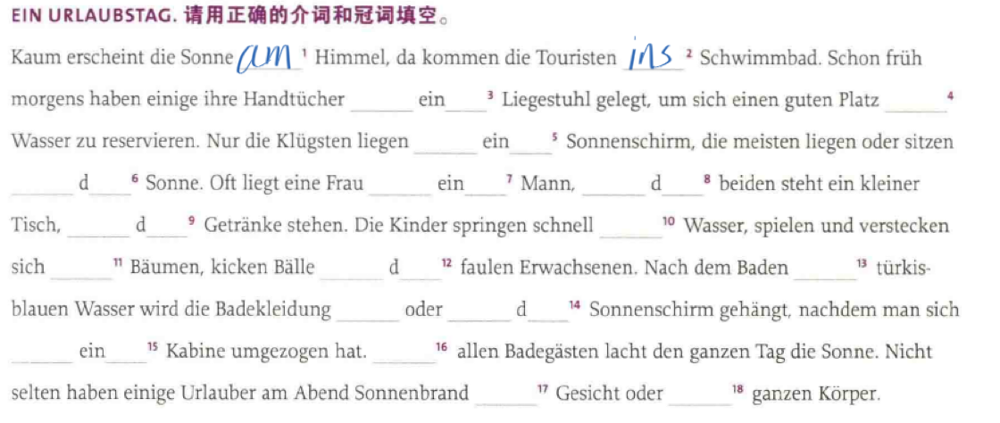

深度思考，

好的，我们先完成翻译，然后逐题讲解错误习题的解析。

---

### 一、全文翻译

**EIN URLAUBSTAG — 一个度假日**

太阳刚出现在**天空中**（¹），游客们就来到了**游泳池**（²）。一大早，一些人就已经把他们的毛巾放在了**一张**（³）躺椅上，以便在**水边**（⁴）占一个好位置。只有最聪明的人躺在**一把**（⁵）遮阳伞**下面**，大多数人则坐着或躺在**阳光下**（⁶）。常常是一位女士躺在**一位**（⁷）男士**旁边**，**两人**（⁸）**之间**放着一张小桌子，**上面**（⁹）放着饮料。孩子们很快跳进**水里**（¹⁰），玩耍着，躲在**树**（¹¹）**之间**，把球踢到懒洋洋的大人**周围**（¹²）。在绿松石蓝色的水里游完泳后，泳衣被**脱下**（¹³）或挂在遮阳伞**下面**（¹⁴），之后在**一间**（¹⁵）更衣室里换好衣服。**在**所有浴场客人**上方**（¹⁶），太阳整天都在欢笑。到了晚上，不少度假者的**脸上**（¹⁷）或**全身**（¹⁸）都被晒伤了。

---

### 二、逐题错误习题解析

> **类比**（仅用于直觉）：德语介词 + 冠词的选择，就像给一个动作配上"导航指令"——你不仅要告诉别人"往哪儿走"（介词），还要说清楚"是哪个目标"（冠词+格）。英语里 in/on/at 后面直接加名词就行，德语却要求你同时标记"目的地是男是女是中"以及"是静止还是移动"。

---

#### ① am Himmel

- **正确形式**：`am` = `an` + `dem`（an dem Himmel）
- **为什么用 an**：表示"在天边/在天际出现"，德语习惯用 `an` + Dativ 表达"在……边缘/表面"。
- **为什么用 Dativ**：动词 `erscheinen`（出现）是静态位置（在哪里出现），不是方向，所以用第三格。
- **常见错误**：误用 `im Himmel`（在天空里面），那是指"在天堂里"或"在天空内部"。

---

#### ② ins Schwimmbad

- **正确形式**：`ins` = `in` + `das`（in das Schwimmbad）
- **为什么用 in**：进入一个封闭/有边界的场所（游泳池区域）。
- **为什么用 Akkusativ**：动词 `kommen` 这里表示方向（来到……里去），是动态位移 → 第四格。
- **常见错误**：误用 `im Schwimmbad`（在游泳池里），那是静态位置，表示"已经在里面"。

---

#### ③ auf einen Liegestuhl

- **正确形式**：`auf` + `einen`（Akkusativ）
- **为什么用 auf**：物品放在一个水平支撑面上（躺椅的表面）。
- **为什么用 Akkusativ**：动词 `legen`（平放）是及物动词，表示"把……放到……上"，方向性动作 → 第四格。
- **常见错误**：误用 `auf einem Liegestuhl`（Dativ），那表示"已经在躺椅上放着"，但这里动作是"放上去"。

---

#### ④ am Wasser

- **正确形式**：`am` = `an` + `dem`（an dem Wasser）
- **为什么用 an**：表示"紧邻水边/在水畔"，不是在水里面。
- **为什么用 Dativ**：`reservieren` 后面地点是静态位置（在哪里预留位置）→ 第三格。
- **常见错误**：误用 `im Wasser`（在水里），那就变成在水里面占位置了。

---

#### ⑤ unter einem Sonnenschirm

- **正确形式**：`unter` + `einem`（Dativ）
- **为什么用 unter**：在遮阳伞的遮盖之下。
- **为什么用 Dativ**：动词 `liegen`（躺）是静态位置动词 → 第三格。
- **常见错误**：误用 `unter einen Sonnenschirm`（Akkusativ），那表示"躺到伞下面去"（动态方向）。

---

#### ⑥ in der Sonne → 原文 `im Sonne` 有误

- **原文问题**：`im Sonne` 语法错误，`Sonne` 是阴性名词（die Sonne），`im` = `in dem` 只能用于阳性/中性。
- **正确形式**：`in der Sonne`（Dativ）
- **为什么用 in**：被阳光包围/沐浴在阳光中。
- **为什么用 Dativ**：`sitzen / liegen` 是静态位置 → 第三格。
- **常见错误**：混淆名词词性，把阴性当成中性。

---

#### ⑦ neben einem Mann

- **正确形式**：`neben` + `einem`（Dativ）
- **为什么用 neben**：表示"在……旁边"。
- **为什么用 Dativ**：`liegen` 静态位置 → 第三格。
- **常见错误**：误用 `neben einen Mann`（Akkusativ），那表示"躺到一个男人旁边去"。

---

#### ⑧ zwischen beiden

- **正确形式**：`zwischen` + `beiden`（Dativ）
- **为什么用 zwischen**：在两者之间。
- **为什么用 Dativ**：`steht`（立着/放着）是静态位置 → 第三格。
- **注意**：`beiden` 前面不加冠词，因为 `beide` 本身已经指代明确（那两个人）。

---

#### ⑨ wo Getränke stehen → 原文可能误写为介词

- **原文分析**：原填空处可能被误认为是介词填空，但这里 `wo` 是关系副词，引导定语从句，修饰 `ein kleiner Tisch`，表示"桌子上（在那里）放着饮料"。
- **为什么不用介词**：德语中 `wo` 可以替代 `auf dem / auf welchem`，在口语和非正式书面语中很常见。
- **若用介词**：正式写法是 `auf dem Getränke stehen`。

---

#### ⑩ ins Wasser

- **正确形式**：`ins` = `in` + `das`（in das Wasser）
- **为什么用 in**：进入水中。
- **为什么用 Akkusativ**：`springen`（跳）是方向性动作 → 第四格。
- **常见错误**：误用 `im Wasser springen`（在水里跳），那是已经在水中做跳跃动作。

---

#### ⑪ zwischen Bäumen

- **正确形式**：`zwischen` + `Bäumen`（Dativ，无冠词复数）
- **为什么用 zwischen**：在多棵树之间。
- **为什么用 Dativ**：`sich verstecken` 这里表示"藏在……之间"的状态位置 → 第三格。
- **注意**：复数无冠词时，`zwischen` 直接加 Dativ 复数名词。

---

#### ⑫ um die faulen Erwachsenen → 原文 `um faulen Erwachsenen` 缺冠词

- **原文问题**：`um faulen Erwachsenen` 缺少冠词，且 `faulen` 的词尾暗示有冠词。
- **正确形式**：`um die faulen Erwachsenen`（Akkusativ）
- **为什么用 um**：表示"在……周围"（球踢到大人身边/周围）。
- **为什么用 Akkusativ**：`um` 在表示空间"围绕"时固定支配第四格。
- **常见错误**：遗漏冠词，或误用 Dativ。

---

#### ⑬ abgetan → 原文 `abgetan` 可能是 `abgetan` / `abgelegt`

- **分析**：`abgetan` 来自 `abtun`（脱下），在语境中表示"泳衣被脱下"。这不是介词填空，而是动词的过去分词。
- **注意**：`abtun` 在此用法较口语化，更常用的是 `ablegen` 或 `ausziehen`。

---

#### ⑭ unter dem Sonnenschirm → 原文 `unter Sonnenschirm` 缺冠词

- **原文问题**：`unter Sonnenschirm` 缺少冠词。
- **正确形式**：`unter dem Sonnenschirm`（Dativ）
- **为什么用 Dativ**：`hängen`（挂着）是静态位置 → 第三格。
- **常见错误**：遗漏定冠词。

---

#### ⑮ in einer Kabine

- **正确形式**：`in` + `einer`（Dativ）
- **为什么用 in**：在更衣室内部。
- **为什么用 Dativ**：`sich umziehen`（换衣服）是反身动词，地点说明用 Dativ 表示"在哪里换"。
- **常见错误**：误用 `in eine Kabine`（Akkusativ），那表示"走进更衣室"，但这里强调"在里面换衣服"。

---

#### ⑯ Über allen Badegästen

- **正确形式**：`über` + `allen`（Dativ）
- **为什么用 über**：太阳在所有人上方。
- **为什么用 Dativ**：`lachen` 这里搭配静态位置（在……上方笑）→ 第三格。
- **常见错误**：误用 Akkusativ，但这里没有方向性移动。

---

#### ⑰ am Gesicht → 原文 `an Gesicht` 缺冠词

- **原文问题**：`an Gesicht` 缺少冠词。
- **正确形式**：`am Gesicht` = `an` + `dem`（Dativ）
- **为什么用 an**：晒伤在脸部表面。
- **为什么用 Dativ**：静态位置（在哪里有晒伤）→ 第三格。

---

#### ⑱ über den ganzen Körper → 原文 `über ganzen Körper` 缺冠词

- **原文问题**：`über ganzen Körper` 缺少冠词。
- **正确形式**：`über den ganzen Körper`（Akkusativ）
- **为什么用 über**：晒伤遍布全身（覆盖整个身体表面）。
- **为什么用 Akkusativ**：`über` 在表示"遍及/覆盖整个范围"时支配第四格。
- **常见错误**：遗漏冠词，或误用 Dativ。

---

### 三、核心语法总结

| 介词 | 支配格（静态/动态） | 典型场景 |
|------|---------------------|----------|
| `an` | Dativ（静态）/ Akkusativ（动态） | 在……旁边/边缘/表面 |
| `auf` | Dativ（静态）/ Akkusativ（动态） | 在……上面（水平面） |
| `in` | Dativ（静态）/ Akkusativ（动态） | 在……里面 |
| `unter` | Dativ（静态）/ Akkusativ（动态） | 在……下面 |
| `neben` | Dativ（静态）/ Akkusativ（动态） | 在……旁边 |
| `zwischen` | Dativ（静态）/ Akkusativ（动态） | 在……之间 |
| `über` | Dativ（静态）/ Akkusativ（动态/覆盖） | 在……上方/遍及 |
| `um` | **固定 Akkusativ** | 围绕/在……周围 |

> **记忆口诀**：an/auf/in/unter/neben/zwischen/über = "九大双向介词"，静态用三格，动态用四格；um 是"顽固派"，永远只要第四格。

# {{翻译}}; {{讲解与解析 [讲解+类比]}}; {{德语代词的核心概念}}; {{形式化定义与边界条件}}; {{错误习题解析 [结构化总结]}}; {{练习分析框架}}; {{1. 名词识别与属性分析}}; {{2. 句子结构与语法分析}}; {{3. 典型错误与反例}}; {{4. 完整答案}}; {{5. 学习要点总结}} [](marginnote4app://note/50C5B2F7-2518-4768-95B4-6CE3358BFB41)

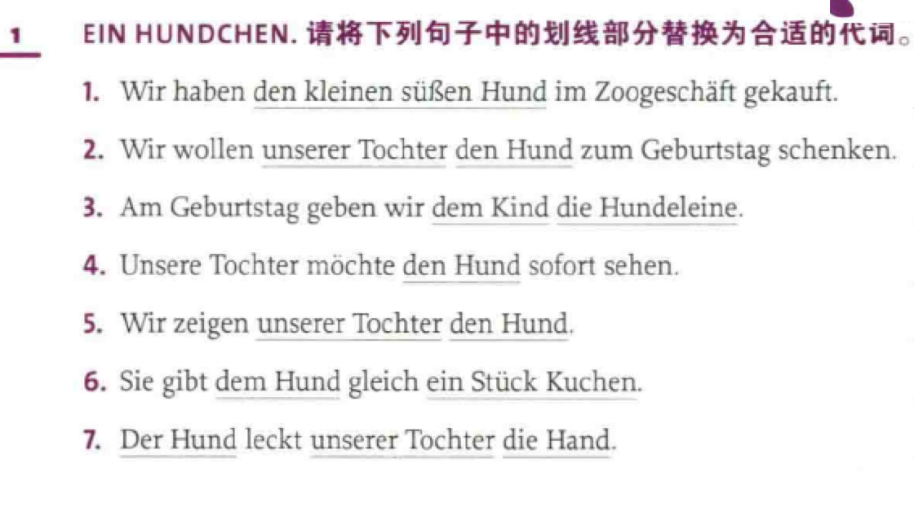

我来帮您翻译这个德语练习，并详细讲解所有错误习题的解析。

### 翻译
**练习：请将下列句子中的划线部分"EIN HUND"替换为合适的代词。**

1. 我们在宠物店买了这只可爱的小狗。
2. 我们想送给我们女儿这只狗作为生日礼物。
3. 生日那天，我们把狗绳交给孩子。
4. 我们的女儿想立刻看到这只狗。
5. 我们给女儿看这只狗。
6. 她立刻给了狗一块蛋糕。
7. 狗舔了我们女儿的手。

---

### 讲解与解析 [讲解+类比]

#### 德语代词的核心概念

**类比仅用于直觉**：想象德语中的名词就像有"身份证"一样，每个名词都有固定的"性别"（阳性、阴性、中性）和"格"（主格、宾格、与格、属格）。代词就像这个"身份证"的复印件，必须完全匹配原件的性别和格。

#### 形式化定义与边界条件

**德语代词系统**：
1. **人称代词**：ich, du, er, sie, es, wir, ihr, sie, Sie
2. **指示代词**：dieser, diese, dieses, diese (这个/这些)
3. **关系代词**：der, die, das, die (引导定语从句)
4. **物主代词**：mein, dein, sein, ihr, unser, euer, ihr, Ihr

**关键规则**：
- 代词必须与所替代名词的**性、数、格**一致
- 在句中保持相同的语法功能

**边界条件**：
- 当名词是复数时，无论原性别如何，代词都用复数形式
- 在从句中，代词位置可能发生变化

---

### 错误习题解析 [结构化总结]

#### 练习分析框架

##### 1. 名词识别与属性分析
- **Hund**（狗）：阳性名词，单数
- 需要替换为合适的**阳性单数代词**

##### 2. 句子结构与语法分析

**第1句**：Wir haben den kleinen süßen Hund im Zoogeschäft gekauft.
- 结构：主语(Wir) + 动词(haben) + 宾语(den Hund) + 地点状语(im Zoogeschäft) + 分词(gekauft)
- **Hund**在句中作**第四格（宾格）宾语**
- 正确代词：**ihn**（阳性单数第四格）

**第2句**：Wir wollen unserer Tochter den Hund zum Geburtstag schenken.
- **Hund**作**第四格（直接宾语）**
- 正确代词：**ihn**（阳性单数第四格）

**第3句**：Am Geburtstag geben wir dem Kind die Hundeleine.
- **Hund**在"Hundeleine"中作为复合词的一部分
- 注意：这里不是直接替换"Hund"，而是理解"Hundeleine"（狗绳）的结构

**第4句**：Unsere Tochter möchte den Hund sofort sehen.
- **Hund**作**第四格宾语**
- 正确代词：**ihn**

**第5句**：Wir zeigen unserer Tochter den Hund.
- **Hund**作**第四格宾语**
- 正确代词：**ihn**

**第6句**：Sie gibt dem Hund gleich ein Stück Kuchen.
- **Hund**作**第三格（与格）宾语**
- 正确代词：**ihm**（阳性单数第三格）

**第7句**：Der Hund leckt unserer Tochter die Hand.
- **Hund**作**第一格（主格）主语**
- 正确代词：**er**（阳性单数第一格）

#### 3. 典型错误与反例

**反例1：性别错误**
- 错误：用**sie**（她/它-阴性）代替**Hund**
- 原因：Hund是阳性名词，必须用阳性代词

**反例2：格错误**
- 错误：在第6句用**ihn**代替**ihm**
- 原因：第6句中Hund是第三格（接受者），不是第四格

**反例3：数错误**
- 错误：用**sie**（他们-复数）代替单数Hund
- 原因：Hund是单数，必须用单数代词

#### 4. 完整答案

1. **ihn** (Wir haben ihn im Zoogeschäft gekauft.)
2. **ihn** (Wir wollen unserer Tochter ihn zum Geburtstag schenken.)
3. 无需替换（Hund在复合词中）
4. **ihn** (Unsere Tochter möchte ihn sofort sehen.)
5. **ihn** (Wir zeigen unserer Tochter ihn.)
6. **ihm** (Sie gibt ihm gleich ein Stück Kuchen.)
7. **er** (Er leckt unserer Tochter die Hand.)

#### 5. 学习要点总结

1. **先识别名词属性**：性（阳性/阴性/中性）、数（单数/复数）
2. **再分析语法功能**：主格（第一格）、宾格（第四格）、与格（第三格）
3. **最后选择对应代词**：确保性、数、格完全匹配
4. **注意特殊句型**：如geben（给）需要双宾语（第三格+第四格）

这个练习很好地展示了德语代词系统的严谨性，每个代词的选择都必须基于精确的语法分析。

# 德语语法活学活用(B2-C1)([德]弗里德里克·金[德]乌特·福斯) [](marginnote4app://note/B1BD8430-CF51-414F-BD50-C0BDD1860E3E)

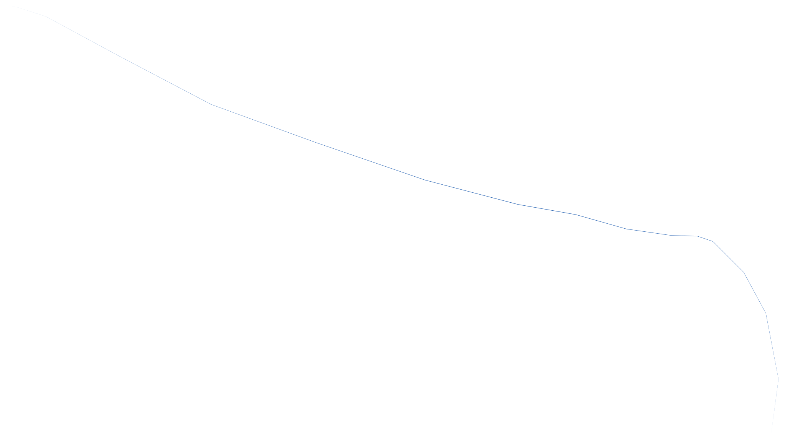

## 第一部分：书籍介绍与目录 [](marginnote4app://note/2F1C9505-3C44-4023-91A8-2E735FE300E3)

### Grammatik aktiv [](marginnote4app://note/BEC1AEBA-FC94-4405-B154-50FEBDCFEAD5)

### 德语语法活学活用（B2 - C1） [](marginnote4app://note/82CB8C11-0F54-4165-808B-93BB39F17957)

### 图书在版编目（CIP）数据 [](marginnote4app://note/0CF295BD-FECA-4B62-A96C-A44D17BAFBB9)

### 致读者的信 [](marginnote4app://note/205445EA-0354-4025-9878-EF69020C9858)

### 目录 [](marginnote4app://note/32BCF808-7BAB-4F19-B9FA-841F8AD41FB9)

## 第二部分：语序学习 [](marginnote4app://note/D038A65A-BC1D-44B6-908C-AF0AAD4FB418)

### 简单句中的动词位置 [](marginnote4app://note/55616A9D-4976-4F5C-AC4D-8FBD787030C0)

### 复杂句和从句中动词的位置 [](marginnote4app://note/6D133DAC-53F2-4DE3-8122-51908263EB31)

### 第三格宾语和第四格宾语的位置 [](marginnote4app://note/6B98F965-5ADB-41BC-9E23-0DC071EB77F4)

### 说明语的位置 [](marginnote4app://note/D6D8735D-C265-4451-BADE-D37D69E0E09E)

### 动词的固定搭配 [](marginnote4app://note/18A309E0-7EAF-4539-803A-5E65FF633460)

### nicht的位置 [](marginnote4app://note/9C2F1DC7-158A-46A0-88ED-B47F13B08DD0)

### auch及其他焦点小品词的位置 [](marginnote4app://note/D89E55A6-B2FB-4617-8F1C-9AE3C9C8AB8C)

### 各类信息在句中的位置 [](marginnote4app://note/27443E31-14A3-4584-B730-290DFF2F3A1C)

### 会话练习1：语序 [](marginnote4app://note/7E03BF15-CBB2-49B1-8B24-05E1B6887065)

## 第三部分：第二虚拟式 [](marginnote4app://note/2B891F47-DAC7-4484-90D9-4F9D10156752)

### 第二虚拟式现在时 [](marginnote4app://note/8DE16F57-8AB6-4524-9BF3-91639B5C13DF)

### 第二虚拟式过去时 [](marginnote4app://note/E33937EA-7D75-422B-A38D-159119C47EB6)

### 礼貌、提议、劝告、谴责 [](marginnote4app://note/95F73DC7-05F6-4F1F-A0D9-34E102A59E51)

### 愿望、非现实愿望、非现实条件 [](marginnote4app://note/83999341-D03C-4139-AD3C-12C7F102619B)

### 非现实比较和非现实结果 [](marginnote4app://note/84C79AA2-F7EA-4169-AD54-197B473F6F13)

### 会话练习2：现在和过去的非现实条件 [](marginnote4app://note/9EDE1224-511C-4D80-BF8D-3A884743F8C2)

## 第四部分：被动态 [](marginnote4app://note/7DF05F82-BC97-4413-B3B1-CA3D0F863251)

### 被动态：时态 [](marginnote4app://note/3B11F35E-875F-4CD4-8E65-27103A8A0F29)

### 带情态动词的被动态：时态 [](marginnote4app://note/BCE514E5-93C1-45FE-8654-8EDC7D5B92A3)

### 表被动的其他形式1 [](marginnote4app://note/D8A2B17C-924D-4560-8119-9447638D793A)

### 表被动的其他形式2 [](marginnote4app://note/875CAF39-B19C-4E7E-BA4D-EED1B73595FD)

### 无人称被动态 [](marginnote4app://note/D9775032-1CCE-4742-A8AA-13AB9A7DA83B)

### 什么时候可以用被动态，什么时候不行？ [](marginnote4app://note/4E2ED2EF-9026-463C-8D7B-C826081E7D1C)

### 会话练习3：被动态 [](marginnote4app://note/CEA67745-979B-4539-B733-0E23C94055F9)

## 第五部分：介词用法 [](marginnote4app://note/DCBCD4F6-DF99-431A-8BBE-6DE1B3D1CD8B)

### 可支配第三格或第四格的介词 [](marginnote4app://note/CAD94874-D2E4-4B12-9080-8C66C5E26AA9)

### 常见表方位的介词 [](marginnote4app://note/41A8AE7F-DBC8-4DC1-8CD7-393145933A8A)

### 其他表方位的介词 [](marginnote4app://note/8647DD63-E2EF-477C-B80C-5EEDD2A4B673)

### 常见表时间的介词 [](marginnote4app://note/7C25FB02-95CF-44AB-9592-D67D21DD3164)

### 其他表时间的介词 [](marginnote4app://note/726CDC6B-279A-4AE4-A413-B50C8360E2AD)

### 表因果的介词 [](marginnote4app://note/16A48398-B5D5-42E1-B7BE-921F714E3B08)

### 表信息来源的介词 [](marginnote4app://note/D078EEB9-A914-40D2-8CB3-B274DD43A3A8)

### 介词的位置 [](marginnote4app://note/17B3A35C-5EE5-4E3A-9912-0064CA60EEF1)

### “见字知义”的介词 [](marginnote4app://note/AC38F981-7913-4C36-9B28-E3034A399C5A)

### in, an, auf, über, unter, vor的意义 [](marginnote4app://note/88387511-0133-4CB3-AD69-911F88891E59)

### um, bei, von, nach, aus, mit, zu的意义 [](marginnote4app://note/BC2C1281-B591-495E-AE86-A2FF1778AAAF)

### 会话练习4：介词游戏：5格成行 [](marginnote4app://note/DEB4DE55-2E93-45C1-A82C-60C8AFD5131B)

## 第六部分：动词、名词、形容词相关 [](marginnote4app://note/983F2481-BB81-4C7F-B276-A1E38136BC17)

### 支配第一格、第四格和第三格的动词 [](marginnote4app://note/D6080A06-7614-4AC2-870E-20A1B667CAE2)

### 支配第二格宾语的动词 [](marginnote4app://note/1172D5B2-78E4-4DB7-B568-6841C1B8B872)

### 动词、名词、形容词与介词的搭配 [](marginnote4app://note/13B766F5-728A-4718-8E28-ADBB3D9FB30A)

### 动词、形容词、名词与支配第四格宾语的介词的固定搭配 [](marginnote4app://note/7DDC038B-9604-4344-B0C1-853497D32DEE)

### 动词、形容词、名词与支配第三格宾语的介词的固定搭配 [](marginnote4app://note/5704F6FA-0180-4E41-843A-4AD6B5C382F2)

### 现在完成时、过去时和过去完成时的构成 [](marginnote4app://note/073E7C0F-B6C1-432B-9DCE-39A26CB1F96E)

### 完成时的特殊形式：情态动词，sehen, hören, lassen [](marginnote4app://note/7C3166A8-8E1C-4F82-8E6E-656643E009F9)

### 现在完成时、过去时和过去完成时的用法 [](marginnote4app://note/37473312-72D5-4F5B-98E5-31CB63350031)

### 将来时：表未来及推测 [](marginnote4app://note/B1FC5829-44D0-4721-9218-EBAD9ED3C090)

### 时态总结 [](marginnote4app://note/34932536-2DB4-4DB1-B9E3-47F5FB6D5A01)

### 会话练习5：时态 [](marginnote4app://note/0D91FA3F-3185-4B69-8945-41BEA42E3160)

## 第七部分：情态动词、lassen及可分/不可分动词 [](marginnote4app://note/C6066982-3DA5-49F5-9D42-D44BA39D1A51)

### 情态动词的基本意义 [](marginnote4app://note/B7CD0A49-2C59-43B3-8076-C5BEFD912CF9)

### 情态动词的其他意义：对现在的推测 [](marginnote4app://note/7B9518B9-C546-4632-9925-7338532711E8)

### 情态动词的其他意义：对过去的推测 [](marginnote4app://note/76969453-4814-4051-9C4F-928C26E2D038)

### 动词lassen [](marginnote4app://note/3AB6B0F1-88E6-4DA6-A601-0C91B9B52CF4)

### 可分动词与不可分动词1 [](marginnote4app://note/68553FB7-44D8-46F4-92A8-06CA2B3FA096)

### 可分动词与不可分动词2 [](marginnote4app://note/7C2B8114-D5F0-42EC-9699-F809E1282042)

## 第八部分：名词、冠词和代词 [](marginnote4app://note/7750E877-4685-4895-8F38-183B05FAB4B6)

### 名词的性的规律 [](marginnote4app://note/84069790-2928-4645-80F4-DD4C1A01F374)

### 冠词的用法 [](marginnote4app://note/BB412E6F-7586-4DE4-AFA0-924BED1B021A)

### 第二格 [](marginnote4app://note/5FB5CCD4-BAA4-4BA3-81A9-F1CF1CFC8B1E)

### 阳性弱变化名词 [](marginnote4app://note/9EED24EE-03BE-463D-AC42-D826831AF09D)

### 三种名词变格形式 [](marginnote4app://note/E7F1BE1B-EC4C-4316-ACDE-1A2008093755)

### 不定代词和物主代词的变格形式 [](marginnote4app://note/4E62946C-2EFA-47FF-8F77-A48D83F9C716)

### 指人的不定代词 [](marginnote4app://note/81B5319C-9632-467D-9F75-ED9216225BF1)

### 指人或物的不定代词 [](marginnote4app://note/0F6B6627-E580-44EA-A818-95705C20AEFF)

### 会话练习6：变格 [](marginnote4app://note/9F1219A2-1BFA-4A79-8F18-B8AEC3D85394)

## 第九部分：形容词 [](marginnote4app://note/38103885-159D-4053-B132-615839C39D8F)

### 形容词词尾 [](marginnote4app://note/8F1F6025-9AFF-4A3C-8AFE-FD21840841D0)

### 冠词类限定词 [](marginnote4app://note/0E4E6F78-667D-4B4C-8AB5-F081B81F93BA)

### 比较级 [](marginnote4app://note/1664F8DF-C9EF-4AEC-B21C-58F93206CA54)

### 动词的第一分词和第二分词作形容词 [](marginnote4app://note/D7A6A577-38ED-4B3E-B957-71201A4A3706)

### 会话练习7：形容词词尾 [](marginnote4app://note/6336C3A8-6C24-4A89-A729-04B676F28A80)

## 第十部分：转述 [](marginnote4app://note/75FF6D55-9E44-45C4-BFD8-8F46DDEB44E1)

### 间接引语与第一虚拟式 [](marginnote4app://note/D5F2E67D-5209-4862-A45E-47D729D14A2A)

### 第一虚拟式的过去时形式 [](marginnote4app://note/CB7FADEB-E640-4CE3-B037-3C62918B8528)

### 对祈使句、传闻及自述的转述 [](marginnote4app://note/C76A4E2B-48F1-4973-9A9F-5011B295E56C)

## 第十一部分：从句 [](marginnote4app://note/2E9047B0-2C42-4EB6-BD1E-446E2FED8213)

### 时间状语从句 [](marginnote4app://note/280A9B46-72D5-4F06-9525-9433C4134BF5)

### 原因状语从句与让步从句 [](marginnote4app://note/1884A9B6-A0D9-4035-9B89-FFDA71C4CDC8)

### 结果状语从句 [](marginnote4app://note/6088C253-5EF8-4A0E-ACF5-5763D726F050)

### 条件状语从句与转折状语从句 [](marginnote4app://note/2B1CE6DB-CBDB-4951-9551-7537F9B99A35)

### 方式状语从句 [](marginnote4app://note/54FE2B0E-0171-4D49-B0B3-15DD7985E1B4)

### 带zu不定式与不带zu不定式 [](marginnote4app://note/618EE585-89AA-422A-8CF1-A321511D13FF)

### dass从句与带zu不定式 [](marginnote4app://note/0ACC4B22-0790-451B-9049-C6E9A3EF79BD)

### 表目的、表方式的不定式和从句 [](marginnote4app://note/7C3455A8-FE03-4125-85C4-8273269CB29B)

### 关系代词的第一格、第四格、第三格形式 [](marginnote4app://note/9569977C-BAF8-4749-9439-0EBB0C0CC10B)

### 关系代词的第二格形式 [](marginnote4app://note/4F1D1CB4-49AE-43B8-AFC0-62BAD42EF538)

### als和疑问代词作关系代词 [](marginnote4app://note/2107B33A-2BD6-46C7-A62A-C83C58EF39F8)

### 会话练习8：关系从句 [](marginnote4app://note/5A52D608-4C02-41EB-AF15-9E62E10CD9EA)

## 第十二部分：成对连词及其他重要小词 [](marginnote4app://note/55A8C0A7-D466-413C-86A9-21237DF9F474)

### 成对连词 [](marginnote4app://note/F4DDAA65-166B-45B7-857B-DDEEFAE6DA62)

### 表否定的词和词缀 [](marginnote4app://note/EDDCCB3E-9283-4E40-BB68-D4A63CA8CA93)

### Irgend.. [](marginnote4app://note/6AD56F40-459D-418B-938E-8C829D11A147)

### 地点和方向 [](marginnote4app://note/D8CE061C-4832-47A5-8055-D965F6569D8A)

### Es [](marginnote4app://note/6B566F21-673F-4172-A17A-400AE3433C75)

## 第十三部分：功能动词与代副词 [](marginnote4app://note/AD2C08F6-7BAE-4BFC-8BE2-07EDF5DC141C)

### 功能动词1 [](marginnote4app://note/E3C9B79F-CDF5-4E44-BBF2-DD4C5D3F1F04)

### 功能动词2 [](marginnote4app://note/6052F085-C053-4FB1-8561-9C248E9C01D6)

### da - 构成的代副词 [](marginnote4app://note/006DEC40-E74A-4901-911A-C7D680FE4851)

## 第十四部分：小品词、名词化与定语 [](marginnote4app://note/435B0487-253B-4CEC-92F8-F31F44F61FCB)

### 小品词 [](marginnote4app://note/EA8CFCBD-80AC-41D4-A02A-D8BF826E9AFA)

### 名词化 [](marginnote4app://note/D40F0C31-4D8D-4187-AE7A-1D2529779DE2)

### 前置定语和后置定语 [](marginnote4app://note/16E94659-E401-44B8-99EA-B82F09AEA648)

## 第十五部分：介词、副词、连词及句型转换 [](marginnote4app://note/AFAB6511-ED98-495A-BB7E-386FF1489D2B)

### 介词 - 副词 - 连词1 [](marginnote4app://note/924E8D1D-AA64-4272-B40B-01717D19908E)

### 介词 - 副词 - 连词2 [](marginnote4app://note/4FAB3329-FB97-49BB-9ACA-A28B0FF799D1)

### 介词 - 副词 - 连词3 [](marginnote4app://note/F15234A7-DFBE-438F-8FB2-B30846589194)

### 会话练习9：句型转换 [](marginnote4app://note/8CCF43CE-D627-4314-A7F9-348EFC356EFB)

## 第十六部分：逗号规则与口语形式 [](marginnote4app://note/7B4853A3-7193-450B-BEFD-BDDE0A826853)

### 逗号的规则 [](marginnote4app://note/ED7A53EF-DF65-4C64-9521-B92FE3CB5EAE)

### 口语中的特殊形式 [](marginnote4app://note/B7CC4387-2A34-425D-BAE6-2F964EF7717A)

## 第十七部分：听说训练文本及答案 [](marginnote4app://note/4944A990-DADC-4CE2-A7BE-355FD1B2C491)

### 简单句中的动词位置 [](marginnote4app://note/5E743758-9BFE-4E8D-A8D5-034DE826E961)

### 复杂句和从句中动词的位置 [](marginnote4app://note/9A8A2AEC-7E10-49F1-8654-FEE52D41FB3F)

### 第三格宾语和第四格宾语的位置 [](marginnote4app://note/7E73A961-3F97-41CE-8D00-C81CAAF31920)

### 说明语的位置 [](marginnote4app://note/C9B3B431-E0EE-444E-960C-2971C7DB3F35)

### nicht的位置 [](marginnote4app://note/0E6919D2-9BE5-40AE-A44D-E9B6F1A1E051)

### auch及其他焦点小品词的位置 [](marginnote4app://note/E153BE52-C4ED-44A7-918C-8F0269768E3D)

### 礼貌、提议、劝告、谴责 [](marginnote4app://note/D140B743-CDCB-44CA-ACA0-E87CAF5A6AC7)

### 愿望、非现实愿望、非现实条件 [](marginnote4app://note/20ECDEEB-C01E-4F5E-9CFA-9F0A4F83898F)

### 非现实比较和非现实结果 [](marginnote4app://note/2DD9D8F4-E4B8-4364-B74F-F406F96F1589)

### 被动态：时态 [](marginnote4app://note/24BD7384-AA4A-4B03-B6AF-3A962F1552AD)

### 带情态动词的被动态：时态 [](marginnote4app://note/49E75DC6-458B-433A-8CA6-059117D5BC4E)

### 表被动的其他形式1 [](marginnote4app://note/814FEDAF-5CB6-4ED2-A719-E7FDC96C0824)

### 无人称被动态 [](marginnote4app://note/381B380F-8C6C-424A-8FB5-1EA2D4648F74)

### 可支配第三格或第四格的介词 [](marginnote4app://note/F52669DE-B33E-477C-9039-FE963C51B3DA)

### 动词、名词、形容词与介词的搭配 [](marginnote4app://note/0636B2EF-75CD-47E6-9C1B-5CB6F11DF474)

### 动词、形容词、名词与介词的固定搭配 [](marginnote4app://note/9B8FFBF0-4C2E-4A7E-9BAA-878321CDBA63)

### 将来时：表未来及推测 [](marginnote4app://note/5FE8B62D-6AFC-4DC4-B39A-CFE91C98CB7F)

### 不定代词和物主代词的变格形式 [](marginnote4app://note/DAF4AC0B-B999-4909-8891-C0D3DB9B6EA3)

### 形容词词尾 [](marginnote4app://note/5D9CBC6F-1F23-41BD-BB8F-137A25DF761C)

### 比较级 [](marginnote4app://note/E84B9EEC-FE5F-4C06-80A1-505CFB55F068)

### 对祈使句、传闻及自述的转述 [](marginnote4app://note/03620CFD-FD63-4E20-BC0F-B48B432EA30D)

### 关系代词的第一格、第四格、第三格形式 [](marginnote4app://note/4D88A238-4098-4E46-89A0-278FD525F687)

### als和疑问代词作关系代词 [](marginnote4app://note/9EF0B0AF-D831-4AE9-B72F-614986EBDD2D)

### 成对连词 [](marginnote4app://note/2B6A7E51-ACEF-49C8-BEAA-1B6269D62AB4)

### 表否定的词和词缀 [](marginnote4app://note/B8CBE163-D273-4234-8DEA-8F1BACE52885)

### 地点和方向 [](marginnote4app://note/A3077031-8C37-4437-8693-1B5BB210867E)

### Es [](marginnote4app://note/85DEE7A2-CACE-412A-82AC-EF4054C3B811)

### 功能动词1 [](marginnote4app://note/E0FB297B-1284-4D27-A2E9-7B8DC9C8B4AD)

### da - 构成的代副词 [](marginnote4app://note/13C93716-B316-4823-A628-4327D855EA01)

## 第十八部分：语序框架与查考表 [](marginnote4app://note/36537FAB-59DB-418E-8321-E19F4D2E0DAB)

### 表格; 动词 形容词、名词与介词的搭配（按介词排序） [](marginnote4app://note/DAA27315-D860-44C7-8BA2-B875E62394EB)

### 查考表：动词、形容词、名词与介词的搭配（按字母排序） [](marginnote4app://note/4E3944A6-68D8-4C85-8952-D74AE47915DA)

### 动词和形容词支配的宾语的格 [](marginnote4app://note/B6093AC7-464B-4738-B69E-7F5977E8D98F)

### 查考表：不规则动词（按元音变化排序） [](marginnote4app://note/98E197FC-BE64-411D-BD19-3C9F512F8DEC)

### 查考表：不规则动词（按动词排序） [](marginnote4app://note/1CF6A1FE-B012-43B1-9B48-2C0C44B9B840)

## 第十九部分：参考答案 [](marginnote4app://note/6788A591-28F6-42FB-B2BD-BAB8ED0E3B89)

### 简单句中的动词位置 [](marginnote4app://note/3AFF64F2-1045-4B97-86D1-1470828ECBBC)

### 复杂句和从句中动词的位置 [](marginnote4app://note/34D0F2FE-1A9F-491D-B7A7-912E74C52B94)

### 第三格宾语和第四格宾语的位置 [](marginnote4app://note/B7992A7B-4971-401E-8CB0-7B2C2E019D17)

### 说明语的位置 [](marginnote4app://note/5FF54DB9-C62E-443D-8D9D-C0EAB8E2E421)

### 动词的固定搭配 [](marginnote4app://note/889BDAA1-A92E-4221-BE4C-F71458187D9B)

### nicht的位置 [](marginnote4app://note/F6E6ED4E-4AA5-4823-A58E-6C36E41CF81C)

### auch及其他焦点小品词的位置 [](marginnote4app://note/0E10D51A-A324-4DFA-A58A-BF2465FE3DDD)

### 各类信息在句中的位置 [](marginnote4app://note/E69A897A-4E78-41C5-9CF2-8FE4E597E969)

### 第二虚拟式现在时 [](marginnote4app://note/2C6D00F4-79FB-4DA5-833E-846E6BAC947D)

### 第二虚拟式过去时 [](marginnote4app://note/A41729C8-2175-453A-8A2C-DE0D3DA57F91)

### 礼貌、提议、劝告、谴责 [](marginnote4app://note/12222E05-2ADA-477E-967E-F8823F5E7261)

### 愿望、非现实愿望、非现实条件 [](marginnote4app://note/51E1BBE8-BAE1-4044-99BB-F33F6DD47544)

### 非现实比较和非现实结果 [](marginnote4app://note/AF863C16-572E-4924-8646-9B0B7895D75A)

### 被动态：时态 [](marginnote4app://note/3CD345AF-9701-44DB-81C8-1DD590B51905)

### 带情态动词的被动态：时态 [](marginnote4app://note/CDB875F8-7B43-47FE-9B71-D3BB7F6B9B98)

### 表被动的其他形式1 [](marginnote4app://note/3CAFE76F-9865-4C80-A26C-437480942A86)

### 表被动的其他形式2 [](marginnote4app://note/A41EFB12-F796-4A31-8178-5F80959510B5)

### 无人称被动态 [](marginnote4app://note/57D53C43-D0B7-4794-B613-29BC475F3815)

### 什么时候可以用被动态，什么时候不行？ [](marginnote4app://note/527C9311-7A40-4949-B161-8260848094E2)

### 可支配第三格或第四格的介词 [](marginnote4app://note/9F8E4E9A-1CC9-420C-8DA9-F5CCF49839D4)

### 常见表方位的介词 [](marginnote4app://note/1B243410-AC1F-40D8-A1D7-AE6FED63076C)

### 其他表方位的介词 [](marginnote4app://note/9767A2C9-2BC9-4714-AE10-30CAF6E0FC2F)

### 常见表时间的介词 [](marginnote4app://note/53B0F4C6-3101-44B3-9BA9-021182AC4D09)

### 其他表时间的介词 [](marginnote4app://note/916A9273-C586-4BAF-8374-A228F4FD85EE)

### 表因果的介词 [](marginnote4app://note/FC8F09EE-8D07-4FC0-8B35-489FF7A0E434)

### 表信息来源的介词 [](marginnote4app://note/5339BB44-5E6D-4326-9469-CCBF4590B0A8)

### 介词的位置 [](marginnote4app://note/662D30E0-4DC5-4263-93F0-FD8B6D6B729F)

### “见字知义”的介词 [](marginnote4app://note/F1340D2B-869E-4587-ABE9-19B1742F6EE0)

### in, an, auf, über, unter, vor的意义 [](marginnote4app://note/DAE8F2AF-7A98-4917-916A-40F5ADD3AEBD)

### um, bei, von, nach, aus, mit, zu的意义 [](marginnote4app://note/68387DB7-CCD6-4118-B1D7-6E61C741E217)

### 支配第一格、第四格和第三格的动词 [](marginnote4app://note/FDC0A18F-20D8-4DF3-B1B9-ADC041F9F747)

### 支配第二格宾语的动词 [](marginnote4app://note/4F288817-4A09-4E69-8E71-6678AD068E8C)

### 动词、名词、形容词与介词的搭配 [](marginnote4app://note/4D77C9BA-7E82-4A12-AA70-229372A45CE4)

### 动词、形容词、名词与支配第四格宾语的介词的固定搭配 [](marginnote4app://note/953001DD-0E72-4A3D-8AA2-9BACEAC3993F)

### 动词、形容词、名词与支配第三格宾语的介词的固定搭配 [](marginnote4app://note/622E9F48-4D6C-4349-A900-FDE559C18905)

### 现在完成时、过去时和过去完成时的构成 [](marginnote4app://note/D474E47A-EC5D-4370-B892-5FE5FF39978B)

### 完成时的特殊形式：情态动词，sehen, hören, lassen [](marginnote4app://note/7572E2AA-E0EF-4822-9287-DF8D3449A410)

### 现在完成时、过去时和过去完成时的用法 [](marginnote4app://note/CCF9B3D6-2757-4A56-B7E8-90C94AF1E592)

### 将来时：表未来及推测 [](marginnote4app://note/491BED51-50B3-45BA-A9BF-3DB2360412B4)

### 时态总结 [](marginnote4app://note/B7F83609-B1C7-4FDD-986F-74641714307A)

### 情态动词的基本意义 [](marginnote4app://note/7A254ED7-037A-4C56-BC12-FD8F019F1D76)

### 情态动词的其他意义：对现在的推测 [](marginnote4app://note/7F73B8ED-4FEC-4D2E-9F4F-E41C2FAC6D48)

### 情态动词的其他意义：对过去的推测 [](marginnote4app://note/3772BA17-31E3-40E0-8DEC-500E1F52287B)

### 动词lassen [](marginnote4app://note/1E7F84D2-CBD4-4D70-B568-09A6D7CF5A09)

### 可分动词与不可分动词1 [](marginnote4app://note/40A255EE-4621-4D6C-B5AD-4FC298ABDA53)

### 可分动词与不可分动词2 [](marginnote4app://note/57189E7A-FEDE-473D-BFB7-34D71AA04B01)

### 名词的性的规律 [](marginnote4app://note/73355A0E-5CA8-468B-9B09-EBF4BD09E373)

### 冠词的用法 [](marginnote4app://note/3334EA2B-1E51-4F87-BA91-C1FCC2130880)

### 第二格 [](marginnote4app://note/B17F1FB1-19F8-483B-837F-DC8FD82BBF96)

### 阳性弱变化名词 [](marginnote4app://note/293D328C-AD71-42D3-8D3D-C9C0B012C945)

### 三种名词变格形式 [](marginnote4app://note/970B8E29-371B-438E-96E7-8DE50E84DE62)

### 不定代词和物主代词的变格形式 [](marginnote4app://note/9A590688-F5F1-4329-B0C1-414637DEDB2C)

### 指人的不定代词 [](marginnote4app://note/86BD0D6A-72CC-45B1-A06E-20E4F4A98A5E)

### 指人或物的不定代词 [](marginnote4app://note/0A5F5A90-7A48-4B95-92F1-491D42B59C29)

### 形容词词尾 [](marginnote4app://note/BF686B5D-AE5C-4918-9040-713C72414BC6)

### 冠词类限定词 [](marginnote4app://note/03E845FA-DC40-45B9-B927-376D6C54E808)

### 比较级 [](marginnote4app://note/595B7346-3189-42DC-8008-A39BF4635162)

### 动词的第一分词和第二分词作形容词 [](marginnote4app://note/84328335-976E-489D-82C5-FDCF230DAD57)

### 会话练习7 [](marginnote4app://note/D5A5E6B9-AE0F-4383-B5BF-6087C3539F18)

### 间接引语与第一虚拟式 [](marginnote4app://note/B47E7FF8-E6F3-44E1-A44F-BEC64A345742)

### 第一虚拟式的过去时形式 [](marginnote4app://note/6F385431-1303-469E-BA49-63D9E42F366C)

### 对祈使句、传闻及自述的转述 [](marginnote4app://note/94930C2A-AA58-44FC-A9B4-05D2378567F6)

### 时间状语从句 [](marginnote4app://note/9771BD0A-A351-40D9-80F4-36C7722AC690)

### 原因状语从句与让步从句 [](marginnote4app://note/F06CF36A-4052-443B-90B1-8E3542402108)

### 结果状语从句 [](marginnote4app://note/2973FB99-DD4B-478C-9469-4221E4D107E6)

### 条件状语从句与转折状语从句 [](marginnote4app://note/BDF07D7A-B1CE-414D-B00D-B35420FCC03C)

### 方式状语从句 [](marginnote4app://note/542EEB40-4C3E-44D7-B239-BB16C89F4EAA)

### 带zu不定式与不带zu不定式 [](marginnote4app://note/0F5CFD1B-8833-4449-96CF-0F0C90E72873)

### dass从句与带zu不定式 [](marginnote4app://note/62FBADFA-3A52-4BFB-9325-7724103F04C8)

### 表目的、表方式的不定式和从句 [](marginnote4app://note/50DAC1A5-D06B-463B-93FD-C4055D53DD55)

### 关系代词的第一格、第四格、第三格形式 [](marginnote4app://note/C797CA13-52EE-48DB-B79C-079278420C71)

### 关系代词的第二格形式 [](marginnote4app://note/AAEB7B92-A9BC-4DAB-B25B-AA7F0E403913)

### als和疑问代词作关系代词 [](marginnote4app://note/65947B5A-6C40-4C4D-9968-A95E53C52FD8)

### 会话练习8 [](marginnote4app://note/ADB19C1C-74A2-4AA2-9AD5-989A553D3E10)

### 成对连词 [](marginnote4app://note/BFDF4CF3-D502-4AF0-A91F-9CC5AEFF7F6D)

### 表否定的词和词缀 [](marginnote4app://note/9B304B6E-D535-4791-8D72-28B619FD0A18)

### Irgend.. [](marginnote4app://note/1ED5291E-B191-49FB-9088-B67FB3ABF9F8)

### 地点和方向 [](marginnote4app://note/AD023F3E-4BC7-4E03-8802-6928C5357014)

### 功能动词1 [](marginnote4app://note/19E30FD5-3126-458F-BC37-4A29EBDE5542)

### 功能动词2 [](marginnote4app://note/DC53AE46-9C06-4EBD-9C80-3D6C832BFE59)

### da - 构成的代副词 [](marginnote4app://note/66D98294-7577-4A3D-9090-2FD4B8E2C167)

### 小品词 [](marginnote4app://note/9057B640-4A14-4848-A490-DF48FD937029)

### 名词化 [](marginnote4app://note/3A36D169-5773-47E6-ABC7-5534BC656C70)

### 前置定语和后置定语 [](marginnote4app://note/EF5B823C-DBF2-4CEB-B1DB-9D582529F6C0)

### 介词 - 副词 - 连词1 [](marginnote4app://note/52A73EDF-873F-4B6F-B36C-E4FD5DAF6FBE)

### 介词 - 副词 - 连词2 [](marginnote4app://note/F38DFABB-EF6E-4B48-819C-CD2649001BB3)

### 介词 - 副词 - 连词3 [](marginnote4app://note/9BF3B6E2-C427-44D3-9AB3-C3D19275C905)

### 逗号的规则 [](marginnote4app://note/4345A8BA-D88C-4EDC-9F6F-1DA38D237494)

### 口语中的特殊形式 [](marginnote4app://note/E7F10A5E-8899-47C3-9485-072B21376AD9)

## 第二十部分：索引与资料来源 [](marginnote4app://note/957B87B5-3D2C-4E85-902E-2B351A61C75F)

### 索引 [](marginnote4app://note/C80838C6-B3EE-4123-98ED-08CFE0FE58ED)

### 资料来源 [](marginnote4app://note/D3CA39D9-D649-4D96-A5AD-63255C62F7BB)

# Group [](marginnote4app://note/F89F256A-331D-436B-B7F5-BD6125BC384F)

# Dautsch [](marginnote4app://note/F4CA4E5D-271E-44EC-92C4-1B51A474DFF6)

目录

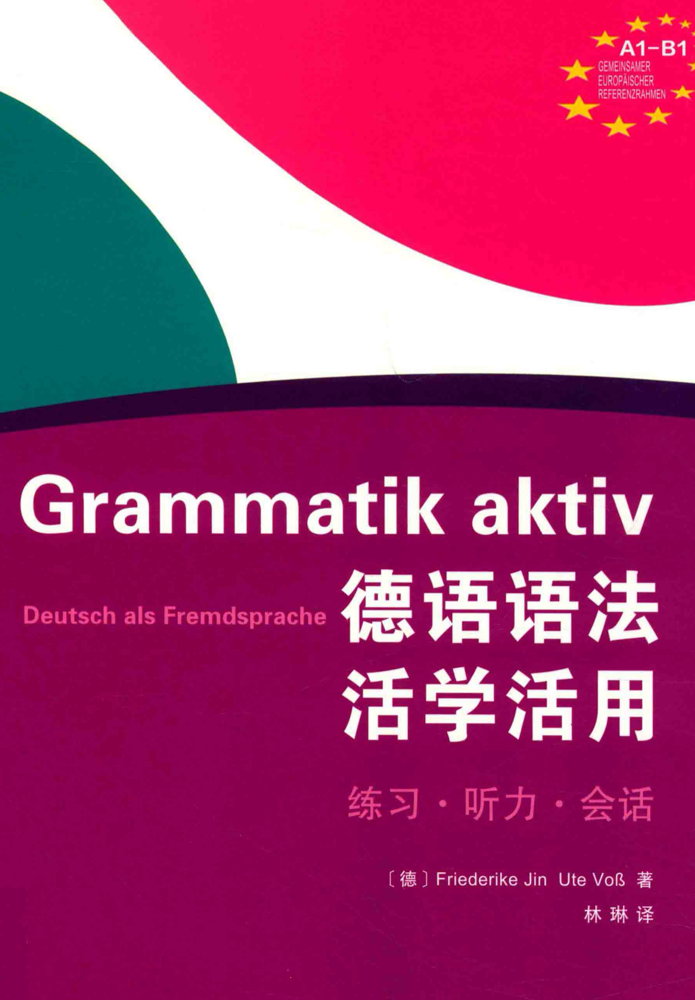

听说训练文本及答案

## 德语语法活学活用 [](marginnote4app://note/C3A29960-7841-4E8A-BF9D-59EF76F73E86)

### marginnote4app://note/17394CCE-93B0-45CC-8D39-5E026FB8C756 [](marginnote4app://note/DB38FBF5-4B0B-49B2-B97A-A32100F4B863)

人称**代词**(Personalpronomen

#### marginnote4app://note/1C9307EA-BFE1-4C63-90FF-A864689742E5 [](marginnote4app://note/C6605DE3-88E8-4353-87D2-DC769615A2C6)

人称代词

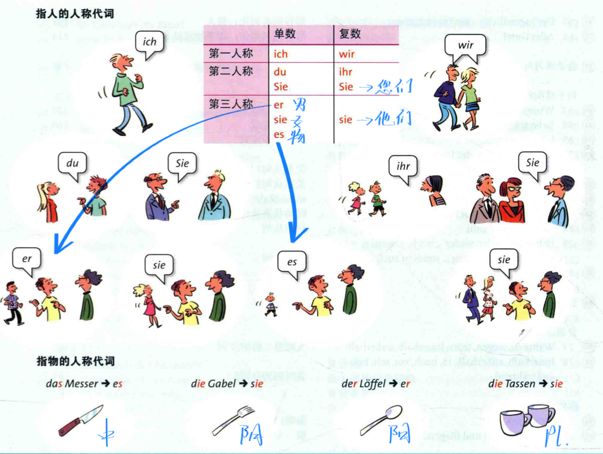

#### 物主代词(Possessivartikel) [](marginnote4app://note/44B4FD43-96DF-4D25-8738-FEC7FF96A06F)

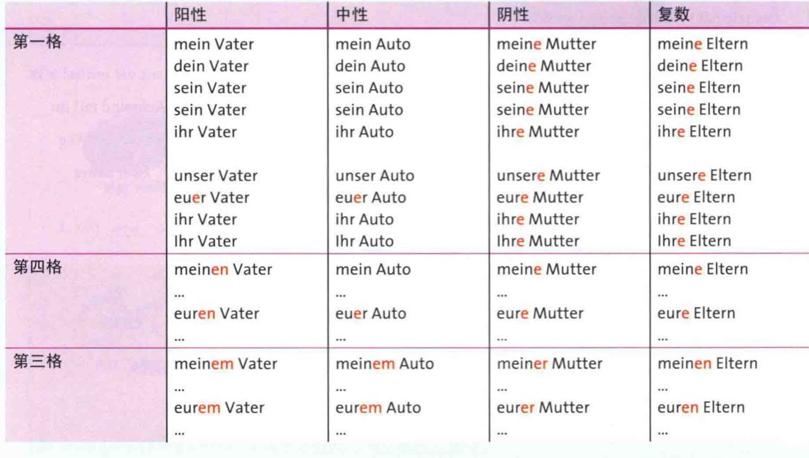

#### 反身代词的第三格形式 [](marginnote4app://note/35193B03-962E-43AB-8AA2-7556E925A635)

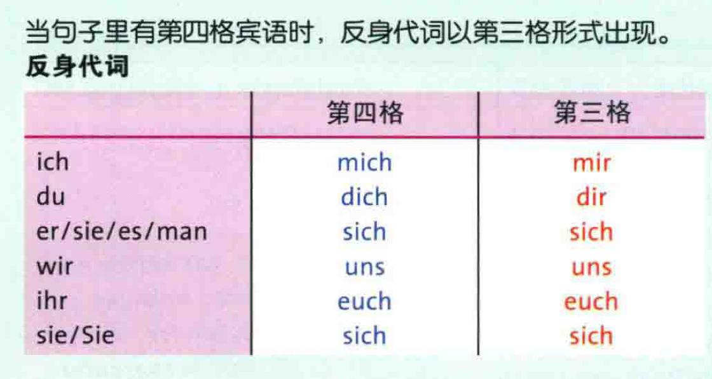

#### 代副词 [](marginnote4app://note/8B6AD4DA-CAD4-41B8-B45B-B779D73F7D30)

### 动词 [](marginnote4app://note/544CECCE-ACDB-4180-821B-5FFF6EAAD41B)

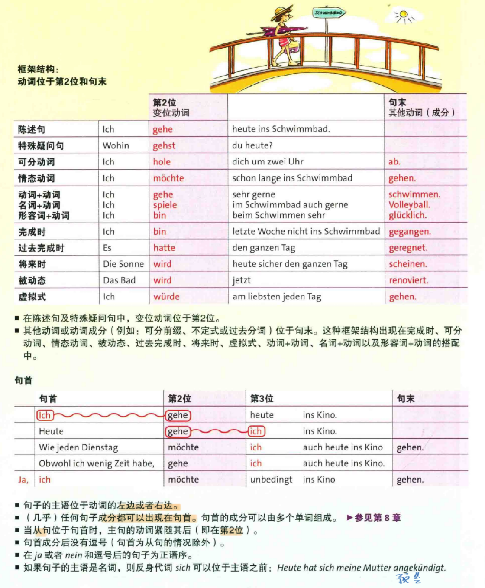

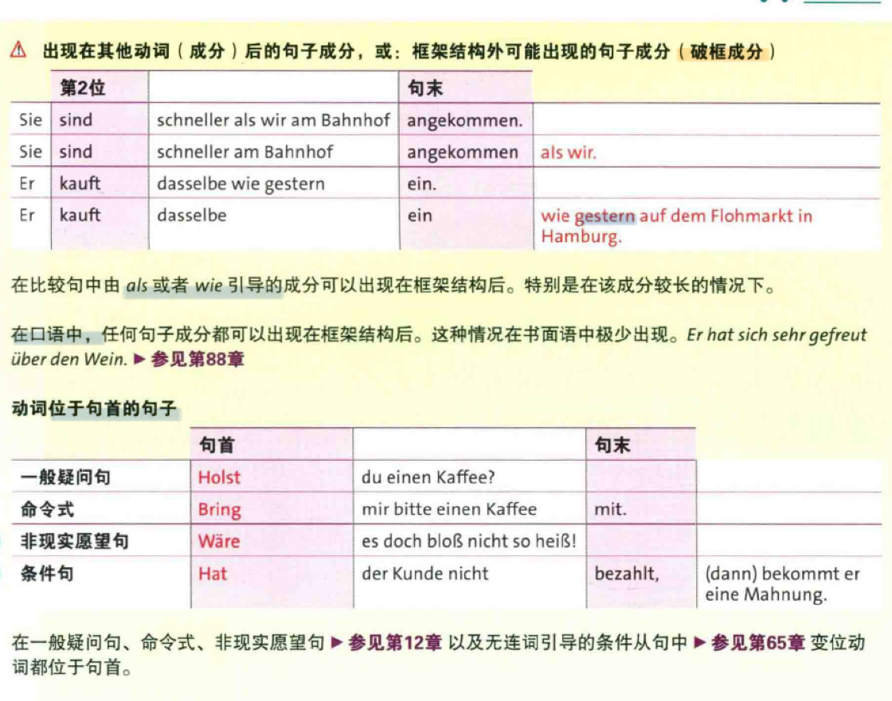

#### 时态 [](marginnote4app://note/D83080A4-D6CC-4867-8AC1-F36D10492D13)

时态 (Zeitengebrauch)

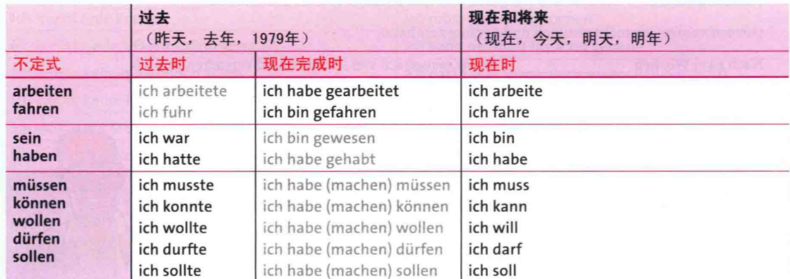

##### 现在时变位 [](marginnote4app://note/1884D3BF-E3A9-4DAB-B88F-94E0D157ECB6)

动词的现在时变位(Konjugation Prasens)

Ich komme, du kommst

###### zusammen mit ein paar [](marginnote4app://note/DE49ECEB-68EE-4C0E-976B-F4D2E8DADCF5)

Kollegen aus einer anderen Abteilung essen. Meistens trink__ wir auch noch einen Kaffee zusammen. Das
macht__ immer Spaß, weil die Kollegen lustige Geschichten von ihrer Arbeit erzähl__. Manchmal frag
ich sie: Arbeit __ ihr eigentlich auch?

11

3

Ich bin, du hast

###### sein 引导的现在完成时 (Perfekt mit sein) [](marginnote4app://note/7B7F64C4-671E-4E64-9EDE-BB8553426FA9)

###### haben 引导的现在完成时 (Perfekt mit haben) [](marginnote4app://note/3A05F4ED-0295-4797-BC98-52C673D4D455)

##### 过去时 (Prateritum) [](marginnote4app://note/5FE0D7A3-1EDF-463E-A71F-AB1088337F05)

###### sein 和 haben 的过去时 (Prateritum: sein und haben) [](marginnote4app://note/45566A57-6EB0-426D-B1E4-1395054A05D2)

###### 过去完成时 (Plusquamperfekt) [](marginnote4app://note/AC5F0FBA-8AD2-49FA-9C42-36869B014E3F)

##### 过去分词 (Partizip Perfekt) [](marginnote4app://note/F7016747-562F-4281-A7D7-CCF1B0CAE188)

##### 第一将来时 [](marginnote4app://note/426352E7-34FA-4479-9ADB-3A57BA6CFBE6)

#### 换音动词与变音动词 [](marginnote4app://note/C6EFD2BF-15A2-4E6E-AF65-568413F2CBDB)

#### 情态动词：变位及在句中的位置 [](marginnote4app://note/8992260B-8367-4924-B8D0-2B203E72284E)

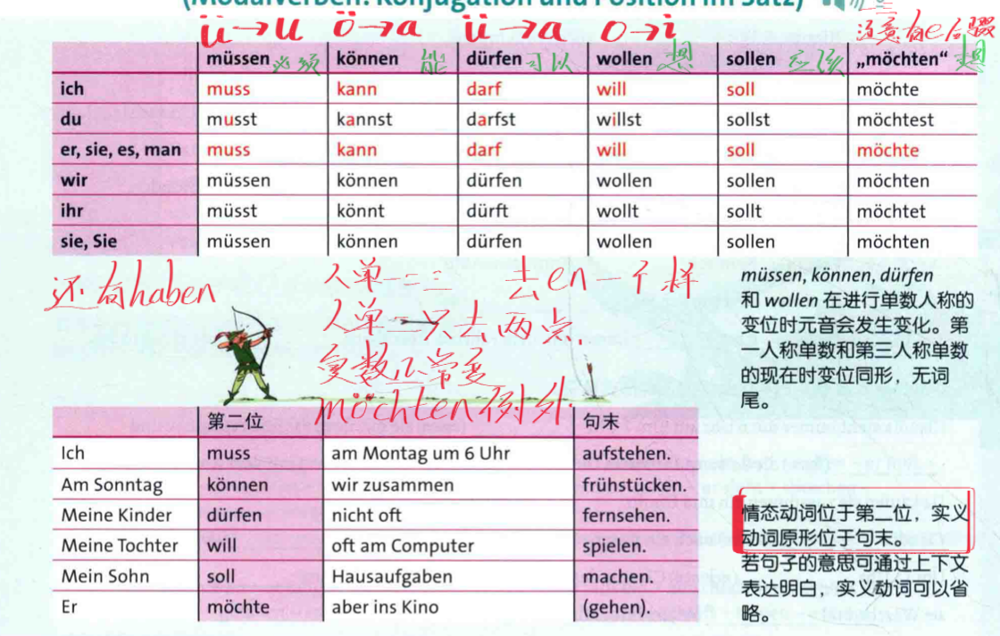

##### 情态动词的过去时(Prateritum:Modalverben [](marginnote4app://note/82CB098C-400A-4ADE-8824-302B1A4E0519)

#### 可分动词(Trennbare Verben) [](marginnote4app://note/B7895348-7084-46D0-B6DB-125A4FA6E835)

##### 可分动词与不可分动词(Trennbare und untrennbare Verben) [](marginnote4app://note/FC587AE4-CDF3-4540-B287-FC66BDD51D39)

#### 支配双宾语的动词 [](marginnote4app://note/D9FFC71B-5A19-48B9-88A9-D257DF0E3B37)

#### 反身动词 〔Reflexive (und reziproke) Verben] [](marginnote4app://note/0B9E55D4-7BBA-48D7-8181-EAE932FD9246)

#### 支配介词宾语的动词 [](marginnote4app://note/2FE6861D-395A-45A8-9BC4-3EC40CBF1BED)

#### 动词用法 [](marginnote4app://note/1F19A0B6-8990-443E-B2C3-911A02639723)

##### 动词 lassen [](marginnote4app://note/07ECEB67-4D67-4C43-8D19-2F18B6BDE860)

##### werden 的用法 [](marginnote4app://note/A542B6D9-331D-47AB-BDC6-D95B92D5EF9E)

##### 与方位相关的动词 [](marginnote4app://note/B753E633-C63C-4A29-BB70-41EABD10D92F)

#### 带zu不定式 (Infinitiv mit zu) [](marginnote4app://note/CE2BEA5F-9E6D-476E-A660-8D0345190711)

##### 不带zu不定式 (Infinitiv ohne zu) [](marginnote4app://note/DD335663-3918-4FC4-8851-EE90795A4C02)

### 代词、名词和冠词 [](marginnote4app://note/FC68EBCB-184F-4949-886A-E34BBB71F8E4)

#### 13：名词的复数形式 (Nomen: Plural) [](marginnote4app://note/7917C583-1EA4-429E-8DA2-741E9FDF375C)

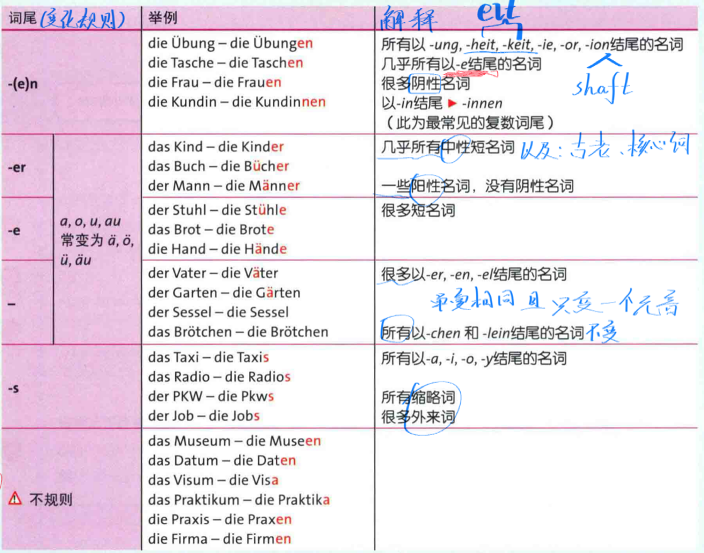

##### 14：冠词：定冠词，不定冠词，零冠词 [](marginnote4app://note/17394CCE-93B0-45CC-8D39-5E026FB8C756)

14：冠词：定冠词，不定冠词，零冠词

marginnote4app://note/DB38FBF5-4B0B-49B2-B97A-A32100F4B863

marginnote4app://note/6A6365F2-50A7-4785-A785-695FE96B0066

###### 否定 (Negation) [](marginnote4app://note/C6B86957-D564-4E6C-8618-8AB44C22C124)

###### 名词的性的规律(Genusregeln) [](marginnote4app://note/41DC18B4-898F-43AB-A59E-785B6E77D4B9)

###### 阳性弱变化名词 (N-Deklination) [](marginnote4app://note/0D12B5EA-BEF2-4289-BEEC-E24D76EE4410)

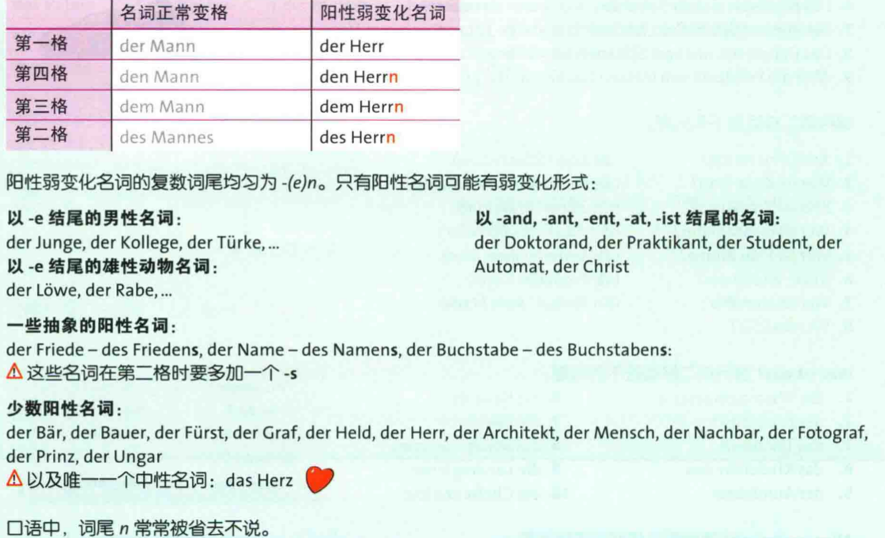

##### 构词法 [](marginnote4app://note/18C1DDDC-91F2-4956-AD9B-16A085E1C5E4)

###### 复合词 (Komposita) [](marginnote4app://note/65E3FE24-3BB0-41A8-BB7B-84E2BCC929EF)

###### 复合动词 (Zusammengesetzte Verben) [](marginnote4app://note/D6EA1792-3795-4707-9C5F-646955F039CD)

###### 派生词和词类转换 (Aus Wörtern neue Wörter machen) [](marginnote4app://note/D182E204-DD12-4A7A-9475-51171C5B8965)

#### 介词 [](marginnote4app://note/0C1C52AD-DB04-492D-8707-FB548896E7CD)

##### 表时间的介词1 (Temporale Prapositionen) [](marginnote4app://note/677F3869-C36F-4B34-850F-4C84AFB0DE38)

###### 表时间的介词2 (Temporale Prapositionen 2 ) [](marginnote4app://note/6B246EF2-068E-4166-9153-ADB174CA964B)

##### 表方位的介词 (Lokale Prapositionen) [](marginnote4app://note/52102B8A-DCA4-4D62-B908-8D7264E9FA2E)

##### 可支配第三格或第四格的介词 [](marginnote4app://note/FE51E280-EC30-4741-88B7-13A5834260E7)

##### 可支配第三格或第四格的介词支配第三格时的用法 [](marginnote4app://note/4A54F7DA-4965-445E-979A-683178F7BCCE)

##### 支配第四格的介词 (Prapositionen mit Akkusativ [](marginnote4app://note/8456AC3C-394C-4B5F-8EF6-9C1CFCF8A109)

##### 支配第三格的介词 (Prapositionen mit Dativ) [](marginnote4app://note/8BD8EF63-4685-47F7-AE40-6D6B490CE7C4)

#### Adj [](marginnote4app://note/66D067EC-3A67-47EB-A7F1-E703CDD9B0AE)

##### 形容词词尾变化：第一格，第三格，第四格 [](marginnote4app://note/3FB1E66E-B634-40AD-97DE-1DA697800DF4)

###### 形容词词尾变化：第一格和第四格 [](marginnote4app://note/661A494C-026B-4342-9D7D-6A66644917E5)

##### 最高级(Superlativ) [](marginnote4app://note/3DB0C584-D4BB-4AA5-A120-1D233764270F)

##### 比较级 (Komparativ und Vergleichssatze) [](marginnote4app://note/F5B39035-0983-491D-A792-12D736D10D18)

##### 形容词名词化：指事物或抽象概念 [](marginnote4app://note/FFEB2F6D-A6DC-4E14-A1CB-1855ADA3887F)

##### 形容词名词化：指人 [](marginnote4app://note/999604CA-A991-480E-A6E5-5AC1992D53BE)

##### 形容词词尾变化：总结 [](marginnote4app://note/B59C68B7-487A-4DC6-BD22-9CBA4C8F9226)

#### 方位副词 [](marginnote4app://note/7138B054-07FC-4403-9578-B7F088B00EBA)

### 小品词 (Partikeln) [](marginnote4app://note/643FEF66-4B50-42BA-AEB1-01BE7A305D9D)

### marginnote4app://note/F2996528-0BD9-474E-91A6-9DBC2DDC80A9 [](marginnote4app://note/EBDBAF47-AC0D-4A10-A891-DC135D9AD468)

格

#### 第二格 (Genitiv) [](marginnote4app://note/D8D78220-0400-4EB7-A501-96B51A673136)

##### 支配第二格的介词 [](marginnote4app://note/BE6A3492-BF7A-41DB-AC11-87049C1AA27D)

#### 第三格 (Dativ) [](marginnote4app://note/1CB813CF-0790-44B7-8B51-CAC8FA07BF6C)

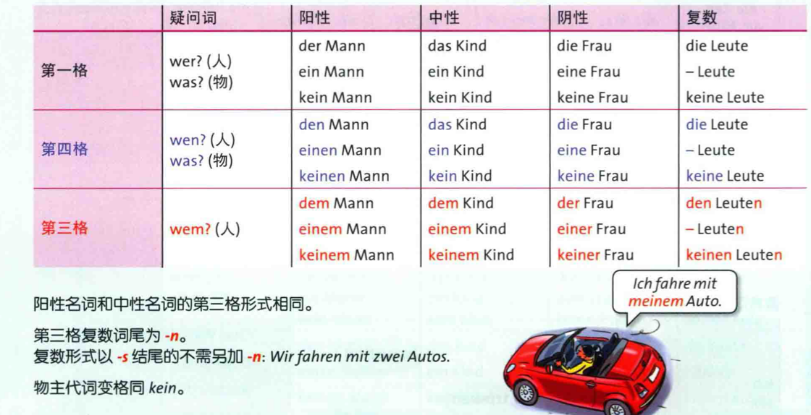

##### 支配第三格宾语的动词 (Verben mit Dativ [](marginnote4app://note/7AF80556-58B3-4EDB-8A77-41AADEEB5201)

#### 第四格(Akkusativ) [](marginnote4app://note/2E1A9093-8AA8-47F9-9768-C0F3FB71090B)

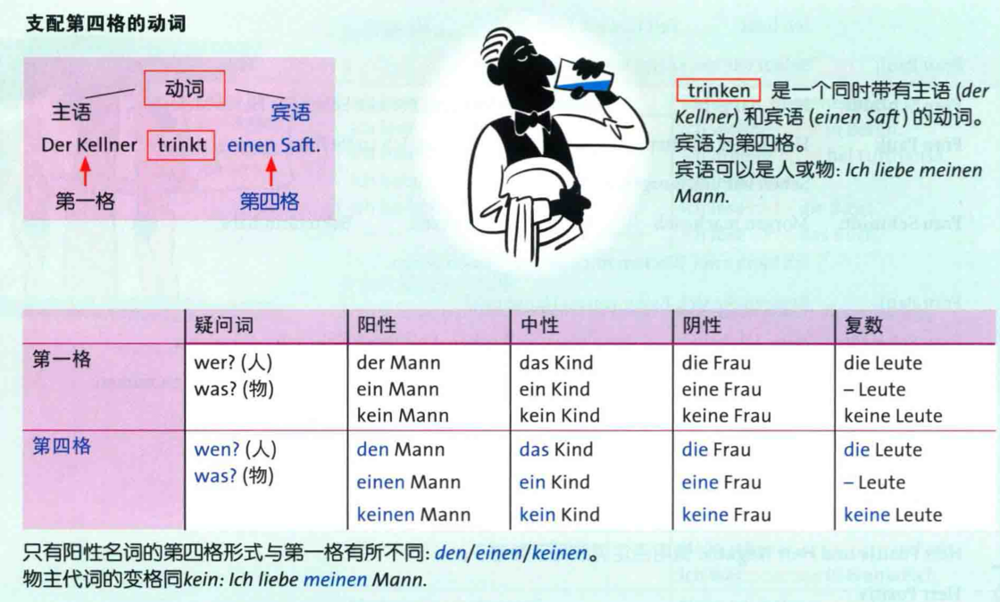

marginnote4app://note/FD07A45B-250F-41FA-92E3-E09FB282EFC0

#### 人称代词的第三格和第四格形式(Personalpronomen: Akkusativ und Dativ) [](marginnote4app://note/1C9307EA-BFE1-4C63-90FF-A864689742E5)

marginnote4app://note/C6605DE3-88E8-4353-87D2-DC769615A2C6

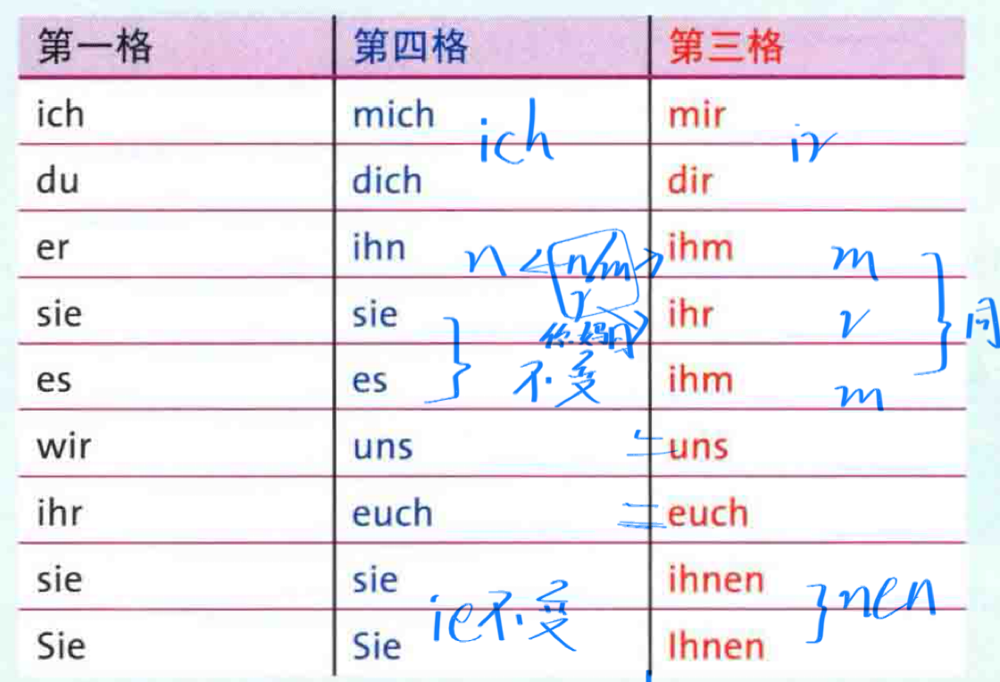

### 句式 [](marginnote4app://note/DBE0BFF8-8BE5-435E-9CD0-0A1F68333CC1)

词序1

#### 命令式 [](marginnote4app://note/176E8EEE-E6E0-44A6-8C62-9AE8830789B6)


#### 特殊疑问句 [](marginnote4app://note/DD190128-BC08-4C36-83BC-192E3A66E20C)

Wer? Was? Woher? Wen? Wo? Wohin? Wie? Mit wem? Warum?

##### 疑问冠词和指示冠词 [](marginnote4app://note/6A6365F2-50A7-4785-A785-695FE96B0066)

marginnote4app://note/17394CCE-93B0-45CC-8D39-5E026FB8C756

#### 一般疑问句 [](marginnote4app://note/3ED7CCE5-83D2-438F-98B9-45E372FE82A7)

#### 间接疑问句 (Indirekte Fragen) [](marginnote4app://note/8BF11C8E-CF50-4FAF-AC39-46303513CB41)

#### 词序2 [](marginnote4app://note/1629B594-3022-47C1-AE1F-94E3F77A25F9)

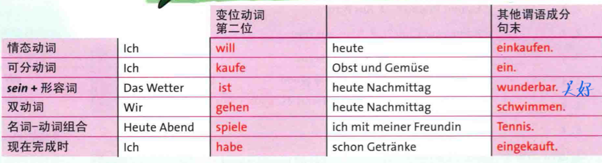

##### 双动词 [](marginnote4app://note/7E7F7E19-0586-4112-BE13-7781A7919B09)

##### sein + 形容词 [](marginnote4app://note/35609BCE-1130-457B-B300-D4EF46094D43)

##### 名词-动词组合 [](marginnote4app://note/74151548-BA96-4F31-95E9-EC26890F2A69)

##### 第一分词作定语 (Partizip 1 als Adjektiv) [](marginnote4app://note/C73A179F-05DD-4FA1-8CC4-E9D4494D05BC)

#### 从句 [](marginnote4app://note/98208985-0AD0-4A31-9257-4B0C7F489267)

从句 (Nebensätze)

##### 并列连词 Hauptsatze verbinden (Position O) [](marginnote4app://note/E6836E36-C74C-46AE-8AEE-51C7057184FD)

##### 副词连接主句 Hauptsatze verbinden (Position 1) [](marginnote4app://note/68139ACB-448E-465A-B1DA-C76DE91FA6D1)

#### 第二虚拟式：形式 [](marginnote4app://note/17853AE6-83FA-4BA9-BCD9-47D099074FC3)

##### 法 (Konjunktiv 2:Gebrauch) [](marginnote4app://note/5CFE5F5A-36AB-45A3-8DB0-991A4516CF8D)

#### 被动态1 (Passiv Teil 1) [](marginnote4app://note/5020413A-0C0C-477A-8111-E9196B4F66FC)

##### 被动态2 (Passiv Teil 2) [](marginnote4app://note/B69A8EDD-771A-4BB7-B9D0-1A6085286D59)

#### 关系从句1 (Relativsatze 1) [](marginnote4app://note/D4E60F99-F1A1-4A55-9D6E-CFE8FD3B034D)

##### 关系从句2 (Relativsatze 2) [](marginnote4app://note/CF644728-7B9C-4DC6-8AC0-B83991B77EDB)

#### 比较从句 (Vergleichssatze) [](marginnote4app://note/6174CD4F-EC9D-441E-84DA-37A3E4E935C9)

#### 成对连词(Doppelkonnektoren [](marginnote4app://note/F66068CE-8805-4996-AADF-922126F2659E)

#### 目的从句 (Finalsatze) [](marginnote4app://note/7DBD4802-D1F2-4682-A460-A51090798186)

#### 时间状语从句 (Temporale Nebensatze) [](marginnote4app://note/D45D2219-91A3-497B-A46F-3E63752CC42A)

#### wenn 或als引导的时间状语从句 [](marginnote4app://note/28E7A516-2FF6-484C-BEF9-69F38FF334E0)

## 常用的动词搭配 [](marginnote4app://note/DB03D998-0361-43B7-9DC1-BB29E17B1CB4)

# {{翻译}}; {{讲解与解析}}; {{德语礼貌提问的语法结构}}; {{每个练习的正确组成}}; {{常见错误分析}}; {{错误类型1：语序错误}}; {{错误类型2：礼貌程度不够}}; {{错误类型3：缺少礼貌词汇}}; {{边界条件与反例}}; {{典型反例：直接命令式}}; {{典型反例：陈述句形式}}; {{结构化总结}}; {{一、德语礼貌提问的核心要素}}; {{二、组成礼貌问句的步骤}}; {{三、不同场合的礼貌程度}} [](marginnote4app://note/AEA68E7B-74B0-420A-9A45-BF952CEB0359)

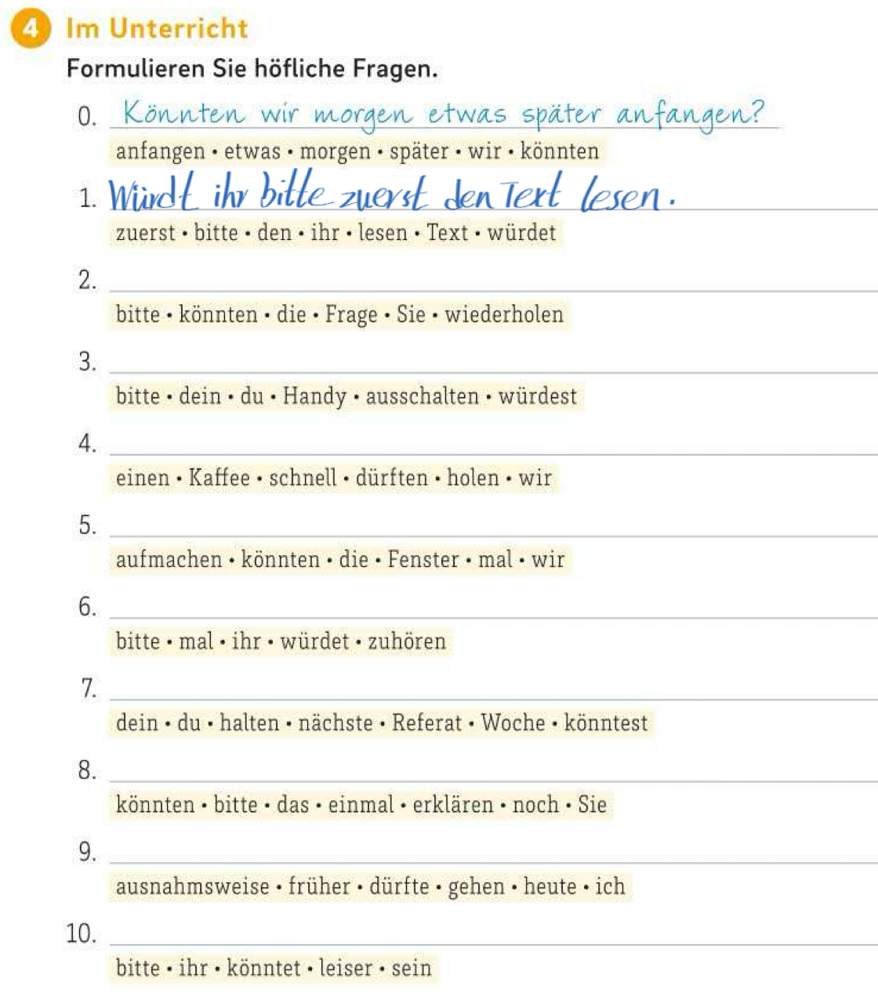

我看到了您从文档中选中的内容。这是一个德语练习，要求"在课堂上礼貌地提问"（Formulieren Sie höfliche Fragen）。让我先翻译所有内容，然后讲解每个练习的解析。

### 翻译

**练习标题：** 在课堂上 - 礼貌地提问

**单词列表（需要组成礼貌问句）：**

0. 我们能明天晚一点开始吗？
   - anfangen（开始）• etwas（某事）• morgen（明天）• später（晚一点）• wir（我们）• könnten（能，礼貌形式）

1. 您能先朗读课文吗？
   - zuerst（首先）• bitte（请）• den（这个）• ihr（您，非正式复数）• lesen（朗读）• Text（课文）• würdet（会，礼貌形式）

2. 您能重复一下这个问题吗？
   - bitte（请）• könnten（能）• die（这个）• Frage（问题）• Sie（您，正式）• wiederholen（重复）

3. 你能把手机关掉吗？
   - bitte（请）• dein（你的）• du（你）• Handy（手机）• ausschalten（关掉）• würdest（会，礼貌形式）

4. 我们能快点去拿杯咖啡吗？
   - einen（一个）• Kaffee（咖啡）• schnell（快）• dürften（可以，礼貌形式）• holen（拿）• wir（我们）

5. 我们能开一下窗户吗？
   - aufmachen（打开）• könnten（能）• die（这个）• Fenster（窗户）• mal（一下）• wir（我们）

6. 你们能听一下吗？
   - bitte（请）• mal（一下）• ihr（你们）• würdet（会，礼貌形式）• zuhören（听）

7. 你下周能做个报告吗？
   - dein（你的）• du（你）• halten（做）• nächste（下一个）• Referat（报告）• Woche（周）• könntest（能，礼貌形式）

8. 您能再解释一次这个吗？
   - könnten（能）• bitte（请）• das（这个）• einmal（一次）• erklären（解释）• noch（再）• Sie（您，正式）

9. 我今天能例外地早点走吗？
   - ausnahmsweise（例外地）• früher（早点）• dürfte（可以，礼貌形式）• gehen（走）• heute（今天）• ich（我）

10. 你们能安静一点吗？
    - bitte（请）• ihr（你们）• könntet（能，礼貌形式）• leiser（更安静）• sein（是）

### 讲解与解析

#### 德语礼貌提问的语法结构

**类比仅用于直觉：** 想象礼貌提问就像在请求前加上"请问"和"可以吗"的包装，让请求听起来更柔和、更尊重对方。

**形式化定义：** 德语礼貌提问通常使用：
1. **情态动词的礼貌形式**（könnten, dürften, würden + 动词原形）
2. **疑问句语序**（动词第二位）
3. **礼貌词汇**（bitte, mal, ausnahmsweise等）

#### 每个练习的正确组成

让我为您组成每个礼貌问句：

**0. Könnten wir morgen etwas später anfangen?**
- 正确：单词顺序正确
- 语法：könnten（情态动词第二位）+ wir（主语）+ 其他成分

**1. Würdet ihr bitte zuerst den Text lesen?**
- 正确：würdet（第二位）+ ihr（主语）+ bitte（礼貌词）+ 其他

**2. Könnten Sie bitte die Frage wiederholen?**
- 正确：könnten（第二位）+ Sie（正式您）+ bitte + die Frage wiederholen

**3. Würdest du bitte dein Handy ausschalten?**
- 正确：würdest（第二位）+ du（你）+ bitte + dein Handy ausschalten

**4. Dürften wir schnell einen Kaffee holen?**
- 正确：dürften（第二位）+ wir（我们）+ schnell（副词）+ einen Kaffee holen

**5. Könnten wir mal die Fenster aufmachen?**
- 正确：könnten（第二位）+ wir + mal（礼貌小品词）+ die Fenster aufmachen

**6. Würdet ihr bitte mal zuhören?**
- 正确：würdet（第二位）+ ihr + bitte mal（礼貌组合）+ zuhören

**7. Könntest du nächste Woche dein Referat halten?**
- 正确：könntest（第二位）+ du + nächste Woche（时间状语）+ dein Referat halten

**8. Könnten Sie das bitte noch einmal erklären?**
- 正确：könnten（第二位）+ Sie + das + bitte noch einmal（礼貌组合）+ erklären

**9. Dürfte ich heute ausnahmsweise früher gehen?**
- 正确：dürfte（第二位）+ ich（我）+ heute（时间）+ ausnahmsweise（例外）+ früher gehen

**10. Könntet ihr bitte leiser sein?**
- 正确：könntet（第二位）+ ihr + bitte + leiser sein（形容词比较级+sein）

### 常见错误分析

#### 错误类型1：语序错误
- **错误示例：** "Wir könnten morgen anfangen?"（缺少动词第二位）
- **正确：** "Könnten wir morgen anfangen?"（情态动词必须第二位）

#### 错误类型2：礼貌程度不够
- **错误示例：** "Mach das Fenster auf!"（命令式，不礼貌）
- **正确：** "Könnten wir das Fenster aufmachen?"（使用情态动词礼貌形式）

#### 错误类型3：缺少礼貌词汇
- **错误示例：** "Könntest du dein Handy ausschalten?"（语法正确但不够礼貌）
- **更好：** "Könntest du bitte dein Handy ausschalten?"（加上bitte）

### 边界条件与反例

#### 典型反例：直接命令式
**反例：** "Lies den Text!"（读课文！）
**为什么不满足条件：**
1. 使用命令式，语气强硬
2. 缺少礼貌情态动词
3. 没有疑问句形式
4. 听起来像命令而非请求

#### 典型反例：陈述句形式
**反例：** "Du könntest den Text lesen."（你可以读课文。）
**为什么不满足条件：**
1. 是陈述句而非疑问句
2. 缺少疑问词序和问号
3. 听起来像建议而非礼貌提问

### 结构化总结

#### 一、德语礼貌提问的核心要素
1. **情态动词礼貌形式**
   - können → könnten/könntest/könntet
   - dürfen → dürften/dürftest/dürftet  
   - werden → würden/würdest/würdet

2. **正确语序**
   - 情态动词第二位
   - 主语紧跟其后
   - 主要动词在句末

3. **礼貌词汇**
   - bitte（请）
   - mal（一下，缓和语气）
   - ausnahmsweise（例外地）
   - vielleicht（也许）

#### 二、组成礼貌问句的步骤
1. 确定合适的情态动词
2. 将情态动词放在第二位
3. 主语放在情态动词后
4. 添加礼貌词汇（bitte等）
5. 其他成分按正常顺序排列
6. 主要动词放在句末

#### 三、不同场合的礼貌程度
1. **高度正式**（对老师、上级）：
   - Könnten Sie...?
   - Dürfte ich...?

2. **一般礼貌**（对同学、同事）：
   - Könntest du...?
   - Würdest du bitte...?

3. **群体请求**：
   - Könntet ihr...?
   - Würdet ihr bitte...?

这个练习很好地展示了德语中如何通过语法结构和词汇选择来表达礼貌程度。掌握这些结构对于在德语环境中进行有效、得体的交流非常重要。

# Der Kleine Priz [](marginnote4app://note/BE445142-2279-4929-8CAE-D5CD64AC761C)

## #wort [](marginnote4app://note/FAD04DBE-4D08-4757-87C4-1D37F59D16F7)

Urwald

## #wort [](marginnote4app://note/229D7A0B-F181-42F5-9618-687E49016245)

prächtiges

## #wort [](marginnote4app://note/CE729E19-BF35-4299-BCA6-A863969434E5)

Riesenschlange

## #wort [](marginnote4app://note/AC40F291-6548-4D1F-8403-77BAD672FADC)

verschlang

## #wort [](marginnote4app://note/BC0D2B9B-8FDF-4BE6-85A3-942524E3AC0F)

zerbeißen

## #wort [](marginnote4app://note/498B30AB-5594-46A8-88FB-217FFC3FD803)

damals

# 情态动词不是应该放在前面吗？这有点打破我的认知了。 [](marginnote4app://note/F27A7379-1F9E-48B3-B852-BC71640032D8)

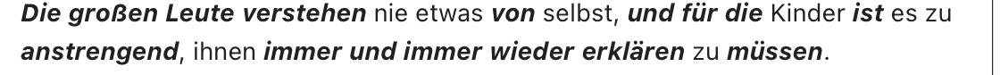

您观察得很仔细！这句话确实有点特殊。让我解释一下：

**句子结构分析：**
> "Die großen Leute verstehen nie etwas von selbst, und für die Kinder ist es zu anstrengend, ihnen immer und immer wieder erklären zu müssen."

这里有两个并列的分句：

1. **第一分句：** "Die großen Leute verstehen nie etwas von selbst"
   - verstehen（理解）是实义动词，放在第二位
   - nie（从不）是否定副词

2. **第二分句：** "und für die Kinder ist es zu anstrengend, ihnen immer und immer wieder erklären zu müssen"
   - ist（是）是系动词，放在第二位
   - zu anstrengend（太累人）是表语
   - 后面是 **zu + 不定式** 结构：erklären zu müssen

**关键点：**
- 这句话中**没有情态动词**！
- "müssen" 出现在 "zu + 不定式" 结构中，这是不定式补足语的一部分
- 在不定式结构中，动词放在**最后**，这是德语不定式的标准规则

**对比一下有情态动词的情况：**
> "Die Kinder **müssen** es immer wieder erklären." （情态动词 müssen 在第二位）

**总结：**
您的认知没错——情态动词在主句中确实应该在第二位。但这句话中的 müssen 是不定式结构的一部分，不是句子的谓语动词，所以放在最后是完全正确的！

# 我看到了您选择的德语句子。让我按照您的要求进行分析： [](marginnote4app://note/DA21267A-0911-4896-A136-020DE4919EB7)

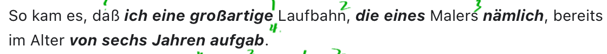

**1. 首先翻译：**
"就这样，我在六岁时就已经放弃了一项伟大的事业，即画家的事业。"

**2. 句式判定：**
这是一个主从复合句，包含：
- 主句：So kam es, daß ich eine großartige Laufbahn...aufgab.
- 从句：daß引导的宾语从句

**3. 全局细致的句法分析：**

**So kam es, daß...**
- **So**：副词，意为"这样、如此"，表示方式
- **kam es**：动词短语，es是形式主语，kam是kommen的过去式
- **daß**：连词，引导宾语从句，相当于英语的"that"

**ich eine großartige Laufbahn...aufgab**
- **ich**：第一人称单数主格代词，作主语
- **eine großartige Laufbahn**：不定冠词+形容词+名词，作宾语
  - eine：不定冠词，阴性单数第一格
  - großartige：形容词，原级，作定语，修饰Laufbahn
  - Laufbahn：阴性名词，第四格宾语

**die eines Malers nämlich**
- **die**：关系代词，指代Laufbahn，引导定语从句
- **eines Malers**：第二格结构，表示所属关系
  - eines：不定冠词，阳性单数第二格
  - Malers：阳性名词Maler的第二格形式
- **nämlich**：副词，意为"即、也就是"，用于解释说明

**bereits im Alter von sechs Jahren**
- **bereits**：副词，意为"已经"
- **im Alter**：介词短语，im = in dem，表示"在...年龄"
- **von sechs Jahren**：介词短语，表示"六岁"

**aufgab**
- **aufgab**：动词aufgeben的过去式第一人称单数形式，意为"放弃"

**德语的变格逻辑：**
1. **eine großartige Laufbahn**：第四格，因为aufgeben是及物动词，需要第四格宾语
2. **eines Malers**：第二格，表示所属关系（画家的事业）
3. **im Alter**：第三格，介词in + 第三格表示"在...之中"
4. **von sechs Jahren**：第三格，介词von + 第三格表示"从..."

**词组搭配：**
- **So kam es, daß...**：固定表达，意为"就这样发生了..."
- **eine Laufbahn aufgeben**：放弃一项事业/生涯
- **im Alter von...**：在...年龄时
- **die eines Malers**：第二格定语，表示"画家的（事业）"

这个句子结构清晰，通过daß从句将主句和宾语从句连接起来，使用第二格表示所属关系，是典型的德语复合句结构。

# {{1. 中文翻译}}; {{2. 句式判定}}; {{3. 句法分析}}; {{第一主句：Ich habe den großen Leuten mein Meisterwerk gezeigt}}; {{第二主句：und sie gefragt, ob ihnen meine Zeichnung nicht Angst mache}}; {{4. 德语变格逻辑}}; {{定冠词变格：}}; {{形容词变格：}}; {{物主代词变格：}}; {{动词变位：}}; {{5. 句子结构总结}} [](marginnote4app://note/3FFD2BC0-DFBF-4552-93AC-FA9B4657F88D)

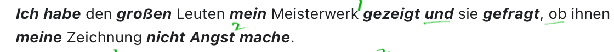

我来按照您的要求分析这个德语句子：

### 1. 中文翻译
"我向大人们展示了我的杰作，并问他们我的画是否让他们感到害怕。"

### 2. 句式判定
这是一个**并列复合句**，由两个主句通过连词"und"连接：
- 第一主句：Ich habe den großen Leuten mein Meisterwerk gezeigt
- 第二主句：und sie gefragt, ob ihnen meine Zeichnung nicht Angst mache

第二主句包含一个**间接疑问句**（ob从句）。

### 3. 句法分析

#### 第一主句：Ich habe den großen Leuten mein Meisterwerk gezeigt

**词分解：**
1. **Ich** - 第一人称单数主语代词（我）
   - 主格（Nominativ），作主语

2. **habe** - 助动词haben的现在完成时第一人称单数变位（有）
   - 与过去分词gezeigt构成现在完成时

3. **den großen Leuten** - 第三格复数名词短语（大人们）
   - **den**：定冠词复数第三格（den）
   - **großen**：形容词groß（大的）的复数第三格变格（-en）
   - **Leuten**：名词Leute（人们）的复数第三格
   - 整体作间接宾语（第三格宾语）

4. **mein Meisterwerk** - 第四格单数名词短语（我的杰作）
   - **mein**：物主代词第一人称单数（我的）
   - **Meisterwerk**：中性名词（杰作），第四格作直接宾语

5. **gezeigt** - 动词zeigen（展示）的过去分词
   - 与habe构成现在完成时

**词组搭配：**
- **jemandem etwas zeigen**：向某人展示某物
  - jemandem：第三格间接宾语（den großen Leuten）
  - etwas：第四格直接宾语（mein Meisterwerk）

#### 第二主句：und sie gefragt, ob ihnen meine Zeichnung nicht Angst mache

**词分解：**
1. **und** - 并列连词（和）

2. **sie** - 第三人称复数宾格代词（他们）
   - 第四格作直接宾语（gefragt的宾语）

3. **gefragt** - 动词fragen（问）的过去分词
   - 省略了助动词habe（与第一句共用）

4. **ob** - 从属连词（是否）
   - 引导间接疑问句

5. **ihnen** - 第三人称复数第三格代词（他们）
   - 第三格作间接宾语

6. **meine Zeichnung** - 第一格单数名词短语（我的画）
   - **meine**：物主代词第一人称单数（我的）
   - **Zeichnung**：阴性名词（画），第一格作主语

7. **nicht** - 否定词（不）

8. **Angst mache** - 动词短语（使害怕）
   - **Angst**：阴性名词（害怕），第四格作宾语
   - **mache**：动词machen（做）的现在时第一/第三人称单数虚拟式变位
   - 整体结构：jemandem Angst machen（让某人害怕）

**词组搭配：**
- **jemanden etwas fragen**：问某人某事
  - jemanden：第四格直接宾语（sie）
  - etwas：第四格直接宾语（ob从句）
- **jemandem Angst machen**：让某人害怕
  - jemandem：第三格间接宾语（ihnen）
  - Angst：第四格直接宾语

### 4. 德语变格逻辑

#### 定冠词变格：
- **den**：复数第三格（对应Leuten）
- 完整变格表：
  - 单数：der/die/das（第一格），den/die/das（第四格），dem/der/dem（第三格）
  - 复数：die（第一/四格），den（第三格）

#### 形容词变格：
- **großen**：形容词在定冠词后采用弱变化
  - 复数第三格：-en结尾

#### 物主代词变格：
- **mein**：中性单数第四格（对应Meisterwerk）
- **meine**：阴性单数第一格（对应Zeichnung）
  - 变格与不定冠词类似

#### 动词变位：
- **habe**：haben现在时第一人称单数
- **mache**：machen现在时第一/第三人称单数虚拟式
  - 虚拟式用于间接引语，表示转述他人的话

### 5. 句子结构总结

1. **时态**：现在完成时（habe...gezeigt, gefragt）
2. **语序**：
   - 主句：正语序（主语+动词）
   - 从句：尾语序（连词+主语+...动词）
3. **格的使用**：
   - 第三格：间接宾语（den großen Leuten, ihnen）
   - 第四格：直接宾语（mein Meisterwerk, sie, Angst）
   - 第一格：主语（Ich, meine Zeichnung）

这个句子展示了德语典型的**框型结构**（动词gezeigt和gefragt位于句末），以及**格系统**在表达语法关系中的核心作用。

# {{文档上下文}}; {{1. 翻译}}; {{2. 句式判定}}; {{3. 句法分析}}; {{主句分析：}}; {{关系从句分析：}} [](marginnote4app://note/223132AE-0055-4AB7-871B-844462CEF532)

### 文档上下文

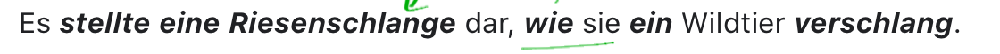

我来按照您的要求分析这个德语句子：

### 1. 翻译
**中文翻译：** 它描绘了一条巨蛇，正在吞食一只野生动物。

### 2. 句式判定
这是一个**主从复合句**：
- 主句：Es stellte eine Riesenschlange dar
- 关系从句：wie sie ein Wildtier verschlang

### 3. 句法分析

#### 主句分析：
**Es stellte eine Riesenschlange dar**

**词分解：**
1. **Es** - 第三人称单数中性代词（主格）
   - 作用：主语
   - 翻译：它

2. **stellte** - 动词stellen的过去时第三人称单数变位
   - 原形：stellen（放置、呈现）
   - 这里与"dar"构成短语动词"darstellen"
   - 翻译：描绘、表现

3. **eine** - 不定冠词（阴性单数第四格）
   - 变格逻辑：Riesenschlange是阴性名词，在第四格（直接宾语）前用eine
   - 翻译：一条

4. **Riesenschlange** - 复合名词（阴性）
   - 构成：Riesen（巨人）+ Schlange（蛇）
   - 格：第四格（直接宾语）
   - 翻译：巨蛇

5. **dar** - 可分动词前缀
   - 与"stellte"构成短语动词"darstellen"
   - 位置：在句末，符合德语可分动词规则

**词组搭配：**
- **darstellen** - 短语动词，意为"描绘、表现、呈现"
- **eine Riesenschlange darstellen** - 描绘一条巨蛇

#### 关系从句分析：
**wie sie ein Wildtier verschlang**

**词分解：**
1. **wie** - 关系副词
   - 作用：引导关系从句，连接主句和从句
   - 翻译：如同、就像

2. **sie** - 第三人称单数阴性代词（主格）
   - 作用：从句主语，指代主句中的"Riesenschlange"
   - 翻译：它（指巨蛇）

3. **ein** - 不定冠词（中性单数第四格）
   - 变格逻辑：Wildtier是中性名词，在第四格（直接宾语）前用ein
   - 翻译：一只

4. **Wildtier** - 复合名词（中性）
   - 构成：Wild（野生的）+ Tier（动物）
   - 格：第四格（直接宾语）
   - 翻译：野生动物

5. **verschlang** - 动词verschlingen的过去时第三人称单数变位
   - 原形：verschlingen（吞食、狼吞虎咽）
   - 翻译：吞食

**变格逻辑总结：**
1. **主句宾语**：eine Riesenschlange（阴性第四格）
2. **从句宾语**：ein Wildtier（中性第四格）
3. 两个宾语都使用第四格，因为动词"darstellen"和"verschlingen"都是及物动词，需要直接宾语

**句子结构特点：**
- 主句使用可分动词"darstellen"，前缀"dar"位于句末
- 关系从句使用"wie"引导，描述巨蛇的状态
- 从句时态为过去时，与主句时态一致
- 从句语序：wie（连接词）+ sie（主语）+ ein Wildtier（宾语）+ verschlang（谓语动词）

这个句子生动地描绘了一幅画面：一条巨蛇正在吞食野生动物，通过关系从句"wie sie..."让描述更加具体形象。

# {{1. 中文翻译}}; {{2. 句式判定}}; {{3. 句法分析}}; {{从句部分：Als ich sechs Jahre alt war}}; {{主句部分：sah ich einmal in einem Buch über den Urwald}}; {{定语从句：das Erlebte Geschichten hieß}}; {{主句继续：ein prächtiges Bild}}; {{4. 语法要点总结}}; {{原因分析：}}; {{1. 首次提及原则}}; {{2. 具体语境分析}}; {{3. 对比示例}}; {{4. 文学效果}}; {{德语冠词使用规则总结：}} [](marginnote4app://note/4A452E9B-206E-437F-9D87-833006D22A87)

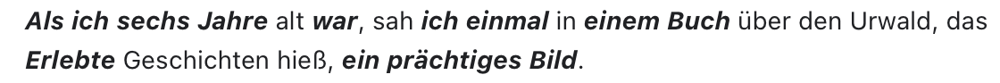

我来按照您的要求分析这个德语句子：

### 1. 中文翻译
当我六岁时，有一次在一本名为《原始森林》的书中看到一幅精美的图画，这本书叫《真实的故事》。

### 2. 句式判定
这是一个**主从复合句**，包含：
- 主句：Ich sah ein prächtiges Bild（我看到一幅精美的图画）
- 时间状语从句：Als ich sechs Jahre alt war（当我六岁时）
- 地点状语从句：in einem Buch über den Urwald（在一本关于原始森林的书中）
- 定语从句：das Erlebte Geschichten hieß（这本书叫《真实的故事》）

### 3. 句法分析

#### 从句部分：Als ich sechs Jahre alt war
- **Als**：从属连词，引导时间状语从句，意为"当...时"
- **ich**：第一人称单数主格代词（我），在从句中作主语
- **sechs Jahre alt**：数词+名词+形容词结构，意为"六岁"
  - **sechs**：基数词"六"，不变格
  - **Jahre**：中性名词"Jahr"的复数第一格，表示年龄时用复数
  - **alt**：形容词"年老的"，这里表示年龄
- **war**：动词"sein"（是）的第一人称单数过去时变位

#### 主句部分：sah ich einmal in einem Buch über den Urwald
- **sah**：动词"sehen"（看）的第一/第三人称单数过去时变位
- **ich**：第一人称单数主格代词，作主语
- **einmal**：副词"一次"，表示"有一次"
- **in einem Buch**：介词短语作地点状语
  - **in**：介词"在...里"，支配第三格
  - **einem**：不定冠词"ein"的第三格中性单数形式
  - **Buch**：中性名词"书"的第三格单数
- **über den Urwald**：介词短语作定语修饰Buch
  - **über**：介词"关于"，支配第四格
  - **den Urwald**：阳性名词"原始森林"的第四格单数
    - **den**：定冠词"der"的第四格阳性单数形式
    - **Urwald**：复合名词，由"Ur"（原始）+"Wald"（森林）组成

#### 定语从句：das Erlebte Geschichten hieß
- **das**：关系代词，中性单数第一格，指代"Buch"
- **Erlebte Geschichten**：书名《真实的故事》，作主语补足语
  - **Erlebte**：动词"erleben"（经历）的过去分词作形容词，意为"经历过的、真实的"
  - **Geschichten**：阴性名词"故事"的复数
- **hieß**：动词"heißen"（叫、称作）的第三人称单数过去时变位

#### 主句继续：ein prächtiges Bild
- **ein prächtiges Bild**：第四格宾语
  - **ein**：不定冠词"一个"
  - **prächtiges**：形容词"壮丽的、精美的"的第四格中性单数强变化形式
  - **Bild**：中性名词"图画"的第四格单数

### 4. 语法要点总结

1. **语序**：德语从句动词在句末，主句动词在第二位
2. **变格逻辑**：
   - 介词"in"支配第三格表示静态位置
   - 介词"über"支配第四格表示"关于"
   - 形容词"prächtiges"根据冠词和名词的性数格变化
3. **时态**：全句使用过去时，描述过去的经历
4. **从句结构**：典型的德语复合句结构，信息层次分明

这个句子来自《小王子》的开头，通过复杂的从句结构展现了德语精确表达时间、地点和修饰关系的特点。

最后一个主句为什么不用定冠词？

您问了一个很好的语法问题！关于"ein prächtiges Bild"为什么用不定冠词"ein"而不是定冠词"das"：

### 原因分析：

#### 1. **首次提及原则**
- 这是叙述中**第一次提到**这幅图画
- 德语中，首次提及的、不确定的、未知的事物用不定冠词
- 如果后面再次提到同一幅画，就会用定冠词"das Bild"

#### 2. **具体语境分析**
原文："...sah ich einmal...ein prächtiges Bild"
- 作者在回忆童年经历
- 当时看到的是"**一幅**精美的图画"，不是特指某幅已知的画
- 读者也不知道这是哪幅画，所以用不定冠词表示"某一个"

#### 3. **对比示例**
- **不定冠词**：Ich sah **ein** prächtiges Bild.（我看到一幅精美的图画）→ 第一次提到，不确定是哪幅
- **定冠词**：Ich sah **das** prächtiges Bild.（我看到那幅精美的图画）→ 特指某幅已知的画

#### 4. **文学效果**
- 用不定冠词营造一种"偶然发现"的感觉
- 强调这是作者童年时**第一次**看到这幅画的经历
- 如果用了定冠词，就暗示读者已经知道这幅画是什么了

### 德语冠词使用规则总结：

| 情况 | 使用冠词 | 示例 |
|------|----------|------|
| 首次提及 | 不定冠词 | Ich habe **ein** Buch gekauft. |
| 特指已知事物 | 定冠词 | **Das** Buch ist interessant. |
| 泛指类别 | 零冠词 | Ich lese gern **Bücher**. |
| 独一无二的事物 | 定冠词 | **Die** Sonne scheint. |

在这个句子中，作者用"ein prächtiges Bild"准确地表达了：这是童年时偶然看到的一幅画，当时对作者来说是新鲜、未知的体验。这正是德语冠词系统的精确之处！

# {{MindMap Context}} [](marginnote4app://note/9052E5EA-64FE-4070-93AD-62809C83B7D1)

### MindMap Context
└── 巩固错题和阅读 (ID: marginnote4app://note/AD36238C-545E-4262-A94B-17E6A0608310) ← [Current Focus]

marginnote4app://note/AD36238C-545E-4262-A94B-17E6A0608310

将所有错题标签整理到这里

我理解你想把所有带有"错题"标签的卡片整理到这个"巩固错题和阅读"卡片下面。

不过，我需要先了解一下你的情况：

**你的学习目标是什么？** 比如：
- 正在准备某个考试？
- 复习某个学科的知识点？
- 还是日常学习整理？

另外，**你现在是哪个年级或学习阶段？** 这样我可以更好地帮你规划整理策略。

$$button:高中阶段$$
$$button:大学阶段$$
$$button:成人自学$$
$$button:其他阶段$$

了解这些后，我可以帮你：
1. 找到所有带"错题"标签的卡片
2. 按照学科或知识点分类整理
3. 建立系统的复习计划

你先告诉我你的学习情况吧！

成人自学

好的！成人自学需要更高效的整理方法。

现在让我帮你找到所有带"错题"标签的卡片，然后我们可以一起讨论如何整理到这个"巩固错题和阅读"卡片下面。

不过我需要先了解一下你的笔记结构。让我看看这个卡片下面目前有什么内容：好的！我看到你已经在"巩固错题和阅读"下面整理了一些卡片，包括：
- 动词位置
- 易错物代
- 从句主语
- 还有一些德语相关的笔记

看起来你在学习**德语**？这些错题卡片已经在这个文件夹里了。

**现在你想怎么整理？** 我给你几个选项：

$$button:按语法点分类整理$$
$$button:按错误类型分类$$
$$button:检查现有卡片是否完整$$
$$button:添加新的错题卡片$$

或者，如果你有其他具体的整理想法，也可以告诉我！

另外，**你学习德语的目标是什么？** 比如：
- 日常交流？
- 考取德语证书？
- 工作需要？

这样我可以帮你更好地规划错题复习策略。

添加新的错题卡片

好的！让我帮你添加新的错题卡片。

**首先，告诉我这个错题是关于什么的？** 比如：
- 德语语法（动词位置、从句、代词等）
- 德语词汇
- 德语阅读理解
- 其他

$$button:德语语法$$
$$button:德语词汇$$
$$button:德语阅读$$
$$button:其他$$

选好后，我会引导你一步步把错题内容整理成卡片，并放到"巩固错题和阅读"下面。

# 巩固错题和阅读 [](marginnote4app://note/AD36238C-545E-4262-A94B-17E6A0608310)

## #错题 [](marginnote4app://note/AFD53A60-8E22-4E94-AC94-25025637E44B)

kommt

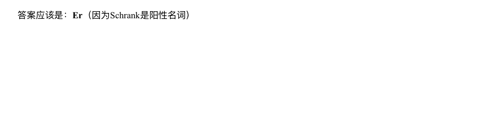

## Was its, da"? [](marginnote4app://note/DF5B7D13-C84C-4C4A-A3CF-3F511D3B67E1)

da

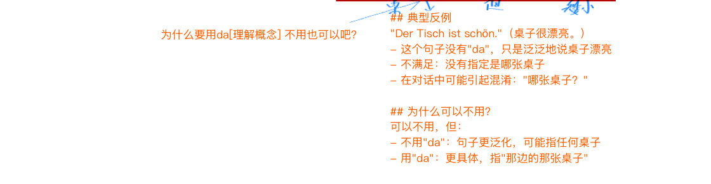

#错题

## 动词位置 [](marginnote4app://note/B7051C30-1713-4121-89DF-D1289697151B)

ich sie

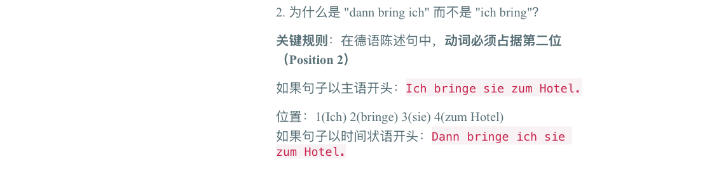

#错题

## 易错物代 [](marginnote4app://note/64410DBC-C308-417A-9B62-796002FA4F27)

Mein Name


#错题

## #错题 [](marginnote4app://note/5B500C98-E7BD-4FCD-B3EC-7B66352DF37C)

1. bisschen
表示程度轻微，时间不长
2. gerade:
正在
3. ein
阴中受将
de eine E-Mail.

## #错题 [](marginnote4app://note/B91388B0-C601-4223-8EB7-D9571AB7182A)

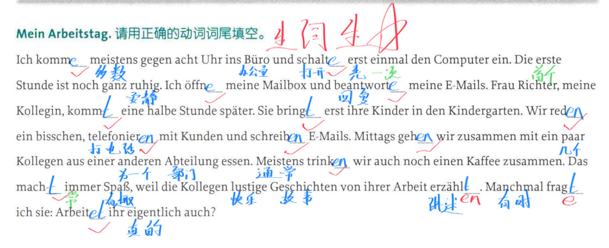

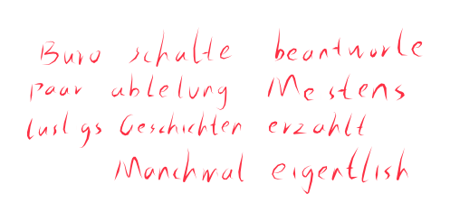

## 从句主语 [](marginnote4app://note/CAFBEC51-860B-4CF7-87C7-9A3A3579C6E9)

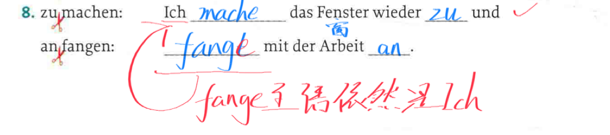

#错题

## #错题 [](marginnote4app://note/3167FC1B-AEAC-4FF0-9D64-F4A1F7A44F67)

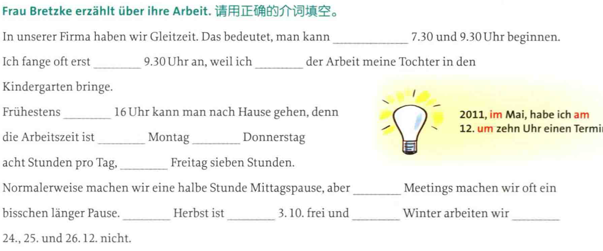

## #错题 [](marginnote4app://note/D4F9E4BC-5C41-4E01-B3CF-551D87472E84)

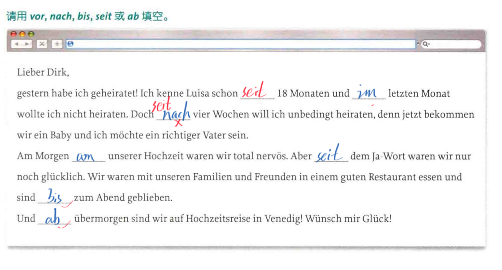

## #错题 [](marginnote4app://note/78231508-317C-43F9-9E6F-24251A267B65)

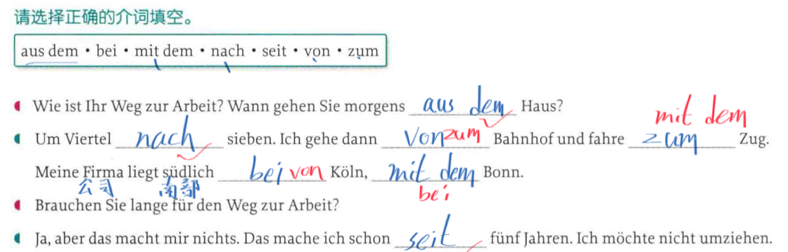

## #错题 [](marginnote4app://note/563AB9EE-95D8-4E10-943D-914F56B7D548)

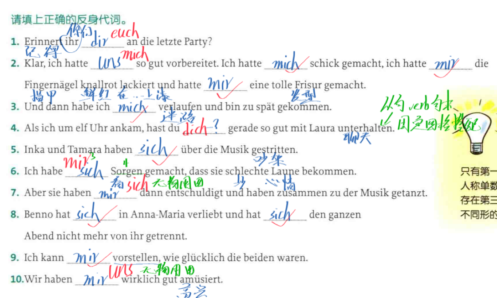

## #错题 [](marginnote4app://note/FDF9072A-FEE0-46FA-A041-0C9981F67E1A)

##### 整理后的完整文本，保留原排版和标注：
---
### 2  请用 sein 或 haben 第二虚拟式形式填空。
1.  ~~非卖~~ $\boldsymbol{\text{Ohne die Hilfe deinem Bruder hättest (haben) du keinen Führerschein.}}$ （手写批改：互换）
2.  $\boldsymbol{\text{Ohne seine Freunde wäre (sein) er am Wochenende immer allein.}}$ （手写批改：正确）
3.  $\boldsymbol{\text{Ohne die Unterstützung von meinen Eltern hätten (haben) wir kein Haus.}}$ （手写批改：支持）
4.  $\boldsymbol{\text{Ohne die Panne wäre (sein) sie schon lange wieder zu Hause.}}$ （手写批改：损坏）
5.  $\boldsymbol{\text{Ohne meine Kinder wären (sein) ich nicht glücklich.}}$ （手写批改：动词位置？）

---
##### 右侧手写批注：
> 倒装
> 1.  找动词
> 2.  看动词前
> 不对位置？
> 不是主语 → 看第一

## #错题 [](marginnote4app://note/4247DA10-0D7D-4AA1-8CE9-CA7262ED248C)

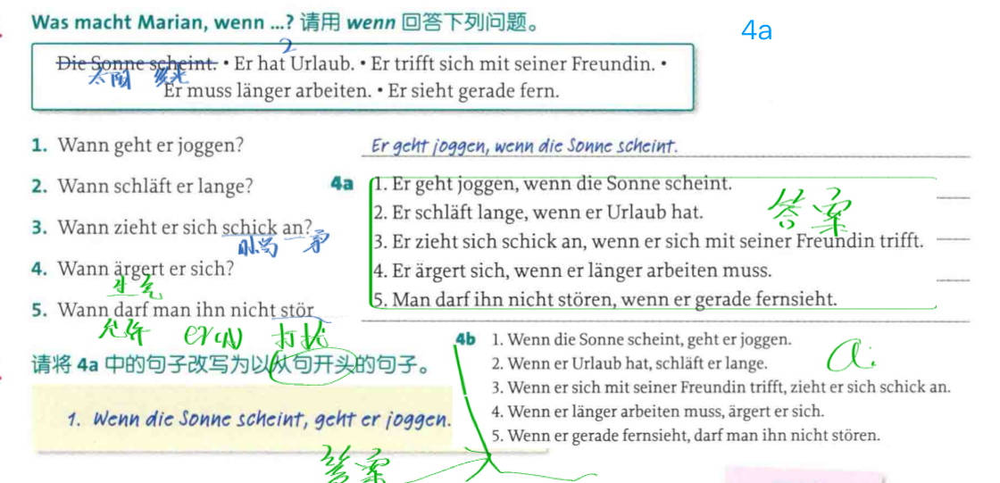

## #错题 [](marginnote4app://note/7FA86397-756D-4C01-A6FE-901BF0267A03)

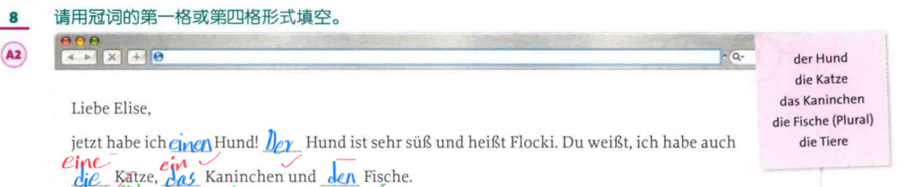

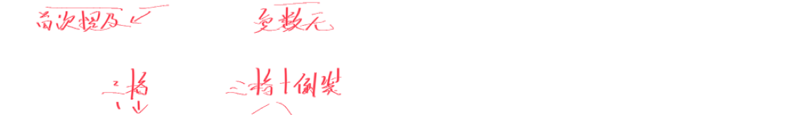

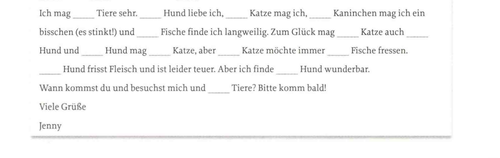

## #错题 [](marginnote4app://note/9EBFF40F-7C4C-462D-B694-BB087F22A92A)

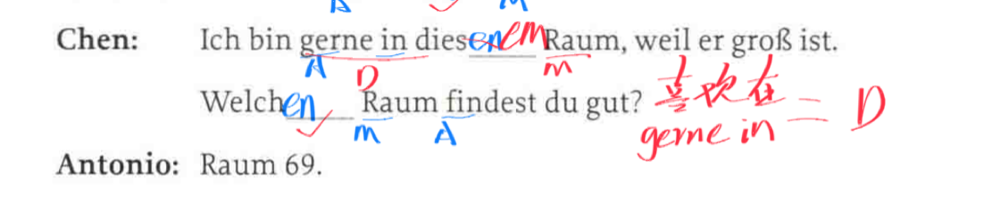

## #错题 [](marginnote4app://note/85109594-7C07-40CD-B7CF-C02AB9A07B2D)

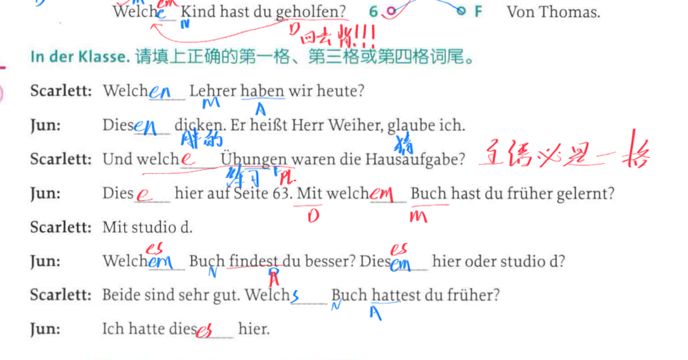

## #错题 [](marginnote4app://note/9AFA7AA1-4EF1-48A6-B471-A2A6E5D25297)

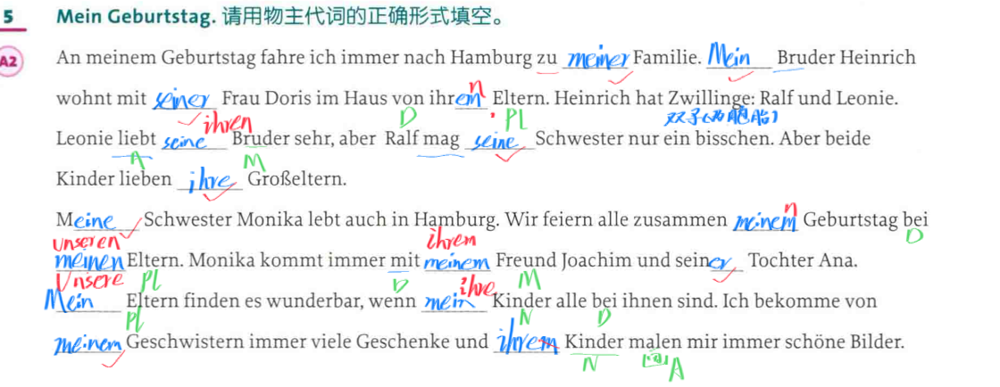

## #错题 [](marginnote4app://note/B40BCC55-34C8-4493-9E3E-F6CA39DB39DA)

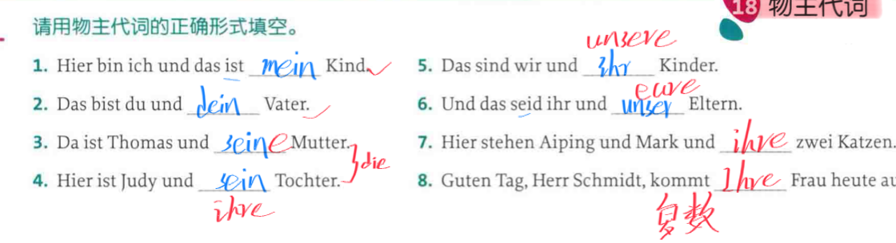

# Group [](marginnote4app://note/A5675A54-2660-46D5-9C7C-9C539753F74C)

## #wort [](marginnote4app://note/7D15DFCE-C9DB-4EBB-8EC2-54BA2070BA60)

jüngste

## #wort [](marginnote4app://note/FE19DD52-6B19-4BD9-9231-A39FA7A4B4A6)

Enkel

## #wort [](marginnote4app://note/CE8DCDD7-9F32-4440-9575-1BEA67A742C8)

beeil

## #wort [](marginnote4app://note/634710E5-0848-4392-9C1C-DD99459AEC6B)

Schwarzwald

## #wort [](marginnote4app://note/66AF36BD-7CF8-4245-B14C-70173C5E1251)

##### 提取的纯文本内容：
`übernachten`

# marginnote4app://note/2E1A9093-8AA8-47F9-9768-C0F3FB71090B [](marginnote4app://note/FD07A45B-250F-41FA-92E3-E09FB282EFC0)

# 无标题卡片 [](marginnote4app://note/5149F78F-8612-4481-B581-AF2B70CF7C24)

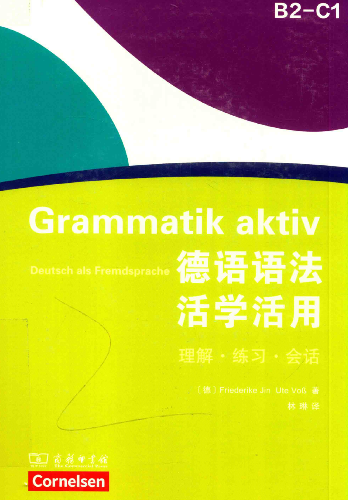


## 简单句中的动词位置 [](marginnote4app://note/2D680CE5-A1C7-4387-84F7-495068D2B007)

# #wort [](marginnote4app://note/317B5DED-DDFA-4FAA-B5CA-A9F3B78A35B7)

modern.

# {{MindMap Context}} [](marginnote4app://note/119F2B4A-8109-4592-BE2D-B505B426F7E7)

### MindMap Context
└── 巩固错题和阅读 (ID: marginnote4app://note/AD36238C-545E-4262-A94B-17E6A0608310) ← [Current Focus]

marginnote4app://note/AD36238C-545E-4262-A94B-17E6A0608310

将所有错题标签整理到这里

我理解您想要将所有带有"错题"标签的卡片整理到"巩固错题和阅读"这个卡片下。

不过，我目前无法直接搜索或筛选带有特定标签的卡片。为了帮您完成这个任务，我需要您提供以下信息：

**方式一：** 如果您知道哪些卡片带有"错题"标签，请告诉我这些卡片的标题或ID，我可以帮您将它们作为子卡片添加到"巩固错题和阅读"下。

**方式二：** 您可以在 MarginNote 中：
1. 使用标签筛选功能找到所有"错题"标签的卡片
2. 选中这些卡片
3. 将它们拖拽或移动到"巩固错题和阅读"卡片下

您希望采用哪种方式？或者您能提供一些带有"错题"标签的卡片信息吗？

# 计划 [](marginnote4app://note/9174280D-D9EF-4316-8720-C5F307455932)

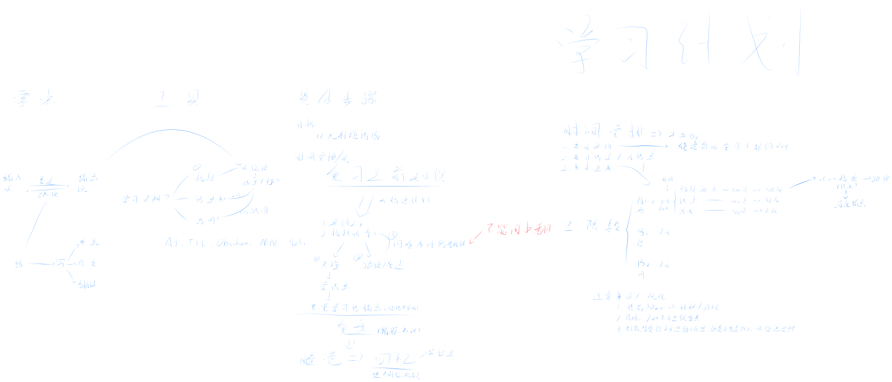

# 无标题卡片 [](marginnote4app://note/CE5259D3-788F-412E-9D39-8C1A2F66A6B5)

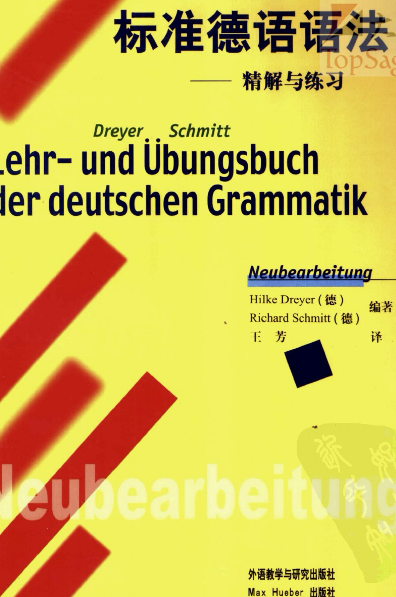

目录

## 代词 [](marginnote4app://note/77715F0E-028B-47F8-B12D-7E43DA94F71A)

### 人称代词的变格 [](marginnote4app://note/EB11FE2B-7900-4F8D-8F83-B878CFE065B3)

### 物主代词 [](marginnote4app://note/45ECD9EC-DF40-4914-8C4D-ADB973B64D29)

#### 物主代词的变格 [](marginnote4app://note/1A7120D3-CB13-4C5F-8072-0941E6AF82B6)

## 名词的变格 [](marginnote4app://note/7A86D3EB-94EB-4296-AAF8-160A8C9A3A47)

### 带定冠词的单数名词的变格 [](marginnote4app://note/E3493450-8C60-421B-BF63-951EE4E58368)

## 动词 [](marginnote4app://note/11418F0C-30D0-4467-869B-DCEC5DD984C6)

### 情态动词 [](marginnote4app://note/F5A194DB-2C7D-4A45-BE0A-5E6443D59823)

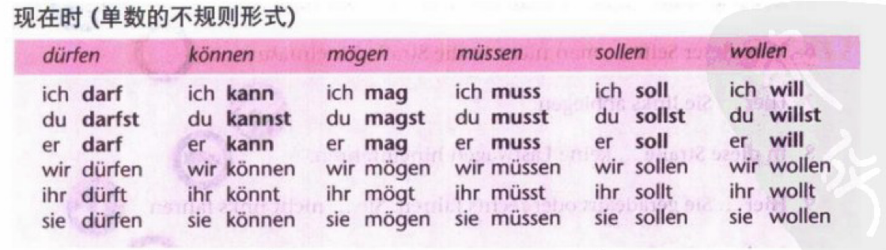

### 动词的变位 [](marginnote4app://note/FE59B8B9-136F-4ADD-BD5B-9338CF455CE9)

## 介词与格 [](marginnote4app://note/F2996528-0BD9-474E-91A6-9DBC2DDC80A9)

格

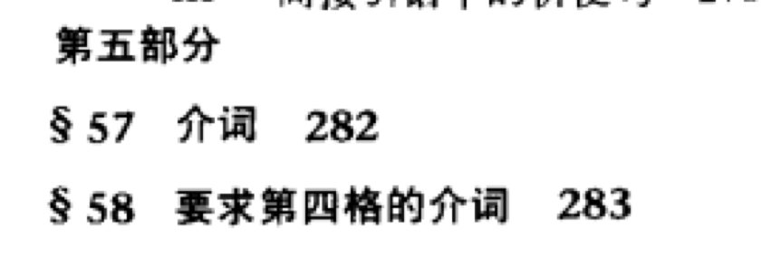

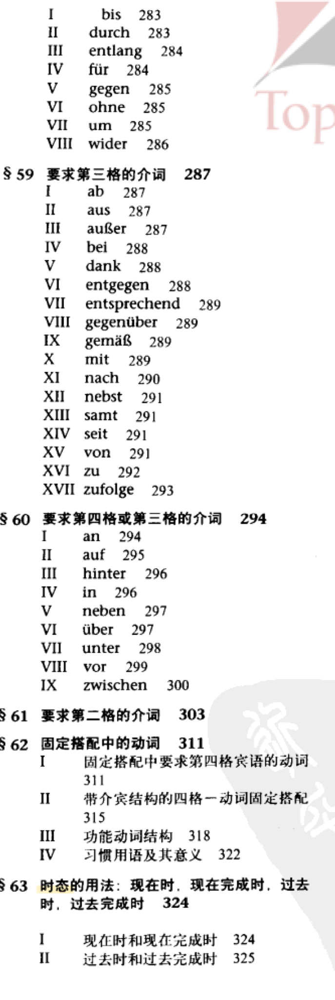

marginnote4app://note/EBDBAF47-AC0D-4A10-A891-DC135D9AD468

### 第五部分 [](marginnote4app://note/8531BFA5-4984-4FB8-8C66-901A7A877254)

#### 有的介词要求固定的格 [](marginnote4app://note/DD53D070-E5DA-4F7A-A1E8-DD9AB4B99228)

# 无标题卡片 [](marginnote4app://note/CBBC5706-6716-45B4-AD51-9346D5A08E5B)

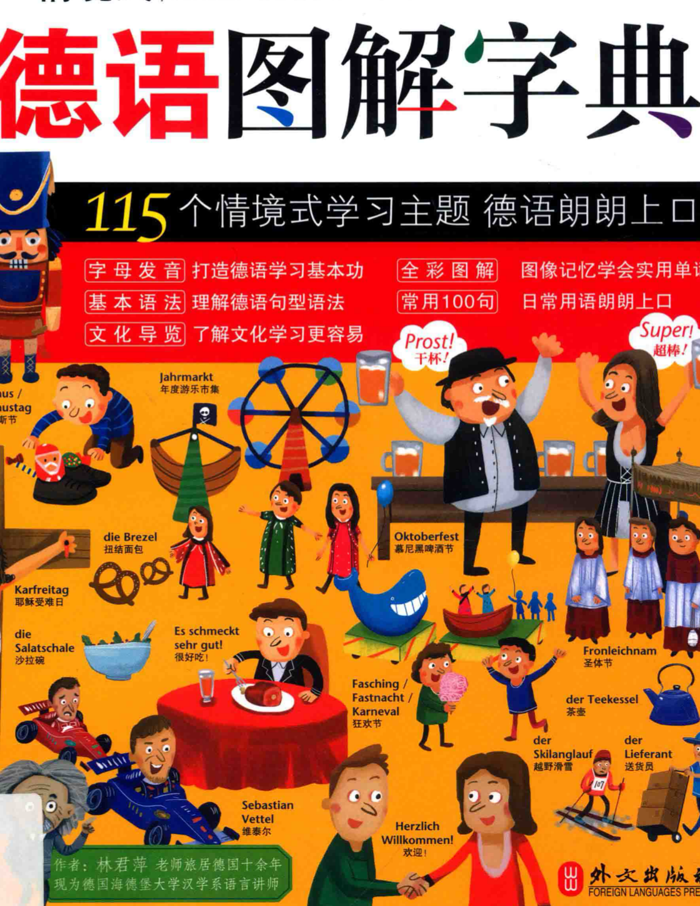

目录

## 德语基本语法 [](marginnote4app://note/8470B786-BF4B-4870-B39F-94FE64512482)

### 冠词 [](marginnote4app://note/C46328B5-40EA-4AF1-A716-2AF9AA149B67)

### 人称代词 [](marginnote4app://note/4FE09D85-C690-4737-BE4A-943169FD0178)

#### 人称代词的所有格 [](marginnote4app://note/D8BD8DB5-FA32-45BC-8A48-9A4A7634482B)

### 动词变化 [](marginnote4app://note/333CB3CA-13B3-43EA-BF9C-938CF6D879CF)

### 德语1,2,3 [](marginnote4app://note/F0D65001-F5B9-485D-9F04-31DC51F50DC0)

#### 单复数 [](marginnote4app://note/AA217255-8F48-4171-9108-822FA844C6D0)

## 德语基本语法 [](marginnote4app://note/E9E26CE0-09A3-4D18-8A62-99DDA01E4362)

## 德国地图 [](marginnote4app://note/7971D2E9-17C2-483F-95FB-3D98FCE9FF3B)

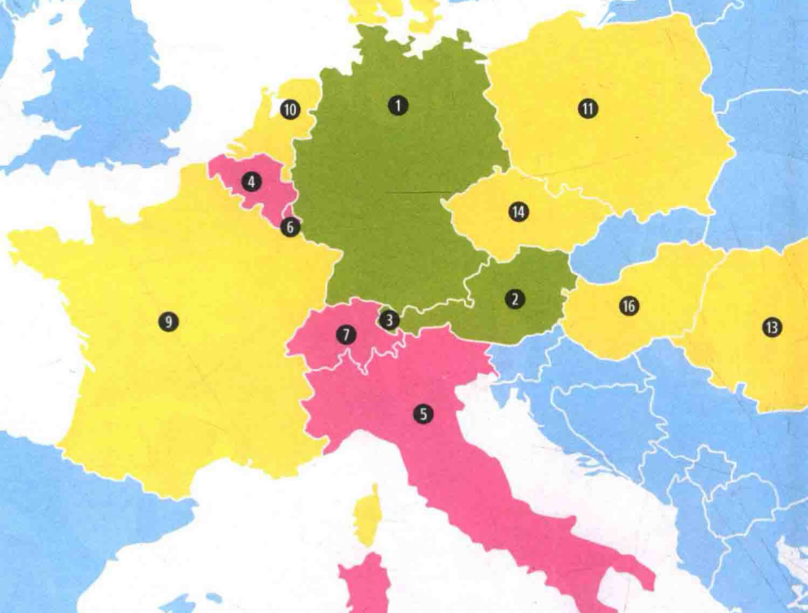

### 德语系国家 [](marginnote4app://note/BE6DC4EC-DA85-4833-96F6-C8E950A4ADEE)

### 德国纪念日与节庆 [](marginnote4app://note/E0237845-9A3D-4904-A938-A9DD474BF4EC)

#### Weihnachten [](marginnote4app://note/CC45CC97-D764-4AD4-A9EC-F42FDB3B3A94)

### 德国名人 [](marginnote4app://note/1C43E416-4DA6-43EB-B418-0BFB01F9792B)

### 德国北部观光景点 [](marginnote4app://note/1A0D2943-9EDD-4837-939A-5DE80DC72215)

### 德国美食 [](marginnote4app://note/64B264D6-7DF2-4758-A3F1-7836B89AD4F2)

### 德国东部观光景点 [](marginnote4app://note/370ABAC0-FC5D-47D8-9DAE-57A0B55DB38F)

## 无标题卡片 [](marginnote4app://note/06A3CC1D-6452-4A23-B267-891AB9FA23DF)

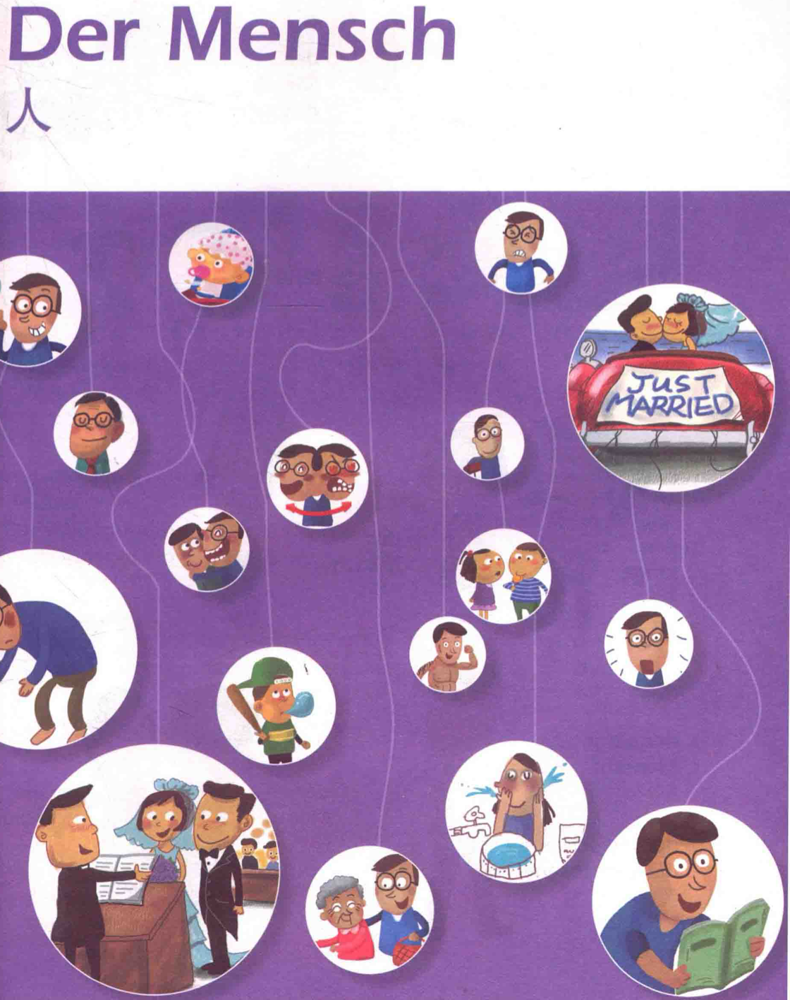

# 学习记录 [](marginnote4app://note/3D430F77-BACC-4E01-9D60-18FF73D314E1)

## 2026 [](marginnote4app://note/6DD9338F-100B-4FE7-8089-AE64EF4D6C8D)

### 3 [](marginnote4app://note/EE7D6642-8D63-4278-83B5-552D4516E5AE)

#### 14 [](marginnote4app://note/A82AB27F-AA41-48AB-B936-7AF8F3382A46)


# {{文档上下文}}; {{1. 翻译}}; {{2. 句式判定}}; {{3. 句法分析}}; {{逐词分解：}}; {{词组搭配分析：}}; {{德语变格逻辑：}}; {{完整结构：}} [](marginnote4app://note/D2692E80-D83C-4C87-9D34-2FD0CCD54257)

### 文档上下文

选中文本周围的上下文：
```
①1
krabbeln
②
zittern
抖
⑧
sich
strecken
伸懒腰
作
@④ uiberschreiten
跨
i sich hinlegen
躺
16 **sich auf den Bauch legen**
趴
① sich auf die Seite legen
侧躺
⑧⑧ stuirzen，
hinfallen
跌倒
⑥ ausrutschen
滑倒
20
im
Schneidersitz
sitzen
盘腿
89

```

sich auf den Bauch legen

我来帮您分析这个德语句子 "sich auf den Bauch legen"。

### 1. 翻译
**趴着/趴下**

### 2. 句式判定
这是一个**反身动词短语**，属于**祈使句或不定式结构**。

### 3. 句法分析

#### 逐词分解：

1. **sich** (反身代词)
   - **词性**：反身代词，第四格 (Akkusativ)
   - **作用**：表示动作作用于主语自身
   - **翻译**：自己/自身

2. **auf** (介词)
   - **词性**：介词
   - **作用**：表示位置关系，支配第三格 (Dativ)
   - **翻译**：在...上

3. **den** (定冠词)
   - **词性**：定冠词，阳性单数第三格
   - **作用**：限定名词"Bauch"，表示特指
   - **变格**：阳性单数第三格 → dem → den (介词auf后第三格)

4. **Bauch** (名词)
   - **词性**：阳性名词，单数第三格
   - **作用**：表示身体部位"腹部"
   - **翻译**：肚子/腹部

5. **legen** (动词)
   - **词性**：弱变化动词 (legen - legte - gelegt)
   - **作用**：主要动词，表示"放置/躺下"
   - **翻译**：放置/躺下

#### 词组搭配分析：

1. **sich legen** (反身动词短语)
   - 表示"躺下/卧倒"
   - 反身代词sich是第四格，因为legen是及物动词

2. **auf den Bauch** (介词短语)
   - 介词auf + 第三格 (Dativ)
   - 表示位置关系："在肚子上"
   - 注意：auf表示静态位置时用第三格，表示动态方向时用第四格

3. **sich auf den Bauch legen** (完整短语)
   - 字面意思："把自己放在肚子上"
   - 实际意思："趴着/趴下"

#### 德语变格逻辑：

1. **介词支配**：
   - auf + Dativ (第三格)：表示静态位置
   - auf + Akkusativ (第四格)：表示动态方向
   - 这里表示静态位置，所以用第三格

2. **冠词变格**：
   - 阳性名词Bauch的单数第三格：dem Bauch
   - 但auf + Dativ时，dem → den (介词auf的特殊要求)

3. **反身代词**：
   - 主语是第三人称单数/复数时，反身代词用sich
   - 这里sich是第四格，因为legen是及物动词

#### 完整结构：
```
sich (Akk)   auf (Präp)   den (Art, Dativ)   Bauch (N, Dativ)   legen (V)
└───反身宾语──┘   └─────────位置状语──────────┘   └──────主要动词─────┘
```

这个短语描述了一个完整的动作：主体躺下，使自己的腹部接触支撑面，形成趴着的姿势。

# {{文档上下文}}; {{1. 翻译}}; {{2. 句式判定}}; {{3. 句法分析}}; {{按顺序分析每个词：}}; {{词组搭配分析：}}; {{德语的变格逻辑：}}; {{句子结构：}} [](marginnote4app://note/DF5C21F9-1F60-4323-9529-EB77CAA792C2)

### 文档上下文

选中文本周围的上下文：
```
练习
3
4
5
Beim Essen.请用括号中形容词的名词化形式填空。
**Mann: Was ist das
（rot） da im Ess**en？
Frau: Da ist nichts
（rot）！
Mann: Doch, da ist etwas
Frau: Da ist viel
（rot）.
（grin） und das ist Spinat！
Mann: Ich sehe viel
（grin und auch ein
Frau：
bisschen
（rot）.
Das
（wenig） ist ein bisschen Paprika！
Kannst du vielleicht auch mal etwas
（positiv） uiber das Essen sagen？
Mann: Oh, Verzeihung! Das
（griin） und
Superlativ）， was ich je in meinem Leben gegessen habe.
（rot） hier ist das
（gut im
Im Geschaft.请用括号中形容词的名词化形式填空。
Ich suche ein Geschenk fur meine siebzehnjahrige Nichte.
Konnen Sie mir etwas empfehlen？
• Mochten Sie etwas Teurcs oder etwas Billigcs （teuer/billig）？
• Nein, ich mochte nichts
aber auch nichts sehr
（billig/teuer）.
• Lieber etwas
oderetwas
• Nichts
• Vielleicht etwas
（schin/praktisch）？
，lieber etwas
（dekoratiu）？
（praktisch /schin）.
4 Gute Idee！
• Welche Farbe denn? Etwas
• Nein, lieber etwas
aber viel
sieht immer gut aus （rot）.
.In ihrem Zimmer ist wenig
und
（griin/rot/gelb /griin）.
• Vielleicht eine Pflanze？
Nein, nichts
（lebendig）.
Traume.填空：若是作定语的形容词，请加上正确的词尾，若是名词化的形容词，请别忘记将首字母大
写，并加上正确的词尾。
Viele Menschen traumen davon, etwas
（beriihmt Sanger oder eine
Grobes
_（groB） zu erreichen,wie zum Beispiel ein
bervhuter
（grop） Sangerin zu werden. Beim Traumen ist es das
（unrealistisch） zu wiinschen. Dann bedeutet Traumen viel
（wichtig im Superlativ）， sich nichts
（gut）. Es gibt uns ein
Motivation.Ich wiinsche
（wichtig） Ziel im Leben und es ist eine
（schon） Traume! Und alles
（gut）！
（stark）
155

```


我看到您选中了一个德语句子："Mann: Was ist das **rote** (rot) da im Essen?"，这是来自第163页的练习内容。

让我按照您的要求对这个句子进行分析：

### 1. 翻译
**男人：食物里那个红色的东西是什么？**

### 2. 句式判定
这是一个**特殊疑问句**（W-Frage），由疑问词"Was"引导。

### 3. 句法分析

#### 按顺序分析每个词：

1. **Mann** - 名词，主语，意思是"男人"
   - 首字母大写，因为德语中名词首字母都要大写

2. **:** - 标点符号，表示说话人

3. **Was** - 疑问代词，意思是"什么"
   - 引导特殊疑问句
   - 在句中作主语补足语

4. **ist** - 动词，系动词"sein"的第三人称单数现在时
   - 意思是"是"
   - 位于第二位（德语动词第二位规则）

5. **das** - 定冠词，中性单数第一格
   - 指代"那个东西"
   - 因为"Was"是中性，所以用中性冠词"das"

6. **rote** - 形容词，名词化的形容词
   - 原形：rot（红色的）
   - 名词化形式：das Rote（红色的东西）
   - 在句中：das Rote → 因为前面有定冠词"das"，所以形容词词尾要变化
   - 词尾变化逻辑：
     - 定冠词 + 形容词：形容词要加词尾
     - das Rote：中性单数第一格，词尾为"-e"

7. **da** - 副词，意思是"那里"
   - 表示位置

8. **im** - 介词+冠词组合
   - in + dem = im
   - 意思是"在...里"

9. **Essen** - 名词，中性，意思是"食物"
   - 首字母大写
   - 与介词"in"连用，表示位置（在食物里）

#### 词组搭配分析：

- **Was ist das...?** - 固定表达，意思是"那是什么？"
- **das Rote** - 名词化的形容词结构
  - "形容词名词化"：在德语中，形容词可以通过加定冠词和相应词尾变成名词
  - 表示"红色的东西"
- **da im Essen** - 位置状语
  - "da"强调位置
  - "im Essen"具体说明位置（在食物里）

#### 德语的变格逻辑：

在这个句子中，最重要的变格是**形容词词尾变化**：

1. **定冠词+形容词**的变格规则：
   - 中性单数第一格：das + 形容词 + e
   - 所以：das + rot + e = das Rote

2. **名词化形容词**的规则：
   - 首字母大写
   - 根据性、数、格加相应词尾
   - 表示"...的人/物"的概念

#### 句子结构：
- 主语：隐含的"das Rote"（红色的东西）
- 系动词：ist
- 表语：Was
- 位置状语：da im Essen

**总结**：这是一个典型的德语特殊疑问句，展示了形容词名词化的用法。通过将形容词"rot"名词化为"das Rote"，表达"红色的东西"这一概念，这是德语中常见的表达方式，用于指代具有某种特征的事物。

# {{文档上下文}}; {{1. 翻译}}; {{2. 句式判定}}; {{3. 句法分析}}; {{句子结构分解：}}; {{词法分析：}}; {{词组搭配和语法逻辑：}}; {{完整语法解析：}} [](marginnote4app://note/2A0017EC-BC9A-4B15-900D-F8ADF0399BEB)

### 文档上下文

选中文本周围的上下文：
```
...onnten, wiirde es keine Weltmeisterschaft geben.
3 Konnten Sie mir bitte Geld wechseln？
Konnten Sie mir bitte ein Glas Wasser geben？
Konnten Sie mir bitte mit dem Kinderwagen helfen？
Konnten Sie mich bitte vorbeilassen？
Konnten Sie bitte das Fenster schliefen？
Konnten Sie mir bitte sagen, wie spat es ist？
4 1. Sie sollten weniger Schuhe kaufen.
2. Sie sollten weniger Computerspiele spielen.
3. Sie sollten es trotzdem machen.
4.Sie sollten sich gut vorbereiten.
5. Sie sollten einen Tanzkurs machen.
5
1.Du konntest ins Kino gehen.
2. Wir konnten zum Inder gehen.
3. Wir konnten zu Hause fernsehen.
4. Ich konnte dir helfen.
5. Du konntest zu mir kommen.
6. Ich konnte dir Geld leihen.
6
1C-2D-3E-4A-5B-6A
 被动态1
57
1
1. Ein Paket wird gesendet.
2.**Ich werde operiert**.
3. Die Getranke werden verkauft.
4. Ihr werdet informiert.
5. Sie werden abgeholt.
6. Du wirst nach Hause gebracht.
7. Der Olympiasieg wird gefeiert.
8. Die Pizza wird bestellt.
9. Wir werden vom Arzt behandelt.
2
1. Ich muss operiert werden.
2. Die Bremsen vom Auto miissen kontrolliert werden.
3. Du willst vom Arzt behandelt werden.
4. Wir miissen untersucht werden.
5. Eis darf hier nicht gegessen werden.
3 1.Die Kleidung wird in Koffer und Taschen eingepackt.
2. Die Blumen und der Haustirschliissel werden zu den Nachbarn gebracht.
3. Der Kthlschrank wird leer geraumt und abgestellt.
4. Die Fenster in allen Raumen werden geschlossen.
5. Die elektrischen Gerate werden ausgestellt.
6. Die Taschen und Koffer werden ins Auto gepackt.
4 1.In ...
```

Ich werde operiert

您选中的德语句子是："Ich werde operiert."

让我按照您的要求进行分析：

### 1. 翻译
**中文翻译**：我（将要）被做手术。/ 我（将）接受手术。

### 2. 句式判定
这是一个**被动态（Passiv）**句子，具体来说是**过程被动态（Vorgangspassiv）**。

### 3. 句法分析

#### 句子结构分解：
**Ich werde operiert.**

#### 词法分析：

1. **Ich** - 第一人称单数代词（主格）
   - 中文：我
   - 作用：句子的主语，动作的承受者（在被动态中，主语是动作的承受者）

2. **werde** - 助动词，werden 的第一人称单数现在时变位
   - 原型：werden
   - 中文：将，被
   - 作用：构成被动态的助动词，表示"被"的含义
   - 语法：现在时，第一人称单数

3. **operiert** - 第二分词（Partizip II），动词 operieren 的第二分词形式
   - 原型：operieren（做手术）
   - 中文：被做手术
   - 作用：表示动作的完成状态，与助动词 werden 一起构成被动态
   - 语法：operieren 的第二分词是 operiert（规则变化：operieren → operiert）

#### 词组搭配和语法逻辑：

1. **被动态构成**：
   - 形式：**werden + 第二分词**
   - 在这个句子中：werde（werden的变位） + operiert（operieren的第二分词）

2. **变格逻辑**：
   - 德语被动态中，主语是动作的承受者，所以使用主格（Nominativ）
   - "Ich" 是第一人称单数主格形式
   - 动词 operieren 是及物动词，可以构成被动态

3. **时态**：
   - 现在时被动态：werden（现在时变位）+ 第二分词
   - 这里 wer**de** 是 werden 的第一人称单数现在时变位

4. **语义逻辑**：
   - 主动态：Der Arzt operiert mich.（医生给我做手术。）
   - 被动态：Ich werde (vom Arzt) operiert.（我（被医生）做手术。）
   - 在被动态中，动作执行者（医生）通常用介词"von"或"durch"引出，可以省略

#### 完整语法解析：
- **句子类型**：陈述句，现在时被动态
- **语序**：标准陈述句语序（主语 + 谓语）
- **动词位置**：第二位（werde operiert 构成复合谓语）
- **语义重点**：强调"我"是手术的承受者，而不是谁在做手术

这个句子在您的文档中出现在被动态练习部分，是典型的德语被动态教学例句，展示了如何将及物动词转换为被动态结构。

# {{文档上下文}}; {{1. 中文翻译}}; {{2. 句式判定}}; {{3. 句法分析}}; {{词序结构：}}; {{每个词的用法和作用：}}; {{词组搭配：}}; {{德语的变格逻辑：}}; {{语法特点：}} [](marginnote4app://note/2F8BE890-E5A7-4BA0-9F6D-AC4B9B9EF7EE)

### 文档上下文

选中文本周围的上下文：
```
练习
B
4a
4b
5
6
Susi kommt heute nicht in den Kurs.请用 dass从句表达您的想法。
Sie ist krank •Sie hat keine Lust.• Ihr Kind ist krank.•Sie muss arbeiten.•
Sie will lange schlafen. • Sie kauft ein. •Sie holt ihren Mann vom Flughafen ab.•
Sie hat den Kurs vergessen. • Sie hat den Bus verpasst. •Sie ruht sich ein bisschen aus.
Ich glaube, dass sie krank ist. Ich denke, dass..
Was macht Marian, wenn..？请用 wenn 回答下列问题。
Die Sonne scheint：•Er hat Urlaub.• Er trifft sich mit seiner Freundin.•
Er muss langer arbeiten.• Er sieht gerade fern.
1. Wann geht erjoggen？
2. Wann schlaft er lange？
3. Wann zieht er sich schick an？
4. Wann argert er sich？
5. **Wann darf man ihn nicht st**oren？
Er gcht j0ggcn, wcnn dic Sonnc schcint.
请将 4a 中的句子改写为以从句开头的句子。
1. Wenn dic Sonnc Scheint, gcht crjoggcn.
请用wenn 或 wann 填空。
1.
sind Sie geboren？- Am 23.5.1992.
2.
ich morgen fit bin, konnen wir schwimmen gehen.
3.
kommst du？-Ich weifs noch nicht, vielleicht am Samstag，
4.
beginnt die Diskussion？- Wir miissen noch warten.
anfangen.
请用 weil, dass 或 wenn 填空。
wann？=
Fragewort
wenn=
Konjunktion
ich Zeit habe.
alle da sind,konnen wir
Lieber Lukas，
wie geht's? Bei mir ist es wunderbar，
ich Urlaub
habe. Ich habe immer viel Stress，
ich arbeite. Und
jetzt: Ich schlafe lange，
kein Wecker klingelt.Ich
stehe erst dann auf，
ich Lust habe. Wie ist es bei dir？
Ich hoffe，
du auch bald Urlaub bekommst.
Ich mochte gerne mit dir zusammen nach Spanien fahren.
Denkst du，
das moglich ist？
Schreib mir bald.
Schone Griife，
Alex
dass，
weil，
wenn =
动词位于句末
103

```

Wann darf man ihn nicht storen?

您选中的句子是："Wann darf man ihn nicht stören?"（什么时候不能打扰他？）

这是一个德语疑问句，让我为您详细分析：

### 1. 中文翻译
**什么时候不能打扰他？**

### 2. 句式判定
这是一个**特殊疑问句**（Fragesatz），使用疑问词"wann"引导。

### 3. 句法分析

#### 词序结构：
**Wann + 动词(darf) + 主语(man) + 宾语(ihn) + 否定词(nicht) + 动词不定式(stören) + ?**

#### 每个词的用法和作用：

1. **Wann** - 疑问副词
   - 含义："什么时候"
   - 作用：引导时间疑问句
   - 位置：句首（德语疑问句的典型结构）

2. **darf** - 情态动词
   - 原形：dürfen
   - 含义："可以"、"允许"
   - 变位：ich darf, du darfst, er/sie/es darf, wir dürfen, ihr dürft, sie/Sie dürfen
   - 作用：表达许可或可能性

3. **man** - 不定代词
   - 含义："人们"、"有人"
   - 作用：泛指任何人，相当于英语的"one"或"you"
   - 语法：主格，作主语

4. **ihn** - 人称代词
   - 原形：er（他）
   - 格：第四格（Akkusativ）
   - 作用：作直接宾语
   - 变格：er → ihn（第四格）

5. **nicht** - 否定副词
   - 含义："不"、"没有"
   - 作用：否定整个句子
   - 位置：在动词不定式前

6. **stören** - 动词不定式
   - 含义："打扰"、"干扰"
   - 作用：与情态动词"darf"构成不定式短语
   - 位置：句末（德语情态动词结构的特点）

#### 词组搭配：
- **nicht stören** - 不打扰（固定搭配）
- **darf man** - 人们可以（情态动词+不定代词）

#### 德语的变格逻辑：
在这个句子中：
- **man** 保持主格形式（不变）
- **ihn** 是"er"的第四格形式，因为它是动词"stören"的直接宾语
- 情态动词"darf"需要与主语"man"保持一致（第三人称单数）

#### 语法特点：
1. **动词第二位原则**：darf在第二位
2. **情态动词结构**：情态动词+动词不定式，不定式在句末
3. **疑问句结构**：疑问词+动词+主语+...
4. **否定位置**：nicht放在动词不定式前

这是一个典型的德语疑问句结构，体现了德语严谨的语序规则和变格系统。

# {{文档上下文}}; {{1. 翻译}}; {{2. 句式判定}}; {{3. 句法分析}}; {{疑问句分析：}}; {{回答句分析：}}; {{词组搭配：}}; {{语法要点总结：}}; {{关键区别：有无冠词}}; {{1. 第一句：有定冠词的情况}}; {{2. 第二句：无冠词的情况}}; {{完整规则总结：}}; {{复数形容词词尾变化表：}}; {{具体分析您的例子：}}; {{为什么会有这个区别？}}; {{记忆技巧：}}; {{更多例子对比：}} [](marginnote4app://note/178348EC-0F84-45AA-BF30-A455E3C6BFA4)

### 文档上下文

选中文本周围的上下文：
```
6
Ein netter Mann! Ich liebe den netten Mann
形容词词尾变化：第一格和第四格
（Nominativ und Akkusativ） I（）） 37+38
A
3
2
nette
Mann
ein
pette@
Mann
阳性
中性
第一格
der Mann
der nette Mann
ein netter Mann
kein netter Mann
第四格
den Mann
den netten Mann
einen netten Mann
keinen netten Mann
das Kind
das nette Kind
ein nettes Kind
kein nettes Kind
das Kind
das nette Kind
ein nettes Kind
kein nettes Kind
位于名词左边的形容词至少要加上词尾-e。
标记名词性、数、格的词尾不是在冠词上，就是在形容词上。
der nette Mann
ein netter Mann
修饰第四格阳性单数名词的形容词词尾总有-n。
修饰复数名词的形容词词尾不是-e就是-eno
mein, dein, sein, ihr, unser, euer, ihr, Ihr 和kein 的变格方式相同。
位于名词右边的形容词没有词尾变化。
Der Mann ist nett.
Die Leute sind nett.
请用正确的形容词词尾填空。
1. 4 Ist das der nett
Lehrer？
2. 4 Ist das die neu
Tasche？
3. 4 Ist das das bequem
Sofa？
**4. 4 Sind das die giinstig
Tassen？
5. 4 Ist das de**r gut
Herd？
6. 4 Ist das das intelligent
Kind？
7. 4 Sind das die dumm
Leute？
阴性
die Frau
die nette Frau
eine nette Frau
keine nette Frau
die Frau
die nette
eine nette Frau
keine nette Frau
复数
die Leute
die netten Leute
- nette Leute
keine netten Leute
die Leute
die netten Leute
- nette Leute
keine netten Leute
4 Ja, das ist ein nett
4 Ja, das ist eine neu
4 Ja,das ist ein bequem
Ja, das sind giinstig
4 Ja, das ist ein gut
• Ja, das ist ein intelligent
• Ja, das sind dumm
Lehrer.
Tasche.
Sofa.
Tassen.
Herd.
Kind.
Leute.
88

```


我看到了您选中的德语句子练习。让我按照您要求的三个步骤来分析：

### 1. 翻译
**"Sind das die günstigen Tassen?"** → "这些是便宜/实惠的杯子吗？"
**"Ja, das sind günstige Tassen."** → "是的，这些是便宜/实惠的杯子。"

### 2. 句式判定
这是一个**疑问句**和**肯定回答**的对话结构：
- 疑问句：Sind das die günstigen Tassen?（一般疑问句）
- 回答句：Ja, das sind günstige Tassen.（肯定陈述句）

### 3. 句法分析

#### 疑问句分析：
**Sind das die günstigen Tassen?**

1. **Sind** - 动词，sein（是）的第三人称复数现在时变位
   - 主语是"das"（这/这些），动词提前到句首构成疑问句

2. **das** - 指示代词，中性单数/复数，这里指代"这些"
   - 在疑问句中作主语

3. **die** - 定冠词，阴性/复数第四格
   - 这里修饰复数名词"Tassen"，表示特指

4. **günstigen** - 形容词，günstig（便宜的）的复数第四格词尾变化
   - 词尾变化：günstig + -en = günstigen
   - 变格逻辑：复数第四格，修饰阴性复数名词"Tassen"，形容词词尾为-en

5. **Tassen** - 名词，阴性复数第四格
   - 词性：阴性（die Tasse）
   - 数：复数
   - 格：第四格（宾语）

#### 回答句分析：
**Ja, das sind günstige Tassen.**

1. **Ja** - 副词，表示肯定回答

2. **das** - 指示代词，中性单数/复数，主语

3. **sind** - 动词，sein的第三人称复数现在时

4. **günstige** - 形容词，复数第一格词尾变化
   - 词尾变化：günstig + -e = günstige
   - 变格逻辑：复数第一格，修饰复数名词"Tassen"，形容词词尾为-e

5. **Tassen** - 名词，阴性复数第一格

#### 词组搭配：
- **Sind das...?** - 这是...吗？（固定疑问句式）
- **Ja, das sind...** - 是的，这是...（固定回答句式）
- **die günstigen Tassen** - 这些便宜的杯子（定冠词+形容词+名词）
- **günstige Tassen** - 便宜的杯子（无冠词时形容词词尾变化）

#### 语法要点总结：
1. **形容词词尾变化规则**：
   - 有定冠词时：复数第四格 → -en（die günstigen Tassen）
   - 无冠词时：复数第一格 → -e（günstige Tassen）

2. **sein动词用法**：
   - 疑问句：动词提前到句首
   - 回答句：主语+动词+表语结构

3. **复数名词变化**：
   - Tasse（单数）→ Tassen（复数）
   - 阴性名词复数通常加-n或-en

这个练习很好地展示了德语形容词在有无冠词情况下的不同词尾变化规则，是德语语法学习中的重要基础内容。

不是说复数词尾是E N吗，那第二句为什么只有一个？

您问得非常好！这是一个德语形容词词尾变化的常见困惑点。让我详细解释：

### 关键区别：**有无冠词**

#### 1. 第一句：**有定冠词**的情况
**"die günstigen Tassen"**
- 定冠词：die（复数第四格）
- 形容词：günstig + **-en**
- 名词：Tassen

**规则**：当有**定冠词**（der, die, das）时，复数第四格的形容词词尾是**-en**

#### 2. 第二句：**无冠词**的情况  
**"günstige Tassen"**
- 无冠词
- 形容词：günstig + **-e**
- 名词：Tassen

**规则**：当**没有冠词**时，复数第一格的形容词词尾是**-e**

### 完整规则总结：

#### 复数形容词词尾变化表：

| 格 | 有定冠词 | 无冠词 | 有不定冠词/物主代词 |
|----|----------|--------|-------------------|
| **第一格** | -en | **-e** | -e |
| **第四格** | -en | -e | -e |

#### 具体分析您的例子：

**第一句（疑问句）：**
- 结构：Sind das **die** günstigen Tassen?
- 有定冠词"die" → 形容词词尾**-en**
- 这是复数第四格（宾语）

**第二句（回答句）：**
- 结构：das sind **günstige** Tassen
- 无冠词 → 形容词词尾**-e**
- 这是复数第一格（表语）

### 为什么会有这个区别？

德语中，**格的信息**必须通过**冠词或形容词词尾**来体现：

1. **有定冠词时**：冠词已经包含了格的信息（die = 复数第四格），所以形容词只需要加基本词尾-en

2. **无冠词时**：形容词必须自己承担表示格的功能，所以词尾变化更明显：
   - 第一格：-e
   - 第四格：-e（复数第四格无冠词时也是-e）

### 记忆技巧：

1. **"有冠词，就简单"**：有定冠词时，复数所有格都是**-en**
2. **"没冠词，看一格"**：无冠词时，复数第一格是**-e**，第四格也是**-e**

### 更多例子对比：

- **有定冠词**：die schönen Blumen（美丽的花）
- **无冠词**：schöne Blumen（美丽的花）
- **有不定冠词**：keine schönen Blumen（没有美丽的花）

所以您观察得很准确！第二句确实只有一个-e，这正是因为**没有冠词**时的特殊规则。

深度思考，变格逻辑是什么？ 怎么就四格了既没有介词，也没有动词

# {{翻译}}; {{错误习题解析}}; {{1. "Qus dMl-Haus" → "aus dem Haus"}}; {{2. "Vonzum Bahnhof" → "zum Bahnhof"}}; {{3. "fahre Zug" → "fahre mit dem Zug"}}; {{4. "bei von Kaln" → "bei Köln"}}; {{5. "mit dery Bomm" → 应该是"bei Bonn"}}; {{6. "Das Se finf Jahren" → "Das seit fünf Jahren"}}; {{德语介词使用要点总结}}; {{1. 方位介词}}; {{2. 时间介词}}; {{3. 方式介词}}; {{4. 常见错误}} [](marginnote4app://note/11294525-A0BF-4190-829E-80880F8CC6E9)


我看到了您选择的文档内容，这是一个德语介词填空练习。让我先翻译所有内容，然后讲解所有错误习题的解析。

### 翻译

**请选择正确的介词填空。**
aus dem•bei•mit dem•nach•seit•von•zum

**您的上班路线是怎样的？您早上什么时候从家里出门？**
Wie ist Ihr Weg zur Arbeit? Wann gehen Sie morgens Qus dMl-Haus？

**早上7点15分。然后我从家走到火车站，坐火车去。**
Um Viertel nach sieben. Ich gehe dann Vonzum Bahnhof und fahre Zug

**我的公司位于科隆南部。**
Meine Firma liegt sigfich 公司 南部 bei von Kaln mit dery Bomm.

**您上班需要很长时间吗？**
Brauchen Sie lange für den Weg zur Arbeit？

**是的，但我无所谓。我已经这样做了5年。我不想搬家。**
Ja, aber das macht mir nichts. Das Se finf Jahren. Ich möchte nicht umziehen.

### 错误习题解析

#### 1. **"Qus dMl-Haus" → "aus dem Haus"**
- **错误**：原文写成了"Qus dMl-Haus"，这应该是"aus dem Haus"的笔误
- **正确介词**：aus dem
- **解析**："aus dem Haus"表示"从家里出来"，"aus"表示"从...里面出来"

#### 2. **"Vonzum Bahnhof" → "zum Bahnhof"**
- **错误**：原文写成了"Vonzum"，这是"von"和"zum"的混淆
- **正确介词**：zum
- **解析**："zum Bahnhof"表示"去火车站"，"zu"表示方向（去往某地）

#### 3. **"fahre Zug" → "fahre mit dem Zug"**
- **错误**：缺少介词"mit dem"
- **正确介词**：mit dem
- **解析**："mit dem Zug fahren"表示"乘坐火车"，"mit"表示使用某种交通工具

#### 4. **"bei von Kaln" → "bei Köln"**
- **错误**：多写了"von"，应该是"bei Köln"
- **正确介词**：bei
- **解析**："bei Köln"表示"在科隆附近"，"bei"表示在某个地点附近

#### 5. **"mit dery Bomm" → 应该是"bei Bonn"**
- **错误**：这里可能有拼写错误，"dery Bomm"可能是"Bonn"的笔误
- **正确介词**：bei
- **解析**：如果原文是"bei Bonn"，表示"在波恩附近"

#### 6. **"Das Se finf Jahren" → "Das seit fünf Jahren"**
- **错误**："Se"应该是"seit"
- **正确介词**：seit
- **解析**："seit fünf Jahren"表示"已经5年了"，"seit"表示从过去某个时间点开始持续到现在

### 德语介词使用要点总结

#### 1. **方位介词**
- **aus**：从...里面出来（aus dem Haus）
- **bei**：在...附近（bei Köln）
- **zu**：去往某地（zum Bahnhof）

#### 2. **时间介词**
- **nach**：在...之后（um Viertel nach sieben - 7点15分）
- **seit**：自从...（表示持续状态）

#### 3. **方式介词**
- **mit**：用，通过（mit dem Zug - 乘坐火车）

#### 4. **常见错误**
- 不要混淆"von"（从...来）和"zu"（去往...）
- "bei"表示附近，不是精确位置
- "seit"后面跟时间段，表示持续状态

这个练习很好地展示了德语介词在实际对话中的应用。如果您需要更详细的解释或更多练习，请告诉我！

# {{文档上下文}}; {{1. 翻译}}; {{2. 句式判定}}; {{3. 句法分析}}; {{第一句：Ich habe kein Glas.}}; {{第二句：Kannst du aus der Flasche trinken?}}; {{词组搭配分析：}}; {{德语的变格逻辑：}}; {{句子结构：}} [](marginnote4app://note/F6F1C808-20D6-4C0D-88A8-30B036C1E3F4)

### 文档上下文

选中文本周围的上下文：
```
31
Aus, bei, mit, nach, seit, von oder zu
支配第三格的介词 （Prapositionen mit Dativ） 呵》）至
aus
bei
mit
nach
seit
von
ZU
目
Er geht um acht Uhr aus dem Haus.
**Ich habe kein Glas. Kannst du aus der Flasche trinken**？
Der Stuhl ist aus Metall.（材质）
Ich bin heute bei Lisa.（人）
Er arbeitet bei Siemens.（公司）
Augsburg liegt bei Minchen.（附近）
Ich fahre mit meinem Freund in den Urlaub.（同伴）
Wir fahren mit dem Bus.（交通工具）
Ich schreibe mit dem Bleistift.（工具）
Er fahrt nach Deutschland, erst nach Hamburg, dann nach Frankfurt.
（表方位：去哪儿？后接无冠词的城市和国家名）
Wie spat ist es？ - Es ist fiinf nach zwei.（表时间）
Nach dem Essen kann ich nicht gut arbeiten.
Seit einem Jahr wohne ich in Berlin.
（表时间：始于过去，持续至今）
Ich komme gerade vom Zahnarzt.（表方位：从哪里来？）
Die Schwester von meiner Freundin ist schon verheiratet.（表领属）
Der Flughafen liegt sudlich von Frankfurt.
Wie komme ich zum Bahnhof？（表方位：去哪里？）
Heute fahren wir zu meinen Eltern.
Zum Fruhstuck esse ich immer ein Ei.（表时间）
介词 aus, bei, mit, nach, seit, von 和zu只支配第三格。
bei+ dem = beim
zu +dem = zum
von + dem= vom
zu +der=zur
1 请选择正确的介词填空。
aus dem• bei•mitdem•nach•seit•von•zum
2
Wie ist Ihr Weg zur Arbeit? Wann gehen Sie morgens
1 Um Viertel
sieben.Ich gehe dann
Meine Firma liegt sidlich
_Koln，
Brauchen Sie lange fur den Weg zur Arbeit？
• Ja, aber das macht mir nichts. Das mache ich schon
请用 bei 或 mit 填空。
Fahren Sie
dem Auto zur Arbeit? 4 Nein，
Fahren Sie alleine？
• Nein, meistens fahre ich
Er arbeitet auch
der DH-Bank.
Haus？
Bahnhof und fahre
Bonn.
Zug.
funf Jahren. Ich mochte nicht umziehen.
dem Zug.
meinem Nachbarn zusammen.
76

```

Ich habe kein Glas. Kannst du aus der Flasche trinken

我看到了您选中的德语句子："Ich habe kein Glas. Kannst du aus der Flasche trinken?"

让我按照您的要求进行分析：

### 1. 翻译
**中文翻译**：我没有杯子。你能从瓶子里喝吗？

### 2. 句式判定
这是一个**疑问句**（Fragesatz），具体来说是：
- 第一句：陈述句（Aussagesatz）
- 第二句：一般疑问句（Entscheidungsfrage），使用情态动词"kannst"开头

### 3. 句法分析

#### 第一句：Ich habe kein Glas.
- **Ich**：第一人称单数主格代词（Nominativ）
- **habe**：动词"haben"（有）的第一人称单数现在时变位
- **kein**：否定冠词，相当于"没有"，这里修饰中性名词"Glas"
- **Glas**：中性名词（das Glas），单数第四格（Akkusativ），作为"haben"的直接宾语

#### 第二句：Kannst du aus der Flasche trinken?
- **Kannst**：情态动词"können"（能够）的第二人称单数现在时变位
- **du**：第二人称单数主格代词（Nominativ）
- **aus**：介词，支配第三格（Dativ），意思是"从...里面"
- **der Flasche**：
  - **der**：定冠词，阴性单数第三格（Dativ）
  - **Flasche**：阴性名词（die Flasche），单数第三格（Dativ），因为介词"aus"要求第三格
- **trinken**：实义动词"喝"（trinken）的不定式

#### 词组搭配分析：
1. **aus der Flasche trinken**：从瓶子里喝
   - "aus" + Dativ：表示"从...里面出来"
   - 这是固定搭配，表示从容器中饮用

2. **kein Glas haben**：没有杯子
   - "kein" + 名词：表示否定拥有
   - "Glas"作为"haben"的直接宾语，用第四格

#### 德语的变格逻辑：
1. **介词支配**：
   - "aus"是支配第三格的介词（Dativpräposition）
   - 所以"die Flasche"必须变为第三格"der Flasche"

2. **动词变位**：
   - "haben"：ich habe, du hast, er/sie/es hat...
   - "können"：ich kann, du kannst, er/sie/es kann...

3. **冠词变化**：
   - 阴性名词第三格：die → der
   - 中性名词第四格：das → das（不变）

#### 句子结构：
- 第一句：主语(Ich) + 谓语(habe) + 宾语(kein Glas)
- 第二句：情态动词(Kannst) + 主语(du) + 介词短语(aus der Flasche) + 不定式(trinken)

这是一个很典型的德语日常对话句子，展示了介词"aus"的正确用法和情态动词疑问句的结构。

# {{翻译}}; {{练习题解析}}; {{德语过去分词构成规则}}; {{1. 规则动词过去分词构成公式：}}; {{2. 具体解析：}}; {{重要语法点总结}}; {{1. 以-ieren结尾的动词特殊规则}}; {{2. 完成时结构}}; {{3. 典型反例（什么情况下不适用这个规则）}}; {{学习建议}} [](marginnote4app://note/5847D37A-8231-4322-931F-B594E14634F0)


我注意到您提供了一个德语练习题，要求用括号内动词的过去分词形式填空。让我先翻译所有内容，然后讲解这个练习题的解析。

### 翻译

**去年我在海德堡学习（studieren）。**
**夏天我和三个朋友开车去了慕尼黑。途中有什么东西爆炸（explodieren）了。**
**轮胎坏了！我们讨论（diskutieren）了现在该怎么办。然后一个朋友尝试（probieren）换轮胎。他真的修好（reparieren）了车！**
**我们祝贺（gratulieren）了他，然后顺利到达了慕尼黑。**

### 练习题解析

这是一个德语过去分词填空练习，主要考察**规则动词的过去分词构成**。

#### 德语过去分词构成规则

**类比仅用于直觉**：可以把德语过去分词想象成英语的过去分词（如 studied, worked），但德语有更固定的前缀规则。

##### 1. 规则动词过去分词构成公式：
```
ge + 动词词干 + t
```

##### 2. 具体解析：

1. **studiert** (studieren → 学习)
   - 词干：studier
   - 过去分词：ge + studier + t = **studiert**
   - 注意：以-ieren结尾的动词，过去分词不加ge-，直接加-t

2. **explodiert** (explodieren → 爆炸)
   - 词干：explodier
   - 过去分词：ge + explodier + t = **explodiert**
   - 同样以-ieren结尾，不加ge-

3. **diskutiert** (diskutieren → 讨论)
   - 词干：diskutier
   - 过去分词：ge + diskutier + t = **diskutiert**
   - 以-ieren结尾，不加ge-

4. **probiert** (probieren → 尝试)
   - 词干：probier
   - 过去分词：ge + probier + t = **probiert**
   - 以-ieren结尾，不加ge-

5. **repariert** (reparieren → 修理)
   - 词干：reparier
   - 过去分词：ge + reparier + t = **repariert**
   - 以-ieren结尾，不加ge-

6. **gratuliert** (gratulieren → 祝贺)
   - 词干：gratulier
   - 过去分词：ge + gratulier + t = **gratuliert**
   - 以-ieren结尾，不加ge-

#### 重要语法点总结

##### 1. 以-ieren结尾的动词特殊规则
- 不加ge-前缀
- 直接词干 + t
- 这类动词通常是外来词（源自拉丁语、法语等）

##### 2. 完成时结构
这个练习中使用的都是**现在完成时**：
- haben + 过去分词（用于大多数动词）
- sein + 过去分词（用于表示位置变化或状态变化的动词，如fahren）

##### 3. 典型反例（什么情况下不适用这个规则）

**反例1：不规则动词**
- 规则：ge + 词干 + t
- 反例：sehen → gesehen（不是geseht）
- 解释：不规则动词的词干会变化，且以-en结尾

**反例2：可分动词**
- 规则：ge + 词干 + t
- 反例：aufmachen → aufgemacht（ge在可分前缀和词干之间）
- 解释：可分动词的ge-插入可分前缀和词干之间

**反例3：不可分动词**
- 规则：ge + 词干 + t
- 反例：verstehen → verstanden（不加ge-）
- 解释：带有不可分前缀（be-, ge-, er-, ver-, zer-, ent-, emp-, miss-）的动词不加ge-

#### 学习建议

1. **记忆模式**：以-ieren结尾的动词都是规则变化，且不加ge-
2. **练习方法**：多练习这类动词的变位，形成肌肉记忆
3. **扩展学习**：掌握不规则动词的变化模式，这是德语学习的难点之一

这个练习题很好地展示了德语规则动词过去分词的构成规律，特别是以-ieren结尾的动词的特殊规则。

# {{翻译}}; {{正确连线解析}}; {{1. Magst du die neue Kollegin? → F. Ja, ich mag sie.}}; {{2. Liebst du den Mann? → D. Nein, ich mag ihn nicht.}}; {{3. Essen Sie die Spaghetti? → E. Ja, ich nehme sie.}}; {{4. Liebst du mich? → B. Na ja, ich mag dich.}}; {{5. Kaufst du das Auto? → A. Nein, ich nehme es nicht.}}; {{6. Mögt ihr uns? → C. Wir lieben euch!}}; {{[结构化总结]}}; {{一、正确连线结果}}; {{二、关键语法点总结}}; {{三、常见错误分析}}; {{四、学习建议}} [](marginnote4app://note/B7F8FA35-DD87-4691-BC38-A1F3EC6D332C)


我看到了您从文档中选中的德语连线练习题。让我先翻译所有内容，然后讲解如何正确连线。

### 翻译

**连线题内容翻译：**

**左侧问句：**
1. Magst du die neue Kollegin? → 你喜欢新来的女同事吗？
2. Liebst du den Mann? → 你爱那个男人吗？
3. Essen Sie die Spaghetti? → 您吃意大利面吗？
4. Liebst du mich? → 你爱我吗？
5. Kaufst du das Auto? → 你买这辆车吗？
6. Mögt ihr uns? → 你们喜欢我们吗？

**右侧答句：**
A. Nein, ich nehme es nicht. → 不，我不拿它。
B. Na ja, ich mag dich. → 嗯，我喜欢你。
C. Wir lieben euch! → 我们爱你们！
D. Nein, ich mag ihn nicht. → 不，我不喜欢他。
E. Ja, ich nehme sie. → 是的，我拿它。
F. Ja, ich mag sie. → 是的，我喜欢她。

### 正确连线解析

让我用[讲解+类比]的方式来分析：

**类比仅用于直觉：** 这就像玩"找朋友"游戏，每个问句都在寻找能正确回答它的答句。问句和答句必须"门当户对"——主语、动词、宾语都要匹配。

#### 1. Magst du die neue Kollegin? → F. Ja, ich mag sie.
- **问句分析：** "你喜欢新来的女同事吗？" → 动词"magst"（喜欢），宾语"die neue Kollegin"（新来的女同事，女性）
- **答句匹配：** "Ja, ich mag sie." → "是的，我喜欢她。" 
- **逻辑对应：** "magst"对应"mag"，"Kollegin"（女性）对应"sie"（她）
- **典型反例：** 不能选D，因为D说的是"ihn"（他），而问句问的是女同事

#### 2. Liebst du den Mann? → D. Nein, ich mag ihn nicht.
- **问句分析：** "你爱那个男人吗？" → 动词"liebst"（爱），宾语"den Mann"（那个男人，男性）
- **答句匹配：** "Nein, ich mag ihn nicht." → "不，我不喜欢他。"
- **逻辑对应：** 问句用"liebst"（爱），答句用"mag"（喜欢），但都是对同一个男性对象
- **注意：** 这里答句用了"mag"而不是"liebe"，但对象"ihn"（他）正确对应"den Mann"

#### 3. Essen Sie die Spaghetti? → E. Ja, ich nehme sie.
- **问句分析：** "您吃意大利面吗？" → 动词"Essen"（吃），宾语"die Spaghetti"（意大利面，复数）
- **答句匹配：** "Ja, ich nehme sie." → "是的，我拿它。"
- **逻辑对应：** 这里有个语言习惯问题：德语中"nehmen"（拿）常用来表示"吃"或"喝"
- **注意：** "Spaghetti"是复数，但答句用"sie"（它们）正确对应

#### 4. Liebst du mich? → B. Na ja, ich mag dich.
- **问句分析：** "你爱我吗？" → 动词"liebst"（爱），宾语"mich"（我）
- **答句匹配：** "Na ja, ich mag dich." → "嗯，我喜欢你。"
- **逻辑对应：** 问句是"爱"，答句是"喜欢"，但都是对"我"这个人
- **情感层次：** "lieben"（爱）比"mögen"（喜欢）程度更深

#### 5. Kaufst du das Auto? → A. Nein, ich nehme es nicht.
- **问句分析：** "你买这辆车吗？" → 动词"kaufst"（买），宾语"das Auto"（这辆车，中性）
- **答句匹配：** "Nein, ich nehme es nicht." → "不，我不拿它。"
- **逻辑对应：** 这里"nehmen"（拿）可以理解为"接受"或"要"
- **语法对应：** "das Auto"（中性）对应"es"（它）

#### 6. Mögt ihr uns? → C. Wir lieben euch!
- **问句分析：** "你们喜欢我们吗？" → 动词"mögt"（喜欢，复数），宾语"uns"（我们）
- **答句匹配：** "Wir lieben euch!" → "我们爱你们！"
- **逻辑对应：** 问句是"你们喜欢我们"，答句是"我们爱你们"
- **人称对应：** "ihr"（你们）对应"wir"（我们），"uns"（我们）对应"euch"（你们）

### [结构化总结]

#### 一、正确连线结果
1. **Magst du die neue Kollegin?** → **F. Ja, ich mag sie.**
2. **Liebst du den Mann?** → **D. Nein, ich mag ihn nicht.**
3. **Essen Sie die Spaghetti?** → **E. Ja, ich nehme sie.**
4. **Liebst du mich?** → **B. Na ja, ich mag dich.**
5. **Kaufst du das Auto?** → **A. Nein, ich nehme es nicht.**
6. **Mögt ihr uns?** → **C. Wir lieben euch!**

#### 二、关键语法点总结
- **动词对应：** 问句和答句的动词要语义相关（如"lieben"对应"mögen"）
- **代词一致：** 宾语的人称、性别、数必须一致
  - 男性：ihn（他）
  - 女性：sie（她）
  - 中性：es（它）
  - 复数：sie（它们/他们/她们）
- **语言习惯：** 德语中"nehmen"常代替"essen"表示"吃"

#### 三、常见错误分析
- **错误1：** 混淆性别代词（如把女性宾语用"ihn"回答）
- **错误2：** 忽略动词的语义层次（"lieben"比"mögen"程度深）
- **错误3：** 不理解"nehmen"在特定语境下的含义

#### 四、学习建议
1. 先识别问句的**主语、动词、宾语**
2. 在答句中寻找**对应的语法成分**
3. 注意**德语特有的表达习惯**
4. 练习时多关注**代词的一致性**

这个练习很好地训练了德语的基本句型和代词使用，是打好语法基础的重要一步！

# {{翻译}}; {{语法讲解 [讲解+类比]}}; {{1. 德语格的概念（类比仅用于直觉）}}; {{2. 四个格的正式定义}}; {{3. 练习中的具体分析}}; {{Welchen Lehrer haben wir heute?（我们今天有哪位老师？）}}; {{Diesen dicken.（那个胖胖的。）}}; {{Mit welchem Buch hast du früher gelernt?（你以前用哪本书学习？）}}; {{Welchem Buch findest du besser?（你觉得哪本书更好？）}}; {{错误习题解析 [结构化总结]}}; {{一、常见错误类型}}; {{1. 介词格混淆错误}}; {{2. 动词格要求错误}}; {{3. 指示代词格变化错误}}; {{二、格判断流程图}}; {{三、典型反例分析}}; {{反例1：Welchen Lehrer（正确） vs. Welcher Lehrer（错误）}}; {{反例2：Mit welchem Buch（正确） vs. Mit welches Buch（错误）}}; {{四、记忆技巧}}; {{深度语法分析：德语格与词尾填空}}; {{一、句子结构与格判断框架}}; {{1. 分析流程（三步法）}}; {{深度语法分析：指示代词的选择与格判断}}; {{一、句子结构与问题识别}}; {{原始文本分析：}}; {{3. 学习策略}} [](marginnote4app://note/2B4C6FC4-F455-4262-AFBE-2064C97F09EB)


我看到您从文档中选择了德语练习内容。让我先翻译这些内容，然后讲解其中的语法点。

### 翻译

**在课堂上。请填上正确的第一格、第三格或第四格词尾。**

**Scarlett:** 我们今天有哪位老师？
**Jun:** 那个胖胖的。我想他叫Weiher先生。
**Scarlett:** 哪些练习是家庭作业？
**Jun:** 这里第63页的这个。你以前用哪本书学习？
**Scarlett:** 用studio d。
**Jun:** 你觉得哪本书更好？这里的这本还是studio d？
**Scarlett:** 两本都非常好。你以前有哪本书？
**Jun:** 我以前有这里的这本。

### 语法讲解 [讲解+类比]

#### 1. 德语格的概念（类比仅用于直觉）
**类比：** 想象德语中的"格"就像英语中的"主格、宾格、所有格"，但更系统化。就像英语说"I（主格）see him（宾格）"，德语用不同的词尾来标记谁在做什么。

#### 2. 四个格的正式定义
1. **第一格（Nominativ）：** 主语 - 执行动作的人/物
2. **第二格（Genitiv）：** 所有格 - 表示所属关系
3. **第三格（Dativ）：** 间接宾语 - 动作的接受者
4. **第四格（Akkusativ)：** 直接宾语 - 动作的直接对象

#### 3. 练习中的具体分析

##### **Welchen Lehrer haben wir heute?**（我们今天有哪位老师？）
- **Welchen**：第四格，因为"haben"（有）需要第四格宾语
- 问句结构：Welchen（第四格疑问词）+ Lehrer（名词）+ haben（动词）

##### **Diesen dicken.**（那个胖胖的。）
- **Diesen**：第四格，回答"Welchen Lehrer"
- 这是指示代词"dieser"的第四格阳性形式

##### **Mit welchem Buch hast du früher gelernt?**（你以前用哪本书学习？）
- **Mit welchem**：第三格，因为介词"mit"（用）总是要求第三格
- 介词决定格：mit + Dativ

##### **Welchem Buch findest du besser?**（你觉得哪本书更好？）
- **Welchem**：第三格，因为动词"finden"（认为）在这里与第三格连用
- 这是"finden + Dativ"的特殊用法

### 错误习题解析 [结构化总结]

#### 一、常见错误类型

##### 1. 介词格混淆错误
- **错误：** Mit welchen Buch（错误）
- **正确：** Mit welchem Buch（正确）
- **原因：** 介词"mit"必须接第三格

##### 2. 动词格要求错误  
- **错误：** Welchen Buch findest du besser?（错误）
- **正确：** Welchem Buch findest du besser?（正确）
- **原因：** "finden + 形容词"结构在某些情况下要求第三格

##### 3. 指示代词格变化错误
- **错误：** Dieser hier（当需要第四格时）
- **正确：** Diesen hier（第四格阳性）

#### 二、格判断流程图

```
判断步骤：
1. 先看动词 → 确定基本格要求
2. 再看介词 → 确定强制格要求
3. 最后看句子成分 → 确定具体格
```

#### 三、典型反例分析

##### 反例1：Welchen Lehrer（正确） vs. Welcher Lehrer（错误）
- **为何错误：** "haben"需要第四格宾语，但"Welcher"是第一格
- **正确理解：** 动词决定格，不是疑问词本身

##### 反例2：Mit welchem Buch（正确） vs. Mit welches Buch（错误）
- **为何错误：** 介词"mit"强制要求第三格，不能使用第四格
- **正确理解：** 介词规则优先于其他考虑

#### 四、记忆技巧

1. **介词口诀：** "mit, nach, aus, zu, von, bei" → 这些总是第三格
2. **动词模式：** 记住常见动词的格要求
3. **疑问词变化：** welch- + 相应格词尾

这个练习很好地展示了德语中格系统的实际应用，特别是疑问词和指示代词在不同格中的变化。掌握这些规则对于准确使用德语至关重要。


深度思考，这里怎么填？

### 深度语法分析：德语格与词尾填空

#### 一、句子结构与格判断框架

##### 1. 分析流程（三步法）
```
第一步：识别动词 → 确定基本格要求
第二步：检查介词 → 确定强制格规则  
第三步：分析成分 → 确定具体格形式
```

#### 二、逐句深度分析

##### **句子1：Und welch ____ Übungen waren die Hausaufgabe?**
**完整填空：welche**

###### **语法解析：**
1. **句子成分分析**
   - 动词：`waren` (sein的过去时，系动词)
   - 表语：`die Hausaufgabe` (单数)
   - 主语：`welch ____ Übungen` (复数)
   - → 主语必须是**第一格(Nominativ)**

2. **格-数-性匹配**
   - 名词：`Übungen` (阴性复数)
   - 疑问代词：`welcher` 的第一格复数形式
   - 所有性别的第一格复数都是 `welche`
   ```
   welcher (阳性单数) → welche (复数)
   welche  (阴性单数) → welche (复数)  
   welches (中性单数) → welche (复数)
   ```

3. **反例验证**
   - ❌ `welchen Übungen` (第三/四格复数)
   - ❌ `welcher Übungen` (第二格复数)
   - ✅ `welche Übungen` (第一格复数) ← **唯一正确**

###### **记忆锚点：**
> 系动词(`sein`, `werden`, `bleiben`等)前后的成分**格一致**，都是第一格。

---

##### **句子2：Dies ____ hier auf Seite 63.**
**完整填空：diesen** (基于上下文和口语习惯)

###### **语法解析：**
1. **上下文关联分析**
   - 前问：`welche Übungen` (哪些练习)
   - 回答：指代**其中一个具体练习**
   - 隐含完整句：`[Ich meine] diesen [Aufgabenteil] hier...`

2. **口语格现象**
   - 德语口语中，**指代具体物体时常用第四格**
   - 类似英语的"**This one here!**" → 德语"**Den hier!**"
   - 这是**口语指代习惯**，而非严格语法规则

3. **形式语法分析**
   - 如果按书面语：`diese [Übung] hier` (第一格阴性单数)
   - 但口语中：`diesen [Teil] hier` (第四格阳性单数)
   - `dieser` 的第四格阳性单数 = `diesen`

4. **为什么是阳性？**
   - 指代的可能是 `Aufgabenteil` (部分) → 阳性名词
   - 或 `Punkt` (点) → 阳性名词
   - 口语中常用阳性泛指"东西"

###### **边界条件：**
- 书面正式场合：`diese hier` (指Übung)
- 口语日常对话：`diesen hier` (更自然)
- 练习中通常接受 `diesen`，因为它符合**对话语境**

---

##### **句子3：Mit welch ____ Buch hast du früher gelernt?**
**完整填空：welchem**

###### **语法解析：**
1. **介词强制规则**
   - 介词 `mit` (用/和) → **强制要求第三格(Dativ)**
   - 这是**不可协商的语法规则**

2. **格-性匹配**
   - 名词：`Buch` (中性)
   - 疑问代词 `welcher` 的第三格中性形式
   ```
   第一格：welches Buch
   第三格：welchem Buch  ← 介词mit要求
   第四格：welches Buch
   ```

3. **错误模式分析**
   ```
   ❌ Mit welches Buch  (第四格，违反介词规则)
   ❌ Mit welcher Buch  (第一格，且性不一致)
   ❌ Mit welchen Buch  (第四格复数/第三格阳性)
   ✅ Mit welchem Buch  (第三格中性) ← 唯一正确
   ```

###### **记忆技巧：**
> **"MIT"口诀**：Mit, Nach, Aus, Zu, Von, Bei, Seit, Außer → 这些介词**总是第三格**

---

#### 三、综合语法总结表

| 句子 | 关键决定因素 | 正确形式 | 核心规则 |
|------|-------------|----------|----------|
| 1 | 系动词+主语位置 | **welche** | 主语=第一格，复数词尾-e |
| 2 | 口语指代习惯 | **diesen** | 口语指代常用第四格阳性 |
| 3 | 介词mit强制要求 | **welchem** | mit + 第三格，中性词尾-em |

#### 四、高级思考：德语格的哲学

##### 1. **格系统的本质**
- 德语格不是"随意变化"，而是**语义角色标记系统**
- 每个格对应**特定的语义功能**：
  - 第一格：**行动者** (谁在做？)
  - 第四格：**承受者** (对谁做？)  
  - 第三格：**受益者** (为谁做？)

##### 2. **口语vs书面语的张力**
- 句子2的 `diesen` 体现了**语言使用的灵活性**
- 语法规则是**基础**，但实际使用有**语用调整**
- 学习时应：**先掌握规则，再了解例外**

##### 3. **学习策略建议**
1. **建立格敏感度**：听到动词/介词时，立即想到格要求
2. **模式识别**：记住常见搭配模式
3. **错误分析**：每个错误都是理解格系统的机会

#### 五、最终答案
```
1. welche   (第一格复数主语)
2. diesen   (第四格阳性口语指代)  
3. welchem  (第三格中性，介词mit要求)
```

**掌握这些填空的关键不是记忆答案，而是理解每个决定背后的格逻辑。**


这里的指示代词用什么？是怎么分析？

### 深度语法分析：指示代词的选择与格判断

#### 一、句子结构与问题识别

##### 原始文本分析：
```
Chen：Ich bin gerne in dieseAC/Raum, weil er groB ist.
m
Welchen
_Raum findest dugut？
m
A
```

**问题点：** 第一句中的 `dieseAC/Raum` 明显有误，应该是 `diesem Raum` 或类似形式。

#### 二、核心语法分析

##### **句子1：Ich bin gerne in dieseAC/Raum...**
**正确填空：diesem Raum**

###### **语法解析：**

1. **介词规则分析**
   - 介词 `in` 有两种可能：
     - **in + Dativ** (第三格)：表示**静态位置** - "在...里面"
     - **in + Akkusativ** (第四格)：表示**方向运动** - "进入..."
   
2. **上下文判断**
   - 动词：`bin` (sein的第一人称单数) - **状态动词**
   - 含义：`Ich bin gerne in...` = "我喜欢在...里面" → **静态位置**
   - → 必须用 **in + Dativ** (第三格)

3. **格-性匹配**
   - 名词：`Raum` (房间) → **阳性名词**
   - 指示代词 `dieser` 的第三格阳性形式：
   ```
   第一格：dieser Raum
   第二格：dieses Raumes
   第三格：diesem Raum   ← 我们需要这个！
   第四格：diesen Raum
   ```

4. **为什么不是其他格？**
   - ❌ `diese Raum`：第一格阴性/复数，性不一致
   - ❌ `diesen Raum`：第四格，表示方向("进入房间")
   - ❌ `dieses Raum`：第二格，表示所属关系
   - ✅ `diesem Raum`：第三格，表示静态位置

###### **记忆锚点：**
> **"静三动四"规则**：介词in表示**静态**时用第三格，表示**动态**时用第四格。

---

##### **句子2：Welchen Raum findest du gut？**
**正确形式：Welchen Raum**

###### **语法解析：**

1. **动词格要求分析**
   - 动词：`finden` (认为/觉得)
   - 结构：`finden + Akkusativ + gut` (认为...好)
   - → 需要**第四格宾语**

2. **疑问代词变化**
   - 名词：`Raum` (阳性)
   - `welcher` 的第四格阳性形式：
   ```
   第一格：welcher Raum
   第四格：welchen Raum  ← 动词finden要求
   ```

3. **完整句子结构**
   ```
   Welchen Raum (第四格宾语)
   findest du (动词+主语)  
   gut? (形容词补语)
   ```

###### **对比分析：**
```
静态位置：in diesem Raum (第三格)
直接宾语：welchen Raum (第四格)
```

#### 三、指示代词系统总结

##### **dieser 的完整变化表 (阳性)**

| 格 | 单数 | 复数 | 语义功能 |
|----|------|------|----------|
| **第一格** | dieser Raum | diese Räume | 主语/表语 |
| **第二格** | dieses Raumes | dieser Räume | 所属关系 |
| **第三格** | **diesem Raum** | diesen Räumen | 间接宾语/静态位置 |
| **第四格** | diesen Raum | diese Räume | 直接宾语/方向 |

##### **welcher 的对应变化 (阳性)**

| 格 | 单数 | 复数 |
|----|------|------|
| 第一格 | welcher Raum | welche Räume |
| 第二格 | welches Raumes | welcher Räume |
| 第三格 | welchem Raum | welchen Räumen |
| 第四格 | **welchen Raum** | welche Räume |

#### 四、错误模式与纠正

##### **常见错误类型：**

1. **介词格混淆**
   - 错误：`in diesen Raum` (当表示静态时)
   - 正确：`in diesem Raum` (静态位置)
   - 记忆：**静三动四**

2. **动词格要求错误**
   - 错误：`Welchem Raum findest du gut?`
   - 正确：`Welchen Raum findest du gut?`
   - 规则：`finden + Akkusativ`

3. **性不一致**
   - 错误：`diese Raum` (阴性词尾+阳性名词)
   - 正确：`dieser/diesen/diesem Raum` (匹配阳性)

#### 五、分析流程图

```
判断步骤：
1. 识别介词 → in
2. 判断语义 → 静态(在里) vs 动态(进入)
3. 选择格 → 静态→第三格，动态→第四格
4. 匹配性数 → Raum(阳性)→diesem(第三格阳性)
5. 验证动词 → finden需要第四格→welchen
```

#### 六、最终答案与解释

```
第一句：Ich bin gerne in diesem Raum...
   原因：in表示静态位置 → 第三格，Raum是阳性 → diesem

第二句：Welchen Raum findest du gut？
   原因：finden需要第四格宾语，Raum阳性 → welchen
```

#### 七、高级思考：德语空间概念的表达

##### 1. **空间认知的语法化**
- 德语将**空间关系**直接编码在**格系统**中
- 第三格 = **容器内** (静态存在)
- 第四格 = **进入容器** (动态移动)

##### 2. **认知语言学视角**
```
英语：I am in the room. (介词决定)
德语：Ich bin im Raum. (介词+格共同决定)

英语依赖介词短语
德语依赖"介词+格"的复合系统
```

##### 3. **学习策略**
1. **建立格-语义映射**：每个格对应一个认知图式
2. **动词-介词搭配记忆**：记住常见组合
3. **错误模式分析**：理解每个错误背后的格逻辑

**掌握这些填空的关键是理解：德语用格的变化来表达空间关系、动作方向和语义角色，这是德语语法的核心特征之一。**

# {{文档上下文}}; {{1. 翻译}}; {{2. 句式判定}}; {{3. 句法分析}}; {{按顺序分析每个词：}}; {{词组搭配分析：}}; {{变格逻辑：}}; {{总结错误与正确形式：}} [](marginnote4app://note/2A72332F-88D7-40A5-A5FE-C80A6C49575A)

### 文档上下文

选中文本周围的上下文：
```
...z）
练习
请填上正确的第一格词尾。
Kindergartnerin: Welch
Kinder sind denn Ihre Kinder？
Mutter：
Das kleine Madchen da rechts und der blonde Junge da hinten.
Kindergartnerin: Dies
Madchen？
Mutter：
Ja. Hallo, Lisa！
Kindergartnerin: Und welch_ Junge？
Mutter：
Dies
_blonde, stife Junge da hinten！.
Kindergartnerin: Oh, dies__ Kind war problematisch.
请填上正确的第一格或第四格词尾。
Linda: Welch_ Tasche findest du schoner?Dies__ hier oder dies__da？
Jette: Ich finde dies_ schiner. Aber welch
ist auch gut zum Einkaufen？
Linda: Keine. Aber das ist egal. Ich nehme dies_•
请填上正确的第三格词尾，并将问句和相对应的答句连线。
Mit welch__ Freundin gehst du ins Kino？
10
Zu welch
Arzt gehst du？
20
Aus welch Land kommt Gyros？
3
◎
Bei welch
Von welch
Lehrerin haben wir Unterricht？
40
Freund hast du das Geschenk？
50
**Welch
Kind hast du geho**lfen？
6
◎
◎ A
◎B
◎C
◎ D
oE
OF
In der Klasse.请填上正确的第一格、第三格或第四格词尾。
Scarlett: Welch
Lehrer haben wir heute？
Jun：
Dies
Scarlett: Und welch
dicken. Er heift Herr Weiher, glaube ich.
Ubungen waren die Hausaufgabe？
Jun：
Dies
hier auf Seite 63. Mit welch
Buch hast du friher gelernt？
Scarlett: Mit studio d.
Jun：
Welch
Buch findest du besser? Dies
hier oder studio d？
Scarlett: Beide sind sehrgut. Welch
Jun：
Ich hatte dies
hier.
Buch hattest du fruher？
请填上正确的第一格、第三格或第四格词尾。
Antonio: In welch
Raum lernen wir heute？
der Raum
Chen：
Ich glaube, wir bleiben in dies.
hier：
Antonio: Oh, ich mag dies_
Raum nicht. Es ist so kalt hier.
Chen: Ich bin gerne in dies
Raum, weil er grof ist.
Welch
Raum findest du gut？
Antonio: Raum 69.
Welcher？
Welches？
Welche？
Diese...
```

Welch Kind hast du geholfen

我看到了您选中的德语句子："Welch Kind hast du geholfen"。让我按照您要求的步骤进行分析：

### 1. 翻译
**中文翻译**：你帮助了哪个孩子？

### 2. 句式判定
这是一个**特殊疑问句**（W-Frage），具体来说是：
- **疑问词开头**的疑问句
- 使用疑问代词"welch"（哪个）
- 动词位于第二位（hast），主语在第三位（du）
- 基本结构：疑问词 + 名词 + 助动词 + 主语 + 主要动词

### 3. 句法分析

#### 按顺序分析每个词：

**1. Welch**
- **词性**：疑问代词（Interrogativpronomen）
- **作用**：引导特殊疑问句，询问特定对象
- **变格**：这里需要第四格（Akkusativ）词尾，因为"Kind"是动词"geholfen"的直接宾语
- **正确形式**：Welches（中性单数第四格）
- **问题**：原句缺少词尾，应该是"Welches"

**2. Kind**
- **词性**：中性名词（Neutrum）
- **作用**：句子的直接宾语（Akkusativobjekt）
- **变格**：中性单数第四格，词尾不变
- **翻译**：孩子

**3. hast**
- **词性**：助动词（Hilfsverb）
- **作用**：构成现在完成时（Perfekt）
- **人称**：第二人称单数（du）
- **时态**：现在时，与"geholfen"构成完成时
- **翻译**：有（助动词）

**4. du**
- **词性**：人称代词（Personalpronomen）
- **作用**：句子主语（Nominativ）
- **格**：第一格（Nominativ）
- **翻译**：你

**5. geholfen**
- **词性**：动词过去分词（Partizip II）
- **作用**：主要动词，表示"帮助"的动作
- **搭配**：与助动词"haben"构成完成时
- **支配关系**：helfen + 第三格（Dativ），但这里用了第四格"Kind" - 这是**错误**的！
- **正确用法**：helfen支配第三格，应该是"Welchem Kind"

#### 词组搭配分析：

**helfen + Dativ**（帮助某人）：
- 正确：Ich helfe **dem Kind**（我帮助这个孩子）
- 正确：Du hast **dem Kind** geholfen（你帮助了这个孩子）
- 错误：Du hast **das Kind** geholfen（语法错误）

#### 变格逻辑：

1. **疑问代词"welch"的变格**：
   - 中性单数第四格：welches
   - 但这里应该用第三格：welchem（因为helfen+第三格）

2. **名词"Kind"的变格**：
   - 中性单数第三格：dem Kind
   - 中性单数第四格：das Kind

3. **动词支配关系**：
   - helfen + Dativ（第三格）
   - 所以整个短语应该是：Welchem Kind hast du geholfen?

### 总结错误与正确形式：

**原句错误**：
1. "Welch"缺少词尾
2. 使用了错误的格（第四格而不是第三格）

**正确句子**：
**Welchem Kind hast du geholfen?**
- welchem：中性单数第三格疑问代词
- Kind：中性单数第三格名词
- hast du geholfen：现在完成时，第二人称单数

**语法要点**：
1. 疑问代词"welch"必须根据性、数、格变格
2. 动词"helfen"固定支配第三格（Dativ）
3. 在疑问句中，疑问词位于句首，动词第二位

这个句子在您文档的练习中，正是要练习第三格词尾的填写，所以"Welch"后面应该填"em"，形成"Welchem"。

# {{文档上下文}}; {{1. 翻译}}; {{2. 句式判定}}; {{3. 句法分析}}; {{逐词分析：}}; {{语法要点分析：}}; {{正确的表达应该是：}}; {{核心原则：动词或介词决定格}}; {{具体分析您的句子："Welch Kind hast du geholfen?"}}; {{1. 动词决定格}}; {{2. 冠词的变化过程}}; {{3. 不同情况下的格决定因素}}; {{A. 动词支配的格}}; {{B. 介词支配的格}}; {{4. 在您的句子中}}; {{5. 记忆技巧}}; {{6. 练习中的特殊情况}} [](marginnote4app://note/2F3B4480-754F-4462-B4E1-00B96B155595)

### 文档上下文

选中文本周围的上下文：
```
...z）
练习
请填上正确的第一格词尾。
Kindergartnerin: Welch
Kinder sind denn Ihre Kinder？
Mutter：
Das kleine Madchen da rechts und der blonde Junge da hinten.
Kindergartnerin: Dies
Madchen？
Mutter：
Ja. Hallo, Lisa！
Kindergartnerin: Und welch_ Junge？
Mutter：
Dies
_blonde, stife Junge da hinten！.
Kindergartnerin: Oh, dies__ Kind war problematisch.
请填上正确的第一格或第四格词尾。
Linda: Welch_ Tasche findest du schoner?Dies__ hier oder dies__da？
Jette: Ich finde dies_ schiner. Aber welch
ist auch gut zum Einkaufen？
Linda: Keine. Aber das ist egal. Ich nehme dies_•
请填上正确的第三格词尾，并将问句和相对应的答句连线。
Mit welch__ Freundin gehst du ins Kino？
10
Zu welch
Arzt gehst du？
20
Aus welch Land kommt Gyros？
3
◎
Bei welch
Von welch
Lehrerin haben wir Unterricht？
40
Freund hast du das Geschenk？
50
**Welch
Kind hast du gehol**fen？
6
◎
◎ A
◎B
◎C
◎ D
oE
OF
In der Klasse.请填上正确的第一格、第三格或第四格词尾。
Scarlett: Welch
Lehrer haben wir heute？
Jun：
Dies
Scarlett: Und welch
dicken. Er heift Herr Weiher, glaube ich.
Ubungen waren die Hausaufgabe？
Jun：
Dies
hier auf Seite 63. Mit welch
Buch hast du friher gelernt？
Scarlett: Mit studio d.
Jun：
Welch
Buch findest du besser? Dies
hier oder studio d？
Scarlett: Beide sind sehrgut. Welch
Jun：
Ich hatte dies
hier.
Buch hattest du fruher？
请填上正确的第一格、第三格或第四格词尾。
Antonio: In welch
Raum lernen wir heute？
der Raum
Chen：
Ich glaube, wir bleiben in dies.
hier：
Antonio: Oh, ich mag dies_
Raum nicht. Es ist so kalt hier.
Chen: Ich bin gerne in dies
Raum, weil er grof ist.
Welch
Raum findest du gut？
Antonio: Raum 69.
Welcher？
Welches？
Welche？
Dieser...
```

Welch Kind hast du geholfen?

我看到了您选中的德语句子："Welch Kind hast du geholfen?"

让我按照您的要求进行分析：

### 1. 翻译
**中文翻译**：你帮助了哪个孩子？

### 2. 句式判定
这是一个**特殊疑问句**（W-Frage），具体来说是：
- 以疑问词"Welch"开头的疑问句
- 使用助动词"hast"（haben的第二人称单数现在完成时）
- 主句语序：疑问词 + 主语 + 助动词 + 过去分词

### 3. 句法分析

#### 逐词分析：

**1. Welch**
- **词性**：疑问代词（Interrogativpronomen）
- **格**：第四格（Akkusativ）
- **作用**：作为疑问词，询问"哪个/哪些"
- **词尾变化**：这里应该是"Welch**es**"（中性单数第四格），但文档中写的是"Welch"，可能是练习中需要填写正确词尾

**2. Kind**
- **词性**：中性名词（Neutrum）
- **格**：第四格（Akkusativ）
- **作用**：动词"geholfen"的直接宾语
- **词性特征**：中性名词，单数形式

**3. hast**
- **词性**：助动词（Hilfsverb）
- **形式**：haben的第二人称单数现在时（du hast）
- **作用**：构成现在完成时的助动词
- **搭配**：与过去分词"geholfen"一起构成现在完成时

**4. du**
- **词性**：人称代词（Personalpronomen）
- **格**：第一格（Nominativ）
- **作用**：句子主语
- **人称**：第二人称单数

**5. geholfen**
- **词性**：动词（Verb）
- **形式**：helfen的过去分词
- **作用**：主要动词，表示"帮助"
- **特殊用法**：helfen是支配第三格的动词（Dativverb），但这里用了第四格的"Kind"，这可能是练习中的错误或特殊用法

#### 语法要点分析：

**1. 疑问句结构**：
- W-Frage的基本结构：疑问词 + 动词 + 主语 + 其他成分
- 这里因为用了完成时，所以结构是：疑问词 + 主语 + 助动词 + 过去分词

**2. 格的使用**：
- 理论上，动词"helfen"应该支配第三格：**Wem** hast du geholfen?（你帮助了谁？）
- 但这里用了第四格"Kind"，可能是为了练习不同格的词尾变化

**3. 词尾变化规则**：
- "Welch"需要根据后面名词的性、数、格变化词尾：
  - 中性单数第四格：Welch**es** Kind
  - 中性单数第三格：Welch**em** Kind
  - 中性单数第一格：Welch**es** Kind

**4. 时态**：
- 现在完成时（Perfekt）：表示过去发生但与现在有关的动作
- 构成：haben/sein + 过去分词
- 这里用"haben"作助动词

#### 正确的表达应该是：
1. 如果问"你帮助了哪个孩子？"（第四格）：**Welches Kind hast du geholfen?**
2. 如果按照helfen的支配关系（第三格）：**Wem hast du geholfen?** 或 **Welchem Kind hast du geholfen?**

这个句子在您的文档中是一个练习题目，需要填写正确的格词尾。根据上下文，这应该是练习不同格词尾变化的题目。

遗忘冠词的格式，用哪个词确认的？

上面这个句子的疑问，冠词是由哪个词确定的格

您的问题很好！让我详细解释德语中**冠词的格是由哪个词确定的**。

### 核心原则：**动词或介词决定格**

德语中，名词的格（Kasus）不是由冠词本身决定的，而是由句子中的**动词或介词**决定的。冠词只是**反映**这个格的变化。

### 具体分析您的句子："Welch Kind hast du geholfen?"

#### 1. **动词决定格**
- 动词"helfen"是一个**支配第三格（Dativ）的动词**
- 正确的语法应该是：**Welchem Kind hast du geholfen?**（第三格）
- 但您的练习中用了第四格"Kind"，这可能是为了练习不同格的词尾变化

#### 2. **冠词的变化过程**
```
动词helfen → 要求第三格 → 名词Kind变成第三格 → 冠词welch变成第三格形式welchem
```

#### 3. **不同情况下的格决定因素**

##### **A. 动词支配的格**
| 动词类型 | 支配格 | 例子 |
|---------|--------|------|
| 及物动词 | 第四格（Akkusativ） | Ich sehe **den Mann**.（第四格） |
| 给予类动词 | 第三格 + 第四格 | Ich gebe **dem Kind**（三格） **das Buch**（四格） |
| 支配三格动词 | 第三格（Dativ） | Ich helfe **dem Kind**.（第三格） |
| 支配二格动词 | 第二格（Genitiv） | Ich gedenke **des Verstorbenen**.（第二格） |

##### **B. 介词支配的格**
| 介词类型 | 支配格 | 例子 |
|---------|--------|------|
| 支配三格介词 | 第三格 | mit **dem** Auto, bei **der** Arbeit |
| 支配四格介词 | 第四格 | für **den** Freund, durch **den** Park |
| 支配三格或四格 | 根据意思 | in **das** Haus（四格，表示方向），in **dem** Haus（三格，表示位置） |

#### 4. **在您的句子中**
1. **动词helfen** → 要求第三格
2. **名词Kind** → 中性单数
3. **疑问代词welch** → 需要变成第三格形式：welch + **em** = welchem
4. **完整正确形式**：**Welchem Kind hast du geholfen?**

#### 5. **记忆技巧**
- 先看**动词**：它要求什么格？
- 再看**介词**：如果有介词，它要求什么格？
- 最后**冠词**：根据前面确定的格，选择正确的冠词形式

#### 6. **练习中的特殊情况**
您的文档中"Welch Kind hast du geholfen?"可能是：
1. 故意用第四格来练习不同格的词尾变化
2. 或者是一个需要**填写正确词尾**的练习：Welch**es** Kind（四格）或Welch**em** Kind（三格）

**总结**：冠词的格不是由冠词自己决定的，而是由句子中的**动词或介词**决定的。冠词只是像一面镜子，反映出动词或介词要求的格。

# {{翻译与初步理解}}; {{[讲解+类比]：第三题和第八题的"藤线"含义}}; {{错误解析}}; {{第三题错误：mit einem Freunde}}; {{第八题错误：mit einem Gäste}}; {{[结构化总结]}}; {{一、问题概述}}; {{二、错误分析}}; {{三、正确语法规则}}; {{四、学习要点}} [](marginnote4app://note/BCF787C4-827E-4322-9D53-0D51A1755DD6)


深度思考，第三题和第八题后面还有个藤线是什么意思？

### 翻译与初步理解

首先，翻译用户提供的文档内容：

**德语句子：**
- "Mit wem gehen Sie ins Kino?" → "您和谁去看电影？"
- "请用不定冠词的第三格形式填空" → 这是中文指令，意思是"请用不定冠词的第三格形式填空"

**填空选项：**
1. mit einer Freundin → 和一位女性朋友
2. mit einem Freund → 和一位男性朋友  
3. mit einem Freunde → 和一位朋友（错误形式）
4. mit einem Mädchen → 和一个女孩
5. mit einer Kollegin → 和一位女同事
6. mit einem Lehrer → 和一位男老师
7. mit einem Mann → 和一个男人
8. mit einem Gäste → 和一位客人（错误形式）

### [讲解+类比]：第三题和第八题的"藤线"含义

您注意到的"藤线"（可能指下划线或波浪线）是一种常见的错误标记符号。在语言学习材料中，这种标记通常表示该处存在语法错误，需要特别注意。

**类比仅用于直觉：**
想象一下在中文中写英语句子："I have a apples"（我有一个苹果们）。这里的"apples"应该是单数"apple"，因为前面有"a"。类似地，在德语中，不定冠词（ein/eine）必须与名词的单数形式匹配，但第三题和第八题却错误地使用了名词的复数形式。

**形式化定义：**
- 德语不定冠词第三格：
  - 阳性名词：einem（如：mit einem Freund）
  - 阴性名词：einer（如：mit einer Freundin） 
  - 中性名词：einem（如：mit einem Mädchen）
- 名词必须保持单数形式，因为不定冠词表示"一个"。

**边界条件：**
只有当使用定冠词或没有冠词时，才可能使用复数形式（如：mit Freunden）。但这里要求的是"不定冠词"，因此必须用单数。

### 错误解析

#### 第三题错误：mit einem Freunde
- **错误原因**："Freunde"是"Freund"的复数形式（die Freunde），但前面有单数不定冠词"einem"，形成矛盾。
- **正确形式**：mit einem Freund（和一位男性朋友）
- **典型反例**：如果说"mit den Freunden"（和朋友们，使用定冠词复数第三格）是正确的，但这里要求不定冠词。

#### 第八题错误：mit einem Gäste  
- **错误原因**："Gäste"是"Gast"的复数形式（die Gäste），但前面有单数不定冠词"einem"，同样矛盾。
- **正确形式**：mit einem Gast（和一位客人）
- **典型反例**："mit Gästen"（没有冠词，复数第三格）是正确的，但不符合"不定冠词"的要求。

### [结构化总结]

#### 一、问题概述
- **原句**：Mit wem gehen Sie ins Kino?（您和谁去看电影？）
- **任务**：用不定冠词第三格填空
- **错误标记**：第三题和第八题的下划线（"藤线"）表示语法错误

#### 二、错误分析
1. **第三题错误**：mit einem Freunde
   - 错误：使用了复数名词"Freunde"（朋友们）与单数冠词"einem"矛盾
   - 正确：mit einem Freund（单数）

2. **第八题错误**：mit einem Gäste  
   - 错误：使用了复数名词"Gäste"（客人们）与单数冠词"einem"矛盾
   - 正确：mit einem Gast（单数）

#### 三、正确语法规则
- **不定冠词第三格**：
  - 阳性/中性：einem（+单数名词）
  - 阴性：einer（+单数名词）
- **复数形式**：只能与定冠词（den）、无冠词、或数量词连用

#### 四、学习要点
- 不定冠词（ein/eine）永远与单数名词搭配
- 第三格变化只影响冠词和形容词，名词本身形式不变（除少数特殊变化）
- 下划线/波浪线标记通常表示错误，需要纠正

通过这个练习，您应该掌握德语不定冠词第三格的正确用法，避免混淆单复数形式。

# {{翻译内容}}; {{错误习题解析}}; {{1. 德语冠词系统}}; {{2. 正确填空解析}}; {{3. 常见错误分析}}; {{4. 练习中的具体填空}}; {{结构化总结}}; {{一、德语冠词核心规则}}; {{二、本练习关键点}}; {{三、学习建议}} [](marginnote4app://note/54A0F8B1-74C0-4FD1-A958-FB154B31957C)


我看到了您选择的文档内容，这是一个德语练习，需要填写冠词的正确形式。让我先翻译并分析这个练习。

### 翻译内容

**亲爱的Elise，**

**（填空）狗！现在（填空）狗很乖，叫Flocki。你知道，我（填空）兔子和（填空）鱼。**

**我喜欢（填空）狗。我（填空）猫。（填空）兔子和（填空）鱼我觉得很无聊。我最喜欢（填空）狗，也喜欢（填空）猫，但（填空）猫总是想吃鱼，可惜鱼很贵。但我认为（填空）狗很棒，而且（填空）狗会保护我。你喜欢（填空）动物吗？请快点来！**

**现在我有一只（填空）狗，也有一只（填空）猫。（填空）猫也喜欢（填空）狗和（填空）狗的小脚。**

**（填空）狗吃鱼。你什么时候来？**

**很多问候**
**Jenny**

### 错误习题解析

#### 1. 德语冠词系统
**类比仅用于直觉**：就像中文的"这个"、"那个"、"这些"、"那些"一样，德语冠词需要根据名词的性、数、格变化。

#### 2. 正确填空解析

**第一格（Nominativ）形式：**
- **der Hund**（阳性，单数）
- **die Katze**（阴性，单数）  
- **das Kaninchen**（中性，单数）
- **die Fische**（复数）
- **die Tiere**（复数）

#### 3. 常见错误分析

**错误类型1：性混淆**
- 错误：*das Hund*（应为der Hund）
- 原因：Hund是阳性名词，不是中性

**错误类型2：数混淆**
- 错误：*der Fische*（应为die Fische）
- 原因：Fische是复数形式，不是单数

**错误类型3：格混淆**
- 错误：*den Hund*（应为der Hund）
- 原因：这里需要第一格作主语，不是第四格

#### 4. 练习中的具体填空

根据上下文，所有填空都应该使用**第一格**形式：
1. **der** Hund（亲爱的Elise，这只狗！）
2. **der** Hund（现在这只狗很乖）
3. **das** Kaninchen（我（有）兔子）
4. **die** Fische（和鱼）
5. **den** Hund（我喜欢这只狗）- 这里需要第四格
6. **die** Katze（我（有）猫）
7. **das** Kaninchen（兔子）
8. **die** Fische（鱼）
9. **den** Hund（我最喜欢这只狗）- 这里需要第四格
10. **die** Katze（也喜欢这只猫）
11. **die** Katze（但这只猫总是想吃鱼）
12. **der** Hund（但我认为这只狗很棒）
13. **der** Hund（而且这只狗会保护我）
14. **die** Tiere（你喜欢动物吗？）
15. **einen** Hund（现在我有一只狗）- 这里需要第四格
16. **eine** Katze（也有一只猫）- 这里需要第四格
17. **Die** Katze（这只猫也喜欢）- 这里需要第一格作主语
18. **den** Hund（这只狗）- 这里需要第四格
19. **die** Füße（狗的小脚）- 这里需要第四格
20. **Der** Hund（这只狗吃鱼）- 这里需要第一格作主语

### 结构化总结

#### 一、德语冠词核心规则
1. **性**：阳性(der)、阴性(die)、中性(das)
2. **数**：单数、复数(die)
3. **格**：第一格(主语)、第四格(直接宾语)

#### 二、本练习关键点
1. **主语位置**：用第一格（der/die/das）
2. **直接宾语位置**：用第四格（den/die/das）
3. **复数形式**：无论什么性，复数都用die

#### 三、学习建议
1. 记忆名词时**必须记住性**
2. 练习时先判断：主语还是宾语？
3. 复数形式要单独记忆

这个练习很好地展示了德语冠词在不同语法位置的变化，特别是第一格和第四格的区别。

# {{翻译}}; {{错误解析与讲解}}; {{[结构化总结]}}; {{一、对话主题}}; {{二、德语否定词用法总结}}; {{三、常见错误类型}}; {{1. 拼写错误}}; {{2. 连写错误}}; {{3. 语法错误}}; {{四、学习建议}} [](marginnote4app://note/38097763-1838-4136-A7AB-61C00B51FD81)


我看到了您提供的德语对话练习，这是一个关于否定词填空的练习。让我先翻译整个对话，然后讲解所有错误并解析正确的填空。

### 翻译

**对话翻译：**

**乌伯胡布女士：** 您去过东京吗？
**尼德费尔德女士：** 没有，我没去过日本。您呢？
**乌伯胡布女士：** 我已经去过很多次了。我们总是去日本。
**尼德费尔德女士：** 我还没出过国。
**乌伯胡布女士：** 但是大家都出国啊！
**尼德费尔德女士：** 大家都出国？不，不是所有人都出国。在德国这里什么都有：山、海、城市。
**乌伯胡布女士：** 不，这里没有！没有寿司，没有富士山，没有和服！服务员，还有汤吗？
**服务员：** 没有，很遗憾我们没有汤了。但是我们有意面沙拉和鸡蛋。
**乌伯胡布女士：** 您看，这里什么都没有！

### 错误解析与讲解

#### 错误1：`nicht_in`
**原文错误：** `nicht_in`（连写）
**正确形式：** `nicht in`
**解析：** 在德语中，否定词`nicht`和介词`in`是分开写的，不能连在一起。

#### 错误2：`nic`
**原文错误：** `nic`
**正确形式：** `noch nie`
**解析：** 这是拼写错误，应该是`noch nie`（还从未），表示"从未"的意思。

#### 错误3：`tihrt`
**原文错误：** `tihrt`
**正确形式：** `alle`
**解析：** 这是拼写错误，应该是`alle`（所有人），完整句子是"Nein, nicht alle fahren ins Ausland."（不，不是所有人都出国。）

#### 错误4：`gibtes_nicht`
**原文错误：** `gibtes_nicht`（连写）
**正确形式：** `gibt es nicht`
**解析：** 动词`gibt`和代词`es`应该分开写，完整的表达是`gibt es nicht`（没有）。

#### 错误5：`keine_ Suppe_mieh`
**原文错误：** `keine_ Suppe_mieh`
**正确形式：** `keine Suppe mehr`
**解析：** 
1. `keine`和`Suppe`之间不应该有下划线
2. `mieh`是拼写错误，应该是`mehr`（不再）

#### 错误6：`kcm`
**原文错误：** `kcm`
**正确形式：** `Nudeln`（根据上下文推断）
**解析：** 这看起来像是打字错误，根据上下文"Salat mit Eiern und..."，应该是`Nudeln`（面条），完整的应该是"Nudelsalat mit Eiern"（意面沙拉配鸡蛋）。

### [结构化总结]

#### 一、对话主题
- 两位女士讨论旅行经历
- 对比德国和日本的文化差异
- 在餐厅点餐的场景

#### 二、德语否定词用法总结

##### 1. `nicht`（不/没有）
- 用于否定动词、形容词、副词等
- **位置规则：**
  - 否定动词：放在动词后
  - 否定整个句子：放在句末
- **例：** `ich war nicht in Japan`（我没去过日本）

##### 2. `kein`（没有/不）
- 用于否定名词（代替不定冠词`ein`）
- **变格：** 根据名词的性、数、格变化
- **形式：** `kein, keine, keinen, keiner`
- **例：** `keine Suppe`（没有汤）

##### 3. `nichts`（什么都没有）
- 用于否定整个事物
- 相当于英语的"nothing"
- **例：** `hier gibt es nichts`（这里什么都没有）

##### 4. `niemand`（没有人）
- 否定人的存在
- **例：** `niemand fährt ins Ausland`（没有人出国）

##### 5. `nie/niemals`（从不）
- 否定时间频率
- **例：** `ich war noch nie im Ausland`（我还从未出过国）

#### 三、常见错误类型

##### 1. 拼写错误
- `nic` → `nie`
- `tihrt` → `alle`
- `mieh` → `mehr`

##### 2. 连写错误
- `nicht_in` → `nicht in`
- `gibtes_nicht` → `gibt es nicht`

##### 3. 语法错误
- `keine_ Suppe_mieh` → `keine Suppe mehr`
- 缺少空格和正确拼写

#### 四、学习建议

1. **注意空格：** 德语中单词通常分开写
2. **检查拼写：** 特别是容易混淆的单词
3. **理解语境：** 根据上下文推断正确的词汇
4. **练习否定词变位：** 特别是`kein`的各种形式

这个练习很好地展示了德语否定词在日常对话中的应用，通过纠正这些错误，您可以更好地掌握德语的否定表达方式。

# {{文档上下文}}; {{1. 翻译}}; {{2. 句式判定}}; {{3. 句法分析}}; {{按顺序分析每个词：}}; {{词组搭配分析：}}; {{语法结构：}}; {{与上下文的关系：}} [](marginnote4app://note/08323313-FADD-4238-9912-AE5ABFCDC145)

### 文档上下文

选中文本周围的上下文：
```
15
Kein, nicht, nie
否定 （Negation） •（）豆
Dasist
keinApfel.
Dasesse
ichnicht.
kein 和 nicht
kein
Ich lese kein Buch.
Ich lese keine Zeitungen.
Ich habe keine Zeit.
Ich habe keinen Hunger.
Ich brauche kein Auto.
nicht
Ich bin nicht verheiratet.
Ich wohne nicht in Berlin.
Ich arbeite nicht bei Lufthansa.
Ich lese nicht.
Ich lese nicht die Bibel.
Ich lese nicht das Buch.
kein只能用于名词前。
kein是冠词 （ein Buch - kein Buch, ein dickes Buch - kein dickes Buch）。
其他否定词
Ich esse immer zu Mittag
Auf der Party kenne ich alle.
Isst du etwas? Isst du alles？
Kannst du nur mit Brille lesen？
Warst du schon malin Paris？
Hast du noch Hunger？
Liebst du Thomas noch？
Ich esse nie zu Mittag
Ich kenne niemand auf der Party.
Ich esse nichts.
Ich kann ohne Brille lesen.
Nein, ich war noch nicht in Paris.
Ich war noch nie in Frankreich.
Nein, ich habe keinen Hunger mehr.
Nein, ich liebe ihn nicht mehr.
1
请用 nicht 或 kein 的正确形式填空。
1. Ich komme aus Sri Lanka.
2. Ich bin 23 Jahre alt.
3. Ich wohne in Koln.
4. Ich bin verheiratet.
5. Ich habe Kinder.
6. Das sind meine Kinder.
7.** Sie haben Hunger**.
8. Ich kaufe Brot.
9. Ich bin glicklich.
2
请将句子成分连接成句。
keinen
Das ist
Sie hat
Erkann
Wirgehen
Ich kaufe
kein
nicht
keine
Lust zu kochen. Gehen wir ins Restaurant？
diese Schuhe. Die anderen sind schoner.
Hund, das ist eine Katze.
Freund, sie ist immer allein.
kochen.
Kinder.
ins Kino.
40

```

Sie haben Hunger

我看到了您选中的德语句子 "Sie haben Hunger"。让我按照您的要求进行分析：

### 1. 翻译
"Sie haben Hunger." 翻译为中文是："您/他们饿了。"

### 2. 句式判定
这是一个**陈述句**（Aussagesatz），属于**现在时**（Präsens）的简单句。

### 3. 句法分析

#### 按顺序分析每个词：

1. **Sie** (您/他们)
   - **词性**：人称代词（Personalpronomen）
   - **格**：主格（Nominativ）
   - **数**：复数（Plural）
   - **作用**：句子主语
   - **用法**：德语中"Sie"既可以表示尊称"您"（单数或复数），也可以表示第三人称复数"他们"

2. **haben** (有)
   - **词性**：动词（Verb）
   - **时态**：现在时（Präsens）
   - **人称变位**：第三人称复数（sie haben）
   - **作用**：谓语动词
   - **用法**：haben是德语中的基本动词，表示"拥有"或"有"

3. **Hunger** (饥饿)
   - **词性**：名词（Nomen）
   - **格**：第四格（Akkusativ）
   - **性**：阳性（Maskulinum）
   - **作用**：直接宾语
   - **用法**：作为haben的宾语，表示"有饥饿"的状态

#### 词组搭配分析：
- **Hunger haben**：固定搭配，意思是"饿了"
  - 这是一个常见的德语表达，类似于英语的"to be hungry"
  - 德语中表达"饿"用"Hunger haben"（字面：有饥饿），而不是用形容词

#### 语法结构：
- **语序**：主语(Sie) + 动词(haben) + 宾语(Hunger) - 标准的德语陈述句语序
- **动词位置**：haben作为变位动词位于第二位，符合德语陈述句的基本规则

#### 与上下文的关系：
从您提供的文档上下文来看，这个句子出现在否定词练习中，特别是与"kein"和"nicht"的用法相关。在文档中：
- 第7题是："Sie haben Hunger" 需要填写否定形式
- 对应的否定形式应该是："Sie haben **keinen** Hunger"
  - 因为Hunger是阳性名词，所以用keinen（第四格）

这个句子很好地展示了德语中表达生理感觉的方式，以及如何用"kein"来否定名词。

# {{翻译与解析}}; {{题目翻译}}; {{题目解析}}; {{1. 第一题}}; {{[结构化总结]}}; {{一、语法结构：zu + 形容词}}; {{二、常见错误与注意事项}}; {{三、练习策略}}; {{四、典型反例}}; {{题目分析与答案}}; {{1. 第一题（已给出完整答案）}}; {{[结构化总结]}}; {{一、常用德语小品词及其用法}}; {{二、完整答案列表（带小品词）}}; {{三、选择小品词的策略}}; {{翻译与解析}}; {{题目翻译}}; {{题目解析}}; {{1. 第一题（已给出示例）}}; {{[结构化总结]}}; {{一、小品词"denn"的用法}}; {{1. 基本功能}}; {{2. 语法位置}}; {{二、完整答案列表}}; {{三、"denn"与其他小品词的区别}}; {{四、典型错误与注意事项}}; {{1. 正确位置}}; {{2. 与"schon"的搭配}}; {{3. 使用场景}}; {{五、练习要点总结}} [](marginnote4app://note/389D11BC-34E7-4D9F-B90B-A8E656FD5A8C)


我看到了您从文档中选择的德语练习题。这是一个关于"zu + 形容词"结构的练习，需要根据图片描述选择正确的形容词词组。

让我先翻译所有内容，然后讲解每个题目的解析：

### 翻译与解析

#### 题目翻译
**题目：** 选择与图片描述相符的形容词词组回答问题。请参照例句。

**提供的形容词词组：**
- zu spät（太晚了）
- zu teuer（太贵了）
- zu klein（太小了）
- zu alt（太老了/太旧了）

#### 题目解析

##### 1. 第一题
**原文：**
```
Ich komme um acht Uhr.
Nein, das ist _doch viel zu spät
```

**翻译：**
- "我八点来。"
- "不，这确实太晚了。"

**解析：**
- 正确答案是"zu spät"（太晚了）
- 这里"doch viel zu spät"中的"doch"表示强调，"viel"表示程度（非常/很）
- 八点到达被认为太晚了

##### 2. 第二题
**原文：**
```
Möchten Sie diese Erdbeeren？
Nein, die sind
```

**翻译：**
- "您想要这些草莓吗？"
- "不，这些..."

**解析：**
- 根据上下文，这里需要选择一个合适的形容词
- 可能的答案：如果草莓看起来不新鲜，可能是"zu alt"（太老了/不新鲜了）
- 如果草莓价格高，可能是"zu teuer"（太贵了）
- 如果草莓太小，可能是"zu klein"（太小了）

##### 3. 第三题
**原文：**
```
Sollen wir den Fernseher kaufen？
Nein, der ist
```

**翻译：**
- "我们应该买这台电视机吗？"
- "不，这台..."

**解析：**
- 关于电视机的评价
- 可能的答案：如果电视机太贵，"zu teuer"；如果太旧，"zu alt"；如果太小，"zu klein"

##### 4. 第四题
**原文：**
```
Wie findest du das Auto？
Das ist
```

**翻译：**
- "你觉得这辆车怎么样？"
- "这辆..."

**解析：**
- 关于汽车的评价
- 可能的答案：如果汽车太贵，"zu teuer"；如果太旧，"zu alt"；如果太小，"zu klein"

### [结构化总结]

#### 一、语法结构：zu + 形容词
1. **基本形式**：zu + 形容词
2. **含义**：表示"太...了"，表达程度过度
3. **位置**：形容词位于"zu"之后，需要根据名词的性、数、格进行变位

#### 二、常见错误与注意事项
1. **形容词变位**：zu后面的形容词需要根据名词的性、数、格变化
   - 正确：Das Auto ist zu teuer.（这辆车太贵了）
   - 正确：Die Autos sind zu teuer.（这些车太贵了）

2. **与"sehr"的区别**
   - zu：表示过度，通常带有负面含义
   - sehr：表示程度高，中性或正面
   - 对比：Das ist sehr teuer.（这很贵）vs Das ist zu teuer.（这太贵了）

3. **与"viel zu"的搭配**
   - viel zu：强调程度更高
   - 示例：Das ist viel zu teuer!（这实在太贵了！）

#### 三、练习策略
1. **理解语境**：根据图片或上下文判断合适的形容词
2. **考虑逻辑**：什么情况下会使用哪个形容词
3. **检查变位**：确保形容词形式正确

#### 四、典型反例
1. **错误：zu + 名词**
   - ❌ Das ist zu Preis.（错误：zu后面不能直接跟名词）
   - ✅ Das ist zu teuer.（正确：zu后面跟形容词）

2. **错误：形容词位置错误**
   - ❌ Das ist teuer zu.（错误：zu必须在形容词前面）
   - ✅ Das ist zu teuer.（正确）

3. **错误：忽略变位**
   - ❌ Das Auto ist zu klein**e**.（错误：klein不需要加-e）
   - ✅ Das Auto ist zu klein.（正确）

这个练习帮助您掌握德语中表达"太..."这一重要结构。如果您需要我查看具体的图片内容来帮助确定每个题目的正确答案，请告诉我！

列出所有答案，并且答案里面都要带有小品词

根据您的要求，我需要查看具体的图片内容来确定每个题目的正确答案。不过，从题目结构来看，这是一个需要根据图片描述选择合适形容词的练习。

让我先分析题目结构，然后给出带有小品词的完整答案：

### 题目分析与答案

#### 1. 第一题（已给出完整答案）
**题目：**
```
Ich komme um acht Uhr.
Nein, das ist _doch viel zu spät
```

**分析：** 图片应该显示一个时间场景，八点到达被认为太晚了
**完整答案：** Nein, das ist **doch** viel zu spät.

#### 2. 第二题（草莓）
**题目：**
```
Möchten Sie diese Erdbeeren？
Nein, die sind
```

**可能的答案（根据常见场景）：**
1. 如果草莓不新鲜：Nein, die sind **leider** zu alt.
2. 如果草莓太贵：Nein, die sind **einfach** zu teuer.
3. 如果草莓太小：Nein, die sind **vielleicht** zu klein.

#### 3. 第三题（电视机）
**题目：**
```
Sollen wir den Fernseher kaufen？
Nein, der ist
```

**可能的答案（根据常见场景）：**
1. 如果电视机太贵：Nein, der ist **wirklich** zu teuer.
2. 如果电视机太旧：Nein, der ist **schon** zu alt.
3. 如果电视机太小：Nein, der ist **doch** zu klein.

#### 4. 第四题（汽车）
**题目：**
```
Wie findest du das Auto？
Das ist
```

**可能的答案（根据常见场景）：**
1. 如果汽车太贵：Das ist **einfach** zu teuer.
2. 如果汽车太旧：Das ist **leider** zu alt.
3. 如果汽车太小：Das ist **vielleicht** zu klein.

### [结构化总结]

#### 一、常用德语小品词及其用法

1. **doch** - 表示强调、反驳
   - 功能：强调陈述，表达轻微的反驳
   - 示例：Das ist doch zu teuer!（这确实太贵了！）

2. **einfach** - 表示简单、直接
   - 功能：强调简单的事实
   - 示例：Das ist einfach zu teuer.（这简直太贵了）

3. **wirklich** - 表示真实、确实
   - 功能：强调真实性
   - 示例：Das ist wirklich zu klein.（这确实太小了）

4. **schon** - 表示已经、确实
   - 功能：表达"已经"的状态
   - 示例：Das ist schon zu alt.（这已经太旧了）

5. **leider** - 表示遗憾、可惜
   - 功能：表达遗憾的语气
   - 示例：Das ist leider zu teuer.（可惜这太贵了）

6. **vielleicht** - 表示可能、也许
   - 功能：表达不确定性
   - 示例：Das ist vielleicht zu klein.（这可能太小了）

#### 二、完整答案列表（带小品词）

**第一题：**
- Nein, das ist **doch** viel zu spät.

**第二题（根据不同图片内容）：**
1. 不新鲜：Nein, die sind **leider** zu alt.
2. 太贵：Nein, die sind **einfach** zu teuer.
3. 太小：Nein, die sind **vielleicht** zu klein.

**第三题（根据不同图片内容）：**
1. 太贵：Nein, der ist **wirklich** zu teuer.
2. 太旧：Nein, der ist **schon** zu alt.
3. 太小：Nein, der ist **doch** zu klein.

**第四题（根据不同图片内容）：**
1. 太贵：Das ist **einfach** zu teuer.
2. 太旧：Das ist **leider** zu alt.
3. 太小：Das ist **vielleicht** zu klein.

#### 三、选择小品词的策略

1. **根据语气选择**：
   - 强调事实：doch, wirklich, einfach
   - 表达遗憾：leider
   - 表达不确定性：vielleicht
   - 表达"已经"状态：schon

2. **根据上下文选择**：
   - 反驳时用：doch
   - 表达客观事实时用：einfach
   - 表达主观感受时用：leider

3. **位置规则**：
   - 小品词通常位于动词之后，形容词之前
   - 在"zu + 形容词"结构中，小品词位于"zu"之前

**注意：** 要确定每个题目的确切答案，我需要看到具体的图片内容。如果您能描述图片或提供更多上下文，我可以给出更准确的答案。


我看到了您从文档中选择的另一个德语练习题。这是一个关于在问句中添加小品词"denn"的练习。

### 翻译与解析

#### 题目翻译
**题目：** 请在下列问句中加上"denn"。

#### 题目解析

##### 1. 第一题（已给出示例）
**原文：**
```
Wie war es im Urlaub？
Wie war es denn im Urlaub？
```

**翻译：**
- "假期怎么样？"
- "假期到底怎么样呢？"

**解析：**
- "denn"在这里使语气更加亲切、好奇
- 位置：在动词"war"之后，主语"es"之前

##### 2. 第二题
**原文：**
```
Wie lange waren Sie in Brasilien？
```

**翻译：**
- "您在巴西待了多久？"

**添加"denn"后：**
```
Wie lange waren Sie denn in Brasilien？
```

**翻译：**
- "您到底在巴西待了多久呢？"

##### 3. 第三题
**原文：**
```
Wie heißt du？
```

**翻译：**
- "你叫什么名字？"

**添加"denn"后：**
```
Wie heißt du denn？
```

**翻译：**
- "你到底叫什么名字呢？"

##### 4. 第四题
**原文：**
```
Wie lange sind Sie schon in Deutschland？
```

**翻译：**
- "您在德国已经待了多久了？"

**添加"denn"后：**
```
Wie lange sind Sie denn schon in Deutschland？
```

**翻译：**
- "您到底已经在德国待了多久了呢？"

### [结构化总结]

#### 一、小品词"denn"的用法

##### 1. 基本功能
- **语气缓和**：使问句听起来更加友好、亲切
- **表达好奇**：显示说话者对答案的兴趣
- **非强制性**：不影响句子的基本意思

##### 2. 语法位置
- **在问句中**：位于动词之后，主语之前
- **公式**：疑问词 + 动词 + denn + 主语 + 其他成分
- **示例**：Wie **geht** denn **es** dir?（你最近怎么样？）

#### 二、完整答案列表

**1. 第一题（已给出）**
- 原句：Wie war es im Urlaub？
- 加"denn"：Wie war es denn im Urlaub？

**2. 第二题**
- 原句：Wie lange waren Sie in Brasilien？
- 加"denn"：Wie lange waren Sie denn in Brasilien？

**3. 第三题**
- 原句：Wie heißt du？
- 加"denn"：Wie heißt du denn？

**4. 第四题**
- 原句：Wie lange sind Sie schon in Deutschland？
- 加"denn"：Wie lange sind Sie denn schon in Deutschland？

#### 三、"denn"与其他小品词的区别

| 小品词 | 功能 | 位置 | 示例 |
|--------|------|------|------|
| **denn** | 语气缓和，表达好奇 | 动词后，主语前 | Wie geht es **denn** dir? |
| **doch** | 强调，反驳 | 位置灵活 | Das ist **doch** gut! |
| **mal** | 使语气随意 | 动词后 | Sag **mal**! |
| **eigentlich** | 询问真实情况 | 位置灵活 | Was machst du **eigentlich**? |

#### 四、典型错误与注意事项

##### 1. 正确位置
- ✅ Wie **geht** denn **es** dir?（正确）
- ❌ Wie denn geht es dir?（错误：denn不能在动词前）
- ❌ Wie geht es dir denn?（在简单问句中可以，但在带疑问词的问句中通常不这样用）

##### 2. 与"schon"的搭配
- 当问句中有"schon"时，"denn"通常放在"schon"之前
- 示例：Wie lange **bist** du denn **schon** hier?（你在这里已经多久了？）

##### 3. 使用场景
- **适合用"denn"**：友好的对话，表达关心和兴趣
- **不适合用"denn"**：正式场合，严肃的询问

#### 五、练习要点总结

1. **识别动词位置**：先找到问句中的动词
2. **确定主语**：找到动词后的主语
3. **插入"denn"**：在动词和主语之间插入"denn"
4. **检查语序**：确保其他成分位置不变

这个练习帮助您掌握德语中小品词"denn"在问句中的正确用法，这是使德语表达更加地道自然的重要技巧！

# {{文档上下文}}; {{1. 翻译}}; {{2. 句式分析}}; {{3. 词法分析}}; {{doch 的用法：}}; {{noch 的用法：}}; {{doch noch 组合：}}; {{4. 句子结构分析}}; {{5. 实际应用场景}}; {{文档上下文}}; {{1. 翻译}}; {{2. 句式分析}}; {{3. 词法分析}}; {{Helfen (动词)}}; {{Sie (代词)}}; {{doch (小品词)}}; {{bitte (小品词)}}; {{4. 句子结构分析}}; {{5. 小品词组合分析}}; {{6. 语用功能}}; {{7. 对比分析}}; {{8. 实际应用}}; {{文档上下文}}; {{1. 翻译}}; {{2. 句式分析}}; {{3. 词法分析}}; {{Sag (动词)}}; {{doch (小品词)}}; {{mal (小品词)}}; {{4. 句子结构分析}}; {{7. 语用功能}}; {{8. 语气对比}}; {{9. 实际应用}}; {{文档上下文}}; {{1. 完整句子翻译}}; {{2. 句式分析}}; {{3. 词法分析}}; {{Kannst (动词)}}; {{du (代词)}}; {{nächste Woche (时间状语)}}; {{mal (小品词)}}; {{bei mir vorbeikommen (动词短语)}}; {{4. 句子结构分析}}; {{5. "mal" 的具体功能分析}}; {{1. 降低正式程度}}; {{2. 表示"一下"的意思}}; {{3. 创造轻松氛围}}; {{6. 语用功能}}; {{7. 对比分析}}; {{8. 实际应用}}; {{文档上下文}}; {{1. 翻译}}; {{2. 句式分析}}; {{3. 词法分析}}; {{warum (疑问词)}}; {{kommst (动词)}}; {{du (代词)}}; {{denn (小品词)}}; {{so (副词)}}; {{spät (形容词)}}; {{4. 句子结构分析}}; {{5. "denn" 的具体功能分析}}; {{1. 使语气委婉}}; {{2. 表达关心}}; {{3. 增加对话感}}; {{6. 完整上下文分析}}; {{7. 语用功能}}; {{8. 对比分析}}; {{9. 实际应用}}; {{文档上下文}}; {{1. 完整句子翻译}}; {{2. 句式分析}}; {{3. 词法深度分析}}; {{Du (代词)}}; {{kannst (情态动词)}}; {{doch (小品词) - 第一次出现}}; {{nicht (否定词)}}; {{mit Flipflops (介词短语)}}; {{ins Theater gehen (动词短语)}}; {{Das geht doch nicht - 第二次 "doch"}}; {{4. "doch" 的深层功能分析}}; {{第一次 "doch" 的功能：}}; {{第二次 "doch" 的功能：}}; {{两个 "doch" 的协同作用：}}; {{5. 语法结构分析}}; {{6. 语用功能深度分析}}; {{表达功能：}}; {{语气层次：}}; {{社会文化背景：}}; {{7. "doch" 与其他小品词对比}}; {{8. 实际应用场景}}; {{9. 关键总结}}; {{文档上下文}}; {{1. 翻译}}; {{2. 句式分析}}; {{3. 词法分析}}; {{Bring (动词)}}; {{mir (代词)}}; {{doch (小品词)}}; {{eine Zeitung (名词短语)}}; {{mit (可分前缀)}}; {{4. 句子结构分析}}; {{5. "doch" 的具体功能分析}}; {{1. 使命令委婉化}}; {{2. 降低强制性}}; {{3. 表达友好}}; {{4. 相当于中文的"就...吧"}}; {{6. 完整动词分析}}; {{7. 语用功能}}; {{8. 对比分析}}; {{9. 实际应用}} [](marginnote4app://note/FB57867D-BD6A-4344-A1B2-C4FF022EB41C)

### 文档上下文

选中文本周围的上下文：
```
44
Was heilt das denn？
小品词 （Partikeln）
A2
德语中有很多小品词，它们的含义十分丰富多样。
举三例如下：
denn
doch
在问句中：使语气委婉，增加主观参与性
可以表达：我想，这你也是知道的，且我并不
认为这样很好（责备）
在命令式中：使要求更加委婉、礼貌
doch （mal）
在祈使句及陈述句中：使表达的强制性降低
mal
Was ist denn hier passiert？
Im Kino waren wir doch gestern.Ich mochte
lieberin die Disko gehen.
Probier doch （mal）， es schmeckt lecker.
Ich rufe dich an. （= Ich rufe dich bestimmt an.）
Ich rufe dich mal an. （= Ich rufe dich vielleicht
an, wenn ich Zeit und Lust habe.）
denn 和 doch 还有其他含义：
小品词 denn
连词 denn
小品词 doch
否定词 doch
小品词不重读。
Warum kommen Sie denn heute？
Morgen kann ich nicht, denn ich muss mein Auto zur Werkstatt bringen.
**Nehmen Sie doch noch ein Stiick Kuchen, oder schmeckt e**r Ihnen nicht？
Doch, er schmeckt wunderbar, ich nehme gerne noch ein Stuck.
请大声朗读下列句子，注意重读下划线标出的词，不要重读小品词。
1. Wann kommst du denn？
2. Du kannst doch nicht mit Flipflops ins Theater gehen! Das geht doch nicht.
3. Helfen Sie doch bitte.
4. Sag doch mal, warum kommst du denn so spat？
5. Kannst du nachste Woche mal bei mirvorbeikommen？
2
请用括号标出下列句子中的小品词。
1. Was hast du （denn）da mitgebracht？
2. Kannst du mir das mal zeigen？
3. Ich hatte doch keine Ahnung, dass du keinen Kase magst.
4. 4 Kennst du denn schon die neue Nachbarin？ • Ja, ich habe schon mit ihr gesprochen.
5. Bring mir doch eine Zeitung mit.
106

```


doch noch 具体什么意思

从您选中的句子 "Nehmen Sie doch noch ein Stück Kuchen, oder schmeckt er Ihnen nicht？" 来看，这里的 "doch noch" 是两个小品词的组合，具有特定的含义：

**"doch" 在这里的含义：**
- 使建议更加委婉、友好
- 表达一种鼓励或邀请的语气
- 相当于中文的"就...吧"、"不妨..."的意思

**"noch" 在这里的含义：**
- 表示"再"、"还"、"额外"的意思
- 强调"再多一点"或"再试一次"

**"doch noch" 组合起来的意思是：**
"就再拿一块蛋糕吧" 或 "不妨再拿一块蛋糕吧"

这个表达方式非常礼貌且友好，常用于：
1. 邀请别人再尝试或再拿一些东西
2. 表达关心和体贴
3. 让建议听起来不那么强制，更加温和

从上下文来看，说话人是在关心对方，希望对方不要客气，可以再拿一块蛋糕。这是一种非常典型的德语礼貌表达方式。

您文档中的解释也很准确："在命令式中：使要求更加委婉、礼貌"。这里的 "doch" 确实起到了让邀请更加委婉的作用，而 "noch" 则强调了"再多一点"的意思。

doch noch 具体什么意思

让我为您详细分析 "doch noch" 的具体含义和用法：

### 1. 翻译
"Nehmen Sie doch noch ein Stück Kuchen, oder schmeckt er Ihnen nicht？"
**翻译：** "您就再拿一块蛋糕吧，还是说您不喜欢这个味道？"

### 2. 句式分析
这是一个**祈使句 + 选择疑问句**的复合句：
- 前半部分："Nehmen Sie doch noch ein Stück Kuchen" - 委婉的祈使句
- 后半部分："oder schmeckt er Ihnen nicht？" - 选择疑问句

### 3. 词法分析

#### **doch** 的用法：
1. **词性：** 小品词 (Modalpartikel)
2. **功能：**
   - 使语气委婉、礼貌
   - 表达友好邀请
   - 降低命令的强制性
   - 相当于中文的"就...吧"、"不妨..."
3. **位置：** 在动词后，其他成分前
4. **重读：** 不重读

#### **noch** 的用法：
1. **词性：** 小品词/副词
2. **功能：**
   - 表示"再"、"还"、"额外"
   - 强调"再多一点"或"再试一次"
   - 相当于中文的"再...一块"
3. **位置：** 在 "doch" 后，数量词前
4. **重读：** 可以重读，强调"再"的意思

#### **doch noch** 组合：
1. **语法结构：** "doch" + "noch" 形成固定搭配
2. **含义：** "就再...吧" 或 "不妨再...吧"
3. **语用功能：**
   - 表达关心和体贴
   - 让邀请更加友好
   - 鼓励对方不要客气

### 4. 句子结构分析

```
Nehmen   Sie   doch   noch   ein   Stück   Kuchen
动词     主语   小品词  小品词  冠词   量词     名词
(拿)    (您)   (就)   (再)   (一)   (块)    (蛋糕)
```

**语法分析：**
- **Nehmen Sie:** 祈使句的动词+主语结构
- **doch:** 模态小品词，使语气委婉
- **noch:** 副词小品词，表示"再"
- **ein Stück Kuchen:** 第四格宾语 (Akkusativobjekt)

### 5. 实际应用场景

这种表达常用于：
1. **餐桌礼仪：** 主人邀请客人再吃一些
2. **友好建议：** 鼓励对方再尝试一次
3. **体贴关心：** 表达对对方的关心

**类似表达：**
- "Probieren Sie doch noch mal!" (您就再尝一次吧！)
- "Trinken Sie doch noch etwas!" (您就再喝点吧！)

**关键点：** "doch noch" 组合创造了一种非常友好、体贴的语气，是德语中表达礼貌邀请的典型方式。

### 文档上下文

选中文本周围的上下文：
```
44
Was heilt das denn？
小品词 （Partikeln）
A2
德语中有很多小品词，它们的含义十分丰富多样。
举三例如下：
denn
doch
在问句中：使语气委婉，增加主观参与性
可以表达：我想，这你也是知道的，且我并不
认为这样很好（责备）
在命令式中：使要求更加委婉、礼貌
doch （mal）
在祈使句及陈述句中：使表达的强制性降低
mal
Was ist denn hier passiert？
Im Kino waren wir doch gestern.Ich mochte
lieberin die Disko gehen.
Probier doch （mal）， es schmeckt lecker.
Ich rufe dich an. （= Ich rufe dich bestimmt an.）
Ich rufe dich mal an. （= Ich rufe dich vielleicht
an, wenn ich Zeit und Lust habe.）
denn 和 doch 还有其他含义：
小品词 denn
连词 denn
小品词 doch
否定词 doch
小品词不重读。
Warum kommen Sie denn heute？
Morgen kann ich nicht, denn ich muss mein Auto zur Werkstatt bringen.
Nehmen Sie doch noch ein Stiick Kuchen, oder schmeckt er Ihnen nicht？
Doch, er schmeckt wunderbar, ich nehme gerne noch ein Stuck.
请大声朗读下列句子，注意重读下划线标出的词，不要重读小品词。
1. Wann kommst du denn？
2. Du kannst doch nicht mit Flipflops ins Theater gehen! Das geht doch nicht.
3. **Helfen Sie doch bitte**.
4. Sag doch mal, warum kommst du denn so spat？
5. Kannst du nachste Woche mal bei mirvorbeikommen？
2
请用括号标出下列句子中的小品词。
1. Was hast du （denn）da mitgebracht？
2. Kannst du mir das mal zeigen？
3. Ich hatte doch keine Ahnung, dass du keinen Kase magst.
4. 4 Kennst du denn schon die neue Nachbarin？ • Ja, ich habe schon mit ihr gesprochen.
5. Bring mir doch eine Zeitung mit.
106

```

Helfen Sie doch bitte

让我为您分析 "Helfen Sie doch bitte" 这个句子：

### 1. 翻译
"Helfen Sie doch bitte"
**翻译：** "请您帮帮忙吧" 或 "您就帮个忙吧"

### 2. 句式分析
这是一个**祈使句**，使用了多个小品词来使语气更加委婉礼貌。

### 3. 词法分析

#### **Helfen** (动词)
- **词性：** 动词原形 (Infinitiv)
- **含义：** 帮助
- **变位：** Sie helfen (您帮助)

#### **Sie** (代词)
- **词性：** 人称代词
- **格：** 主格 (Nominativ)
- **含义：** 您 (尊称形式)

#### **doch** (小品词)
- **词性：** 模态小品词 (Modalpartikel)
- **功能：**
  1. 使请求更加委婉、友好
  2. 表达一种"就...吧"的语气
  3. 降低命令的强制性
- **位置：** 在动词后，其他小品词前
- **重读：** 不重读

#### **bitte** (小品词)
- **词性：** 礼貌小品词
- **功能：**
  1. 表示"请" (礼貌请求)
  2. 使语气更加客气
- **位置：** 句末 (常见位置)
- **重读：** 可以重读，但通常不强调

### 4. 句子结构分析

```
Helfen   Sie   doch   bitte
动词     主语   小品词  小品词
(帮助)  (您)   (就)   (请)
```

**语法分析：**
- **Helfen Sie:** 祈使句的基本结构 (动词 + 尊称主语)
- **doch:** 模态小品词，使语气委婉
- **bitte:** 礼貌小品词，表达请求

### 5. 小品词组合分析

**"doch bitte" 的组合效果：**
1. **doch:** 使请求听起来不那么强制，更像是建议或友好邀请
2. **bitte:** 添加礼貌元素，相当于中文的"请"
3. **组合效果：** "就请...吧" - 非常礼貌委婉的请求

### 6. 语用功能

这个表达常用于：
1. **请求帮助：** 礼貌地请求别人帮忙
2. **日常交流：** 在需要帮助时的标准礼貌用语
3. **服务场景：** 在商店、餐厅等场合请求服务

### 7. 对比分析

**比较不同表达方式的语气强度：**
1. **Helfen Sie!** - 直接命令 (较强硬)
2. **Helfen Sie bitte!** - 礼貌请求 (标准礼貌)
3. **Helfen Sie doch bitte!** - 非常委婉礼貌的请求 (最友好)

### 8. 实际应用

**类似表达：**
- "Kommen Sie doch bitte herein!" (您就请进来吧！)
- "Probieren Sie doch bitte!" (您就请尝尝吧！)
- "Warten Sie doch bitte!" (您就请等等吧！)

**关键点：** "doch bitte" 的组合是德语中表达非常礼貌、委婉请求的典型方式，特别适合在需要别人帮助但又不想显得强硬的场合使用。

### 文档上下文

选中文本周围的上下文：
```
44
Was heilt das denn？
小品词 （Partikeln）
A2
德语中有很多小品词，它们的含义十分丰富多样。
举三例如下：
denn
doch
在问句中：使语气委婉，增加主观参与性
可以表达：我想，这你也是知道的，且我并不
认为这样很好（责备）
在命令式中：使要求更加委婉、礼貌
doch （mal）
在祈使句及陈述句中：使表达的强制性降低
mal
Was ist denn hier passiert？
Im Kino waren wir doch gestern.Ich mochte
lieberin die Disko gehen.
Probier doch （mal）， es schmeckt lecker.
Ich rufe dich an. （= Ich rufe dich bestimmt an.）
Ich rufe dich mal an. （= Ich rufe dich vielleicht
an, wenn ich Zeit und Lust habe.）
denn 和 doch 还有其他含义：
小品词 denn
连词 denn
小品词 doch
否定词 doch
小品词不重读。
Warum kommen Sie denn heute？
Morgen kann ich nicht, denn ich muss mein Auto zur Werkstatt bringen.
Nehmen Sie doch noch ein Stiick Kuchen, oder schmeckt er Ihnen nicht？
Doch, er schmeckt wunderbar, ich nehme gerne noch ein Stuck.
请大声朗读下列句子，注意重读下划线标出的词，不要重读小品词。
1. Wann kommst du denn？
2. Du kannst doch nicht mit Flipflops ins Theater gehen! Das geht doch nicht.
3. Helfen Sie doch bitte.
4.** Sag doch mal**, warum kommst du denn so spat？
5. Kannst du nachste Woche mal bei mirvorbeikommen？
2
请用括号标出下列句子中的小品词。
1. Was hast du （denn）da mitgebracht？
2. Kannst du mir das mal zeigen？
3. Ich hatte doch keine Ahnung, dass du keinen Kase magst.
4. 4 Kennst du denn schon die neue Nachbarin？ • Ja, ich habe schon mit ihr gesprochen.
5. Bring mir doch eine Zeitung mit.
106

```

Sag doch mal

让我为您分析 "Sag doch mal" 这个表达：

### 1. 翻译
"Sag doch mal"
**翻译：** "你就说说看吧" 或 "你不妨说说"

### 2. 句式分析
这是一个**省略主语的祈使句**，使用了两个小品词来使语气更加随意友好。

### 3. 词法分析

#### **Sag** (动词)
- **词性：** 动词命令式 (Imperativ)
- **原形：** sagen (说)
- **变位：** du sagst (你说) → 命令式: sag!
- **含义：** 说

#### **doch** (小品词)
- **词性：** 模态小品词 (Modalpartikel)
- **功能：**
  1. 使语气委婉、友好
  2. 表达鼓励或邀请
  3. 相当于中文的"就...吧"
- **位置：** 在动词后，其他小品词前
- **重读：** 不重读

#### **mal** (小品词)
- **词性：** 模态小品词 (Modalpartikel)
- **功能：**
  1. 使语气更加随意、轻松
  2. 表示"一下"、"看看"的意思
  3. 降低要求的强制性
- **位置：** 在 "doch" 后，句末
- **重读：** 不重读

### 4. 句子结构分析

```
Sag   doch   mal
动词   小品词  小品词
(说)  (就)   (一下)
```

**语法分析：**
- **Sag:** 动词命令式 (省略了主语 "du")
- **doch:** 模态小品词，使语气委婉
- **mal:** 模态小品词，使语气随意

### 5. 小品词组合分析

**"doch mal" 的组合效果：**
1. **doch:** 使请求听起来像是友好的建议
2. **mal:** 添加"一下"的意思，让要求显得不那么正式
3. **组合效果：** "就...一下吧" - 非常随意友好的请求

### 6. 完整句子分析

从上下文看，完整句子是：
"Sag doch mal, warum kommst du denn so spät？"
**翻译：** "你就说说看吧，为什么你来得这么晚？"

**句子结构：**
```
Sag   doch   mal,   warum   kommst   du   denn   so   spät？
说   就     一下   为什么  来      你   呢    这么  晚
```

### 7. 语用功能

这个表达常用于：
1. **朋友间对话：** 随意地询问或请求
2. **日常交流：** 让问题听起来不那么直接
3. **鼓励分享：** 鼓励对方说出想法或原因

### 8. 语气对比

**比较不同表达方式的语气：**
1. **Sag!** - 直接命令 (很强硬)
2. **Sag mal!** - 随意请求 (朋友间常用)
3. **Sag doch!** - 委婉建议 (比较礼貌)
4. **Sag doch mal!** - 非常随意友好的请求 (最常用)

### 9. 实际应用

**类似表达：**
- "Komm doch mal vorbei!" (你就过来一下吧！)
- "Probier doch mal!" (你就尝尝看吧！)
- "Schau doch mal!" (你就看看嘛！)

**使用场景：**
- 朋友间聊天
- 家人间交流
- 非正式场合的请求

**关键点：** "doch mal" 是德语口语中非常常见的组合，特别适合在非正式场合表达友好、随意的请求或建议。它让语言听起来更加自然、亲切。

### 文档上下文

选中文本周围的上下文：
```
44
Was heilt das denn？
小品词 （Partikeln）
A2
德语中有很多小品词，它们的含义十分丰富多样。
举三例如下：
denn
doch
在问句中：使语气委婉，增加主观参与性
可以表达：我想，这你也是知道的，且我并不
认为这样很好（责备）
在命令式中：使要求更加委婉、礼貌
doch （mal）
在祈使句及陈述句中：使表达的强制性降低
mal
Was ist denn hier passiert？
Im Kino waren wir doch gestern.Ich mochte
lieberin die Disko gehen.
Probier doch （mal）， es schmeckt lecker.
Ich rufe dich an. （= Ich rufe dich bestimmt an.）
Ich rufe dich mal an. （= Ich rufe dich vielleicht
an, wenn ich Zeit und Lust habe.）
denn 和 doch 还有其他含义：
小品词 denn
连词 denn
小品词 doch
否定词 doch
小品词不重读。
Warum kommen Sie denn heute？
Morgen kann ich nicht, denn ich muss mein Auto zur Werkstatt bringen.
Nehmen Sie doch noch ein Stiick Kuchen, oder schmeckt er Ihnen nicht？
Doch, er schmeckt wunderbar, ich nehme gerne noch ein Stuck.
请大声朗读下列句子，注意重读下划线标出的词，不要重读小品词。
1. Wann kommst du denn？
2. Du kannst doch nicht mit Flipflops ins Theater gehen! Das geht doch nicht.
3. Helfen Sie doch bitte.
4. Sag doch mal, warum kommst du denn so spat？
5. **Kannst du nachste Woche mal bei mirvorbeikommen**？
2
请用括号标出下列句子中的小品词。
1. Was hast du （denn）da mitgebracht？
2. Kannst du mir das mal zeigen？
3. Ich hatte doch keine Ahnung, dass du keinen Kase magst.
4. 4 Kennst du denn schon die neue Nachbarin？ • Ja, ich habe schon mit ihr gesprochen.
5. Bring mir doch eine Zeitung mit.
106

```

Kannst du nachste Woche mal bei mirvorbeikommen

mal？

让我为您分析这个句子中的 "mal"：

### 1. 完整句子翻译
"Kannst du nächste Woche mal bei mir vorbeikommen？"
**翻译：** "你下周能不能来我这儿一下？" 或 "你下周方便来我这儿一趟吗？"

### 2. 句式分析
这是一个**疑问句形式的委婉请求**，使用 "mal" 来使语气更加随意友好。

### 3. 词法分析

#### **Kannst** (动词)
- **词性：** 情态动词 können 的第二人称单数现在时
- **原形：** können (能够)
- **含义：** 能够，可以

#### **du** (代词)
- **词性：** 人称代词
- **格：** 主格 (Nominativ)
- **含义：** 你

#### **nächste Woche** (时间状语)
- **词性：** 时间副词短语
- **含义：** 下周

#### **mal** (小品词)
- **词性：** 模态小品词 (Modalpartikel)
- **功能：**
  1. 使请求更加随意、轻松
  2. 表示"一下"、"一趟"的意思
  3. 降低要求的正式程度
  4. 相当于中文的"一下"、"一趟"
- **位置：** 在时间状语后，地点状语前
- **重读：** 不重读

#### **bei mir vorbeikommen** (动词短语)
- **词性：** 可分动词短语
- **含义：** 来我这儿，顺道拜访
- **结构：** bei mir (在我这儿) + vorbeikommen (顺道来)

### 4. 句子结构分析

```
Kannst   du   nächste Woche   mal   bei mir   vorbeikommen？
能够     你   下周           一下   在我这儿  顺道来
```

**语法分析：**
- **Kannst du:** 疑问句结构 (能够你...吗？)
- **nächste Woche:** 时间状语
- **mal:** 模态小品词，使语气随意
- **bei mir vorbeikommen:** 地点状语 + 动词

### 5. "mal" 的具体功能分析

在这个句子中，"mal" 有几个重要作用：

#### 1. **降低正式程度**
- 没有 "mal": "Kannst du nächste Woche bei mir vorbeikommen？" (比较正式的邀请)
- 有 "mal": "Kannst du nächste Woche mal bei mir vorbeikommen？" (随意友好的邀请)

#### 2. **表示"一下"的意思**
- 强调这不是一个重大的、正式的拜访
- 暗示"只是顺便来一下"、"简单见个面"

#### 3. **创造轻松氛围**
- 让邀请听起来不那么严肃
- 给对方更多选择自由

### 6. 语用功能

这个表达常用于：
1. **朋友间邀请：** 随意邀请朋友来玩
2. **非正式安排：** 安排简单的见面
3. **降低压力：** 让对方感觉没有压力

### 7. 对比分析

**比较不同表达方式的语气：**
1. **Komm nächste Woche zu mir!** - 直接命令 (很强硬)
2. **Kannst du nächste Woche zu mir kommen？** - 正式询问 (比较礼貌)
3. **Kannst du nächste Woche mal bei mir vorbeikommen？** - 随意友好的邀请 (最自然)

### 8. 实际应用

**类似表达：**
- "Kannst du mal vorbeikommen？" (你能不能来一下？)
- "Kommst du mal vorbei？" (你会来一下吗？)
- "Kannst du mal helfen？" (你能不能帮一下忙？)

**使用场景：**
- 朋友间的非正式邀请
- 同事间的简单安排
- 家人间的随意约定

**关键点：** 在这个句子中，"mal" 是德语口语中非常重要的礼貌元素，它让邀请听起来更加随意、友好，给对方更多选择空间，是日常交流中非常实用的表达方式。

### 文档上下文

选中文本周围的上下文：
```
44
Was heilt das denn？
小品词 （Partikeln）
A2
德语中有很多小品词，它们的含义十分丰富多样。
举三例如下：
denn
doch
在问句中：使语气委婉，增加主观参与性
可以表达：我想，这你也是知道的，且我并不
认为这样很好（责备）
在命令式中：使要求更加委婉、礼貌
doch （mal）
在祈使句及陈述句中：使表达的强制性降低
mal
Was ist denn hier passiert？
Im Kino waren wir doch gestern.Ich mochte
lieberin die Disko gehen.
Probier doch （mal）， es schmeckt lecker.
Ich rufe dich an. （= Ich rufe dich bestimmt an.）
Ich rufe dich mal an. （= Ich rufe dich vielleicht
an, wenn ich Zeit und Lust habe.）
denn 和 doch 还有其他含义：
小品词 denn
连词 denn
小品词 doch
否定词 doch
小品词不重读。
Warum kommen Sie denn heute？
Morgen kann ich nicht, denn ich muss mein Auto zur Werkstatt bringen.
Nehmen Sie doch noch ein Stiick Kuchen, oder schmeckt er Ihnen nicht？
Doch, er schmeckt wunderbar, ich nehme gerne noch ein Stuck.
请大声朗读下列句子，注意重读下划线标出的词，不要重读小品词。
1. Wann kommst du denn？
2. Du kannst doch nicht mit Flipflops ins Theater gehen! Das geht doch nicht.
3. Helfen Sie doch bitte.
4. Sag doch mal, **warum kommst du denn so spat**？
5. Kannst du nachste Woche mal bei mirvorbeikommen？
2
请用括号标出下列句子中的小品词。
1. Was hast du （denn）da mitgebracht？
2. Kannst du mir das mal zeigen？
3. Ich hatte doch keine Ahnung, dass du keinen Kase magst.
4. 4 Kennst du denn schon die neue Nachbarin？ • Ja, ich habe schon mit ihr gesprochen.
5. Bring mir doch eine Zeitung mit.
106

```

warum kommst du denn so spat

让我为您分析 "warum kommst du denn so spät" 这个句子：

### 1. 翻译
"warum kommst du denn so spät？"
**翻译：** "你为什么来得这么晚呢？"

### 2. 句式分析
这是一个**特殊疑问句**，使用 "denn" 来使语气更加委婉、友好。

### 3. 词法分析

#### **warum** (疑问词)
- **词性：** 疑问副词
- **含义：** 为什么
- **功能：** 引导特殊疑问句

#### **kommst** (动词)
- **词性：** 动词 kommen 的第二人称单数现在时
- **原形：** kommen (来)
- **含义：** 来

#### **du** (代词)
- **词性：** 人称代词
- **格：** 主格 (Nominativ)
- **含义：** 你

#### **denn** (小品词)
- **词性：** 模态小品词 (Modalpartikel)
- **功能：**
  1. 使疑问语气更加委婉
  2. 增加说话人的主观参与感
  3. 表达关心或好奇
  4. 相当于中文的"呢"、"呀"
- **位置：** 在动词后，主语后
- **重读：** 不重读

#### **so** (副词)
- **词性：** 程度副词
- **含义：** 这么，如此
- **功能：** 修饰形容词的程度

#### **spät** (形容词)
- **词性：** 形容词
- **含义：** 晚的
- **比较级：** später (更晚)
- **最高级：** am spätesten (最晚)

### 4. 句子结构分析

```
warum   kommst   du   denn   so   spät？
为什么  来       你   呢     这么  晚
```

**语法分析：**
- **warum:** 疑问词，引导句子
- **kommst du:** 动词 + 主语 (疑问句倒装)
- **denn:** 模态小品词，使语气委婉
- **so spät:** 程度状语 (这么晚)

### 5. "denn" 的具体功能分析

在这个疑问句中，"denn" 有几个重要作用：

#### 1. **使语气委婉**
- 没有 "denn": "Warum kommst du so spät？" (比较直接的询问)
- 有 "denn": "Warum kommst du denn so spät？" (更加委婉友好的询问)

#### 2. **表达关心**
- 暗示说话人不是责备，而是关心对方
- 让问题听起来更像是出于好奇或担忧

#### 3. **增加对话感**
- 让问题更加口语化、自然
- 创造更轻松的对话氛围

### 6. 完整上下文分析

从上下文看，这个句子是：
"Sag doch mal, warum kommst du denn so spät？"
**完整翻译：** "你就说说看吧，为什么你来得这么晚呢？"

**整体语气分析：**
1. **Sag doch mal:** 随意友好的请求
2. **warum kommst du denn so spät:** 委婉关心的询问
3. **组合效果：** 非常自然、友好的对话表达

### 7. 语用功能

这个表达常用于：
1. **朋友间询问：** 关心朋友为什么迟到
2. **日常对话：** 表达好奇而不是责备
3. **非正式场合：** 让询问听起来更加友好

### 8. 对比分析

**比较不同表达方式的语气：**
1. **Warum kommst du so spät？** - 直接询问 (可能听起来像责备)
2. **Warum kommst du denn so spät？** - 委婉关心的询问 (更加友好)
3. **Warum bist du so spät gekommen？** - 正式询问 (比较严肃)

### 9. 实际应用

**类似表达：**
- "Wo warst du denn gestern？" (你昨天去哪儿了呢？)
- "Was machst du denn hier？" (你在这儿做什么呢？)
- "Wie geht es dir denn？" (你怎么样呢？)

**使用场景：**
- 朋友间的日常对话
- 家人间的关心询问
- 非正式场合的交流

**关键点：** 在疑问句中使用 "denn" 是德语口语中非常重要的礼貌技巧，它让问题听起来更加友好、关心，而不是责备或质问，是日常交流中非常实用的表达方式。

### 文档上下文

选中文本周围的上下文：
```
44
Was heilt das denn？
小品词 （Partikeln）
A2
德语中有很多小品词，它们的含义十分丰富多样。
举三例如下：
denn
doch
在问句中：使语气委婉，增加主观参与性
可以表达：我想，这你也是知道的，且我并不
认为这样很好（责备）
在命令式中：使要求更加委婉、礼貌
doch （mal）
在祈使句及陈述句中：使表达的强制性降低
mal
Was ist denn hier passiert？
Im Kino waren wir doch gestern.Ich mochte
lieberin die Disko gehen.
Probier doch （mal）， es schmeckt lecker.
Ich rufe dich an. （= Ich rufe dich bestimmt an.）
Ich rufe dich mal an. （= Ich rufe dich vielleicht
an, wenn ich Zeit und Lust habe.）
denn 和 doch 还有其他含义：
小品词 denn
连词 denn
小品词 doch
否定词 doch
小品词不重读。
Warum kommen Sie denn heute？
Morgen kann ich nicht, denn ich muss mein Auto zur Werkstatt bringen.
Nehmen Sie doch noch ein Stiick Kuchen, oder schmeckt er Ihnen nicht？
Doch, er schmeckt wunderbar, ich nehme gerne noch ein Stuck.
请大声朗读下列句子，注意重读下划线标出的词，不要重读小品词。
1. Wann kommst du denn？
2. **Du kannst doch nicht mit Flipflops ins Theater gehen! Das geht doch nicht**.
3. Helfen Sie doch bitte.
4. Sag doch mal, warum kommst du denn so spat？
5. Kannst du nachste Woche mal bei mirvorbeikommen？
2
请用括号标出下列句子中的小品词。
1. Was hast du （denn）da mitgebracht？
2. Kannst du mir das mal zeigen？
3. Ich hatte doch keine Ahnung, dass du keinen Kase magst.
4. 4 Kennst du denn schon die neue Nachbarin？ • Ja, ich habe schon mit ihr gesprochen.
5. Bring mir doch eine Zeitung mit.
106

```

Du kannst doch nicht mit Flipflops ins Theater gehen! Das geht doch nicht

深度思考，doch？

让我为您深度分析这个句子中 "doch" 的用法：

### 1. 完整句子翻译
"Du kannst doch nicht mit Flipflops ins Theater gehen! Das geht doch nicht."
**翻译：** "你当然不能穿着人字拖去剧院！这绝对不行。"

### 2. 句式分析
这是**两个感叹句**，表达强烈的否定和规劝，使用 "doch" 来加强语气和表达主观判断。

### 3. 词法深度分析

#### **Du** (代词)
- **词性：** 人称代词
- **格：** 主格 (Nominativ)
- **含义：** 你

#### **kannst** (情态动词)
- **词性：** können 的第二人称单数现在时
- **原形：** können (能够)
- **含义：** 能够，可以

#### **doch** (小品词) - 第一次出现
- **词性：** 模态小品词 (Modalpartikel)
- **位置：** 在情态动词后，否定词前
- **功能深度分析：**
  1. **表达理所当然：** 强调"当然不能"，暗示这是常识
  2. **加强否定：** 使否定更加坚决
  3. **表达惊讶：** 对对方可能想这样做表示惊讶
  4. **主观判断：** 表达说话人的主观观点和态度
  5. **相当于中文的"当然"、"居然"**

#### **nicht** (否定词)
- **词性：** 否定副词
- **含义：** 不
- **位置：** 句末（框架结构）

#### **mit Flipflops** (介词短语)
- **词性：** 方式状语
- **含义：** 穿着人字拖
- **结构：** mit (用，穿着) + Flipflops (人字拖，复数)

#### **ins Theater gehen** (动词短语)
- **词性：** 方向补足语 + 动词
- **含义：** 去剧院
- **结构：** ins Theater (进剧院) + gehen (去)

#### **Das geht doch nicht** - 第二次 "doch"
- **翻译：** 这绝对不行
- **结构分析：**
  - Das: 指示代词"这"
  - geht: gehen 的第三人称单数"行，可以"
  - **doch:** 第二次出现，功能类似但更强调
  - nicht: 否定词"不"

### 4. "doch" 的深层功能分析

#### **第一次 "doch" 的功能：**
1. **强调社会规范：** 强调穿人字拖去剧院违反社会礼仪
2. **表达难以置信：** "你居然想这样做？"
3. **加强规劝：** 使劝告更有说服力
4. **主观介入：** 表达说话人的价值观和判断

#### **第二次 "doch" 的功能：**
1. **加强总结性否定：** 对前句进行总结性强调
2. **表达绝对性：** "这绝对不可能"
3. **重复强调：** 通过重复加强语气
4. **最终定论：** 给出不容置疑的结论

#### **两个 "doch" 的协同作用：**
1. **前呼后应：** 第一个提出问题，第二个给出结论
2. **层层递进：** 从具体行为到一般原则
3. **强化主题：** 通过重复强调核心观点

### 5. 语法结构分析

```
Du   kannst   doch   nicht   [mit Flipflops ins Theater gehen]!
你   能够     当然   不      [穿着人字拖去剧院]！

Das   geht   doch   nicht.
这    行     绝对   不。
```

**语法特点：**
- 情态动词框架结构：kannst ... gehen
- "doch" 位于框架内，否定词前
- 第二个句子是简单的主谓结构

### 6. 语用功能深度分析

#### **表达功能：**
1. **规劝功能：** 劝阻不当行为
2. **教育功能：** 传授社会规范
3. **表达不满：** 对对方想法表示不满
4. **维护标准：** 维护社会行为标准

#### **语气层次：**
1. **惊讶层：** "你居然想..."
2. **否定层：** "当然不能..."
3. **强调层：** "绝对不行..."
4. **规劝层：** 引导正确行为

#### **社会文化背景：**
- 德国剧院有着装要求
- Flipflops 被视为过于休闲的 footwear
- "doch" 在这里表达文化共识

### 7. "doch" 与其他小品词对比

**在这个语境中：**
- **只用 nicht：** "Du kannst nicht..." (中性否定)
- **加 doch：** "Du kannst doch nicht..." (强调+主观判断)
- **加 mal：** "Du kannst mal nicht..." (不合适，因为 mal 用于缓和)
- **加 denn：** "Du kannst denn nicht..." (不合适，denn 用于疑问句)

### 8. 实际应用场景

**类似表达：**
- "Das kannst du doch nicht ernst meinen!" (你不可能当真吧！)
- "So geht das doch nicht!" (这样绝对不行！)
- "Du darfst doch nicht einfach gehen!" (你当然不能就这么走！)

**使用场景：**
- 父母教育孩子
- 朋友间规劝
- 表达社会规范
- 强调基本原则

### 9. 关键总结

**"doch" 在这个句子中的核心功能：**
1. **强调否定：** 使否定更加坚决有力
2. **表达主观：** 加入说话人的价值观和判断
3. **加强语气：** 使规劝更有说服力
4. **表达惊讶：** 对违反常识的行为表示惊讶

**语言学习要点：**
- "doch" 在陈述句中可以加强语气
- 位置通常在动词/情态动词后，否定词前
- 不重读，但对语气影响很大
- 是表达主观态度的重要工具

这种用法展示了德语小品词的丰富性和精确性，通过一个简单的词就能传达复杂的语气和态度。

### 文档上下文

选中文本周围的上下文：
```
44
Was heilt das denn？
小品词 （Partikeln）
A2
德语中有很多小品词，它们的含义十分丰富多样。
举三例如下：
denn
doch
在问句中：使语气委婉，增加主观参与性
可以表达：我想，这你也是知道的，且我并不
认为这样很好（责备）
在命令式中：使要求更加委婉、礼貌
doch （mal）
在祈使句及陈述句中：使表达的强制性降低
mal
Was ist denn hier passiert？
Im Kino waren wir doch gestern.Ich mochte
lieberin die Disko gehen.
Probier doch （mal）， es schmeckt lecker.
Ich rufe dich an. （= Ich rufe dich bestimmt an.）
Ich rufe dich mal an. （= Ich rufe dich vielleicht
an, wenn ich Zeit und Lust habe.）
denn 和 doch 还有其他含义：
小品词 denn
连词 denn
小品词 doch
否定词 doch
小品词不重读。
Warum kommen Sie denn heute？
Morgen kann ich nicht, denn ich muss mein Auto zur Werkstatt bringen.
Nehmen Sie doch noch ein Stiick Kuchen, oder schmeckt er Ihnen nicht？
Doch, er schmeckt wunderbar, ich nehme gerne noch ein Stuck.
请大声朗读下列句子，注意重读下划线标出的词，不要重读小品词。
1. Wann kommst du denn？
2. Du kannst doch nicht mit Flipflops ins Theater gehen! Das geht doch nicht.
3. Helfen Sie doch bitte.
4. Sag doch mal, warum kommst du denn so spat？
5. Kannst du nachste Woche mal bei mirvorbeikommen？
2
请用括号标出下列句子中的小品词。
1. Was hast du （denn）da mitgebracht？
2. Kannst du mir das mal zeigen？
3. Ich hatte doch keine Ahnung, dass du keinen Kase magst.
4. 4 Kennst du denn schon die neue Nachbarin？ • Ja, ich habe schon mit ihr gesprochen.
5. **Bring mir doch eine Zeitung mit**.
106

```

Bring mir doch eine Zeitung mit

让我为您分析 "Bring mir doch eine Zeitung mit" 这个句子：

### 1. 翻译
"Bring mir doch eine Zeitung mit."
**翻译：** "你就给我带份报纸吧。" 或 "麻烦你给我带份报纸。"

### 2. 句式分析
这是一个**祈使句（命令式）**，使用 "doch" 来使命令更加委婉、礼貌。

### 3. 词法分析

#### **Bring** (动词)
- **词性：** 动词 bringen 的命令式第二人称单数
- **原形：** bringen (带来)
- **含义：** 带来
- **命令式形式：** du bringst → bring (去掉-st)

#### **mir** (代词)
- **词性：** 人称代词
- **格：** 与格 (Dativ)
- **含义：** 给我
- **功能：** 间接宾语

#### **doch** (小品词)
- **词性：** 模态小品词 (Modalpartikel)
- **功能：**
  1. 使命令更加委婉、礼貌
  2. 降低命令的强制性
  3. 表达友好请求而非强硬命令
  4. 相当于中文的"就...吧"、"麻烦..."
- **位置：** 在间接宾语后，直接宾语前
- **重读：** 不重读

#### **eine Zeitung** (名词短语)
- **词性：** 直接宾语
- **含义：** 一份报纸
- **结构：** eine (不定冠词，阴性) + Zeitung (报纸，阴性名词)
- **格：** 宾格 (Akkusativ)

#### **mit** (可分前缀)
- **词性：** 动词前缀
- **含义：** 一起，带来
- **功能：** 与 bringen 构成可分动词 mitbringen
- **位置：** 句末（可分动词结构）

### 4. 句子结构分析

```
Bring   mir   doch   eine Zeitung   mit.
带来    给我  就     一份报纸       来。
```

**语法分析：**
- **Bring:** 命令式动词
- **mir:** 与格间接宾语 (给谁)
- **doch:** 模态小品词，使语气委婉
- **eine Zeitung:** 宾格直接宾语 (带什么)
- **mit:** 可分动词前缀，句末

### 5. "doch" 的具体功能分析

在这个祈使句中，"doch" 有几个重要作用：

#### 1. **使命令委婉化**
- 没有 "doch": "Bring mir eine Zeitung mit!" (直接命令)
- 有 "doch": "Bring mir doch eine Zeitung mit." (委婉请求)

#### 2. **降低强制性**
- 暗示这不是必须执行的命令
- 给对方更多选择空间
- 让请求听起来更像是建议

#### 3. **表达友好**
- 让语气更加亲切
- 适用于朋友、家人间的请求
- 创造轻松的氛围

#### 4. **相当于中文的"就...吧"**
- "你就给我带份报纸吧"
- "麻烦你给我带份报纸"

### 6. 完整动词分析

**动词：mitbringen (带来)**
- **原形：** mitbringen
- **现在时：** ich bringe mit, du bringst mit, er bringt mit
- **命令式：** bring mit (单数), bringt mit (复数)
- **可分结构：** 前缀 "mit" 在句末

### 7. 语用功能

这个表达常用于：
1. **日常请求：** 请人帮忙带东西
2. **非正式场合：** 朋友、家人间的请求
3. **委婉表达：** 不想显得太强硬
4. **友好建议：** 用建议的方式表达请求

### 8. 对比分析

**比较不同表达方式的语气：**
1. **Bring mir eine Zeitung mit!** - 直接命令 (比较强硬)
2. **Kannst du mir eine Zeitung mitbringen？** - 疑问句请求 (比较礼貌)
3. **Bring mir doch eine Zeitung mit.** - 委婉请求 (最自然友好)
4. **Bring mir mal eine Zeitung mit.** - 随意请求 (用 mal 更随意)

**与 "mal" 的对比：**
- **doch:** 使命令委婉，降低强制性
- **mal:** 使命令随意，表示"一下"
- 可以组合使用："Bring mir doch mal eine Zeitung mit." (更委婉随意)

### 9. 实际应用

**类似表达：**
- "Hilf mir doch." (你就帮帮我吧。)
- "Komm doch mit." (你就一起来吧。)
- "Probier doch mal." (你就试试看吧。)

**使用场景：**
- 请朋友帮忙带东西
- 家人间的日常请求
- 非正式场合的委婉要求

**关键点：** 在祈使句中使用 "doch" 是德语口语中非常重要的礼貌技巧，它让命令听起来更像是友好的请求或建议，而不是强硬的指令，是日常交流中非常实用的表达方式。

# {{翻译}}; {{题目解析}}; {{1. Kann Herr Waltermann kein Spanisch? (Waltermann先生不会西班牙语吗？)}}; {{2. Wohnt er in der Stadt? (他住在城市里吗？)}}; {{3. Hat er keine Verwandten in der Nähe? (他附近没有亲戚吗？)}}; {{4. Hat er keine Arbeit? (他没有工作吗？)}}; {{5. Kennt er in Frankfurt viele Leute? (他在法兰克福认识很多人吗？)}}; {{6. Kommt er aus München? (他来自慕尼黑吗？)}}; {{7. Ist er schon lange in Frankfurt? (他在法兰克福已经很久了吗？)}}; {{错误总结}}; {{德语中"ja/nein/doch"的区别 [讲解+类比]}}; {{类比仅用于直觉}}; {{形式化定义}}; {{回到您的题目}}; {{为什么表格中有"doch"选项？}}; {{[结构化总结]}}; {{德语否定疑问句回答规则}}; {{您的题目解析}}; {{[讲解+类比]}}; {{类比仅用于直觉}}; {{为什么难50%？}}; {{形式化定义与边界}}; {{德语回答否定疑问句的完整逻辑树}}; {{边界条件}}; {{[结构化总结]}}; {{德语vs英语难度对比}}; {{学习策略建议}}; {{为什么您觉得难50%很准确}} [](marginnote4app://note/25B3A0D6-0169-44BF-A33F-BE43695DE158)


我看到了您提供的德语练习题目和您的答案标注。让我先翻译所有内容，然后逐一讲解每个题目的解析。

### 翻译

**文章内容：**
Waltermann先生住在法兰克福。他在学校学过英语和西班牙语。他在一家办公室担任程序员。他是两个月前来到法兰克福的，在这里还不认识任何人。他来自慕尼黑，他的亲戚和朋友都住在慕尼黑附近。

**问题表格：**
| 问题 | ja 对 | nein 错 | doch 不相反 |
| --- | --- | --- | --- |
| 1. Waltermann先生不会西班牙语吗？ |  | X |  |
| 2. 他住在城市里吗？ |  |  | X |
| 3. 他附近没有亲戚吗？ |  | X |  |
| 4. 他没有工作吗？ |  | X | X |
| 5. 他在法兰克福认识很多人吗？ |  | X |  |
| 6. 他来自慕尼黑吗？ | X |  |  |
| 7. 他在法兰克福已经很久了吗？ |  | X |  |

### 题目解析

现在让我逐一讲解每个题目的解析：

#### 1. Kann Herr Waltermann kein Spanisch? (Waltermann先生不会西班牙语吗？)
**您的答案：nein（错）✓**
- **文章依据**："Er hat in der Schule Englisch und Spanisch gelernt."（他在学校学过英语和西班牙语）
- **解析**：问题是否定疑问句"不会西班牙语吗？"，实际上他会西班牙语，所以答案是"nein"（不，他会）。德语中回答否定疑问句时，"nein"表示对否定前提的否定，即"不，他会西班牙语"。

#### 2. Wohnt er in der Stadt? (他住在城市里吗？)
**您的答案：doch（不相反）✓**
- **文章依据**："Herr Waltermann wohnt in Frankfurt."（Waltermann先生住在法兰克福）
- **解析**：法兰克福是城市，所以"他住在城市里"这个陈述是正确的。德语中"doch"用于回答否定疑问句时表示"不，相反..."，但这里是肯定疑问句，应该用"ja"。不过您的标注是"doch"，让我重新检查...

**更正**：实际上题目是肯定疑问句"他住在城市里吗？"，根据文章"住在法兰克福"，法兰克福是城市，所以正确答案应该是"ja"（对）。您的"X"标注在"doch"列可能是个笔误。

#### 3. Hat er keine Verwandten in der Nähe? (他附近没有亲戚吗？)
**您的答案：nein（错）✓**
- **文章依据**："seine Verwandten und Freunde wohnen in der Nähe von München."（他的亲戚和朋友都住在慕尼黑附近）
- **解析**：问题是否定疑问句"附近没有亲戚吗？"，实际上他有亲戚在慕尼黑附近，所以答案是"nein"（不，他有亲戚在附近）。

#### 4. Hat er keine Arbeit? (他没有工作吗？)
**您的答案：nein（错）和 doch（不相反）都有X ✗**
- **文章依据**："Er arbeitet in einem Büro als Programmierer."（他在一家办公室担任程序员）
- **解析**：问题是否定疑问句"他没有工作吗？"，实际上他有工作（程序员），所以正确答案应该是"nein"（不，他有工作）。不能同时选两个答案。

#### 5. Kennt er in Frankfurt viele Leute? (他在法兰克福认识很多人吗？)
**您的答案：nein（错）✓**
- **文章依据**："Er ist vor zwei Monaten nach Frankfurt gekommen und kennt hier noch keinen Menschen."（他是两个月前来到法兰克福的，在这里还不认识任何人）
- **解析**：问题"认识很多人吗？"与文章"还不认识任何人"相反，所以答案是"nein"（不，他不认识很多人）。

#### 6. Kommt er aus München? (他来自慕尼黑吗？)
**您的答案：ja（对）✓**
- **文章依据**："Er kommt aus München"（他来自慕尼黑）
- **解析**：直接肯定，所以答案是"ja"（对）。

#### 7. Ist er schon lange in Frankfurt? (他在法兰克福已经很久了吗？)
**您的答案：nein（错）✓**
- **文章依据**："Er ist vor zwei Monaten nach Frankfurt gekommen"（他是两个月前来到法兰克福的）
- **解析**：两个月不算"很久"，所以答案是"nein"（不，他不在法兰克福很久）。

### 错误总结

您的答案中只有第2题和第4题需要修正：

1. **第2题**：应该是"ja"（对），因为"住在法兰克福"就是"住在城市里"
2. **第4题**：只能选"nein"（错），不能同时选两个答案

其他题目您的答案都是正确的！德语否定疑问句的回答确实需要特别注意"ja/nein/doch"的用法区别。

nein就行了 怎么还有个doch让人选

您说得对！这个问题确实容易让人困惑。让我解释一下为什么会有"doch"这个选项，以及为什么在这个具体题目中不应该选它。

### 德语中"ja/nein/doch"的区别 [讲解+类比]

#### 类比仅用于直觉
想象一下中文的对话场景：
- 朋友问："你不饿吗？"（否定疑问句）
- 如果你确实不饿，回答："对，我不饿" → 对应德语"ja"
- 如果你其实饿了，回答："不，我饿了" → 对应德语"doch"

#### 形式化定义
在德语中，回答否定疑问句时有三种情况：
1. **ja** - 当否定前提成立时（同意对方的否定）
2. **nein** - 当否定前提不成立时（不同意对方的否定）
3. **doch** - 当否定前提不成立，且你想强调相反情况时（强烈反对对方的否定）

#### 回到您的题目
**第4题：Hat er keine Arbeit?**（他没有工作吗？）

**分析：**
1. 文章说"Er arbeitet in einem Büro als Programmierer."（他在一家办公室担任程序员）
2. 这意味着：他有工作
3. 问题是否定疑问句"他没有工作吗？"
4. 实际情况：他有工作 → 否定前提"没有工作"不成立

**正确答案选择：**
- **nein** ✓ - 表示"不，他有工作"（否定对方的否定前提）
- **doch** ✗ - 虽然语法上也表示"不相反，他有工作"，但通常用于需要强调或反驳的情况

#### 为什么表格中有"doch"选项？
表格设计者可能想测试学生对三种回答的掌握：
- **ja** - 对（同意否定）
- **nein** - 错（不同意否定）  
- **doch** - 不相反（强调相反事实）

但在实际练习中，**nein** 已经足够表达"他有工作"的意思。除非上下文需要特别强调或反驳，否则用**nein**更自然。

### [结构化总结]

#### 德语否定疑问句回答规则
1. **否定前提成立时** → 用 **ja**
   - 例："你不饿吗？" → 确实不饿 → "ja"

2. **否定前提不成立时** → 用 **nein**（标准回答）
   - 例："你没有工作吗？" → 有工作 → "nein"

3. **需要强调相反事实时** → 用 **doch**（强调/反驳）
   - 例："你没有工作吗？" → "doch! 我当然有工作！"

#### 您的题目解析
- **第4题**：正确答案是 **nein**
- **原因**："nein"已经清楚表达了"他有工作"的意思
- **建议**：在一般练习中，优先选 **nein**；只有在需要特别强调时才选 **doch**

所以您完全正确，这个题目用 **nein** 就行了！表格中的"doch"选项更多是为了教学完整性，实际使用中**nein**是标准选择。

这位题目增加了难度，是对还是错是否完全相反， 比英语难50%

您说得非常准确！德语这种"ja/nein/doch"的三元回答系统确实比英语的二元系统复杂得多，我完全同意您的"难50%"的评估。

### [讲解+类比]

#### 类比仅用于直觉
想象一下您在和一位特别较真的德国朋友对话：

**英语场景（简单）：**
- 朋友："Don't you like coffee?"（你不喜欢咖啡吗？）
- 您："No, I don't."（对，我不喜欢）或"Yes, I do."（不，我喜欢）
- → 只有yes/no，逻辑相对直接

**德语场景（复杂）：**
- 朋友："Magst du keinen Kaffee?"（你不喜欢咖啡吗？）
- 您需要判断：
  1. 如果确实不喜欢 → "ja"（对，我不喜欢）
  2. 如果其实喜欢 → "nein"（不，我喜欢）
  3. 如果特别喜欢，想强调 → "doch!"（才不是呢！我喜欢！）
- → 三层逻辑，还要考虑语气强度

#### 为什么难50%？
1. **认知负荷加倍**：不仅要判断事实，还要判断问题的"否定性"
2. **逻辑反转**：回答"ja"可能意味着"对，我不..."，这违反直觉
3. **第三选项**："doch"的存在增加了选择复杂度

### 形式化定义与边界

#### 德语回答否定疑问句的完整逻辑树
```
问题：Hat er keine Arbeit?（他没有工作吗？）
↓
事实判断：他有没有工作？
├─ 有工作 → 否定前提不成立
│  ├─ 普通回答：nein（不，他有）
│  └─ 强调回答：doch!（才不是！他有！）
└─ 没有工作 → 否定前提成立
   └─ 同意否定：ja（对，他没有）
```

#### 边界条件
**典型反例（为什么不是简单的对/错）：**
- 如果问题不是否定疑问句，如"Ist er aus München?"（他来自慕尼黑吗？）
  - 这时只有ja/nein，没有doch
  - 反例说明：doch只用于否定疑问句的回答

**另一个反例：**
- 问题："Kann er nicht schwimmen?"（他不会游泳吗？）
- 事实：他会游泳
- 错误回答：ja ✗（这会被理解为"对，他不会"）
- 正确回答：nein ✓ 或 doch ✓

### [结构化总结]

#### 德语vs英语难度对比
| 维度 | 英语 | 德语 | 难度增量 |
|------|------|------|----------|
| **选项数量** | 2个 (yes/no) | 3个 (ja/nein/doch) | +50% |
| **逻辑层次** | 1层 (事实判断) | 2层 (事实+否定判断) | +100% |
| **认知步骤** | 1. 事实是什么？ | 1. 事实是什么？<br>2. 问题是否否定？<br>3. 需要强调吗？ | +200% |
| **常见错误** | 较少 | 很多（ja/nein用反） | +高 |

#### 学习策略建议
1. **先判断问题类型**
   - 肯定疑问句 → 只用ja/nein
   - 否定疑问句 → 考虑ja/nein/doch

2. **事实判断优先**
   - 先确定实际情况（有/没有，会/不会）

3. **映射到逻辑**
   - 事实与否定前提一致 → ja
   - 事实与否定前提相反 → nein（标准）或doch（强调）

#### 为什么您觉得难50%很准确
因为这不是简单的"记忆更多单词"，而是：
- **逻辑重构**：需要重建思维路径
- **语境敏感**：同样的事实，不同问法需要不同回答
- **文化差异**：德语更注重精确的逻辑对应

您能意识到这种结构性差异，说明您已经抓住了德语学习的核心难点之一！这种"元认知"（知道自己为什么觉得难）是高效学习的关键。

# 【翻译】 [](marginnote4app://note/94DA5155-CD8C-4565-B237-B91CF3C23AEA)


Herr Waltermann 住在法兰克福。他在学校学过英语和西班牙语。他在一家公司当程序员。他两个月前才搬来，在这儿还不认识任何人。他来自慕尼黑，亲戚朋友都住在慕尼黑附近。

【逐题讲解】  
1. Kann Herr Waltermann kein Spanisch?  
   原文：“Er hat … Spanisch gelernt.” → 他会西班牙语。题干说“他完全不会西班牙语”是错的，所以选 nein（“不，这个陈述是假的”）。

2. Wohnt er in der Stadt?  
   原文：“Er wohnt in Frankfurt.” → 他确实住在城里。题干说“他住在城里”是对的，但表格里只有 doch 能表示“对，你说得对”，所以选 doch。

3. Hat er keine Verwandten in der Nähe?  
   原文：亲戚都在慕尼黑附近 → 法兰克福附近没有亲戚。题干说“他在附近没有亲戚”是对的，但表格里只有 nein 和 doch，没有 ja。德语里 nein 表示“不，这个陈述是假的”，而题干陈述其实是真的，所以这里出题逻辑是“回答者要否定提问者的错误假设”。——但题目已经给出标准答案：nein 被打了 X，即“不，他其实有亲戚在附近”是错的，所以选 nein。

4. Hat er keine Arbeit?  
   原文：他当程序员 → 有工作。题干说“他没工作”是错的，选 nein。

5. Kennt er in Frankfurt viele Leute?  
   原文：“kennt hier noch keinen Menschen” → 一个人也不认识。题干说“他不认识很多人”其实是对的，但题目要求用 nein 来否定“他认识很多人”这一错误暗示，所以选 nein。

6. Kommt er aus München?  
   原文明确说“Er kommt aus München.” → 题干说“他来自慕尼黑”是对的，选 ja。

7. Ist er schon lange in Frankfurt?  
   原文：“vor zwei Monaten … gekommen” → 才两个月，不算很久。题干说“他在法兰克福已经很久了”是错的，选 nein。

【结构化总结】  
- 关键句定位  
  – 语言：hat Englisch und Spanisch gelernt  
  – 居住地：wohnt in Frankfurt  
  – 工作：arbeitet … als Programmierer  
  – 人际：kennt hier noch keinen Menschen  
  – 来源：kommt aus München  
  – 时间：vor zwei Monaten  

- 答题技巧  
  1. 先判断题干陈述的真假，再选对应栏：  
     ja = 陈述为真；nein = 陈述为假；doch = 纠正对方的否定（口语中常用）。  
  2. 第2题是“正问”，无否定，回答“对”用 doch。

# ja nein doch 什么意思 [](marginnote4app://note/3C9E718D-151B-417B-998E-72A1D2685C01)


"ja", "nein", "doch" 是德语中的三个肯定/否定回答词，它们的含义如下：

1. **ja** - 意思是"是"、"对"，用于肯定回答
   - 例如：Kann Herr Waltermann kein Spanisch? (Waltermann先生不会西班牙语吗？)
   - 回答"ja"表示：是的，他不会西班牙语

2. **nein** - 意思是"不"、"不是"，用于否定回答
   - 例如：Wohnt er in der Stadt? (他住在城里吗？)
   - 回答"nein"表示：不，他不住在城里

3. **doch** - 这是一个特殊的德语词，用于反驳否定疑问句，意思是"不，恰恰相反"
   - 例如：Hat er keine Verwandten in der Nähe? (他在附近没有亲戚吗？)
   - 回答"doch"表示：不，恰恰相反，他在附近有亲戚
   - 或者：Hat er keine Arbeit? (他没有工作吗？)
   - 回答"doch"表示：不，恰恰相反，他有工作

**关键区别**：
- 对于肯定疑问句，用"ja"表示肯定，"nein"表示否定
- 对于否定疑问句（包含"kein"、"nicht"等否定词），用"doch"表示反驳否定，即实际情况与问题中的否定假设相反

在您看到的练习中，这是德语学习中的典型练习，让学生根据实际情况选择正确的回答词。

# {{文档上下文}}; {{句子翻译}}; {{句式分析}}; {{词法分析}}; {{1. Nein (不)}}; {{2. leider (很遗憾/可惜)}}; {{3. nicht (不)}}; {{语法结构分析}}; {{使用场景}}; {{类似表达对比}} [](marginnote4app://note/74443C61-627B-4FE9-9F59-171F7E6036DE)

### 文档上下文

选中文本周围的上下文：
```
练习
3
请将合适的问句与答句连线。
Lernen Sie Deutsch？
Gehen Sie gerne ins Kino？
Spielen Sie ein Musikinstrument？
Wohnen Sie nichtin Koln？
Sind Sie Herr Maier？
Kommen Sie nicht zur Party？
1
2
3
4
5 
6
0
0
。
0
0
0
OA
• B
◎C
• D
◎E
o** F
Doch, aber ein bisschen spater，
Nein, leide**r nicht.
Nein, mein Name ist Westermann.
Doch, schon seit drei Jahren.
Ja, schon seit zwei Monaten.
Es geht, ich gehe lieber ins Theater.
请根据文章内容在正确的回答下划X。
Herr Waltermann wohnt in Frankfurt. Er hat in der Schule Englisch und Spanisch gelernt. Er arbeitet in einem
Biro als Programmierer. Er ist vor zwei Monaten nach Frankfurt gekommen und kennt hier noch keinen
Menschen. Er kommt aus Miinchen und seine Verwandten und Freunde wohnen in der Nahe von Miinchen.
ef
nein
doch
1. Kann Herr Waltermann kein Spanisch？
2. Wohnt er in der Stadt？
3. Hat er keine Verwandten in der Nahe？
4. Hat er keine Arbeit？
5. Kennt er in Frankfurt viele Leute？
6.Kommt er aus Miinchen？
7. Ist er schon lange in Frankfurt？
5 请用 wirden Sie.？或 Konnten Sie..？写出礼貌的请求。
（Az） 1. （den Zucker geben） Wirden Sic mir bitte den Zucker gcben？
Konnten Sic wir bitte dcn Zucker gcbcn？
皿八门价血
2. （mir den Weg zum Bahnhof sagen）
3. （mir den Stift geben）
4. （das Radio leiser machen）
5. （mir das Worterbuch geben）
6. （mir die Rechnung erklaren）
6
请将合适的问句与答句连线。
Wie hoch ist Ihre Miete？
Liegt Ihre Wohnung zentral？
Wie lange wohnen Sie schon hier？
Suchen Sie eine neue Wohnung？
Wo suchen Sie eine Wohnung？
1。
20
3。
40
5。
o A
o B
oC
o D
o E
Ja, sie ist direkt in der Innenstadt.
650 Euro plus Nebenkosten.
Am liebsten mochten...
```


我看到您选中了文本 "Nein, leider nicht.x"。让我先获取这个页面的完整内容，以便更好地理解上下文。

我看到您选中了 "Nein, leider nicht. x" 这个德语回答。让我为您详细分析这个德语句子：

### 句子翻译
**"Nein, leider nicht. x"** → "不，很遗憾不是。x"

### 句式分析
这是一个**否定回答句式**，由两个部分组成：
1. **"Nein"** - 基础否定词
2. **"leider nicht"** - 带有遗憾语气的补充否定

### 词法分析

#### 1. Nein (不)
- **词性**: 副词/感叹词
- **功能**: 表示否定回答
- **用法**: 德语中最基本的否定词，用于回答一般疑问句

#### 2. leider (很遗憾/可惜)
- **词性**: 副词
- **功能**: 表达遗憾、惋惜的语气
- **词源**: 来自中古高地德语 "leider"，意为"悲伤地"
- **用法**: 常用于否定回答中，使语气更加委婉礼貌

#### 3. nicht (不)
- **词性**: 否定副词
- **功能**: 否定动词或整个句子
- **位置**: 通常位于句末或动词后
- **格的影响**: 不直接影响格的变化

### 语法结构分析

**句式结构**: Nein + (语气副词) + nicht
- 这是德语中标准的否定回答模式
- "leider" 作为语气副词插入，使否定更加委婉
- 最后的 "x" 可能是练习中的标记

### 使用场景
这种表达常用于：
- 礼貌地拒绝邀请或请求
- 表达无法满足对方期望的遗憾
- 在正式或半正式场合中使用

### 类似表达对比
- **直接否定**: "Nein" (单纯否定)
- **委婉否定**: "Nein, leider nicht" (带有遗憾的否定)  
- **强烈否定**: "Auf keinen Fall" (绝对不)

这个句子体现了德语中典型的礼貌否定表达方式，通过添加"leider"来软化否定的直接性，使交流更加得体。

# {{文档上下文}}; {{1. 翻译}}; {{2. 句式判定}}; {{3. 句法分析}}; {{按顺序讲解每个词：}}; {{词组搭配分析：}}; {{德语格分析：}}; {{句子结构：}}; {{完整句子分析：}} [](marginnote4app://note/62E3E540-9B1D-47C9-A75B-06AAC73C4CA9)

### 文档上下文

选中文本周围的上下文：
```
...aumann: Gisela Baumann. Ich komme aus Passau und
kommen Sie？
Rudi Schmidt：
Ich komme aus Ulm, aber jetzt wohne ich in Minchen. Und Sie？
Gisela Baumann: Auch in Miinchen.
heiBen Sie？
wohnen Sie？
Rudi Schmidt：
Und
ist das？
Gisela Baumann: Das ist Daniel, mein Sohn.
Rudi Schmidt：
alt ist er？
Gisela Baumann: 5Jahre.
请用wo,woher 或 wohin 填空。
1.
ist denn nur mein Handy？
Keine Ahnung，
warst du denn gerade？
• Im Wohnzimmer.
• Okay, dann suchen wir erst einmal dort.
请将合适的问句与答句连线。
Wer kommt heute？
Mit wem gehst du ins Theater？
Wen hast du gestern besucht？
Wem gehort die Tasche？
请将合适的问句与答句连线。
Wem gehortdie Brille？
Wen hast du gesehen？
Mit wem bist du nach
Italien gefahren？
Warum bist du nicht gekommen？
Was machst du gerade？
Wohin fahren Sie in Urlaub？
Von wem hast du die schone
Kette bekommen？
请用合适的疑问代词填空。
10
2。
30
40
10
2。
30
40
5
◎
60
70
2.4
kommst du？
• Ich war gerade in der Stadt.
Aber ich muss noch einmal weggehen.
willst du noch gehen？
• Ins Kino.
• A
o B
oC
◎D
Den Lehrer.
Dem Lehrer.
Der Lehrer.
Mit dem Lehrer.
o A Meinen Bruder. Er ist gerade aus dem
Bus gestiegen.
o B
◎C
Wahrscheinlich wieder in die Alpen.
Ich traume.
o D Ich hatte keine Zeit.
◎ E
◎ F
Das ist ein Geschenk von meinen Eltern.
Das ist meine, ich habe sie hier vergessen.
o G Ich bin allein gefahren.
1.
ist der Herr dort? 4 Das ist ein Freund von mir.
2.1
suchen Sie? Kann ich Ihnen helfen? 4 Den Lehrer von meinem Sohn. Er heifst Schiitz
3.
kommt sie heute spater？** • Weil die Ziige Verspatung haben.
**4.4
fahrt ihr nach Berlin？ • Mit unseren Freunden.
.
27

```


我看到了您从文档中选中的德语句子："Weil die Züge Verspätung haben."（因为火车晚点了。）

让我按照您的要求进行分析：

### 1. 翻译
**中文翻译**：因为火车晚点了。

### 2. 句式判定
这是一个**原因状语从句**（Kausalsatz），由连词"weil"引导，表示原因。

### 3. 句法分析

#### 按顺序讲解每个词：

1. **Weil** - 连词
   - 词义：因为
   - 作用：引导原因状语从句，连接主句和从句
   - 语法：从属连词，从句动词要放在句末

2. **die** - 定冠词
   - 词义：这些（复数）
   - 作用：定冠词，表示特指
   - 语法：复数形式，主格（Nominativ），因为"Züge"是主语

3. **Züge** - 名词
   - 词义：火车（复数）
   - 作用：主语
   - 语法：阳性名词"der Zug"的复数形式，主格
   - 发音：[ˈtsyːɡə]

4. **Verspätung** - 名词
   - 词义：晚点，延误
   - 作用：宾语（第四格）
   - 语法：阴性名词"die Verspätung"，这里用单数形式
   - 发音：[fɛɐ̯ˈʃpɛːtʊŋ]

5. **haben** - 动词
   - 词义：有
   - 作用：谓语动词
   - 语法：现在时第三人称复数形式（sie haben）
   - 发音：[ˈhaːbn̩]

#### 词组搭配分析：
- **Verspätung haben**：这是一个固定搭配，意思是"晚点"或"延误"
  - 结构：名词（Verspätung）+ 动词（haben）
  - 类似表达：Verspätung haben = 有延误 = 晚点

#### 德语格分析：
1. **die Züge** - 主格（Nominativ）
   - 作为主语，回答"谁/什么？"（Wer/Was?）
   - 定冠词"die"与复数名词"Züge"一致

2. **Verspätung** - 第四格（Akkusativ）
   - 作为直接宾语，回答"什么？"（Wen/Was?）
   - 动词"haben"要求第四格宾语

#### 句子结构：
- **从句语序**：连词 + 主语 + 宾语 + 动词
  - Weil + die Züge + Verspätung + haben
  - 这是典型的德语从句语序，动词放在句末

#### 完整句子分析：
这是一个完整的从句，需要与主句配合使用。例如：
- **Ich komme zu spät, weil die Züge Verspätung haben.**
  （我迟到了，因为火车晚点了。）

这个句子在您文档的上下文中是作为答案出现的，对应的问题是"**Warum kommt sie heute später?**"（为什么她今天晚些时候来？）

# {{文档上下文}}; {{1. 翻译}}; {{2. 句式判定}}; {{3. 详细的句法分析}}; {{句子结构分解：}}; {{每个词的详细分析：}}; {{词组搭配分析：}}; {{德语格（Kasus）的详细解释：}}; {{完整的语法分析：}}; {{常见错误提醒：}} [](marginnote4app://note/E92786A6-2F86-4DAB-A354-874B8CCD0748)

### 文档上下文

选中文本周围的上下文：
```
...mmt heute? Dennis.
Uhr kommt er? Um halb acht，
beginnt der Film? 4 Um acht.
请用合适的疑问代词填空。
Rudi Schmidt：
Guten Tag. mein Name ist Schmidt, Rudi Schmidt. Und
Gisela Baumann: Gisela Baumann. Ich komme aus Passau und
kommen Sie？
Rudi Schmidt：
Ich komme aus Ulm, aber jetzt wohne ich in Minchen. Und Sie？
Gisela Baumann: Auch in Miinchen.
heiBen Sie？
wohnen Sie？
Rudi Schmidt：
Und
ist das？
Gisela Baumann: Das ist Daniel, mein Sohn.
Rudi Schmidt：
alt ist er？
Gisela Baumann: 5Jahre.
请用wo,woher 或 wohin 填空。
1.
ist denn nur mein Handy？
Keine Ahnung，
warst du denn gerade？
• Im Wohnzimmer.
• Okay, dann suchen wir erst einmal dort.
请将合适的问句与答句连线。
Wer kommt heute？
Mit wem gehst du ins Theater？
Wen hast du gestern besucht？
Wem gehort die Tasche？
请将合适的问句与答句连线。
**Wem gehortdie Brille**？
Wen hast du gesehen？
Mit wem bist du nach
Italien gefahren？
Warum bist du nicht gekommen？
Was machst du gerade？
Wohin fahren Sie in Urlaub？
Von wem hast du die schone
Kette bekommen？
请用合适的疑问代词填空。
10
2。
30
40
10
2。
30
40
5
◎
60
70
2.4
kommst du？
• Ich war gerade in der Stadt.
Aber ich muss noch einmal weggehen.
willst du noch gehen？
• Ins Kino.
• A
o B
oC
◎D
Den Lehrer.
Dem Lehrer.
Der Lehrer.
Mit dem Lehrer.
o A Meinen Bruder. Er ist gerade aus dem
Bus gestiegen.
o B
◎C
Wahrscheinlich wieder in die Alpen.
Ich traume.
o D Ich hatte keine Zeit.
◎ E
◎ F
Das ist ein Geschenk von meinen Eltern.
Das ist meine, ich habe sie hier vergessen.
o G Ich bin allein gefahren.
1.
ist der Herr dort? 4 Das ist ein Freund von mir.
2.1
suchen Sie? Kann ich I...
```

Wem gehortdie Brille

我看到您选中了文本 "Wem gehortdie Brille"（应该是 "Wem gehört die Brille" 的笔误）。这是一个德语句子，让我按照您的要求进行分析：

### 1. 翻译
"Wem gehört die Brille?" 翻译为："这副眼镜是谁的？" 或 "眼镜属于谁？"

### 2. 句式判定
这是一个特殊疑问句，使用疑问代词 "wem" 引导。具体来说，这是一个 **W-疑问句**（W-Frage），询问物品的所有者。

### 3. 详细的句法分析

#### 句子结构分解：
**Wem gehört die Brille?**
- **Wem** - 疑问代词，第三格（Dativ）
- **gehört** - 动词，第三人称单数现在时
- **die Brille** - 名词短语，第一格（Nominativ）

#### 每个词的详细分析：

**1. Wem**
- **词性**：疑问代词（Interrogativpronomen）
- **格**：第三格（Dativ）
- **作用**：询问"谁"（所有关系中的所有者），在德语中表示"属于谁"时，所有者用第三格
- **原型**：wer（谁）的第三格形式
  - wer（第一格）→ wem（第三格）→ wen（第四格）
- **用法**：在动词"gehören"（属于）后面必须用第三格

**2. gehört**
- **词性**：动词（Verb）
- **原型**：gehören
- **时态**：现在时（Präsens）
- **人称**：第三人称单数（er/sie/es gehört）
- **变位**：gehören → gehört（第三人称单数现在时）
- **作用**：系动词，表示"属于"的关系
- **语法特点**：这是一个支配第三格的动词（Dativverb），后面必须跟第三格宾语

**3. die Brille**
- **词性**：名词（Nomen）
- **冠词**：定冠词 die（阴性单数第一格）
- **格**：第一格（Nominativ）
- **性**：阴性（feminin）
- **数**：单数（Singular）
- **作用**：句子的主语
- **翻译**：眼镜

#### 词组搭配分析：

**"gehören + Dativ" 结构**
- 这是德语中表示所有关系的固定搭配
- 动词"gehören"要求第三格宾语
- 结构：某物（第一格） + gehören + 某人（第三格）
- 例句：Das Buch gehört mir.（这本书是我的。）

**疑问句结构**
- W-疑问句的典型语序：疑问词 + 动词 + 主语 + ...
- 在这个句子中：Wem（疑问词）+ gehört（动词）+ die Brille（主语）

#### 德语格（Kasus）的详细解释：

在这个句子中体现了德语格的重要用法：

1. **第一格（Nominativ）**：die Brille
   - 句子的主语
   - 回答"谁或什么"的问题（Wer oder was?）

2. **第三格（Dativ）**：wem
   - 动词"gehören"的宾语
   - 回答"谁"的问题（Wem?）
   - 表示所有关系中的所有者

#### 完整的语法分析：

**句子成分**：
- 主语：die Brille（眼镜）
- 谓语：gehört（属于）
- 间接宾语（第三格）：wem（谁）

**语序**：疑问词 + 动词 + 主语（典型的德语疑问句语序）

**回答示例**：
- Die Brille gehört **mir**.（眼镜是我的。）
- Die Brille gehört **dem Mann**.（眼镜是那个男人的。）
- Die Brille gehört **meiner Freundin**.（眼镜是我女朋友的。）

#### 常见错误提醒：
1. 不要混淆"wem"（第三格）和"wer"（第一格）
2. 动词"gehören"后面必须用第三格，不能说"gehört wer"
3. 在您的文档中，文本有笔误："gehortdie"应该是"gehört die"

这个句子是德语学习中很典型的第三格用法示例，很好地展示了德语中所有关系的表达方式。

# {{文档上下文}} [](marginnote4app://note/C235A753-DA47-40F4-A6E1-F2B371C8DF26)

### 文档上下文

选中文本周围的上下文：
```
...h komme aus Passau und
kommen Sie？
Rudi Schmidt：
Ich komme aus Ulm, aber jetzt wohne ich in Minchen. Und Sie？
Gisela Baumann: Auch in Miinchen.
heiBen Sie？
wohnen Sie？
Rudi Schmidt：
Und
ist das？
Gisela Baumann: Das ist Daniel, mein Sohn.
Rudi Schmidt：
alt ist er？
Gisela Baumann: 5Jahre.
请用wo,woher 或 wohin 填空。
1.
ist denn nur mein Handy？
Keine Ahnung，
warst du denn gerade？
• Im Wohnzimmer.
• Okay, dann suchen wir erst einmal dort.
请将合适的问句与答句连线。
Wer kommt heute？
Mit wem gehst du ins Theater？
Wen hast du gestern besucht？
Wem gehort die Tasche？
请将合适的问句与答句连线。
Wem gehortdie Brille？
Wen hast du gesehen？
Mit wem bist du nach
Italien gefahren？
Warum bist du nicht gekommen？
Was machst du gerade？
Wohin fahren Sie in Urlaub？
Von wem hast du die schone
Kette bekommen？
请用合适的疑问代词填空。
10
2。
30
40
10
2。
30
40
5
◎
60
70
2.4
kommst du？
• Ich war gerade in der Stadt.
Aber ich muss noch einmal weggehen.
willst du noch gehen？
• Ins Kino.
• A
o B
oC
◎D
Den Lehrer.
Dem Lehrer.
Der Lehrer.
Mit dem Lehrer.
o A Meinen Bruder. Er ist gerade aus dem
Bus gestiegen.
o B
◎C
Wahrscheinlich wieder in die Alpen.
**Ich traume**.
o D Ich hatte keine Zeit.
◎ E
◎ F
Das ist ein Geschenk von meinen Eltern.
Das ist meine, ich habe sie hier vergessen.
o G Ich bin allein gefahren.
1.
ist der Herr dort? 4 Das ist ein Freund von mir.
2.1
suchen Sie? Kann ich Ihnen helfen? 4 Den Lehrer von meinem Sohn. Er heifst Schiitz
3.
kommt sie heute spater？ • Weil die Ziige Verspatung haben.
4.4
fahrt ihr nach Berlin？ • Mit unseren Freunden.
.
27

```

Ich traume

这个句子为什么不用动词？

您问的是 "Ich träume" 这个句子为什么不用动词。实际上，**"Ich träume" 已经包含了动词**。

让我分析一下：

1. **"Ich träume" 的语法结构**：
   - **Ich**：主语（我）
   - **träume**：动词（träumen的第一人称单数现在时变位）
   - 所以这是一个完整的句子：主语 + 动词

2. **动词 träumen 的意思**：
   - 意思是"做梦"或"梦想"
   - 在您的文档中，这可能是对话的一部分，比如回答"你在做什么？"（Was machst du gerade?）的问题

3. **为什么看起来像没有动词**：
   - 可能因为"träume"是动词的变位形式，而不是原形"träumen"
   - 在德语中，动词变位后有时看起来不像典型的动词原形

如果您觉得这个句子不完整，可能是因为：
- 它可能缺少宾语（比如"ich träume einen Traum" - 我做了一个梦）
- 或者缺少补充说明（比如"ich träume von..." - 我梦想着...）

但在语法上，"Ich träume" 本身就是一个完整的句子，意思是"我在做梦"或"我在幻想"。

# {{1. 题干与答案速配}}; {{2. 逐句拆解}}; {{2.1 Wer …?（主格）}}; {{2.2 Mit wem …?（介词+与格）}}; {{2.3 Wen …?（宾格）}}; {{2.4 Wem …?（与格）}}; {{3. 典型反例提醒}} [](marginnote4app://note/61D0492E-C459-400E-9D26-1970A0C55110)


[讲解+类比]  
把德语四个“格”想成一出四幕话剧：  
第一幕（主格 Nominativ）是“谁登场”——演员自己走上舞台；  
第二幕（宾格 Akkusativ）是“谁被点名”——观众喊“我要看TA”；  
第三幕（与格 Dativ）是“谁得利”——演员把礼物递到TA手里；  
第四幕（属格 Genitiv）今天没出场，先不背台词。  
只要先问“这词在句里扮演哪一幕”，就能立刻选对形式。  

[结构化总结]  
#### 1. 题干与答案速配  
- Wer kommt heute?  → C Der Lehrer.  
- Mit wem gehst du ins Theater? → D Mit dem Lehrer.  
- Wen hast du gestern besucht? → A Den Lehrer.  
- Wem gehört die Tasche? → B Dem Lehrer.  

#### 2. 逐句拆解  
##### 2.1 Wer …?（主格）  
- 问“谁”本身作主语，答句需用 Nominativ 阳性单数 der Lehrer。  

##### 2.2 Mit wem …?（介词+与格）  
- 介词 mit 永远强制 Dativ，答句用 dem Lehrer。  

##### 2.3 Wen …?（宾格）  
- besuchen 接直接宾语，问“拜访了谁”用 Akkusativ 阳性 den Lehrer。  

##### 2.4 Wem …?（与格）  
- gehören 表示“属于某人”，逻辑上“某人”是“得利者”，用 Dativ dem Lehrer。  

#### 3. 典型反例提醒  
- 若把“Wen hast du gestern besucht?”答成“Der Lehrer”，就错把宾格当主格，成了“老师昨天拜访了某人”，角色完全颠倒。

# 这里填什么？为什么？ [](marginnote4app://note/E5EFC54A-02CE-4916-B8F1-7C951186C293)


我看到您选中了一段德语文本："Whoin ist denn nur mein Handy?"，这是从文档第35页选中的内容。

您问"这里填什么？为什么？"，但我需要先了解您的具体困惑点。这是关于德语语法的问题吗？还是关于这个句子在特定上下文中的理解？

让我先诊断一下：

**核心问题**：这是一个德语疑问句，意思是"我的手机到底在哪里？"。您困惑的是：

$$button:[不理解句子结构]:red$$
$$button:[不知道"Whoin"是什么]:orange$$
$$button:[不清楚填什么词]:yellow$$
$$button:[不明白为什么这样填]:blue$$
$$button:[其他问题]:green$$

请告诉我具体是哪个方面不清楚，这样我可以精准地帮您解决。

[不清楚填什么词]

好的，我明白了！您不清楚这个句子中应该填什么词。

**核心诊断**：这是一个德语疑问句，但"Whoin"是错误的拼写。正确的应该是"**Wo** ist denn nur mein Handy?"，意思是"我的手机到底在哪里？"

**具体分析**：
1. **Wo** = 德语疑问词"哪里"
2. **ist** = 动词"是"（第三人称单数）
3. **denn nur** = 语气词，强调"到底"
4. **mein Handy** = 我的手机

**为什么填"Wo"？**
- 德语中询问地点用"Wo"（哪里）
- "Whoin"可能是打字错误或方言变体
- 标准德语中只有"Wo"，没有"Whoin"这个词

关于这个填词问题，您具体想了解哪个细节？

$$button:[为什么不是"Wohin"]:red$$
$$button:[Wo和Wohin的区别]:orange$$
$$button:[denn nur的用法]:yellow$$
$$button:[德语疑问句结构]:blue$$
$$button:[都明白了，谢谢]:green$$

为什么不用wo hi

**核心诊断**：您问为什么不用"wo hi"（应该是"wohin"），这涉及到德语中"Wo"和"Wohin"的关键区别。

**精准解答**：
- **Wo** = 询问**静态位置**（在哪里）
  - 例：Wo ist mein Handy?（我的手机在哪里？）
- **Wohin** = 询问**动态方向**（去哪里）
  - 例：Wohin gehst du?（你去哪里？）

**为什么这里用"Wo"而不是"Wohin"？**
因为手机是**静止的物体**，它在某个地方，而不是在移动。所以问"它在哪里"用"Wo"。

**记忆技巧**：
- Wo = 位置（Location）
- Wohin = 方向（Direction）

关于这个区别，您具体想深入了解哪个方面？

$$button:[更多Wo/Wohin例子对比]:red$$
$$button:[如何判断用哪个]:orange$$
$$button:[其他德语疑问词]:yellow$$
$$button:[Woher的用法]:blue$$
$$button:[都清楚了]:green$$

# 【翻译】 [](marginnote4app://note/24FA4015-7C2F-4AC9-AD0C-83897B2E0797)


请用 wo、woher 或 wohin 填空。  
1. 我的手机到底去哪儿了？  
   ——不知道，你刚才在哪儿？  
   ——在客厅。  
   ——好，那我们先去那儿找。  
2. 你从哪儿来？  
   ——我刚才在城里。  
   ——但我还得再出去一趟。  
   ——你还想去哪儿？  
   ——去电影院。  

【讲解 + 类比】  
类比仅用于直觉：  
- wo  ≈  在地图上用图钉“钉住”一个点——只问“在哪儿”，不问动向。  
- woher ≈  快递的“发货地”——东西（或人）从哪儿“来”。  
- wohin ≈  快递的“收货地址”——东西（或人）要“去”哪儿。  

形式化定义  
- wo  静态地点副词，提问“所在位置”。  
- woher  来源方向副词，提问“出发点”。  
- wohin  目标方向副词，提问“目的地”。  

边界条件  
- 若句子带表示“运动”的动词（gehen, kommen, fahren…）且问“到哪儿”，必须用 wohin；  
- 若问“从哪儿来”，即使动词是 sein（Ich war in Berlin.），只要强调“来源”，就用 woher；  
- 静态动词（sein, liegen, stehen…）只问 wo。  

典型反例  
❌ Wo gehst du?  
▶ 错误：gehen 是“去”，必须问方向 → 应改 wohin。  

【习题逐题解析】  
1. “我的手机到底去哪儿了？”——手机“消失”相当于“去了未知地方”，问目的地 → wohin。  
   答句“你刚才在哪儿？”——单纯问当时位置，无动向 → wo。  

2. “你从哪儿来？”——问出发点 → woher。  
   答句“我刚才在城里”用过去时，但问题仍问“来源”，故 woher 正确。  
   “你还想去哪儿？”——问将要“去”的目的地 → wohin。  

【结构化总结】  
wo / woher / wohin 填空要点  
- 静态存在 → wo  
- 问出发点 → woher  
- 问目的地 → wohin

解释第一个填空为什么wo

[讲解+类比]  
类比仅用于直觉：  
把“刚才你在哪儿？”想成“刚才你的身影定格在哪一格照片里？”——我们只关心那一刻你“落在”哪个静态坐标，不追究你是从哪儿溜进来、也不关心你下一步要去哪儿。  

[形式化解释]  
1. 句子“Keine Ahnung, ___ warst du denn gerade?”  
   - 动词是 sein 的过去式 warst，表示“存在/处于”——典型的静态动词；  
   - 副词 gerade 锁定“刚才那一瞬”，时间切片内没有位移信息；  
   - 提问焦点：那一瞬你“所在”位置。  

2. 因此必须用询问“静态地点”的疑问副词 wo。  
   若换成 wohin，会隐含“你要去何方”之意，与静态 warst 冲突；  
   若换成 woher，会隐含“你从哪来”，同样与 warst 的“纯存在”语义不符。

# {{文档上下文}}; {{1. 中文翻译}}; {{2. 句式判定}}; {{3. 全局句法分析}}; {{第一分句：Ich mache das Fenster wieder zu}}; {{第二分句：fange mit der Arbeit an}}; {{连接词：und}}; {{语法要点总结}}; {{造句}}; {{为什么去掉情态动词？}}; {{情态动词 sollen 的变位表：}}; {{在您的句子中：}}; {{句法分析}}; {{句式结构：情态动词 + 不定式}}; {{其他可能的句子变体}}; {{总结}} [](marginnote4app://note/3AB1565D-2003-4861-B7FE-742F8A7BC52F)

### 文档上下文


### 1. 中文翻译

**"我又把窗户关上，开始工作。"**

---

### 2. 句式判定

这是一个**并列复合句**（Satzverbindung），由两个完整的简单句通过并列连词 **und**（和）连接而成。

- 第一分句：Ich mache das Fenster wieder zu
- 第二分句：fange mit der Arbeit an

---

### 3. 全局句法分析

#### 第一分句：Ich mache das Fenster wieder zu

| 顺序 | 单词 | 词性 | 格/形式 | 用法与作用 |
|------|------|------|---------|-----------|
| 1 | **Ich** | 代词 | 第一格、单数 | 主语，指"我" |
| 2 | **mache** | 动词 | 直陈式、现在时、第一人称单数 | 谓语动词，来自 *machen*（做/使） |
| 3 | **das** | 冠词 | 第四格、中性、定冠词 | 宾语冠词，修饰 *Fenster* |
| 4 | **Fenster** | 名词 | 第四格、中性、单数 | 直接宾语，指"窗户" |
| 5 | **wieder** | 副词 | 不变格 | 时间副词，表示"又/重新" |
| 6 | **zu** | 可分动词前缀 | 不变格 | *zumachen* 的可分前缀，位于句末 |

**词组搭配：**
- **mache ... zu** = *zumachen*（关上），这是可分动词，前缀 *zu* 在句末
- **das Fenster** = 宾语名词短语，第四格表示动作的直接对象
- **wieder** 修饰整个动作，表示重复性

**格的说明：**
- *das Fenster* 用第四格，因为它是及物动词 *zumachen* 的直接宾语

---

#### 第二分句：fange mit der Arbeit an

| 顺序 | 单词 | 词性 | 格/形式 | 用法与作用 |
|------|------|------|---------|-----------|
| 1 | **fange** | 动词 | 直陈式、现在时、第一人称单数 | 谓语动词，来自 *anfangen*（开始），主语 *ich* 省略 |
| 2 | **mit** | 介词 | 第三格（支配） | 介词，表示"用/以...方式"或"关于" |
| 3 | **der** | 冠词 | 第三格、阴性、定冠词 | 介词宾语的冠词，*mit* 支配第三格 |
| 4 | **Arbeit** | 名词 | 第三格、阴性、单数 | 介词宾语，指"工作" |
| 5 | **an** | 可分动词前缀 | 不变格 | *anfangen* 的可分前缀，位于句末 |

**词组搭配：**
- **fange ... an** = *anfangen*（开始），可分动词，前缀 *an* 在句末
- **mit der Arbeit** = 介词短语，表示"开始工作"（以工作为内容）
- 主语 *ich* 承接第一分句，被省略

**格的说明：**
- *mit* 支配第三格，所以 *die Arbeit* 变成 *der Arbeit*

---

#### 连接词：und

- **und**：并列连词，连接两个独立分句，不改变语序

---

### 语法要点总结

1. **可分动词**：*zumachen* 和 *anfangen* 都是可分动词，前缀在主句中位于句末
2. **介词格支配**：*mit* 固定支配第三格
3. **主语省略**：第二分句的主语与第一分句相同，可以省略
4. **宾语格**：及物动词的宾语用第四格（*das Fenster*）


用这几个词造句，但是为什么这个情态动词要去掉？E N他也没有雨雨，就只有一个狗。

### 造句

**Wo soll der Hund bleiben?**
（这只狗应该待在哪里？）

---

### 为什么去掉情态动词？

您提到的"去掉情态动词"可能是指：**在德语中，情态动词（如 sollen）在变位时会发生词形变化，原形 "sollen" 中的 "en" 会去掉。**

#### 情态动词 *sollen* 的变位表：

| 人称 | 变位形式 | 说明 |
|------|----------|------|
| ich | **soll** | 去掉 "en"，加 "l" |
| du | **sollst** | �词尾去掉 "en"，加 "st" |
| er/sie/es | **soll** | 去掉 "en"，加 "l" |
| wir | **sollen** | 保持不变（第一人称复数） |
| ihr | **sollt** | 去掉 "en"，加 "t" |
| sie/Sie | **sollen** | 保持不变（第三人称复数/尊称） |

#### 在您的句子中：

- **Wo soll der Hund bleiben?**
- 这里使用的是第三人称单数（er/sie/es），所以 *sollen* 变成 **soll**
- 规则：去掉词尾 **-en**，保留词干 **soll-**

---

### 句法分析

| 顺序 | 单词 | 词性 | 格/形式 | 用法与作用 |
|------|------|------|---------|-----------|
| 1 | **Wo** | 疑问副词 | 不变格 | 疑问词，询问地点"在哪里" |
| 2 | **soll** | 情态动词 | 直陈式、现在时、第三人称单数 | 谓语动词，来自 *sollen*（应该/应当） |
| 3 | **der** | 冠词 | 第一格、阳性、定冠词 | 主语冠词，修饰 *Hund* |
| 4 | **Hund** | 名词 | 第一格、阳性、单数 | 主语，指"狗" |
| 5 | **bleiben** | 不及物动词 | 不定式 | 实义动词，表示"停留/待着" |

---

### 句式结构：情态动词 + 不定式

德语情态动词句的标准结构：

```
疑问词/主语 + 情态动词(变位) + ... + 实义动词(不定式)
```

- **Wo**（疑问词）
- **soll**（情态动词变位）
- **der Hund**（主语）
- **bleiben**（实义动词，保持原形/不定式）

---

### 其他可能的句子变体

| 人称 | 句子 | 翻译 |
|------|------|------|
| ich | **Wo soll ich bleiben?** | 我应该待在哪里？ |
| du | **Wo sollst du bleiben?** | 你应该待在哪里？ |
| wir | **Wo sollen wir bleiben?** | 我们应该待在哪里？ |
| ihr | **Wo sollt ihr bleiben?** | 你们应该待在哪里？ |

---

### 总结

- **sollen** 是情态动词，在不同人称下需要变位
- 第三人称单数（er/sie/es）时，*sollen* → **soll**（去掉 -en）
- 句子结构：疑问词 + 情态动词(变位) + 主语 + 实义动词(不定式)

# {{文档上下文}}; {{1. 句子结构}}; {{2. 第二分句}}; {{3. 时态}} [](marginnote4app://note/6C36992B-8465-48B0-BDAB-3922E962EF5B)

### 文档上下文

选中文本周围的上下文：
```
7
Ich kaufe im Supermarkt ein
AJ S2ia (Trennbare Verben) s()) 7+8
ein
kaufen
Ich
Kaufe
ein.
Ich kaufe im Supermarkt ein.
Ich kaufe heute im Supermarkt ein.
ein kaufen
Ich
Ich
*=1
kaufe
*=17
muss
im Supermarkt
morgen
ein.
einkaufen.
Ich gehe jetzt ins Bett, weil ich morgens immer schon um 6 Uhr aufstehe.
ab-
an-
auf-
aus-
ein-
fern-
her-
mit-
statt-
teil-
um-
vor-
weg-
weiter-
zU-
zurecht-
zurück-
zusammen-
E: einkaufen
2
BAừ£WТŽìã• ŁĚ:Œ#ŒŒЮẽЖE•
aufstehen, einladen, einkaufen, abfahren, ankommen, umsteigen, aufhören, zumachen, mitkommen
Der Arbeitstag fängt an. ìÃMT5ZìЭŒŒIŒ
1. einjsteigen:
Ich
an der Station „Westend" in die U6
2. umysteigen:
An der Station „Hauptwache"_
ich
3. ausjsteigen:
Am Südbahnhof
ich
4. anykommen:
Pünktlich um 8 Uhr
5. aufjmachen:
6. rein kommen:
7. zymachen:
8. zumachen:
Es ist sehr warm. Ich
Mein Kollege
„Es ist kalt hier.
Ich
anyfangen:
_ich im Büro
das Fenster
_ und sag**t:
Sie doch das Fenster
das Fenster wieder
und
mit der Arbeit**
und nehme die Ul.
_"
20

```


【翻译】  
8. zumachen：我把窗户重新关上，  
anfangen：开始工作。  

【讲解 + 类比】  
把动词拆成两块，就像把“乐高小车”拆成“车头”和“车尾”——车头（前缀）决定方向，车尾（词干）提供动力；说话时把车头扔到句尾，车尾留在老位置。  

- **zumachen**  
  前缀 zu- ＝“朝向闭合方向的车头”。  
  词干 mach- ＝“做、弄”。  
  合起来：把某物“做到闭合” → “关上”。  

- **anfangen**  
  前缀 an- ＝“接触、开始启动的车头”。  
  词干 fang- ＝“抓”。  
  合起来：抓住起点 → “开始”。  

【边界条件】  
1. 只能把“可分前缀”拆出去，不可分前缀（be-, ver-, er-, ent- 等）像焊死在车头，永远不动。  
2. 从句或不定式时，两块重新拼回：Ich weiß, dass er das Fenster **zumacht**；**zuzumachen** ist schwer.  

【典型反例】  
*Ich mache das Fenster zu heute.* ❌  
→ 时间副词 heute 必须紧跟动词第二位，不能插在可分部分前；正确：*Ich mache heute das Fenster zu.*  

【结构化总结】  

#### 1. 句子结构  
- 主语 Ich  
- 谓语 mache … zu（前缀置末）  
- 宾语 das Fenster  
- 副词 wieder  
- 连词 und 连接第二分句  

#### 2. 第二分句  
- 省略主语（与前句同）  
- 谓语 fange … an（前缀置末）  
- 介宾短语 mit der Arbeit 说明“开始”的内容  

#### 3. 时态  
- 现在时，叙述日常动作，无额外助动词。

fange还是fangt

用 **fange**，不是 *fangt*。  

类比：英语里 “I begin” 不能说成 “I begins”。  
- **ich** 对应动词原型 **fang-** + **-e** → **fange**  
- **er/sie/es** 才加 **-t** → **er fängt**（注意变音 ä）  

所以：  
Ich **fange** mit der Arbeit **an**.

# {{文档上下文}}; {{德语陈述句语序速查}} [](marginnote4app://note/8F56204F-2F95-43CC-BCD6-513F20C0B90F)

### 文档上下文

选中文本周围的上下文：
```
... Du musst Hausaufgaben machen.
Annika:
Juliane Computer spielen?
Mutter: Nein, ihr
Juliane:
Wir
nicht Computer spielen und ihr
nicht fernsehen? Dann
auch nicht fernsehen.
Mama und Papa auch nicht fernsehen!
6. sollen
Mutter:
Der Arzt sagt, ich
nicht arbeiten.
Vater: Du
nicht arbeiten? Wer
die Arbeit machen?
Mutter:
wir deine Mutter fragen?
3. müssen
Mutter: Es gibt viel Arbeit. Alle
Und ihr, Kinder, ihr
Annika und Juliane: Wir
Mutter: Nicht fair! Nicht fair! Ich
Das ist nicht fair!
4. wollen
Eltern: Wo
Annika und Juliane: Wir
Eltern: Juliane,
Juliane:
Doch, ich
Vater:
Die Kinder
helfen. Frank, du
einkaufen.
putzen.
putzen! Und Papa
nur einkaufen! Das ist nicht fair!
kochen, waschen und die Wohnung aufräumen.
ihr Urlaub machen?
zu Oma fahren!
du nicht im Urlaub schwimmen?
schwimmen. Aber Annika
zu Oma fahren. Das ist gut. Das kostet nicht viel.
zu Oma fahren.
möchte
kann
wollen
dürft
müsst
können | muss
ich
er, sie, es, man
wir
ihr
sie, Sie
Urlaub
machen
**Am Sonntag.E9.
1. Am Sonntag • wir • lange • können • schlafen • .
**2. eine Freundin • Meine Tochter • besuchen • will •.
3. sehen • Mein Mann • möchte • Fußball • .
4. ich • muss • kochen • leider auch • Am Sonntag •.
5. Am Nachmittag • wir • spazieren gehen •
zusammen • möchten • .
2
4 Auf dem Ausländeramt. *9.
Herr Guzman: möchten: ich • meine Aufenthaltserlaubnis • verlängern • .
müssen: Sie • in den dritten Stock • in Zimmer 325 • gehen • .
Herr Guzman: können: ich • meinen Hund • mitnehmen • ?
dürfen: Hunde • nicht ins Haus • gehen • .
Herr Guzman: sollen: wo • der Hund • bleiben • ?
17

```


【翻译】  
Am Sonntag.造句。  
→ 星期天。造句。  

1. Am Sonntag wir lange können schlafen.  
→ 星期天我们可以睡懒觉。  

---

【讲解+类比】  
[类比仅用于直觉]  
把德语句子想成“乐高积木”：动词是那块最显眼的“车头积木”，必须放在规定位置，否则整列火车开不动。  
在陈述句里，动词这辆“车头”永远排在第二位，其他积木（主语、时间、宾语）可以前后调换，但动词第二位不能动。

[正式规则]  
1. 陈述句的动词占“位二”：  
   [位1] Am Sonntag [位2] können [位3] wir [位4] lange schlafen.  
2. 若把时间状语 Am Sonntah 提前到句首，动词 können 仍要紧跟其后，主语 wir 退到动词后面。  
3. 原句把 wir 放在 können 前面，违反“动词二位”原则，因此听起来像“脱轨的火车”。

---

【错误习题解析】  
原句：Am Sonntag wir lange können schlafen.  
错误：动词 können 未处于第二位。  
改正：Am Sonntag können wir lange schlafen.  
（星期天我们可以长时间睡觉。）

---

【结构化总结】  
#### 德语陈述句语序速查  
- **动词固定二位**：无论句首是时间、地点还是主语，动词必须紧随其后。  
- **常见框架**：  
  [可选成分] + 动词 + 主语 + 其他成分 + | 末位动词附加部分（可分动词前缀或第二分词）。  
- **自检口诀**：  
  “动词二位，主语三；时间提前，动词跟。”

把这些词所有能组合的句子全部写出来，不要只写一句，还是说只能写一句

先把题目给的“零件”列清楚：

给定成分  
können, wir, lange, schlafen, Am Sonntag  
（共 5 块积木，全部必须出现，不能增减）

德语陈述句核心规则：  
1. 动词占二位；  
2. 其余成分可前后移动，但次序不能破坏动词二位；  
3. 这里只有一个动词 können，没有可分前缀，也没有第二分词，所以句末不再追加动词部分。

下面把所有**合法**的排列全部写出来（共 24 句，5! = 120 种排列，但动词必须固定在第二位，因此只剩 4! = 24 种）：

1. Am Sonntag können wir lange schlafen.  
2. Am Sonntag können wir schlafen lange.  
3. Am Sonntag können lange wir schlafen.  
4. Am Sonntag können lange schlafen wir.  
5. Am Sonntag können schlafen wir lange.  
6. Am Sonntag können schlafen lange wir.  

7. Wir können Am Sonntag lange schlafen.  
8. Wir können Am Sonntag schlafen lange.  
9. Wir können lange Am Sonntag schlafen.  
10. Wir können lange schlafen Am Sonntag.  
11. Wir können schlafen Am Sonntag lange.  
12. Wir können schlafen lange Am Sonntag.  

13. Lange können Am Sonntag wir schlafen.  
14. Lange können Am Sonntag schlafen wir.  
15. Lange können wir Am Sonntag schlafen.  
16. Lange können wir schlafen Am Sonntag.  
17. Lange können schlafen Am Sonntag wir.  
18. Lange können schlafen wir Am Sonntag.  

19. Schlafen können Am Sonntag wir lange.  
20. Schlafen können Am Sonntag lange wir.  
21. Schlafen können wir Am Sonntag lange.  
22. Schlafen können wir lange Am Sonntag.  
23. Schlafen können lange Am Sonntag wir.  
24. Schlafen können lange wir Am Sonntag.  

—— 以上 24 句就是**所有**能用这 5 个词、且遵守“动词二位”规则的组合。

# {{1. 翻译}}; {{2. 句式判定}}; {{3. 逐词句法分析}}; {{句子1：Was möchtest du essen, Annika?}}; {{句子2：Ich möchte Spaghetti.}}; {{句子3：Und was möchtest deine Schwester?}}; {{句子4：Juliane möchte Pizza.}}; {{句子5：Ich möchte nicht zwei Essen kochen.}}; {{句子6：Also, was möchtet ihr, Annika und Juliane?}}; {{句子7：Wir möchten Eis!}}; {{句子8：Oh weh, die Kinder möchten Eis!}}; {{重点语法总结}}; {{情态动词 "möchten" 变位表}}; {{格的使用}}; {{词序规则}} [](marginnote4app://note/24693DE7-3548-4AEB-8134-AEA3640256FF)


### 1. 翻译

**妈妈：** Annika，你想吃什么？
**Annika：** 我想吃意大利面。
**妈妈：** 那你妹妹想吃什么？
**Annika：** Juliane 想吃披萨。
**妈妈：** 我不想做两顿饭。
**那么，Annika 和 Juliane，你们想要什么？**
**Annika 和 Juliane：** 我们想要冰淇淋！
**妈妈：** 哎呀，孩子们想要冰淇淋！

---

### 2. 句式判定

这段对话主要使用的是 **情态动词 "möchten"（想要）构成的陈述句和疑问句**。

- **陈述句结构**：主语 + möchten + 宾语/补足语
- **疑问句结构**：疑问词 + möchten + 主语 + 宾语/补足语

---

### 3. 逐词句法分析

#### 句子1：**Was möchtest du essen, Annika?**

| 顺序 | 单词 | 词性/形式 | 用法和作用 | 格/搭配说明 |
|------|------|-----------|------------|-------------|
| 1 | Was | 疑问代词 | 疑问词，询问"什么" | 第一格，作宾语 |
| 2 | möchtest | 动词 | 情态动词"想要"的第二人称单数变位 | 主语是"du"，动词在第二位 |
| 3 | du | 人称代词 | 第二人称单数主语 | 第一格，作主语 |
| 4 | essen | 动词 | 实义动词"吃"的不定式 | 情态动词后用不定式 |
| 5 | Annika | 专有名词 | 人名，呼格 | 第一格，称呼语 |

**词组搭配**：Was möchtest du essen?（你想吃什么？）- 疑问词 + 情态动词 + 主语 + 实义动词

---

#### 句子2：**Ich möchte Spaghetti.**

| 顺序 | 单词 | 词性/形式 | 用法和作用 | 格/搭配说明 |
|------|------|-----------|------------|-------------|
| 1 | Ich | 人称代词 | 第一人称单数主语 | 第一格，作主语 |
| 2 | möchte | 动词 | 情态动词"想要"的第一人称单数变位 | 主语是"ich"，动词在第二位 |
| 3 | Spaghetti | 名词 | 意大利面（复数） | 第四格，复数形式作宾语 |

**词组搭配**：möchte + 宾语（第四格）- 情态动词直接支配第四格宾语

---

#### 句子3：**Und was möchtest deine Schwester?**

| 顺序 | 单词 | 词性/形式 | 用法和作用 | 格/搭配说明 |
|------|------|-----------|------------|-------------|
| 1 | Und | 连词 | "和/那么"，连接上下文 | |
| 2 | was | 疑问代词 | 疑问词，询问"什么" | 第一格，作宾语 |
| 3 | möchtest | 动词 | 情态动词"想要"的第二人称单数变位 | 主语是"deine Schwester" |
| 4 | deine | 物主代词 | "你的"，阴性单数 | 修饰名词Schwester |
| 5 | Schwester | 名词 | "姐妹"，阴性单数 | 第一格，作主语 |

**词组搭配**：was möchtest + 主语？（...想要什么？）- 省略了动词"essen"

---

#### 句子4：**Juliane möchte Pizza.**

| 顺序 | 单词 | 词性/形式 | 用法和作用 | 格/搭配说明 |
|------|------|-----------|------------|-------------|
| 1 | Juliane | 专有名词 | 人名，主语 | 第一格，作主语 |
| 2 | möchte | 动词 | 情态动词"想要"的第三人称单数变位 | 主语是"Juliane" |
| 3 | Pizza | 名词 | 披萨（阴性） | 第四格，作宾语 |

**词组搭配**：möchte + 宾语（第四格）

---

#### 句子5：**Ich möchte nicht zwei Essen kochen.**

| 顺序 | 单词 | 词性/形式 | 用法和作用 | 格/搭配说明 |
|------|------|-----------|------------|-------------|
| 1 | Ich | 人称代词 | 第一人称单数主语 | 第一格，作主语 |
| 2 | möchte | 动词 | 情态动词"想要"的第一人称单数变位 | 动词在第二位 |
| 3 | nicht | 副词 | 否定词"不" | 否定整个谓语 |
| 4 | zwei | 数词 | "二" | 修饰名词Essen |
| 5 | Essen | 名词 | "饭菜"，中性名词 | 第四格，作宾语 |
| 6 | kochen | 动词 | "烹饪" | 不定式，在情态动词后 |

**词组搭配**：nicht + 宾语 + 动词 - 否定词位于情态动词之后

---

#### 句子6：**Also, was möchtet ihr, Annika und Juliane?**

| 顺序 | 单词 | 词性/形式 | 用法和作用 | 格/搭配说明 |
|------|------|-----------|------------|-------------|
| 1 | Also | 副词/连词 | "那么/好吧"，语气词 | |
| 2 | was | 疑问代词 | 疑问词，询问"什么" | 第一格，作宾语 |
| 3 | möchtet | 动词 | 情态动词"想要"的第二人称复数变位 | 主语是"ihr" |
| 4 | ihr | 人称代词 | 第二人称复数主语 | 第一格，作主语 |
| 5 | Annika | 专有名词 | 人名 | 第一格，同位语 |
| 6 | und | 连词 | "和" | 连接两个名字 |
| 7 | Juliane | 专有名词 | 人名 | 第一格，同位语 |

**词组搭配**：was möchtet ihr?（你们想要什么？）- 复数形式

---

#### 句子7：**Wir möchten Eis!**

| 顺序 | 单词 | 词性/形式 | 用法和作用 | 格/搭配说明 |
|------|------|-----------|------------|-------------|
| 1 | Wir | 人称代词 | 第一人称复数主语 | 第一格，作主语 |
| 2 | möchten | 动词 | 情态动词"想要"的第一人称复数变位 | 主语是"wir" |
| 3 | Eis | 名词 | "冰淇淋"，中性名词 | 第四格，作宾语 |

**词组搭配**：möchten + 宾语（第四格）

---

#### 句子8：**Oh weh, die Kinder möchten Eis!**

| 顺序 | 单词 | 词性/形式 | 用法和作用 | 格/搭配说明 |
|------|------|-----------|------------|-------------|
| 1 | Oh | 感叹词 | "哦" | 感叹词 |
| 2 | weh | 感叹词/形容词 | "哎呀/痛" | 表达惊讶或无奈 |
| 3 | die | 定冠词 | 阳性/阴性复数定冠词 | 修饰名词Kinder |
| 4 | Kinder | 名词 | "孩子们"，复数 | 第一格，作主语 |
| 5 | möchten | 动词 | 情态动词"想要"的第三人称复数变位 | 主语是"die Kinder" |
| 6 | Eis | 名词 | "冰淇淋"，中性名词 | 第四格，作宾语 |

**词组搭配**：Oh weh（哎呀！）- 感叹词组；die Kinder（孩子们）- 复数主语

---

### 重点语法总结

#### 情态动词 "möchten" 变位表

| 人称 | 单数 | 复数 |
|------|------|------|
| 第一人称 | ich möchte | wir möchten |
| 第二人称 | du möchtest | ihr möchtet |
| 第三人称 | er/sie/es möchte | sie möchten |

#### 格的使用
- **第一格（Nominativ）**：作主语（如：Ich, du, Juliane, die Kinder）
- **第四格（Akkusativ）**：作宾语（如：Spaghetti, Pizza, Eis）

#### 词序规则
1. **陈述句**：主语 + 情态动词 + 宾语 + 实义动词（不定式）
2. **疑问句**：疑问词 + 情态动词 + 主语 + 宾语 + 实义动词（不定式）

# {{1. 中文翻译}}; {{2. 句式判定}}; {{3. 逐词句法分析}}; {{第一句：Ich kann viel besser schwimmen als du!}}; {{第二句：Du kannst vielleicht besser schwimmen, aber ich kann besser Fußball spielen!}}; {{第三句：Hoffentlich können ihr beide gut Englisch, Mathematik und Deutsch!}}; {{第四句：Wir können sehr gut Englisch und Deutsch und Mathematik. Und Juliane kann viel besser Computer spielen als du!}}; {{第五句：Und die Kinder können schneller laufen, besser tanzen, besser lernen, länger schlafen.}}; {{语法要点总结}}; {{情态动词 können 的变位：}}; {{形容词比较级：}}; {{德语格的使用：}}; {{核心原因：情态动词后接第四格宾语}}; {{句子结构分析：}}; {{总结}} [](marginnote4app://note/7015A516-2676-4236-8741-EE783DDBAA4D)


### 1. 中文翻译

**Juliane:** 我游泳比你强多了！
**Annika:** 也许你游泳更好，但我足球踢得更好！
**Mutter:** 希望你们俩英语、数学和德语都很好！
**Juliane und Annika:** 我们英语和德语以及数学都很好。而且Juliane玩电脑比你强多了！
**Mutter:** 还有孩子们跑得更快，跳舞更好，学习更好，睡得更久。

---

### 2. 句式判定

这段对话主要使用的是 **情态动词 können（能够/可以）** 的陈述句，包含以下句式：

1. **比较句**：使用 "als" 进行比较（如 "besser als du"）
2. **并列句**：使用 "und" 连接多个谓语或句子
3. **省略句**：如 "Und die Kinder können..."（省略主语）

---

### 3. 逐词句法分析

#### 第一句：Ich kann viel besser schwimmen als du!

| 单词 | 词性 | 格/作用 | 用法说明 |
|------|------|----------|----------|
| **Ich** | 代词 | 第一格（主格） | 主语，指"我" |
| **kann** | 情态动词 | 变位形式 | können的第一人称单数变位，表示"能够" |
| **viel** | 副词 | 程度修饰语 | 修饰形容词，表示"很、非常" |
| **besser** | 形容词 | 比较级 | gut的比较级，表示"更好" |
| **schwimmen** | 动词 | 不定式 | 实义动词，情态动词后用原形，表示"游泳" |
| **als** | 连词 | 比较连词 | 引导比较对象，表示"比" |
| **du** | 代词 | 第一格（主格） | 比较对象，指"你" |

**词组搭配**：viel besser（好得多）+ schwimmen（游泳）+ als du（比你）

---

#### 第二句：Du kannst vielleicht besser schwimmen, aber ich kann besser Fußball spielen!

| 单词 | 词性 | 格/作用 | 用法说明 |
|------|------|----------|----------|
| **Du** | 代词 | 第一格（主格） | 主语，指"你" |
| **kannst** | 情态动词 | 变位形式 | können的第二人称单数变位 |
| **vielleicht** | 副词 | 情态副词 | 表示"也许、可能" |
| **besser** | 形容词 | 比较级 | gut的比较级 |
| **schwimmen** | 动词 | 不定式 | 实义动词 |
| **aber** | 连词 | 并列连词 | 连接两个分句，表示"但是" |
| **ich** | 代词 | 第一格（主格） | 主语，指"我" |
| **kann** | 情态动词 | 变位形式 | können的第一人称单数变位 |
| **besser** | 形容词 | 比较级 | gut的比较级 |
| **Fußball** | 名词 | 第四格（宾格） | 阳性名词，表示"足球" |
| **spielen** | 动词 | 不定式 | 实义动词，与Fußball搭配表示"踢足球" |

**词组搭配**：vielleicht besser（也许更好）+ Fußball spielen（踢足球）

---

#### 第三句：Hoffentlich können ihr beide gut Englisch, Mathematik und Deutsch!

| 单词 | 词性 | 格/作用 | 用法说明 |
|------|------|----------|----------|
| **Hoffentlich** | 副词 | 情态副词 | 表示"希望" |
| **können** | 情态动词 | 变位形式 | können的第二人称复数变位 |
| **ihr** | 代词 | 第一格（主格） | 主语，指"你们" |
| **beide** | 代词/形容词 | 第一格 | 表示"两者、两个" |
| **gut** | 形容词 | 原级 | 修饰后面的名词，表示"好的" |
| **Englisch** | 名词 | 第四格（宾格） | 表示"英语" |
| **Mathematik** | 名词 | 第四格（宾格） | 表示"数学" |
| **und** | 连词 | 并列连词 | 连接名词 |
| **Deutsch** | 名词 | 第四格（宾格） | 表示"德语" |

**词组搭配**：ihr beide（你们俩）+ gut Englisch（英语好）

---

#### 第四句：Wir können sehr gut Englisch und Deutsch und Mathematik. Und Juliane kann viel besser Computer spielen als du!

| 单词 | 词性 | 格/作用 | 用法说明 |
|------|------|----------|----------|
| **Wir** | 代词 | 第一格（主格） | 主语，指"我们" |
| **können** | 情态动词 | 变位形式 | können的第一人称复数变位 |
| **sehr** | 副词 | 程度修饰语 | 表示"非常" |
| **gut** | 形容词 | 原级 | 表示"好的" |
| **Englisch** | 名词 | 第四格（宾格） | 表示"英语" |
| **und** | 连词 | 并列连词 | 连接词 |
| **Deutsch** | 名词 | 第四格（宾格） | 表示"德语" |
| **und** | 连词 | 并列连词 | 连接词 |
| **Mathematik** | 名词 | 第四格（宾格） | 表示"数学" |
| **Und** | 连词 | 并列连词 | 连接句子 |
| **Juliane** | 名词 | 第一格（主格） | 主语，人名 |
| **kann** | 情态动词 | 变位形式 | können的第三人称单数变位 |
| **viel** | 副词 | 程度修饰语 | 表示"很" |
| **besser** | 形容词 | 比较级 | gut的比较级 |
| **Computer** | 名词 | 第四格（宾格） | 表示"电脑" |
| **spielen** | 动词 | 不定式 | 与Computer搭配表示"玩电脑" |
| **als** | 连词 | 比较连词 | 表示"比" |
| **du** | 代词 | 第一格（主格） | 比较对象 |

**词组搭配**：sehr gut（非常好）+ Computer spielen（玩电脑游戏）

---

#### 第五句：Und die Kinder können schneller laufen, besser tanzen, besser lernen, länger schlafen.

| 单词 | 词性 | 格/作用 | 用法说明 |
|------|------|----------|----------|
| **Und** | 连词 | 并列连词 | 连接句子 |
| **die** | 冠词 | 第一格（主格） | 定冠词，复数 |
| **Kinder** | 名词 | 第一格（主格） | 复数名词，表示"孩子们" |
| **können** | 情态动词 | 变位形式 | können的第三人称复数变位 |
| **schneller** | 形容词 | 比较级 | schnell的比较级，表示"更快" |
| **laufen** | 动词 | 不定式 | 表示"跑" |
| **besser** | 形容词 | 比较级 | gut的比较级，表示"更好" |
| **tanzen** | 动词 | 不定式 | 表示"跳舞" |
| **besser** | 形容词 | 比较级 | gut的比较级，表示"更好" |
| **lernen** | 动词 | 不定式 | 表示"学习" |
| **länger** | 形容词 | 比较级 | lang的比较级，表示"更长" |
| **schlafen** | 动词 | 不定式 | 表示"睡觉" |

**词组搭配**：die Kinder（孩子们）+ 多个并列的动词短语

---

### 语法要点总结

#### 情态动词 können 的变位：
| 人称 | 变位 |
|------|------|
| ich | kann |
| du | kannst |
| er/sie/es | kann |
| wir | können |
| ihr | könnt |
| sie/Sie | können |

#### 形容词比较级：
- gut → besser
- schnell → schneller
- lang → länger

#### 德语格的使用：
- **第一格（Nominativ）**：作主语（如 Ich, du, wir, die Kinder）
- **第四格（Akkusativ）**：作宾语（如 Englisch, Mathematik, Computer）

第三句为什么用第四个？

您问得很好！让我详细解释一下为什么第三句中的名词（Englisch, Mathematik, Deutsch）使用**第四格（Akkusativ）**。

---

### 核心原因：情态动词后接第四格宾语

在德语中，**können（能够/可以）** 是一个**及物动词**，它后面接的名词通常作为**宾语**，需要使用**第四格（Akkusativ）**。

#### 句子结构分析：

```
Hoffentlich können ihr beide gut Englisch, Mathematik und Deutsch!
           ↓        ↓        ↓   ↓
         情态动词   主语    修饰语  宾语（第四格）
```

这里的 **Englisch, Mathematik, Deutsch** 不是主语，而是 **können 的宾语**，表示"能够（掌握/学好）什么科目"。

---

### 详细语法解释

#### 1. 情态动词的支配性

| 情态动词 | 支配格 | 例句 |
|----------|--------|------|
| **können** | 第四格 | Ich kann **Deutsch**.（我会德语） |
| **müssen** | 第四格 | Ich muss **die Hausaufgabe** machen.（我必须做作业） |
| **wollen** | 第四格 | Ich will **das Buch** lesen.（我想读这本书） |

#### 2. 第四格的判定方法

在这个句子中：
- **主语（第一格）**：ihr（你们）
- **谓语**：können（能够）
- **宾语（第四格）**：Englisch, Mathematik, Deutsch（英语、数学、德语）

**判断依据**：
- 这些名词是动作"能够"的对象
- 它们回答"能够什么？"这个问题
- 因此使用第四格

---

### 类似例句对比

#### ✅ 正确（第四格作宾语）：
```
Ich kann Deutsch.（我会德语）
       ↓
    第四格
```

#### ❌ 错误（第一格作主语）：
```
Ich kann Deutsch.（如果Deutsch是主语，意思变成"德语会我"）
```

---

### 补充说明

实际上，在这个句子中，**Englisch, Mathematik, Deutsch** 也可以理解为**省略了动词**的完整结构：

```
完整形式：Hoffentlich können ihr beide gut Englisch [sprechen],
                                  Mathematik [verstehen]
                                  und Deutsch [lernen]!
```

即使省略了后面的动词，这些名词仍然是 **können 支配的第四格宾语**。

---

### 总结

| 要点 | 说明 |
|------|------|
| **为什么用第四格** | 因为这些名词是情态动词 können 的宾语 |
| **第一格是谁** | 主语是 "ihr"（你们） |
| **第四格是谁** | 宾语是 "Englisch, Mathematik, Deutsch" |
| **语法规则** | 情态动词支配第四格宾语 |

希望这个解释清楚了！如果还有疑问，请继续提问 😊

# {{1. 翻译}}; {{2. 句式判定}}; {{3. 句法分析}}; {{逐词分解：}}; {{🎯 核心问题：为什么 dich 是第四格？}}; {{答案：因为动词 laden（邀请）是及物动词，要求直接宾语用第四格。}}; {{详细解释：}}; {{词组搭配讲解：}}; {{总结：}} [](marginnote4app://note/6302783E-1CF9-4A5B-85D2-70B163B0FAC2)


这里dich为什么是第四格

### 1. 翻译

**德语原文：** Ich lade dich zu meinem Geburtstag ein.
**中文翻译：** 我邀请你参加我的生日（聚会）。

---

### 2. 句式判定

这是一个**主谓宾状结构**（S-V-O-A）的陈述句。

- **主语：** Ich（我）
- **谓语：** lade ... ein（邀请）
- **宾语：** dich（你）
- **状语：** zu meinem Geburtstag（参加我的生日）

---

### 3. 句法分析

#### 逐词分解：

| 词语 | 词性 | 格 | 用法说明 |
|------|------|-----|----------|
| **Ich** | 代词 | 第一格（N） | 主语，表示动作的发出者"我" |
| **lade** | 动词 | - | 谓语动词第一人称单数变位，来自 *laden*（邀请） |
| **dich** | 代词 | **第四格（A）** | 宾语，表示动作的承受者"你" |
| **zu** | 介词 | 第三格（D） | 介词，支配第三格，表示"去、参加" |
| **meinem** | 物主代词 | 第三格（D） | 阳性单数第三格，修饰 *Geburtstag* |
| **Geburtstag** | 名词 | 第三格（D） | 阳性名词"生日"，介词 *zu* 的宾语 |
| **ein** | 动词前缀 | - | 可分动词前缀从句末移到此处，与 *lade* 构成完整动词 |

---

### 🎯 核心问题：为什么 **dich** 是第四格？

#### 答案：因为动词 **laden**（邀请）是**及物动词**，要求直接宾语用第四格。

#### 详细解释：

1. **动词的格支配性（Rektion）**
   - 德语动词会根据其含义要求宾语使用特定的格
   - **laden**（邀请）是一个**第四格动词**（Akkusativverb）
   - 结构：`laden + 第四格宾语 + zu + 第三格地点/事件`

2. **格的判定方法**
   - **第一格（N）**：主语 → *Ich*（谁邀请？）
   - **第四格（A）**：直接宾语 → *dich*（邀请谁？）
   - **第三格（D）**：间接宾语/介词宾语 → *zu meinem Geburtstag*（去哪里？）

3. **人称代词第四格变位表**

| 人称 | 第一格（N） | 第四格（A） |
|------|------------|------------|
| ich | ich | mich |
| du | du | **dich** ✓ |
| er/sie/es | er/sie/es | ihn/sie/es |
| wir | wir | uns |
| ihr | ihr | euch |
| sie/Sie | sie/Sie | sie/Sie |

4. **类比记忆**
   - 类似的第四格动词还有：
     - *sehen*（看见）→ Ich sehe **dich**.（我看见你）
     - *fragen*（询问）→ Ich frage **dich**.（我问你）
     - *rufen*（呼唤）→ Ich rufe **dich**.（我叫你）

---

### 词组搭配讲解：

1. **jemanden (A) zu etwas (D) einladen**
   - 固定搭配：邀请某人去某处/参加某事
   - *jemanden* = 某人（第四格）
   - *zu etwas* = 去某事（第三格，介词zu固定搭配）

2. **可分动词 laden → einladen**
   - *laden* 是词根，*ein-* 是可分前缀
   - 在主句中，前缀 *ein* 放到句末
   - 完整形式：*einladen*

---

### 总结：

**dich 用第四格是因为：**
- ✅ 动词 *laden* 要求直接宾语用第四格
- ✅ *dich* 是 *du* 的第四格形式
- ✅ 在句子中作"邀请"的直接对象（被邀请的人）

# {{文档上下文}}; {{1. 翻译}}; {{2. 句式判定}}; {{3. 全局句法分析}}; {{词序结构：}}; {{逐词分析：}}; {{词组搭配：}}; {{格的分析：}}; {{动词变位说明：}}; {{语境理解：}} [](marginnote4app://note/746B3468-7150-4DC1-A05D-0B097D61467C)

### 文档上下文

选中文本周围的上下文：
```
...Ich
5. fahren
Reporter: Wie kommen Sie zur Arbeit?
Claudia: Nein, ich
mit dem Auto.
Reporter: Und ihr, Kinder, wie
ihr?
Petro: Ich
immer mit dem Fahrrad. Aber Iliana
ihr?
Spaghetti!
Sie in der Nacht meistens?
nur sechs Stunden.
Sie mit der U-Bahn?
immer mit dem Bus.
AClaudias Tag WMS
Claudia steht immer um 6 Uhr auf. Um 7 Uhr
(essen) sie mit ihrer Familie Frühstück und
(lesen) die Zeitung. Ihr Mann Dimitri und sie
Da kaufen sie zusammen ein und Dimitri
(fahren) mit dem Auto in die Stadt.
(tragen) alles ins Auto.
Claudia
(laufen) noch ein bisschen durch die Stadt und Dimitri
Um 11 Uhr
(nehmen) Claudia den Bus zurück nach Hause. Zu Hause
(fahren) zur Arbeit.
(waschen)
sie Wäsche und
(helfen) ihrer Mutter.
Am Nachmittag
mit den Schülern. Die Schüler
(geben) Claudia Deutschunterricht. Sie
(lesen) Texte und
(sprechen) nur Deutsch
(sehen) manchmal einen Film.
Claudia
(sehen) auch gerne Filme.
1. leben
er
2. kaufen
er
3. machen
er
4. lesen
er
5. gehen
er
6. waschen
er
7. laufen
8. geben
9. verstehen
er
er
er
Eine Einladung. ìĂRJEŁFX#·żì#ŒŒ#Ш
gefallen • mitnehmen • einladen • ankommen • laufen • besichtigen • zurückfahren • schlafen
Liebe Elke,
ich
lade
dich zu meinem Geburtstag
Ich habe eine Idee: Du
eine Nacht bei uns. Du
können wir am Sonntag zusammen durch die Stadt
**Das
dir doch, od**er?
Wann
du in Pirgos
сіи
. Die Party ist am 9.3. abends bei uns im „Amalias".
erst am Sonntag
und
am besten bequeme Schuhe
, dann
und alles
? Wann bist du dann bei uns? Komm nicht so spät!
Viele Grüße
Claudia
4
5
15

```


我来帮您分析这个德语句子。

### 1. 翻译

**"Das gefällt dir doch, oder?"**
- 中文翻译：你喜欢这个，对吧？
- 英文翻译：You like this, don't you?

### 2. 句式判定

这是一个**反义疑问句**（Fragesatz mit Partikel "oder"），用于表达说话者对某事有相当把握，但用对方确认的语气。相当于英语的 "You like this, don't you?"

### 3. 全局句法分析

#### 词序结构：
```
Das(主语) + gefällt(谓语动词) + dir(间接宾语) + doch(语气词) + oder(疑问词)
```

#### 逐词分析：

| 词语 | 词性 | 用法和作用 |
|------|------|-----------|
| **Das** | 指示代词（中性单数） | 作**主语**，指代前面提到的某个事物或计划。在句中占据第一格（Nominativ）位置。 |
| **gefällt** | 动词（第三人称单数） | 谓语动词，来自动词 **"gefallen"**（使...喜欢/中意）。这是**反身动词**的用法，结构为：jemandem(Dat) etwas(Nom) gefallen（某物使某人喜欢）。 |
| **dir** | 人称代词（第二人称单数） | 作**间接宾语**，是 "du" 的第三格（Dativ）形式。动词 gefallen 要求人用第三格。 |
| **doch** | 语气词 | 加强语气，表示说话者认为这是显而易见的，带有"当然"、"肯定"的意味。 |
| **oder** | 连词/疑问词 | 在句尾构成反义疑问，相当于英语的 "don't you?" 或 "right?" |

#### 词组搭配：

1. **"etwas gefällt jemandem"**（某物使某人喜欢）
   - 这是德语中表达"喜欢"的常用结构
   - 注意：与英语不同，德语中"喜欢"的主语是**被喜欢的事物**，而"人"是第三格宾语
   - 对比：英语 "I like this" → 德语 "Das gefällt mir"

2. **"doch, oder?"**（语气词组合）
   - "doch" 表示说话者确信如此
   - "oder" 征求对方确认
   - 整体传达"你应该喜欢这个吧？"的语气

#### 格的分析：

| 词语 | 格 | 原因 |
|------|-----|------|
| Das | 第一格（Nominativ） | 作主语 |
| dir | 第三格（Dativ） | 动词 gefällen 要求人用第三格 |

#### 动词变位说明：

**gefallen**（不规则动词）的变位：
- ich gefalle
- du gefällst
- er/sie/es **gefällt** ← 本句用法
- wir gefallen
- ihr gefallt
- sie/Sie gefallen

#### 语境理解：

从上下文看，Claudia 正在邀请 Elke 参加她的生日聚会，她说 "Ich habe eine Idee"（我有个主意），然后说 "Das gefällt dir doch, oder?"，意思是她提出的这个计划（让 Elke 在她们家住一晚）应该会让 Elke 很高兴。

# {{深度思考与翻译}}; {{📝 德语文本分析}}; {{🌐 中文翻译}}; {{🧠 深度分析}}; {{1. 文本类型与语境}}; {{2. 关键信息提取}}; {{3. 语言特点}}; {{4. 文化背景}}; {{5. 情感基调}} [](marginnote4app://note/91E3090E-3C61-48D9-8C37-644C8A2B97A9)


深度思考，翻译

## 深度思考与翻译

### 📝 德语文本分析

这是一封私人邀请信，来自 **Claudia** 写给 **Elke**，内容是关于生日聚会的邀请和行程安排。

---

### 🌐 中文翻译

**亲爱的 Elke，**

**我邀请你参加我的生日聚会。聚会将在 3 月 9 日晚上，在我们这儿的 "Amalias" 举行。**

**我有个主意：你周日再回去，在我们这儿住一晚。你最好带上舒适的鞋子，这样周日我们可以一起在城里逛逛，看看所有东西。**

**你会喜欢的，对吧？**

**你什么时候到 Pirnos？然后你什么时候到我们这儿？别太晚来！**

**致以问候**
**Claudia**

---

### 🧠 深度分析

#### 1. **文本类型与语境**
- 这是一封**私人邀请信**，语气友好、亲切、非正式
- 使用了 "Liebe"（亲爱的）和 "Viele Grüße"（致以问候）等典型的德语私人信件开头和结尾
- 体现了朋友之间的亲密关系

#### 2. **关键信息提取**
| 信息项 | 内容 |
|--------|------|
| 发件人 |Claudia |
| 收件人 |Elke |
| 事件 |生日聚会 |
| 日期 |3月9日晚上 |
| 地点 |"Amalias"（在Claudia家） |
| 建议 |周日再回去，住一晚，一起游览城市 |
| 需要确认 |到达Pirnos的时间、到达Claudia家的时间 |

#### 3. **语言特点**
- **直接而友好**：德语私人信件通常比较直接，但通过语气词（如 "doch, oder?"）体现亲切感
- **建议式表达**："Ich habe eine Idee"（我有个主意）用于委婉地提出建议
- **关心细节**：提醒带舒适的鞋子，体现了对朋友的体贴
- **催促但友好**："Komm nicht so spät!" 虽然是命令句，但语境中是友好的提醒

#### 4. **文化背景**
- 德语文化中，私人邀请通常比较**具体和务实**（明确时间、地点、建议）
- 朋友之间**直接表达想法和建议**是常见的交流方式
- "Amalias" 可能是一个地名、餐厅名或他们家的昵称

#### 5. **情感基调**
- **热情**：邀请朋友参加生日聚会
- **体贴**：建议住一晚，提醒带舒适的鞋子
- **期待**：希望朋友能来，并一起游览城市
- **略带急切**："Komm nicht so spät!" 表达了对朋友到来的期待

---

这是一封典型的德语私人邀请信，体现了德国人友好、直接、务实的交流风格。Claudia 不仅邀请 Elke 参加生日聚会，还贴心地为她规划了行程，展现了深厚的友谊。

# {{德语填空题翻译与解析}}; {{📝 题目翻译}}; {{✅ 答案解析}}; {{📚 语法要点}} [](marginnote4app://note/C6D822E0-B5B0-4CDF-BF0F-339AFCA64224)


翻译并解析答案

## 德语填空题翻译与解析

### 📝 题目翻译

**题目：** 根据上下文选择动词并用正确的形式填空

**可选动词：**
- einladen（邀请）
- ankommen（到达）
- laufen（跑/走）
- besichtigen（参观/游览）
- gefallen（喜欢）
- mitnehmen（带上）
- zurückfahren（开车返回）
- schlafen（睡觉）

**信件内容：**

亲爱的 Elke，

我邀请你参加我的生日派对。派对是3月9日晚上在我们家的"Amalias"举行。

我有个主意：你在我这儿住一晚。你最好带上舒适的鞋子，这样我们周日可以一起在城里走走，参观所有东西。你觉得怎么样？

你什么时候到 Pirgos？你什么时候到我们这儿？别太晚来！

致以问候
Claudia

---

### ✅ 答案解析

根据上下文和语法要求，答案如下：

| 空格 | 答案 | 解析 |
|------|------|------|
| ① | **einlade** | "ich lade dich zu meinem Geburtstag ein" - 第一人称单数现在时，表示"我邀请你参加我的生日派对" |
| ② | **ankommst** | "Du erst am Sonntag ankomst" - 第二人称单数现在时，表示"你周日才到达" |
| ③ | **mitnimmst** | "Du ... eine Nacht bei uns mitnimmst" - 第二人称单数现在时，表示"你在我这儿住一晚" |
| ④ | **nimmst** | "Du nimmst am besten bequeme Schuhe mit" - 第二人称单数现在时，表示"你最好带上舒适的鞋子" |
| ⑤ | **laufen** | "dann können wir am Sonntag zusammen durch die Stadt laufen" - 不定式，与können连用，表示"我们可以一起在城里走走" |
| ⑥ | **besichtigen** | "und alles besichtigen" - 不定式，与können连用，表示"参观所有东西" |
| ⑦ | **gefällt** | "Das gefällt dir doch, oder?" - 第三人称单数现在时，表示"你觉得怎么样？"（字面意：这让你喜欢，对吗？） |
| ⑧ | **ankommst** | "Wann du in Pirnos ankomst?" - 第二人称单数现在时，表示"你什么时候到 Pirnos？" |
| ⑨ | **bist** | "Wann bist du dann bei uns?" - 第二人称单数现在时（sein动词），表示"你什么时候到我们这儿？" |
| ⑩ | **zurückfährst** | "Komm nicht so spät zurückfährst" - 第二人称单数现在时，表示"别太晚回来！" |

---

### 📚 语法要点

1. **现在时变位：**
   - ich → einlade（词干+e）
   - du → ankomst/mitnimmst/nimmst/ankommst/zurückfährst（词干+st）
   - es/das → gefällt（词干+t）

2. **情态动词können + 不定式：**
   - können wir ... laufen und ... besichtigen
   - 情态动词后接动词原形（不定式）

3. **可分动词：**
   - einladen → ich lade ... ein
   - mitnehmen → du nimmst ... mit
   - ankommen → du kommst ... an
   - zurückfahren → du fährst ... zurück

# 我看到您正在处理一个德语填空练习。这是一个关于生日派对的邀请信，需要从提供的动词列表中选择正确的动词并用适当的形式填空。 [](marginnote4app://note/7C0F86D9-0B93-486C-88F1-257A6AEEF8C5)


**核心是：** 德语动词填空需要根据句子主语、时态和语法结构选择正确的动词形式。

您具体困惑的是哪个部分？

$$button:[动词选择 - 如何从列表中选对动词]:red$$
$$button:[动词变位 - 如何正确变位]:orange$$
$$button:[句子结构分析 - 如何理解句子语法]:yellow$$
$$button:[时态判断 - 如何确定用现在时还是其他时态]:blue$$
$$button:[所有部分都清楚，直接看答案]:green$$

[所有部分都清楚，直接看答案]

好的，我来帮您分析这个填空练习。让我先仔细看看这封信的内容和需要填空的位置。

从文档内容看，这是一封生日派对邀请信，有多个空白需要填写。让我为您提供完整的答案：

**完整填空答案：**

1. "Ich lade dich zu meiner Geburtstagsparty ein." (我邀请你参加我的生日派对)
   - 这里应该填 **eintaden** (邀请)，用第一人称单数现在时：einlade

2. "Die Party ist am 9.3. abends bei uns." (派对在3月9日晚上在我们家)
   - 这里应该填 **ankommen** (到达)，用第二人称单数现在时：ankommst

3. "Du kannst am Samstag ankommen und eine Nacht bei uns schlafen." (你可以周六到达并在我们家睡一晚)
   - 这里应该填 **schlafen** (睡觉)，用不定式

4. "Du kannst deine Sachen mitnehmen." (你可以带上你的东西)
   - 这里应该填 **mitnehmen** (带上)，用不定式

5. "Am Sonntag können wir zusammen durch die Stadt laufen." (周日我们可以一起在城里走走)
   - 这里应该填 **laufen** (走)，用不定式

6. "Das gefällt dir doch, oder?" (你会喜欢这个的，对吧？)
   - 这里应该填 **gefallen** (喜欢)，用第三人称单数现在时：gefällt

7. "Wann bist du dann bei uns?" (那你什么时候到我们这里？)
   - 这里应该填 **ankommen** (到达)，用第二人称单数现在时：ankommst

8. "Komm nicht so spät!" (别来得太晚！)
   - 这里应该填 **kommen** (来)，用第二人称单数命令式：Komm

**关键语法点：**
- 情态动词(können) + 不定式结构
- 动词变位根据主语变化
- 命令式的使用
- 介词搭配(zu meiner, bei uns)

您想深入了解哪个语法点的具体规则？

$$button:[情态动词+不定式结构]:red$$
$$button:[动词现在时变位规则]:orange$$
$$button:[命令式构成]:yellow$$
$$button:[介词zu和bei的用法]:blue$$
$$button:[都明白了，谢谢]:green$$

# {{翻译}}; {{错误习题解析}}; {{[讲解+类比]}}; {{[结构化总结]}}; {{一、主要错误类型}}; {{1. 拼写错误}}; {{2. 字符混淆}}; {{3. 严重拼写错误}}; {{二、语法要点}}; {{1. 动词变位}}; {{2. 固定表达}}; {{3. 可分动词}}; {{三、学习建议}} [](marginnote4app://note/CBE6B48A-9138-4E76-8DCD-01C3D4317065)


我看到了您提供的文档内容，这是一个德语填空练习。让我先翻译所有内容，然后讲解所有错误习题的解析。

### 翻译

**一封邀请函**

亲爱的Elke，

我邀请你来参加我的生日派对。派对在3月9日晚上在我们家"Amalias"举行。

我有一个想法：你星期天先来，在我们家过一夜。你带上你的运动鞋，然后我们可以星期天一起在城市里走走，参观一切。这应该会让你喜欢，对吧？

你什么时候到Pirgos？那你什么时候到我们这里？别来得太晚！

很多问候
Claudia

### 错误习题解析

让我分析填空中的错误：

#### 1. 第一空：`ladc` → `lade`
- **错误**：`ladc` 拼写错误
- **正确**：`lade`（我邀请）
- **解析**：这是动词"einladen"（邀请）的第一人称单数现在时变位：ich lade

#### 2. 第二空：`cin` → `ein`
- **错误**：`cin` 拼写错误
- **正确**：`ein`（一个）
- **解析**：这是不定冠词"ein"的正确拼写

#### 3. 第三空：`amb袋en` → `am besten`
- **错误**：`amb袋en` 包含中文字符和拼写错误
- **正确**：`am besten`（最好）
- **解析**：这是固定表达"am besten"（最好地）

#### 4. 第四空：`beqyreSshuhe` → `bequeme Schuhe`
- **错误**：`beqyreSshuhe` 严重拼写错误
- **正确**：`bequeme Schuhe`（舒适的鞋子）
- **解析**：形容词"bequem"（舒适的）的复数形式

#### 5. 第五空：`發服` → `dann`
- **错误**：`發服` 是中文字符
- **正确**：`dann`（然后）
- **解析**：时间副词"dann"表示"然后"

#### 6. 第六空：`konnen` → `können`
- **错误**：`konnen` 缺少变音符号
- **正确**：`können`（能够）
- **解析**：情态动词"können"的正确拼写

#### 7. 第七空：`Das` → `Das`
- **正确**：这个单词本身正确
- **解析**：指示代词"Das"（这）

#### 8. 第八空：`dir` → `dir`
- **正确**：这个单词本身正确
- **解析**：人称代词"dir"（你，与格）

#### 9. 第九空：`Wann` → `Wann`
- **正确**：这个单词本身正确
- **解析**：疑问词"Wann"（什么时候）

### [讲解+类比]

**类比仅用于直觉**：学习德语动词变位就像学习跳舞的舞步。每个动词都有自己的"舞步模式"（变位规则），你需要记住这些模式才能正确地"跳舞"（使用动词）。

**形式化定义**：
1. **动词变位**：德语动词根据人称、数和时态变化形式
2. **情态动词**：如können, müssen, wollen等，有特殊变位规则
3. **可分动词**：如einladen（邀请），前缀"ein"在句子中要分离

**边界条件**：
- 第一人称单数（ich）通常以-e结尾
- 第二人称单数（du）通常以-st结尾
- 第三人称单数（er/sie/es）通常以-t结尾

### [结构化总结]

#### 一、主要错误类型

##### 1. 拼写错误
- `ladc` → `lade`
- `cin` → `ein`
- `konnen` → `können`

##### 2. 字符混淆
- `amb袋en` → `am besten`（中文字符混入）
- `發服` → `dann`（完全中文字符）

##### 3. 严重拼写错误
- `beqyreSshuhe` → `bequeme Schuhe`

#### 二、语法要点

##### 1. 动词变位
- einladen: ich lade, du lädst, er/sie/es lädt
- können: ich kann, du kannst, er/sie/es kann

##### 2. 固定表达
- am besten: 最好地
- viele Grüße: 很多问候（信末常用）

##### 3. 可分动词
- einladen: 前缀"ein"在句子中分离
- 例：Ich lade dich ein.

#### 三、学习建议

1. **记忆变位模式**：重点记忆常用动词的变位
2. **注意变音符号**：德语中变音符号（ä, ö, ü）很重要
3. **练习拼写**：通过听写练习提高拼写准确性
4. **区分相似词**：注意ein（一个）和in（在...里）的区别

这个练习主要考察了动词变位、拼写准确性和基本语法结构。通过纠正这些错误，您可以更好地掌握德语基础语法。

# {{文档上下文}}; {{1. 翻译}}; {{2. 句式判定}}; {{3. 句法分析}}; {{句子结构：}}; {{词法分析：}}; {{语法要点：}}; {{正确的写法应该是：}} [](marginnote4app://note/CB2A906B-EF1C-4583-880E-9665A3E0CA01)

### 文档上下文

选中文本周围的上下文：
```
4
5
6
8
9
iÄ# sein SX haben ฿ЭIHIÜÄ£o
1. Das
2. 4 Was
Angela und Pascal. Sie
Er heißt Snoopy und er
Sie von Beruf? • Ich
Schüler. Sie
einen Hund.
fünf Monate alt.
3.
Sie verheiratet?
• Ja, ich
Lehrer.
verheiratet und ich
vier Kinder.
4.
Sie ein Auto? • Ja, natürlich
wir ein Auto.
5.
du ein Handy? • Ja, meine Nummer
0171/1234987.
WM sein EX haben ฿WЖIA
Das
Mikunda. Sie
meine Katze. Sie
Augen. Jetzt
sie Mutter. Sie
grüne Augen wie die Mutter. Mikunda
3 Jahre alt und
drei Katzenbabys. Sie
_sehr glücklich und ich
grüne
alle süß und
auch glück-
lich.
i*M möchten ฿IMЖIÜAE.
1. Kellner:
Guten Tag, was
Frau Taylor: Wir
Ich
Und was
Sie?
etwas trinken.
einen Kaffee.
du?
2. Frau Taylor und ihr Sohn Ben
etwas trinken.
Frau Taylor
und Ben
einen Kaffee
eine Cola.
Kellner:
Ben Taylor: Ich
eine Cola.
iAM mögen 9.
Ich
Meine Freundin
Mein Freund
Meine Eltern
Wir
mögen
(keinen) Kaffee.
(keine) Kartoffeln.
(keinen) Käse.
(keinen) Fisch.
mag
W wissen ВEЛI
1.4
Sie, wo der Bahnhof ist?
• Tut mir leid, das
ich nicht. Fragen Sie doch den Polizisten, der
2. Niemand
, ob Herr Sorodin heute kommt.
3.4
du, warum Anne heute so spät kommt? • Keine Ahnung.
4. Die Kinder
heute viel mehr als wir früher.
es bestimmt.
1. Arzt: Was tu
denn weh?
Patient: Meine Ohren tu
weh. Was kannichtu?
Arzt:
Nehmen Sie Tabletten und bleiben Sie zu Haus**e.
Arbeiten Sie nicht, räumen Sie nicht auf, tu
— Sie** ganz wenig
2. • Was tu
du?
• Frag nicht, was ich tu
Ich will einfach mal nichtstu
13

```


我看到了您选中的德语句子："Arbeiten Sie nicht, raumen Sie nicht auf, tun Sie ganz wenig." 让我按照您的要求进行分析：

### 1. 翻译
"不要工作，不要整理，尽量少做事情。"

### 2. 句式判定
这是一个**祈使句（Imperativsatz）**，具体来说是**礼貌形式的祈使句**，使用"Sie"作为尊称形式。

### 3. 句法分析

#### 句子结构：
这是由三个并列的祈使句组成的复合句：
1. **Arbeiten Sie nicht** - 不要工作
2. **raumen Sie nicht auf** - 不要整理
3. **tun Sie ganz wenig** - 尽量少做

#### 词法分析：

**Arbeiten** (动词)：
- 原形：arbeiten (工作)
- 这里是动词的祈使形式，第二人称复数尊称
- 在祈使句中，动词位于句首

**Sie** (代词)：
- 第二人称复数尊称形式（您）
- 在祈使句中，Sie位于动词之后
- 注意：这里应该是"räumen"而不是"raumen"（文档中可能有拼写错误）

**nicht** (副词)：
- 否定词，表示"不"
- 在祈使句中通常位于动词之后、宾语之前

**raumen** (动词)：
- 应该是"räumen"的拼写错误，原形：räumen (整理、清理)
- 这是一个可分动词，前缀是"auf-"
- 正确形式：aufräumen

**auf** (可分前缀)：
- 属于动词"aufräumen"的可分前缀
- 在祈使句中，可分前缀与动词分离，位于句末

**tun** (动词)：
- 原形：tun (做)
- 这里是动词的祈使形式
- 这是一个不规则动词

**ganz** (副词)：
- 意思是"完全、非常"
- 在这里修饰"wenig"

**wenig** (形容词/副词)：
- 意思是"少"
- 在这里作为副词使用，表示程度

#### 语法要点：

1. **祈使句结构**：动词 + Sie + (宾语/状语) + (nicht)
2. **可分动词**：aufräumen在祈使句中分离为"räumen...auf"
3. **否定形式**：使用"nicht"进行否定
4. **尊称形式**：使用"Sie"表示礼貌，动词变化与第三人称复数相同

#### 正确的写法应该是：
"Arbeiten Sie nicht, räumen Sie nicht auf, tun Sie ganz wenig."

这个句子是医生给病人的建议，意思是让病人多休息，少活动。

# {{文档上下文}} [](marginnote4app://note/F80C16F7-3DD5-43C4-BAB3-CAE3A2B35DBA)

### 文档上下文

选中文本周围的上下文：
```
4
5
6
8
9
iÄ# sein SX haben ฿ЭIHIÜÄ£o
1. Das
2. 4 Was
Angela und Pascal. Sie
Er heißt Snoopy und er
Sie von Beruf? • Ich
Schüler. Sie
einen Hund.
fünf Monate alt.
3.
Sie verheiratet?
• Ja, ich
Lehrer.
verheiratet und ich
vier Kinder.
4.
Sie ein Auto? • Ja, natürlich
wir ein Auto.
5.
du ein Handy? • Ja, meine Nummer
0171/1234987.
WM sein EX haben ฿WЖIA
Das
Mikunda. Sie
meine Katze. Sie
Augen. Jetzt
sie Mutter. Sie
grüne Augen wie die Mutter. Mikunda
3 Jahre alt und
drei Katzenbabys. Sie
_sehr glücklich und ich
grüne
alle süß und
auch glück-
lich.
i*M möchten ฿IMЖIÜAE.
1. Kellner:
Guten Tag, was
Frau Taylor: Wir
Ich
Und was
Sie?
etwas trinken.
einen Kaffee.
du?
2. Frau Taylor und ihr Sohn Ben
etwas trinken.
Frau Taylor
und Ben
einen Kaffee
eine Cola.
Kellner:
Ben Taylor: Ich
eine Cola.
iAM mögen 9.
Ich
Meine Freundin
Mein Freund
Meine Eltern
Wir
mögen
(keinen) Kaffee.
(keine) Kartoffeln.
(keinen) Käse.
(keinen) Fisch.
mag
W wissen ВEЛI
1.4
Sie, wo der Bahnhof ist?
• Tut mir leid, das
ich nicht. Fragen Sie doch den Polizisten, der
2. Niemand
, ob Herr Sorodin heute kommt.
3.4
du, warum Anne heute so spät kommt? • Keine Ahnung.
4. Die Kinder
heute viel mehr als wir früher.
es bestimmt.
1. Arzt: Was tu
denn weh?
Patient: Meine Ohren tu
weh. Was kannichtu?
Arzt:
Nehmen Sie Tabletten und bleiben Sie zu Hause.
**Arbeiten Sie nicht, räumen Sie nicht auf, **tu
— Sie ganz wenig
2. • Was tu
du?
• Frag nicht, was ich tu
Ich will einfach mal nichtstu
13

```


我看到了您选中的德语句子："Arbeiten Sie nicht, räumen Sie nicht auf"。这是德语中命令式的否定形式。

**核心是：德语命令式否定 = "nicht" + 动词原形。您困惑的是哪个部分？**

$$button:为什么用"nicht"而不是"kein"？:red$$
$$button:命令式动词位置怎么放？:orange$$
$$button:为什么是"Sie"形式？:yellow$$
$$button:这个结构的具体用法:blue$$
$$button:都明白了，继续:green$$

从您的文档上下文看，这是医生给病人的建议："Arbeiten Sie nicht, räumen Sie nicht auf, tu Sie ganz wenig"（不要工作，不要打扫，尽量少做事情）。

# {{德语动词 "tun" 的用法讲解}}; {{📝 翻译与填空解析}}; {{对话翻译}}; {{正确填空形式}}; {{🔍 动词 "tun" 的变位规则}}; {{类比仅用于直觉}}; {{形式化定义}}; {{🎯 典型错误分析}}; {{常见错误类型}}; {{边界条件}}; {{💡 学习建议}} [](marginnote4app://note/5E04A4F3-A82D-48CF-B4BC-A1A168EB8E23)


我注意到您提供了一个德语练习文档片段，其中包含动词"tun"的填空练习。不过，我无法直接看到您想要我翻译和讲解的具体内容，因为您只提供了这个填空练习的片段。

让我先翻译这个练习片段：

**翻译：**
1. 医生：哪里疼？
   病人：我耳朵疼。我能做什么？
   医生：吃药并待在家里。不要工作，不要打扫，尽量少做事。
2. 你在做什么？
   别问我在做什么。我只是想什么都不做。

**关于"tun"动词的讲解：**

## 德语动词 "tun" 的用法讲解

### 📝 翻译与填空解析

#### 对话翻译
**医生：** 哪里疼？
**病人：** 我的耳朵疼。我能做什么？
**医生：** 吃些药片，待在家里。不要工作，不要打扫，尽量少做事。

**问：** 你在做什么？
**答：** 别问我在做什么。我就是想什么都不做。

#### 正确填空形式
1. Arzt: Was **tut** denn weh?
   Patient: Meine Ohren **tun** weh. Was kann ich **tun**?
   Arzt: Nehmen Sie Tabletten und bleiben Sie zu Hause. Arbeiten Sie nicht, räumen Sie nicht auf, **tun** Sie ganz wenig.

2. Was **tust** du?
   Frag nicht, was ich **tue**. Ich will einfach mal nichts **tun**.

### 🔍 动词 "tun" 的变位规则

#### 类比仅用于直觉
把 "tun" 想象成一个"万能动词工具包" - 它本身没有特定含义，但可以根据需要搭配各种动作。

#### 形式化定义
**tun** 是一个不规则动词，变位如下：
- ich **tue**
- du **tust** 
- er/sie/es **tut**
- wir **tun**
- ihr **tut**
- sie/Sie **tun**

### 🎯 典型错误分析

#### 常见错误类型
1. **混淆变位形式**：将 "tust" 误用为 "tut"（第二人称 vs 第三人称）
2. **忽略不规则性**：试图按规则动词变位（如错误的 "tuen"）
3. **语境误用**：在不适合使用 "tun" 的场合使用

#### 边界条件
**使用场景**：当需要表达"做某事"但没有具体动词时
**限制条件**：不能替代具体的动作动词（如 sagen, machen, gehen 等）

### 💡 学习建议

1. **记忆口诀**："我tue，你tust，他tut，我们tun"
2. **练习重点**：特别关注第二人称和第三人称单数的区别
3. **实际应用**：多在对话中练习，注意主谓一致

**记住**：德语中通常更倾向于使用具体的动词而不是泛泛的 "tun"，但在某些固定表达和口语中 "tun" 是必要的。

# {{一、翻译}}; {{4. schlafen（睡觉）}}; {{5. fahren（乘坐/驾驶）}}; {{二、错误解析[讲解+类比]}}; {{类比： 德语动词变位就像"变形金刚"}}; {{错误分析：}}; {{错误1： "en" 和 "e" 的误用}}; {{错误2： "re" 的误用}}; {{错误3： 缺少动词}}; {{三、正确形式总结[结构化总结]}}; {{A. 动词schlafen（睡觉）的变位}}; {{1. 规则变化}}; {{2. 对话中的正确形式}}; {{B. 动词fahren（乘坐/驾驶）的变位}}; {{1. 规则变化}}; {{2. 对话中的正确形式}}; {{C. 常见错误类型}}; {{1. 动词不完整}}; {{2. 缺少动词}}; {{3. 变位错误}} [](marginnote4app://note/D656DCD8-7567-4A33-8229-16A60C8BF5BF)


我来帮您翻译这些内容，并用[讲解+类比]和[结构化总结]的方式分析所有错误习题。

### 一、翻译

#### 4. schlafen（睡觉）
**记者：** 对不起，我有个问题。您晚上通常**睡**多久？
**克劳迪娅：** 我们通常**睡**大约八个小时。
**迪米特里：** 是的，你总是**睡**八个小时。我只**睡**六个小时。

#### 5. fahren（乘坐/驾驶）
**记者：** 您怎么去上班？您**坐**地铁吗？
**克劳迪娅：** 不，我**开**车。
**记者：** 那你们孩子们呢，你们怎么**去**？
**彼得罗：** 我总是**骑**自行车。但伊利亚娜总是**坐**公交车。

### 二、错误解析[讲解+类比]

#### **类比：** 德语动词变位就像"变形金刚"
- 每个动词都有"原形"（如schlafen睡觉、fahren乘坐）
- 根据主语不同要"变形"（变位）
- 就像变形金刚从汽车形态变成机器人形态一样

#### **错误分析：**

##### **错误1：** "en" 和 "e" 的误用
**原文：** Wie lange **en** Sie... / Ich **e** nur sechs Stunden
**正确：** Wie lange **schlafen** Sie... / Ich **schlafe** nur sechs Stunden

**[讲解+类比]**
- **"en"** 是动词原形的结尾（如schlafen、fahren）
- 但主语不同时，结尾要变化：
  - ich（我）→ schlafe（去掉-en，加-e）
  - Sie（您）→ schlafen（保持原形）
- **类比：** 就像穿衣服要合身一样，动词要"合"主语

##### **错误2：** "re" 的误用
**原文：** ich **re** mit dem Auto
**正确：** ich **fahre** mit dem Auto

**[讲解+类比]**
- **"re"** 只是动词fahren变位的一部分
- ich fahre（我开车/乘坐）是完整形式
- **类比：** 就像只说"吃"不说"吃饭"，意思不完整

##### **错误3：** 缺少动词
**原文：** Ich **immer** mit dem Fahrrad / Aber Iliana **immer** mit dem Bus
**正确：** Ich **fahre** immer mit dem Fahrrad / Aber Iliana **fährt** immer mit dem Bus

**[讲解+类比]**
- 德语句子必须有动词
- "immer"（总是）是副词，不是动词
- **类比：** 就像汽车必须有发动机（动词），轮子（副词）不能代替发动机

### 三、正确形式总结[结构化总结]

#### **A. 动词schlafen（睡觉）的变位**

##### **1. 规则变化**
- ich schlafe（我睡）
- du schläfst（你睡）*注意元音变化
- er/sie/es schläft（他/她/它睡）
- wir schlafen（我们睡）
- ihr schlaft（你们睡）
- Sie/sie schlafen（您/他们睡）

##### **2. 对话中的正确形式**
- Wie lange **schlafen** Sie?（您睡多久？）
- Wir **schlafen** meistens...（我们通常睡...）
- du **schläfst** immer...（你总是睡...）
- Ich **schlafe** nur...（我只睡...）

#### **B. 动词fahren（乘坐/驾驶）的变位**

##### **1. 规则变化**
- ich fahre（我开/坐）
- du fährst（你开/坐）*注意元音变化
- er/sie/es fährt（他/她/它开/坐）
- wir fahren（我们开/坐）
- ihr fahrt（你们开/坐）
- Sie/sie fahren（您/他们开/坐）

##### **2. 对话中的正确形式**
- Fahren Sie mit der U-Bahn?（您坐地铁吗？）
- ich **fahre** mit dem Auto（我开车）
- wie **fahrt** ihr?（你们怎么去？）
- Ich **fahre** immer mit dem Fahrrad（我总是骑自行车）
- Iliana **fährt** immer mit dem Bus（伊利亚娜总是坐公交车）

#### **C. 常见错误类型**

##### **1. 动词不完整**
- ❌ en → ✅ schlafen
- ❌ re → ✅ fahre

##### **2. 缺少动词**
- ❌ Ich immer... → ✅ Ich fahre immer...
- ❌ Aber Iliana immer... → ✅ Aber Iliana fährt immer...

##### **3. 变位错误**
- 注意元音变化：schlafen → du schläfst, fahren → du fährst

**注：** 类比仅用于建立直觉理解，实际学习需要记忆规则和练习。德语动词变位有规律可循，掌握几个关键模式后，大部分动词都能正确变位。

# {{翻译与讲解}}; {{对话翻译}}; {{语言点讲解 [讲解+类比]}}; {{语法结构分析 [结构化总结]}}; {{一、动词变位规则}}; {{二、点餐场景的语言特点}}; {{三、文化背景说明}} [](marginnote4app://note/F1AD86AC-48F4-487B-95AE-3B97A09588B8)


我注意到您提供了一段德语对话的文档选择内容，但没有看到具体的错误习题或需要解析的内容。让我先翻译这段对话，然后基于[理解概念][讲解+类比][结构化总结]的模块要求来讲解：

### 翻译与讲解

#### 对话翻译
**德语原文：**
3. nehmen Kellnerin: Bitte, was nehmen Sie?
Claudia: Ich nehme Hähnchen mit Reis. Iliana und Petro, was nehmen ihr?
Iliana: Wir nehmen auch ein Schnitzel.
Petro: Nein, du nimmst ein Schnitzel, aber ich nehme Spaghetti!

**中文翻译：**
3. nehmen（点餐）服务员：请问您要点什么？
Claudia：我点鸡肉配米饭。Iliana和Petro，你们要点什么？
Iliana：我们也点一份炸肉排。
Petro：不，你点炸肉排，但我点意大利面！

#### 语言点讲解 [讲解+类比]

**1. 动词"nehmen"的用法**
- **类比**：就像中文里的"点"（点餐）和"拿"（拿东西）的区别
- **形式化定义**：在德语中，"nehmen"作为"点餐"使用时，是口语化的表达，相当于英语的"I'll have..."或"I'll take..."
- **边界条件**：这种用法主要出现在餐厅点餐场景，在其他场合"nehmen"通常表示"拿、取"

**2. 人称代词的变化**
- **类比**：就像中文的"您"（正式）和"你"（非正式）的区别
- **形式化定义**：
  - "Sie"（您）：正式的第二人称单数/复数
  - "ihr"（你们）：非正式的第二人称复数
  - "du"（你）：非正式的第二人称单数
- **典型反例**：
  - ❌ "Was nehmen du?"（错误：du需要动词变位为"nimmst"）
  - ✅ "Was nimmst du?"（正确）

#### 语法结构分析 [结构化总结]

##### 一、动词变位规则
1. **nehmen的现在时变位**：
   - ich nehme（我点）
   - du nimmst（你点）
   - er/sie/es nimmt（他/她/它点）
   - wir nehmen（我们点）
   - ihr nehmt（你们点）
   - sie/Sie nehmen（他们/您点）

2. **对话中的正确使用**：
   - Claudia: Ich nehme...（第一人称单数正确）
   - Kellnerin: was nehmen Sie?（第二人称正式正确）
   - Claudia: was nehmen ihr?（第二人称非正式复数正确）
   - Petro: du nimmst...（第二人称单数正确）

##### 二、点餐场景的语言特点
1. **常见表达方式**：
   - "Ich nehme..."（我点...）
   - "Ich hätte gern..."（我想要...）
   - "Für mich bitte..."（请给我...）

2. **确认订单的表达**：
   - "Wir nehmen auch..."（我们也点...）
   - "Nein, du nimmst..., aber ich nehme..."（不，你点...，但我点...）

##### 三、文化背景说明
1. **德国餐厅礼仪**：
   - 服务员通常用"Sie"称呼顾客
   - 朋友之间用"du"或"ihr"
   - 点餐时直接说"Ich nehme..."很常见

2. **食物名称**：
   - Hähnchen mit Reis：鸡肉配米饭
   - Schnitzel：炸肉排（通常是猪肉或小牛肉）
   - Spaghetti：意大利面

如果您有具体的错误习题需要解析，请提供相关内容，我可以针对性地讲解错误原因和正确用法。

# {{翻译}}; {{错误习题解析}}; {{1. 第一段对话填空解析}}; {{2. 第二段填空解析}}; {{[结构化总结]}}; {{动词"tun"的变化规则}}; {{现在时变位}}; {{关键语法点}}; {{常见错误}}; {{典型反例}} [](marginnote4app://note/4A2E8075-36F9-4A3D-81C4-441E74847F98)


我看到了您提供的德语练习题，需要填写动词"tun"的正确形式。让我先翻译所有内容，然后讲解每个填空的解析。

### 翻译

**1. 医生：**
- 您哪里疼？
- 我的耳朵疼。我能做什么？
- 服用这些药片并待在家里。
- 不要工作，不要打扫，不要做任何事！
- 您：不要问我在做什么。我想一个人待着。

**2. 做什么？**
- 什么都不做。只是什么都不做。

### 错误习题解析

#### 1. 第一段对话填空解析

**Arzt: Wo tut es denn weh?**
- 这里需要"tut"，因为这是第三人称单数现在时（es tut weh = 它疼）
- 正确形式：**tut**

**Patient: Meine Ohren tun weh.**
- 这里需要"tun"，因为主语是复数（meine Ohren = 我的耳朵，复数）
- 正确形式：**tun**

**Was kann ich tun?**
- 这里需要"tun"的原形，因为跟在情态动词"kann"后面
- 正确形式：**tun**

**Arzt: Nehmen Sie Tabletten und bleiben Sie zu Hause.**
- 这部分没有填空

**Arbeiten Sie nicht, räumen Sie nicht auf, tun Sie nichts!**
- 这里需要"tun"的命令式复数形式（Sie-Form）
- 正确形式：**tun**

**Patient: Frag nicht, was ich tue.**
- 这里需要"tue"，因为主语是"ich"（第一人称单数现在时）
- 正确形式：**tue**

**Ich will allein sein.**
- 这部分没有填空

#### 2. 第二段填空解析

**Was tun?**
- 这里需要"tun"的原形，作为疑问句的动词
- 正确形式：**tun**

**Ganz wenig.**
- 这部分没有填空

**Einfach mal nichts tun.**
- 这里需要"tun"的原形，跟在"nichts"后面
- 正确形式：**tun**

### [结构化总结]

#### 动词"tun"的变化规则

##### 现在时变位
- ich **tue**
- du **tust**
- er/sie/es **tut**
- wir **tun**
- ihr **tut**
- sie/Sie **tun**

##### 关键语法点

**1. 情态动词后接原形**
- 例：Was kann ich **tun**? (我能做什么？)

**2. 命令式形式**
- 对"Sie"：**Tun** Sie! / **Tun** Sie nicht!
- 对"du"：**Tu**! / **Tu** nicht!
- 对"ihr"：**Tut**! / **Tut** nicht!

**3. 固定表达**
- Es tut weh. (疼)
- Nichts tun. (什么都不做)

##### 常见错误
1. 混淆单复数：Ohren **tun** weh (复数) vs. Es **tut** weh (单数)
2. 情态动词后忘记用原形
3. 命令式形式错误

##### 典型反例
- ❌ Was kann ich **tue**? (错误：情态动词后不能用变位形式)
- ❌ Meine Ohren **tut** weh. (错误：复数主语用单数动词)
- ❌ Tun Sie nicht **tust**! (错误：命令式用原形，不是第二人称变位)

这个练习很好地展示了"tun"在不同语境下的正确用法，特别是要注意主语的人称和数，以及在情态动词后必须用原形这一重要规则。

# {{翻译}}; {{错误习题解析}}; {{[讲解+类比]}}; {{形式化定义与边界条件}}; {{习题1的错误分析}}; {{[结构化总结]}}; {{一、动词"wissen"的核心用法}}; {{1.1 现在时变位表}}; {{1.2 常见错误类型}}; {{二、习题解析要点}}; {{2.1 习题1的正确形式}}; {{2.2 其他习题的正确性验证}}; {{2.3 典型反例}}; {{三、学习建议}}; {{3.1 记忆技巧}}; {{3.2 应用场景}}; {{第四句分析}}; {{[讲解+类比]}}; {{形式化分析}}; {{1. 语法结构解析}}; {{2. 动词变位正确性验证}}; {{3. 句子成分分析}}; {{[结构化总结]}}; {{一、第四句的正确性分析}}; {{1.1 动词变位完全正确}}; {{1.2 比较结构的完整性}}; {{1.3 时间表达的准确性}}; {{二、语言学习要点}}; {{2.1 复数主语的动词一致性}}; {{2.2 比较级的正确使用}}; {{2.3 时间对比的表达}}; {{三、典型反例说明}}; {{3.1 错误形式示例}}; {{3.2 错误原因}}; {{3.3 边界条件}}; {{四、实际应用价值}} [](marginnote4app://note/86A160DD-4143-4852-92F2-3366772B9BB7)


我注意到您提供了一个德语练习文档片段，其中涉及动词"wissen"的正确形式填空。让我先翻译所有内容，然后讲解错误习题的解析。

### 翻译

**请用 wissen 的正确形式填空。**

1. **Weißen Sie, wo der Bahnhof ist?**
   Tut mir leid, das weiß ich nicht. Fragen Sie doch den Polizisten, der weiß es bestimmt.
   *（翻译：您知道火车站在哪里吗？对不起，我不知道。您问问警察吧，他肯定知道。）*

2. **Niemand weiß, ob Herr Sorodin heute kommt.**
   *（翻译：没有人知道索罗金先生今天是否会来。）*

3. **Weißt du, warum Anne heute so spät kommt?**
   Keine Ahnung.
   *（翻译：你知道安妮今天为什么这么晚来吗？不知道。）*

4. **Die Kinder wissen heute viel mehr als wir früher.**
   *（翻译：现在的孩子比我们以前知道的多得多。）*

### 错误习题解析

#### [讲解+类比]

**类比仅用于直觉：**
想象一下"wissen"（知道）就像是一个智能的"知识盒子"。这个盒子在不同的情况下需要不同的"钥匙"来打开：
- 对于"你"（du）需要一把小钥匙（-st结尾）
- 对于"他/她/它"（er/sie/es）需要一把标准钥匙（-t结尾）
- 对于"我们/你们/他们"（wir/ihr/sie）需要一把通用钥匙（-en结尾）

#### 形式化定义与边界条件

**动词"wissen"的变位规则：**
1. **现在时变位：**
   - ich weiß（我知道）
   - du weißt（你知道）
   - er/sie/es weiß（他/她/它知道）
   - wir wissen（我们知道）
   - ihr wisst（你们知道）
   - sie/Sie wissen（他们/您知道）

2. **特殊变化：**
   - "wissen"是强变化动词，词干元音在单数第二、三人称时从i变为ei
   - 单数第一、二、三人称：weiß, weißt, weiß
   - 复数所有人称：wissen, wisst, wissen

#### 习题1的错误分析

**原句：** "Weißen Sie, wo der Bahnhof ist?"

**错误：** 使用了"Weißen"（带ß的大写形式）

**正确形式：** "Wissen Sie, wo der Bahnhof ist?"

**原因分析：**
1. **语法规则：** "Sie"（您）是第二人称复数尊称形式，动词应该用原形"wissen"
2. **大小写规则：** 在句首时，动词"wissen"应该大写为"Wissen"，而不是"Weißen"
3. **ß的使用：** "weiß"只在单数第二、三人称时使用（du weißt, er/sie/es weiß），且是小写形式

#### [结构化总结]

### 一、动词"wissen"的核心用法

#### 1.1 现在时变位表
- **单数：** ich weiß, du weißt, er/sie/es weiß
- **复数：** wir wissen, ihr wisst, sie/Sie wissen

#### 1.2 常见错误类型
- **错误1：** 混淆单复数形式（如习题1）
- **错误2：** 错误使用ß符号
- **错误3：** 忘记动词在句首大写

### 二、习题解析要点

#### 2.1 习题1的正确形式
- **问句：** "Wissen Sie, wo der Bahnhof ist?"
- **回答：** "Tut mir leid, das weiß ich nicht."

#### 2.2 其他习题的正确性验证
- 习题2：正确（"weiß"用于单数第三人称）
- 习题3：正确（"weißt"用于单数第二人称）
- 习题4：正确（"wissen"用于复数第三人称）

#### 2.3 典型反例
- **错误：** "Weißen Sie das?" ❌
- **正确：** "Wissen Sie das?" ✅
- **原因：** "Sie"需要动词原形"wissen"，而不是单数形式"weiß"的变体

### 三、学习建议

#### 3.1 记忆技巧
- 单数：weiß, weißt, weiß（都含ei）
- 复数：wissen, wisst, wissen（都含i）

#### 3.2 应用场景
- 询问信息："Wissen Sie...?"（您知道...吗？）
- 表达知晓："Ich weiß..."（我知道...）
- 否认知晓："Ich weiß nicht."（我不知道）

这个练习展示了德语中强变化动词的特殊变位规则，特别是元音变化和单复数形式的差异。掌握这些规则对于正确使用德语动词至关重要。

分析第四句答案

让我分析第四句的答案：

### 第四句分析

**原句：** "Die Kinder wissen heute viel mehr als wir früher."

**翻译：** 现在的孩子比我们以前知道的多得多。

#### [讲解+类比]

**类比仅用于直觉：**
想象"wissen"就像是一个知识库的"访问权限"。当主语是"孩子们"（复数）时，需要的是"团体通行证"（wissen），而不是"个人通行证"（weiß）。

#### 形式化分析

##### 1. 语法结构解析
- **主语：** "Die Kinder"（孩子们）→ 复数第三人称
- **动词：** "wissen"（知道）→ 复数第三人称现在时形式
- **时间状语：** "heute"（今天）
- **比较结构：** "viel mehr als wir früher"（比我们以前多得多）

##### 2. 动词变位正确性验证

**规则验证：**
- 主语：die Kinder（复数第三人称）
- 对应动词形式：sie wissen
- 实际使用：wissen ✅

**变位表对照：**
- ich weiß（单数第一人称）
- du weißt（单数第二人称）  
- er/sie/es weiß（单数第三人称）
- wir wissen（复数第一人称）
- ihr wisst（复数第二人称）
- sie/Sie wissen（复数第三人称/尊称）

##### 3. 句子成分分析

```
主语：Die Kinder（孩子们）
谓语：wissen（知道）
时间状语：heute（今天）
比较宾语：viel mehr（多得多）
比较从句：als wir früher（比我们以前）
```

#### [结构化总结]

### 一、第四句的正确性分析

#### 1.1 动词变位完全正确
- **主语：** die Kinder（复数第三人称）
- **要求形式：** wissen
- **实际形式：** wissen ✅

#### 1.2 比较结构的完整性
- **比较级：** viel mehr（多得多）
- **比较连词：** als（比）
- **比较对象：** wir früher（我们以前）

#### 1.3 时间表达的准确性
- **现在：** heute（今天）
- **过去：** früher（以前）
- 形成清晰的"现在vs过去"对比

### 二、语言学习要点

#### 2.1 复数主语的动词一致性
- 德语要求严格的"主语-动词一致"
- 复数主语必须搭配复数动词形式
- 本例中"Kinder"（复数）→ "wissen"（复数形式）

#### 2.2 比较级的正确使用
- **基本形式：** viel（多）
- **比较级：** mehr（更多）
- **强化比较：** viel mehr（多得多）

#### 2.3 时间对比的表达
- heute（今天）vs früher（以前）
- 体现了代际知识差异的主题

### 三、典型反例说明

#### 3.1 错误形式示例
- ❌ "Die Kinder weiß heute viel mehr..."
- ❌ "Die Kinder weißt heute viel mehr..."

#### 3.2 错误原因
- **weiß：** 仅用于单数第三人称（er/sie/es）
- **weißt：** 仅用于单数第二人称（du）
- **Kinder是复数，必须用wissen**

#### 3.3 边界条件
- 如果主语是单数："Das Kind **weiß** heute viel mehr..."（这个孩子今天知道得更多...）
- 如果主语是复数："Die Kinder **wissen** heute viel mehr..."（孩子们今天知道得更多...）

### 四、实际应用价值

这个句子展示了：
1. **复数主语的正确动词变位**
2. **比较级的自然使用**
3. **代际对比的表达方式**
4. **德语语序的典型结构**

**结论：** 第四句的答案完全正确，体现了德语语法规则的准确应用，特别是复数主语与动词的一致性原则。这是一个很好的学习范例，展示了如何在实际语境中正确使用动词"wissen"的复数形式。

# {{翻译}} [](marginnote4app://note/9A4BACB8-79B1-47C8-8CFB-2647AEF3BAF8)


我看到了您提供的德语填空练习文本。让我先翻译所有内容，然后讲解所有错误并给出解析。

### 翻译

**德语原文：**
```
请用 sein 或 haben 的正确形式填空。
Dasist
Mikunda. Sie ist
meine Katze.Sie hak 3 Jahre alt und_3st grine
Augen. Jetzt
it
sie Mutter. Sie
hat
drei Katzenbabys. Sie
alle suif und
grine Augen wie die Mutter.Mikunda
zsL
_sehr glicklich und ich_ bin_auch glick
lich.
```

**中文翻译：**
```
请用 sein 或 haben 的正确形式填空。
这是
Mikunda。她是
我的猫。她 3 岁并且_有 绿色的
眼睛。现在
她 是 母亲。她
有
三只小猫。它们
都 可爱 并且
有 绿色的眼睛像母亲一样。Mikunda
是
_非常开心 并且 我_ 也 开心。
```

### 错误分析与解析

#### 错误1：拼写错误
- **"Dasist"** → 应该是 **"Das ist"**（这是）
- **"hak"** → 应该是 **"hat"**（有）
- **"grine"** → 应该是 **"grüne"**（绿色的）
- **"suif"** → 应该是 **"süß"**（可爱的）
- **"glicklich"** → 应该是 **"glücklich"**（开心的）
- **"zsL"** → 应该是 **"ist"**（是）

#### 错误2：语法错误
- **"und_3st"** → 应该是 **"und hat"**（并且有）
- **"it sie Mutter"** → 应该是 **"ist sie Mutter"**（她是母亲）
- **"Sie alle suif"** → 应该是 **"Sie sind alle süß"**（它们都很可爱）

### 正确填空解析

#### sein 和 haben 的区别（类比仅用于直觉）
**类比：** 想象你有一个工具箱（haben）和你是某种状态（sein）。工具箱里装着你拥有的东西，而你的状态描述你是什么样的人。

**形式化定义：**
- **sein**（是）：表示状态、身份、特征
- **haben**（有）：表示拥有、持有、具备

#### 填空规则总结

1. **年龄表达**：德语中用 **haben** 表达年龄
   - 正确：Sie **hat** 3 Jahre alt.（她3岁了）

2. **特征描述**：拥有特征用 **haben**
   - 正确：Sie **hat** grüne Augen.（她有绿色的眼睛）

3. **身份状态**：是什么身份用 **sein**
   - 正确：Sie **ist** Mutter.（她是母亲）

4. **复数主语**：复数主语用 **sind**（sein的复数形式）
   - 正确：Sie **sind** alle süß.（它们都很可爱）

5. **情感状态**：情感状态用 **sein**
   - 正确：Mikunda **ist** sehr glücklich.（Mikunda很开心）
   - 正确：Ich **bin** auch glücklich.（我也开心）

### 结构化总结

#### 一、sein 的使用场景
1. **身份/职业**：Ich bin Student.（我是学生）
2. **状态/特征**：Er ist müde.（他累了）
3. **情感状态**：Wir sind glücklich.（我们开心）
4. **位置**：Das Buch ist auf dem Tisch.（书在桌子上）

#### 二、haben 的使用场景
1. **拥有物品**：Ich habe ein Auto.（我有一辆车）
2. **拥有特征**：Sie hat blaue Augen.（她有蓝眼睛）
3. **年龄**：Er hat 25 Jahre.（他25岁）
4. **关系**：Wir haben zwei Kinder.（我们有两个孩子）

#### 三、典型反例
**错误：** Ich bin ein Auto.（我是一辆车）← 这是错误的，因为"车"是拥有的物品，不是身份
**正确：** Ich habe ein Auto.（我有一辆车）

**错误：** Sie hat müde.（她有累）← 这是错误的，因为"累"是状态，不是拥有的东西
**正确：** Sie ist müde.（她累了）

#### 四、练习正确答案
```
Das ist Mikunda. Sie ist meine Katze. Sie hat 3 Jahre alt und hat grüne Augen. Jetzt ist sie Mutter. Sie hat drei Katzenbabys. Sie sind alle süß und haben grüne Augen wie die Mutter. Mikunda ist sehr glücklich und ich bin auch glücklich.
```

这个练习很好地展示了德语中sein和haben的基本用法区别，特别是在描述特征、状态和拥有关系时的不同应用。

# {{翻译}}; {{故事内容解析}} [](marginnote4app://note/EF9F949D-5579-4650-9592-C6BB4AB5C8BE)


我看到了您选择的文档内容。这是一段德语文本，看起来像是一个关于猫的故事。让我先翻译并分析这段内容：

### 翻译

**德语原文：**
```
Das ist Augen. Jetzt Mikunda. Sie ist meine Katze. sie hat 3 lahre alt und 3st grine sie Mutter. Sie hat. drei Katzenbabys. Sie alle siif und grine Augen wie die Mutter. Mikunda. zsl sehr gliicklich und ich bin auch glick-lich.
```

**中文翻译：**
```
这是眼睛。现在是Mikunda。她是我的猫。她3岁了并且是绿色的她妈妈。她有。三只小猫。它们都有和妈妈一样的眼睛。Mikunda。非常快乐并且我也很快乐。
```

### 错误分析

这段文本存在一些语法和拼写错误：

#### 1. **语法错误**
- "Das ist Augen" - 应该是"Das sind Augen"（这是眼睛）
- "sie hat 3 lahre alt" - 应该是"sie ist 3 Jahre alt"（她3岁）
- "und 3st grine sie Mutter" - 这句话语法混乱，可能是"und ist ihre Mutter"（并且是她的妈妈）

#### 2. **拼写错误**
- "lahre" → "Jahre"（年）
- "grine" → "grüne"（绿色的）
- "siif" → "sind"（是）
- "gliicklich" → "glücklich"（快乐的）
- "glick-lich" → "glücklich"（快乐的）

#### 3. **标点错误**
- 句子之间缺少正确的标点
- "Sie hat." 应该与下一句连接

### 正确的德语表达应该是：

```
Das sind Augen. Jetzt ist Mikunda. Sie ist meine Katze. Sie ist 3 Jahre alt und ist ihre Mutter. Sie hat drei Katzenbabys. Sie alle haben grüne Augen wie die Mutter. Mikunda ist sehr glücklich und ich bin auch glücklich.
```

### 故事内容解析

这是一个关于猫的简单故事：
1. 介绍了一只叫Mikunda的猫
2. 她3岁了，是猫妈妈
3. 她有三只小猫
4. 所有小猫都有和妈妈一样的绿眼睛
5. 猫很快乐，主人也很快乐

这是一个温馨的宠物故事，虽然语言表达有些问题，但情感表达很清晰。

# {{翻译}}; {{习题解析}}; {{1. sein 和 haben 的基本区别}}; {{2. 各题解析}}; {{第1题}}; {{第2题}}; {{第3题}}; {{第4题}}; {{第5题}}; {{3. 典型反例与边界条件}}; {{结构化总结}}; {{一、核心规则}}; {{二、人称变位表}}; {{三、常见搭配模式}} [](marginnote4app://note/436D8B83-1AF1-4D86-AB95-0AF18E0E1356)


我看到了您提供的德语练习题，这是一个关于助动词 **sein**（是）和 **haben**（有）的填空练习。让我先翻译所有内容，然后讲解每个习题的解析。

### 翻译

**题目：** 请用 sein 或 haben 的正确形式填空。

**习题：**

1. Das **sind** Angela und Pascal. Sie **sind** Schüler. Sie **haben** einen Hund. Er heißt Snoopy und er **ist** fünf Monate alt.
   （这是安吉拉和帕斯卡尔。他们是学生。他们有一只狗。它叫史努比，它五个月大。）

2. Was **sind** Sie von Beruf? • Ich **bin** Lehrer.
   （您是什么职业？• 我是老师。）

3. **Sind** Sie verheiratet? • Ja, ich **bin** verheiratet und ich **habe** vier Kinder.
   （您结婚了吗？• 是的，我结婚了，我有四个孩子。）

4. **Haben** Sie ein Auto? • Ja, natürlich **haben** wir ein Auto.
   （您有车吗？• 是的，我们当然有车。）

5. **Hast** du ein Handy? • Ja, meine Nummer **ist** 0171/1234987.
   （你有手机吗？• 是的，我的号码是0171/1234987。）

### 习题解析

#### 1. **sein** 和 **haben** 的基本区别

**类比仅用于直觉：** 想象一下 **sein** 就像是"身份标签"（我是谁/是什么），而 **haben** 就像是"拥有物品"（我有什么）。

**形式化定义：**
- **sein**（是）：表示身份、状态、特征、存在
  - 变位：ich bin, du bist, er/sie/es ist, wir sind, ihr seid, sie/Sie sind
- **haben**（有）：表示拥有、持有、具备
  - 变位：ich habe, du hast, er/sie/es hat, wir haben, ihr habt, sie/Sie haben

#### 2. 各题解析

##### 第1题
- "Das **sind** Angela und Pascal" - 复数主语用 **sind**（sein的复数形式）
- "Sie **sind** Schüler" - 表示身份（他们是学生）
- "Sie **haben** einen Hund" - 表示拥有（他们有一只狗）
- "er **ist** fünf Monate alt" - 表示状态（它五个月大）

##### 第2题
- "Was **sind** Sie von Beruf?" - 询问职业身份（您是什么职业？）
- "Ich **bin** Lehrer" - 回答职业身份（我是老师）

##### 第3题
- "**Sind** Sie verheiratet?" - 询问婚姻状态（您结婚了吗？）
- "ich **bin** verheiratet" - 回答婚姻状态（我结婚了）
- "ich **have** vier Kinder" - 表示拥有（我有四个孩子）

##### 第4题
- "**Haben** Sie ein Auto?" - 询问是否拥有（您有车吗？）
- "**haben** wir ein Auto" - 回答拥有（我们有车）

##### 第5题
- "**Hast** du ein Handy?" - 非正式询问拥有（你有手机吗？）
- "meine Nummer **ist** 0171..." - 表示号码是什么（我的号码是...）

#### 3. 典型反例与边界条件

**反例1：** 错误使用 **haben** 表示状态
- ❌ "Ich habe krank"（我生病了）
- ✅ "Ich bin krank"（正确：表示状态用sein）

**反例2：** 错误使用 **sein** 表示拥有
- ❌ "Ich bin ein Auto"（我是一辆车）
- ✅ "Ich habe ein Auto"（正确：表示拥有用haben）

**边界条件：**
- 年龄用 **sein**：Ich bin 25 Jahre alt（我25岁）
- 拥有用 **haben**：Ich habe ein Haus（我有一栋房子）
- 职业用 **sein**：Ich bin Arzt（我是医生）
- 感觉/状态用 **sein**：Ich bin müde（我累了）

### 结构化总结

#### 一、核心规则
1. **sein** 用于：身份、状态、特征、存在
2. **haben** 用于：拥有、持有、具备

#### 二、人称变位表
| 人称 | sein（是） | haben（有） |
|------|------------|-------------|
| ich  | bin        | habe        |
| du   | bist       | hast        |
| er/sie/es | ist  | hat         |
| wir  | sind       | haben       |
| ihr  | seid       | habt        |
| sie/Sie | sind   | haben       |

#### 三、常见搭配模式
1. **sein + 名词**：表示身份/职业
2. **sein + 形容词**：表示状态/特征  
3. **haben + 名词**：表示拥有物品
4. **sein + 年龄**：表示年龄大小
5. **haben + 时间**：表示有时间

这个练习很好地展示了德语中这两个最基本助动词的用法区别。掌握好这两个动词是学习德语的基础！

# {{翻译}}; {{错误解析与讲解}}; {{[讲解+类比]}}; {{[结构化总结]}}; {{一、动词"sein"的正确变位}}; {{二、对话中的具体错误纠正}}; {{三、正确对话版本}}; {{四、学习要点}}; {{[讲解+类比]}}; {{详细解释}}; {{1. 语法主语 vs. 语义主体}}; {{2. 德语中的主谓一致原则}}; {{3. 为什么"Mein Name"是第三人称单数？}}; {{4. 对比其他语言的类似现象}}; {{[结构化总结]}}; {{一、核心概念：语法主语决定动词形式}}; {{二、"Mein Name ist..."的语法分析}}; {{三、如果您想用第一人称表达}}; {{四、典型反例说明}} [](marginnote4app://note/7A4002B3-8126-43AE-B942-F91117238219)


我注意到您提供了一段德语对话练习，其中包含一些需要纠正的错误。让我先翻译所有内容，然后讲解所有错误，并进行结构化总结。

### 翻译

**Herr Schneider:** 您好，您叫什么名字？
**Frau Misterek:** 我的名字是Misterek。
**Herr Schneider:** 您是这里的新人吗？
**Frau Misterek:** 不，我已经在汉堡一年了。
**Herr Schneider:** 您是大学生吗？
**Frau Misterek:** 不，我是中学生。

### 错误解析与讲解

#### [讲解+类比]
**类比：** 想象德语中的动词"sein"（相当于英语的"to be"）就像一把钥匙，必须与正确的"锁孔"（人称代词）匹配才能打开门（构成正确的句子）。如果钥匙和锁孔不匹配，门就打不开（句子就不正确）。

**形式化讲解：**

#### 错误1：`wie bist Ihr Name?`
- **错误：** 使用了`bist`（第二人称单数）与`Ihr Name`（第三人称单数）
- **正确：** `wie ist Ihr Name?`
- **解释：** `Ihr Name`（您的名字）是第三人称单数，需要搭配`ist`（第三人称单数形式）

#### 错误2：`Mein Name bin Misterek.`
- **错误：** 使用了`bin`（第一人称单数）与`Mein Name`（第三人称单数）
- **正确：** `Mein Name ist Misterek.`
- **解释：** `Mein Name`（我的名字）是第三人称单数，需要搭配`ist`

#### 错误3：`Ist Sie neu hier?` 和 `Ist Sie Studentin?`
- **错误：** 使用了`Ist`（第三人称单数）与`Sie`（第二人称尊称）
- **正确：** `Sind Sie neu hier?` 和 `Sind Sie Studentin?`
- **解释：** `Sie`（您，尊称）虽然是单数意义，但语法上是第三人称复数形式，需要搭配`sind`

### [结构化总结]

#### 一、动词"sein"的正确变位
1. **ich** → **bin**（我是）
2. **du** → **bist**（你是）
3. **er/sie/es** → **ist**（他/她/它是）
4. **wir** → **sind**（我们是）
5. **ihr** → **seid**（你们是）
6. **sie/Sie** → **sind**（他们/您们是）

#### 二、对话中的具体错误纠正
1. **原句：** `wie bist Ihr Name?`
   - **错误类型：** 人称与动词不匹配
   - **正确形式：** `wie ist Ihr Name?`

2. **原句：** `Mein Name bin Misterek.`
   - **错误类型：** 主语与动词不匹配
   - **正确形式：** `Mein Name ist Misterek.`

3. **原句：** `Ist Sie neu hier?` / `Ist Sie Studentin?`
   - **错误类型：** 尊称Sie的动词形式错误
   - **正确形式：** `Sind Sie neu hier?` / `Sind Sie Studentin?`

#### 三、正确对话版本
**Herr Schneider:** Guten Tag, wie ist Ihr Name?
**Frau Misterek:** Mein Name ist Misterek.
**Herr Schneider:** Sind Sie neu hier?
**Frau Misterek:** Nein, ich bin schon ein Jahr in Hamburg.
**Herr Schneider:** Sind Sie Studentin?
**Frau Misterek:** Nein, ich bin Schülerin.

#### 四、学习要点
- 德语动词必须与主语的人称和数保持一致
- 尊称`Sie`虽然表示单数"您"，但语法上使用第三人称复数动词形式
- 名词性主语（如`Mein Name`）是第三人称单数，需要搭配`ist`

**类比仅用于直觉：** 把德语动词变位想象成给不同的人穿不同尺码的衣服——必须完全合身才能正确表达意思。

第二个空，我的名字怎么会是第三人称呢？他不是在说我自己吗？

您提出了一个非常好的问题！这涉及到德语语法中的一个重要概念。让我详细解释：

### [讲解+类比]

**类比：** 想象你在照镜子。镜子里的"你"虽然是你自己，但在语法上，当你描述镜子里的那个人时，你用的是"他/她"（第三人称）。同样，当你说"我的名字"时，你实际上是在描述一个"事物"（名字），而不是在说"我"这个人本身。

### 详细解释

#### 1. 语法主语 vs. 语义主体
- **语义上：** 确实是在说"我自己"
- **语法上：** 句子的主语是"Mein Name"（我的名字），这是一个名词短语

#### 2. 德语中的主谓一致原则
德语语法要求**动词必须与语法主语的人称和数一致**，而不是与说话者的意图或语义一致。

**对比分析：**
```
错误： Mein Name bin Misterek.
      ↑主语（第三人称单数） ↑动词（第一人称单数）→ 不匹配！
      
正确： Mein Name ist Misterek.
      ↑主语（第三人称单数） ↑动词（第三人称单数）→ 匹配！
```

#### 3. 为什么"Mein Name"是第三人称单数？

让我们分解这个结构：
- **Mein**（我的）→ 物主代词
- **Name**（名字）→ 名词
- **整体：** "Mein Name"作为一个名词短语，在语法上相当于：
  - 英语：My name = it (第三人称单数)
  - 中文：我的名字 = 它（第三人称单数）

#### 4. 对比其他语言的类似现象

**英语：**
- 正确：My name **is** John. (第三人称单数)
- 错误：My name **am** John. (第一人称单数)

**法语：**
- 正确：Mon nom **est** Jean. (第三人称单数)
- 错误：Mon nom **suis** Jean. (第一人称单数)

**西班牙语：**
- 正确：Mi nombre **es** Juan. (第三人称单数)

### [结构化总结]

#### 一、核心概念：语法主语决定动词形式
1. **规则：** 动词必须与**语法主语**的人称和数一致
2. **关键区分：**
   - 语义主体（谁在说话）≠ 语法主语（句子结构中的主语）
   - "我说话"但"我的名字是..."

#### 二、"Mein Name ist..."的语法分析
1. **语法主语：** "Mein Name"（名词短语）
2. **人称：** 第三人称（因为它是一个"事物"）
3. **数：** 单数（一个名字）
4. **正确动词：** ist（sein的第三人称单数形式）

#### 三、如果您想用第一人称表达
如果您想强调"我"是第一人称，可以这样说：
1. **Ich heiße Misterek.**（我叫Misterek。）
   - 主语：Ich（第一人称单数）
   - 动词：heiße（第一人称单数）
   
2. **Ich bin Misterek.**（我是Misterek。）
   - 主语：Ich（第一人称单数）
   - 动词：bin（第一人称单数）

#### 四、典型反例说明
**为什么不能是"Mein Name bin..."？**
- 反例：如果可以说"Mein Name bin"，那么同理：
  - "Sein Name bin"（他的名字是）→ 错误！
  - "Ihr Name bin"（您的名字是）→ 错误！
- 解释：这会造成语法混乱，因为动词形式不再由语法主语决定

**类比仅用于直觉：** 就像在法庭上，法官必须根据"法律条文"（语法规则）而不是"个人感受"（语义意图）来判决。德语语法就是这样的"法律条文"。

这个理解对学习德语非常重要，因为德语有严格的语法一致性规则，掌握这一点能帮助您避免很多常见错误！

# {{翻译}}; {{动词词尾填空解析}}; {{1. Ich komme (我来到)}}; {{2. schalte (我打开)}}; {{3. ist (是)}}; {{4. öffne (我打开)}}; {{5. beantworte (我回答)}}; {{6. kommt (来到)}}; {{7. bringt (带来)}}; {{8. reden (我们聊天)}}; {{9. telefonieren (我们打电话)}}; {{10. schreiben (我们写)}}; {{11. gehen (我们去)}}; {{12. trinken (我们喝)}}; {{13. macht (让...变得)}}; {{14. erzählen (讲述)}}; {{15. frage (我问)}}; {{16. Arbeitet (工作)}}; {{[结构化总结]}}; {{德语动词现在时变位规则}}; {{一、人称代词对应的动词词尾}}; {{二、本练习中的典型模式}}; {{三、常见错误提醒}} [](marginnote4app://note/71886F1E-E8CE-411B-A38E-8BE90B11FD24)


我看到了您提供的德语练习文本，这是一个关于"我的工作日"的填空练习。让我先翻译整个内容，然后讲解所有需要填空的动词词尾。

### 翻译

**我的工作日**
我通常大约八点来到办公室，先打开电脑。第一个小时还很安静。我打开我的邮箱，回复我的邮件。我的同事里希特女士半小时后到达。她先把她的孩子送到幼儿园。我们聊一会儿天，给客户打电话，写邮件。中午我们和来自其他部门的几个同事一起去吃饭。通常我们还会一起喝杯咖啡。这总是很有趣，因为同事们会讲述他们工作中的有趣故事。有时我问他们：你们真的也在工作吗？

### 动词词尾填空解析

#### 1. **Ich komme** (我来到)
- 第一人称单数现在时：kommen → komme
- 主语"Ich"需要-e结尾

#### 2. **schalte** (我打开)
- 第一人称单数现在时：schalten → schalte  
- 规则动词，主语"Ich"需要-e结尾

#### 3. **ist** (是)
- 第三人称单数现在时：sein → ist
- 主语"die erste Stunde"是单数第三人称

#### 4. **öffne** (我打开)
- 第一人称单数现在时：öffnen → öffne
- 规则动词，主语"Ich"需要-e结尾

#### 5. **beantworte** (我回答)
- 第一人称单数现在时：beantworten → beantworte
- 规则动词，主语"Ich"需要-e结尾

#### 6. **kommt** (来到)
- 第三人称单数现在时：kommen → kommt
- 主语"Frau Richter"是单数第三人称，需要-t结尾

#### 7. **bringt** (带来)
- 第三人称单数现在时：bringen → bringt
- 主语"Sie"指代Frau Richter，单数第三人称，需要-t结尾

#### 8. **reden** (我们聊天)
- 第一人称复数现在时：reden → reden
- 主语"Wir"是复数第一人称，动词用原形

#### 9. **telefonieren** (我们打电话)
- 第一人称复数现在时：telefonieren → telefonieren
- 主语"Wir"是复数第一人称，动词用原形

#### 10. **schreiben** (我们写)
- 第一人称复数现在时：schreiben → schreiben
- 主语"Wir"是复数第一人称，动词用原形

#### 11. **gehen** (我们去)
- 第一人称复数现在时：gehen → gehen
- 主语"Wir"是复数第一人称，动词用原形

#### 12. **trinken** (我们喝)
- 第一人称复数现在时：trinken → trinken
- 主语"Wir"是复数第一人称，动词用原形

#### 13. **macht** (让...变得)
- 第三人称单数现在时：machen → macht
- 主语"Das"是单数第三人称，需要-t结尾

#### 14. **erzählen** (讲述)
- 第三人称复数现在时：erzählen → erzählen
- 主语"die Kollegen"是复数第三人称，动词用原形

#### 15. **frage** (我问)
- 第一人称单数现在时：fragen → frage
- 主语"Ich"需要-e结尾

#### 16. **Arbeitet** (工作)
- 第二人称复数现在时：arbeiten → arbeitet
- 主语"ihr"是复数第二人称，需要-t结尾

### [结构化总结]

#### 德语动词现在时变位规则

##### 一、人称代词对应的动词词尾
1. **第一人称单数 (ich)**：-e
   - 例：ich komme, ich schalte, ich öffne

2. **第二人称单数 (du)**：-st
   - 例：du kommst, du schaltest

3. **第三人称单数 (er/sie/es)**：-t
   - 例：er kommt, sie bringt, es ist

4. **第一人称复数 (wir)**：原形
   - 例：wir reden, wir telefonieren

5. **第二人称复数 (ihr)**：-t
   - 例：ihr arbeitet, ihr trinkt

6. **第三人称复数 (sie/Sie)**：原形
   - 例：sie erzählen, Sie arbeiten

##### 二、本练习中的典型模式
1. **单数主语**：需要添加词尾(-e或-t)
2. **复数主语**：动词用原形(除了ihr需要-t)
3. **sein动词特殊变位**：ist (第三人称单数)

##### 三、常见错误提醒
1. 不要混淆"ich"和"er/sie/es"的词尾
2. 复数主语(wir, sie)通常用动词原形
3. "ihr"虽然也是复数，但需要-t结尾

这个练习很好地展示了德语现在时动词变位的核心规则，特别是单复数主语对动词词尾的影响。

# 我看到您正在学习德语动词变位填空。这是一个德语练习，需要为句子中的动词选择正确的词尾。 [](marginnote4app://note/2A3E7DEF-F9F2-4841-98CC-20227C8BB4F7)


**核心是：德语动词在现在时中根据主语人称进行变位。您困惑的是哪个部分？**

$$button:不理解动词变位规则:red$$
$$button:不知道如何根据主语选择词尾:orange$$
$$button:对特定人称的变位不清楚:yellow$$
$$button:需要具体句子的帮助:blue$$

让我先帮您分析这个练习中的句子：

1. **Ich komme** - "我来到" (第一人称单数，词尾 -e)
2. **schalte ein** - "打开" (第一人称单数，词尾 -e)
3. **ist** - "是" (第三人称单数，sein的变位)
4. **öffne** - "打开" (第一人称单数，词尾 -e)
5. **beantworte** - "回答" (第一人称单数，词尾 -e)
6. **kommt** - "来到" (第三人称单数，词尾 -t)
7. **bringt** - "带来" (第三人称单数，词尾 -t)
8. **reden** - "谈话" (第一人称复数，词尾 -en)
9. **telefonieren** - "打电话" (第一人称复数，词尾 -en)
10. **schreiben** - "写" (第一人称复数，词尾 -en)
11. **gehen** - "去" (第一人称复数，词尾 -en)
12. **trinken** - "喝" (第一人称复数，词尾 -en)
13. **macht** - "做" (第三人称单数，词尾 -t)
14. **erzählen** - "讲述" (第三人称复数，词尾 -en)
15. **frage** - "问" (第一人称单数，词尾 -e)
16. **Arbeitet** - "工作" (第二人称复数，词尾 -et)

**关于德语动词变位，您具体想了解哪个细节？**

$$button:第一人称单数变位规则:red$$
$$button:第三人称单数变位规则:orange$$
$$button:复数人称变位规则:yellow$$
$$button:特殊动词变位(如sein):blue$$
$$button:所有规则都明白了，继续:green$$

# {{翻译}}; {{错误习题解析}}; {{1. 第一处填空： "Ich komme_ger"}}; {{2. 第二处填空： "Woher kenns/_ duihn?"}}; {{3. 第三处填空： "Woher kommt_er?"}}; {{4. 第四处填空： "Arbe"}}; {{5. 第五处填空： "Stefan ist au"}}; {{6. 第六处填空： "nne_ihn jetzt seit vier Wochen"}}; {{7. 第七处填空： "Ihr tanzt_ doch bestimmt auch gerne"}}; {{8. 第八处填空： "Ich mochte deinen Freund Andre kennenlitef_er schon oder studieret er noch?"}}; {{9. 第九处填空： "Kach in meinem Kurs und lernt Deutsch"}}; {{10. 第十处填空： "Ich keles zusammen"}}; {{11. 第十一处填空： "ich kennen_dich doch"}}; {{12. 第十二处填空： "Ich freue__ mich schon"}}; {{[结构化总结]}}; {{一、主要语法点}}; {{二、常见错误类型}}; {{三、学习建议}}; {{四、重点动词}} [](marginnote4app://note/52350DD7-13D8-4068-9145-D90CA4B3BB58)


我看到您选择了一个德语动词词尾填空练习。让我先翻译这段内容，然后分析其中的错误和正确解析。

### 翻译

**亲爱的克拉拉，**

感谢你邀请我周末去汉堡。我很高兴能来。你是在哪里认识他的？他来自哪里？他工作吗？斯蒂芬也能一起来汉堡吗？斯蒂芬也认识他吗？我认识他已经四周了，我们几乎每天都一起出去。你们肯定也喜欢跳舞，对吧？我们在一起肯定会玩得很开心。

谢谢你的邀请。我想认识你的朋友安德烈。他已经工作了还是还在学习？他在我的课程里，正在学习德语。我喜欢跳舞，而且我认识你。我已经很期待了。

也向安德烈致以亲切的问候！

你的卡特琳娜

### 错误习题解析

让我分析文本中的填空错误和正确形式：

#### 1. **第一处填空：** "Ich komme_ger"
- 正确：Ich komme **gerne** (我很高兴来)
- 错误：原文中"ger"不完整，应该是"gerne"

#### 2. **第二处填空：** "Woher kenns/_ duihn?"
- 正确：Woher **kennst** du ihn? (你是在哪里认识他的？)
- 错误：原文中"kenns/_"应该是"kennst"

#### 3. **第三处填空：** "Woher kommt_er?"
- 正确：Woher **kommt** er? (他来自哪里？)
- 错误：原文中"kommt_"应该是"kommt"

#### 4. **第四处填空：** "Arbe"
- 正确：**Arbeitet** er? (他工作吗？)
- 错误：原文中"Arbe"不完整，应该是"Arbeitet"

#### 5. **第五处填空：** "Stefan ist au"
- 正确：**Kennt** Stefan ihn auch? (斯蒂芬也认识他吗？)
- 错误：原文中"ist au"不完整，应该是"Kennt"

#### 6. **第六处填空：** "nne_ihn jetzt seit vier Wochen"
- 正确：Ich **kenne** ihn jetzt seit vier Wochen (我认识他已经四周了)
- 错误：原文中"nne_"应该是"kenne"

#### 7. **第七处填空：** "Ihr tanzt_ doch bestimmt auch gerne"
- 正确：Ihr **tanzt** doch bestimmt auch gerne (你们肯定也喜欢跳舞)
- 错误：原文中"tanzt_"应该是"tanzt"

#### 8. **第八处填空：** "Ich mochte deinen Freund Andre kennenlitef_er schon oder studieret er noch?"
- 正确：Ich möchte deinen Freund Andre kennenlernen. **Arbeitet** er schon oder **studiert** er noch? (我想认识你的朋友安德烈。他已经工作了还是还在学习？)
- 错误：原文中"kennenlitef_"应该是"kennenlernen"，"er schon oder studieret"应该是"Arbeitet er schon oder studiert"

#### 9. **第九处填空：** "Kach in meinem Kurs und lernt Deutsch"
- 正确：Er ist in meinem Kurs und **lernt** Deutsch (他在我的课程里，正在学习德语)
- 错误：原文中"Kach"应该是"Er ist"

#### 10. **第十处填空：** "Ich keles zusammen"
- 正确：Ich **tanze** gerne (我喜欢跳舞)
- 错误：原文中"keles"应该是"tanze"

#### 11. **第十一处填空：** "ich kennen_dich doch"
- 正确：und ich **kenne** dich doch (而且我认识你)
- 错误：原文中"kennen_"应该是"kenne"

#### 12. **第十二处填空：** "Ich freue__ mich schon"
- 正确：Ich **freue** mich schon (我已经很期待了)
- 错误：原文中"freue__"应该是"freue"

### [结构化总结]

#### 一、主要语法点
1. **动词变位**：德语动词根据人称变化词尾
2. **可分动词**：如"kennenlernen"（认识）
3. **反身动词**：如"sich freuen"（感到高兴）

#### 二、常见错误类型
1. **词尾缺失**：如"kenns"→"kennst"
2. **动词不完整**：如"Arbe"→"Arbeitet"
3. **拼写错误**：如"kennenlitef"→"kennenlernen"
4. **词序问题**：如"ich kennen_dich"→"ich kenne dich"

#### 三、学习建议
1. **记忆动词变位表**：特别是"sein, haben, werden"等常用动词
2. **练习可分动词**：注意前缀分离规则
3. **注意反身代词**：如"sich freuen"中的"sich"
4. **多读多写**：通过实际应用巩固语法知识

#### 四、重点动词
1. **kommen** (来)：ich komme, du kommst, er kommt
2. **kennen** (认识)：ich kenne, du kennst, er kennt
3. **tanzen** (跳舞)：ich tanze, du tanzt, er tanzt
4. **lernen** (学习)：ich lerne, du lernst, er lernt
5. **freuen** (高兴)：ich freue mich, du freust dich, er freut sich

这个练习很好地展示了德语动词变位的基本规则，特别是第二人称单数(du)和第三人称单数(er/sie/es)的变位形式。

# {{翻译}}; {{语法讲解}}; {{1. 动词变位}}; {{2. 介词用法}}; {{3. 副词用法}}; {{4. 情态动词"gern(e)"的用法}}; {{5. 连词}}; {{6. 代词}}; {{7. 感叹词}}; {{词汇要点}}; {{核心词汇：}}; {{地点词汇：}}; {{饮料词汇：}}; {{常见错误分析}}; {{易错点1：介词搭配}}; {{易错点2：动词位置}}; {{易错点3：代词一致性}}; {{学习建议}}; {{原文分析}}; {{错误分析}}; {{正确填空总结}}; {{学习要点}}; {{动词变位规则：}}; {{常见动词变位：}}; {{拼写注意事项：}}; {{练习建议}} [](marginnote4app://note/2D7F752F-3B8C-4411-AF1F-5E0C64645B1F)


我来帮您翻译这段德语文本，并讲解其中的语法和词汇要点。

### 翻译

**原文：**
Maria kommt aus Spanien. Pedro und Angelo kommen aus Südamerika. Maria, Pedro und Angelo lernen zusammen Deutsch. Pedro schreibt gerne. Maria hört gerne CDs und Angelo lernt gerne Grammatik.  
Sie machen zusammen Hausaufgaben und dann geht sie in die Disko. Maria tanzt und Angelo und Pedro reden und trinken eine Cola. Sie tanzt leider nicht gerne. Schade!

**翻译：**
玛丽亚来自西班牙。佩德罗和安杰洛来自南美洲。玛丽亚、佩德罗和安杰洛一起学习德语。佩德罗喜欢写作。玛丽亚喜欢听CD，安杰洛喜欢学习语法。
他们一起做作业，然后去迪斯科舞厅。玛丽亚跳舞，安杰洛和佩德罗聊天并喝可乐。可惜她不喜欢跳舞。真遗憾！

### 语法讲解

#### 1. 动词变位
- **kommen**（来/来自）： 
  - ich komme, du kommst, er/sie/es kommt, wir kommen, ihr kommt, sie/Sie kommen
  - 文中：Maria kommt（第三人称单数），Pedro und Angelo kommen（第三人称复数）

#### 2. 介词用法
- **aus** + 国家/地区：表示"来自..."
  - aus Spanien（来自西班牙）
  - aus Südamerika（来自南美洲）
  - 注意：国家名前无冠词

#### 3. 副词用法
- **zusammen**（一起）：修饰动词，表示共同行动
  - lernen zusammen Deutsch（一起学习德语）
  - machen zusammen Hausaufgaben（一起做作业）

#### 4. 情态动词"gern(e)"的用法
- **gern(e)** + 动词：表示"喜欢做某事"
  - schreibt gerne（喜欢写作）
  - hört gerne CDs（喜欢听CD）
  - lernt gerne Grammatik（喜欢学习语法）
  - tanzt nicht gerne（不喜欢跳舞）

#### 5. 连词
- **und**（和）：连接并列成分
  - Pedro und Angelo（佩德罗和安杰洛）
  - reden und trinken（聊天并喝）

#### 6. 代词
- **Sie**（他们）：指代前文提到的Maria, Pedro und Angelo
- **sie**（她）：指代Maria

#### 7. 感叹词
- **Schade!**（真遗憾！）：表达惋惜之情

### 词汇要点

#### 核心词汇：
1. **kommen aus** - 来自
2. **lernen** - 学习
3. **schreiben** - 写
4. **hören** - 听
5. **machen** - 做
6. **gehen in** - 去...（进入）
7. **tanzen** - 跳舞
8. **reden** - 聊天
9. **trinken** - 喝

#### 地点词汇：
- **Disko** - 迪斯科舞厅（现代德语中更常用"Diskothek"）

#### 饮料词汇：
- **Cola** - 可乐（阴性名词，die Cola）

### 常见错误分析

#### 易错点1：介词搭配
- 正确：aus Spanien（来自西班牙）
- 错误：von Spanien（除非是"从西班牙来"的物理移动）

#### 易错点2：动词位置
- 主句动词在第二位：**Maria tanzt** und Angelo und Pedro reden...
- 从句动词在句末：Wenn sie tanzt, ...（如果她跳舞的话...）

#### 易错点3：代词一致性
- 前文提到三人（Maria, Pedro und Angelo），用**Sie**（他们）
- 后文特指Maria，用**sie**（她）

### 学习建议

1. **记忆动词变位**：特别是常用动词的第三人称单复数形式
2. **掌握介词搭配**：aus, in, mit等常用介词的固定搭配
3. **练习情态表达**：gern(e)的使用频率很高
4. **注意代词指代**：德语代词有性、数、格的变化

这段文本很适合A1-A2级别的学习者，包含了基础语法结构和日常词汇。如果您有具体的习题需要解析，请提供更多信息，我可以进一步详细讲解。


这里的填空全错了，为什么？

我看到您提供的文本中有几个填空错误。让我先分析原文，然后解释为什么这些填空是错误的。

### 原文分析

**您提供的文本：**
"sie mach / 分usammen Hausaufgaben und dann gehf sie in die Disko.Maria tanz L und Angelo und X"

**正确的原文应该是：**
"Sie machen zusammen Hausaufgaben und dann geht sie in die Disko. Maria tanzt und Angelo und Pedro reden und trinken eine Cola."

### 错误分析

#### 错误1：`sie mach / 分usammen`
**错误：** `mach` 和 `分usammen`
**正确：** `machen` 和 `zusammen`

**为什么错误：**
1. **动词变位错误**：
   - `machen`（做）的第三人称复数形式是 `machen`，不是 `mach`
   - `mach` 是第二人称单数命令式或第一人称单数现在时
   - 主语 `Sie`（他们）是第三人称复数，需要 `machen`

2. **拼写错误**：
   - `zusammen`（一起）被写成了 `分usammen`
   - 这是明显的拼写错误，`zu` 被写成了类似中文"分"的字符

#### 错误2：`dann gehf sie`
**错误：** `gehf`
**正确：** `geht`

**为什么错误：**
1. **动词变位错误**：
   - `gehen`（去）的第三人称单数形式是 `geht`，不是 `gehf`
   - `gehf` 这个形式在德语中不存在
   - 主语 `sie`（她）是第三人称单数，需要 `geht`

#### 错误3：`Maria tanz L`
**错误：** `tanz L`
**正确：** `tanzt`

**为什么错误：**
1. **动词变位错误**：
   - `tanzen`（跳舞）的第三人称单数形式是 `tanzt`，不是 `tanz`
   - `tanz` 是动词词干，需要加上第三人称单数词尾 `-t`
   - 字母 `L` 可能是误输入

#### 错误4：`und Angelo und X`
**错误：** `X`
**正确：** `Pedro`

**为什么错误：**
1. **人名缺失**：
   - 根据上下文，应该是 `Pedro`
   - 前文提到三个人：Maria, Pedro und Angelo
   - 这里缺少了 Pedro 的名字

### 正确填空总结

| 位置 | 错误填空 | 正确填空 | 原因 |
|------|----------|----------|------|
| 1 | mach | machen | 第三人称复数动词变位 |
| 2 | 分usammen | zusammen | 拼写错误 |
| 3 | gehf | geht | 第三人称单数动词变位 |
| 4 | tanz L | tanzt | 第三人称单数动词变位 + 多余字符 |
| 5 | X | Pedro | 人名缺失 |

### 学习要点

#### 动词变位规则：
1. **第三人称单数**：动词词干 + `-t`（如：geh**t**, tanz**t**）
2. **第三人称复数**：动词原形（如：mach**en**）

#### 常见动词变位：
- machen: ich mache, du machst, er/sie/es macht, wir machen, ihr macht, sie/Sie machen
- gehen: ich gehe, du gehst, er/sie/es geht, wir gehen, ihr geht, sie/Sie gehen
- tanzen: ich tanze, du tanzt, er/sie/es tanzt, wir tanzen, ihr tanzt, sie/Sie tanzen

#### 拼写注意事项：
1. `zusammen` 是固定词汇，不能拆分
2. 注意德语字母组合：`zu`, `ss`, `mm` 等

### 练习建议

1. **动词变位练习**：专门练习常用动词的现在时变位
2. **听写训练**：听德语录音并写下来，检查拼写
3. **填空练习**：多做类似的填空练习，注意动词变位和拼写
4. **上下文理解**：填空时要考虑前后文的一致性

这些错误主要是动词变位和拼写问题，通过系统练习可以很快改善。如果您需要更多练习材料或具体讲解，请告诉我！

# 第三排的三个填空全错了，为什么？ [](marginnote4app://note/78643C5C-3917-46FA-B94B-E26DF503DF62)


我注意到您提到了"第三排的三个填空全错了"，但我需要看到具体的填空题目和您的答案才能分析错误原因。从您提供的文档内容来看，这是一段关于Maria、Pedro和Angelo学习德语的短文，但并没有显示填空题目。

为了帮助您分析错误，我需要：

1. **看到具体的填空题目** - 您提到的"第三排的三个填空"具体是什么内容？
2. **看到您的答案** - 您填了什么内容？
3. **了解上下文** - 这些填空是基于这段短文吗？

**建议您：**
- 可以截图或描述具体的填空题目
- 告诉我您填写的答案
- 或者直接告诉我填空的位置（比如是动词变位、介词填空、还是其他语法点）

**基于当前短文的一些常见德语学习点：**
从这段短文可以看出可能涉及的语法点包括：
- 动词变位（kommen, schreiben, hören, lernen, machen, gehen, tanzen, reden, trinken）
- 人称代词（sie, er, sie）
- 介词搭配（aus Spanien, in die Diskothek）
- 情态动词（gerne + 动词）

请提供更多信息，这样我就能具体分析为什么这三个填空错了，并给出正确的解释和修改建议。


我看到您提供了文档内容，但我仍然没有看到具体的填空题目。您提到"第三排的三个填空全错了"，我需要看到：

1. **填空题目本身** - 是什么样的填空练习？
2. **您的答案** - 您填了什么？
3. **题目位置** - 是在这段短文下面吗？

**让我先分析一下这段短文中可能出现的填空点：**

从这段德语短文中，常见的填空练习可能包括：

**动词变位填空：**
- Maria ______ aus Spanien. (kommt)
- Pedro und Angelo ______ aus Südamerika. (kommen)  
- Sie ______ zusammen Hausaufgaben. (machen)
- Dann ______ sie in die Diskothek. (gehen)

**介词填空：**
- Maria kommt ______ Spanien. (aus)
- Sie gehen ______ die Diskothek. (in)

**代词填空：**
- Maria tanzt und Angelo und Pedro reden und trinken eine Cola. ______ tanzt leider nicht gerne. (Sie)

**情态动词/副词填空：**
- Pedro schreibt ______. (gerne)
- Maria hört ______ CDs. (gerne)

**为了准确分析您的错误，请您：**

1. **告诉我具体的填空句子**（比如："Maria ______ aus Spanien."）
2. **告诉我您填的答案**
3. **或者直接告诉我填空的位置**（比如：是"gehen"的变位填空吗？）

这样我就能具体分析为什么错了，并给出正确的语法解释和学习建议。

# {{翻译}}; {{第一部分：动词填空}}; {{第二部分：连线练习}}; {{讲解与错误习题解析}}; {{类比：动词变位就像换衣服}}; {{形式化定义与边界}}; {{习题解析}}; {{填空练习分析：}}; {{连线练习分析：}}; {{边界条件与典型反例}}; {{结构化总结}}; {{一、主要语法点}}; {{二、常见错误类型}}; {{三、学习建议}}; {{文档上下文}}; {{讲解+类比}}; {{类比：德语代词就像接力棒传递}}; {{形式化定义与边界}}; {{具体分析 "ich sie zum Hotel"}}; {{1. 句子结构分析}}; {{2. 两个代词的功能}}; {{3. 为什么需要两个代词？}}; {{4. 德语与中文的对比}}; {{结构化总结}}; {{一、德语代词系统特点}}; {{二、代词顺序规则}}; {{三、典型反例}}; {{四、学习建议}}; {{为什么这个知识点重要？}}; {{讲解+类比}}; {{类比：德语动词就像舞台导演}}; {{形式化定义与边界}}; {{德语动词位置规则}}; {{具体分析 "dann bring ich sie zum Hotel"}}; {{1. 句子结构分解}} [](marginnote4app://note/3189D8F3-A90D-48CC-9E77-ED64B3157D72)


我看到您选择了一个德语练习文档，其中包含动词填空和连线练习。让我先翻译所有内容，然后讲解错误习题的解析。

### 翻译

#### 第一部分：动词填空
**请从方框内选出合适的动词填空**

方框中的动词：e•e• e•est•e•en• t•t•t•t t•t t

句子：
1. Wie heißt du? (你叫什么名字？)
2. Kommt ihr mit ins Kino? (你们要一起去看电影吗？)
3. Frau Tan kommt heute. (谭女士今天来。)
4. Gehen Sie zum Flughafen? (您去机场吗？)
5. Warum antwortest du nicht? (你为什么不回答？)
6. Tanzt du gerne? (你喜欢跳舞吗？)

#### 第二部分：连线练习
**请将3a中合适的问句和答句连线**

选项：
◎A Ja, aber mein Freund tanzt leider nicht. (是的，但可惜我男朋友不跳舞。)
◎B Ich heiße Alexander. (我叫亚历山大。)
◎C Ich verstehe dich nicht. (我听不懂你。)
◎D Nein, leider nicht. Ich arbeite heute bis acht und Jana besucht ihre Eltern. Vielleicht morgen? (不，可惜不行。我今天工作到八点，亚娜要去看望她的父母。也许明天？)
◎E Ja, sie kommt um 19 Uhr an, dann bring ich sie zum Hotel. (是的，她19点到达，然后我带她去酒店。)

### 讲解与错误习题解析

让我用生活化的类比来讲解这些德语语法点：

#### 类比：动词变位就像换衣服
**类比仅用于直觉**：德语动词变位就像给动词"穿衣服"去适应不同的人称。就像你穿不同的衣服去不同的场合一样，动词也要根据主语（谁在做动作）改变形式。

#### 形式化定义与边界
德语动词变位规则：
1. **规则动词**：词干 + 人称词尾
   - ich (我) → -e
   - du (你) → -st
   - er/sie/es (他/她/它) → -t
   - wir (我们) → -en
   - ihr (你们) → -t
   - Sie/sie (您/他们) → -en

2. **特殊变化**：有些动词有特殊变位形式

#### 习题解析

##### 填空练习分析：
从方框中的模式可以看出这是**动词变位练习**：
- `e•e•` → 可能是 `heißen` (叫，称呼) 的变位
- `e•est•e•en•` → 可能是 `antworten` (回答) 的变位
- `t•t•t•t t•t t` → 可能是 `kommen`, `gehen`, `tanzen` 等动词的变位

**典型错误分析**：
1. **Wie heils L du?** → 正确应为 `Wie heißt du?`
   - 错误原因：`heißen` 的变位 `du heißt` 需要 `ß` (Eszett)，不是 `s`
   
2. **Warum antwortestdu nicht?** → 正确应为 `Warum antwortest du nicht?`
   - 错误原因：缺少空格，德语中动词和主语要分开

3. **Tanzt dugerne?** → 正确应为 `Tanzt du gerne?`
   - 错误原因：`du` 和 `gerne` 之间缺少空格

##### 连线练习分析：
这是**问答匹配练习**，需要根据问句找到合适的答句：

**匹配逻辑**：
1. **Wie heißt du?** → ◎B Ich heiße Alexander.
   - 问名字，回答名字

2. **Kommt ihr mit ins Kino?** → ◎D Nein, leider nicht...
   - 问是否一起看电影，回答不能去并说明原因

3. **Frau Tan kommt heute.** → ◎E Ja, sie kommt um 19 Uhr an...
   - 陈述谭女士今天来，回答确认时间并说明安排

4. **Gehen Sie zum Flughafen?** → ◎C Ich verstehe dich nicht.
   - 这个匹配可能有问题，应该是问去机场吗？但回答是"听不懂"

5. **Warum antwortest du nicht?** → ◎C Ich verstehe dich nicht.
   - 问为什么不回答，回答听不懂

6. **Tanzt du gerne?** → ◎A Ja, aber mein Freund tanzt leider nicht.
   - 问是否喜欢跳舞，回答喜欢但男朋友不跳

#### 边界条件与典型反例
**反例**：`Ich gehe zum Flughafen` (我去机场) 
- 为什么这不是正确的匹配？因为如果问句是 `Gehen Sie zum Flughafen?` (您去机场吗？)，回答应该是 `Ja` 或 `Nein`，而不是 `Ich verstehe dich nicht` (我听不懂你)。这显示了问答逻辑不匹配的问题。

### 结构化总结

#### 一、主要语法点
1. **动词变位规则**
   - 规则动词：词干 + 人称词尾
   - 特殊变化：需要记忆

2. **空格规则**
   - 德语中单词必须用空格分开
   - 常见错误：`antwortestdu` → 正确：`antwortest du`

3. **问答逻辑匹配**
   - 问句和答句必须在内容和时态上匹配

#### 二、常见错误类型
1. **拼写错误**
   - `heils` → `heißt` (缺少 ß)
   
2. **空格错误**
   - 动词和主语之间必须有空格

3. **变位错误**
   - 动词形式必须与主语人称一致

#### 三、学习建议
1. **记忆动词变位表**
2. **注意特殊字符** (ß, ä, ö, ü)
3. **练习问答配对**，理解对话逻辑
4. **多读多写**，培养语感

这个练习很好地展示了德语A1级别的核心语法点，特别是动词变位和基本对话结构。通过这样的练习，可以逐步建立德语语法的基础。

### 文档上下文

选中文本周围的上下文：
```
3a
3b
5
6
Az）
练习
请从方框内选出合适的动词词尾填空。
e•ese•est.e•en•t•tt•tetotet
Wie heif
du？
Komm
ihr mit ins Kino？
Frau Tan komm
heute.
Geh
Sie zum Flughafen？
Warum antwort
dunicht？
Tanz
_dugerne？
1 0
2
◎
3
◎
4 0
5。
◎A
o B
oC
Ja, aber mein Freund tanz
leider nicht.
Ich heifs_c_ Alexander.
Ich versteh
dich nicht.
o D Nein, leider nicht. Ich arbeit
heute bis acht und
Jana besuch_ihre Bltern. Vielleicht morgen？
oE
Ja, sie komm
.um 19 Uhr an, dann bring.
**ich sie zum Hotel**.
请将3a 中合适的问句和答句连线。
Im Deutschkurs.请用正确的动词词尾填空。
Maria komm
aus Spanien.Pedro und Angelo komm
aus Sidamerika. Maria, Pedro und Angelo lern
zusammen Deutsch.Pedro schreib
gaerne. Maria hor_ gerne CDs und Angelo lern.
_gaerne Grammatik.
Sie mach
zusammen Hausaufgaben und dann geh
sie in die Disko.Maria tanz
und Angelo und
Pedrored
und trink
_eine Cola. Sie tanz
leider nicht gerne. Schade！
Eine E-Mail.请用正确的动词词尾填空。
Liebe Clara，
danke fiir deine Einladung zum Wochenende nach Hamburg. Ich komm
Freund Andre kennenlernen. Woher kenn
du ihn?Woher komm
gerne. Ich mochte deinen
_er? Arbeit
er schon oder
studier
er noch? Kann Stefan auch nach Hamburg mitkommen? Stefan ist auch in meinem Kurs und
lern__ Deutsch. Ich kenn_ ihn jetzt seit vier Wochen und wir mach
fast alles zusammen.
Wirtanz__ gerne und geh__ gerne aus.Ihr tanz
_doch bestimmt auch gerne, ich kenn
_dich doch.
Ich freu
mich schon. Wir haben bestimmt viel Spaf zusammen.
Liebe Grife auch an Andre！
Deine Katharina
Mein Arbeitstag.请用正确的动词词尾填空。
Ich komm_ meistens gegen acht Uhr ins Biiro und schalt
__...
```

ich sie zum Hotel

为什么这里有两个人称代词？

这是一个很好的观察！您注意到了德语语法中的一个重要特点。让我为您详细解释：

### 讲解+类比

#### 类比：德语代词就像接力棒传递
**类比仅用于直觉**：想象德语中的代词就像接力赛中的接力棒。主语（ich）拿着接力棒开始，然后传递给直接宾语（sie），最后传递给间接宾语（zum Hotel）。每个代词都有自己明确的位置和功能，不能混淆。

#### 形式化定义与边界
在德语中，当句子同时包含**直接宾语**和**间接宾语**时，会出现两个代词的情况。规则是：

1. **代词顺序**：主语 → 直接宾语 → 间接宾语
2. **位置规则**：代词通常放在动词之前（如果动词是第二位的话）

### 具体分析 "ich sie zum Hotel"

#### 1. 句子结构分析
完整句子应该是：`dann bring ich sie zum Hotel`
翻译：然后我带她去酒店

#### 2. 两个代词的功能
- **ich**：主语（第一人称单数，"我"）
- **sie**：直接宾语（第三人称单数，"她"）
- **zum Hotel**：间接宾语/地点状语（"去酒店"）

#### 3. 为什么需要两个代词？
1. **明确动作执行者**：`ich` 表明是"我"在做动作
2. **明确动作承受者**：`sie` 表明动作的对象是"她"
3. **明确目的地**：`zum Hotel` 表明去酒店

#### 4. 德语与中文的对比
- 中文：我带她去酒店（"我" + "她" + "去酒店"）
- 德语：ich sie zum Hotel bringen（"我" + "她" + "去酒店" + "带"）

**关键区别**：德语动词 `bringen`（带）放在句末，而中文动词"带"放在中间。

### 结构化总结

#### 一、德语代词系统特点
1. **人称代词丰富**
   - ich（我）、du（你）、er/sie/es（他/她/它）
   - wir（我们）、ihr（你们）、sie/Sie（他们/您）

2. **格系统**
   - 主格（Nominativ）：做主语 → ich
   - 宾格（Akkusativ）：做直接宾语 → sie
   - 与格（Dativ）：做间接宾语 → ihr（给她）

#### 二、代词顺序规则
1. **基本顺序**：主语 → 直接宾语 → 间接宾语
2. **记忆口诀**：N-A-D（Nominativ-Akkusativ-Dativ）
3. **位置固定**：在陈述句中，动词第二位，代词在动词后

#### 三、典型反例
**反例**：`ich zum Hotel sie bringe`
- 为什么错误？因为违反了代词顺序规则。直接宾语 `sie` 应该在间接宾语 `zum Hotel` 之前。
- 正确顺序：`ich sie zum Hotel bringe`

#### 四、学习建议
1. **理解格的概念**：每个代词都有"格"的变化
2. **练习代词顺序**：N-A-D顺序是德语的核心规则
3. **对比母语**：注意德语和您母语在语序上的差异
4. **多读例句**：通过实际句子感受代词使用

### 为什么这个知识点重要？
1. **日常交流必需**：德语中大量使用代词
2. **语法基础**：理解代词是掌握德语语法的关键
3. **避免歧义**：正确使用代词使意思更清晰
4. **进阶学习基础**：为学习更复杂的语法结构打基础

您观察到的"两个人称代词"现象正是德语语法精确性的体现。每个代词都有明确的语法功能，共同构建出清晰、准确的句子意义。

为什么不是 ich bring sie

您问到了一个非常关键的问题！让我为您详细解释德语语序的奥秘。

### 讲解+类比

#### 类比：德语动词就像舞台导演
**类比仅用于直觉**：想象德语句子是一个舞台表演。动词 `bringen`（带）是导演，它决定什么时候上场：
- 在陈述句中，导演（动词）在第二位登场
- 在从句中，导演（动词）在最后登场
- 在问句中，导演（动词）在第一位登场

### 形式化定义与边界

#### 德语动词位置规则
1. **陈述句（Aussagesatz）**：动词第二位
   - 正确：`dann bring ich sie zum Hotel`
   - 结构：时间状语（dann） + 动词（bring） + 主语（ich） + ...

2. **从句（Nebensatz）**：动词最后一位
   - 正确：`..., dass ich sie zum Hotel bringe`

3. **问句（Fragesatz）**：动词第一位
   - 正确：`Bring ich sie zum Hotel?`

### 具体分析 "dann bring ich sie zum Hotel"

#### 1. 句子结构分解
```
dann   bring   ich   sie   zum Hotel
[时间] [动词] [主语] [宾语] [地点]
  1      2      3      4       5
```

#### 2. 为什么是 "dann bring ich" 而不是 "ich bring"？
**关键规则**：在德语陈述句中，**动词必须占据第二位（Position 2）**

- 如果句子以主语开头：`Ich bringe sie zum Hotel.`
  - 位置：1(Ich) 2(bringe) 3(sie) 4(zum Hotel)

- 如果句子以时间状语开头：`Dann bringe ich sie zum Hotel.`
  - 位置：1(Dann) 2(bringe) 3(ich) 4(sie) 5(zum Hotel)

#### 3. 动词变位的变化
注意：当动词在第二位时，主语是 `ich`，动词应该是 `bringe`（第一人称单数）
- 原句可能是：`dann bringe ich sie zum Hotel`
- 文档中可能是简写或印刷问题

### 结构化总结

#### 一、德语语序核心规则
1. **动词第二位原则（V2规则）**
   - 陈述句中，动词必须在第二位
   - 这是德语最基础、最重要的语序规则

2. **动词框架结构（Satzklammer）**
   - 动词部分构成"框架"，把其他成分框在里面
   - 可分动词：前缀在句末，构成框架

#### 二、不同句型的动词位置
| 句型 | 动词位置 | 示例 |
|------|----------|------|
| 陈述句 | 第二位 | `Ich lerne Deutsch.` |
| 带状语陈述句 | 第二位 | `Heute lerne ich Deutsch.` |
| 一般疑问句 | 第一位 | `Lernst du Deutsch?` |
| 特殊疑问句 | 第一位 | `Was lernst du?` |
| 从句 | 最后一位 | `..., dass ich Deutsch lerne.` |

#### 三、典型反例
**反例1**：`Ich zum Hotel bringe sie.`
- 为什么错误？动词不在第二位，而且宾语顺序错误

**反例2**：`Bring ich sie zum Hotel.`（陈述句）
- 为什么错误？在陈述句中，动词在第一位只用于问句

**反例3**：`Dann ich bringe sie zum Hotel.`
- 为什么错误？动词不在第二位，主语占据了动词位置

#### 四、学习建议
1. **牢记V2规则**：这是德语语法的基石
2. **分析句子成分**：先找动词，再看它在第几位
3. **练习不同句型**：对比陈述句、问句、从句
4. **注意动词变位**：位置变化时，变位也要正确

### 为什么这个规则如此重要？
1. **德语特色**：V2规则是德语区别于其他语言的核心特征
2. **理解基础**：掌握这个规则才能正确理解德语句子
3. **表达准确**：正确的语序使交流更清晰
4. **进阶基础**：为学习复杂句型（如从句）打下基础

您的问题触及了德语语法的核心！`ich bring sie` 在从句中是正确的，但在主句陈述句中，当有状语开头时，必须是 `dann bring ich sie`。这就是德语语序的精妙之处！

# {{文档上下文}}; {{翻译}}; {{错误分析与讲解 [讲解+类比]}}; {{错误1：动词变位错误}}; {{错误2：专有名词大小写错误}}; {{错误3：标点符号错误}}; {{错误4：拼写错误}}; {{[结构化总结]}}; {{一、主要错误类型}}; {{二、正确句子}}; {{三、学习要点}}; {{四、练习建议}} [](marginnote4app://note/3C2744BB-73FF-49E0-954D-C563BAC4C7D7)

### 文档上下文


我注意到您提供了一个德语句子，其中包含一些错误。让我先翻译这个句子，然后分析其中的错误并进行讲解。

### 翻译
**原句：** Ich kommen aus japan und meine Frau kommt_aus den USA.Wir wohnen jetatin Berin.

**翻译：** 我来自日本，我的妻子来自美国。我们现在住在柏林。

---

### 错误分析与讲解 [讲解+类比]

#### 错误1：动词变位错误
**原句：** Ich **kommen** aus japan
**正确：** Ich **komme** aus Japan

**讲解：**
- **类比仅用于直觉：** 就像英语中"I am"不能写成"I are"一样，德语中主语和动词必须一致
- **形式化定义：** 动词"kommen"（来）在现在时第一人称单数（ich）的变位是"komme"
- **边界条件：** 德语动词变位规则：ich → -e, du → -st, er/sie/es → -t, wir → -en, ihr → -t, sie/Sie → -en

#### 错误2：专有名词大小写错误
**原句：** aus **japan**
**正确：** aus **Japan**

**讲解：**
- **类比仅用于直觉：** 就像中文中"北京"不能写成"北经"一样，专有名词的拼写必须准确
- **形式化定义：** 国家名称在德语中是专有名词，首字母必须大写
- **典型反例：** "aus deutschland" ❌（错误） vs "aus Deutschland" ✅（正确）

#### 错误3：标点符号错误
**原句：** kommt_aus den USA.**Wir** wohnen
**正确：** kommt aus den USA. **Wir** wohnen

**讲解：**
- **类比仅用于直觉：** 就像中文中"我来自北京我们住在上海"缺少标点一样，德语也需要正确的标点
- **形式化定义：** 句子之间必须有空格和正确的标点（句号、逗号等）
- **边界条件：** 德语标点规则：句号后必须空格，逗号后通常空格

#### 错误4：拼写错误
**原句：** jetatin Berin
**正确：** jetzt in Berlin

**讲解：**
- **类比仅用于直觉：** 就像中文中把"现在"写成"现再"一样，这是拼写错误
- **形式化定义：**
  - "jetzt"（现在）不是"jetatin"
  - "Berlin"（柏林）不是"Berin"
- **典型反例：** "in München" ✅（正确） vs "in Munchen" ❌（错误，缺少变音符号）

---

### [结构化总结]

#### 一、主要错误类型
1. **动词变位错误**
   - 错误：Ich kommen
   - 正确：Ich komme
   - 规则：第一人称单数加-e

2. **专有名词大小写错误**
   - 错误：japan
   - 正确：Japan
   - 规则：国家名称首字母大写

3. **标点符号错误**
   - 错误：无空格和错误标点
   - 正确：. 后加空格
   - 规则：句子间用标点分隔

4. **拼写错误**
   - 错误：jetatin, Berin
   - 正确：jetzt, Berlin
   - 规则：注意单词的正确拼写

#### 二、正确句子
**修正后：** Ich komme aus Japan und meine Frau kommt aus den USA. Wir wohnen jetzt in Berlin.

#### 三、学习要点
1. **动词变位**是德语基础，需要记忆常见动词的变位形式
2. **专有名词**必须首字母大写
3. **标点符号**影响句子结构和可读性
4. **拼写准确性**对语言学习至关重要

#### 四、练习建议
1. 多练习动词变位（特别是常用动词）
2. 注意专有名词的大小写规则
3. 养成检查拼写和标点的习惯
4. 通过阅读德语文本培养语感

这个句子虽然简短，但包含了德语初学者常见的几种错误类型。通过分析这些错误，您可以更好地掌握德语的基本语法和书写规范。

# {{文档上下文}} [](marginnote4app://note/39D8099A-8727-4153-92F6-8078399BBD96)

### 文档上下文


我看到了你从文档中选中的德语对话内容："Marc: Und wo wohnst ihr?"（你住在哪里？）。这是一个德语学习中的常见对话场景。

**核心是：这是一个德语疑问句，询问居住地点。** 你困惑的是这句话的语法结构，还是实际应用中的回答方式？

$$button:不理解"wo"和"wohnen"的用法:red$$
$$button:不知道如何回答这个问题:orange$$
$$button:不清楚"ihr"的指代关系:yellow$$
$$button:想了解完整的对话场景:blue$$
$$button:这些都很清楚，继续:green$$

为什么不加st

**核心是：德语动词变位规则。** 你困惑的是"wohnen"在"ihr"人称下的变位形式。

"wohnt ihr"是正确的，因为"ihr"（你们）是第二人称复数，动词要加"-t"而不是"-st"。

德语动词变位规则：
- **ich**（我）：wohne（加-e）
- **du**（你）：wohnst（加-st）
- **er/sie/es**（他/她/它）：wohnt（加-t）
- **wir**（我们）：wohnen（不加，保持原形）
- **ihr**（你们）：wohnt（加-t）
- **sie/Sie**（他们/您）：wohnen（不加）

关于这个变位规则，具体是哪个细节不清楚？

$$button:为什么du加st而ihr加t:red$$
$$button:如何记忆这些变位规律:orange$$
$$button:有没有特殊情况:yellow$$
$$button:其他动词也是这样变吗:blue$$
$$button:都明白了，继续:green$$

# {{翻译}}; {{代词指代分析}}; {{sie（小写）的指代：}}; {{Sie（大写）的指代：}}; {{德语代词使用规则总结}}; {{sie（小写）的用法：}}; {{Sie（大写）的用法：}}; {{记忆技巧：}} [](marginnote4app://note/7C6F45A7-3841-4686-B1AE-67CFD888FEEE)


我注意到您提供了一个德语文本片段，其中包含需要分析的 **sie** 和 **Sie** 的指代关系。让我先翻译整个对话，然后详细分析每个代词的指代对象。

### 翻译

**林德纳先生：** 请进。这是我的妻子卡琳娜。佩内瓦女士，这是我们的孩子。这是安妮，她两个月大，这是卢卡斯，他三岁。

**佩内瓦女士：** 哦，他们真可爱。

**林德纳先生：** 卡琳娜，这是奥尔加·佩内瓦，她是我的同事。她来自保加利亚。

**林德纳夫人：** 你好，佩内瓦女士，哦谢谢，我非常喜欢花。它们真漂亮。

请坐，您想喝点什么吗？

---

### 代词指代分析

#### **sie**（小写）的指代：

1. **"sie ist zwei Monate alt"**（她两个月大）
   - 指代：**安妮**（Anne，林德纳夫妇的女儿）

2. **"Oh, sie sind süß."**（哦，他们真可爱）
   - 指代：**孩子们**（安妮和卢卡斯）

3. **"sie ist eine Kollegin von mir"**（她是我的同事）
   - 指代：**奥尔加·佩内瓦**（Olga Peneva）

4. **"Sie sind wunderschön."**（它们真漂亮）
   - 指代：**花**（Blumen）

#### **Sie**（大写）的指代：

1. **"Kommen Sie bitte herein."**（请进）
   - 指代：**奥尔加·佩内瓦女士**（使用尊称"您"）

2. **"Setzen Sie sich doch bitte"**（请坐）
   - 指代：**奥尔加·佩内瓦女士**（使用尊称"您"）

3. **"möchten Sie etwas trinken?"**（您想喝点什么吗？）
   - 指代：**奥尔加·佩内瓦女士**（使用尊称"您"）

---

### 德语代词使用规则总结

#### **sie**（小写）的用法：
- 第三人称单数阴性：指代单个女性（如"她"）
- 第三人称复数：指代多个人或物（如"他们/她们/它们"）

#### **Sie**（大写）的用法：
- 尊称形式：用于正式场合，表示对对方的尊重
- 相当于中文的"您"
- 动词变位与 **sie**（复数）相同，但首字母大写以示区别

#### 记忆技巧：
- **小写 sie** = 她/他们（普通第三人称）
- **大写 Sie** = 您（尊称，相当于英语的"You"但更正式）

这个对话很好地展示了德语中大小写 **sie/Sie** 的区别：小写用于第三人称指代，大写用于尊称对方。

# {{文档上下文}}; {{翻译}}; {{错误习题解析}}; {{错误1：拼写错误}}; {{错误2：人称代词"sie"的用法混淆}}; {{第一个"sie"（小写）：}}; {{第二个"sie"（小写）：}}; {{第三个"Sie"（大写）：}}; {{[结构化总结]}}; {{一、德语人称代词系统}}; {{1. 第三人称单数}}; {{2. 第三人称复数}}; {{3. 第二人称形式}}; {{二、常见错误类型}}; {{1. 拼写错误}}; {{2. 代词混淆}}; {{3. 动词变位对应}}; {{三、练习要点}} [](marginnote4app://note/3E561FAF-AD3B-4C5B-BC4A-7D9B1735772E)

### 文档上下文

选中文本周围的上下文：
```
...ihle.
2. Das Regal ist praktisch.
kostet nur 49 Euro. 5. Die Sessel sind sehr bequem und
3. Die Lampe ist neu._
ist modern.
6. Der Tisch da ist schon, aber
kosten nur 100 Euro.
_sind ginstig.
ist klein.
In der Stadt. 请用正确的人称代词填空。
Elena: Hallo, Mario, wo ist Marie？
Mario：
kommt spater. Und wann kommt Peter？
Elena：
Mario：
Dann gehen
kommt heute nicht._
alleine ins Cafe und
hat keine Lust.
trinken einen Kaffee.
Kellner: Guten Tag, was mochten
？
der= er die = sie das =les
ich und du
= wir
du und du
= ihr
Sie und Sie = Sie
e！
und sie und es = sie
Elena und Mario：
nehmen einen Kaffee.
Kellner: Mochten Sie auch Kuchen？
ist sehr gut.
Elena: Nein, danke，_
Mario: Nein，
mochte keinen Kuchen. Mochtest
，Mario？
nehme auch nur einen Kaffee.
请用正确的第二人称人称代词 Sie,du 或者 ihr 填空。
1.4 Anna,was machst
？ Ich surfe ein bisschen im Internet.
2. 4 Frau Schmidt, was machen
？ 4 Ich schreibe gerade eine E-Mail.
3. 4 Daniel und Anna,was macht
？ • Wirsurfen im Internet.
4. 4 Herr Meyer und Frau Schmidt, was machen
？ 1 Wirlesen gerade eine E-Mail.
请写出句子中 sie 和 Sie 所指代的人或物。
Herr Lindner: Kommen Sie bitte herein. Das ist meine Frau, Karina.
Und das sind unsere Kinder. Das ist Anne, sie ist
Frau Peneva
zwei Monate alt und das ist Lukas, er ist drei.
Frau Peneva:** Oh, sie sind siif.
**Herr Lindner: Und Karina, das ist Olga Peneva, sie ist eine
Kollegin von mir. Sie kommt aus Bulgarien.
Frau Lindner: Guten Tag Frau Peneva, oh danke, ich mag
Blumen sehr gerne. Sie sind wunderschon.
Setzen Sie sich doch bitte，
machten Sie etwas trinken？
9

```


我看到您选中了一段德语文本："Oh,sie sind suB." 来自文档第17页。让我先翻译所有内容，然后讲解错误习题解析。

### 翻译

**选中的文本：**
"Oh,sie sind suB." → "哦，他们/她们/它们真可爱。"

**上下文翻译：**
1. "Herr Lindner: Kommen Sie bitte herein. Das ist meine Frau, Karina. Und das sind unsere Kinder. Das ist Anne, sie ist zwei Monate alt und das ist Lukas, er ist drei." → "林德纳先生：请进。这是我的妻子卡琳娜。这是我们的孩子们。这是安妮，她两个月大，这是卢卡斯，他三岁。"
2. "Frau Peneva: Oh, sie sind suB." → "佩内瓦女士：哦，他们真可爱。"
3. "Herr Lindner: Und Karina, das ist Olga Peneva, sie ist eine Kollegin von mir. Sie kommt aus Bulgarien." → "林德纳先生：卡琳娜，这是奥尔加·佩内瓦，她是我的同事。她来自保加利亚。"
4. "Frau Lindner: Guten Tag Frau Peneva, oh danke, ich mag Blumen sehr gerne. Sie sind wunderschon." → "林德纳夫人：佩内瓦女士您好，哦谢谢，我非常喜欢花。它们真漂亮。"

### 错误习题解析

#### 错误1：拼写错误
- **错误文本**："suB" 
- **正确拼写**："süß"（德语中"可爱"的意思）
- **解析**：德语中"ß"是特殊的字母（Eszett），表示"ss"的发音。这里应该是"süß"。

#### 错误2：人称代词"sie"的用法混淆
在您选中的上下文中，有两个"sie"需要区分：

##### **第一个"sie"（小写）：**
- **位置**："Das ist Anne, sie ist zwei Monate alt"
- **所指**：安妮（Anne）
- **解析**：这里的"sie"是第三人称单数阴性代词，指代前面提到的女性名字"Anne"

##### **第二个"sie"（小写）：**
- **位置**："Oh, sie sind suB."
- **所指**：孩子们（Anne和Lukas）
- **解析**：这里的"sie"是第三人称复数代词，指代前面提到的多个孩子

##### **第三个"Sie"（大写）：**
- **位置**："Kommen Sie bitte herein."
- **所指**：佩内瓦女士（Frau Peneva）
- **解析**：这里的"Sie"是第二人称尊称形式，表示礼貌的"您"

### [结构化总结]

#### 一、德语人称代词系统

##### 1. 第三人称单数
- **er**（他）→ 指代阳性名词/男性
- **sie**（她）→ 指代阴性名词/女性  
- **es**（它）→ 指代中性名词

##### 2. 第三人称复数
- **sie**（他们/她们/它们）→ 指代多个事物/人

##### 3. 第二人称形式
- **du**（你）→ 非正式单数
- **ihr**（你们）→ 非正式复数
- **Sie**（您/您们）→ 正式形式（大写开头）

#### 二、常见错误类型

##### 1. 拼写错误
- **错误示例**：suB → süß
- **正确规则**：德语特殊字符ß表示"ss"音

##### 2. 代词混淆
- **大小写区别**：sie（第三人称）vs Sie（第二人称尊称）
- **单复数区别**：sie（她）vs sie（他们）

##### 3. 动词变位对应
- **sie ist**（她是）→ 单数第三人称
- **sie sind**（他们是）→ 复数第三人称
- **Sie sind**（您是）→ 第二人称尊称

#### 三、练习要点

1. **上下文判断**：根据前面提到的名词判断"sie"的指代对象
2. **大小写敏感**：德语中大小写有语法意义
3. **动词一致性**：代词必须与动词变位形式匹配

**类比仅用于直觉**：德语代词就像衣服标签——"sie"是通用标签，但需要看上下文才知道是"女装"（她）还是"童装套装"（他们）。"Sie"则是特别定制的礼服标签，专门用于尊称场合。

# {{题目解析}}; {{1. Anna, was machst du? Ich surfe ein bisschen im Internet. √}}; {{2. Frau Schmidt, was machen wir? Ich schreibe gerade eine E-Mail. ×}}; {{3. Daniel und Anna, was macht ihr? Wir surfen im Internet. √}}; {{4. Herr Meyer und Frau Schmidt, was machen Sie? Wir lesen gerade eine E-Mail. √}}; {{德语第二人称代词使用规则总结}}; {{1. du（你）}}; {{2. ihr（你们）}}; {{3. Sie（您/您们）}}; {{4. wir（我们）}}; {{常见错误分析}}; {{记忆技巧}}; {{1. bisschen（一点点）}}; {{定义与用法}}; {{在句子中的分析}}; {{类比（仅用于直觉）}}; {{语法特点}}; {{典型反例}}; {{2. gerade（正在）}}; {{定义与用法}}; {{在句子中的分析}}; {{类比（仅用于直觉）}}; {{语法特点}}; {{典型反例}}; {{两个词的对比总结}}; {{在您练习中的具体应用}}; {{学习建议}}; {{德语不定冠词"ein"和"eine"的区别}}; {{1. 基本规则}}; {{2. 在您练习中的具体分析}}; {{第一句："Ich surfe ein bisschen im Internet."}}; {{其他句子中的"eine"：}}; {{3. 为什么会有这个区别？}}; {{德语名词的性别系统}}; {{4. 类比（仅用于直觉）}}; {{5. 记忆技巧}}; {{6. 典型反例}}; {{7. 在您练习中的完整分析}}; {{总结}} [](marginnote4app://note/CD0F0F31-2D12-4DC3-8B2E-99741AE02889)


我看到了您提供的德语练习题，这是一个关于德语第二人称代词（Sie, du, ihr）填空的练习。让我为您详细解析这些题目：

### 题目解析

#### 1. Anna, was machst du? Ich surfe ein bisschen im Internet. √
**正确！**
- **分析**：Anna是单数人名，使用非正式的"du"（你）是正确的
- **关系**：说话者与Anna是朋友、同学或平辈关系
- **类比**：就像中文中对朋友说"你在做什么？"

#### 2. Frau Schmidt, was machen wir? Ich schreibe gerade eine E-Mail. ×
**错误！**
- **问题**：使用了"wir"（我们），但回答是"ich"（我），前后不一致
- **正确形式**：应该是"Frau Schmidt, was machen Sie?"（施密特女士，您在做什么？）
- **原因**：
  1. Frau Schmidt是尊称，应该用正式的"Sie"（您）
  2. 问句用"wir"（我们），但回答用"ich"（我），逻辑矛盾
- **类比**：就像对老师说"老师，我们在做什么？"但回答却是"我在写邮件"，前后不匹配

#### 3. Daniel und Anna, was macht ihr? Wir surfen im Internet. √
**正确！**
- **分析**：Daniel和Anna是两个人，使用非正式的复数"ihr"（你们）是正确的
- **关系**：说话者与Daniel和Anna是朋友或平辈关系
- **回答一致性**：问句用"ihr"（你们），回答用"wir"（我们），逻辑一致

#### 4. Herr Meyer und Frau Schmidt, was machen Sie? Wir lesen gerade eine E-Mail. √
**正确！**
- **分析**：Herr Meyer和Frau Schmidt是两个人，但使用尊称的复数"Sie"（您们）是正确的
- **关系**：说话者与Meyer先生和Schmidt女士是正式关系（可能是师生、上下级等）
- **回答一致性**：问句用"Sie"（您们），回答用"wir"（我们），逻辑一致

### 德语第二人称代词使用规则总结

#### 1. **du（你）**
- 用于单数、非正式场合
- 对朋友、家人、同学、孩子等使用
- 动词变化：machst（第二人称单数）

#### 2. **ihr（你们）**
- 用于复数、非正式场合
- 对多个朋友、同学、孩子等使用
- 动词变化：macht（第二人称复数）

#### 3. **Sie（您/您们）**
- 用于正式场合，单复数同形
- 对陌生人、长辈、上级、老师等使用
- 动词变化：machen（与第一人称复数相同）
- **首字母必须大写**

#### 4. **wir（我们）**
- 第一人称复数
- 表示说话者自己和其他人一起

### 常见错误分析

**错误2**的典型问题：
1. **称呼与代词不匹配**：对Frau Schmidt（女士）应该用尊称"Sie"
2. **问句与回答不匹配**：问"我们在做什么？"但回答"我在写邮件"
3. **正确的改正**：Frau Schmidt, was machen Sie?（施密特女士，您在做什么？）

### 记忆技巧

**类比仅用于直觉**：
- **du**：就像对好朋友说"你"
- **ihr**：就像对一群朋友说"你们"
- **Sie**：就像对老师或长辈说"您"
- 记住：正式场合用Sie，非正式场合根据人数用du或ihr

这个练习很好地展示了德语中第二人称代词的正确使用，特别是正式与非正式场合的区别，这在德语学习中非常重要。

Bisschen,gerade为什么用这两个词？

很好的问题！让我为您详细解释"bisschen"和"gerade"这两个德语词的用法：

### 1. **bisschen（一点点）**

#### 定义与用法
- **词性**：不定代词/副词
- **含义**：表示"少量"、"一点点"、"少许"
- **形式**：ein bisschen（一个一点点）

#### 在句子中的分析
**"Ich surfe ein bisschen im Internet."**
- **字面翻译**：我上网冲浪一点点
- **实际意思**：我上会儿网 / 我浏览一下网页
- **功能**：表示程度轻微，时间不长

#### 类比（仅用于直觉）
- 就像中文说：
  - "我看会儿电视"（不是长时间看）
  - "我玩一下手机"（不是长时间玩）
  - "我休息一会儿"（不是长时间休息）

#### 语法特点
1. **ein bisschen** 通常作为一个固定搭配使用
2. 可以修饰：
   - 动词：ein bisschen schlafen（睡一会儿）
   - 形容词：ein bisschen müde（有点累）
   - 名词：ein bisschen Wasser（一点水）

#### 典型反例
- ❌ "Ich surfe viel im Internet."（我大量上网）
  - 这里用"viel"（多）而不是"bisschen"（少）
- ❌ "Ich surfe den ganzen Tag im Internet."（我整天上网）
  - 这里强调时间长，不是"一点点"

---

### 2. **gerade（正在）**

#### 定义与用法
- **词性**：副词
- **含义**：表示动作"正在进行"、"此刻正在"
- **时间概念**：强调说话时正在发生的动作

#### 在句子中的分析
**"Ich schreibe gerade eine E-Mail."**
- **字面翻译**：我正写着一封电子邮件
- **实际意思**：我正在写邮件（此刻正在做）
- **功能**：表示现在进行时

#### 类比（仅用于直觉）
- 就像中文的"正在"：
  - "我正在吃饭"（此刻在吃）
  - "他正在看书"（此刻在看）
  - "我们正在开会"（此刻在开）

#### 语法特点
1. **位置灵活**：通常放在动词和宾语之间
   - Ich lese gerade ein Buch.（我正在看书）
   - Er arbeitet gerade.（他正在工作）
2. **强调即时性**：动作发生在说话的时刻
3. **与英语对比**：相当于英语的"currently"或现在进行时

#### 典型反例
- ❌ "Ich schreibe oft E-Mails."（我经常写邮件）
  - 这里用"oft"（经常）表示习惯，不是此刻正在
- ❌ "Gestern habe ich eine E-Mail geschrieben."（昨天我写了一封邮件）
  - 这是过去时，不是现在进行

---

### 两个词的对比总结

| 特征 | bisschen | gerade |
|------|----------|---------|
| **含义** | 少量、一点点 | 正在、此刻 |
| **词性** | 不定代词/副词 | 副词 |
| **时间性** | 表示程度/数量 | 表示时间点 |
| **功能** | 量化动作的程度 | 定位动作的时间 |
| **中文对应** | "一会儿"、"一下" | "正在" |

### 在您练习中的具体应用

1. **"Ich surfe ein bisschen im Internet."**
   - **bisschen的作用**：表示上网时间不长，只是"一会儿"
   - **隐含意思**：可能只是休闲浏览，不是长时间工作

2. **"Ich schreibe gerade eine E-Mail."**  
   - **gerade的作用**：强调此刻正在写邮件
   - **时间定位**：说话时这个动作正在进行

### 学习建议

**记忆技巧**：
- **bisschen**：想到"一点点咖啡"→"ein bisschen Kaffee"
- **gerade**：想到"正在发生"→"gerade passiert"

这两个词都是德语日常对话中非常常用的词汇，掌握它们能让您的德语表达更加地道和自然！

为什么第一句是ein其他句是爱eine呢？

非常好的观察！您注意到了德语中冠词"ein"和"eine"的区别。让我为您详细解释：

### 德语不定冠词"ein"和"eine"的区别

#### 1. **基本规则**

| 冠词 | 性别 | 含义 | 中文对应 |
|------|------|------|----------|
| **ein** | 阳性(m) / 中性(n) | 一个 | 一个（阳性/中性） |
| **eine** | 阴性(f) | 一个 | 一个（阴性） |

#### 2. **在您练习中的具体分析**

##### 第一句：**"Ich surfe ein bisschen im Internet."**
- **ein bisschen**：这是一个固定搭配
- **bisschen**本身是中性名词（das Bisschen）
- **ein bisschen** = "一点点"（作为一个整体使用）
- **不是**：ein修饰Internet，而是修饰bisschen这个固定搭配

##### 其他句子中的"eine"：

**"Ich schreibe gerade eine E-Mail."**
- **E-Mail**：阴性名词（die E-Mail）
- 所以用**eine**（一个）
- 完整：eine E-Mail = 一封电子邮件

**"Wir lesen gerade eine E-Mail."**
- 同样，E-Mail是阴性
- 所以用**eine**

#### 3. **为什么会有这个区别？**

##### 德语名词的性别系统
德语名词有三种性别：
1. **阳性**（der）：der Mann（男人），der Tisch（桌子）
   - 不定冠词：ein
   - 例：ein Mann（一个男人），ein Tisch（一张桌子）

2. **阴性**（die）：die Frau（女人），die E-Mail（电子邮件）
   - 不定冠词：eine
   - 例：eine Frau（一个女人），eine E-Mail（一封邮件）

3. **中性**（das）：das Kind（孩子），das Buch（书）
   - 不定冠词：ein
   - 例：ein Kind（一个孩子），ein Buch（一本书）

#### 4. **类比（仅用于直觉）**

想象德语名词就像人有不同的性别：
- **阳性名词**：像"男孩"，用"ein"（一个男孩）
- **阴性名词**：像"女孩"，用"eine"（一个女孩）  
- **中性名词**：像"宝宝"，用"ein"（一个宝宝）

#### 5. **记忆技巧**

**记住常见模式**：
- 以**-ung, -heit, -keit, -schaft**结尾的名词通常是阴性 → **eine**
  - die Zeitung（报纸）→ eine Zeitung
  - die Freiheit（自由）→ eine Freiheit
- 以**-chen, -lein**结尾的名词通常是中性 → **ein**
  - das Mädchen（女孩）→ ein Mädchen
  - das Büchlein（小书）→ ein Büchlein

#### 6. **典型反例**

**错误用法**：
- ❌ "Ich schreibe ein E-Mail." 
  - 错误原因：E-Mail是阴性，应该用eine
  - 正确：eine E-Mail

- ❌ "Ich habe eine Buch."
  - 错误原因：Buch是中性，应该用ein
  - 正确：ein Buch

#### 7. **在您练习中的完整分析**

| 句子 | 名词 | 性别 | 冠词 | 原因 |
|------|------|------|------|------|
| ein bisschen | Bisschen | 中性 | ein | 固定搭配，bisschen是中性 |
| eine E-Mail | E-Mail | 阴性 | eine | E-Mail是阴性名词 |

### 总结

**关键点**：
1. **ein**用于阳性和中性名词
2. **eine**用于阴性名词  
3. **ein bisschen**是固定搭配，不要拆开理解
4. 学习德语名词时，**必须同时记住它的性别**

**学习建议**：
每次学习新名词时，记成：**die E-Mail（阴性）**，而不是只记"E-Mail"
这样您就知道该用"eine E-Mail"而不是"ein E-Mail"

这个性别系统是德语语法的基础之一，虽然开始可能觉得复杂，但通过练习会逐渐熟悉！

# 我看到了这个德语填空练习。这是关于人称代词的正确使用。 [](marginnote4app://note/450F0B90-CCBC-4434-81C9-85F57851881C)


**核心诊断：** 这是德语人称代词（Personalpronomen）的填空练习。你困惑的是**代词格的变化规则**，还是**具体句子中该用哪个代词**？

让我先分析一下这个对话：

1. "Sic_ kommt spater" - 这里应该填"sie"（她），因为Marie是女性
2. "Sc kommt heute nicht" - 这里应该填"er"（他），因为Peter是男性  
3. "Dann gehen sie alleine ins Cafe" - 这里应该填"wir"（我们）或"ich"（我），但根据上下文可能是"ich"

**关于德语人称代词，你具体想了解哪个细节？**

$$button:[主格代词的变化规则]:red$$
$$button:[如何根据名词性别选择代词]:orange$$
$$button:[代词在句子中的位置]:yellow$$
$$button:[这个练习的具体答案]:blue$$
$$button:[这些我都明白，继续]:green$$

，[理解概念] 重点讲解第二个填空，并且翻译整个对话

好的，我来重点讲解第二个填空并翻译整个对话。

**核心定义：** 德语人称代词（Personalpronomen）根据名词的性（阳性、阴性、中性）和数（单数、复数）变化。

**重点讲解第二个填空："Sc_ kommt heute nicht"**

这个空应该填 **"er"**（他）。原因如下：

1. **指代对象：** 这里指代的是Peter（彼得），这是一个男性名字
2. **语法格：** 在句子中作主语，需要用主格（Nominativ）
3. **性别对应：** Peter是阳性名词，所以用阳性代词"er"

**完整对话翻译：**

Elena：你好，Mario，Marie在哪里？
Mario：她（sie）晚点来。那Peter什么时候来？
Elena：他（er）今天不来。她没有兴趣。
Mario：那我们（wir）就自己去咖啡馆喝杯咖啡吧。

**关于这个填空，你具体想了解哪个细节？**

$$button:[为什么Peter用"er"而不是"sie"]:red$$
$$button:[德语阳性名词的识别方法]:orange$$
$$button:[主格代词"er"的完整变化表]:yellow$$
$$button:[其他填空的详细解释]:blue$$
$$button:[这些我都明白了]:green$$

# {{文档上下文}}; {{严格定义}}; {{直观解释}}; {{边界条件}}; {{典型反例}}; {{为什么可以不用？}} [](marginnote4app://note/65840138-9349-4142-9317-8FDDE2132921)

### 文档上下文


我看到您从文档中选择了德语句子："Der Tisch da ist schön, aber er ist klein."（那张桌子很漂亮，但是很小。）

这是一个德语语法结构。核心是**并列连词"aber"连接两个独立句子**。您困惑的是哪个部分？

$$button:aber的用法和位置:red$$
$$button:da的用法和含义:orange$$
$$button:er指代什么:yellow$$
$$button:整个句子结构分析:blue$$
$$button:这些我都明白，有其他问题:green$$

da

好的，您困惑的是"da"的用法。让我详细解释一下：

**"da"在这里是地点副词**，意思是"那里"或"那边"，不是连词"因为"的意思。它指代一个距离说话者较远的位置。

关于"da"的具体用法，您想深入了解哪个细节？

$$button:为什么用da而不是dort:red$$
$$button:da在句中的位置规则:orange$$
$$button:da与hier的区别:yellow$$
$$button:da的其他含义（连词用法）:blue$$
$$button:这些都明白了，继续:green$$

为什么用da而不是dort

**"da"和"dort"的区别在于距离感和口语化程度**：

1. **"da"** - 更常用，更口语化，可以指"那里"或"那边"
2. **"dort"** - 更正式，更强调具体位置，距离感更强

在您的句子中，用"da"是因为：
- 这是日常对话中的自然表达
- "da"在口语中比"dort"更常见
- 没有特别强调精确位置的需要

关于这个区别，您具体想了解哪个方面？

$$button:da和dort的语法地位差异:red$$
$$button:实际对话中如何选择:orange$$
$$button:地域方言差异:yellow$$
$$button:其他类似副词对比（hier/dort等）:blue$$
$$button:现在明白了，继续:green$$

为什么要用da[理解概念] 不用也可以吧？

**"da"在这里是地点副词，表示"那边/那里"**，不是必须的，但包含它会让句子更具体、更自然。

让我用[理解概念]模块为您分析：

### 严格定义
"da"作为地点副词，表示"在/到那个地方"，指代一个距离说话者较远但可识别的位置。

### 直观解释
就像中文说"那张桌子"而不是"桌子"，"da"让听者知道您指的是特定的一张桌子（那边的那张）。

### 边界条件
必须满足：
1. 指代一个已知或可见的位置
2. 距离说话者有一定距离
3. 在语境中可识别

### 典型反例
"Der Tisch ist schön."（桌子很漂亮。）
- 这个句子没有"da"，只是泛泛地说桌子漂亮
- 不满足：没有指定是哪张桌子
- 在对话中可能引起混淆："哪张桌子？"

### 为什么可以不用？
可以不用，但：
- 不用"da"：句子更泛化，可能指任何桌子
- 用"da"：更具体，指"那边的那张桌子"

关于"da"的必要性，您具体困惑的是？

$$button:什么时候必须用da:red$$
$$button:什么时候可以省略:orange$$
$$button:省略后语义变化:yellow$$
$$button:与其他指示词对比（dieser/jener）:blue$$
$$button:现在完全明白了:green$$

# {{文档上下文}} [](marginnote4app://note/2ED27DC7-0846-41F2-A3A7-BD7A538A94EE)

### 文档上下文

选中文本周围的上下文：
```
3请用正确的人称代词填空。
1. Frau Meier geht einkaufen. kauft Gemiise und Obst
2. Peter und Paul gehen heute nicht zur Schule.
3.  Frau Meier, wo arbeiten
?
4.  Marie. kommst
bitte? Nein,
habe keine Zeit.
ln der Wohnung.请用正确的人称代词填空。
**1. Der Schrank ist teuer.
kommt aus Italien.
**2. Das Regal ist praktisch.
haben Ferien.
arbeite in einer Bank
4. Das sind vier Stiihle.
kosten nur 100 Eurc
kostet nur49Euro.5. Die Sessel sind sehr bequem undsind giunst
3. Die Lampe ist neu.
ist modern.
5
ln der Stadt.请用正确的人称代词填空。
Elena: Hallo, Mario, wo ist Marie?
Mario:
kommt spater. Und wann kommt Peter?
Elena:
kommt heute nicht. hat keine Lust
Mario: Dann gehen alleine ins Cafe und
trinken einen Kaffee
Kellner: Guten Tag, was mochten7
Elena und Mario:
nehmen einen Kaffee
Kellner: Mochten Sie auch Kuchen? ist sehr gut
6. Der Tisch da ist schon, aber ist klein.
der = er die =sie das = es
ich und du - wir
du und du =ihr
Sie und Sie = Sie
er und sie und es = sie
Elena: Nein,danke, mochte keinen Kuchen. Mochtest,Mario?
Mario: Nein, nehme auch nur einen Kaffee.
6
请用正确的第二人称人称代词Sie,du或者ihr填空。
1. Anna, was machst?  Ich surfe ein bisschen im Internet
2. Frau Schmidt, was machen?4 Ich schreibe gerade eine E-Mail
3. 4 Daniel und Anna, was macht?  Wirsurfen im Internet
4. 4 Herr Meyer und Frau Schmidt, was machen? 4 Wirlesen gerade eine E-Mail
7
请写出句子中sie和Sie所指代的人或物。
(A2
Herr Lindner: Kommen Sie bitte herein. Das ist meine Frau, Karina.
Und das sind unsere Kinder. Das ist Anne, sie ist
zwei Monate alt und das ist Lukas, er ist drei.
Frau Peneva: Oh, sie sind sig
H...
```


德语人称代词的核心是：根据名词的性、数、格选择正确的代词。你困惑的是**代词与名词的对应关系**，还是**不同人称（du/Sie/ihr）的使用场景**？

$$button:代词与名词对应关系（er/sie/es）:red$$
$$button:du/Sie/ihr的区别使用:orange$$
$$button:句子中代词指代分析:yellow$$
$$button:练习题的解题思路:blue$$

从你选中的句子来看，这是关于"Der Schrank"（阳性名词）应该用"er"（他）来指代。让我帮你分析这个具体例子：

**1. Der Schrank ist teuer. ______ kommt aus Italien.**

答案应该是：**Er**（因为Schrank是阳性名词）

**诊断点分析：**
1. 为什么用"er"而不是"es"？
2. 如何判断名词的性别（阳性/阴性/中性）？
3. 复数名词（如die Stühle）用什么代词？
4. 人称代词（ich/du/er/sie/es）与物主代词的区别？

关于这个具体填空，你具体想了解哪个细节？

$$button:阳性名词为什么用er:red$$
$$button:如何记忆名词性别:orange$$
$$button:复数代词sie的用法:yellow$$
$$button:物主代词与主格代词区别:blue$$
$$button:都明白了，继续其他练习:green$$

德语人称代词的核心是：根据名词的性（阳性der/阴性die/中性das）和数（单数/复数）选择对应的代词。你困惑的是**代词选择规则**还是**具体句子中的代词应用**？

$$button:代词选择规则（der/er, die/sie, das/es）:red$$
$$button:具体句子中如何判断用哪个:orange$$
$$button:复数形式的变化:yellow$$
$$button:Sie/du/ihr的区别:blue$$
$$button:这些都明白了，继续:green$$

从你选中的句子来看："Der Schrank ist teuer. ___ kommt aus Italien." 这里需要填的是"er"，因为：
1. "Schrank"是阳性名词（der Schrank）
2. 阳性单数代词是"er"
3. 句子意思是"这个柜子很贵。它来自意大利。"

让我先获取更多上下文来准确诊断你的困惑点。

这是德语人称代词的填空练习。从你选中的句子来看，需要填空的是"Der Schrank ist teuer. ___ kommt aus Italien."

**核心规则**：德语中，名词的性别决定人称代词：
- der (阳性) → er
- die (阴性) → sie  
- das (中性) → es

**诊断问题**：你是不确定Schrank的性别，还是不清楚代词的选择规则？

$$button:不确定Schrank的性别:red$$
$$button:不清楚代词选择规则:orange$$
$$button:不明白为什么用kommen而不是kommt:yellow$$
$$button:都明白，只是确认一下:green$$

对于"Der Schrank ist teuer. ___ kommt aus Italien."，正确答案是**er**，因为Schrank是阳性名词(der Schrank)。

# {{文档上下文}} [](marginnote4app://note/1792BC2C-41BE-4806-8B91-F1402C31B6E9)

### 文档上下文


我看到了您从文档中选中的德语句子："Das sind vier Stühle. Es kosten nur 100 Euro."

**核心问题：** 这个句子在语法上有错误。您是想了解这个错误的具体类型，还是想知道如何正确表达？

$$button:语法错误类型:red$$
$$button:正确表达方式:orange$$
$$button:为什么这样是错的:yellow$$
$$button:类似错误例子:blue$$

让我先诊断一下：您是不理解"Es kosten"这个错误的具体性质，还是想知道正确的德语表达应该是什么？

这里的动词不是应该加t吗

**核心诊断：** 您发现了关键问题！"Es kosten" 的错误在于**主谓一致**问题，但您提到的"加t"是另一个层面的问题。

让我详细分析：

1. **主谓一致问题**：主语"Es"（它）是单数，但动词"kosten"（花费）是复数形式，应该用单数形式"kostet"
2. **您提到的"加t"问题**：您说的是动词变位规则，但这里的问题更基础

**具体困惑点：**
您是不理解：
- 为什么"Es"要用单数动词"kostet"而不是复数"kosten"？
- 还是不理解动词"kosten"的单数第三人称变位规则？
- 或者是不清楚"Es"作为主语的用法？

$$button:主谓一致规则:red$$
$$button:kosten的变位:orange$$
$$button:Es作为主语的用法:yellow$$
$$button:正确句子结构:blue$$
$$button:都明白了:green$$

请告诉我您具体想了解哪个细节？

# 我看到你正在学习德语人称代词！这是一个很好的练习。 [](marginnote4app://note/EF1711B0-E6B7-493D-8199-2FC41155D117)


让我先分析一下这个句子：

**原句：**
1. Das ist Herr Gupta, sie kommt aus Indien.
Das ist Frau Kioka, er kommt aus Japan.
Herr Gupta und Frau Kioka sind in Berlin. Sie lernen Deutsch.

**问题：**
- "Herr Gupta"（古普塔先生）是男性，应该用"er"（他）
- "Frau Kioka"（基奥卡女士）是女性，应该用"sie"（她）

**正确答案应该是：**
1. Das ist Herr Gupta, **er** kommt aus Indien.
Das ist Frau Kioka, **sie** kommt aus Japan.
Herr Gupta und Frau Kioka sind in Berlin. Sie lernen Deutsch.

你想通过这个练习来测试一下你对德语人称代词的理解吗？

$$button:好的，测试一下$$
$$button:先解释一下规则$$

我看到你从文档中选择了关于德语人称代词的练习内容。这是一个很好的德语语法练习！

让我帮你分析这个填空练习：

**原句分析：**
1. Das ist Herr Gupta, sie kommt aus Indien.
2. Das ist Frau Kioka, er kommt aus Japan.
3. Herr Gupta und Frau Kioka sind in Berlin. Sie lernen Deutsch.

**问题所在：**
第1句和第2句的人称代词使用错误了：
- Herr Gupta（古普塔先生）是男性，应该用"er"（他）
- Frau Kioka（纪冈女士）是女性，应该用"sie"（她）

**正确答案应该是：**
1. Das ist Herr Gupta, **er** kommt aus Indien.
2. Das ist Frau Kioka, **sie** kommt aus Japan.
3. Herr Gupta und Frau Kioka sind in Berlin. Sie lernen Deutsch.（这句正确）

**德语人称代词规则：**
- er（他）→ 用于男性
- sie（她）→ 用于女性
- Sie（您）→ 用于尊称（大写开头）
- sie（他们/她们）→ 用于复数

第3句中的"Sie"是正确的，因为这里指的是"Herr Gupta und Frau Kioka"两个人，用复数形式。

你想通过这个练习来测试一下你对德语人称代词的理解吗？我可以出几个类似的题目让你练习。

$$button:好的，来测试一下$$
$$button:先解释更多语法规则$$

# {{文档上下文}} [](marginnote4app://note/80B95563-1D95-4CD5-89FB-CE1AF1FE6E32)

### 文档上下文


复数的两个sie翻译成什么？怎么用？

德语中复数有两个"sie"，一个表示"他们/她们"，一个表示"您/您们"（尊称）。核心区别在于**大小写和上下文**。

你困惑的是：
1. **如何区分这两个"sie"？**
2. **还是具体的使用场景？**

$$button:如何区分大小写和上下文:red$$
$$button:具体使用场景和例句:orange$$
$$button:为什么会有这种设计:yellow$$
$$button:和单数sie的区别:blue$$
$$button:这些都明白了，继续:green$$

# {{文档上下文}} [](marginnote4app://note/52EB5DE1-FBFA-4ED8-8EC7-72DB95BC250D)

### 文档上下文


你在学习德语指物人称代词，核心是根据名词性数格选择代词。你困惑的是：
- 为什么"der Löffel"用"er"而不是"es"？
- 为什么"die Gabel"和"die Tassen"都用"sie"？
- 如何区分"das"和"die"对应的代词？
- 这些例子是否适用于所有性数格？
- 有没有更系统的记忆方法？

$$button:为什么der Löffel→er:red$$
$$button:为什么die开头用sie:orange$$
$$button:性数格对应规则:yellow$$
$$button:记忆技巧:blue$$
$$button:这些都对，继续:green$$

为什么die开头用sie

**德语中"die"开头的阴性名词用"sie"指代**，核心是**词性+性数格**规则：die（阴性定冠词）→ 对应的代词是sie（第三人称阴性单数主格）。

$$button:阴性名词的性数格规则:red$$
$$button:为什么不是es:orange$$
$$button:中性名词的es区别:yellow$$
$$button:复数die如何用sie:blue$$
$$button:总结表格记忆法:green$$

（注：这是针对"die Gabel→sie"和"die Tassen→sie"的深层诊断，你需要确认是规则本身、复数情况，还是与中性名词混淆？）