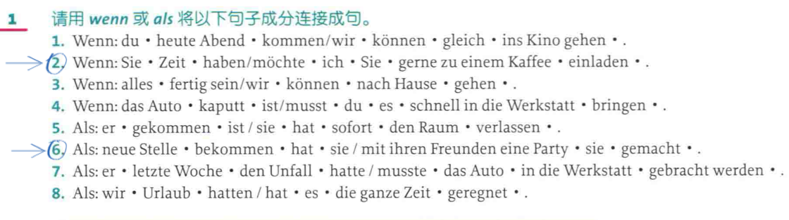

# Wann. als 

![[image-502.png|902x328]]
“2. Wenn Sie Zeit haben, möchte ich Sie gerne zu einem Kaffee einladen.” ([pdf](zotero://open-pdf/library/items/XSKKCL2M?page=258&annotation=L756AYGE)) |  

