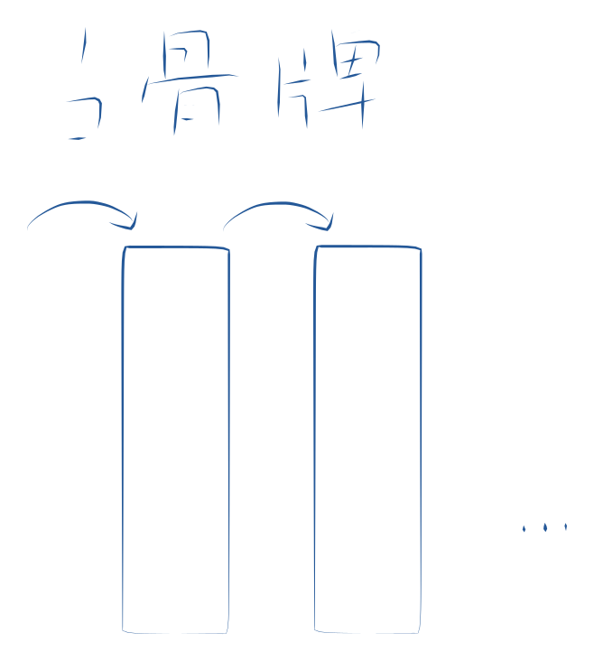

## 数学归纳法; Mathematical Induction 

最简单和常见的数学归纳法是证明当 $n$ 等于任意一个自然数时某命题成立。证明分下面两步：

 

  - 证明当 $n=1$ 时命题成立。 

  - 假设 $n=m$ 时命题成立，那么可以**推导**出在 $n=m+1$ 时命题也成立。（$m$ 代表任意自然数） 

 

这种方法的原理在于：首先证明在某个起点值时命题成立，然后证明从一个值到下一个值的过程有效。当这两点都已经证明，那么任意值都可以通过反复使用这个方法推导出来。

#基础方法

参考：

[数学归纳法（百度百科）](https://baike.baidu.com/item/%E6%95%B0%E5%AD%A6%E5%BD%92%E7%BA%B3%E6%B3%95/5155524?fr=ge_ala)

应用：

marginnote3app://note/A78DE51A-EE0F-463D-BEC2-DAD80D7E5651

> 它们的差与 0 的大小
> [MarginNote](marginnote4app://note/D9446D97-F085-4E3E-A1B0-CA8C8C748EDD)