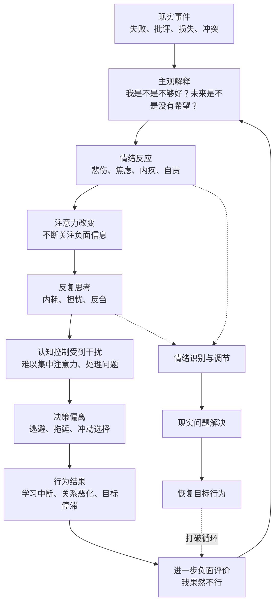

[构建认知模型](https://chatgpt.com/c/6ae46faa-4824-83ea-bf8e-f4219f9b73fd)

# 人类认知与自我管理模型：从大脑机制到人格塑造

我建议将你的架构进一步扩展成一套完整的模型：

人体基础状态 → 认知加工 → 价值判断 → 决策控制 → 行为执行 → 习惯形成 → 人格表现。

这套模型最终不是为了让人每天依靠意志力强迫自己，而是为了建立一种更高级的运行方式：

> 让正确的行为越来越容易发生，让错误的行为越来越难以发生，让一个人即使在疲惫、压力和动力不足时，也能维持基本的行为秩序。

不过，在正式建立模型之前，需要修正一个关键的科学认识。

## 一、先理解大脑究竟如何决策

### 1. 没有一个独立的「决策开关」

你提出的决策区域，方向是对的，但不能理解成大脑里存在一个专门负责所有决策、消耗完电量就停止工作的区域。

实际上，决策与认知控制是多个脑区、神经网络共同完成的。

[The neuroscience of mindfulness meditation | Nature Reviews Neuroscience](https://images.openai.com/static-rsc-4/MRVuyqGNPdki1RZ8Pavmez3KgwM0l02rH_xh5SfFuEcU7JOmcd7amSRBU3GjEXdAu93lDNmuQGmTyiTOITVkxiwGWgF_rmhWL4PtLjVNDMdmBMV0jthVFFZb8dKioOnM-d8IfR5LZE-KvtW2BDEB-imxV0k-i2uVDu4CAX3JbOs?purpose=inline)

[nature.com](https://www.nature.com/articles/nrn3916?utm_source=chatgpt.com)

|脑区或网络|主要作用|通俗理解|
|---|---|---|
|背外侧前额叶（dlPFC）|工作记忆、目标维持、规则执行|记住自己要做什么|
|前扣带皮层（ACC）|冲突监测、错误监测、控制需求评估|发现自己正在偏离目标|
|前岛叶|显著性检测、身体与情绪状态整合|发现重要刺激和内部状态变化|
|腹内侧前额叶（vmPFC）及眶额皮层（OFC）|价值评估、结果预期|衡量什么更值得|
|基底节与纹状体|行动选择、强化学习、习惯相关过程|逐渐形成自动化行为|

尤其需要记住：

- 前额叶并不是单独工作的。
- 大脑既需要选择目标，也需要评估代价、监测冲突、调动行动。
- 最终的行为是多个系统竞争、协作的结果。

2025 年发表于《Annual Review of Psychology》的认知控制综述，将认知控制的核心概括为：根据情境选择新的行为，以及监控当前行为并作出调整。

Annual Reviews+1

### 2. 人的意志力是不是一种会耗尽的电池？

这里需要区分三个概念：

|概念|是否存在|正确理解|
|---|---|---|
|生理能量消耗|存在|大脑需要持续消耗能量维持活动|
|认知疲劳|存在|长时间高强度认知活动可能改变后续任务的努力成本和行为选择|
|意志力固定额度|尚无充分证据|不能把自控能力当作每天固定的电量|

有一项涉及 36 个实验室、3531 名参与者的预注册研究，在确认性分析中没有发现显著的典型自我损耗效应（效应量 d=0.06）。这说明，简单的「做了很多自控任务 → 意志力必然被耗尽」并不可靠。

PMC+1

另一方面，2025 年《Trends in Cognitive Sciences》的一篇综述指出，认知疲劳可能增加认知控制的主观成本，使人更偏向低努力、短期回报的选择。

DOI+1

这就解释了你观察到的现象：

一个人学习了很久、处理了大量复杂事情之后，可能更倾向于刷视频、打游戏、吃东西或寻找其他即时奖励。

但这里不一定是大脑「电量耗尽」，更可能是：

继续执行高成本任务的吸引力下降，而低成本即时奖励的吸引力上升。

因此，我们应该把你的原始概念：

「意志力电池」

升级为：

认知控制成本与行为调度系统。

这个概念比简单的意志力电量更适合建立长期管理模型。

## 二、建立完整的人类认知运行架构

现在把人的认知与行为从根源到表面拆分成七个层级。

#chatgpt-mermaid-_r_od_ {font-family:-apple-system-body,ui-sans-serif,-apple-system,system-ui,"Segoe UI",Helvetica,"Apple Color Emoji",Arial,sans-serif,"Segoe UI Emoji","Segoe UI Symbol";font-size:16 px;fill:rgb(237, 237, 237);}@keyframes edge-animation-frame{from{stroke-dashoffset:0;}}@keyframes dash{to{stroke-dashoffset:0;}} #chatgpt-mermaid-_r_od_ .edge-animation-slow{stroke-dasharray:9,5!important;stroke-dashoffset:900;animation:dash 50 s linear infinite;stroke-linecap:round;} #chatgpt-mermaid-_r_od_ .edge-animation-fast{stroke-dasharray:9,5!important;stroke-dashoffset:900;animation:dash 20 s linear infinite;stroke-linecap:round;} #chatgpt-mermaid-_r_od_ .error-icon{fill:rgb(48, 48, 48);} #chatgpt-mermaid-_r_od_ .error-text{fill:rgb(237, 237, 237);stroke:rgb(237, 237, 237);} #chatgpt-mermaid-_r_od_ .edge-thickness-normal{stroke-width:1 px;} #chatgpt-mermaid-_r_od_ .edge-thickness-thick{stroke-width:3.5 px;} #chatgpt-mermaid-_r_od_ .edge-pattern-solid{stroke-dasharray:0;} #chatgpt-mermaid-_r_od_ .edge-thickness-invisible{stroke-width:0;fill:none;} #chatgpt-mermaid-_r_od_ .edge-pattern-dashed{stroke-dasharray:3;} #chatgpt-mermaid-_r_od_ .edge-pattern-dotted{stroke-dasharray:2;} #chatgpt-mermaid-_r_od_ .marker{fill:rgb(175, 175, 175);stroke:rgb(175, 175, 175);} #chatgpt-mermaid-_r_od_ .marker.cross{stroke:rgb(175, 175, 175);} #chatgpt-mermaid-_r_od_ svg{font-family:-apple-system-body,ui-sans-serif,-apple-system,system-ui,"Segoe UI",Helvetica,"Apple Color Emoji",Arial,sans-serif,"Segoe UI Emoji","Segoe UI Symbol";font-size:16 px;} #chatgpt-mermaid-_r_od_ p{margin:0;} #chatgpt-mermaid-_r_od_ .label{font-family:-apple-system-body,ui-sans-serif,-apple-system,system-ui,"Segoe UI",Helvetica,"Apple Color Emoji",Arial,sans-serif,"Segoe UI Emoji","Segoe UI Symbol";color:rgb(237, 237, 237);} #chatgpt-mermaid-_r_od_ .cluster-label text{fill:rgb(237, 237, 237);} #chatgpt-mermaid-_r_od_ .cluster-label span{color:rgb(237, 237, 237);} #chatgpt-mermaid-_r_od_ .cluster-label span p{background-color:transparent;} #chatgpt-mermaid-_r_od_ .label text, #chatgpt-mermaid-_r_od_ span{fill:rgb(237, 237, 237);color:rgb(237, 237, 237);} #chatgpt-mermaid-_r_od_ .node rect, #chatgpt-mermaid-_r_od_ .node circle, #chatgpt-mermaid-_r_od_ .node ellipse, #chatgpt-mermaid-_r_od_ .node polygon, #chatgpt-mermaid-_r_od_ .node path{fill:rgb(9, 23, 44);stroke:rgb(31, 78, 148);stroke-width:1 px;} #chatgpt-mermaid-_r_od_ .rough-node .label text, #chatgpt-mermaid-_r_od_ .node .label text, #chatgpt-mermaid-_r_od_ .image-shape .label, #chatgpt-mermaid-_r_od_ .icon-shape .label{text-anchor:middle;} #chatgpt-mermaid-_r_od_ .node .katex path{fill: #000 ;stroke: #000 ;stroke-width:1 px;} #chatgpt-mermaid-_r_od_ .rough-node .label, #chatgpt-mermaid-_r_od_ .node .label, #chatgpt-mermaid-_r_od_ .image-shape .label, #chatgpt-mermaid-_r_od_ .icon-shape .label{text-align:center;} #chatgpt-mermaid-_r_od_ .node.clickable{cursor:pointer;} #chatgpt-mermaid-_r_od_ .root .anchor path{fill:rgb(175, 175, 175)!important;stroke-width:0;stroke:rgb(175, 175, 175);} #chatgpt-mermaid-_r_od_ .arrowheadPath{fill:rgb(175, 175, 175);} #chatgpt-mermaid-_r_od_ .edgePath .path{stroke:rgb(175, 175, 175);stroke-width:1 px;} #chatgpt-mermaid-_r_od_ .flowchart-link{stroke:rgb(175, 175, 175);fill:none;} #chatgpt-mermaid-_r_od_ .edgeLabel{background-color:rgb(0, 0, 0);text-align:center;} #chatgpt-mermaid-_r_od_ .edgeLabel p{background-color:rgb(0, 0, 0);} #chatgpt-mermaid-_r_od_ .edgeLabel rect{opacity:0.5;background-color:rgb(0, 0, 0);fill:rgb(0, 0, 0);} #chatgpt-mermaid-_r_od_ .labelBkg{background-color:rgba(0, 0, 0, 0.5);} #chatgpt-mermaid-_r_od_ .cluster rect{fill:rgb(48, 48, 48);stroke:rgba(255, 255, 255, 0.15);stroke-width:1 px;} #chatgpt-mermaid-_r_od_ .cluster text{fill:rgb(237, 237, 237);} #chatgpt-mermaid-_r_od_ .cluster span{color:rgb(237, 237, 237);} #chatgpt-mermaid-_r_od_ div.mermaidTooltip{position:absolute;text-align:center;max-width:200 px;padding:2 px;font-family:-apple-system-body,ui-sans-serif,-apple-system,system-ui,"Segoe UI",Helvetica,"Apple Color Emoji",Arial,sans-serif,"Segoe UI Emoji","Segoe UI Symbol";font-size:12 px;background:rgb(48, 48, 48);border:1 px solid rgba(255, 255, 255, 0.15);border-radius:2 px;pointer-events:none;z-index:100;} #chatgpt-mermaid-_r_od_ .flowchartTitleText{text-anchor:middle;font-size:18 px;fill:rgb(237, 237, 237);} #chatgpt-mermaid-_r_od_ rect.text{fill:none;stroke-width:0;} #chatgpt-mermaid-_r_od_ .icon-shape, #chatgpt-mermaid-_r_od_ .image-shape{background-color:rgb(0, 0, 0);text-align:center;} #chatgpt-mermaid-_r_od_ .icon-shape p, #chatgpt-mermaid-_r_od_ .image-shape p{background-color:rgb(0, 0, 0);padding:2 px;} #chatgpt-mermaid-_r_od_ .icon-shape .label rect, #chatgpt-mermaid-_r_od_ .image-shape .label rect{opacity:0.5;background-color:rgb(0, 0, 0);fill:rgb(0, 0, 0);} #chatgpt-mermaid-_r_od_ .label-icon{display:inline-block;height:1 em;overflow:visible;vertical-align:-0.125 em;} #chatgpt-mermaid-_r_od_ .node .label-icon path{fill:currentColor;stroke:revert;stroke-width:revert;} #chatgpt-mermaid-_r_od_ .node .neo-node{stroke:rgb(31, 78, 148);} #chatgpt-mermaid-_r_od_ [data-look="neo"].node rect, #chatgpt-mermaid-_r_od_ [data-look="neo"].cluster rect, #chatgpt-mermaid-_r_od_ [data-look="neo"].node polygon{stroke:url( #chatgpt-mermaid-_r_od_-gradient );filter:drop-shadow( 1 px 2 px 2 px rgba(185,185,185,1));} #chatgpt-mermaid-_r_od_ [data-look="neo"].swimlane.cluster rect{filter:none;} #chatgpt-mermaid-_r_od_ [data-look="neo"].node path{stroke:url( #chatgpt-mermaid-_r_od_-gradient );stroke-width:1 px;} #chatgpt-mermaid-_r_od_ [data-look="neo"].node .outer-path{filter:drop-shadow( 1 px 2 px 2 px rgba(185,185,185,1));} #chatgpt-mermaid-_r_od_ [data-look="neo"].node .neo-line path{stroke:rgb(31, 78, 148);filter:none;} #chatgpt-mermaid-_r_od_ [data-look="neo"].node circle{stroke:url( #chatgpt-mermaid-_r_od_-gradient );filter:drop-shadow( 1 px 2 px 2 px rgba(185,185,185,1));} #chatgpt-mermaid-_r_od_ [data-look="neo"].node circle .state-start{fill: #000000 ;} #chatgpt-mermaid-_r_od_ [data-look="neo"].icon-shape .icon{fill:url( #chatgpt-mermaid-_r_od_-gradient );filter:drop-shadow( 1 px 2 px 2 px rgba(185,185,185,1));} #chatgpt-mermaid-_r_od_ [data-look="neo"].icon-shape .icon-neo path{stroke:url( #chatgpt-mermaid-_r_od_-gradient );filter:drop-shadow( 1 px 2 px 2 px rgba(185,185,185,1));} #chatgpt-mermaid-_r_od_ .node text{font-size:14 px;font-weight:600;letter-spacing:normal;fill:rgb(153, 206, 255);} #chatgpt-mermaid-_r_od_ .edgeLabels text{font-size:13 px;font-weight:600;letter-spacing:-0.08 px;fill:rgb(153, 206, 255);} #chatgpt-mermaid-_r_od_ .node tspan[font-weight="normal"], #chatgpt-mermaid-_r_od_ .edgeLabels tspan[font-weight="normal"]{font-weight:600;} #chatgpt-mermaid-_r_od_ .edgeLabel .label rect{opacity:1;rx:13 px;ry:13 px;fill:rgb(0, 14, 26);stroke:rgb(26, 62, 95);stroke-width:1 px;} #chatgpt-mermaid-_r_od_ .node rect, #chatgpt-mermaid-_r_od_ .node circle, #chatgpt-mermaid-_r_od_ .node ellipse, #chatgpt-mermaid-_r_od_ .node polygon, #chatgpt-mermaid-_r_od_ .node path{fill:rgb(0, 40, 77);stroke:rgba(255, 255, 255, 0.1);stroke-width:1 px;} #chatgpt-mermaid-_r_od_ .node rect{rx:16 px;ry:16 px;} #chatgpt-mermaid-_r_od_ .mermaid-decision .label-container{fill:rgb(0, 14, 26);stroke:rgb(26, 62, 95);stroke-dasharray:2,2;} #chatgpt-mermaid-_r_od_ .edgePaths .flowchart-link{stroke:rgb(175, 175, 175);stroke-width:1 px;stroke-linecap:round;stroke-linejoin:round;} #chatgpt-mermaid-_r_od_ .marker{fill:rgb(175, 175, 175);stroke:rgb(175, 175, 175);} #chatgpt-mermaid-_r_od_ :root{--mermaid-font-family:-apple-system-body,ui-sans-serif,-apple-system,system-ui,"Segoe UI",Helvetica,"Apple Color Emoji",Arial,sans-serif,"Segoe UI Emoji","Segoe UI Symbol";}第 1 层：生理基础睡眠、营养、体力、压力第 2 层：外部环境刺激、诱惑、信息、行为线索第 3 层：动机与价值系统欲望、情绪、即时奖励、长期目标第 4 层：认知控制系统注意力、工作记忆、冲突监测、抑制控制第 5 层：决策与行为执行选择、启动、停止、行动第6层：学习与习惯系统反馈、重复、自动化、强化第7层：人格与社会表现自律、稳定性、自信、气场、可靠性疲劳、压力、睡眠不足环境设计与行为规则影响影响降低诱惑降低控制成本

这七层不是七个彼此独立的模块，而是一个循环系统。

例如：

一个人早上睡眠充足，精神状态良好（第一层），坐在没有手机干扰的书桌前（第二层），知道学习对自己的长期目标有帮助（第三层），于是能够维持注意力（第四层），开始学习（第五层）。

经过长期、稳定的重复，学习逐渐变成习惯（第六层）。

最终，他开始成为一个做事有计划、能够持续执行、值得信赖的人（第七层）。

反过来，如果一个人每天熬夜、手机始终放在旁边、没有明确目标，那么即使他知道自己应该努力，也会不断遭遇更高的行为阻力。

真正重要的不是单独强化某一层，而是让七层之间形成正向循环。

下面逐层拆解。

## 三、第一层：生理基础——认知系统的底盘

这是所有后续能力的基础。

|底层资源|主要影响|不足时可能出现的表现|
|---|---|---|
|睡眠与恢复|注意力、记忆、情绪调节|困倦、注意力不集中|
|营养与身体状态|正常脑功能及身体活动|饥饿、身体不适、精力下降|
|身体活动|身体健康、精神状态|久坐、疲劳、不适|
|压力水平|情绪、认知控制|焦虑、烦躁、难以专注|
|生物节律|清醒程度与状态波动|不同时间段表现差异|

这里可以得出一个很重要的原则：

不能把所有表现不佳都归咎于自律不足。

有时不是你不愿意学习，而是身体状态不允许你保持高质量的认知活动。

### 如何补充和维护？

建议把这些作为长期基础设施：

1. 保持相对稳定的睡眠时间。
2. 规律运动，避免长期久坐。
3. 保证正常饮食，不依赖糖分刺激维持工作。
4. 将高强度脑力活动与休息交替安排。
5. 管理持续存在的压力源。

这些措施不是给意志力充电的神奇方法，而是在维护认知系统正常运行的基础条件。

## 四、第二层：环境系统——决定你需要付出多少自控成本

这是我认为你原始架构中缺少、但非常重要的一层。

人的行为并不是单纯由内心决定的。

环境本身就会影响行为发生的概率。

例如：

[SmartStudy | 徳島市の24時間プレミアム自習室](https://images.openai.com/static-rsc-4/E0nKlO4U3LR0afhOofDizKz2vqBOqTGEw_mYOAmObKMXI_SbROw3AH7TlO55dXouzVvJXTrwdylo2PZn2MbNsF5PsNpCXjnVn9gt07BXEDsscVAsJ-E04NZFPFdyWmLRGk7C21dZwfkPknT59eDe2WuVwEmxL37zLFV41FgvPWQ?purpose=inline)

环境 A

手机就在手边，视频软件随时可以打开。

诱惑阻力高

[Vexulnix Focus Lab — Clarity. Focus. Meaningful Work.](https://images.openai.com/static-rsc-4/m_Zm8UCMcBpNV4xp7R1aJpdxTluEPTmRVxgblo45zlQq2L-09kSqujVaR5o1hXcGJfdnUQ9djuCoakHaO1oYjrd0kFyrBfQvK2hxJZpcjw6S6CW2dQwWQQiKQkHyUlKGMNnTSHtLyQGwFatDxiJUCEIMMchKmTxxSPjCbLkknVk?purpose=inline)

环境 B

手机放在另一个房间，桌面只有学习材料。

诱惑阻力低

两种环境下，你执行同一个学习计划，所需要付出的自控成本可能完全不同。

心理学中有一个很重要的思路：不要等到诱惑出现以后才抵抗，而应该尽可能提前调整环境。

例如：

- 想减少刷视频：提前设置应用限制。
- 想减少游戏：卸载不必要的游戏，增加重新安装的成本。
- 想保持学习：提前准备好书籍和学习资料。
- 想坚持运动：前一天晚上准备运动服。

Duckworth 等人的自我控制情境策略研究特别强调，主动选择或改变环境，往往比在诱惑已经出现后进行强行抵抗更加有效。

PMC+1

这里可以建立一个公式：

\[ \text{自控成本} = \text{行为诱惑} + \text{环境阻力} + \text{当前任务难度} \]

这不是经过验证的生理计算公式，而是一个用于分析行为阻力的管理模型。

你的目标是降低不必要的自控成本，而不是每天锻炼自己抵抗诱惑的能力。

## 五、第三层：动机与价值系统——为什么人会选择某种行为？

这是决策发生之前的一个关键环节。

假设你面前有两个选择：

|选择|当前收益|长期收益|所需努力|
|---|---|---|---|
|刷短视频|即时愉悦|通常较低|很低|
|学习一门语言|即时回报较弱|可能非常高|较高|

人的大脑需要不断处理这些不同选项的价值、成本与预期结果。

这里需要区分三种动力。

第一种：即时奖励。

例如游戏、短视频、美食、娱乐。

特点是容易获得反馈，通常不需要等待。

第二种：目标导向。

例如学习语言、掌握专业技能、锻炼身体。

特点是需要先付出努力，收益可能在未来才出现。

第三种：内在价值。

例如认为学习本身有意义，享受掌握知识的过程，认同自己的行为与人生方向一致。

第三种尤其值得培养，因为它不完全依赖外部奖励。

### 一个重要修正：动力不是没有用

你提到不能靠打鸡血实现自我驱动。

这个方向基本正确，但不能推导出动力毫无价值。

真正需要警惕的是：

- 靠一次情绪激动制定大量计划。
- 靠短期兴奋维持长期行为。
- 每次失败后都需要重新给自己打鸡血。
- 只有在心情好时才能执行计划。

动机能够帮助你选择目标、启动改变和维持投入，但需要通过行为规则、环境和习惯来承接。

2023 年的自我控制整合框架将自控划分为识别控制需求、选择调节策略、执行调节策略三个阶段，这也说明自控不是一句「我要坚持」就能完成的事情。

Wiley Online Library+1

## 六、第四层：认知控制系统——你真正需要训练的能力

这一层是整个模型的核心。

我建议将认知控制拆分成五项可以观察的能力。

|能力名称|主要功能|日常表现|
|---|---|---|
|注意力控制|将注意力集中在目标上|学习时不频繁切换任务|
|工作记忆|暂时保留并处理信息|记住正在解决的问题|
|抑制控制|阻止不合适的冲动行为|想刷视频时能够停止|
|认知灵活性|根据新情况调整思路|发现方法错误后更换策略|
|冲突监测|发现目标与实际行为的偏离|意识到自己正在逃避任务|

这五项能力共同构成你所说的「决策能力」。

### 1. 注意力控制

需要训练的不是每天坐在桌前多久，而是：

- 能否快速进入工作状态。
- 能否保持一段时间的专注。
- 能否发现自己走神。
- 能否主动把注意力拉回来。

### 2. 工作记忆

例如学习德语时，需要同时处理：

- 主语是什么？
- 动词在哪里？
- 名词使用什么格？
- 从句的语序如何变化？

这些信息需要在短时间内被保留、调用和加工。

因此，信息组织、知识结构化、分块学习，都是降低工作记忆负担的重要手段。

### 3. 抑制控制

例如：

你正在学习，突然产生打开短视频的冲动。

你需要识别这个冲动，暂停自动反应，再决定是否执行。

但是，最有效的方案往往不是每次都强行抵抗，而是提前减少手机干扰。

### 4. 认知灵活性

一个真正成熟的人，并不是永远按照既定计划执行。

当计划不适合现实情况时，他能够重新评估、改变方法。

例如：

- 学习效率持续下降，就调整学习方式。
- 发现目标不合理，就修改目标。
- 遇到新的机会，就评估原来的路线是否还值得坚持。

### 5. 冲突监测

这是一个很容易忽视的能力。

它相当于内部的警报系统：

「你本来准备学习，现在却打开了游戏。」

「你本来准备睡觉，现在已经连续刷了一个小时。」

「你明明很疲劳，却仍然在强迫自己工作。」

识别偏离，比单纯要求自己坚持更重要。

# 七、第五层：行为执行——把认知转变为现实行动

这一层关注的是：

知道应该做什么，与真正开始做，是两回事。

建议把行动拆成五个步骤：

1. 识别目标

    明确自己现在最重要的事情是什么。

2. 确定动作

    把抽象目标转化为具体任务。

3. 降低启动难度

    让第一个动作足够简单，不需要等待情绪准备好。

4. 执行与监控

    发现分心、逃避和行为偏离。

5. 完成与反馈

    记录结果，确认是否完成，并调整下一次行动。

举一个例子：

目标：提高德语水平。

错误的行为指令：

「今天一定要非常努力地学习德语。」

正确的行为指令：

「早饭结束后，坐到书桌前，打开德语学习材料，先完成 10 分钟听力。」

两者最大的区别是，后者明确了时间、环境、动作和启动门槛。

这里还有一个非常值得使用的工具：如果—那么计划（If–Then Planning）。

例如：

- 如果早饭结束，那么我就打开德语听力。
- 如果我想打开短视频，那么我先离开书桌走动五分钟。
- 如果学习中遇到难题，那么我先记录问题，再继续下一道题。
- 如果晚上到了规定的休息时间，那么我就停止工作。

一项 2024 年发表的元分析分析了 642 项独立测试，发现这种具体的条件式计划对认知、情绪与行为结果都有积极作用，效果大小因情境而异。

Get Access+1

这也是我建议你将「具体行为规则」列入长期自我管理体系的原因。

## 八、第六层：习惯系统——让正确的行为逐渐自动化

这是整个模型中最值得长期投资的一层。

因为人的认知控制能力不可能时时刻刻都处于最佳状态。

你不可能每天都保持：

- 高度兴奋；
- 注意力集中；
- 意志坚定；
- 情绪稳定；
- 充足精力。

因此，不能把长期目标全部建立在主动决策上。

你需要把一部分行为转变为自动化的日常模式。

### 1. 习惯是如何形成的？

可以将习惯理解为：

特定情境线索 → 自动产生行为倾向 → 执行行为 → 获得反馈 → 强化线索与行为之间的联系。

[Hacking the Habit Loop: A Neuroscience Guide for L&D](https://images.openai.com/static-rsc-4/ADGAnIqrp-7-chfd10PHAR0ux_wUGpAxTjbS2hj93ccaIUNF2rpa6m9IqPxZ0co-0YnmvXV549sMcfsDAUZrXeb9akvPX6T0Q-9ckMIJT2BDdfWSIumG2OQDinxGiuPUKCoQVfTqAeeNrWjTxlwQ84VtGSXsmYB99E8YtXnBQhM?purpose=inline)

[growthengineering.co.uk](https://www.growthengineering.co.uk/learning-habits/?utm_source=chatgpt.com)

例如：

|阶段|学习习惯|
|---|---|
|触发条件|每天早餐结束|
|行为启动|坐到书桌前|
|具体动作|打开学习材料|
|行为强化|完成学习后记录进度|
|重复|第二天在相同条件下继续|

重点在于：让同一个外部线索不断触发同一个行为。

2024 年的习惯研究综述强调，习惯建立依赖于情境线索与行为之间通过重复形成的联系。

Wiley Online Library+1

### 2. 为什么必须从微小习惯开始？

因为你要降低启动成本。

例如：

|想建立的习惯|最小启动动作|后续扩展|
|---|---|---|
|阅读|阅读一段|逐渐延长阅读|
|运动|穿上运动鞋|开始完整训练|
|学习|打开学习资料|开始正式学习|
|整理|收拾桌面一分钟|整理工作区域|
|写作|写下一句话|完成一段内容|

注意：最小启动动作不是最终目标，而是保证行为能够持续发生的入口。

### 3. 习惯需要多久形成？

不能迷信 21 天养成一个习惯。

2024 年一项针对健康行为习惯的系统综述和元分析纳入 20 项研究、2601 名参与者。

其中报告习惯形成时间的研究显示：

- 中位数大约为 59～66 天。
- 平均数大约为 106～154 天。
- 不同行为和个体之间存在很大差异。

而且这批研究的部分证据质量有限，因此不能将这些数字当作统一期限。

PMC+1

更重要的是：

不要以连续打卡多少天作为唯一标准，而要观察某个情境出现时，你是否越来越自然地开始行动。

### 4. 如何替换错误习惯？

你提到刷视频、打游戏，我建议增加一个很重要的分析：

不要只关注行为本身，还要分析这个行为满足了什么需求。

|诱因|原有行为|可能的真实需求|替代方案|
|---|---|---|---|
|身体疲劳|刷视频|休息|闭目休息、散步|
|无聊|玩游戏|新鲜感|阅读、学习新技能|
|焦虑|刷视频|暂时逃避压力|拆解任务、记录问题|
|孤独|刷社交平台|社交联系|与人交流|
|任务太难|游戏|获得即时成功感|将任务拆小|

这里有一个原则：

不要只删除旧行为，还要解决旧行为背后的需求。

而且娱乐本身不是坏事。

有计划、有边界的游戏和视频可以成为正常休闲。真正需要警惕的是：不知不觉地通过娱乐逃避任务、情绪和现实问题。

还要强调，习惯不是万能的。2024 年的习惯理论综述指出，习惯有助于行为维持，但不是长期改变的必要条件，也不一定足以独立维持改变。意图、环境和持续的动机仍然会发挥作用。

Wiley Online Library+1

## 九、消耗品量化与资源管理系统

现在回到你提出的第二部分。

你的思路非常有价值：将抽象的认知资源变成能够观察、记录和管理的指标。

但我建议不要把所有资源统统称为意志力。

我们建立一张真正实用的资源管理表。

### 1. 六类资源

|资源名称|属性|主要消耗来源|主要补充方式|
|---|---|---|---|
|生理恢复资源|身体基础|睡眠不足、身体负担|睡眠、饮食、休息|
|注意力资源|认知能力|分心、多任务切换|减少干扰、休息|
|工作记忆负荷|认知负荷|同时处理大量信息|信息分块、外部记录|
|情绪调节资源|心理调节|焦虑、冲突、压力|情绪调节、休息、支持|
|决策控制成本|认知控制|复杂选择、冲动抵抗|规则化、预先决策|
|动机与价值状态|驱动因素|目标失去意义、挫折|反馈、目标调整、内在价值|

这里有一个重要区别：

生理恢复资源、注意力状态等可以出现明显的疲劳变化；但动机不是严格意义上的消耗品，情绪调节能力也不能简单视为固定容量。

环境支持更不是大脑内部资源，它是一种能够降低资源需求的外部条件。

### 2. 如何给资源打分？

建议建立一个每天可以填写的认知状态仪表盘。

以下采用 1～5 分的自我评估量表。

个人认知状态仪表盘

模拟日常自我评估。1 分最低，5 分最高。仅用于行为管理，不是脑功能检测。

身体精力

## 3/5

极度疲惫精力充沛

注意力清晰度

## 3/5

非常涣散高度清晰

情绪稳定性

## 3/5

情绪波动明显稳定平静

任务启动难度

## 3/5

很容易启动极难启动

诱惑强度

## 3/5

几乎没有非常强烈

环境支持程度

## 3/5

干扰很多环境理想

今天的状态记录

状态解释  

保持常规任务节奏

根据当前状态安排任务，避免不必要的高负荷。

复制今天的评估重置评估

这个仪表盘有两个目的：

第一，让你知道自己什么时候适合做高认知负荷的任务。

第二，帮助你识别问题究竟出在哪里。

例如：

- 身体精力很低，不应该首先归咎于意志力。
- 注意力很低，应该减少任务切换。
- 诱惑很强，应该首先处理手机、游戏等环境问题。
- 情绪不稳定，应该先处理情绪，而不是一味强行工作。
- 环境支持很差，应该重新安排工作场所。

这些分数只是个人观察指标，不存在所谓身体剩余 37%的意志力。

建议连续记录 14 天，观察自己的工作状态、时间规律和行为结果，逐渐建立自己的资源调度规律。

### 3. 如何安排每天有限的认知资源？

建议将一天的任务划分成三类。

A 级

高认知负荷任务

需要大量思考、创造和复杂判断。

例如：学习新知识、分析难题、制定重要计划。

B 级

中认知负荷任务

需要一定专注，但决策难度较低。

例如：复习、整理资料、练习熟悉的内容。

C 级

低认知负荷任务

不需要大量思考。

例如：整理桌面、文件归档、处理简单事务。

安排原则：

- 状态最好的时间段，处理 A 级任务。
- 状态一般时，处理 B 级任务。
- 注意力明显下降时，处理 C 级任务或休息。
- 不要把所有重要工作都安排在一天的最后阶段。

这并不意味着 A 级工作只能做一次，或者每天只能做固定数量，而是要根据个人真实状态安排。

## 十、训练与补充：分别应该训练什么？

这里要避免一个常见错误：认为所有能力都能通过做更多自控练习来提高。

实际上，应该针对不同能力采用不同方法。

|训练对象|训练方法|目标|
|---|---|---|
|注意力|单任务训练、减少干扰|提高专注与恢复注意力的能力|
|工作记忆负荷管理|分块、笔记、知识组织|降低同时处理的信息量|
|冲动控制|延迟反应、预设规则|减少冲动行为|
|情绪调节|识别情绪、重新评价、暂停反应|提高情绪稳定性|
|决策能力|明确标准、复盘选择|提高判断质量|
|习惯形成|固定线索、重复执行|降低启动成本|
|身体恢复|睡眠、饮食、运动|维护生理基础|

有一点特别重要：

训练某种具体能力，不代表它一定能自动迁移到所有其他领域。

例如，你玩了很多训练记忆力的小游戏，不代表你就自然获得了更好的情绪管理能力。

所以，与其寻找一种万能的意志力训练，不如直接训练自己真正需要的行为和技能。

# 十一、第七层：人格塑造——自律、气场与性格如何形成？

这是你整个模型的终点，也是我认为最值得深入研究的部分。

你希望最终获得的不仅仅是较强的执行力，而是一个整体状态优秀、内在稳定、能够长期维持的人。

我建议将人格表现拆分成五个维度。

## 1. 自律：能够管理自己的行为

自律不是每天强迫自己做不愿意做的事。

真正成熟的自律包括：

- 知道自己的长期目标。
- 能够主动安排生活。
- 能够开始应该做的事情。
- 能够拒绝不合适的诱惑。
- 能够在疲惫时调整，而不是直接放弃。
- 能够兑现自己对自己的承诺。

自律的深层基础是行为的可靠性。

你每次完成一个自己承诺的小目标，实际上都在积累一种经验：

「我可以相信自己。」

这种经验经过长期积累，可以成为自信的一部分。

## 2. 情绪稳定：不被情绪牵着走

这里需要区分两种状态：

|情绪压抑|情绪调节|
|---|---|
|不允许自己生气|识别自己为什么生气|
|强迫自己不难过|接受情绪存在|
|避免表达不同意见|选择合适的表达方式|
|忍耐所有压力|主动处理压力来源|
|表面平静、内部积压|能够恢复稳定状态|

真正强大的人，不是没有情绪，而是不会轻易让一时的情绪决定自己的长期行为。

建议训练三个步骤：

1. 识别：我现在产生了什么情绪？
2. 分析：它由什么事情触发？它在提醒我什么？
3. 调节：我应该如何回应，才能符合自己的长期目标和价值观？

## 3. 气场：内在稳定性在外部的表现

气场不是什么神秘的心理力量。

从实际行为角度，可以拆分为：

气场的五项组成

外部表现

① 身体表现

体态自然、动作从容、眼神稳定。

② 情绪表现

不容易被激怒，不轻易慌乱，不急于证明自己。

③ 语言表现

表达清晰，有逻辑，敢于表达不同意见。

④ 行为表现

说到做到，做事有始有终，能够承担责任。

⑤ 能力表现

拥有真正的知识、技能、判断力和解决问题的能力。

尤其要强调最后一点。

没有能力支撑的自信，往往很脆弱。

真正持久的自信，来自不断积累的能力、经验和实际成果。

## 4. 性格强大：建立自己的原则与边界

建议重点培养以下能力：

|能力|表现|
|---|---|
|独立判断|不盲目跟随他人观点|
|边界意识|知道什么可以接受、什么不能接受|
|抗压能力|遇到困难能够调整和应对|
|责任意识|承认并承担自己的选择|
|延迟满足|能够为重要的长期目标放弃部分即时收益|
|开放心态|能够接受批评、修正错误|

强大的性格并不意味着永远强硬。

一个真正成熟的人，既可以坚定，也可以柔和；既能坚持原则，也能根据事实改变自己的看法。

## 5. 人格是如何逐步形成的？

我建议把这个过程理解为：

#chatgpt-mermaid-_r_rm_ {font-family:-apple-system-body,ui-sans-serif,-apple-system,system-ui,"Segoe UI",Helvetica,"Apple Color Emoji",Arial,sans-serif,"Segoe UI Emoji","Segoe UI Symbol";font-size:16 px;fill:rgb(237, 237, 237);}@keyframes edge-animation-frame{from{stroke-dashoffset:0;}}@keyframes dash{to{stroke-dashoffset:0;}} #chatgpt-mermaid-_r_rm_ .edge-animation-slow{stroke-dasharray:9,5!important;stroke-dashoffset:900;animation:dash 50 s linear infinite;stroke-linecap:round;} #chatgpt-mermaid-_r_rm_ .edge-animation-fast{stroke-dasharray:9,5!important;stroke-dashoffset:900;animation:dash 20 s linear infinite;stroke-linecap:round;} #chatgpt-mermaid-_r_rm_ .error-icon{fill:rgb(48, 48, 48);} #chatgpt-mermaid-_r_rm_ .error-text{fill:rgb(237, 237, 237);stroke:rgb(237, 237, 237);} #chatgpt-mermaid-_r_rm_ .edge-thickness-normal{stroke-width:1 px;} #chatgpt-mermaid-_r_rm_ .edge-thickness-thick{stroke-width:3.5 px;} #chatgpt-mermaid-_r_rm_ .edge-pattern-solid{stroke-dasharray:0;} #chatgpt-mermaid-_r_rm_ .edge-thickness-invisible{stroke-width:0;fill:none;} #chatgpt-mermaid-_r_rm_ .edge-pattern-dashed{stroke-dasharray:3;} #chatgpt-mermaid-_r_rm_ .edge-pattern-dotted{stroke-dasharray:2;} #chatgpt-mermaid-_r_rm_ .marker{fill:rgb(175, 175, 175);stroke:rgb(175, 175, 175);} #chatgpt-mermaid-_r_rm_ .marker.cross{stroke:rgb(175, 175, 175);} #chatgpt-mermaid-_r_rm_ svg{font-family:-apple-system-body,ui-sans-serif,-apple-system,system-ui,"Segoe UI",Helvetica,"Apple Color Emoji",Arial,sans-serif,"Segoe UI Emoji","Segoe UI Symbol";font-size:16 px;} #chatgpt-mermaid-_r_rm_ p{margin:0;} #chatgpt-mermaid-_r_rm_ .label{font-family:-apple-system-body,ui-sans-serif,-apple-system,system-ui,"Segoe UI",Helvetica,"Apple Color Emoji",Arial,sans-serif,"Segoe UI Emoji","Segoe UI Symbol";color:rgb(237, 237, 237);} #chatgpt-mermaid-_r_rm_ .cluster-label text{fill:rgb(237, 237, 237);} #chatgpt-mermaid-_r_rm_ .cluster-label span{color:rgb(237, 237, 237);} #chatgpt-mermaid-_r_rm_ .cluster-label span p{background-color:transparent;} #chatgpt-mermaid-_r_rm_ .label text, #chatgpt-mermaid-_r_rm_ span{fill:rgb(237, 237, 237);color:rgb(237, 237, 237);} #chatgpt-mermaid-_r_rm_ .node rect, #chatgpt-mermaid-_r_rm_ .node circle, #chatgpt-mermaid-_r_rm_ .node ellipse, #chatgpt-mermaid-_r_rm_ .node polygon, #chatgpt-mermaid-_r_rm_ .node path{fill:rgb(9, 23, 44);stroke:rgb(31, 78, 148);stroke-width:1 px;} #chatgpt-mermaid-_r_rm_ .rough-node .label text, #chatgpt-mermaid-_r_rm_ .node .label text, #chatgpt-mermaid-_r_rm_ .image-shape .label, #chatgpt-mermaid-_r_rm_ .icon-shape .label{text-anchor:middle;} #chatgpt-mermaid-_r_rm_ .node .katex path{fill: #000 ;stroke: #000 ;stroke-width:1 px;} #chatgpt-mermaid-_r_rm_ .rough-node .label, #chatgpt-mermaid-_r_rm_ .node .label, #chatgpt-mermaid-_r_rm_ .image-shape .label, #chatgpt-mermaid-_r_rm_ .icon-shape .label{text-align:center;} #chatgpt-mermaid-_r_rm_ .node.clickable{cursor:pointer;} #chatgpt-mermaid-_r_rm_ .root .anchor path{fill:rgb(175, 175, 175)!important;stroke-width:0;stroke:rgb(175, 175, 175);} #chatgpt-mermaid-_r_rm_ .arrowheadPath{fill:rgb(175, 175, 175);} #chatgpt-mermaid-_r_rm_ .edgePath .path{stroke:rgb(175, 175, 175);stroke-width:1 px;} #chatgpt-mermaid-_r_rm_ .flowchart-link{stroke:rgb(175, 175, 175);fill:none;} #chatgpt-mermaid-_r_rm_ .edgeLabel{background-color:rgb(0, 0, 0);text-align:center;} #chatgpt-mermaid-_r_rm_ .edgeLabel p{background-color:rgb(0, 0, 0);} #chatgpt-mermaid-_r_rm_ .edgeLabel rect{opacity:0.5;background-color:rgb(0, 0, 0);fill:rgb(0, 0, 0);} #chatgpt-mermaid-_r_rm_ .labelBkg{background-color:rgba(0, 0, 0, 0.5);} #chatgpt-mermaid-_r_rm_ .cluster rect{fill:rgb(48, 48, 48);stroke:rgba(255, 255, 255, 0.15);stroke-width:1 px;} #chatgpt-mermaid-_r_rm_ .cluster text{fill:rgb(237, 237, 237);} #chatgpt-mermaid-_r_rm_ .cluster span{color:rgb(237, 237, 237);} #chatgpt-mermaid-_r_rm_ div.mermaidTooltip{position:absolute;text-align:center;max-width:200 px;padding:2 px;font-family:-apple-system-body,ui-sans-serif,-apple-system,system-ui,"Segoe UI",Helvetica,"Apple Color Emoji",Arial,sans-serif,"Segoe UI Emoji","Segoe UI Symbol";font-size:12 px;background:rgb(48, 48, 48);border:1 px solid rgba(255, 255, 255, 0.15);border-radius:2 px;pointer-events:none;z-index:100;} #chatgpt-mermaid-_r_rm_ .flowchartTitleText{text-anchor:middle;font-size:18 px;fill:rgb(237, 237, 237);} #chatgpt-mermaid-_r_rm_ rect.text{fill:none;stroke-width:0;} #chatgpt-mermaid-_r_rm_ .icon-shape, #chatgpt-mermaid-_r_rm_ .image-shape{background-color:rgb(0, 0, 0);text-align:center;} #chatgpt-mermaid-_r_rm_ .icon-shape p, #chatgpt-mermaid-_r_rm_ .image-shape p{background-color:rgb(0, 0, 0);padding:2 px;} #chatgpt-mermaid-_r_rm_ .icon-shape .label rect, #chatgpt-mermaid-_r_rm_ .image-shape .label rect{opacity:0.5;background-color:rgb(0, 0, 0);fill:rgb(0, 0, 0);} #chatgpt-mermaid-_r_rm_ .label-icon{display:inline-block;height:1 em;overflow:visible;vertical-align:-0.125 em;} #chatgpt-mermaid-_r_rm_ .node .label-icon path{fill:currentColor;stroke:revert;stroke-width:revert;} #chatgpt-mermaid-_r_rm_ .node .neo-node{stroke:rgb(31, 78, 148);} #chatgpt-mermaid-_r_rm_ [data-look="neo"].node rect, #chatgpt-mermaid-_r_rm_ [data-look="neo"].cluster rect, #chatgpt-mermaid-_r_rm_ [data-look="neo"].node polygon{stroke:url( #chatgpt-mermaid-_r_rm_-gradient );filter:drop-shadow( 1 px 2 px 2 px rgba(185,185,185,1));} #chatgpt-mermaid-_r_rm_ [data-look="neo"].swimlane.cluster rect{filter:none;} #chatgpt-mermaid-_r_rm_ [data-look="neo"].node path{stroke:url( #chatgpt-mermaid-_r_rm_-gradient );stroke-width:1 px;} #chatgpt-mermaid-_r_rm_ [data-look="neo"].node .outer-path{filter:drop-shadow( 1 px 2 px 2 px rgba(185,185,185,1));} #chatgpt-mermaid-_r_rm_ [data-look="neo"].node .neo-line path{stroke:rgb(31, 78, 148);filter:none;} #chatgpt-mermaid-_r_rm_ [data-look="neo"].node circle{stroke:url( #chatgpt-mermaid-_r_rm_-gradient );filter:drop-shadow( 1 px 2 px 2 px rgba(185,185,185,1));} #chatgpt-mermaid-_r_rm_ [data-look="neo"].node circle .state-start{fill: #000000 ;} #chatgpt-mermaid-_r_rm_ [data-look="neo"].icon-shape .icon{fill:url( #chatgpt-mermaid-_r_rm_-gradient );filter:drop-shadow( 1 px 2 px 2 px rgba(185,185,185,1));} #chatgpt-mermaid-_r_rm_ [data-look="neo"].icon-shape .icon-neo path{stroke:url( #chatgpt-mermaid-_r_rm_-gradient );filter:drop-shadow( 1 px 2 px 2 px rgba(185,185,185,1));} #chatgpt-mermaid-_r_rm_ .node text{font-size:14 px;font-weight:600;letter-spacing:normal;fill:rgb(153, 206, 255);} #chatgpt-mermaid-_r_rm_ .edgeLabels text{font-size:13 px;font-weight:600;letter-spacing:-0.08 px;fill:rgb(153, 206, 255);} #chatgpt-mermaid-_r_rm_ .node tspan[font-weight="normal"], #chatgpt-mermaid-_r_rm_ .edgeLabels tspan[font-weight="normal"]{font-weight:600;} #chatgpt-mermaid-_r_rm_ .edgeLabel .label rect{opacity:1;rx:13 px;ry:13 px;fill:rgb(0, 14, 26);stroke:rgb(26, 62, 95);stroke-width:1 px;} #chatgpt-mermaid-_r_rm_ .node rect, #chatgpt-mermaid-_r_rm_ .node circle, #chatgpt-mermaid-_r_rm_ .node ellipse, #chatgpt-mermaid-_r_rm_ .node polygon, #chatgpt-mermaid-_r_rm_ .node path{fill:rgb(0, 40, 77);stroke:rgba(255, 255, 255, 0.1);stroke-width:1 px;} #chatgpt-mermaid-_r_rm_ .node rect{rx:16 px;ry:16 px;} #chatgpt-mermaid-_r_rm_ .mermaid-decision .label-container{fill:rgb(0, 14, 26);stroke:rgb(26, 62, 95);stroke-dasharray:2,2;} #chatgpt-mermaid-_r_rm_ .edgePaths .flowchart-link{stroke:rgb(175, 175, 175);stroke-width:1 px;stroke-linecap:round;stroke-linejoin:round;} #chatgpt-mermaid-_r_rm_ .marker{fill:rgb(175, 175, 175);stroke:rgb(175, 175, 175);} #chatgpt-mermaid-_r_rm_ :root{--mermaid-font-family:-apple-system-body,ui-sans-serif,-apple-system,system-ui,"Segoe UI",Helvetica,"Apple Color Emoji",Arial,sans-serif,"Segoe UI Emoji","Segoe UI Symbol";}明确自己的价值观和原则制定具体行为规则反复执行小目标积累真实成果与经验形成自我信任形成稳定的行为模式逐渐形成可靠、自律、自信的人格表现

这里的关键是，不要试图通过想象自己是一个强大的人，直接获得强大的人格。

而是通过每天的具体行为，逐渐建立能够支撑这种人格的真实基础。

# 十二、需要长期警戒的认知误区

你原本提出了「警戒误区」，我认为这一部分必须单独建立。

|误区|为什么危险|正确做法|
|---|---|---|
|依靠打鸡血|情绪兴奋不能保证持续执行|建立习惯和规则|
|迷信意志力|过度依赖临场抵抗|优先调整环境|
|把休息当懒惰|忽视恢复会增加长期负担|把休息纳入计划|
|追求完美主义|一次失败就放弃整个计划|允许偏离，及时恢复|
|同时改变所有习惯|执行负担过重|一次重点改变少数行为|
|将娱乐全部视为敌人|忽视正常休闲与心理需求|区分主动娱乐和逃避性娱乐|
|只关注计划，不关注结果|容易陷入自我感动|用实际行为与成果检验|
|只强调服从计划|忽略环境变化与现实约束|保持调整能力|

另外，我建议特别警惕三个长期风险。

第一，过度消耗。

你不能因为希望变得自律，就不断压榨睡眠、健康和休息时间。

第二，过度量化。

每天记录几十项指标，可能让自我管理本身变成新的负担。指标应该帮助你做决策，而不是成为新的任务。

第三，把自律变成自我惩罚。

犯错不代表你是一个失败的人。

需要研究的是：为什么这个行为发生了？下次如何改变条件？

不要把行为问题上升为人格否定。

# 十三、最终运行方式：每天、每周、长期三个管理周期

建立模型以后，还需要让它真正运转。

我建议采用三个管理周期。

## 1. 每日管理：调度认知资源

早晨：状态评估与计划

- 评估身体、注意力和情绪状态。
- 确定当天最重要的 1～3 项任务。
- 提前安排工作环境。
- 写下可能出现的干扰及应对方法。

白天：行为执行与监控

- 高状态时优先完成高认知负荷任务。
- 使用单任务模式。
- 适当安排休息。
- 出现冲动时，先识别原因，再采取预设行动。

晚上：反馈与修正

- 今天完成了什么？
- 哪些行为出现了偏离？
- 是身体问题、环境问题、任务问题，还是习惯问题？
- 明天需要调整什么？

## 2. 每周管理：观察行为模式

不需要每天纠结一次失败。

每周集中检查以下指标：

|指标|观察目的|
|---|---|
|重要任务完成率|执行是否稳定|
|有效专注时间|注意力质量是否改善|
|非计划娱乐时间|是否存在逃避行为|
|睡眠与身体状态|是否出现长期透支|
|习惯执行情况|行为是否逐步自动化|

每周只挑选最明显的一个问题进行优化。

例如，这周发现自己经常因为手机中断学习，那么下一周就重点解决手机干扰，而不是同时增加运动、阅读、早起等五六项新任务。

## 3. 长期管理：建立人生运行系统

长期来看，你应该追求三个不同层级的状态。

第一阶段

基础稳定

能够保证正常作息、规律学习、基本运动和正常生活。即使心情不好，也不至于完全失去生活秩序。

第二阶段

高效运行

重要行为已经形成稳定习惯，能够管理注意力、处理复杂任务、控制冲动，并合理安排工作与休息。

第三阶段

人格成熟

有明确价值观、独立判断能力、情绪稳定性、行为可靠性和持续学习能力。遇到困难时能够自主调整，而不是依赖他人督促。

第三阶段才是你所追求的终身状态。

它并不是每天都达到最高效率，而是具备长期维持良好状态的能力。

# 十四、最终总结：完整的人类认知—行为—人格模型

我们可以把整个模型压缩成下面这张总表。

|层级|核心研究对象|最终建设目标|
|---|---|---|
|01 生理基础|睡眠、营养、运动、压力|保持良好身体状态|
|02 环境系统|刺激、诱惑、行为线索|降低行为阻力|
|03 动机系统|欲望、情绪、目标、价值|建立持续的内在驱动|
|04 认知控制|注意力、记忆、抑制、判断|提高认知控制能力|
|05 行为执行|启动、行动、监控、反馈|建立可靠执行能力|
|06 习惯系统|重复、自动化、行为替换|减少对临场意志力的依赖|
|07 人格系统|自律、情绪、原则、能力|形成稳定成熟的人格|

我认为还可以再提炼出五条终身原则：

1. 不要依赖意志力解决所有问题。 优先改变环境、减少不必要的决策和诱惑。
2. 不要依赖短期动力。 用长期价值、具体计划和微小习惯保持行为。
3. 不要只训练执行力。 身体、情绪、认知、判断力都需要同步维护。
4. 不要把高效率当成人生唯一目标。 恢复能力、适应能力和长期稳定性同样重要。
5. 不要追求永远不犯错。 真正强大的自我管理系统，应该具有发现问题、纠正偏差和重新启动的能力。

## 十五、我建议将这个模型继续发展成一个可长期使用的个人系统

这个模型可以命名为：

个人认知与行为管理系统（Personal Cognitive & Behavioral Management System）

未来可以拆成四个相互关联的模块：

认知控制实验室

注意力、工作记忆、决策、冲动控制、情绪调节。

资源调度中心

身体状态、认知负荷、疲劳、恢复与任务安排。

习惯养成中心

行为替换、微小习惯、自动化、环境设计。

人格发展中心

自律、情绪稳定、独立判断、气场与社会表现。

我的核心建议是：先建设资源调度中心和习惯养成中心，再逐渐训练认知控制，最后把这些能力沉淀为稳定的人格表现。

因为一个能够长期维持良好状态的人，不是每天都在战胜自己，而是已经建立了一套不需要每天与自己激烈斗争的生活系统。

这才是值得追求的终身自我管理能力。

# ---

# 负面情绪角度

你补充的这两个角度非常重要。我认为它们实际上揭示了原来模型中一个比较大的缺口：

一个人的认知能力，即使很强，也不代表他在现实生活中就能稳定地发挥出来。

原因是，人不是在实验室里生活的。

一个人每天还要面对自己的悲伤、内疚、焦虑、自我怀疑，也要面对饮食、家庭关系、人际冲突、经济压力、社会竞争和不确定的未来。

这些因素会改变一个人的心理状态，影响注意力、判断、行为选择，甚至影响长期习惯。

因此，我建议在原来的模型中增加两个重要系统：

1. 情绪调节系统：负责处理内部心理冲突，维护决策稳定性。
2. 现实环境适应系统：负责处理外部生活条件与社会关系，保证认知能力能够在现实中发挥作用。

而且，这两个系统不应该只是原来七层结构中的两个普通层级，而应该是贯穿整个人类认知与行为系统的横向调节机制。

# 一、负面情绪：为什么它会影响决策与意志？

## 1. 首先要理解：情绪不是意志力的敌人

很多人会把自我管理理解成：

- 不要悲伤。
- 不要焦虑。
- 不要内疚。
- 不要自责。
- 不要胡思乱想。
- 永远保持积极。

这种理解其实有问题。

情绪本身是人体处理现实信息的一部分。

例如：

|情绪|可能反映的内部信号|
|---|---|
|悲伤|失去、失望、未满足的情感需求|
|内疚|认为自己的行为违反了某种责任或价值观|
|羞耻|感觉自己的整体价值受到否定|
|焦虑|对未来的不确定性和潜在威胁的预期|
|愤怒|感觉自己的边界、利益或公平受到侵犯|
|恐惧|感觉可能遭遇危险|
|自责|对自己过去的行为或结果进行负面评价|
|内耗|反复进行没有产生有效新信息或行动的心理活动|

因此，不能简单地消灭这些情绪。

真正需要解决的是：

情绪出现以后，你是否能够理解它、处理它，并且不让它无限制地控制自己的行为。

## 2. 负面情绪是如何影响决策系统的？

这里建立一个完整的运行过程。

现实事件失败、批评、损失、冲突主观解释我是不是不够好？未来是不是没有希望？情绪反应悲伤、焦虑、内疚、自责注意力改变不断关注负面信息反复思考内耗、担忧、反刍认知控制受到干扰难以集中注意力、处理问题决策偏离逃避、拖延、冲动选择行为结果学习中断、关系恶化、目标停滞进一步负面评价我果然不行情绪识别与调节现实问题解决恢复目标行为打破循环

举一个例子：

假设一个人今天学习失败了。

他原本应该这样思考：

「今天的学习效率比较差，可能是任务安排不合理，或者身体状态不好。明天可以调整。」

但他可能产生了另外一套思维：

「我已经努力这么久了，为什么还是没有进步？」

「是不是我的能力根本不够？」

「别人已经取得了很大进步，我却还在原地踏步。」

「我是不是根本没有希望？」

原本只是一次学习效率低下，最后却演变成对自身能力、未来和人生的全面否定。

这里发生了一个非常重要的变化：

你已经不再处理原始问题，而是在不断处理自己对这个问题产生的负面解释。

这就是需要警惕的反刍思维（Rumination）。

2026 年发表的一项涵盖 215 项研究的元分析发现，认知控制能力与反刍、担忧以及认知重新评价之间存在联系，但总体关联幅度较小（相关系数绝对值均小于 0.15）。因此，不能把情绪问题简单归因于意志力不足。

PubMed+1

## 3. 必须区分六种容易混淆的心理活动

这部分很重要，因为不同情绪需要不同处理方法。

|心理状态|核心问题|应对方向|
|---|---|---|
|反思|我哪里做错了？|找出具体原因|
|反刍|为什么我总是这样？|停止无效重复|
|自责|我是不是很差？|把人格评价改成行为评价|
|内疚|我是否伤害了别人？|判断责任并进行修复|
|羞耻|我是不是不值得被尊重？|区分行为错误与自我价值|
|担忧|未来可能发生什么？|区分可解决问题和不可控风险|

尤其是内疚与羞耻。

这两者不能混为一谈。

内疚：我做了一件不好的事情。

羞耻：我就是一个不好的人。

前者可能促使人道歉、弥补和改变。

后者则容易使人陷入隐藏、逃避和自我否定。

举个例子：

你因为没有兑现对朋友的承诺而感到内疚。

合理的处理方式是：

1. 承认自己没有履行承诺。
2. 判断是否能够弥补。
3. 向对方解释并道歉。
4. 下次制定更现实的承诺。

而不是不断告诉自己：

「我真是一个没用的人。」

犯错需要承担责任，但不需要通过长期惩罚自己来证明自己有责任感。

# 二、如何克服负面情绪，获得稳定的决策能力？

这里我建议建立一套独立的机制：

情绪识别 → 情绪处理 → 问题解决 → 行为恢复。

它比单纯告诉自己要坚强有效得多。

## 1. 第一步：情绪识别——知道自己正在经历什么

很多人产生负面情绪时，并没有真正理解自己。

例如：

「我很烦。」

但烦躁的来源可能是：

- 工作量太大。
- 目标不明确。
- 担心未来。
- 感觉不被尊重。
- 身体疲劳。
- 长期得不到正反馈。

这些问题的解决方法完全不同。

所以应该把模糊的情绪转变为具体信息。

建议问自己四个问题：

1. 我现在具体是什么情绪？
2. 是什么事件触发了它？
3. 我脑海中正在重复什么想法？
4. 这个情绪背后有什么未解决的需求？

例如：

「我现在不是单纯懒惰，而是因为担心未来，所以开始逃避学习。」

这就已经比「我太不自律了」更有价值。

## 2. 第二步：情绪调节——不要压制，而是改变与情绪的关系

我建议学习四种方法。
![[image-513.png|1218x1060]]

2025 年发表的一项正念情绪调节系统综述与元分析，纳入 110 项研究、8105 名参与者，发现正念相关调节策略具有小到中等程度的积极效果；其中接纳和保持平和的策略也表现出积极作用。但研究存在较高异质性，不能认为任何一种练习都适合所有情境。

PMC+1

## 3. 第三步：问题解决——把心理消耗转变成现实行动

这是我特别希望你记住的一点：

有些情绪不是通过思考消除的，而是通过解决现实问题改善的。

例如：

|负面情绪来源|单纯心理安慰|更有效的处理|
|---|---|---|
|经济压力|告诉自己不要焦虑|做预算、增加收入、控制支出|
|学习落后|告诉自己要加油|评估方法、调整学习计划|
|人际冲突|告诉自己不要生气|沟通、设定边界|
|对未来担忧|告诉自己要乐观|建立预案、准备备选方案|
|长期疲劳|告诉自己要坚持|调整工作量、恢复身体|

如果问题可以解决，就应该把注意力转向解决方案。

如果问题暂时不能解决，就需要学习接受不确定性，避免无限重复思考。

## 4. 第四步：恢复行为——不能让情绪无限期中断生活

例如：

今天发生了不愉快的事情，你心情不好。

你不需要要求自己马上恢复到 100%的效率。

但可以保留最低限度的生活秩序：

- 正常吃饭。
- 保持基本睡眠。
- 完成最低限度的重要任务。
- 适当运动。
- 不进行报复性娱乐。
- 不在情绪极端波动时做重大决定。

这样做的目的不是压抑情绪，而是让情绪波动不至于摧毁整个生活系统。

如果持续数周存在明显悲伤、焦虑、自我否定，或者睡眠、食欲、工作和日常功能受到显著影响，就不能只依靠自我管理技巧，应考虑寻求专业心理或医疗帮助。

世界卫生组织+1

## 5. 建立一个可以随时使用的「情绪决策过滤器」

当你陷入内耗、自责、焦虑时，不要立即相信脑海中的所有想法。

使用下面这套流程：

## 情绪—决策过滤器

发生负面情绪时，按照顺序进行处理。

1. 发生了什么？

    只记录事实，不加入评价。

    例如：今天学习任务完成得比计划少。

2. 我产生了什么情绪？

    例如：焦虑、失望、自责。

3. 我的解释是否准确？

    例如：「今天没完成任务」不等于「我永远无法达到目标」。

4. 这个问题是否可以控制？

    - 可以控制：寻找解决方案。
    - 可以影响：采取能够改善局面的行动。
    - 暂时不可控：接受不确定性，避免反复消耗。

5. 现在最小的有效行动是什么？

    例如：重新安排明天的学习任务，先完成一个小目标。

6. 结束无效思考，回到生活。

    将问题记录下来，必要时设定一个以后重新评估的时间，不再无限重复。

这里最重要的是最后一步：

思考应该产生新的信息、判断或行动。如果持续思考却没有任何新结果，就应该怀疑自己是不是陷入了反刍。

# 三、认知提升与现实生活：饮食、人际关系、社会压力之间的联系

这一部分我认为甚至比单纯训练注意力更重要。

因为认知能力本身并不能脱离现实环境运行。

## 1. 饮食：身体营养状况影响认知系统

首先，人的认知表现与身体健康密切相关。

饮食主要通过几个方向影响整个系统：

饮食与营养状态

摄入是否充分、饮食是否均衡

身体状态

能量供应、代谢和身体健康

长期健康

营养状况与疾病风险

认知与情绪表现

注意力、精神状态、学习和情绪调节

目前也有具体研究支持饮食模式与认知之间存在联系。

2025 年发表的一项随机对照试验元分析，纳入 19 项研究、12119 名参与者。

饮食干预对总体认知功能显示出小幅积极效果（标准化效应量 SMD=0.14），但不同认知领域的结果并不一致，并非所有能力都获得改善。

PubMed+1

这说明：

饮食是认知系统的重要基础，但不是吃某一种食物就能明显提高智力。

### 饮食管理应该注意什么？

建议将其作为日常生活的基础管理项目：

|管理对象|主要原则|目的|
|---|---|---|
|蛋白质|保证适量摄入|支持身体正常功能|
|蔬菜水果|保持多样化|获取多种微量营养素和膳食纤维|
|主食|不必盲目排斥|保证正常能量供应|
|脂肪|选择合理的脂肪来源|维持正常生理功能|
|饮水|避免长时间缺水|维持正常身体状态|
|进餐规律|根据自己的作息安排|避免因饥饿和饮食紊乱影响生活|

特别要警惕：

- 长期饮食不规律。
- 为了工作或学习而经常不吃饭。
- 过度节食。
- 营养摄入长期不均衡。
- 依靠大量咖啡因掩盖睡眠不足。

还有一个很容易忽视的联系：

认知能力也会反过来影响饮食。

例如，一个人知道怎样安排饮食，有能力抵抗不合理的即时诱惑，能够提前准备食物，就更容易维持良好的生活习惯。

因此，饮食与认知之间不是单向关系，而是相互影响的。

## 2. 人际交往：认知能力决定你如何理解和处理他人

这也是一个非常重要的切入点。

人际交往不是单纯的语言交流，而是一个复杂的社会认知过程。

举个例子：

当别人批评你时，你可能有几种反应。

反应 A：情绪化解释

「他是不是看不起我？」

然后开始生气、反击或者陷入自我怀疑。

反应 B：理性分析

「他具体指出了什么问题？」

「他的评价有什么事实依据？」

「他是在提出建议，还是在表达个人情绪？」

「哪些内容值得采纳？」

这两种反应体现了不同的信息处理和情绪调节方式。

### 人际交往需要哪些认知能力？

|能力|实际用途|
|---|---|
|情绪识别|识别自己的情绪和他人的情绪表达|
|换位思考|理解他人的处境与可能动机|
|逻辑分析|区分事实、推测和个人评价|
|抑制控制|不在愤怒时立即说出伤害性的话|
|边界判断|判断他人的要求是否合理|
|冲突处理|将争吵转化为问题讨论|
|自我表达|清楚表达需求、立场与底线|

这里还需要考虑人际关系对自己的反向影响。

[Women having serious conversation in cafe expressing empathy](https://images.openai.com/static-rsc-4/6WGhLuY-yS4Lq_aM_iOqeyz7WFCuLyJnI56e0oNFmcZa6xcSyYosYnsPCnShDAnLKtrRVeIL0qv_f9kQE-euqaMegK2S7gxMOTz6gUvkriTBDjpkn9ajlZTXyt28WvIjWG8zKojP-OjFTDYByeHnMmlPtUCyTt8Gq-GtMyn-WHcccpTFyxlFbD7pNIOCoY1h?purpose=inline)

支持性关系

理解、尊重、可靠支持，有助于缓冲压力。

[Young man and woman quarreling at home](https://images.openai.com/static-rsc-4/IXgA5leB_a-06JgKJog2Ks962zgvrTUrAGXv3kmg3HCxcfeWuusHP3Ak6ttpCkZHuFb3dPsi2y0ZUN2XdBi_YYok8TLE8mPbh01WLyL8VFBgY6JXIw4AJ-VeAog9FW4mi30lWXy6i0Hh61_0Aim-4rEyXsSEnchB46BCXn65jclCtI43TLxoHV8rYlnoFjK2?purpose=inline)

高冲突关系

反复冲突、贬低、缺乏安全感，可能增加心理负担。

世界卫生组织将家庭、朋友和社区的社会支持网络列为健康的重要影响因素；积极的社会互动也被列为心理健康的保护因素。

世界卫生组织+1

所以，不能仅仅训练个人的情绪稳定能力，还要考虑自己处于什么样的人际环境。

例如：

一个人每天与喜欢贬低、攻击、制造冲突的人相处，那么他需要付出更多精力来处理情绪和关系。

这时候，仅仅要求自己提高认知、保持冷静，并不能解决全部问题。

他还需要学会：

- 减少不必要的冲突。
- 识别不健康的互动模式。
- 明确自己的边界。
- 寻找更健康的社会支持。
- 必要时减少接触甚至离开有害关系。

认知成熟不等于无限忍耐。

## 3. 社会压力：为什么有些人很难保持长期自律？

这一点我认为尤其值得重视。

我们经常听到一种观点：

「只要一个人足够自律，就能改变自己的人生。」

这种说法只说对了一部分。

人的行为受到个人能力影响，也受到现实环境制约。

例如：

|社会压力|可能产生的心理影响|现实问题|
|---|---|---|
|经济压力|焦虑、担忧、注意力被占用|收入不足、生活成本高|
|就业压力|自我怀疑、挫败感|工作机会与竞争|
|家庭压力|内疚、责任冲突|家庭期待与个人目标|
|社会比较|羞耻、嫉妒、不满|过度关注他人的生活成果|
|不确定性|长期担忧|未来缺乏稳定预期|
|缺乏支持|孤独、无助|没有人分担困难|

这里需要引入一个特别重要的概念：

社会环境不仅影响一个人的情绪，还会改变他维持良好认知和行为状态所需要承担的成本。

世界卫生组织在 2024 年的健康决定因素资料中明确指出，收入、教育、就业条件、家庭与朋友的支持网络等因素都会影响人的健康；同时，不能把所有健康结果都归咎于个人行为，因为许多决定因素并不完全受个人控制。

世界卫生组织

世界卫生组织 2026 年的心理健康资料也将贫困、暴力、不平等和环境剥夺列为风险因素，并把积极社会互动、体面工作和安全社区列为保护因素。

世界卫生组织

因此，个人认知提升必须考虑外部环境。

举个简单的例子。

两个人都想学习一门语言。

|条件|A|B|
|---|---|---|
|经济状态|相对稳定|长期经济压力|
|学习环境|安静|经常被打断|
|家庭支持|支持学习|经常发生冲突|
|身体状态|睡眠规律|经常熬夜|
|心理状态|对未来有预期|经常担忧未来|

即使两个人具有相近的学习能力，最终的表现也可能不同。

这并不是 B 不够自律。

而是 B 需要同时承担学习之外的额外负担。

所以，不能用一个人的行为结果，直接推断他的意志力和人格水平。

# 四、一个更高级的模型：个人认知与现实环境的双向作用

现在我们可以将你提出的两个新角度，与最初的七层结构结合起来。

我建议将最终模型升级为以下架构：

#chatgpt-mermaid-_r_121_ {font-family:-apple-system-body,ui-sans-serif,-apple-system,system-ui,"Segoe UI",Helvetica,"Apple Color Emoji",Arial,sans-serif,"Segoe UI Emoji","Segoe UI Symbol";font-size:16 px;fill:rgb(237, 237, 237);}@keyframes edge-animation-frame{from{stroke-dashoffset:0;}}@keyframes dash{to{stroke-dashoffset:0;}} #chatgpt-mermaid-_r_121_ .edge-animation-slow{stroke-dasharray:9,5!important;stroke-dashoffset:900;animation:dash 50 s linear infinite;stroke-linecap:round;} #chatgpt-mermaid-_r_121_ .edge-animation-fast{stroke-dasharray:9,5!important;stroke-dashoffset:900;animation:dash 20 s linear infinite;stroke-linecap:round;} #chatgpt-mermaid-_r_121_ .error-icon{fill:rgb(48, 48, 48);} #chatgpt-mermaid-_r_121_ .error-text{fill:rgb(237, 237, 237);stroke:rgb(237, 237, 237);} #chatgpt-mermaid-_r_121_ .edge-thickness-normal{stroke-width:1 px;} #chatgpt-mermaid-_r_121_ .edge-thickness-thick{stroke-width:3.5 px;} #chatgpt-mermaid-_r_121_ .edge-pattern-solid{stroke-dasharray:0;} #chatgpt-mermaid-_r_121_ .edge-thickness-invisible{stroke-width:0;fill:none;} #chatgpt-mermaid-_r_121_ .edge-pattern-dashed{stroke-dasharray:3;} #chatgpt-mermaid-_r_121_ .edge-pattern-dotted{stroke-dasharray:2;} #chatgpt-mermaid-_r_121_ .marker{fill:rgb(175, 175, 175);stroke:rgb(175, 175, 175);} #chatgpt-mermaid-_r_121_ .marker.cross{stroke:rgb(175, 175, 175);} #chatgpt-mermaid-_r_121_ svg{font-family:-apple-system-body,ui-sans-serif,-apple-system,system-ui,"Segoe UI",Helvetica,"Apple Color Emoji",Arial,sans-serif,"Segoe UI Emoji","Segoe UI Symbol";font-size:16 px;} #chatgpt-mermaid-_r_121_ p{margin:0;} #chatgpt-mermaid-_r_121_ .label{font-family:-apple-system-body,ui-sans-serif,-apple-system,system-ui,"Segoe UI",Helvetica,"Apple Color Emoji",Arial,sans-serif,"Segoe UI Emoji","Segoe UI Symbol";color:rgb(237, 237, 237);} #chatgpt-mermaid-_r_121_ .cluster-label text{fill:rgb(237, 237, 237);} #chatgpt-mermaid-_r_121_ .cluster-label span{color:rgb(237, 237, 237);} #chatgpt-mermaid-_r_121_ .cluster-label span p{background-color:transparent;} #chatgpt-mermaid-_r_121_ .label text, #chatgpt-mermaid-_r_121_ span{fill:rgb(237, 237, 237);color:rgb(237, 237, 237);} #chatgpt-mermaid-_r_121_ .node rect, #chatgpt-mermaid-_r_121_ .node circle, #chatgpt-mermaid-_r_121_ .node ellipse, #chatgpt-mermaid-_r_121_ .node polygon, #chatgpt-mermaid-_r_121_ .node path{fill:rgb(9, 23, 44);stroke:rgb(31, 78, 148);stroke-width:1 px;} #chatgpt-mermaid-_r_121_ .rough-node .label text, #chatgpt-mermaid-_r_121_ .node .label text, #chatgpt-mermaid-_r_121_ .image-shape .label, #chatgpt-mermaid-_r_121_ .icon-shape .label{text-anchor:middle;} #chatgpt-mermaid-_r_121_ .node .katex path{fill: #000 ;stroke: #000 ;stroke-width:1 px;} #chatgpt-mermaid-_r_121_ .rough-node .label, #chatgpt-mermaid-_r_121_ .node .label, #chatgpt-mermaid-_r_121_ .image-shape .label, #chatgpt-mermaid-_r_121_ .icon-shape .label{text-align:center;} #chatgpt-mermaid-_r_121_ .node.clickable{cursor:pointer;} #chatgpt-mermaid-_r_121_ .root .anchor path{fill:rgb(175, 175, 175)!important;stroke-width:0;stroke:rgb(175, 175, 175);} #chatgpt-mermaid-_r_121_ .arrowheadPath{fill:rgb(175, 175, 175);} #chatgpt-mermaid-_r_121_ .edgePath .path{stroke:rgb(175, 175, 175);stroke-width:1 px;} #chatgpt-mermaid-_r_121_ .flowchart-link{stroke:rgb(175, 175, 175);fill:none;} #chatgpt-mermaid-_r_121_ .edgeLabel{background-color:rgb(0, 0, 0);text-align:center;} #chatgpt-mermaid-_r_121_ .edgeLabel p{background-color:rgb(0, 0, 0);} #chatgpt-mermaid-_r_121_ .edgeLabel rect{opacity:0.5;background-color:rgb(0, 0, 0);fill:rgb(0, 0, 0);} #chatgpt-mermaid-_r_121_ .labelBkg{background-color:rgba(0, 0, 0, 0.5);} #chatgpt-mermaid-_r_121_ .cluster rect{fill:rgb(48, 48, 48);stroke:rgba(255, 255, 255, 0.15);stroke-width:1 px;} #chatgpt-mermaid-_r_121_ .cluster text{fill:rgb(237, 237, 237);} #chatgpt-mermaid-_r_121_ .cluster span{color:rgb(237, 237, 237);} #chatgpt-mermaid-_r_121_ div.mermaidTooltip{position:absolute;text-align:center;max-width:200 px;padding:2 px;font-family:-apple-system-body,ui-sans-serif,-apple-system,system-ui,"Segoe UI",Helvetica,"Apple Color Emoji",Arial,sans-serif,"Segoe UI Emoji","Segoe UI Symbol";font-size:12 px;background:rgb(48, 48, 48);border:1 px solid rgba(255, 255, 255, 0.15);border-radius:2 px;pointer-events:none;z-index:100;} #chatgpt-mermaid-_r_121_ .flowchartTitleText{text-anchor:middle;font-size:18 px;fill:rgb(237, 237, 237);} #chatgpt-mermaid-_r_121_ rect.text{fill:none;stroke-width:0;} #chatgpt-mermaid-_r_121_ .icon-shape, #chatgpt-mermaid-_r_121_ .image-shape{background-color:rgb(0, 0, 0);text-align:center;} #chatgpt-mermaid-_r_121_ .icon-shape p, #chatgpt-mermaid-_r_121_ .image-shape p{background-color:rgb(0, 0, 0);padding:2 px;} #chatgpt-mermaid-_r_121_ .icon-shape .label rect, #chatgpt-mermaid-_r_121_ .image-shape .label rect{opacity:0.5;background-color:rgb(0, 0, 0);fill:rgb(0, 0, 0);} #chatgpt-mermaid-_r_121_ .label-icon{display:inline-block;height:1 em;overflow:visible;vertical-align:-0.125 em;} #chatgpt-mermaid-_r_121_ .node .label-icon path{fill:currentColor;stroke:revert;stroke-width:revert;} #chatgpt-mermaid-_r_121_ .node .neo-node{stroke:rgb(31, 78, 148);} #chatgpt-mermaid-_r_121_ [data-look="neo"].node rect, #chatgpt-mermaid-_r_121_ [data-look="neo"].cluster rect, #chatgpt-mermaid-_r_121_ [data-look="neo"].node polygon{stroke:url( #chatgpt-mermaid-_r_121_-gradient );filter:drop-shadow( 1 px 2 px 2 px rgba(185,185,185,1));} #chatgpt-mermaid-_r_121_ [data-look="neo"].swimlane.cluster rect{filter:none;} #chatgpt-mermaid-_r_121_ [data-look="neo"].node path{stroke:url( #chatgpt-mermaid-_r_121_-gradient );stroke-width:1 px;} #chatgpt-mermaid-_r_121_ [data-look="neo"].node .outer-path{filter:drop-shadow( 1 px 2 px 2 px rgba(185,185,185,1));} #chatgpt-mermaid-_r_121_ [data-look="neo"].node .neo-line path{stroke:rgb(31, 78, 148);filter:none;} #chatgpt-mermaid-_r_121_ [data-look="neo"].node circle{stroke:url( #chatgpt-mermaid-_r_121_-gradient );filter:drop-shadow( 1 px 2 px 2 px rgba(185,185,185,1));} #chatgpt-mermaid-_r_121_ [data-look="neo"].node circle .state-start{fill: #000000 ;} #chatgpt-mermaid-_r_121_ [data-look="neo"].icon-shape .icon{fill:url( #chatgpt-mermaid-_r_121_-gradient );filter:drop-shadow( 1 px 2 px 2 px rgba(185,185,185,1));} #chatgpt-mermaid-_r_121_ [data-look="neo"].icon-shape .icon-neo path{stroke:url( #chatgpt-mermaid-_r_121_-gradient );filter:drop-shadow( 1 px 2 px 2 px rgba(185,185,185,1));} #chatgpt-mermaid-_r_121_ .node text{font-size:14 px;font-weight:600;letter-spacing:normal;fill:rgb(153, 206, 255);} #chatgpt-mermaid-_r_121_ .edgeLabels text{font-size:13 px;font-weight:600;letter-spacing:-0.08 px;fill:rgb(153, 206, 255);} #chatgpt-mermaid-_r_121_ .node tspan[font-weight="normal"], #chatgpt-mermaid-_r_121_ .edgeLabels tspan[font-weight="normal"]{font-weight:600;} #chatgpt-mermaid-_r_121_ .edgeLabel .label rect{opacity:1;rx:13 px;ry:13 px;fill:rgb(0, 14, 26);stroke:rgb(26, 62, 95);stroke-width:1 px;} #chatgpt-mermaid-_r_121_ .node rect, #chatgpt-mermaid-_r_121_ .node circle, #chatgpt-mermaid-_r_121_ .node ellipse, #chatgpt-mermaid-_r_121_ .node polygon, #chatgpt-mermaid-_r_121_ .node path{fill:rgb(0, 40, 77);stroke:rgba(255, 255, 255, 0.1);stroke-width:1 px;} #chatgpt-mermaid-_r_121_ .node rect{rx:16 px;ry:16 px;} #chatgpt-mermaid-_r_121_ .mermaid-decision .label-container{fill:rgb(0, 14, 26);stroke:rgb(26, 62, 95);stroke-dasharray:2,2;} #chatgpt-mermaid-_r_121_ .edgePaths .flowchart-link{stroke:rgb(175, 175, 175);stroke-width:1 px;stroke-linecap:round;stroke-linejoin:round;} #chatgpt-mermaid-_r_121_ .marker{fill:rgb(175, 175, 175);stroke:rgb(175, 175, 175);} #chatgpt-mermaid-_r_121_ :root{--mermaid-font-family:-apple-system-body,ui-sans-serif,-apple-system,system-ui,"Segoe UI",Helvetica,"Apple Color Emoji",Arial,sans-serif,"Segoe UI Emoji","Segoe UI Symbol";}个人内部系统外部现实环境生理基础情绪与心理调节动机与价值判断认知控制决策与行为执行学习与习惯形成人格与社会表现饮食与生活条件家庭与人际关系经济与社会压力工作与学习环境

这里有三个核心认识：

第一，外部环境会影响内部状态。

饮食、经济、人际关系和社会压力，都可能影响你的心理状态和行为能力。

第二，内部状态会影响你如何处理外部环境。

认知、情绪调节和决策能力，决定你如何理解问题、选择行动、设立边界。

第三，行动又会反过来改变环境。

例如：

- 通过学习提高职业竞争力。
- 通过改善沟通减少关系冲突。
- 通过财务规划降低经济压力。
- 通过调整生活方式改善身体状态。
- 通过选择更合适的社交圈改善环境支持。

因此，这不是一个单向的自我提升过程，而是一个持续循环的系统。

# 五、如何把这些能力真正纳入终身自我管理？

我建议在原先的每日资源管理制度中，增加两个管理项目：

- 情绪状态管理。
- 现实环境管理。

否则，原来的系统容易出现一个问题：它能记录你今天学习了多少小时，却不知道你为什么今天无法正常学习。

## 1. 每日增加一张情绪与现实环境检查表

建议每天花 5 分钟完成。

## 每日心理与环境管理表

用于观察问题，不用于给自己打人格分数。

1. 情绪状态

今天是否存在明显的焦虑、悲伤或内疚？

是否出现反复自责或无效思考？

是否能够及时识别和调整情绪？

2. 现实环境

今天的饮食和身体状态是否正常？

是否受到人际冲突或外界干扰？

是否存在尚未解决的现实压力？

3. 行为恢复

是否完成了最低限度的重要任务？

是否采取了具体的解决行动？

明天需要改变什么条件？

其他问题记录

0/9 项已完成 复制记录

清空

注意：这里的勾选表示你是否主动检查、处理了相关问题，而不是要求每天都没有负面情绪。

## 2. 每周进行一次现实环境审计

你还应该定期研究自己的生活环境。

建议按照三个范围进行划分：

第一圈：完全或较大程度可控

个人可以直接改变的事情

睡眠安排、学习计划、饮食选择、手机使用、时间管理、日常习惯。

第二圈：可以影响但不能完全控制

需要与他人协作的事情

人际关系、家庭沟通、工作安排、社交圈、合作机会。

第三圈：暂时无法直接控制

需要接受现实、寻找应对策略的事情

宏观经济、就业市场、政策变化、社会竞争、他人的选择。

面对第三圈的问题，不是说什么都不做，而是改变应对方式：

不要把所有精力放在试图控制不可控的事上，而要研究自己还能做什么准备。

例如，就业市场变化无法由个人决定，但你可以提升技能、储备资金、寻找不同机会并做好备选规划。

这比每天担忧未来更有价值。

# 六、最终模型应该增加哪些新模块？

经过这次补充，我建议不再将人类认知系统简单理解为七个层级，而是形成一个更加完整的结构。

|模块|核心内容|训练与维护目标|
|---|---|---|
|01 生理系统|睡眠、营养、运动|维护身体基础|
|02 环境系统|饮食环境、社会环境、工作环境|降低外部阻力|
|03 情绪系统|悲伤、焦虑、内疚、愤怒、反刍|提高情绪调节能力|
|04 动机系统|欲望、价值、目标、意义|建立持续驱动力|
|05 认知系统|注意力、工作记忆、判断、灵活性|提高认知控制能力|
|06 决策系统|选择、行动、监控、反馈|保持目标导向|
|07 习惯系统|行为重复、自动化、替换|降低启动成本|
|08 人际系统|沟通、边界、共情、合作|建立健康关系|
|09 人格系统|自律、独立、稳定、责任感|形成成熟人格|

其中有两个重要调整：

- 情绪系统贯穿认知与决策，而不是等到产生负面行为以后才处理。
- 人际系统和现实环境既是影响因素，也是个人可以通过行动逐步改善的领域。

## 七、我认为最应该培养的五项终身能力

如果最终要从这个庞大的模型中提炼出最重要的能力，我会选择以下五项。

1. 认知能力

能够理解复杂事物、独立判断、识别错误，并根据事实修正自己的看法。

2. 情绪调节能力

不被短期情绪控制，不陷入长期内耗，能够恢复心理稳定。

3. 自我管理能力

能够制定计划、形成习惯、管理资源，并在状态不佳时调整行动。

4. 社会适应能力

能够处理人际关系、管理个人边界、理解社会规则，并寻找有利于自己的环境。

5. 心理韧性

遇到挫折、失败、压力和不确定性时，能够恢复、调整，并继续朝重要目标前进。

这里的心理韧性尤其值得强调。

心理韧性不是永远不会受到伤害，而是在受到影响之后，仍然具有恢复和重新组织生活的能力。

# 八、最终的核心思想

我想把我们目前讨论的所有内容浓缩成一个观点：

一个人的强大，不是他拥有多少意志力，而是他能否在真实、复杂且充满变化的生活环境中，长期保持良好的认知、情绪、决策和行为状态。

因此，真正的自我提升应该包含三个方向：

向内：管理自己。

处理情绪、改善认知、建立习惯、提高判断能力。

向外：管理环境。

管理饮食、选择关系、改善工作环境、处理现实问题。

向前：管理人生。

确立长期目标、持续积累能力、适应社会变化，并为未来保留选择权。

这三者缺一不可。

我尤其不建议将终极目标定义成「成为一个永远自律、永远积极、永远高效率的人」。

我更赞同将它定义为：

> 建立一个具有自我恢复、自我调节、自我修正和持续成长能力的人格与生活系统。

下一步最值得做的是把这九个模块进一步整理成一套完整的《个人认知与行为管理手册》，为每个模块分别建立科学原理、常见问题、训练方法、日常指标和长期维护规则。
