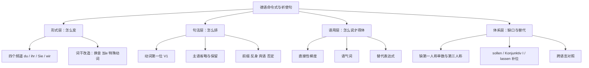
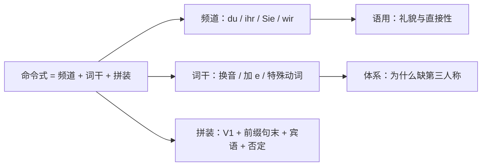
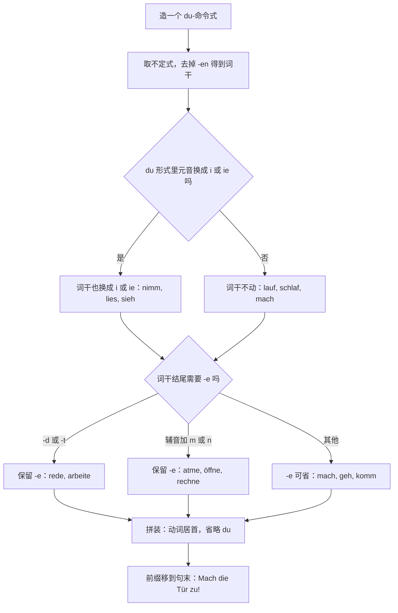

# 德语命令式与祈使句系统讲解

## 从“Nimm!”到“Seien Sie so nett”——一套可自动生成的请求系统

---

## 学习目标

读完本文，你应该能够：

1. **生成**：对任意一个动词、任意一类听话人，在几秒内造出形式正确的德语命令句（du / ihr / Sie / wir 四个“频道”）。
2. **诊断**：看到 `Nehm!`、`Sein Sie ruhig!`、`Läuf schneller!` 这类句子，能立刻说出错在哪里、为什么错。
3. **判断**：面对一个具体场合（对室友、对主管、对全组、对陌生人），能选出一个既正确又得体的表达——包括判断**什么时候不该用命令式**。
4. **迁移**：理解“语法体系有缺口时，语言用别的手段补位”这一机制，并把它用到其他语法点上。

---

## 教学设计说明

| 项目 | 内容 |
|---|---|
| 主题类型 | 语言语法型（形态学 + 句法 + 语用），兼有系统型特征 |
| 假定起点 | 学过现在时变位，知道 du/Sie 的区别，但没系统学过命令式 |
| 核心难点 | ① 命令式形式不在变位表里，学习者缺少生成规则；② 形式正确 ≠ 说得得体 |
| 依赖顺序 | 人称频道 → 词干改造 → 句法拼装 → 语用梯度 → 体系缺口与替代 |
| 主要教学策略 | 概念转变（破除“去 -st 就行”的错误规则）、精细加工（整体→局部→整体）、检索练习 |

---

## 知识地图



---

# 第 0 阶：无极·破壁——为什么命令式让人措手不及

设想你刚到德国交换，第一天搬进宿舍。室友开门，一口气说了这些：

> **Komm rein!**
> **Stell deine Tasche einfach da hin.**
> **Setz dich!**
> **Nimm dir was zu trinken.**

半小时后房东太太来敲门，说的是：

> **Kommen Sie doch herein.**
> **Nehmen Sie sich einen Kaffee.**
> **Seien Sie so nett und schließen Sie die Tür.**
> 请进吧。
> 随便喝点咖啡吧。
> 麻烦您把门关上哦。

你回想起语法书上的变位表：

| | nehmen |
|---|---|
| ich | nehme |
| du | nimmst |
| er/sie/es | nimmt |
| wir | nehmen |
| ihr | nehmt |
| sie/Sie | nehmen |

然后你发现一个问题：**你听到的 `Nimm!`、`Nehmt!`、`Nehmen Sie!`、`Seien Sie!` 没有一个直接对应这张表里的形式。** 尤其那个 `seien` ——你只在“虚拟式”那一章见过它。

于是产生了五个具体的困惑：

1. 命令式到底是怎么从动词变出来的？为什么它“不属于”变位表？
2. 同一个意思“请坐”，为什么有 `Setz dich!` / `Setzt euch!` / `Setzen Sie sich!` / `Setzen wir uns!` 四种说法？
3. `du nimmst` 换音成了 `Nimm!`，可 `du läufst` 为什么不变成 `Läuf!`？
4. 为什么不能说 `Sein Sie ruhig!`？
5. 为什么对室友说 `Setz dich!` 完全正常，对老板说就会出事？

第 1–3 个问题属于**形式生成**，第 4 个属于**不规则动词的特殊性**，第 5 个属于**语用选择**。

本文要解决的就是这两组问题：**怎么变对**，以及**对谁怎么说才不失礼**。

### 三个必须提前破除的误解

**误解一：“命令式就是把 du 形式去掉 -st”**

这条规则只在规则动词上成立。`du nimmst` 去掉 -st 得到 `nimm`，碰巧对了；但 `du läufst` 去掉 -st 得到 `läuf`，错了。而且这条规则完全无法生成 `Seien Sie!` 和 `Gehen wir!`。所以它不能作为核心规则，最多算一个偶然好用的巧合。

**误解二：“命令式就是粗鲁的”**

德语里 `Kommen Sie bitte herein` 是服务业、职场、说明书里的**中性标准写法**，不带任何粗鲁色彩。真正决定礼貌程度的，不只是动词形式，还有语气词、语调、双方关系、以及你是否给了对方拒绝的空间。这一点第 3 阶会展开。

**误解三：“命令式是一种时态”**

它不是时态。它是动词的**式（Modus）**，表示说话人以什么“态度”对待命题。而且德语命令式**结构上没有过去时**——原因很简单：你无法命令一件已经发生的事。

---

# 第 1 阶：道生一——命令式的核心本质与最小模型

## 1. 专业定义

> **Der Imperativ**（也称 Befehlsform、Aufforderungsform）ist ein Verbmodus. Er drückt aus, dass ein Sprecher von einem oder mehreren Adressaten erwartet, dass diese eine Handlung ausführen oder unterlassen. Die zugehörige Satzart ist der **Imperativsatz / Aufforderungssatz**: Das finite Verb steht an erster Stelle, das Subjekt der 2. Person wird in der Regel nicht realisiert.

翻成中文：命令式是动词的一种“式”，表示说话人期待某个或某些听话人去执行（或不执行）某个动作。对应的句类是**祈使句**：变位动词位于句首，第二人称主语通常不出现。

## 2. 一句话本质

> **命令式是德语动词唯一一个“天生指向听话者”的形式：它不描述世界，而是要求世界改变。**

## 3. 大白话

别的动词形式在“说事”：`Ich gehe` 在报告一个事实，`Ich ginge` 在假设一种情况。命令式在**派人干活**：`Geh!` 不是报告你正在走，而是要你去走。

## 4. 一个能用的类比：对讲机

命令式像一台对讲机，操作只有两步：

- **第一步，选频道**：`du`（单人对讲）／ `ihr`（群组对讲）／ `Sie`（正式加密频道）／ `wir`（广播，连自己也在频道里）
- **第二步，按发射键**：动词词干

**这个类比解释了什么：**

- 为什么必须先确定人称——因为**词形本身随频道改变**（`Mach!` / `Macht!` / `Machen Sie!`）。
- 为什么“发射”这个动作不带时间——你按下发射键时说的是“接下来要做的事”，不可能命令一件已完成的事。
- 为什么对讲机有四个频道却只有一个发射键——四种人称共用同一套“词干改造”逻辑。

**这个类比不能解释什么：**

- 它不能解释为什么 `Sie` 和 `wir` 这两个频道里，“主语”这个词必须留在句子里（`Machen Sie!` 而不是 `Machen!`），而对讲机不需要点名。
- 它不能解释同一个频道内部的礼貌差别（`Komm!` 和 `Komm mal!` 完全是两种语气）。
- 它更不能解释 `Seien Sie!` 这种“形态上属于虚拟式”的例外。

**所以：类比只能给你方向感，不能代替规则。** 下面就是真正的规则。

## 5. 最小可运行模型

> **命令式 = 选频道（4 选 1）+ 改造词干 + 拼装句子**

用一个完整例子拆开：

> **Mach die Tür zu!**（把门关上！）

| 层 | 内容 |
|---|---|
| 选频道 | 对一个熟人说话 → `du` |
| 改造词干 | `machen` → 词干 `mach`，无换音，词尾 -e 可省 → `Mach` |
| 拼装 | 动词居首 + 省略 `du` + 可分前缀 `zu` 移到句末 → `Mach die Tür zu!` |

四层结构一目了然。这个模型对 90% 的动词有效，剩下 10% 的特殊情况我们在第 2、3 阶处理。

## 6. 系统缩略图



---

# 第 2 阶：一生二——两个关键维度

命令式的全部变化都能分解到两条轴上：

- **轴一：人称轴（对谁说）**——决定词尾形式和代词去留。
- **轴二：词干轴（什么动词）**——决定词干要不要改造。

两条轴交叉，就是你要的答案。

## 2.1 轴一：人称轴——四个频道

### 总览表

| 频道 | 形式规则 | machen | gehen | sein | 主语代词 |
|---|---|---|---|---|---|
| **du** | 词干（+e），必要时换音 | **Mach!** | **Geh!** | **Sei!** | 省略 |
| **ihr** | 词干 + t（＝现在时 2 pl） | **Macht!** | **Geht!** | **Seid!** | 省略 |
| **Sie** | 词干 + en + Sie（＝现在时 3 pl） | **Machen Sie!** | **Gehen Sie!** | **Seien Sie!** | 保留，紧跟动词 |
| **wir** | 词干 + en + wir（＝现在时 1 pl） | **Machen wir!** | **Gehen wir!** | **Seien wir!** | 保留 |

### 每个频道是什么、为什么存在

**du 频道：最直接，最日常**

对一个人说话，且关系是 duzen（家人、朋友、同学、同事、孩子、宠物）。形式上是**裸词干**——这是德语动词最短的可能形式，也是命令式最古老的形态。

`Komm!` `Mach!` `Hör mal!` `Sag mal!`

**ihr 频道：对一群人，每个人单拎出来都是 du**

注意：`ihr` 不是“礼貌复数”，而是“把一群 du 打包”。形式等于现在时第二人称复数去掉代词。

`Kommt!` `Macht!` `Hört mal!`

**Sie 频道：正式、距离、陌生**

对陌生人、上级、客户、服务对象、正式书面语。形式上是**现在时第三人称复数 + Sie**——因为 `Sie` 这个尊称词本身就是从第三人称复数借来的。这一点很重要：`Sie` 频道用的是“第三人称”形式，所以它在句法上必须保留代词，否则别人无法知道你在对谁说话。

`Kommen Sie!` `Machen Sie!` `Nehmen Sie Platz!`

**wir 频道：包括说话人自己**

严格说这不是“命令”，而是**共同行动的提议**（Adhortativ）。它对听话人说“我们（包括我）一起做某事”。

`Gehen wir!` `Fangen wir an!` `Seien wir ehrlich.`

### 四个频道的相同与不同

| 维度 | du | ihr | Sie | wir |
|---|---|---|---|---|
| 听话人数量 | 1 | 多个 | 1 或多个 | 包括说话人 |
| 动词形式来源 | 裸词干 | 现在时 2 pl | 现在时 3 pl | 现在时 1 pl |
| 主语是否出现 | 不出现 | 不出现 | 必须出现 | 必须出现 |
| 直接性 | 高 | 高 | 中（正式） | 低（提议） |
| 典型场合 | 熟人 | 熟人群体 | 陌生、职场、说明 | 团队协作 |

### 一个关键洞察

**这四个频道不是“语法变体”，而是德语社会关系系统的语法化。** `du` / `ihr` / `Sie` 的选择，与德语 duzen/siezen 的社交规则完全一致。你选错了频道，语法上可能完全正确，社交上却已经出事了——这正是第 0 阶问题 5 的答案。

### 一个常见混淆

| 容易混淆的 | 区别 |
|---|---|
| `ihr` 命令式 vs. `Sie` 命令式 | `Macht!`（对一群熟人）vs. `Machen Sie!`（对一群需要尊称的人）。两者都是“对多人”，但社交距离完全不同。 |
| `wir` 命令式 vs. 陈述句 | `Gehen wir!`（走，咱们走）vs. `Wir gehen.`（我们要走／我们正在走）。前者是提议，后者是报告。语序和语调都不同。 |

## 2.2 轴二：词干轴——三种改造

### 类型 A：规则动词——什么都不用做

词干直接拿来用，词尾 -e 加不加都行（但见下面的条件）。

`machen → Mach!` `gehen → Geh!` `kaufen → Kauf!` `sagen → Sag!`

### 类型 B：换音动词——只继承 e→i / e→ie

这是最重要的一类。德语强变化动词在第二人称单数会发生元音变化，命令式**只继承其中一种：e 变 i 或 ie**。

| 不定式 | du 现在时 | du 命令式 | ihr 命令式 |
|---|---|---|---|
| nehmen | du nim**m**st | **Nimm!** | **Nehmt!** |
| geben | du g**i**bst | **Gib!** | **Gebt!** |
| lesen | du l**ie**st | **Lies!** | **Lest!** |
| sehen | du s**ie**hst | **Sieh!** | **Seht!** |
| essen | du **i**sst | **Iss!** | **Esst!** |
| sprechen | du spr**i**chst | **Sprich!** | **Sprecht!** |
| helfen | du h**i**lfst | **Hilf!** | **Helft!** |
| werfen | du w**i**rfst | **Wirf!** | **Werft!** |
| treffen | du tr**i**ffst | **Triff!** | **Trefft!** |
| sterben | du st**i**rbst | **Stirb!** | **Sterbt!** |
| empfehlen | du empf**ie**hlst | **Empfiehl!** | **Empfehlt!** |
| vergessen | du verg**i**sst | **Vergiss!** | **Vergesst!** |
| treten | du tr**i**ttst | **Tritt!** | **Tretet!** |
| brechen | du br**i**chst | **Brich!** | **Brecht!** |

**注意两件事：**

1. 只有 **du** 形式换音，**ihr** 形式永远保留原元音（`Nehmt!` 不是 `Nimmt!`）。
2. `nehmen` 出现双 m（`Nimm!`），`treten` 出现双 t（`Tritt!`），`essen` 出现双 s（`Iss!`）——这是为了保持短元音，规则上跟 du 形式一致。

### 类型 C：陷阱区——a / o / u 变音**不进入**命令式

这是中国学习者最容易错的地方。因为 `du läufst` 有变音，就顺手推出 `Läuf!` ——**错**。

**规律一句话：命令式继承 du 的“换音”（e→i/ie），但拒绝 du 的“变音”（a/o/u→ä/ö/ü）。**

| 不定式 | du 现在时 | 错误 | 正确 |
|---|---|---|---|
| laufen | du l**ä**ufst | ~~Läuf!~~ | **Lauf!** |
| schlafen | du schl**ä**fst | ~~Schläf!~~ | **Schlaf!** |
| fahren | du f**ä**hrst | ~~Fähr!~~ | **Fahr!** |
| tragen | du tr**ä**gst | ~~Träg!~~ | **Trag!** |
| halten | du h**ä**ltst | ~~Hält!~~ | **Halt!** |
| stoßen | du st**ö**ßt | ~~Stöß!~~ | **Stoß!** |
| lassen | du l**ä**sst | ~~Läss!~~ | **Lass!** |
| werden | du w**i**rst | ~~Wird!~~ | **Werde!** |

最后一行 `werden` 是双重例外：它 du 形式换音（wirst），但命令式**不换**。

### 类型 D：完全特殊——必须背

| 动词 | du | ihr | Sie | wir |
|---|---|---|---|---|
| **sein** | **Sei!** | **Seid!** | **Seien Sie!** | **Seien wir!** |
| **haben** | **Hab!** | **Habt!** | **Haben Sie!** | **Haben wir!** |
| **werden** | **Werde!** | **Werdet!** | **Werden Sie!** | **Werden wir!** |
| **wissen** | **Wisse!** | **Wisst!** | **Wissen Sie!** | **Wissen wir!** |
| **tun** | **Tu!** | **Tut!** | **Tun Sie!** | **Tun wir!** |
| **lassen** | **Lass!** | **Lasst!** | **Lassen Sie!** | **Lassen wir!** |

** `sein` 是关键。** `Seien Sie!` 里的 `seien` 在形式上就是第一虚拟式。这解释了为什么它看起来“不属于”变位表——它是从别的地方调过来的。

## 2.3 词尾 -e 的取舍

| 词干结尾                                  | -e          | 例子                                                         |
| ------------------------------------- | ----------- | ---------------------------------------------------------- |
| **-d / -t**                           | 标准语必须保留     | **Rede!** **Warte!** **Arbeite!** **Antworte!** **Finde!** |
| **-m / -n，前面是难以连读的辅音**（t, f, ch, g 等） | 必须保留        | **Atme!** **Öffne!** **Rechne!** **Zeichne!** **Begegne!** |
| **-m / -n，前面是元音、l、r 或同一鼻音**           | 可省          | **Komm!** **Lern!** **Wohn!** **Schwimm!**                 |
| **-ig**                               | 习惯保留        | **Entschuldige!** **Beschäftige!**                         |
| **-eln / -ern**                       | 词干内的 -e- 可省 | **Sammle! / Sammel!** **Ändre! / Ändere!**                 |
| **-ieren**                            | 常省略         | **Studier!** **Probier!** **Telefonier!**                  |
| 其他                                    | 可省          | **Mach!** **Geh!** **Kauf!**                               |

**口语 vs. 标准语的差别**：口语里 `Wart mal!` `Find das gut!` 非常常见，这并不“错”，但考试和正式写作建议用标准形式。

## 2.4 辨析：命令式与哪些形式“撞脸”

这是很多人读错句子的根源。

| 命令式形式 | 与谁同形 | 如何区分 |
|---|---|---|
| **Macht!**（ihr） | er/sie/es **macht**（3 sg） | 有无主语代词；语调；语境 |
| **Machen Sie!** | 3 pl 陈述句 / 是非问句 | 语调（降调＝命令，升调＝提问）；语境；`Sie` 紧跟动词 |
| **Gehen wir!** | 1 pl 陈述句 / 是非问句 | 语序（`Gehen wir!` vs. `Wir gehen.`）；语调；语境 |
| **Sei!** | 第一虚拟式（Konjunktiv I） | 见下 |

**最小对立对**（同一个形式，两种功能）：

- **Machen Sie das!**（降调，命令：您做这个！）
- **Machen Sie das?**（升调，提问：您在做这个吗？）

这说明一件事：**命令句不是由动词形式单独定义的，而是由“形式 + 句首位置 + 语调 + 语境”共同定义的。**

## 2.5 `sei` 的多重身份（重要辨析）

`sei` 看起来一样，但功能完全不同：

| 句子 | 形式 | 功能 | 中文 |
|---|---|---|---|
| **Sei ruhig!** | 命令式 | 命令 | 安静点！ |
| **Seien Sie so nett!** | 命令式（Sie） | 请求 | 麻烦您…… |
| **Es sei denn, du kommst mit.** | Konjunktiv I | 连词结构 | 除非你一起去。 |
| **Wie dem auch sei.** | Konjunktiv I | 固定短语 | 无论如何。 |
| **Man nehme 200 g Mehl.** | Konjunktiv I | 无人称指令（旧式） | 取 200 克面粉。 |
| **Er sagt, sie sei krank.** | Konjunktiv I | 间接引语 | 他说她病了。 |

**记忆法**：看到 `sei` 先问“有没有听话人在被要求做事”——有就是命令式，没有就是虚拟式。

---

# 第 3 阶：二生三——内部机制与运行规律

现在你知道了零件。接下来要理解**这台机器怎么运转**，以及**它为什么必须是这个样子**。

## 3.1 三要素机制模型

任何一个合法的德语祈使句，都由三个要素共同决定：

```mermaid
①  谁在听（Adressat） → 决定频道、词尾、代词去留
②  什么动词（Stamm）  → 决定换音、-e、特殊形式
③  怎么排（Syntax）   → 决定前缀、反身、宾语、否定、语气词
```

这三个要素是**串联**的，顺序不能颠倒。下面用流程图把 `du` 频道（最难的一个）完整走一遍：



## 3.2 为什么德语命令式长这样——四个结构性原因

理解“为什么”比背“是什么”更抗遗忘。

**原因一：du 命令式是最古老、最简化的形式**

动词的裸词干是德语动词能呈现的极简形态。命令式之所以“短”，是因为它承担的是最直接的功能——不给修饰，不给缓冲。这也解释了为什么它在口语里不断继续简化（-e 脱落）：语言倾向于让高频、高直接性的形式变短。

**原因二：ihr 命令式直接借用现在时第二人称复数**

`ihr macht` → `Macht!`，只做了一件事：去掉代词。这也是为什么它**不换音**——换音只发生在第二人称单数，不在复数。

**原因三：Sie 命令式借用第三人称复数**

`Sie` 这个尊称词源自第三人称复数。所以 `Sie` 命令式就是“现在时第三人称复数 + 保留代词”。**保留代词不是可选项，是必须的**：因为 `machen` 这个形式同时可以是 1 pl、3 pl 或不定式的一部分，只有 `Sie` 能标明“这是在对您说话”。

**原因四：wir 命令式借用第一人称复数，并保留代词**

同理。`Gehen wir!` 的 `wir` 不能省，否则剩下的 `Gehen!` 会被理解成不定式祈使（“走！”）或者干脆不成句。

**一个统一的原则浮出来了：**

> **动词词尾本身能区分人称时，代词省略；词尾无法区分时，代词保留。**

`du`（裸词干）和 `ihr`（-t）在形式上足够独特，所以省略；`Sie`（-en）和 `wir`（-en）形式重叠，所以保留。这条原则比“背四条规则”好记得多。

## 3.3 慢镜头推演：一次完整的生成过程

**任务**：把“把书递给我”这句话，分别对四种人说。

**第 1 步：确定动词与词干**

动词 `geben`。词干 `geb-`。

**第 2 步：检查换音**

`du gibst` → 有 e→i 换音 → du 命令式换成 `gib`。ihr / Sie / wir **不换音**。

**第 3 步：确定词尾**

词干 `geb` 结尾是 -b，不是 -d/-t，也不涉及 -m/-n → -e 可省。

**第 4 步：拼装宾语**

“书”是 `das Buch`（第四格），“我”是 `mir`（第三格）。**代词宾语排在名词宾语前面**：`Gib mir das Buch!`

**第 5 步：四个频道**

| 频道 | 结果 |
|---|---|
| du | **Gib mir das Buch!** |
| ihr | **Gebt mir das Buch!** |
| Sie | **Geben Sie mir das Buch!** |
| wir | （`Geben wir...` 在此不自然）→ 改用 **Lass uns das Buch geben!** |

注意最后一行：`wir` 频道并不是万能的。当动作的受益者是说话人自己（“给我”）时，“我们一起给我”在语义上说不通。这就是**形式正确 ≠ 语义通顺**的第一个例子。

**第 6 步：改变条件，看结果怎么变**

- 加礼貌 → `Geben Sie mir das Buch bitte!`
- 加语气词 → `Gib mir mal das Buch!`（随意、轻松）
- 加否定 → `Gib mir das Buch nicht!`（不要给我那本书）
- 换成分离动词 → `Gib das Buch bitte zurück!`（`zurückgeben` 的前缀到句末）
- 加反身 → `Zieh dir die Jacke an!`（`sich` 用第三格，因为 `die Jacke` 占了第四格）

## 3.4 句法拼装：五条硬规则

**规则 1：变位动词必须在第一位（V 1）**

`Mach die Tür zu!` ✓ ／ `Du mach die Tür zu!` ✗（除非 `du` 重读表强调，见规则 5）

**规则 2：可分前缀必须到句末**

| 原动词 | 命令式 |
|---|---|
| aufstehen | **Steh auf!** |
| zumachen | **Mach zu!** |
| anrufen | **Ruf an!** |
| aufpassen | **Pass auf!** |
| mitkommen | **Komm mit!** |
| anziehen | **Zieh dich an!** |
| durchgehen | **Geh das durch!** |

错误形式 ~~ `Aufsteh!` ~~ ~~ `Anzieh dich!` ~~ 之所以错，是因为它们把德语动词的“框形结构”拆坏了。

**规则 3：反身代词紧贴动词**

| 动词 | du | ihr | Sie |
|---|---|---|---|
| sich setzen | **Setz dich!** | **Setzt euch!** | **Setzen Sie sich!** |
| sich beeilen | **Beeil dich!** | **Beeilt euch!** | **Beeilen Sie sich!** |
| sich ausruhen | **Ruh dich aus!** | **Ruht euch aus!** | **Ruhen Sie sich aus!** |

注意 `Sie` 频道里 `sich` 在 `Sie` **后面**，这是固定位置。

**规则 4：宾语顺序——代词在前，名词在后**

| 情况 | 顺序 | 例子 |
|---|---|---|
| 一个第三格代词 + 一个第四格名词 | 三格在前 | **Gib mir das Buch!** |
| 一个第四格代词 + 一个第三格代词 | 四格在前 | **Gib es mir!** |
| 一个第四格名词 + 一个第三格名词 | 三格在前 | **Gib dem Kind das Buch!** |

**规则 5：重读的 du 可以回来**

这不是例外，是**强调手段**。当你要把责任明确压到对方头上时：

> **Mach du das!**（你来干！）
> **Komm du mal her!**（你给我过来一下！）

**位置必须是动词之后**，不能说 ~~ `Du mach das!` ~~。

**规则 6：否定词必须在动词之后**

| 正确 | 错误 |
|---|---|
| **Mach das nicht!** | ~~Nicht mach das!~~ |
| **Geh nicht weg!** | ~~Nicht geh weg!~~ |
| **Hab keine Angst!** | ~~Keine Angst hab!~~ |
| **Sei nicht so laut!** | ~~Nicht sei so laut!~~ |

名词否定用 `kein`，其余用 `nicht` ——这条跟陈述句一样。

## 3.5 语用机制：为什么“命令式”不总是“命令”

现在进入最容易被忽略、但在真实交流中最重要的一层。

一个祈使句的实际效果，由**两个独立维度**共同决定：

```mermaid
维度 1：直接性——听话人是否被明确点名、动作是否被明确说出
维度 2：社会距离——du / ihr / Sie 的选择，以及语气词、语调、附加的缓冲
```

这两个维度**不能互相替代**。`Kommen Sie bitte herein!` 在维度 1 上非常直接（明确点名、明确动作），在维度 2 上却足够礼貌（尊称 + bitte），所以它在服务业是标准说法。反过来，`Es ist kalt hier.` 在维度 1 上极度间接（什么都没说），但如果对方是你刚认识的人，它可能反而让人不舒服——因为它把“猜”的负担推给了对方。

**直接性梯度表**（从施压最强到最弱，具体感受取决于关系、地区、场合，不是物理定律）：

| 表达手段 | 例子 | 直接性 | 典型场景 | 风险 |
|---|---|---|---|---|
| werden + 不定式 | **Du wirst jetzt aufräumen!** | 极高（威胁） | 家长对孩子 | 冒犯 |
| du 命令式，无缓冲 | **Räum auf!** | 高 | 熟人、紧急 | 对陌生人失礼 |
| du 命令式 + mal/doch | **Räum mal auf!** | 中高 | 熟人日常 | 低 |
| Sie 命令式 | **Räumen Sie bitte auf.** | 中（正式） | 职场、说明 | 缺 bitte 显生硬 |
| 情态动词陈述 | **Sie sollten aufräumen.** | 中低（建议） | 职场建议 | 显得说教 |
| Konjunktiv II 疑问 | **Könnten Sie aufräumen?** | 低（请求） | 正式请求、邮件 | 过度迂回 |
| 陈述 + 暗示 | **Es ist ziemlich unordentlich hier.** | 极低 | 尴尬场合 | 可能不被理解 |

## 3.6 语气词：一句话的语气，全在这几个小词上

德语命令式的“人情味”，主要靠语气词调节。这是中国学习者最容易忽略、但最能立刻提升自然度的一环。

| 语气词 | 功能 | 例子 | 中文对应 |
|---|---|---|---|
| **mal** | 弱化、随意化 | **Komm mal her!** | 来一下 |
| **doch** | 催促、反驳“你本该” | **Setz dich doch!** | 坐呀／坐嘛 |
| **bitte** | 礼貌 | **Komm bitte pünktlich!** | 请 |
| **endlich** | 不耐烦 | **Räum endlich auf!** | 到底／终于 |
| **ruhig** | 许可、让对方放心 | **Geh ruhig rein!** | 尽管进去 |
| **schon** | 催促 | **Komm schon!** | 快点呀 |
| **bloß / nur** | 警告 | **Mach bloß keine Dummheit!** | 千万别 |
| **ja** | 强调警告 | **Vergiss das ja nicht!** | 可千万别 |

对照一下：

- **Komm!** —— 中性，可能有点硬
- **Komm mal!** —— 轻松，日常
- **Komm doch!** —— 带点劝说、带点“你本来就该来”
- **Komm endlich!** —— 我已经等很久了
- **Komm schon!** —— 催促、鼓励
- **Komm bitte!** —— 礼貌请求

**同一个动词形式，六种社交含义。** 这就是为什么“学会变位”和“学会说话”是两件事。

---

# 第 4 阶：三生万物——从命令式到整个“请求系统”

## 4.1 体系缺口：命令式缺了哪些人称？

这是本文最重要的一张表。它解释了为什么德语需要那么多“替代说法”。

| 人称 | 有无形态命令式 | 替代手段 | 例子 |
|---|---|---|---|
| ich（我） | **无** | 自我指令用陈述或被动 | **Ich muss jetzt los.** / **Jetzt wird gearbeitet!** |
| du（你） | **有** | — | **Komm!** |
| er/sie/es（他） | **无** | sollen / Konjunktiv I / lassen | **Er soll sofort kommen.** / **Sie sagte, er solle kommen.** / **Lass ihn kommen!** |
| wir（我们） | **有**（提议式） | lassen uns / wollen wir | **Gehen wir!** / **Lass uns gehen!** / **Wollen wir gehen?** |
| ihr（你们） | **有** | — | **Kommt!** |
| sie（他们） | **无** | sollen | **Sie sollen warten.** |
| Sie（您） | **有** | — | **Kommen Sie!** |

**为什么缺？** 因为命令式在语义上必须**指向听话人**。我无法命令我自己（我不是我的听话人），也无法直接命令一个不在场的第三者（他听不到）。这不是德语的特殊缺陷，是**所有语言共有的语义限制**。

**缺口怎么补？** 用词汇手段。`sollen`（应该）、`Konjunktiv I`（间接引语）、`lassen`（让）这三个词，就是德语的“补丁”。

> **迁移性洞察**：任何语法体系都有洞。语言不会因为“形式缺一格”就瘫痪，它会调用别的词类来填补。学语法时要问：“这个格子里为什么是空的？系统用什么填它？”——这个问题可以套用到虚拟式、被动、冠词系统上。

## 4.2 完整替代手段清单

| 手段 | 例子 | 语域 |
|---|---|---|
| **不定式** | **Bitte einsteigen!** / **Nicht rauchen!** / **Zurückbleiben bitte!** | 告示、广播、说明书 |
| **第二分词** | **Aufgepasst!** / **Stillgestanden!** | 军队、感叹 |
| **名词** | **Ruhe!** / **Achtung!** / **Vorsicht, Stufe!** | 标语、紧急提示 |
| **情态动词陈述** | **Du musst jetzt gehen.** / **Sie sollten warten.** | 日常、职场 |
| **werden + 不定式** | **Du wirst jetzt aufräumen!** | 威胁、家长 |
| **Konjunktiv II** | **Könnten Sie mir helfen?** | 正式请求 |
| **Konjunktiv II 陈述** | **Du solltest mal zum Arzt gehen.** | 建议 |
| **haben + zu + 不定式** | **Sie haben das bis Freitag abzugeben.** | 行政、强势 |
| **sein + zu + 不定式** | **Das ist bis Freitag zu erledigen.** | 公文、无人称 |
| **被动现在时** | **Jetzt wird geschlafen!** / **Hier wird nicht geraucht!** | 家长、集体规则 |
| **Konjunktiv I** | **Man nehme 200 g Mehl.** / **Es sei darauf hingewiesen, dass ...** | 菜谱（旧式）、学术写作 |
| **疑问句** | **Kommen Sie doch rein!** / **Wollen wir anfangen?** | 邀请、提议 |
| **暗示** | **Es zieht.** / **Der Müll steht noch draußen.** | 极间接 |
| **lassen** | **Lass das!** / **Lass uns gehen!** / **Lass ihn erst mal ankommen.** | 阻止、提议、允许 |

## 4.3 场景地图：不同场合用哪一套

| 场合 | 主导形式 | 为什么 |
|---|---|---|
| 家庭日常 | du / ihr 命令式 + mal/doch | 关系近，直接不构成威胁 |
| 育儿 | du 命令式 / werden + Inf. / 被动 | 需要明确边界 |
| 职场（同事间） | du 或 Sie 命令式 + bitte | 效率优先，德语职场对 Sie 命令式接受度高 |
| 职场邮件 | Sie 命令式 + bitte / Konjunktiv II | 书面语需要缓冲 |
| 客服、服务业 | Sie 命令式 + bitte | 标准中性，不显粗鲁 |
| 说明书、菜谱 | 不定式 / Sie 命令式 | 无人称或标准化 |
| 告示、标语 | 不定式、分词、名词 | 空间有限，需要一眼读懂 |
| 交通广播 | 不定式 + bitte | 无人称、覆盖所有人 |
| 学术写作 | Konjunktiv I / sein + zu + Inf. | 无人称、客观化 |
| 行政公文 | haben/sein + zu + Inf. | 明确义务，不指向个人 |
| 军队 | 分词、短命令式 | 清晰、可喊 |

**一个值得注意的跨语言差异（作为倾向，不是定律）**：德语职场邮件里 `Bitte senden Sie mir ... bis Freitag` 是常规、中性的写法；把它逐字译成英文会显得生硬，反过来，英文里 `Could you possibly ...` 的客气程度直译成德语 `Könnten Sie eventuell ...`，在德语里有时会显得过度迂回。**两种语言对“礼貌”的默认刻度不同**，这属于语用习惯差异，具体还取决于行业、地区和个人风格。

## 4.4 中文母语者的干扰地图

中文没有形态命令式——靠“请、吧、啊、了”和语境。这会造成系统性的迁移错误。

| 中文思维 | 错误德语 | 正确德语 | 错因 |
|---|---|---|---|
| “你坐” | ~~Du setzt dich.~~ | **Setz dich!** | 用了陈述句 |
| “请坐” | ~~Bitte Sie setzen sich.~~ | **Setzen Sie sich bitte.** | 逐字翻译“请+你+动词” |
| “别忘了” | ~~Nicht vergessen!~~（可作不定式祈使，但不针对个人） | **Vergiss das nicht!** | 没有变位 |
| “你拿这个” | ~~Du nimmst das!~~ | **Nimm das!** | 陈述句当命令 |
| “快点” | ~~Schnell!~~（可作感叹） | **Beeil dich!** | 只译了词，没译结构 |
| “请进” | ~~Bitte eintreten!~~（告示可以，对人不行） | **Kommen Sie rein!** | 不定式不用于面对面 |

**一个普遍的根源**：中文的动词不变位，所以“谁做”由主语和语境承担；德语的动词变位本身就携带“对谁说”的信息。学命令式时，不要把中文句子逐词搬过去，而要**先问“我对谁说”，再动词**。

---

# 第 5 阶：实战·落地——从“会变”到“会办成事”

## 5.1 实战任务：实习第一天的八个请求

**背景**：你在德国一家中型公司实习，第一天。德语 B 1，写过邮件但没在真实职场用过。今天之内你要发出八个请求。

**约束**：不能显得傲慢，也不能过度客气到让对方觉得你在开玩笑。

**资源**：你知道所有人的名字和职位；公司内部用 duzen，但对外和不熟的上级用 Siezen。

### SOP：六步生成法

| 步骤 | 做什么 | 为什么 | 怎么判断 | 出错怎么办 |
|---|---|---|---|---|
| 1 | 确定听话人集合 | 决定频道 | 一个人？一群人？包括自己？ | 拿不准就用 Sie——多用敬称不丢分 |
| 2 | 取词干，查换音 | 决定词形 | du 形式换 i/ie 吗？词干结尾要 -e 吗？ | 拿不准就查表，别猜 |
| 3 | 选礼貌标记 | 决定得体度 | 熟人加 mal，正式加 bitte | 邮件里永远加 bitte |
| 4 | 拼装句法 | 决定正确性 | 前缀在句末？反身紧贴？代词在前？nicht 在后？ | 逐条对照规则表 |
| 5 | 语域检查 | 决定是否冒犯 | “换成中文我会这么说吗？” | 觉得硬就降一级直接性 |
| 6 | 结果验证 | 决定是否达成目的 | 对方是否立刻执行？是否追问？ | 追问说明信息不全，不是礼貌问题 |

### 八个请求的完整推演

**① 对同组实习生 Jonas（du，同龄）**

> **Schau dir das bitte mal an.
> > 请看看这个。**

频道 du → `schauen` 词干 `schau`，无换音，-e 可省 → `Schau`；`dir` 是反身第三格（因为 `das` 是第四格）；`bitte mal` 两个缓冲词叠用，表示“不着急，顺手看看”。

**② 对三位同事（ihr）**

> **Legt die Dateien bitte im Share ab.**

`ablegen` 可分，前缀 `ab` 到句末。`ihr` 形式不换音：`legt` 不是 `l**ä**gt`。

**③ 对主管 Frau Brandt（Sie）**

> **Unterschreiben Sie das bitte hier unten.**

`unterschreiben` 不可分，直接 `Unterschreiben Sie`。`bitte` 放在宾语后、地点状语前——德语中 `bitte` 位置灵活，但习惯上不放在句首（句首会显得像在强调“请你”）。

**④ 给全组邮件（Sie，书面）**

> **Bitte senden Sie Ihre Rückmeldung bis Freitag an mich.**

书面语里 `bitte` 常放句首，后面紧跟动词——这是标准的邮件开头结构。没有 `bitte` 的 `Senden Sie mir ... bis Freitag` 语法完全正确，但在邮件里会显得像在下指令。

**⑤ 共同任务（wir）**

> **Gehen wir die Liste zusammen durch!**

`durchgehen` 可分，`durch` 到句末。`wir` 必须保留。这条是提议，不是命令—— `zusammen` 一词专门用来强化“一起”的含义。

**⑥ 对访客（Sie，面对面）**

> **Warten Sie bitte kurz im Besprechungsraum.**

`kurz` 是缓冲词，把“等”变成“稍等一下”，比 `Warten Sie im Besprechungsraum` 友好得多。

**⑦ 紧急情况（对全体，ihr）**

> **Kommt bitte sofort zum Sammelpunkt!**

紧急情况下**直接性优先于礼貌**：`sofort` 明确、`bitte` 保留最低限度的礼貌。这时候用 `Könnten Sie eventuell ...` 是错的——不是不礼貌的问题，是会误事。

**⑧ 对自己（不能命令自己）**

> **Ich muss jetzt die Präsentation fertigstellen.**

命令式没有第一人称单数。要表达“我该做某事了”，用 `müssen` 的陈述句。这是第 3 阶那张表里“体系缺口”的直接应用。

## 5.2 失败案例：一封让实习生被提醒的邮件

**初始情况**：实习生需要同事（比他资深，但公司 duzen）周四前给一份数据。

**错误版本**：

> *Schick mir die Daten.*
> *Und ruf mich an.*

**错误链条**：

| 阶段 | 发生了什么 | 为什么有问题 |
|---|---|---|
| 判断 | 觉得公司 duzen，就用 du 命令式 | du 是对的，但“用 du”不等于“用最直接的 du 形式” |
| 形式 | `Schick` `ruf` 都没加缓冲 | 语法正确，语用过硬 |
| 结构 | 两句并置、没有称呼、没有理由 | 读起来像上级对下级发指令 |
| 结果 | 对方觉得被使唤，回了句 `Kannst du das bitte etwas freundlicher formulieren?` | 目的没达成，还消耗了关系 |

**改进版本**：

> **Hallo Markus,**
> **könntest du mir die Daten bis Donnerstag schicken? Ich brauche sie für die Präsentation am Freitag.**
> **Gib mir bitte kurz Bescheid, wenn es bei dir zeitlich nicht passt.**
> **Danke dir!**

**改进的四处**：

1. `könntest du` —— 用 Konjunktiv II 疑问，把“命令”变成“请求”。
2. `bis Donnerstag` + 理由 —— 给出截止时间和原因，让对方理解这不是随意使唤。
3. `Gib mir bitte kurz Bescheid` —— 这里又用回 du 命令式，但因为前面已经有缓冲，“顺手告诉我一声”听起来是体贴，不是命令。
4. `wenn es nicht passt` —— 给对方拒绝的空间。这一条在德语请求中非常关键：**没有退路的请求，再客气也是命令。**

**这个案例的核心教训**：一次请求的礼貌程度，不由某一个词决定，而由“**称呼 + 缓冲 + 理由 + 退路**”四个要素共同决定。命令式只是其中一个变量。

## 5.3 独立任务（请先自己写，再看文末评分标准）

**场景**：你在一家德国诊所实习。今天你需要：

1. 请一位候诊的老太太（Sie）稍等十分钟。
2. 请三位护士同事（du/ihr）帮忙把病历整理到架子上。
3. 请你和另一位实习生共同完成的任务开始动工（wir）。
4. 提醒一位同事（du）不要在走廊吃东西（诊所规定）。
5. 在门口贴一张手写提示，请所有访客关掉手机。
6. 对一个已经等了很久、有点不耐烦的病人（Sie）说一句安抚+请求的话。

**要求**：

- 覆盖 du / ihr / Sie / wir 四个频道。
- 至少有一句使用语气词，至少有一句使用非命令式替代手段。
- 至少有一句含可分前缀，至少有一句含反身代词。
- 用第 5.1 的六步 SOP 说明每一句的生成过程。

---

# 第 6 阶：九九归一——边界、批判与升维

## 6.1 命令式的适用条件与失效边界

**成立条件：**

1. 动作**指向未发生的事**（命令式只能指向现在或未来，不能指向过去）。
2. 听话人是**第二人称**（单/复数）或**包括说话人的第一人称复数**。
3. 说话人**有某种权利**（正式授权、情境授权、或对方认可）去提出要求。
4. 动作**在听话人的控制范围内**（你无法命令别人“长高”）。

**失效的情况：**

| 情况 | 为什么失效 | 应该怎么做 |
|---|---|---|
| 指向过去 | 无法命令已发生的事 | `Du hättest kommen sollen.` |
| 指向第三人称 | 第三者不是听话人 | `Er soll kommen.` / `Lass ihn kommen.` |
| 指向自己 | 无法自我命令 | `Ich muss ...` |
| 对方没有能力做到 | 命令不可执行 | 陈述事实、提供帮助 |
| 正式书面请求 | 直接性过高 | Konjunktiv II / `Bitte senden Sie ...` |
| 对方地位远高于你 | 命令权不存在 | 请求、建议、询问 |
| 对方情绪激动 | 命令会激发对抗 | 先共情，再提议 |

## 6.2 极端案例与反例

**反例一：形式正确，语义荒谬**

> ~~**Sei zwei Meter groß!**~~（长到两米！）

语法完美，但违反“可控性”条件。这说明命令式不只是一个形态问题，它预设了**可执行性**。

**反例二：命令式表达的不是命令**

> **Sei so nett und hilf mir.**（行行好，帮我一下。）

形式是命令，功能是请求 + 缓冲。`Sei so nett und ...` 是固定礼貌公式。

**反例三：非命令式表达的命令**

> **Hier wird nicht geraucht!**（这里不许吸烟！）
> **Jetzt wird geschlafen!**（现在都给我睡觉！）

形式上是被动陈述句，功能上是最强硬的指令。这再次证明：**句子功能不由动词形式单独决定。**

**反例四：`sei` 不是命令**

> **Es sei denn, du kommst mit.**（除非你一起去。）

这是 Konjunktiv I 引导的连词结构，没有听话人在被要求做事。

## 6.3 竞争性解释：怎么理解“德语命令式用得这么多”

对于同一个现象，不同学科给出不同解释。它们不是互相排斥，而是看问题的尺度不同。

| 解释框架 | 核心主张 | 优势 | 局限 |
|---|---|---|---|
| **形态学** | 命令式形式简单、省略主语，所以高频、易用 | 解释了为什么它短 | 解释不了语用差异 |
| **语用学（Searle）** | 命令式是“指令类言语行为”的典型标记 | 解释了它为什么能表达请求、建议、邀请 | 不涉及社会关系 |
| **社会语言学** | du/ihr/Sie 四频道是德语 duzen/siezen 系统的语法化 | 解释了频道选择的社交意义 | 不解释具体句子的语气 |
| **跨文化语用** | 不同语言对“直接”的默认刻度不同 | 解释了翻译时的错觉 | **极易过度概括，必须谨慎** |

**关于第四点要特别小心**：不能因为“德语命令式出现频率高”就推出“德国人更直接”这类结论。频率差异可能来自语法系统（德语有形态命令式，中文没有）、语域习惯（德语职场邮件的标准写法）、甚至语料来源。这是一个**待检验的假设**，不是已经确立的事实。

## 6.4 常见误区汇总表

| 误区 | 纠正 |
|---|---|
| 命令式 = du 形式去 -st | 只在规则动词成立，不能当规则用 |
| a/o/u 变音进入命令式 | 不进入：`Lauf!` 不是 `Läuf!` |
| ihr 命令式也换音 | 不换：`Nehmt!` 不是 `Nimmt!` |
| `Sein Sie ruhig!` | `Seien Sie ruhig!` |
| 命令式有过去时 | 没有 |
| 命令式可以命令第三人称 | 不能，要用 `sollen` |
| 可分前缀留在动词旁 | 必须到句末：`Mach zu!` |
| `nicht` 可以放句首 | 必须在动词后：`Mach das nicht!` |
| 命令式一定粗鲁 | Sie 命令式 + bitte 是中性标准写法 |
| `sei` 一定是命令式 | 也可能是 Konjunktiv I（`Es sei denn`） |
| `Setz dich!` 和 `Setzen Sie sich!` 只是形式不同 | 它们是不同的社交频道，选错会出事 |

## 6.5 回到开篇：重新解释那个下午

现在再看室友和房东太太的话：

| 原句 | 现在你能看到的 |
|---|---|
| **Komm rein!** | du 频道，`kommen` 词干 `komm`，可分前缀 `rein` 到句末 |
| **Stell deine Tasche einfach da hin.** | du 频道，`hinstellen` 可分，`da` + `hin` 双副词，`einfach` 是缓冲词 |
| **Setz dich!** | du 频道 + 反身第四格，`sich` 紧贴动词 |
| **Nimm dir was zu trinken.** | du 频道，e→i 换音（nimm），`dir` 反身第三格 |
| **Kommen Sie doch herein.** | Sie 频道，主语必须保留，`doch` 表示“别客气，进来吧” |
| **Nehmen Sie sich einen Kaffee.** | Sie 频道，不换音（`Nehmen` 不是 `Nimm`），`sich` 在 `Sie` 后 |
| **Seien Sie so nett und schließen Sie die Tür.** | Sie 频道 + `sein` 的 Konjunktiv I 形式 + 固定礼貌公式 |

**那一刻的慌乱，本质上是因为你只学过“变位表”，没学过“频道系统”。** 变位表告诉你动词跟着主语怎么变；命令式告诉你**说话人如何通过动词形式，把听话人拉进句子**。这是两套不同的信息。

## 6.6 三个可以迁移到别处的思维模型

**模型一：一个形式的意义，来自它和谁对立**

`Setz dich!` 之所以“直接”，不是因为它是命令式，而是因为它和 `Setzen Sie sich!`、`Komm mal her!`、`Könnten Sie ...?` 构成了一个对立系统。学任何语法点，都问一句：**“它和什么对立？选它而不选别的，意味着什么？”**

这套问法可以直接迁移到：du/Sie 的选择、Konjunktiv II 与直陈式的对立、被动与主动的对立、`weil` 与 `denn` 的对立。

**模型二：语法有缺口时，词汇来补**

命令式缺第一人称单数和第三人称 → 用 `müssen`、`sollen`、Konjunktiv I、`lassen` 补。这不是德语的缺陷，是语言的常态。

这套思路可以迁移到：为什么德语没有将来时“形态”而用 `werden`、为什么被动缺情态时用 `werden + 分词`、为什么比较级缺最高级时用 `am ...sten`。

**模型三：形式正确 ≠ 交际成功**

`Schick mir die Daten` 语法完美，交际失败。任何一条语法规则，都要问：“它在真实场合里，会被谁、以什么语气、对谁说？”

这套思路可以迁移到所有“语用敏感”的语法点：尊称系统、情态动词的强弱、虚拟式的客气程度、甚至标点符号。

---

# 练习与检测

> 建议先独立完成，再对照文末答案。每题都标注了考查层级。

## 第一级：概念识别

**1.** “命令式”和“祈使句”是同一个东西吗？请区分。

**2.** 德语命令式有几种人称形式？缺哪几种？缺的那几种用什么补？

## 第二级：形式生成

**3.** 写出下列动词的 du / ihr / Sie 命令式：

nehmen, laufen, sein, sich setzen, aufstehen, arbeiten, lächeln, sich verabschieden

**4.** 下面两个形式错在哪里？各用一句话说明原因。

a) ~~**Läuf schneller!**~~

b) ~~**Nehmt dein Buch!**~~

## 第三级：结构分析

**5.** 为什么 `Machen Sie das!` 和 `Machen Sie das?` 动词形式完全一样？靠什么区分？

**6.** 为什么 `Sie` 和 `wir` 命令式必须保留代词，而 `du` 和 `ihr` 不保留？

## 第四级：机制推导

**7.** 要把命令指向第三人称（“让他马上来”），德语有哪几种说法？请给出至少三种，并说明各自语域。

**8.** 为什么德语没有过去时的命令式？请从语义角度解释，不要只回答“语法上没有”。

## 第五级：概念辨析

**9.** 判断下面三句哪个不成立，并说明原因：

a) **Setz dich!**

b) **Setzen Sie sich!**

c) ~~**Lass uns setzen!**~~

**10.** `bitte` 在下面三句中的功能分别是什么？

a) **Kommen Sie bitte herein.**

b) **Bitte schön!**

c) **Bitte?**

## 第六级：案例应用

**11.** 把 `Sie sollten mir die Unterlagen schicken.` 改写成三种直接程度不同的说法，并标注适用场合。

**12.** 找出并改正下列句子的错误：

a) ~~**Sein Sie bitte pünktlich.**~~

b) ~~**Nehm deine Jacke mit!**~~

c) ~~**Bitte Sie setzen sich.**~~

d) ~~**Aufsteh!**~~

e) ~~**Zieh dich die Jacke an!**~~

f) ~~**Vergessen du das nicht!**~~

## 第七级：陌生迁移

**13.** 动词 `sich verabschieden`（告别）你没学过命令式。请造出 du / ihr / Sie 三个形式，并写出你的推理过程。

**14.** 一个中国学生说：~~**Bitte Sie kommen morgen.**~~ 请分析这句话的错误来源，并给出正确说法。

## 第八级：独立创造

**15.** 完成第 5.3 的独立任务（六个场景），并按文末评分标准自评。

---

# 答案与解析

**1.** 不是同一个东西。**命令式**是动词的形态（Modus），是词形层面；**祈使句**是句类（Satzart），是句子层面。一个祈使句可以用命令式动词（`Komm!`），也可以用不定式（`Bitte einsteigen!`）、名词（`Ruhe!`）、被动（`Jetzt wird geschlafen!`）。反过来，命令式动词也可以出现在非祈使句中（`Sei so nett und hilf mir` 形式上仍算请求）。**形式和功能是多对多的关系。**

**2.** 四种：du / ihr / Sie / wir。缺 ich 和 er/sie/es（以及 sie 复数）。补足手段：`sollen`（`Er soll kommen`）、Konjunktiv I（`Sie sagte, er solle kommen`）、`lassen`（`Lass ihn kommen`）、以及自我指令用陈述句（`Ich muss los`）。

**3.**

| 动词 | du | ihr | Sie |
|---|---|---|---|
| nehmen | **Nimm!** | **Nehmt!** | **Nehmen Sie!** |
| laufen | **Lauf!** | **Lauft!** | **Laufen Sie!** |
| sein | **Sei!** | **Seid!** | **Seien Sie!** |
| sich setzen | **Setz dich!** | **Setzt euch!** | **Setzen Sie sich!** |
| aufstehen | **Steh auf!** | **Steht auf!** | **Stehen Sie auf!** |
| arbeiten | **Arbeite!** | **Arbeitet!** | **Arbeiten Sie!** |
| lächeln | **Lächle! / Lächel!** | **Lächelt!** | **Lächeln Sie!** |
| sich verabschieden | **Verabschiede dich!** | **Verabschiedet euch!** | **Verabschieden Sie sich!** |

**4.**

a) `Läuf` 错在把 du 形式的**变音**带进了命令式。命令式只继承 e→i/ie 的**换音**，不继承 a/o/u 的变音。正确：**Lauf schneller!**

b) 两个错误：① `Nehmt` 是 ihr 形式，但 `dein Buch` 是单数，人称不一致；② 即使改成 ihr，`nehmen` 在 ihr 形式也不换音（`Nehmt` 本身是对的），问题出在人称矛盾。正确（对一个人）：**Nimm dein Buch mit!**（对多个人）：**Nehmt eure Bücher mit!**

**5.** 因为 `Sie` 命令式借用的就是现在时第三人称复数形式，而德语的是非问句同样是“动词第一位（V 1）”结构。两者在**词形和语序上完全重合**，只能靠：① **语调**（命令用降调，提问用升调）；② **语境**；③ **标点**。这也说明祈使句的识别依赖多个层面，不只是动词形式。

**6.** 因为**词尾能否区分人称**。`du` 命令式是裸词干（`mach`），`ihr` 命令式是 -t（`macht`），形式足够独特，省略代词不会造成歧义。而 `Sie` 和 `wir` 都用 -en，与不定式、第一/第三人称复数重叠，只有保留代词才能标明“这是在对谁说”。这不是随意的历史遗留，而是**信息传递的必要性**决定的。

**7.** 三种主要说法：

| 说法 | 例子 | 语域 |
|---|---|---|
| `sollen` 陈述句 | **Er soll sofort kommen.** | 日常、中性，最常用 |
| Konjunktiv I（间接引语） | **Sie sagte, er solle sofort kommen.** | 转述别人的命令 |
| `lassen` 使役 | **Lass ihn sofort kommen!** | 授权某人去传达 |
| （补充）`sollen` 虚拟 | **Es wäre gut, wenn er sofort käme.** | 极委婉 |

**8.** 因为命令式在语义上要求“听话人能够执行”，而**过去的事无法被执行**——它已经发生了。命令式只能指向现在或未来，这是语义限制，不是形态缺陷。如果要表达“你本应该来”，只能用 `Du hättest kommen sollen.`（Konjunktiv II），因为这里的功能已经不是“命令”，而是“责备/反事实”。

**9.** c) 不成立。`Lass uns setzen` 缺反身代词 `uns`：正确是 **Lass uns setzen** → 应为 **Lass uns (uns) setzen**？——更准确地说，`sich setzen` 是反身动词，`Lass uns` 结构里必须保留反身代词：**Lass uns setzen** 是错的，应为 **Lass uns Platz nehmen** 或 **Setzen wir uns!** / **Lass uns setzen** 应改为 **Lass uns (einmal) setzen**——**注意**：`sich setzen` 的 `sich` 在 `Lass uns` 结构中要变成 `uns`：**Lass uns setzen** ✗ → **Lass uns uns setzen** 听起来重复，实际德语更常说 **Setzen wir uns!** 或 **Lass uns Platz nehmen.**

> **标准答案**：c) 形式上缺反身代词，且 `Lass uns uns setzen` 因重复而罕用；实际表达“我们坐吧”用 **Setzen wir uns!** 或 **Lass uns Platz nehmen.** 这道题的意义在于：`Lass uns` 不是万能的 wir 命令式替代品，反身动词在其中有额外限制。

**10.**

a) **请求标记**（bitte = 请），修饰整个祈使句。

b) **递交标记**（bitte schön = 给您），配合递东西的动作。

c) **请求重复**（Bitte? = 您说什么？），是听不懂时的反问，与请求无关。

同一个词，三种功能——这说明**词的意义由语境决定**，不能只查词典。

**11.**

| 直接程度 | 说法 | 适用场合 |
|---|---|---|
| 直接 | **Schicken Sie mir die Unterlagen!** | 紧急、已授权的指令 |
| 中等（推荐） | **Schicken Sie mir die Unterlagen bitte bis Freitag.** | 职场邮件标准写法 |
| 间接 | **Könnten Sie mir die Unterlagen bis Freitag schicken?** | 对上级、初次接触、需要留退路 |

**12.**

| 错误 | 正确 | 原因 |
|---|---|---|
| a) ~~Sein Sie pünktlich.~~ | **Seien Sie pünktlich.** | `sein` 的 Sie 命令式是 Konjunktiv I 形式 `seien` |
| b) ~~Nehm deine Jacke mit!~~ | **Nimm deine Jacke mit!** | e→i 换音；`mitnehmen` 前缀到句末 |
| c) ~~Bitte Sie setzen sich.~~ | **Setzen Sie sich bitte.** | `bitte` 不是主语前的词；主语必须在动词后 |
| d) ~~Aufsteh!~~ | **Steh auf!** | 可分前缀必须到句末 |
| e) ~~Zieh dich die Jacke an!~~ | **Zieh dir die Jacke an!** | `die Jacke` 占第四格，反身代词用第三格 `dir` |
| f) ~~Vergessen du das nicht!~~ | **Vergiss das nicht!** | 没有变位；`du` 不能这样插在动词后 |

**13.** 推理过程：

1. 不定式 `sich verabschieden` → 词干 `verabschied-`
2. du 形式 `du verabschiedest` → 无 e→i 换音 → 词干不变
3. 词干结尾是 **-d** → **-e 必须保留**
4. 反身代词：`sich` → du 用 `dich`，ihr 用 `euch`，Sie 用 `sich`
5. 结果：

| 频道 | 形式 |
|---|---|
| du | **Verabschiede dich!** |
| ihr | **Verabschiedet euch!** |
| Sie | **Verabschieden Sie sich!** |

**14.** 错误来源：

- 中文“请您明天来”的结构是“**请 + 你 + 动词**”，逐字翻译就产生了 `Bitte Sie kommen`。
- 德语没有“bitte + 主语 + 动词原形”这种结构。`bitte` 是**语气词**，不占据句法位置，也不带动词移位。
- 德语祈使句的动词必须在第一位，`Sie` 在动词之后。
- 而且 `kommen` 在这里没有变位——中文动词不变位，这个习惯被直接搬了过来。

正确说法：

> **Kommen Sie bitte morgen.**
> 或 **Bitte kommen Sie morgen.**

**15.** 评分标准（每项 4 分，满分 20）：

| 维度 | 4 分标准 |
|---|---|
| **频道选择** | 六个场景的 du/ihr/Sie/wir 全部选对，且与社会关系一致 |
| **动词形式** | 无换音错误、无 -e 错误、特殊动词（sein/haben/werden）正确 |
| **句法拼装** | 前缀在句末、反身代词位置正确、宾语顺序正确、nicht 位置正确 |
| **语域得体** | 至少一处语气词、至少一处非命令式替代、至少一处给出退路或理由 |
| **无母语干扰** | 没有 `Bitte Sie ...`、`Du gehst ...`、`Nicht ...` 前置这类中文迁移错误 |

**一个参考版本**（你的答案不必相同，但应满足上述标准）：

1. **Warten Sie bitte etwa zehn Minuten, Frau Müller.**（Sie + bitte + 缓冲词 `etwa`）
2. **Legt die Unterlagen bitte in den Ordner, ja?**（ihr + bitte + 反问 `ja?` 给退路）
3. **Fangen wir mit der Liste an!**（wir + 可分前缀 `an` 到句末）
4. **Iss bitte nicht im Flur, das ist hier nicht erlaubt.**（du + bitte + 理由）
5. **Bitte schalten Sie Ihr Handy aus.**（Sie + bitte 句首 + 可分前缀 `aus`）
6. **Ich verstehe, dass das Warten ärgerlich ist. Könnten Sie bitte noch kurz Geduld haben?**（先共情 + Konjunktiv II 请求，不用命令式）

---

# 一页速查卡

```mermaid
【四频道】
du  → 词干(+e)        主语省略      Mach! / Nimm! / Sei!
ihr → 词干+t          主语省略      Macht! / Nehmt! / Seid!
Sie → 词干+en + Sie   主语保留      Machen Sie! / Nehmen Sie! / Seien Sie!
wir → 词干+en + wir   主语保留      Machen wir! / Gehen wir!

【换音规则】
只继承 e→i/ie：nimm, gib, lies, sieh, iss, sprich, hilf, wirf, triff, stirb, brich, empfiehl, vergiss, tritt
不继承 a/o/u 变音：Lauf! Schlaf! Fahr! Trag! Halt! Stoß! Lass!
特例：werden → Werde!（du wirst 但命令式不换）

【-e 必须保留】
-d / -t：rede, arbeite, warte, antworte
辅音+m/n：atme, öffne, rechne, zeichne
-ig 习惯保留：entschuldige

【拼装五条】
1. 动词第一位
2. 可分前缀到句末：Mach zu!
3. 反身紧贴动词：Setz dich! / Setzen Sie sich!
4. 代词宾语在名词宾语前：Gib mir das Buch! / Gib es mir!
5. 否定在动词后：Mach das nicht!

【体系缺口】
ich / er / sie → 无命令式 → sollen / Konjunktiv I / lassen 补位

【语气词】
mal 随意 / doch 催促 / bitte 礼貌 / endlich 不耐烦 / ruhig 许可 / schon 催促 / bloß 警告 / ja 警告

【三个误区】
✗ Läuf!        ✓ Lauf!
✗ Sein Sie!    ✓ Seien Sie!
✗ Bitte Sie kommen.  ✓ Kommen Sie bitte.
```

---

## 最后一句

德语命令式真正的难点，不在于把 `nehmen` 变成 `Nimm`——那只是一条换音规则。真正的难点在于**同时处理两件事**：动词词形要不要改造，以及这个形式在对谁、以什么距离、给对方留了多少余地。

前者可以靠规则表解决，后者只能靠在真实场景里反复校准。而这两件事恰好对应本文的两个核心结论：

> **形式层面：命令式是一个四频道的系统，不是一个“去 -st”的技巧。**
> **功能层面：一次请求是否得体，不由动词形式单独决定，而由称呼、缓冲、理由、退路共同决定。**

把这两条记住，你就不仅学会了命令式，还学会了怎么看任何一个“形式—功能—语境”三者纠缠的语法点。
