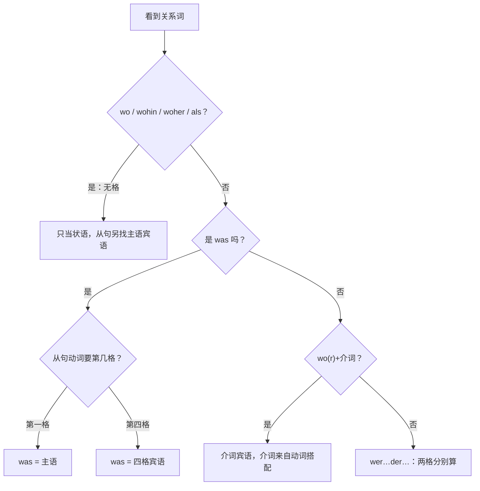
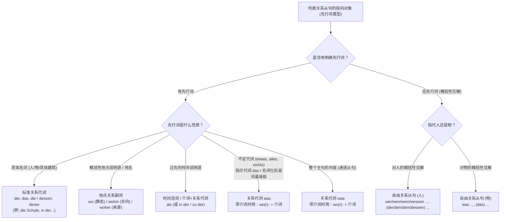
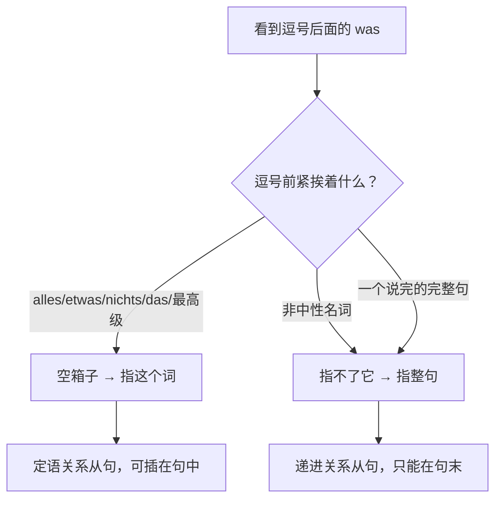
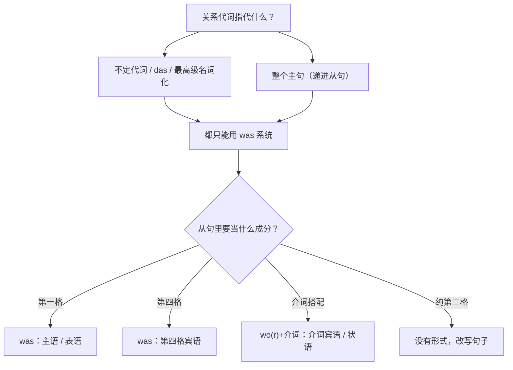
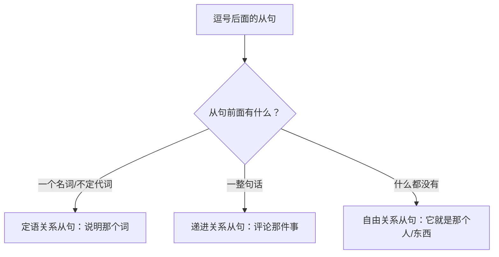

# als 和疑问代词作关系代词

# - 问题：这类关系词引导的关系从句，是不是也和**第二格**关系代词一样，能充当主语、第四格宾语、第三格宾语、介词宾语等各种角色？怎么判断？

- 原句：（表格内容）关系代词 **wo** / **wohin** / **woher** / **als** / **was** / **wo(r)+介词** / **wer …, der …** / **was …, (das) …**

## ② 答案

不能一概而论，要分成三组看。你说“和第二格一样”，其实有两种完全不同的“不占位”：第二格关系代词 **dessen/deren** 自己不占主语宾语位，是因为它只是贴在名词旁边的一条“谁的”标签，位置让给后面那个名词；而 **wo / wohin / woher / als** 不占位，是因为它们根本不是代词，而是**关系副词**（Relativadverb，就是引导定语从句的“副词”），**没有格**，所以天生只能坐“状语”这一个位置——**wo** 表地点（在哪儿）、**wohin** 表方向（去哪儿）、**woher** 表来处（从哪儿来）、**als** 表过去那一次的时间，从句里的主语、宾语永远由别的词来当。真正能占各种角色的是剩下那一组：**was** 可以当主语或第四格宾语（它指代不定物，只能以“was”这一种形式出现，没有第三格形式），**wo(r)+介词** 固定当介词宾语（介词由从句动词的搭配决定，如 **träumen von** → **wovon**），而 **wer …, der …** 才是唯一真正“什么角色都能当”的：它其实是两个独立小句，**wer** 的格由它所在从句的动词决定，**der/dem/den/dessen** 的格由主句的动词决定，两边分开计算。

所以判断方法和上次一样，先看“谁在占位”。看到 **wo/wohin/woher/als**，直接判定它只当状语，然后从句照样另有自己的主语和宾语，别把状语当主语；看到 **was**，把它当成一个换了名字的名词，问从句动词要第一格还是第四格，要第一格它就是主语，要第四格它就是第四格宾语，如果要第三格，**was** 用不了，必须换成 **wo(r)+介词** 或 **dem**；看到 **wo(r)+介词**，先由动词的固定搭配确定介词（**sich freuen über** → **worüber**），整块就是介词宾语，只有介词以元音开头时才插入 r（**wo+über → worüber**，**wo+von → wovon** 不加）。看到 **wer …, der …**，就在两个小句中分别找谓语：从句谓语定 **wer** 的格，主句谓语定 **der** 系列的格；两边可以一个第一格、一个第三格，完全不冲突。

图解：四类关系词的角色判断

注： 状语修饰的是谓语，也就是“这件事”本身。主语和宾语只是这件事的参与者，状语给这件事补充发生环境（在哪儿、什么时候、为什么），所以根本不存在“必须挑一个名词”的选择题；

和第二格关系代词对照（这是你问题的直接答案）：

| 关系词 | 自己能不能当主语/宾语 | 由谁去占这个位子 | 判断依据（触发条件） |
|---|---|---|---|
| 第二格 **dessen / deren** | 不能（只有极罕见的第二格宾语） | 它后面紧跟的那个名词 | 后面有没有名词 |
| **wo / wohin / woher / als** | 不能 | 从句自己的名词或代词 | 关系词本身无格，只能当状语 |
| **was** | 能：主语、第四格宾语 | 它自己 | 从句动词要第一格还是第四格 |
| **wo(r)+介词** | 能：介词宾语 | 它自己（整块） | 动词的介词搭配 |
| **wer …, der …** | 能：两侧都是 | 它自己（每侧各算） | 各自动词或结构要什么格 |

例 1（**wo**：只当状语）

> Das ist ein Ort, **wo** das Essen fertig an den Bäumen wächst.

- 主句：**Das**（第一格主语）+ **ist**（谓语）+ **ein Ort**（表语，第一格）。
- 从句：**das Essen**（第一格主语）+ **wächst**（谓语）+ **fertig**（结果说明）+ **an den Bäumen**（地点状语，an + 第三格）+ **wo**（地点状语，回指 **ein Ort**）。
- 关系：**wo** 替换的是“in dem Ort”整个状语短语，所以只坐状语位；从句主语是 **das Essen**，与 **wo** 无关。**wo** 没有格，不可能被选去当主语或宾语。

例 2（**wohin / woher**：只当状语）

> Das ist der Platz, **wohin** wir nur in der Fantasie reisen können.

- 主句：**Das**（主语）+ **ist**（谓语）+ **der Platz**（表语）。
- 从句：**wir**（第一格主语）+ **können … reisen**（谓语，情态动词 + 不定式）+ **nur**（语气小品词）+ **in der Fantasie**（地点状语）+ **wohin**（方向状语）。

> Ist das das Land, **woher** die glücklichen Menschen kommen?

- 主句：**Ist**（谓语）+ **das**（第一格主语）+ **das Land**（表语）。
- 从句：**die glücklichen Menschen**（第一格主语）+ **kommen**（谓语）+ **woher**（来处状语）。
- 关系：一个说“去哪儿”，一个说“从哪儿来”，都只在状语的位置上，和主语位无关。

例 3（**als**：只当时间状语，指过去那一次）

> Das war die Zeit, **als** man noch geträumt hat.

- 主句：**Das**（第一格主语）+ **war**（谓语）+ **die Zeit**（表语，第一格）。
- 从句：**man**（第一格主语）+ **hat geträumt**（谓语，现在完成时）+ **noch**（时间小品词）+ **als**（时间状语）。
- 关系：**als** 只说明“当时那一次”，从句主语是 **man**；如果是现在或反复发生，要用 **wenn**。

例 4（**was**：能真占位，但只有两个位子）

> Es gibt etwas, **was** mich jeden Tag freut.

- 主句：**Es**（形式主语）+ **gibt**（谓语）+ **etwas**（第四格宾语）。
- 从句：**was**（第一格主语）+ **mich**（第四格宾语）+ **jeden Tag**（时间状语）+ **freut**（谓语，**freuen + 第四格**）。
- 关系：**was** 回指 **etwas**，在这里当主语。

> Das Schlarafenland ist etwas, **was** wir alle schön finden.

- 主句：**Das Schlarafenland**（主语）+ **ist**（谓语）+ **etwas**（表语）。
- 从句：**wir**（第一格主语）+ **alle**（同位语）+ **finden**（谓语，要第四格）+ **was**（第四格宾语）+ **schön**（宾语补足语）。
- 关系：**was** 这次当第四格宾语；要第三格时不能用 **was**，得改说 **wo(r)+介词** 或 **dem**。

例 5（**wo(r)+介词**：当介词宾语）

> Da findet man das Leckerste, **wovon** wir träumen.

- 主句：**Da**（地点状语）+ **findet**（谓语）+ **man**（第一格主语）+ **das Leckerste**（第四格宾语）。
- 从句：**wir**（第一格主语）+ **träumen**（谓语，**träumen von + 第三格**）+ **wovon**（介词宾语）。
- 关系：**wovon** = **von + was**，介词由从句动词的固定搭配决定，整块当介词宾语。

> Mein Vater hat mir viel davon erzählt, **worüber** ich mich gefreut habe.

- 主句：**Mein Vater**（第一格主语）+ **hat erzählt**（谓语，完成时）+ **mir**（第三格宾语）+ **viel**（第四格宾语）+ **davon**（介词宾语，作铺垫）。
- 从句：**ich**（第一格主语）+ **habe mich gefreut**（谓语，**sich freuen über + 第四格**）+ **worüber**（介词宾语）。
- 关系：这里 **worüber** 指的不是某个名词，而是整句主句说的事；角色仍然是介词宾语。

例 6（**wer …, der …**：唯一两侧都占位的类型）

> Wer im Schlarafenland lebt, dem geht es gut.

- 从句：**wer**（第一格主语，**leben** 要第一格）+ **im Schlarafenland**（地点状语）+ **lebt**（谓语）。
- 主句：**dem**（第三格宾语，**es geht jemandem gut** 固定要第三格）+ **geht**（谓语）+ **es**（主语）+ **gut**（说明语）。
- 关系：**wer** 的格由从句动词 **lebt** 决定，**dem** 的格由主句结构决定，两个格分开计算。

> Wem man zu viel Essen gibt, dessen Gewicht wird steigen.

- 从句：**Wem**（第三格宾语，**geben** 的接受者）+ **man**（第一格主语）+ **zu viel Essen**（第四格宾语）+ **gibt**（谓语）。
- 主句：**dessen Gewicht**（第一格主语，其中 **dessen** 是第二格定语）+ **wird steigen**（谓语，将来时）。
- 关系：这里正好接上第二格那一讲——**dessen** 在主句里又变回“第二格定语”，真正当主语的是 **Gewicht**。

> Für wen Stress kein Problem ist, mit dem kann man ganz entspannt zusammen sein.

- 从句：**Für wen**（介词宾语，für + 第四格）+ **Stress**（第一格主语）+ **kein Problem**（表语）+ **ist**（谓语）。
- 主句：**mit dem**（介词宾语，mit + 第三格）+ **kann**（谓语）+ **man**（第一格主语）+ **ganz entspannt**（方式状语）+ **zusammen sein**（不定式部分）。
- 关系：两边都是介词宾语，但介词和格都不同（**für + 第四格** / **mit + 第三格**），因为各自由各自的搭配决定。

例 7（**was …, (das) …**：主句的 das 可省）

> Was dir gut schmeckt, (das) solltest du genießen.

- 从句：**was**（第一格主语，因为 **etwas schmeckt jemandem gut**）+ **dir**（第三格宾语）+ **gut**（说明语）+ **schmeckt**（谓语）。
- 主句：**(das)**（第四格宾语，**genießen + 第四格**，可省略）+ **solltest**（谓语，情态动词）+ **du**（第一格主语）+ **genießen**（不定式）。
- 关系：从句里 **was** 当主语，主句里 **das** 当第四格宾语，两个角色各由各的动词决定。

易错点：

| 易错点 | 正确做法 | 为什么 |
|---|---|---|
| 拿 **wo** 当主语 | 从句必须另有主语 | **wo** 是副词，没有格，只能当状语 |
| 用 **was** 表示第三格 | 换成 **wo(r)+介词** 或 **dem** | **was** 只有一种形式，没有第三格 |
| **wo / wohin / woher** 混用 | 在哪用 wo，去哪用 wohin，从哪来用 woher | 三者分别对应静态、方向、来处 |
| 以为 **wo(r)** 里的介词可以随便选 | 介词来自从句动词搭配 | **träumen von** → **wovon** |
| 把 **wer** 和 **der** 的格写成一个 | 各按各的动词判断 | 两个小句两套格，互不影响 |

同类例子验证：**Wer zu spät kommt, den bestraft das Leben.**（谁迟到，生活就惩罚谁。）从句里 **wer** 是 **kommen** 要的第一格主语，主句里 **den** 是 **bestrafen** 要的第四格宾语——和例 6 第一条完全同一个规律：两个小句，各定各的格。

# 定义

在德语 B 1 向 B 2–C 1 跨越的过程中，关系从句（Relativsatz）的引导词不再局限于定冠词类关系代词（_der, das, die, denen, dessen, deren_）。当先行词（Bezugswort）是**地点、时间、不定代词、形容词最高级、整个主句内容**，或者句子表达**对人、对物的概括性见解**时，必须使用连词 **als** 或疑问词形式的关系词（**wo, wohin, woher, was, wo(r)-, wer**）来引导关系从句。

先通过下面这张句法决策图，从宏观上建立德语关系词的选择逻辑：

代码段

## 一、 关系副词 wo, wohin, woher 引导的地点关系从句

当关系从句用于修饰主句中的地点概念时，疑问副词 **wo, wohin, woher** 可以充当关系副词（Relativadverbien）引导从句，从句动词置于句末。

### 1. 适用范围与方向区分

**wo, wohin, woher** 主要指向**概括性的地点说明语**（如 _der Ort, der Platz, das Land, die Stelle, die Gegend_ 以及地点副词 _dort, da, überall, irgendwo, nirgendwo_）和**无冠词的地理专有名词**（城市名、国家名，如 _Berlin, München, Deutschland_）。

三者的选择完全取决于从句动词所表达的空间运动方向：

|**关系副词**|**语法功能**|**教材原句与翻译**|**语法结构解析**|
|---|---|---|---|
|**wo**|表示静态位置（在哪里）|_Das ist ein **Ort**, **wo** das Essen fertig an Bäumen wächst._         （这是一个食物做好了长在树上的地方。）|先行词为概括性地点名词 _ein Ort_，从句动词 _wachsen_ 表示静态存在，用 **wo**。|
|**wohin**|表示目标去向（去哪里）|_Das ist der **Platz**, **wohin** wir nur in der Fantasie reisen können._         （这是我们只能在幻想中前往的地方。）|先行词为 _der Platz_，从句动词 _reisen_ 表示位移去向，用 **wohin**。|
|**woher**|表示来源出处（从哪里来）|_Ist das das **Land**, **woher** die glücklichen Menschen kommen?_         （这就是幸福的人们所来自的国度吗？）|先行词为 _das Land_，从句动词 _kommen_ 表示来源方向，用 **woher**。|

> **补充规则（地名专有名词）**：当先行词是没有冠词的城市名或国家名时，不能使用 _in dem / in der_，只能使用 **wo / wohin / woher**。
>
>
>
> - _Ich ziehe nächsten Monat nach **München**, **wo** ich eine Stelle als Ingenieur gefunden habe._（我下个月搬去慕尼黑，在那里我找到了一份工程师的工作。）

### 2. 概括性地点与具体地点的严格区分

对于**具体的地点说明语**（即指代具体建筑物、机构、房间等实体名词，如 _die Schule, das Haus, die Wohnung, die Praxis, das Amt_），在标准书面语和 B 2 考试中，**最好使用“介词 + 定冠词类关系代词”（如 _in dem, in der, an dem, zu dem_）**，而不建议使用 _wo_。

- **教材规范示例**：_Das ist **die Schule**, **in der** ich gelernt habe._（这就是我曾就读的那所学校。）
    - **解析**：_die Schule_ 是具体的地点名词，用介词 _in_ + 阴性第三格关系代词 _der_（表静态位置）。虽然在德国日常口语中常能听到当地人说 _die Schule, wo..._，但在 B 2/C 1 写作中请严格区分。

### 3. 移民生活场景例句

- **行政办事（地名 + wo）**：_Das ist die Stadt **Frankfurt**, **wo** ich vor zwei Jahren meinen ersten Aufenthaltstitel beantragt habe._（这是法兰克福市，两年前我在那里申请了我的第一份居留许可。）
- **找工作（概括性地点 + wohin）**：_Deutschland ist ein **Land**, **wohin** viele qualifizierte Fachkräfte aus dem Ausland auswandern möchten._（德国是一个许多外国高技能专业人才想要移民前往的国家。）
- **租房（具体地点名词 + in der）**：_Die **Wohnung**, **in der** wir gestern zur Besichtigung waren, liegt direkt neben der U-Bahn-Station._（我们昨天去看房的那套公寓，紧挨着地铁站。—— _Wohnung_ 为具体地点，优先用 _in der_）

## 二、 连词 als 引导的时间关系从句

一样。 als 也是关系副词（Relativadverb，引导定语从句的副词，没有格），从句中只当时间状语，不占主语位、也不占宾语位；从句需要主语、需要第四格或第三格宾语、需要介词宾语，仍然由从句动词决定，als 一概不碰。证据和 wo 一样：als 的内容等于 zu der Zeit / in dem Jahr，在换词实验里它顶掉的是一整个时间状语短语，不是名词，所以不可能变成主语或宾语。它只和 wo 有两点不同：第一，先行词必须是表示“过去时间”的名词（der Tag / die Zeit / das Jahr / der Moment / das erste Mal），它不能回指人、物或地点；第二，它和连词 als 同形，同一个词还有“当……时”和“比”两种身份，必须用锚点来分辨。

分辨时看一个地方：
- 逗号前有没有时间名词做锚点。有（der Tag, die Zeit, das Jahr …），就是关系从句，als 在从句里当时间状语；
- 没有，再看前面有没有比较级（größer、schneller、anders、niemand），有就是比较连词“比”；
- 两样都没有，就是时间连词“当……时”，整个从句给主句提供时间背景。
- 还有一条搭配规则要记：als 只用于过去的一次或一段（als ich zwölf war），现在和将来用 wenn，过去“每次”也用 wenn（immer wenn），同等比较用 wie（so groß wie ich）。

当关系从句修饰主句中的**时间说明语**（如 _die Zeit, das Jahr, der Tag, der Moment, der Augenblick_），且从句描述的**行为发生在过去**时，可以使用连词 **als** 来充当关系词引导从句，也可以替换成传统的“介词 + 关系代词”（如 _in der / zu der / an dem / in dem_）。

### 1. 教材例句与同义转换

- **教材原句**：_Das war **die Zeit**, **als** man noch geträumt hat._ （那是人们还曾怀揣梦想的时代。）
- **等价转换**：_Das war **die Zeit**, **in der** (或 **zu der**) man noch geträumt hat._
    - **解析**：先行词 _die Zeit_ 是阴性单数名词，表示过去的一段时期，既可用时间连词 **als** 引导，也可用支配第三格的介词 _in/zu_ + 阴性第三格关系代词 _der_。

### 2. 移民生活场景例句

- **初到德国**：_Ich erinnere mich noch genau an **die Zeit**, **als** (或 **in der**) ich ohne Deutschkenntnisse in Berlin ankam._ （我还清楚地记得我毫无德语基础抵达柏林的那段时光。）
- **职场入职**：_Der **Tag**, **als** (或 **an dem**) ich meinen unbefristeten Arbeitsvertrag unterschrieben habe, war ein Meilenstein für meine Familie._ （我签署无固定期限劳动合同的那一天，对我的家庭来说是一个里程碑。）

## 三、 关系代词 was 与关系代副词 wo(r)- 引导的定语关系从句

在 B 1 阶段我们学过，中性单数名词作先行词时，关系代词用 _das_（如 _das Buch, das ich lese_）。但是，当先行词不是具体的中性名词，而是**高度抽象、不确定的概念**时，关系代词**绝对不能用 _das_，必须改用 `was` **。

### 1. 必须使用关系代词 was 的先行词类型

当主句中的先行词属于以下类别时，后续关系从句（第一格或第四格）必须由 **was** 引导：

1. **不定代词（Indefinitpronomen）**：如 **etwas**（某事/某物）、**alles**（一切）、**nichts**（没有什么），以及 _vieles_（许多事）、_einiges_（一些事）、_manches_（某些事）、_wenig_（很少的事）。
2. **指示代词（Demonstrativpronomen）**：独立使用的 **das**（这/那），以及 _dasselbe / das Gleiche_（同样的事）。
3. **形容词最高级名词化（Nominalisierter Superlativ）**：如 **das Leckerste**（最美味的东西）、_das Beste_（最好的事）、_das Wichtigste_（最重要的事）、_das Erste_（第一件事）。
4. **拓展补充（中性形容词名词化）**：如 _das Gute_（好的方面）、_das Neue_（新事物）、_das Schöne_（美好的事）。

**教材原句解析**：

- _Das Schlaraffenland ist **etwas**, **was** wir alle schön finden._ （懒人国是我们大家都觉得美好的事物。—— 先行词是不定代词 _etwas_，_was_ 在从句中作 _finden_ 的第四格宾语。）
- _Da findet man **das Leckerste**, **was** man sich vorstellen kann._ （在那里人们能找到所能想象到的最美味的食物。—— 先行词是名词化的形容词最高级 _das Leckerste_，_was_ 在从句中作 _vorstellen_ 的第四格宾语。）

### 2. 带介词时的形式：关系代副词 wo(r)- + 介词

如果先行词是上述的不定代词（_etwas, alles, nichts_）、_das_ 或名词化最高级，但**关系从句中的动词要求搭配特定介词**（例如 _träumen von_, _warten auf_, _sich interessieren für_），在标准德语中**不能**写成 _~~von was~~_ 或 _~~für was~~_，而必须将 **wo** 与介词合并为**关系代副词（Relativpronomen in Form eines Pronominaladverbs）：`wo(r)- + 介词` **。

- **构词规则**：
    - 介词以**辅音**开头：直接拼合为 **wo + 介词**（如 _wovon, womit, wofür, wozu, wobei_）。
    - 介词以**元音**开头：中间必须插入字母 **-r-** 以便发音，构成 **wor + 介词**（如 _worüber, worauf, woran, worin, worum_）。

**教材原句解析**：

- _Das Schlaraffenland ist **etwas**, **wovon** wir träumen._ （懒人国是我们梦寐以求的事物。—— 先行词是 _etwas_，从句动词短语是 _träumen von_，故将 _von + was_ 合并为 **wovon**。）

### 判断它指代的是先行词还是整个主句

图解：**was** 指哪个的判断路径

图解：四种判断方法对照

| 判断方式    | 指代前面的词（定语关系从句）                                     | 指代整个主句（递进关系从句）                              | 为什么（触发条件）                             |
| ------- | -------------------------------------------------- | ------------------------------------------- | ------------------------------------- |
| 逗号前紧挨的词 | **alles / etwas / nichts / das / das Beste**（中性名词） | 已说完的完整句，或非中性名词                              | 关系从句必须紧贴先行词，而 **was** 只接中性不定量，接不了别的名词 |
| 位置      | 可插在主句中间：Alles, **was** er sagt, stimmt.            | 只能在句末：Er kam zu spät, **was** mich ärgerte. | 定语跟着先行词走，先行词在哪它就在哪                    |
| 删除测试    | 拿掉从句，先行词悬空                                         | 拿掉从句，主句照样成立                                 | 定语是名词的一部分，递进从句只是追加评论                  |
| 中文翻译    | “……的东西／事情”                                         | “这／这件事……”                                   | 指代对象一个是物，一个是事件                        |

同类例子：Er hat mir alles erzählt, **was** er wusste, und er hat sich danach entschuldigt, **was** ich nicht erwartet hatte.（他把知道的都告诉了我，之后又道了歉，这是我没想到的。）前半句逗号前是 **alles** 这个空箱子，**was** 指它，从句插在主句中间；后半句逗号前是一个说完的句子，**was** 只能指整句，出现在句末——同一个 **was**，看逗号前那一个词就能分开。

## 四、 关系代词 was 与关系代副词 wo(r)- 引导的递进关系从句

问题：**was** 和 **wo(r)-+介词** 这两类关系代词，在①指代不定代词（**etwas / alles / nichts** 或 **das**、形容词最高级名词化）和②指代整个主句（递进从句）这两种情况下，分别在从句中能充当哪些句子成分？请列出所有情况。

② 答案

先给结论：这两大类指代对象能充当的句子成分是**同一套**，因为它们的先行词都只能接 **was** 这一套关系代词——**was** 只能占第一格（Nominativ：主语所用的格）和第四格（Akkusativ：直接宾语所用的格）的位置，一旦从句里需要“介词＋宾语”，就必须换成 **wo(r)-+介词**（**womit**、**worüber**、**worauf**…）。原因是 **was** 本身不变格，它根本没有第三格和第二格的形式，所以像“*alles, wem ich danke*”（所有我感谢的东西）这种写法是不存在的；同时德语不允许介词直接接 **was**，于是就把两者合成一个词，介词要求的格藏在词里面（**womit** = **mit** + 第三格，**worüber** = **über** + 第四格）。

所以判断要分两步：先看先行词是哪一类——**etwas / alles / nichts / das** 和最高级名词化（**das Beste**、**das Schönste**）都属于“中性、不定量”的词，没有明确的性和数可以对应，因此只能用 was 这一套；指代整个主句时（这种从句叫 **weiterführender Relativsatz**，即“递进从句”，意思相当于 **und das…**，整句被压缩成“一件中性的事”），同样落在这一套关系代词上。再看它在从句里当什么成分：当主语、第四格宾语、以及 **sein / werden / bleiben** 后面的表语第一格（Gleichsetzungsnominativ，即“主语和表语指同一个东西”的用法）时用 **was**；当介词宾语（Präpositionalobjekt，即“介词＋名词”构成的宾语）和状语（说明手段、时间、地点等的附加信息）时用 **wo(r)-+介词**。唯一的难处理的情况是动词要求一个“纯第三格宾语”（**helfen**、**danken** 这一类，中间没有介词），was 这一套给不出形式，只能改写句子，或者把先行词换成 **jemand / niemand / alle**，那样才能用 der/die 那一套（**dem** 等）来指代。

图解：判定关系代词形式的流程

核心对照表（两大类通用）：

| 从句里的成分 | **was** | **wo(r)-+介词** | 为什么（触发条件） |
|---|---|---|---|
| 主语（第一格） | 能 | 不能 | **was** 自带第一格位置，不用变格；介词短语不能当主语 |
| 第四格宾语 | 能 | 不能 | **was** 这一个形式兼第一格和第四格 |
| 表语第一格（**sein / werden / bleiben** 后） | 能 | 不能 | 这类动词后面要第一格，**was** 正好能填 |
| 介词宾语 | 不能 | 能 | 介词不许直接接 **was**，必须合成 **womit / worüber** 等 |
| 状语（手段、时间、地点…） | 不能 | 能 | 介词短语本来就是自由状语，只是把名词换成了 **wo(r)-** |
| 纯第三格宾语（**helfen, danken**） | 不能 | 不能 | **was** 没有第三格形式，**wo(r)-** 只解决“介词”，不解决“裸第三格” |
| 第二格宾语 / 定语 | 不能 | 不能 | 同理，**was** 无第二格形式 |

例句对照表：

| 成分 | 指代不定代词 / 最高级名词化 | 指代整个主句 | 触发条件 |
|---|---|---|---|
| 主语 | Alles, **was** geschieht, hat einen Grund.（发生的一切都有原因。） | Er kam zu spät, **was** mich ärgerte.（他来晚了，这让我很恼火。） | 从句动词缺一个第一格主语 |
| 第四格宾语 | Das ist das Beste, **was** ich je gegessen habe.（这是我吃过的最好的东西。） | Er hat gelogen, **was** ich nicht wusste.（他撒谎了，这我当时并不知道。） | 从句动词缺一个第四格宾语 |
| 表语第一格 | Sie ist nicht mehr das, **was** sie früher war.（她已不再是过去的她了。） | （指代整句时基本不用） | **sein** 类动词后接第一格 |
| 介词宾语 | Das ist etwas, **womit** ich nicht gerechnet habe.（这是一件我没料到的事。） | Er hat sich entschuldigt, **worüber** ich mich gefreut habe.（他道歉了，我对此感到高兴。） | 动词或形容词固定带介词（**rechnen mit**、**sich freuen über**） |
| 状语（手段） | Er suchte ein Werkzeug, **womit** er die Schraube lösen konnte.（他在找一件能拧开螺丝的工具。） | Er kam zu spät, **wodurch** er den Zug verpasste.（他来晚了，因此错过了火车。） | 介词短语表示“通过什么手段”，属于附加信息而非固定搭配 |

同类例子：Er hat gekündigt, **was** alle überraschte, und **womit** niemand gerechnet hatte.（他辞职了，这让所有人吃惊，也是谁都没料到的。）——和上面同一个规律：**was** 占据第一格或第四格位置当主语、宾语时使用，一旦需要介词就换成 **womit**，而它指代的仍然是前面那一整句内容。

---

当关系从句修饰的不再是主句中的某一个词，而是**整个主句所陈述的完整内容（整句内容）**时，这类句子在德语语法中被称为**递进关系从句（weiterführender Nebensatz / weiterführender Relativsatz）**。教材指出这类句子主要在口语中使用，同时在 B 2 书信和议论文写作中，它也是承接上文、表达个人评价的极佳句型。

### 1. 语法规则与教材例句

- **无介词支配时用 `was` **：当整个主句的内容在后续关系从句中充当第一格主语或第四格宾语时，用 **was** 引导。
    - **教材原句**：_Mein Vater hat mir viel vom Schlaraffenland erzählt, **was** ich genossen habe._ （我父亲给我讲了很多关于懒人国的事，我很享受这个过程。—— **was** 指代前面“父亲给我讲故事”这整件事，在从句中作 _genießen_ 的第四格宾语。）
- **有介词支配时用 `wo(r)- + 介词` **：当从句中的动词或形容词要求通过特定介词来引出前面整句话的内容时，必须使用 **wo(r)- + 介词**。
    - **教材原句**：_Mein Vater hat mir viel davon erzählt, **worüber** ich mich gefreut habe._ （我父亲给我讲了很多这方面的事，对此我感到很高兴。—— 从句动词为 _sich freuen über + Akk._，指代前文整句内容，合并为 **worüber**。）

### 2. 移民生活场景例句

- **租房维权（was 指代整句）**：_Die Heizung ist mitten im Winter ausgefallen, **was** zu einem starken Schimmelbefall im Schlafzimmer geführt hat._ （暖气在寒冬腊月坏掉了

## 自由关系从句（wer..., der; wem...,dessen）

这是第三种情况：自由关系从句（freier Relativsatz，即没有先行词的关系从句），它前面根本没有可指的词——它自己就代表“那个人／那个东西”，整个从句直接充当主句里的一个成分，所以中文可以直接译成“……的人”“……的东西”。引导词只有两个：指人用 wer（会变格：wer / wen / wem / wessen），指物或事用 was（永远不变格）。你可以把它当成 derjenige, der … 的简写：从句先说出“那个人”，主句里再用 der / den / dem 把“那个人”接回来，就是中文的“谁……，谁就……”。

最容易出错的是格：两边各管各的——从句里的 wer 看它在从句里当什么成分，主句里的 der 看它在主句里当什么成分，两者可以完全不同，比如 Wer zu spät kommt, den bestraft das Leben（从句里它是主语，用第一格；主句里它是宾语，用第四格）。另外，你图里那个“wem …, dessen”看起来像是排版串行了：第三格的对应词是 dem，dessen / deren 属于第二格（属格），标准写法是 wessen …, dessen；还有，主句里那个 der / das 经常可以整个省掉（Was du sagst, stimmt），它省不省都不影响从句的格。

|格|从句里|主句对应词|例句|中文|
|---|---|---|---|---|
|第一格|wer|der|Wer zuletzt lacht, der lacht am besten.|谁最后笑，谁笑得最好。|
|第四格|wen|den|Wen du einlädst, den musst du auch bezahlen.|你请谁，就得替谁付钱。|
|第三格|wem|dem|Wem ich vertraue, dem helfe ich.|我信谁，我就帮谁。|
|第二格|wessen|dessen / deren|Wessen er sich rühmt, dessen wird er sich bald schämen.|他吹嘘什么，很快就会为此羞愧。|
|物／事|was|das（可省）|Was du sagst, (das) stimmt.|你说的（那件事）是对的。|

（主句里 der / den 一旦出现就占第一位，变位动词紧跟着它：Wer zuletzt lacht, der lacht am besten。）

同类例子：Wer zu spät kommt, den bestraft das Leben.（迟到的人，生活会惩罚他。）和上面完全同一个规律：从句里 wer 是主语、第一格，主句里 den 是宾语、第四格——两边指同一个人，格却各管各的。
