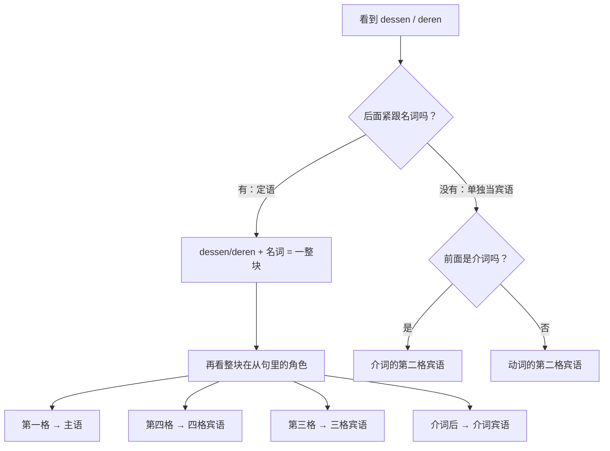
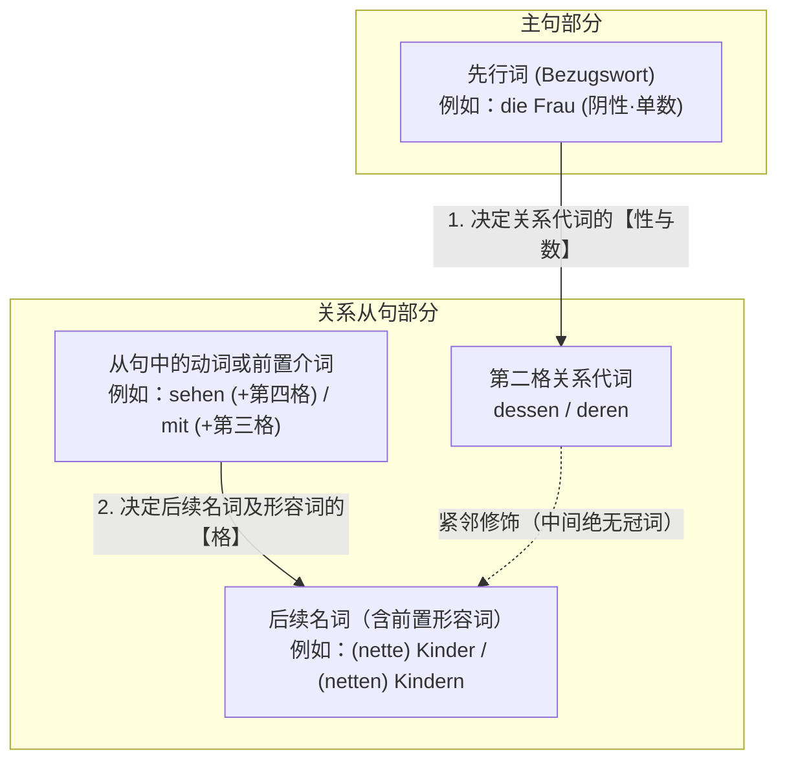

# - 问题：
  1. 关系代词的**第二格**在句子中能担当哪些角色？
  2. 核心问题：怎么判断它是哪一种角色？

## ② 答案

先给结论：**第二格关系代词**（关系代词就是引导“……的”那种定语从句、代替前面那个名词的词；第二格 Genitiv 就是回答“谁的/什么的”的格，形式是 **dessen / deren**）在从句里只有两种角色：
- **第二格定语**（定语就是贴在名词旁边给它补充信息的成分），占九成以上；
- 以及**第二格宾语**（有些动词或介词规定后面必须接第二格），这种很少见。
- 
- 所以你列的那四种角色，它一个都占不上——它自己永远不当主语，也不当第四格宾语、第三格宾语或介词宾语；**真正占这些位置的是它后面紧跟的那个名词**，而 dessen/deren 只是给那个名词贴了一条“属于谁”的标签。因为它相当于一个“第二格冠词”，必须依附在一个名词前面才成立，所以它和后面的名词总是合成一整块，一起充当主语、第四格宾语、第三格宾语或介词宾语。

判断只有两步。**先看它后面有没有紧跟名词**：有，它就是第二格定语，这时把 “dessen/deren + 名词”当作一个整体来看，再问这个整体在从句里干什么——从句缺第一格的主语，它当主语；从句动词要第四格，它当第四格宾语；动词要第三格，它当第三格宾语；站在介词后面，它当介词宾语。反过来，**后面没有名词**，它就是自己单独当宾语，这时去从句里找那个“要求第二格”的动词（如 **gedenken**）或介词（如 **wegen**）。还要记住两条：它的**格**由它在从句里的角色决定，但**长什么样**（dessen 还是 deren）只看先行词（先行词就是主句里被它指回的那个名词）的性和数，从句要第几格都不影响它的形状；另外 **deren** 既可能是阴性单数，也可能是复数，两形同一是最容易看错的地方。

图解：第二格关系代词的角色判断流程

形式对照表（形式只看先行词，不看从句要第几格）：

| 先行词（主句里被指回的名词） | 第二格关系代词 | 为什么是这个形式（触发条件） | 例子 |
|---|---|---|---|
| 阳性单数 **der Mann** | **dessen** | 关系代词的性和数与先行词一致 | der Mann, **dessen** Auto rot ist |
| 中性单数 **das Kind** | **dessen** | 阳性、中性单数同形，只能靠先行词分辨 | das Kind, **dessen** Spielzeug kaputt ist |
| 阴性单数 **die Frau** | **deren** | 阴性单数一律用 **deren** | die Frau, **deren** Auto rot ist |
| 复数 **die Kinder** | **deren** | 复数与阴性单数同形，看后面名词或上下文 | die Kinder, **deren** Eltern kommen |

例 1（第二格定语，整块当主语）

> Der Student, **dessen Vater** in Berlin arbeitet, kommt aus China.

- 主句：**Der Student**（第一格主语）+ **kommt**（谓语）+ **aus China**（介词状语，表来处）；关系从句插在主语和谓语中间。
- 从句：**dessen Vater**（第一格主语）+ **arbeitet**（谓语）+ **in Berlin**（地点状语）。
- **dessen**：回指 **der Student**（阳性单数），给 **Vater** 补充“谁的”这条信息，是第二格定语；从句里的主语是 **Vater** 这一整块，**dessen** 单独拿出来不能当主语。

例 2（第二格定语，整块当第四格宾语）

> Die Frau, **deren Hund** ich jeden Tag sehe, wohnt neben mir.

- 主句：**Die Frau**（第一格主语）+ **wohnt**（谓语）+ **neben mir**（地点状语，neben 后接第三格）。
- 从句：**ich**（第一格主语）+ **sehe**（谓语，要求第四格）+ **deren Hund**（第四格宾语）+ **jeden Tag**（时间状语）。
- **deren**：回指 **die Frau**（阴性单数），是 **Hund** 的第二格定语；承担第四格宾语角色的是 **Hund**。注意，从句要第四格也不会把 **deren** 变成别的形状，它的形式只由先行词决定。

例 3（第二格定语，整块当第三格宾语）

> Die Kinder, **deren Eltern** ich oft helfe, sind meine Nachbarn.

- 主句：**Die Kinder**（第一格主语）+ **sind**（谓语）+ **meine Nachbarn**（表语，第一格）。
- 从句：**ich**（第一格主语）+ **helfe**（谓语，**helfen** 要求第三格）+ **deren Eltern**（第三格宾语）+ **oft**（频率状语）。
- **deren**：回指 **die Kinder**（复数，所以是 **deren** 而不是 dessen），是 **Eltern** 的第二格定语；因为 **helfen** 要第三格，所以这一整块落在第三格位置上。

例 4（第二格定语，整块当介词宾语）

> Der Kollege, **über dessen Witze** alle lachen, ist sehr beliebt.

- 主句：**Der Kollege**（第一格主语）+ **ist**（谓语）+ **sehr beliebt**（表语）。
- 从句：**alle**（第一格主语）+ **lachen**（谓语，**lachen über** 要求第四格）+ **über dessen Witze**（介词宾语）。
- **dessen**：回指 **der Kollege**（阳性单数）；后面的 **Witze** 是复数，**dessen** 照旧不变。介词 **über** 管的是整块 **dessen Witze**，整块要第四格，但里面的 **dessen** 仍然是第二格，所以是 **über dessen Witze**，不是 ~~über dessen Witzen~~。

例 5（少见：动词要求的第二格宾语）

> Der Künstler, **dessen** wir heute gedenken, wurde in Wien geboren.

- 主句：**Der Künstler**（第一格主语）+ **wurde ... geboren**（谓语，被动）+ **in Wien**（地点状语）。
- 从句：**wir**（第一格主语）+ **gedenken**（谓语，**gedenken** 要求第二格）+ **dessen**（第二格宾语）+ **heute**（时间状语）。
- 这里 **dessen** 后面没有名词，所以它不是定语，而是动词直接要求的第二格宾语。

例 6（少见：介词要求的第二格宾语）

> Der Plan, **wegen dessen** die Parteien monatelang verhandelt haben, wurde schließlich abgelehnt.
> > 那个让各方耗费数月时间谈判的方案，最终被否决了。

- 主句：**Der Plan**（第一格主语）+ **wurde ... abgelehnt**（谓语，被动）+ **schließlich**（时间状语）。
- 从句：**die Parteien**（第一格主语）+ **haben verhandelt**（谓语，现在完成时）+ **monatelang**（时间状语）+ **wegen dessen**（介词宾语，**wegen** 要求第二格）。
- **dessen** 回指 **der Plan**（阳性单数），单独站在介词 **wegen** 后面当第二格宾语；这种说法公文味极重，日常德语更常说 **wegen dem Plan** 或直接改写句子。

易错点：

| 易错点 | 正确做法 | 为什么 |
|---|---|---|
| 从句缺主语，就拿 dessen 当主语 | dessen 后面必须跟名词，当主语的是那个名词 | dessen 是定语，不能单独占主语位 |
| 写成 ~~dessen der Vater~~ | 写 **dessen Vater** | dessen 已经占用了冠词的位置，后面不再加冠词 |
| 用主句的格来定关系代词的格 | 格看从句内的角色，性/数看先行词 | 两条线分开判断，混在一起必错 |
| 以为 deren 只能是阴性单数 | deren 也可能是复数 | 阴性单数和复数形式相同，要靠后面的名词或上下文分辨 |

同类例子验证：**Das Mädchen, dessen Bruder ich gut kenne, spielt Klavier.**（那个女孩，我认识她哥哥，她弹钢琴。）这句和例 2 是同一个规律——**dessen Bruder** 是第二格定语，“当第四格宾语”的是 **Bruder**，而 **dessen** 用 dessen 是因为先行词 **das Mädchen** 是中性单数（不是看它是“女孩”）。

# 关系代词的第二格形式

关系代词的第二格形式（Relativpronomen im Genitiv）是德语 B 2 阶段的核心语法标志，也是通往 C 1 水平的必经之路。在 B 2 考试（如歌德、Telc B 2）的写作和口语表达中，熟练使用第二格关系从句能立刻将两个松散的简单句合并为逻辑严密的复合句，极大提升语言地道程度。

## 一、 关系代词第二格的词形变化

关系代词的第二格形式用于表示关系从句中的**所属关系（定语功能）**，或者满足从句中特定动词、介词对**第二格（Genitiv）的支配要求**。其具体词形变化如下表所示：

|**格 (Kasus)**|**阳性 (Maskulinum)**|**中性 (Neutrum)**|**阴性 (Femininum)**|**复数 (Plural)**|
|---|---|---|---|---|
|**第二格 (Genitiv)**|**dessen**|**dessen**|**deren***|**deren***|

> **词形记忆规律**：阳性与中性同形，均为 **dessen**（词尾与定冠词第二格 _des_ 对应）；阴性与复数同形，均为 **deren**（词尾与定冠词第二格 _der_ 对应）。 **C 1 补充规则（*）**：当关系代词处于阴性或复数，且**后面不接名词**时，除了使用 **deren**，也可以使用 **derer**。

## 二、 名词前的第二格关系代词（B 2 核心定语用法）

在绝大多数日常及 B 2 考试场景中，第二格关系代词位于一个名词之前，充当该名词的**第二格定语（Genitivattribut）**，替代原句中的物主冠词（如 _sein, ihr_）。

观察教材中的基础转换过程：

- **原句拆分**：_Gehört der Hund der Frau dort? — Ja, das ist **ihr** Hund._（那条狗属于那边的女士吗？——是的，那是**她的**狗。）
- **合并为关系从句**：_Die Frau, **deren** Hund gerade meine Katze jagt, ist meine Nachbarin._（那位**她的**狗正在追我的猫的女士，是我的邻居。）

要彻底掌握这一结构，必须理清关系从句内部的**双向决定机制**：

代码段

### 1. 先行词决定关系代词的性与数

关系代词选 **dessen** 还是 **deren**，**唯一取决于主句中被修饰的先行词（Bezugswort）的词性和单复数**，与后面跟着的名词毫无关系。

- **阳性先行词 $\rightarrow$ dessen**： _Der Vermieter_, **dessen** Mietvertrag (阳性) / **dessen** Wohnung (阴性) / **dessen** Haus (中性) / **dessen** Nebenkosten (复数) sehr fair sind, wohnt im Erdgeschoss. （那位他的租房合同/公寓/房子/杂费非常公道的房东，住在一楼。）
- **中性先行词 $\rightarrow$ dessen**： _Das Unternehmen_, **dessen** Hauptsitz in München liegt, sucht dringend IT-Fachkräfte. （那家它的总部位于慕尼黑的企业，正在急聘 IT 专业人才。）
- **阴性先行词 $\rightarrow$ deren**： _Die Frau_, **deren** Hund gerade meine Katze jagt, ist meine Nachbarin. （那位她的狗正在追我的猫的女士，是我的邻居。）
- **复数先行词 $\rightarrow$ deren**： _Die Antragsteller_, **deren** Unterlagen noch unvollständig sind, müssen einen neuen Termin vereinbaren. （那些他们的材料尚不完整的申请人，必须预约一个新的时间。）

### 2. 第二格关系代词后的名词前无冠词

**dessen** 和 **deren** 本身已经承担了限定功能，因此它们后面的名词前**绝对不能再加任何定冠词、不定冠词或物主冠词**（例如：严禁写出 _~~deren der Hund~~_ 或 _~~deren ihr Hund~~_）。

### 3. 被修饰名词的格由从句动词或前置介词决定

虽然 **dessen / deren** 永远固定为第二格形式，但**紧跟在它后面的那个名词**在关系从句中充当什么成分（主语、第四格宾语、第三格宾语或介词宾语），就必须变为相应的格。

我们结合教材中的四个经典对比例句来剖析这一规则：

|**决定因素**|**教材原句与格的分析**|**语法解析与易错点提示**|
|---|---|---|
|**动词支配第一格**         _(jagen - 主语)_|_Die Frau, **deren Hund (第一格)** gerade meine Katze jagt, ist meine Nachbarin._|_Hund_ 在从句中作主语（发出“追赶”这一动作），故用第一格单数 _Hund_。|
|**动词支配第四格**         _(sehen + Akk.)_|_Die Frau, **deren Kinder (第四格)** du auf dem Spielplatz dort **siehst**, ist meine Nachbarin._|从句主语是 _du_，动词 _sehen_ 支配第四格。_Kinder_ 作第四格宾语（你看到她的孩子们）。|
|**动词支配第三格**         _(helfen + Dat.)_|_Die Frau, **deren Kindern (第三格)** ich bei den Hausaufgaben **helfe**, ist meine Nachbarin._|动词 _helfen_ 支配第三格。**高频易错点**：复数名词 _Kinder_ 在第三格时词尾必须加 **-n**，变成 **Kindern**！|
|**介词支配第四格**         _(für + Akk.)_|_Die Frau, **für deren Kinder (第四格)** ich ein Geschenk gekauft habe, ist meine Nachbarin._|介词 _für_ 要求第四格。注意语序：**介词永远位于关系代词的最左侧**，形成「介词 + dessen/deren + 名词」结构。|
|**介词支配第三格**         _(mit + Dat.)_|_Die Frau, **mit deren Kindern (第三格)** meine Kinder gerne spielen, ist meine Nachbarin._|介词 _mit_ 要求第三格。复数第三格名词词尾同样必须加 **-n**（_Kindern_）。|

### 4. 名词前形容词的词尾变化（无冠词强变化规则）

当第二格关系代词与名词之间插入形容词时，**形容词的格必须与该名词保持一致**。 这里有一个极具迷惑性的语法细节：由于 **dessen / deren** 自身的词尾是固定的，无法体现后续名词的格，因此夹在中间的形容词必须承担起标示“性、数、格”的任务——即**完全按照无冠词（零冠词 / starke Deklination）的强变化规则进行词尾变化**！

对比教材中的两个复数例句：

1. _Die Frau, für deren **nette** Kinder ..._

    - **解析**：介词 _für_ 支配第四格。复数第四格在无冠词强变化下，形容词词尾为 **-e**（_nette Kinder_）。切勿受前面 _deren_ 的误导而错误地写成弱变化 _-en_！

2. _Die Frau, mit deren **netten** Kindern ..._

    - **解析**：介词 _mit_ 支配第三格。复数第三格在无冠词强变化下，形容词词尾为 **-en**，且名词本身加 **-n**（_netten Kindern_）。

为了方便你在写作中直接检索核对，我将 **dessen / deren + 形容词 + 名词** 的强变化词尾完整总结如下：

|**后续名词在从句中的格**|**阳性单数名词**|**中性单数名词**|**阴性单数名词**|**复数名词**|
|---|---|---|---|---|
|**第一格 (Nom.)**|dessen/deren **neuer** Chef|dessen/deren **neues** Büro|dessen/deren **neue** Wohnung|dessen/deren **neue** Kollegen|
|**第四格 (Akk.)**|dessen/deren **neuen** Chef|dessen/deren **neues** Büro|dessen/deren **neue** Wohnung|dessen/deren **neue** Kollegen|
|**第三格 (Dat.)**|dessen/deren **neuem** Chef|dessen/deren **neuem** Büro|dessen/deren **neuer** Wohnung|dessen/deren **neuen** Kollegen|

## 三、 第二格关系代词后无名词的情况（C 1 进阶用法）

在正式书面语、法律行政公文（如德国外管局信函、合同条款）以及 C 1 级别语法中，第二格关系代词后面**可以不接名词**，独立在从句中充当宾语。

出现这种情况的原因只有一个：**关系从句中的动词本身支配第二格，或者关系代词左边的介词本身支配第二格**。此时，若先行词为阴性或复数，既可以用 **deren**，也常使用更为书面的 **derer**。

### 1. 从句动词支配第二格（Verben mit Genitiv）

德语中有一批高阶动词要求直接跟第二格宾语，如 _bedürfen_（需要）、_gedenken_（纪念/缅怀）、_sich erinnern_（记得，书面用法）、_sich annehmen_（受理/照料）、_sich erfreuen_（享有）。

- **教材例句**： _Die Vorbereitungen, **derer/deren** dieses Projekt **bedarf**, brauchen noch einige Zeit._ （这个项目所需要的准备工作，还要花费一些时间。）
    - **结构拆解**：先行词是 _die Vorbereitungen_（复数），从句动词 _bedürfen_（第三人称单数变位为 _bedarf_）要求支配第二格宾语（_einer Vorbereitung bedürfen_）。因此关系代词直接用复数第二格 **derer** 或 **deren**，后面不再接名词。
- **移民行政场景拓展**： _Die Genehmigung, **derer/deren** ich für meine selbstständige Tätigkeit **bedarf**, wurde endlich von der Ausländerbehörde erteilt._ （我从事自由职业所需要的许可，终于由外国人管理局签发了。）

### 2. 从句介词支配第二格（Präpositionen mit Genitiv）

当关系从句由支配第二格的介词引导时（如 _infolge_ 由于、_wegen_ 因为、_trotz_ 尽管、_aufgrund_ 基于、_innerhalb_ 在……之内、_während_ 在……期间），介词置于第二格关系代词之前，后面同样不接名词。

- **教材例句**： _Sie waren genervt von den Streitigkeiten, **infolge derer/deren** die Arbeit am Projekt stockte._ （他们对这些争执感到厌烦，由于这些争执，项目工作陷入了停滞。）
    - **结构拆解**：先行词是 _die Streitigkeiten_（复数），介词 _infolge_ 支配第二格。介词后直接跟复数第二格关系代词 **derer** 或 **deren**。
- **阳/中性先行词的特殊形式（合写与分写）**： 当先行词是阳性或中性单数时，支配第二格的介词如 _wegen, trotz, innerhalb, aufgrund_ 等与 **dessen** 结合，例如： _Das war ein schwerer Systemfehler, **aufgrund dessen** (或 **infolge dessen**) mein Visumsantrag verzögert wurde._ （那是一个严重的系统错误，由于该错误，我的签证申请被延误了。）

## 四、 德国移民生活场景高频实用例句库

为了帮你在六个月内冲刺 B 2 并适应德国生活，以下为你整理了四大核心移民场景的地道表达，建议直接背诵并套用到你的 B 2 作文模板和口语交流中：

### 1. 租房与看房（Wohnungssuche & Mietvertrag）

- _Der Vermieter, **dessen** Wohnung wir gestern besichtigt haben, verlangt eine Kaution von drei Monatsmieten._ （那位我们昨天看了他的公寓的房东，要求交三个月房租的押金。—— _Wohnung_ 在从句中作 _besichtigen_ 的第四格宾语）
- _Die Nachbarn, **mit deren lauten Hunden** es oft Probleme gibt, ziehen nächsten Monat aus._ （那些大家常因他们吵闹的狗而产生困扰的邻居，下个月就要搬走了。—— _mit_ + 复数第三格，注意形容词词尾 _-en_ 和名词词尾 _-n_）

### 2. 求职与职场（Bewerbung & Beruf）

- _Die Firma, **für deren neue Abteilung** ich mich beworben habe, hat mich zu einem Vorstellungsgespräch eingeladen._ （那家我申请了其新部门的公司，邀请我参加面试。—— _für_ + 阴性第四格，形容词强变化词尾 _-e_）
- _Der Abteilungsleiter, **dessen erfahrenem Team** ich bald angehöre, hat meinen Arbeitsvertrag bereits unterschrieben._ （那位我即将加入其经验丰富的团队的部门主管，已经签署了我的劳动合同。—— _angehören_ 支配第三格，中性单数强变化形容词词尾为 _-em_）

### 3. 就医与医疗保险（Arztbesuch & Krankenkasse）

- _Die Ärztin, **in deren moderner Praxis** ich gestern behandelt wurde, nimmt noch neue gesetzlich versicherte Patienten auf._ （那位我昨天在她的现代化诊所接受治疗的女医生，目前还接收新的公立医保患者。—— _in_ 表静态位置支配第三格，阴性单数强变化形容词词尾为 _-er_）
- _Das Medikament, **dessen Nebenwirkungen** auf dem Beipackzettel genau beschrieben sind, ist verschreibungspflichtig._ （那种其副作用在说明书上有详细描述的药物，是处方药。—— _Nebenwirkungen_ 在被动句中作第一格主语）

### 4. 外管局与行政办事（Behördengänge & Ausländerbehörde）

- _Der Sachbearbeiter, **auf dessen schriftliche Bestätigung** ich seit drei Wochen warte, ist momentan im Urlaub._ （那位我等了他的书面确认信已经三周的办事员，目前正在休假。—— _warten auf_ + 第四格，阴性单数强变化形容词词尾为 _-e_）
- _Die Dokumente, **ohne deren beglaubigte Übersetzung** der Antrag auf die Blaue Karte EU nicht bearbeitet werden kann, liegen beim Notar._ （那些如果没有它们的公证翻译件就无法审理欧盟蓝卡申请的文件，目前在公证处。—— _ohne_ + 第四格）

## 五、 常见易错点总结与随堂自测

在 B 2 阶段的实战中，90% 的扣分都集中在以下三个细节上：

1. **混淆性别的决定权**：看到后面是 _Hund_（阳性），就误选 _dessen_。记住：**眼睛永远先往左看主句的先行词**！只要先行词是 _die Frau_，不管她养的是公狗、母猫还是孩子，一律用 **deren**。
2. **遗漏第三格复数的词尾 `-n` **：当被修饰的名词是复数，且在从句中处于第三格（如跟在 _mit, zu, bei, von, helfen, danken_ 之后）时，若该复数名词本身不以 _-n_ 或 _-s_ 结尾，**必须在名词词尾加上 `-n` **（如 _mit deren Kinder**n**_）。
3. **形容词词尾误用弱变化**：在 _dessen / deren_ 之后，形容词必须采用**无冠词强变化**（例如阳性第三格是 _dessen gut**em** Freund_，而不是 _~~gut**en**~~_；复数第四格是 _für deren nett**e** Kinder_，而不是 _~~nett**en**~~_）。

### 随堂巩固练习

请尝试运用今天所学的规则，将下列三组移民生活场景的简单句合并为**包含第二格关系代词（dessen / deren）的复合句**（注意检查介词位置、名词第三格复数词尾以及形容词强变化词尾）：

1. **求职场景**：_Das ist der Personalchef. Ich habe gestern mit **seiner** netten Assistentin telefoniert._
2. **租房场景**：_Die Wohnungen sind leider schon vergeben. Wir haben uns für **ihre** günstige Miete interessiert._ （提示：_sich interessieren für + Akk._）
3. **就医场景**：_Der Facharzt hat mir sehr geholfen. Ich vertraue **seinen** medizinischen Ratschlägen vollkommen._ （提示：_vertrauen + Dat._，复数名词 _die Ratschläge_）

请把你的造句答案发给我，我来为你逐句批改点拨；确认你完全吃透这一章后，我们再进入下一个语法模块！
