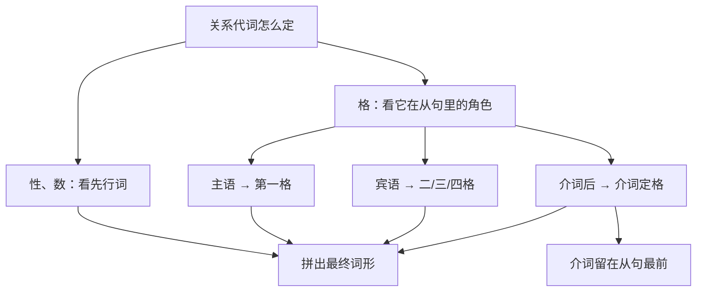
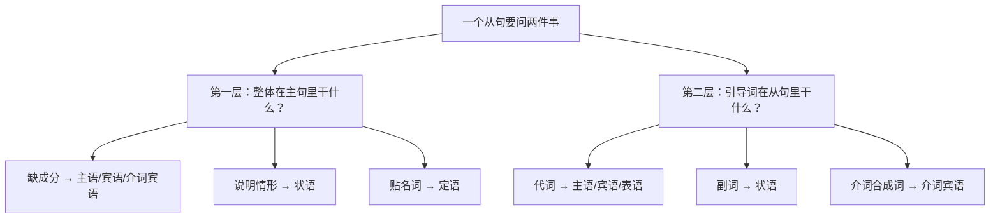

## ① 句子与问题

- 原句：一个表格总结梳理关系从句的所有差异：第一种：最基础的关系从句。只使用第一格作为关系代词，并且只有关系词决定动词，结构和普通从句一样，放在词尾、句尾。第二种：可变革的关系代词。由从句的动词决定第几格，由关系词决定词性。第三种：由介词决定格的关系代词。由介词来决定关系代词的格，关系词决定性、属格。第四种：第二格关系代词。第二格似乎和其他种类关系代词都不同。第五种：疑问代词作关系词。将这五种关系代词分别用表格列举出来，并详细对比它们的结构、含义、用法区别以及使用的注意事项等。
- 问题：
  1. 最基础型：只用第一格关系代词、由它决定动词、位置在从句末尾——这样理解对吗？结构和条件是什么？
  2. 变格型：格由从句动词决定、性数由先行词决定，具体怎么操作？
  3. 介词型：格由介词决定，那“属格”这个说法对不对？
  4. 第二格代词 **dessen / deren** 为什么和其他几类都不同？有哪些硬规矩？
  5. **wer / was** 这类疑问代词形式的关系代词，怎么用、有什么限制？
  6. 请用表格对比这五类的结构、含义、用法区别和注意事项。

## ② 答案

先要把一个关键点说清楚：决定关系代词“性”和“数”的负责对象搞清楚了。
先看**先行词**（Bezugswort，就是主句里被这个从句修饰的那个名词），它决定关系代词的性和数；
再看关系代词在从句里担任什么角色：作主语就是第一格；
作直接宾语就是第二、三或第四格；作所属关系就是第二格——这五类共用同一套规则，并非五套独立规则。
另外还有三处要改：关系从句并不是“放在句尾”，它要**紧跟先行词**，主句可以继续往下走，比如 Der Mann, **der** dort steht, **ist** mein Lehrer 里 ist 就落在从句后面；动词也不是“由关系词决定”，而是跟**从句里真正的主语**一致，关系代词作主语时才由它决定（der Mann, **der** kommt），作宾语时动词跟着别人走（der Mann, **den** ich gesehen **habe**）；
第三类的格也不是“属格”，介词要哪格就哪格，**mit** 给三格、**für** 给四格，只有 **wegen / trotz / während** 这类要求第二格的介词才算少见例外。

W 开头的是从句，从句整个成分作为主语的所以关系代词的变格用三步就能确定：看先行词决定性和数，看在从句里的角色决定格，再套 der/die/das 的变格表。

第四、第五类看起来特殊，其实特殊的原因很具体。**dessen / deren** 的格永远是第二格，因为它表示“所属”，真正的特别之处在于后面那个名词要**去掉冠词**（der Mann, **dessen Auto**，不能说 dessen **das** Auto），而且它只能修饰后面的名词、不能单独拿去当介词的宾语（可以说 von **dessen** Frau，不能说 von **dessen**），现代德语里也很少拿它作动词的第二格宾语（要说 der Mann, **an den** ich mich erinnere）。**wer / was** 则根本不属于 der/die/das 这套代词，它们本身就指代那个未知的人或事物——**wer** 等于“那个……的人”，**was** 等于“那个……的事”，所以从句前面不需要名词，这叫自由关系从句（freie Relativsätze），主句里常拿 der/den/das 回指（**Wer** zu spät kommt, **den** bestraft das Leben），**was** 还能指代整个主句、带介词时要合并成 **worauf / womit**。同一个规律换个名词照样成立：Die Kollegin, **deren** Projekt wir prüfen（所属，二格）和 Die Kollegin, **der** ich danke（danken 要三格），差别只在“它在从句里扮演什么角色”。

图解：关系代词词形的两个决定因素

表 1：五类关系代词总览

| 类型 | 关系代词形式 | 谁定格、谁定性数 | 例句 | 为什么（触发条件） |
|---|---|---|---|---|
| 一、第一格基础型 | **der / die / das / die** | 格由“作主语”定；性数由先行词定 | Der Mann, **der** hier arbeitet, ist mein Onkel. | 主语只能是第一格，词形只随先行词的性数走 |
| 二、变格型 | **den / die / das / dem / der / denen** | 格由从句动词定（及物→四格，**helfen** 类→三格）；性数由先行词定 | Der Film, **den** wir sahen, war lang. / Die Frau, **der** ich half, … | 动词支配什么格，代词就取什么格 |
| 三、介词型 | **介词 + dem / der / denen / den / die / das** | 格由介词定；性数由先行词定 | Der Stuhl, **auf dem** ich sitze, … / Die Freunde, **mit denen** ich reise | 介词规定格，而且介词必须留在从句最前，不能移到句末 |
| 四、第二格型 | **dessen / deren** | 格永远是第二格（所属）；性数由先行词定 | Der Mann, **dessen** Auto vor der Tür steht, … | 表示“谁的”，后面的名词因此不再带冠词 |
| 五、wer / was 型 | **wer / was / wen / wem / wo(r)+介词** | 格由从句里的角色定；**没有先行词** | **Wer** zu spät kommt, **den** bestraft das Leben. | 先行词被包含在代词里，指代对象本来就不确定 |

表 2：这套变格表（关系代词 = 定冠词变格，只有两处不同）

| 格 | 阳性 | 中性 | 阴性 | 复数 |
|---|---|---|---|---|
| 第一格 | **der** | **das** | **die** | **die** |
| 第四格 | **den** | **das** | **die** | **die** |
| 第三格 | **dem** | **dem** | **der** | **denen**（不是 den） |
| 第二格 | **dessen** | **dessen** | **deren** | **deren** |

表 3：**dessen / deren** 的用法与硬规矩

| 项目 | 说明与例句 | 为什么 |
|---|---|---|
| 形式分工 | **dessen** 用于阳性单数、中性单数；**deren** 用于阴性单数和一切复数（der Kollege, **dessen** Bericht alle lobten；die Eltern, **deren** Kinder …） | 只有两种形式，所以阴性和复数必须共用 **deren**，靠先行词判断 |
| 后面名词零冠词 | **dessen** Auto（✓）／ dessen **das** Auto（✗） | dessen/deren 本身就占了冠词的位置，相当于“他的、她的” |
| 后面可以接介词+名词 | von **dessen** Frau（✓） | 它修饰后面的名词，整个“介词+名词”才是一体 |
| 不能光秃秃当介词宾语 | von **dessen**（✗） | 它没有独立指代能力，必须带着名词出现 |
| 不作动词的第二格宾语 | der Mann, **an den** ich mich erinnere（✓） | 现代德语里第二格宾语基本被“动词+介词”取代 |
| 别和第三格复数 **denen** 混 | die Eltern, **denen** ich helfe（✓）／ deren ich helfe（✗） | **helfen** 要三格；第二格只表所属，功能完全不同 |
| 指代可能含糊 | Peter besucht Hans, **dessen** Bruder krank ist（谁的弟弟？） | 一般指最近的合适先行词，但读者可能误读，必要时改写 |

表 4：**wer / was** 这一族（自由关系从句）

| 形式 | 意思 | 使用条件 | 例句 |
|---|---|---|---|
| **wer** | 那个……的人 | 指人、前面没有名词 | **Wer** fragt, bekommt eine Antwort. |
| **was** | 那个……的事/物 | 指物、指整句，或前面是 **alles / nichts / etwas / das**、中性最高级 | **Was** du sagst, stimmt nicht. / Er kam zu spät, **was** mich ärgerte. |
| **wen / wem** | 谁（四格/三格） | 在从句里作宾语 | **Wen** du fragst, ist egal. |
| **wo(r)+介词** | 介词+什么 | **was** 前有介词时必须合并 | das, **worauf** ich warte |
| **wo / wohin / woher / wie** | 哪里／去哪／从哪／怎样 | 指地点、方向、方式 | die Stadt, **wo** ich wohne |

表 5：五类通用的易错点

| 常见说法 | 正确说法 | 为什么 |
|---|---|---|
| 关系从句放在句尾 | 紧跟先行词：Der Mann, **der** dort steht, **ist** mein Lehrer. | 它是定语，必须贴着被修饰的名词，主句接着说 |
| 性数由关系代词或动词决定 | 由先行词决定：das Mädchen, **das** dort steht | 性是名词自身的属性，与从句里的角色无关 |
| 格由先行词决定 | 由从句里的角色决定：der Zeuge, **den** ich fragte | 先行词在主句里是主语，进了从句可能变宾语 |
| 关系代词就是 der/die/das | 三格复数 **denen**、二格 **dessen/deren** 是例外 | 这两格与定冠词表不同，最容易考 |
| 关系代词决定动词变位 | 只有它作主语时才决定：der Mann, **den** ich getroffen **habe** | 变位跟着从句里真正的主语 ich 走 |
| 从句时态跟主句走 | 各自独立：Der Mann, der damals in Berlin **lebte**, **arbeitet** heute in München. | 关系从句只是定语，时间由它自己交代 |
| 逗号后的 der 还是冠词 | 逗号 + 变位动词在句末 = 关系从句 | 同一个词形可作冠词、指示代词、关系代词，只能靠逗号和语序分辨 |
| 中性名词后面一律用 was | das Buch, **das** ich lese（标准）；**was** 偏口语 | 只有 alles/nichts/etwas/das 或整句指代时才用 **was** |

## 问题：能不能用“W 开头的从句是状语、带格形式的从句是主语或宾语”这条规则来快速区分从句类型？

不能，因为这条规则把**两个层次**混成了一个。第一层是“引导词在从句**里面**当什么成分”，第二层是“整个从句在主句**里面**当什么成分”，这两件事互相独立：**wo** 在从句内部是状语，但 Ich weiß nicht, **wo** er wohnt 整句仍然是 **wissen** 的宾语，所以从“W 副词”推到“状语从句”这一步跳得太快了。而且按字面“W 开头”也分不了：**weil、wenn、während** 同样 W 开头，可它们是纯从属连词；即便把范围限成“疑问词开头”，疑问词里也有**代词**（**wer, was, welcher**，有格）和**副词**（**wo, wann, wie, warum**，无格），代词那一批照样在从句里当主语或宾语。

你说的带格那一类需要再补充两点。它们的格确实反映了它们在从句里的角色，但除了主语和宾语，还有**表语第一格**（das, **was** sie war）和**第二格定语**（der Mann, **dessen** Auto kaputt ist）；而且这类从句**整体**是**定语**（修饰前面的名词），并不是主句的主语或宾语。此外，还有一类你此前没有覆盖：**介词合成词 womit / worüber / damit**，它们在从句里当**介词宾语**（**Präpositionalobjekt**，由介词带出来的宾语），既不算纯格宾语，也不算状语。

图解：一个从句要分两层看

图解：引导词按“词性”分工

| 引导词 | 词性 | 在从句里当 | 例句 |
|---|---|---|---|
| **wer / wen / wem / wessen** | 代词（有格） | 主语 / 宾语 / 定语 | Ich weiß nicht, **wer** kommt. |
| **was** | 代词（不变格） | 主语 / 宾语 / 表语 | **Was** du sagst, stimmt. |
| **welcher** | 代词（有格） | 主语 / 宾语 | Ich weiß nicht, **welchen** du meinst. |
| **wo / wohin / woher / wann / wie / warum** | 副词（无格） | 状语 | Ich weiß nicht, **wo** er wohnt. |
| **womit / worüber / wozu** | 介词合成词 | 介词宾语（或状语） | Ich weiß nicht, **womit** er das gemacht hat. |
| **weil / wenn / während** | 从属连词（不是疑问词） | 只连接＋定语义 | **Weil** es regnet, bleibe ich hier. |

图解：同一引导词，两层各说各的

| 例句 | 整个从句在主句里 | 引导词在从句里 |
|---|---|---|
| Ich weiß nicht, **wo** er wohnt. | **wissen** 的宾语 | 地点状语 |
| Ich weiß nicht, **wer** kommt. | **wissen** 的宾语 | 主语（第一格） |
| **Was** du sagst, stimmt. | 主句主语 | **sagen** 的第四格宾语 |
| **Wer** zuletzt lacht, lacht am besten. | 主句主语 | 主语（第一格） |

同类例子：Ich habe vergessen, **wann** der Zug fährt.（我忘了火车什么时候开。）——**wann** 是副词，在从句里当时间状语；但整个从句是 **vergessen** 的第四格宾语，所以它是宾语从句。对比 **Wann** der Zug fährt, ist unklar.（火车什么时候开还不清楚）——同一个引导词、从句内部还是状语，整体却变成了主句主语：可见两层永远分开判断。

定冠词作为关系代词时，之后充当主语和宾语
![[image-215.png|1537x1007]]