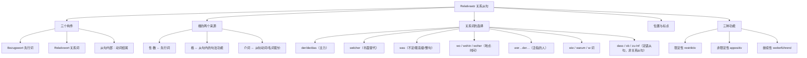
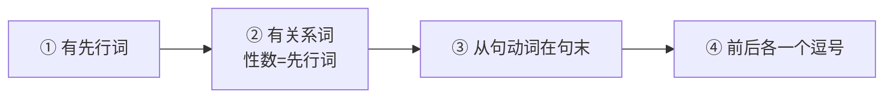
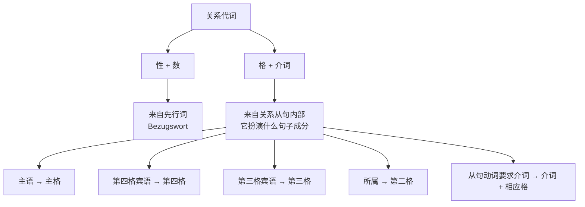
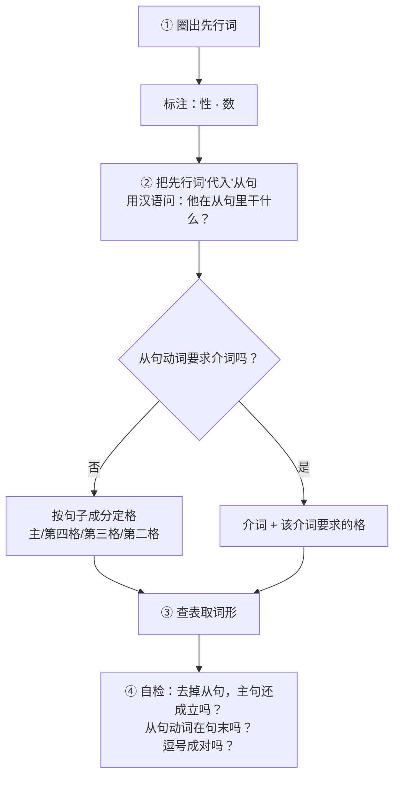
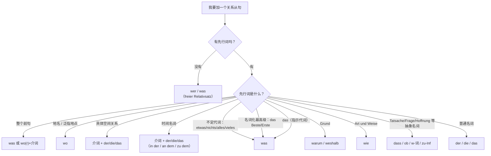
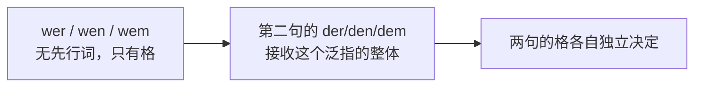
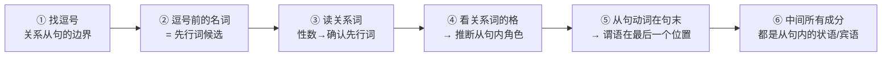
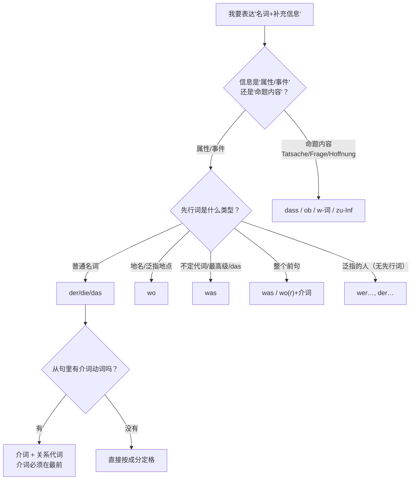
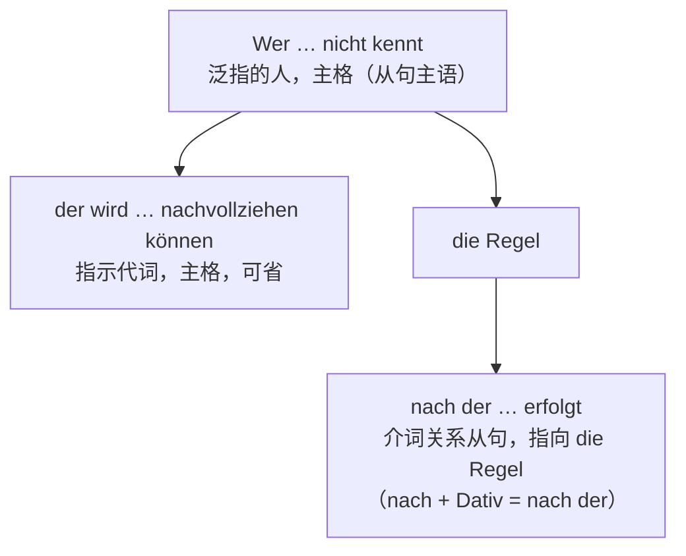

# 德语关系从句全解：从“格的分配”到“关系词的选择”

> **本讲适配说明**
> - **知识类型**：语言语法型（H）+ 技能型（E）
> - **起点假设**：你已掌握 A 2–B 1 的格系统、冠词变格、从句动词结尾语序；能在简单句中使用 `der/die/das` 作关系代词，但在 B 2 文本中遇到 `wo`、`was`、`wer…der…`、`dessen/deren`、`dass/ob` 定语从句时会犹豫。
> - **终点能力**：能**判定**任何一个关系词的格与形式；能**选择**正确的关系词家族；能**读懂**跨越 3 行的长关系从句；能在 Schreiben 中**产出**语体得体的关系从句和关系从句变体（分词定语）。
> - **认知层级**：记忆（变格表）→ 理解（格的两个来源）→ 应用（填空）→ 分析（拆句）→ 评价（选哪个关系词更好）→ 创造（改写与合并）。

---

## 学习目标

学完本讲，你应当能够做到：

1. 说出关系从句的“两个信息来源”，并解释为什么关系代词的性数来自前面、格来自里面。
2. 不看表写出 `der/die/das` 与 `welcher` 两套关系代词的完整变格，并说明 `welcher` 为什么在第二格和复数第三格“残缺”。
3. 用一张决策树判断该用 `der`、`was`、`wo`、`wer`、`wie`、`warum` 还是 `dass/ob`。
4. 准确区分 `der`（关系代词）与 `das`（指示代词）+ `was`（关系代词）的结构差别。
5. 写出并解释 `wer…, der…` 关联结构，说明指示代词何时可以省略。
6. 辨认“整句回指”的 `was` 从句，并说清它与“递进/继续性关系从句”的关系。
7. 判断一个关系从句该紧跟先行词，还是该放到句末（后场）。

---

## 知识地图



---

# 第 0 阶 · 无极：为什么关系从句是 B 2 的真正分水岭

## 0.1 一个卡点

请读这句（歌德 B 2 阅读常见语体）：

> **Wer die Regel, nach der die Vergabe der Studienplätze in Deutschland erfolgt, nicht kennt, der wird die Entscheidung der Behörde kaum nachvollziehen können.**

这句话里出现了：
- 一个**无先行词**的关系从句 `Wer … nicht kennt`
- 一个**带介词**的关系从句 `nach der … erfolgt`（插在名词和它的介词短语之间）
- 一个**关联指示代词** `der`，回指前面的 `Wer…`

每一个语法点你都学过。但三种结构同时出现时，大多数学习者只能抓住大意，抓不住“谁修饰谁”。

再看写作端：

> ❌ *Ich habe eine Wohnung gefunden. Die Wohnung ist günstig. Die Wohnung liegt im Zentrum. Das Zentrum ist sehr laut.*

语法完全正确，但这是 A 2 的句子密度。B 2 的要求是：

> ✅ *Ich habe eine Wohnung im Zentrum gefunden, **das allerdings sehr laut ist**.*

**读不懂别人写的关系从句、写不出自己的关系从句——这是同一个知识缺口的两面。**

## 0.2 三个典型直觉及其局限

| 直觉 | 部分正确 | 局限 |
|---|---|---|
| “关系代词就是 der/die/das，跟先行词的性数格一致” | 性数一致是对的 | **格不与先行词一致**，这是最高频的错误来源 |
| “关系词只有 der/die/das 和 was” | 覆盖了大部分 | 忽略了 `wo`、`wer…der…`、`wie`、`warum`、`welcher`、`dessen/deren`、`dass/ob` 这一整片区域，而它们正是 B 2 阅读的失分区 |
| “关系从句就是逗号+关系词+正常语序” | 逗号是对的 | 从句内部是**动词结尾**语序；带情态动词、可分动词、完成时的时候位置会变 |

## 0.3 本讲要解决的核心矛盾

德语关系从句之所以难，是因为它同时受**两条互相独立的规则**支配：

> **规则一（格的规则）**：德语要求格信息必须能被听者识别出来——所以关系代词必须变格。
> **规则二（回指的规则）**：关系从句必须让听者知道“我在说前面哪个名词”——所以关系词必须携带先行词的性数。

这两条规则**作用于同一个词的不同维度**：

- **性、数**：来自**左边**（先行词）
- **格**：来自**右边**（从句内部）

只要你能把这两个维度彻底分开处理，关系从句就从“凭语感”变成“可计算”。

**整章讲的就是这一句话。**

---

# 第 1 阶 · 道生一：关系从句的本质与最小模型

## 1.1 专业定义

**关系从句（Relativsatz）是一种定语从句（Attributsatz），它通过一个回指性的关系词（Relativwort / Relativpronomen / Relativadverb）指向主句中的某个名词性成分（先行词 Bezugswort），并对这个成分进行限定或补充说明。关系从句本身不是句子的独立成分，而是先行词的“卫星”。**

## 1.2 一句话本质

> **关系从句 = 把“一整句话的信息”压缩成一个形容词，挂在名词后面，用关系词当作回指的钩子。**

## 1.3 大白话解释

你想说“那个男人昨天给我打电话了”，而且这个“男人”还需要补充信息“他昨天来过这里”。你有两种做法：

- **加一个新句子**：`Der Mann hat angerufen. Er war gestern hier.`（两个独立信息块，松散）
- **用一个关系从句**：`Der Mann, **der** gestern hier war, hat angerufen.`（信息被整合进“男人”这个概念里）

**关系从句的作用就是：把一个独立句子降级成一个“名词的修饰成分”。** 降级的手段有两个——加逗号 + 把动词赶到句末 + 用关系词回指。

## 1.4 类比：身份证与借用身份证

把先行词想成一个**人**，关系从句想成**一段关于他的档案**：

- **关系词的性数** = 档案上写的“这是谁”（身份证号，来自本人）。
- **关系词的格** = 档案里这一条“他在这个事件中扮演什么角色”（来自档案内部的事件描述，而不是来自本人）。

**关键**：同一个人，在不同档案里角色不同。同一个先行词，在不同关系从句里格可以完全不同：

> `Der Mann, **der** mich liebt` （他是爱的主体 → 主格）
> `Der Mann, **den** ich liebe` （他是爱的对象 → 第四格）
> `Der Mann, **dem** ich helfe` （他是被帮助者 → 第三格）
> `Der Mann, **dessen** Auto ich kenne` （他是车主 → 第二格）

**四个句子说的是同一个男人，四种完全不同的关系。**

## 1.5 类比失效的地方（必须说清）

1. “身份证号”这个类比无法解释**为什么德语第二格关系代词是 `dessen/deren` 而不是 `des` **——那是历史语音演变的结果，不是逻辑必然。
2. 类比也无法解释**“什么时候可以省略关系代词”**——答案是：标准德语中**几乎从不省略**（这一点与英语的 `the book I bought` 完全不同）。
3. 类比无法解释**距离问题**：先行词和关系从句在真实句子里常常隔得很远，而“档案挂在本人身上”这个画面会误导你以为它们总是相邻的。

## 1.6 最小可运行模型

一个合格的关系从句只需要满足四个条件：



**最小示例**：

> `Das ist der Kollege, **den** ich gestern kennengelernt **habe**.`

| 检验项 | 结果 |
|---|---|
| 先行词 | `der Kollege`（阳性单数） |
| 关系词 | `den`（阳性单数第四格 ✓ 性数来自先行词，格来自从句宾语位置） |
| 动词位置 | `kennengelernt habe` — 助动词在最后 ✓ |
| 逗号 | 前后各一个 ✓ |

## 1.7 整个知识体系的缩略图

> **一个关系从句 = 先行词（决定性别和数）+ 关系词（决定格和介词）+ 从句其余部分（动词结尾）+ 逗号。**

后面所有的复杂情况，都是这四个位置上的变化：

- 先行词可以**不存在**（`wer…, der…`）
- 先行词可以是**整个句子**（`…, was mich ärgert`）
- 关系词可以**不是代词**（`wo`、`wie`、`warum`）
- 关系词可以**换成引导词**（`dass`、`ob`、`w-词`）
- 从句可以**离开先行词的位置**（后场）

---

# 第 2 阶 · 一生二：三个构件与两条信息流

## 2.1 构件一：先行词（Bezugswort）

先行词决定**性别和数**，它可以是：

| 先行词类型 | 例子 |
|---|---|
| 名词短语 | `der neue Kollege, **der** …` |
| 代词 | `ich, **der** ich immer zu spät komme, …`（高雅书面） |
| 代词化形容词（名词化） | `das Beste, **was** …` |
| 不定代词 | `nichts, **was** …` |
| 地点名词 | `die Stadt, **wo** …` |
| 时间名词 | `die Zeit, **in der** …` |
| 整个前句 | `Er kam zu spät, **was** mich ärgerte.` |
| 无先行词 | `**Wer** das glaubt, …` |

**先行词不一定紧贴关系从句**。它可以被各种成分隔开：

> `Ich habe gestern mit dem Kollegen gesprochen, **der** neu im Team ist.`

这里关系从句指向的是 `dem Kollegen`，中间的 `gesprochen` 是主句谓语。

## 2.2 构件二：关系词——五个家族

这是全讲的**中枢**。请把它当作“选择系统”来学，而不是“清单”。

### 家族一：`der / die / das / die`（代词性关系代词，主力）

| Kasus | maskulin | feminin | neutrum | Plural |
|---|---|---|---|---|
| Nominativ | **der** | **die** | **das** | **die** |
| Akkusativ | **den** | **die** | **das** | **die** |
| Dativ | **dem** | **der** | **dem** | **denen** |
| Genitiv | **dessen** | **deren** | **dessen** | **deren** |

**与定冠词的两个唯一差别**：

1. **第三格复数**：冠词是 `den`，关系代词是 `denen`（多一个 `-en`）。
2. **第二格全部**：冠词是 `des/der/des/der`，关系代词是 `dessen/deren/dessen/deren`。

记住这两点，这张表就不用背了——因为其余全部和定冠词一模一样。

### 家族二：`welcher / welche / welches / welche`（书面替代）

| Kasus | maskulin | feminin | neutrum | Plural |
|---|---|---|---|---|
| Nominativ | welcher | welche | welches | welche |
| Akkusativ | welchen | welche | welches | welche |
| Dativ | welchem | welcher | welchem | welchen |
| Genitiv | — | — | — | — |

**为什么第二格是空的？** 因为 `welches` 作为第二格听起来几乎无法辨认（与主格中性 `welches` 完全同形）；第三格复数 `welchen` 又与第四格阳性/复数同形，也会造成歧义。所以**标准德语避开这两个形式**，改用 `dessen/deren` 和 `denen`。

**使用建议**：`welcher` 在歌德 B 2 中属于“认得出来即可，主动少用”。它的历史功能是**避免 `der` 的重复**（`der …, der …` 连用显得笨重）。强行使用反而常被判为语体不当。

### 家族三：`was`（不定 / 最高级 / 整句）

| Kasus | Form |
|---|---|
| Nominativ | **was** |
| Akkusativ | **was** |
| Dativ | （不用） |
| Genitiv | （不用） |

`was` **只有第一格和第四格**。如果从句需要第三格或第二格，就不能用 `was`，必须改写结构。这是最容易出错的地方之一。

### 家族四：`wer / wen / wem / wessen`（泛指的人，无先行词）

| Kasus | Form |
|---|---|
| Nominativ | **wer** |
| Akkusativ | **wen** |
| Dativ | **wem** |
| Genitiv | **wessen** |

### 家族五：关系副词（不变格）

| 词 | 指向 |
|---|---|
| `wo` | 地点、时间（口语）、抽象场景 |
| `wohin` | 方向（较少，多为介词结构替代） |
| `woher` | 来源（较少） |
| `wie` | 方式（Art und Weise） |
| `warum / weshalb / wieso` | 原因 |
| `womit / worüber / worauf …` | 整句回指 + 介词 |

## 2.3 构件三：从句内部结构

关系从句是**从属句**，遵循从属句语序：**动词到句末**。

| 主句类型 | 关系从句中的位置 |
|---|---|
| 简单动词 | `…, der gestern **kam**.` |
| 完成时 | `…, der gestern **gekommen ist**.` |
| 情态动词 | `…, der das **machen muss**.` |
| 可分动词 | `…, der um 8 Uhr **ankommt**.`（前缀落地） |
| 被动 | `…, der gestern **geprüft wurde**.` |
| 带介词动词 | `…, **mit dem** ich **gesprochen habe**.`（介词提到关系代词前） |
| 反身动词 | `…, der sich dafür **interessiert**.` |

**两条铁律（德语特有，与英语完全不同）**：

> **铁律一：关系代词不能省略。**
> ❌ *Das Buch ich gekauft habe* → ✅ *Das Buch, **das** ich gekauft habe*
>
> **铁律二：介词不能留在句尾（不能“介词悬空”）。**
> ❌ *der Mann, den ich mit gesprochen habe* → ✅ *der Mann, **mit dem** ich gesprochen habe*

这两条正是中文母语者受英语影响最容易犯的错误。

## 2.4 核心机制：格的两个来源

这是本讲的**理论核心**，请务必停下来理解。



**判定流程只有三步：**

1. **看先行词** → 确定性别和数（阳性/阴性/中性/复数）。
2. **看从句** → 关系代词在从句里充当什么成分？（主语 / 直接宾语 / 间接宾语 / 所属 / 介词宾语）
3. **合成** → 用第 2 步得到的格 + 第 1 步得到的性数，去表里取词形。

**示范：**

> `Die Studentin, **die** ich gestern getroffen habe, …`

- 先行词 `Die Studentin` → 阴性单数
- 从句：`ich … getroffen habe`，我是主语，她是“被遇到的人” → 第四格
- 合成：阴性单数第四格 → `die`

> `Die Studentin, **der** ich geholfen habe, …`

- 先行词 → 阴性单数
- 从句：`helfen` 要求第三格 → 第三格
- 合成：阴性单数第三格 → `der`

**注意：这两个句子的先行词完全相同，关系代词却不同。这就是为什么“关系代词跟先行词同格”这个直觉是错的。**

## 2.5 易混辨析

| 容易混 | 区别 | 例子 |
|---|---|---|
| 关系代词 `der` vs 定冠词 `der` | 关系代词引导从句、动词到句末；定冠词在名词短语内 | `Der Mann, **der** dort steht` / **Der** Mann steht dort |
| 关系代词 `der` vs 指示代词 `der` | 指示代词引导**主句**，动词在第二位 | `**Der** hat es getan.` |
| `was`（关系代词）vs `was`（疑问词） | 疑问 `was` 引导疑问句或间接疑问句 | `**Was** hast du gesagt?` / `Ich weiß, **was** du meinst.` |
| 关系从句 vs 定语从句（dass/ob） | 后者没有“回指”功能，靠引导词连接 | `die Tatsache, **dass** er log` |
| 关系从句 vs 状语从句 | 状语从句修饰**主句谓语**，关系从句修饰**名词** | `**Weil** es regnete, blieb er.` / `der Tag, **an dem** es regnete` |
| 关系从句 vs 同位语 | 同位语无谓语 | `Herr Weber, **mein neuer Chef**,` |

---

# 第 3 阶 · 二生三：运行机制

## 3.1 机制一：格的分配（三步法 + 自检）

**操作流程：**



**慢镜头示范（易错句）：**

> `Das ist die Kollegin, **deren** Mann bei uns arbeitet.`

- 先行词：`die Kollegin` → 阴性单数
- 从句：`… Mann arbeitet bei uns` —— 谁是“Mann 的所有者”？是那位女同事 → 第二格
- 阴性单数第二格 → `deren`
- ✅ 正确

> `Das ist der Kollege, **dessen** Frau bei uns arbeitet.`

- 先行词：`der Kollege` → 阳性单数 → `dessen`

> `Das sind die Kollegen, **deren** Kinder dieselbe Schule besuchen.`

- 先行词：复数 → 复数第二格 → `deren`

**这就是用户笔记里最容易混的那一点：`dessen` 还是 `deren`，看的是“所有者”的性数，不是被拥有物的性数。**

## 3.2 机制二：冠词性关系代词（`dessen / deren` 的特殊句法）

这是本讲一个容易被忽略但极重要的结构点。

`dessen / deren` 有两种用法：

| 用法 | 句法角色 | 例子 | 后续形容词 |
|---|---|---|---|
| **代词性** | 代替名词，独立充当成分（罕见） | `der Mann, **dessen** ich mich erinnere` | — |
| **冠词性** | 占据冠词位置，修饰后面的名词 | `der Mann, **dessen** Auto …` | **强变化** |

**为什么冠词性用法后面形容词要强变化？** 因为 `dessen/deren` **本身不带词尾**（它是不可变形的），无法承担格数性标记。根据“标记守恒”原则，标记必须由下一位——形容词——来承担。

> ✅ `der Kollege, dessen **neues** Auto vor der Tür steht`
> ❌ `der Kollege, dessen **neue** Auto vor der Tür steht`

同理：

> ✅ `die Firma, deren **alter** Chef gekündigt hat`
> ✅ `das Kind, dessen **beide** Eltern arbeiten`

**另一条限制**：`dessen/deren` **前面不能加介词**。

> ❌ *der Mann, wegen dessen ich gekommen bin*
> ✅ `der Mann, **dessentwegen** ich gekommen bin`（书面）或 `der Mann, **wegen dem** ich gekommen bin`（口语，规范上不推荐）或改写：`der Mann, **deretwegen** …`（阴性）

**B 2 建议**：遇到“介词+第二格关系代词”的需求，改写句子结构，不要硬造。

## 3.3 机制三：关系词的选择（本讲核心，对应你的笔记）

### 3.3.1 决策树



### 3.3.2 `der / die / das` —— 默认选项

适用于：**先行词是普通名词或代词，且从句表达的是“属性、事件、状态”**。

> `Der Vortrag, **den** wir gestern gehört haben, war ausgezeichnet.`
> `Die Kollegin, **mit der** ich zusammengearbeitet habe, wechselt die Firma.`

### 3.3.3 `was` —— 六个触发条件（背下来就是分数）

| 触发条件 | 例子 |
|---|---|
| ① 不定代词 `alles / nichts / etwas / vieles / manches / einiges / weniges / anderes` | `Das ist alles, **was** ich weiß.`<br>`Es gibt nichts, **was** mich mehr ärgert.`<br>`Ich habe etwas gehört, **was** dich interessieren könnte.` |
| ② 名词化最高级 / 序数词 | `Das ist das Beste, **was** mir je passiert ist.`<br>`Das Erste, **was** er tat, war anzurufen.`<br>`Das Einzige, **was** fehlt, ist Geld.` |
| ③ 指示代词 `das` 作先行词 | `Das, **was** du sagst, stimmt nicht.`<br>`Ich meine das, **was** er gestern gesagt hat.` |
| ④ 整个前句 | `Er hat gelogen, **was** ich nicht wusste.`<br>`Sie kam zu spät, **was** den Chef verärgerte.` |
| ⑤ 整句 + 介词（`wo(r)-`） | `Er hat gelogen, **worüber** ich mich ärgerte.`<br>`Sie hat bestanden, **womit** niemand gerechnet hatte.`<br>`Er ist umgezogen, **was** mir egal ist.` / `**wovon** ich nichts wusste` |
| ⑥ 中性的“整体/全部”概念 | `Das Ganze, **was** er sagte, war wirr.`（口语可接受，正式语体更倾向改写） |

**重要区分：`der` 还是 `was`？**

> `Das Buch, **das** ich lese, ist spannend.` ← `das` 是**关系代词**（先行词是 `Buch`，中性名词）
> `Das, **was** ich lese, ist spannend.` ← `das` 是**指示代词**（先行词），`was` 是**关系代词**

两句意思几乎一样，但句法分析完全不同。歌德 B 2 的 Sprachbausteine 常在这里设陷阱。

**高频错误：**

> ❌ `Ich habe alles verstanden, **das** du gesagt hast.`
> ✅ `Ich habe alles verstanden, **was** du gesagt hast.`

> ❌ `Das ist das Schönste, **das** ich je gesehen habe.`
> ✅ `Das ist das Schönste, **was** ich je gesehen habe.`

### 3.3.4 `wo` —— 地点与时间（精确化你的笔记）

你的笔记里这一条非常关键，但需要**补充背后的机制**，否则你只能背例句、不能自己做决定。

**为什么地名必须用 `wo`？** 因为**很多地名没有冠词**，没有冠词就无法变出关系代词：

> ❌ *Berlin, in **dem/das** ich studiere*（`Berlin` 无冠词，没有格标记可挂）
> ✅ `Berlin, **wo** ich studiere`

对比：**有冠词的地名**就可以用介词+关系代词：

> ✅ `die Schweiz, **in der** ich studiere`
> ✅ `der Iran, **in dem** er aufgewachsen ist`
> ✅ `die Türkei, **in der** sie lebt`

**这条规则比“背地名清单”有用得多**：你可以自己判断——

| 地名 | 有冠词？ | 关系词 |
|---|---|---|
| Deutschland, Österreich, Frankreich, China, Europa, München | 无 | `wo` |
| die Schweiz, die Türkei, die Ukraine, der Iran, die Niederlande (Pl.), die USA (Pl.) | 有 | `in der / in dem / in denen` |

**概括性地点 → `wo`；具体空间关系 → 介词 + 关系代词**

这是你笔记中“概括性的地点说明语用 wo，具体的地点说明语最好用 an dem / zu dem”的准确表述：

| 类型 | 关系词 | 例子 |
|---|---|---|
| **泛指的地点、场所类型** | `wo` | `Ich suche einen Ort, **wo** man in Ruhe arbeiten kann.`<br>`Das ist ein Dorf, **wo** jeder jeden kennt.` |
| **特指的具体空间关系** | 介词 + 关系代词 | `Das ist die Schule, **in der** ich gelernt habe.`<br>`Das ist der Tisch, **an dem** wir damals saßen.`<br>`Das ist das Café, **zu dem** wir immer gingen.`<br>`Das ist der Park, **auf dem** wir Fußball spielten.` |

**为什么“具体”要用介词？** 因为 `wo` 只回答“在哪个位置”，而介词还能表达**表面（auf）、旁边（an）、内部（in）、方向（zu）**。信息越具体，介词越必要。

**时间说明语：标准用介词，`wo` 是口语**

你的笔记写“时间说明语，行为发生在过去（也用 in der / zu der）”，这一条对应的是：

| 表达 | 标准形式 | 口语替代 |
|---|---|---|
| 时间段 | `die Zeit, **in der** / **während der**` | `die Zeit, **wo**` |
| 时间点 | `der Zeitpunkt, **zu dem**` | — |
| 日期 | `der Tag, **an dem**` | `der Tag, **wo**` |
| 年份 | `das Jahr, **in dem**` | `das Jahr, **wo**` |
| 月份 | `der Monat, **in dem**` | — |
| 年龄阶段 | `das Alter, **in dem**` | — |

> ✅ `Ich denke oft an die Zeit, **in der** ich in Berlin studiert habe.`（标准）
> ⚠️ `Ich denke oft an die Zeit, **wo** ich in Berlin studiert habe.`（口语，Sprechen 可说，Schreiben 优选前者）

**关于“这类句子主要在口语中使用”的一点补充说明：**

你的笔记把“整句内容”和 `wo` 类关系从句归为口语。更精确的划分是：

| 类型 | 语体定位 |
|---|---|
| `wo` 指代地名 | 完全标准，书面口语皆可 |
| `wo` 指代时间 | **口语**，书面语用 `in der / an dem` |
| `wo` 指代抽象场景（`der Fall, wo…`） | **明显口语**，书面语改用 `in dem` 或改写 |
| `was` 指代整句 | **书面与口语都常见**，是正式语体的常用结构 |

也就是说：**“口语标签”只适用于 `wo` 家族，不适用于整句回指的 `was`。** 后者在报纸、学术文章里非常常见（例如 `Die Zahl der Anträge ist gestiegen, was auf eine höhere Nachfrage hindeutet.`）。因此，**不要把整句回指的 `was` 当作口语而避免使用**——它恰恰是 B 2 正式写作的加分结构。

** `wohin` / `woher` 的边界：**

> `die Stadt, **wohin** er gezogen ist` → 更标准：`die Stadt, **in die** er gezogen ist`
> `das Land, **woher** er kommt` → 更标准：`das Land, **aus dem** er kommt`

**结论**：`wohin/woher` 能做关系词，但**有冠词时优先用介词+关系代词**，`wohin/woher` 主要用来救无冠词的地名（`Österreich, wohin er heimlich fuhr`）。

### 3.3.5 `wie`、`warum`、`w-词`

| 关系词 | 典型先行词 | 例句 |
|---|---|---|
| `wie` | `die Art (und Weise)`、`der Grund`、方式类抽象名词 | `Die Art und Weise, **wie** er spricht, gefällt mir nicht.`<br>`Es war ein Verhalten, **wie** es für ihn typisch ist.` |
| `warum / weshalb / wieso` | `der Grund` | `Der Grund, **warum** er abgesagt hat, ist privat.` |
| `wann` | `der Zeitpunkt` | `Der Zeitpunkt, **wann** das passierte, ist unklar.` |
| `w-词`（间接疑问） | `die Frage`、`das Problem`、`die Unsicherheit` | `Die Frage, **wann** wir starten, ist noch offen.`<br>`Das Problem, **wie** man das Finanziert, bleibt ungelöst.` |

**注意辨析：**

> `Der Grund, **warum** er kam, …`（原因本身）
> `Der Grund, **dass** er kam, …`（事实性内容，“他来了这个事实的原因”）
> `Der Grund, **wo** er kam, …` ❌（错误）

### 3.3.6 `dass` / `ob` / `zu-Infinitiv` —— “定语从句”，不是关系从句

这一类结构**功能上等同于定语**，但**没有回指关系词**，所以严格讲是 `Attributsatz`（定语从句）而不是 `Relativsatz`（关系从句）。歌德 B 2 的语法讲解常把它们放在一起，考试则直接考搭配。

| 类型 | 使用条件 | 例句 |
|---|---|---|
| `dass` | 先行词是“事实性名词”，从句表达一个命题/事实 | `die Tatsache, **dass** er log`<br>`die Hoffnung, **dass** sie kommt`<br>`die Befürchtung, **dass** es regnet` |
| `ob` | 先行词是“疑问性名词”，从句表达是非疑问 | `die Frage, **ob** er kommt`<br>`der Zweifel, **ob** das stimmt` |
| `w-词` | 先行词是“疑问性名词”，从句表达补充疑问 | `die Frage, **wie** es weitergeht`<br>`das Problem, **wer** zuständig ist` |
| `zu + Infinitiv` | 先行词是“可能性/必要性/意愿”类名词，从句主语与主句主语一致 | `die Möglichkeit, **das Problem zu lösen**`<br>`der Versuch, **ihn zu überzeugen**`<br>`die Bereitschaft, **mehr zu zahlen**` |
| `um … zu` | ❌ **不能作定语** | ❌ *die Möglichkeit, um das zu lösen* |

**必须记住的搭配清单（B 2 高频）：**

| 词 | 配合 | 例子 |
|---|---|---|
| Tatsache | dass | `die Tatsache, dass niemand kam` |
| Frage | ob / w- | `die Frage, ob das erlaubt ist` |
| Zweifel | ob / daran, dass | `der Zweifel, ob er es schafft` |
| Hoffnung | dass | `die Hoffnung, dass es klappt` |
| Angst / Sorge | dass | `die Angst, dass er fällt` |
| Wunsch | dass | `der Wunsch, dass alle kommen` |
| Ziel / Absicht / Plan | dass / zu-Inf | `das Ziel, die Kosten zu senken` |
| Möglichkeit / Chance | zu-Inf / dass | `die Chance, etwas zu verbessern` |
| Gefahr / Risiko | dass | `die Gefahr, dass es schiefgeht` |
| Voraussetzung / Bedingung | dass | `die Bedingung, dass alle zustimmen` |
| Grund | warum / dass | `der Grund, dass es nicht klappte` |
| Eindruck / Gefühl | dass | `der Eindruck, dass niemand zuhört` |

**这条清单的价值在写作**：B 2 正式邮件里，用 `die Tatsache, dass…` / `die Frage, ob…` / `die Möglichkeit, … zu…` 能把简单句整合进名词短语，显著提高句式密度，同时**避免关系从句的格判定压力**——对容易出错的学习者来说，这是“稳健的高分路径”。

## 3.4 机制四：`wer…, der…` —— 泛指的关联结构（你的笔记核心）

### 3.4.1 结构长什么样

```
[wer/wen/wem… + 从句] + [der/den/dem… + 主句]
     ↑ 无先行词、泛指               ↑ 指示代词，回指前句
```

你的笔记说得完全正确：**第一句的关系代词格由从句动词决定；第二句的指示代词格由主句动词决定；两者同格时，主句的指示代词可以省略。**

### 3.4.2 为什么要这样设计

因为“泛指的人”没有先行词，所以没有性数可继承。德语用 `wer` 家族做“空先行词”的占位符，然后在主句里用 `der` 家族做“接收器”。这是一个**跨句指代回路**：



### 3.4.3 四个典型句

| 例句 | 第一句格 | 第二句格 | 能省略吗 |
|---|---|---|---|
| `**Wer** zuerst kommt, (**der**) mahlt zuerst.` | Nom | Nom | ✅ 可省（谚语固定） |
| `**Wer** zu spät kommt, **den** bestraft das Leben.` | Nom | Akk | ❌ 不能省 |
| `**Wen** das nicht interessiert, **der** kann gehen.` | Akk | Nom | ❌ 不能省 |
| `**Wem** das zu kompliziert ist, **der** sollte es lassen.` | Dat | Nom | ❌ 不能省 |

**省略规则的准确表述：**

> **只有当第一句的关系代词与第二句的指示代词格相同时，第二句的指示代词才可以省略。** 因为此时它的格信息已在前句出现，重复无信息价值，省略后句子更像格言。

> 同格可省：`Wer rastet, rostet.` / `Wer nicht wagt, (der) nicht gewinnt.`
> 异格不可省：`Wem nicht zu raten ist, **dem** ist nicht zu helfen.`

### 3.4.4 `was…, das…` —— 泛指物的对应结构

同理，泛指“物”时用 `was`：

> `**Was** du sagst, (**das**) stimmt.`（同格 Nom → 可省）
> `**Was** er versprochen hat, (**das**) hat er gehalten.`（同为 Akk → 可省）
> `**Was** mich betrifft, (so) bin ich einverstanden.`（固定搭配，`so` 为习惯插入）

**注意**：`was…das…` 中如果主句用的是 `das` 作第四格，可以省；但如果你想让语气更重，保留 `das` 反而更好。

### 3.4.5 补充性句式（你的笔记未涉及但考试会用）

| 结构 | 例子 | 说明 |
|---|---|---|
| `wer/was … auch immer` | `**Wer auch immer** anruft, ich bin nicht da.` | 泛指 + 让步 |
| `was … auch` | `**Was** er **auch** sagt, ich bleibe bei meiner Meinung.` | 让步 |
| `derjenige, der…` | `**Derjenige**, **der** zuerst kommt, bekommt den Platz.` | 强指示 + 关系从句 |
| `die Zahl derer, die…` | `**Die Zahl derer**, **die** arbeitslos sind, steigt.` | `derer` 为复数第二格指示代词，专用于关系从句前 |
| `so…, wie…` | `Er ist **so** klug, **wie** ich dachte.` | 比较，非关系从句 |

## 3.5 机制五：整句回指与“递进/继续性关系从句”

### 3.5.1 `was` 指代整个前句

这是你的笔记里“整句内容”那一条。它的结构特点：

- 先行词不是一个名词，而是**前面整个命题**；
- 关系词只能用 `was` 或 `wo(r)+介词`；
- 因而是**中性、单数**的默认值。

> `Er hat die Prüfung ohne Vorbereitung bestanden, **was** alle überraschte.`
> `Sie hat sich entschuldigt, **was** ich anerkenne.`
> `Die Preise sind gestiegen, **womit** kaum jemand gerechnet hatte.`
> `Er hat gekündigt, **was** ich nur verstehen kann.`

**语体判断（修正你的笔记）**：这一类在**书面正式语体中非常常见**，尤其是评论、报告、论证性文章。例如：

> `Die Zahl der Studierenden ist gestiegen, **was** auf eine veränderte Nachfrage hindeutet.`

这句话完全属于标准书面德语。**所以不要把整句回指的 `was` 归入“只在口语使用”。**

如果要把这个“口语/书面”标签放对位置，应该是：**`wo` 用于时间与抽象场景是口语性的**；`was` 用于整句回指是中性的，书面上也是好结构。

### 3.5.2 `weiterführender Relativsatz`（继续性关系从句）

术语说明：德语语法中，“继续性关系从句”指的是**不是限定先行词、而是接着往下讲故事**的关系从句。判断标准是：如果去掉它，主句意思**完整但不连贯**；保留它，等于**多了一个主句**。

> 限定性：`Der Mann, **der dort steht**, ist mein Chef.`（限定“哪个男人”）
> 继续性：`Ich traf Peter, **der mir von dem Unfall erzählte**.`（= Ich traf Peter. Er erzählte mir von dem Unfall.）

继续性关系从句的两个特征：
1. **可以改写成并列句**（用 `und er…`）；
2. 关系词前通常有逗号，且**先行词是特指的**。

**在 B 2 写作中的价值**：把两个短句合并成一个长句，同时不损失可读性。这是最安全的“提密度”手段。

> ❌ `Ich habe Herrn Müller getroffen. Er arbeitet jetzt in Hamburg.`
> ✅ `Ich habe Herrn Müller getroffen, **der** jetzt in Hamburg arbeitet.`

## 3.6 机制六：位置与逗号

### 3.6.1 贴近原则

> **关系从句应尽可能紧跟在先行词后面。**

> ✅ `Der Vortrag, **den** wir gestern gehört haben, war ausgezeichnet.`

如果关系从句被其他成分隔开，读者会误判它修饰谁：

> ⚠️ `Der Vortrag war ausgezeichnet, **den** wir gestern gehört haben.`

这句话在**口语**里完全正常（关系从句落到后场），但在**书面语**中会让读者先误解，然后在句末才修正——增加理解负担。

### 3.6.2 后场（Nachfeld）——什么时候可以放后面

**可以用后场的情况：**

1. **主句很短**，关系从句很长——此时紧跟会让主句被“淹没”：
   > `Das Buch ist wirklich lesenswert, **das** ich dir gestern empfohlen habe.`
2. **口语/论坛帖**语体，便于边说边补充。
3. 先行词在主句**句末**，关系从句自然顺延。

**不可以用后场的情况：**

1. 关系从句**短**而主句**长**——此时放后面会让读者误以为修饰其他名词。
2. **书面正式文本**（报告、学术、正式邮件）——紧跟。B 2 的 Schreiben Aufgabe 2 属于这一类。

### 3.6.3 关系从句不能插在冠词和名词之间

> ❌ *Der, der dort steht, Mann ist mein Chef.*
> ✅ `Der Mann, **der** dort steht, ist mein Chef.`

这一点与英语一致，但值得明确：德语的关系从句**只能挂在完整的名词短语之后**，不能切进名词短语内部。

### 3.6.4 逗号规则（德语比英语严格）

| 规则 | 说明 |
|---|---|
| 关系从句**一律**用逗号隔开 | 无论限定性还是继续性 |
| 关系从句在句末时，**前**有逗号 | `…, der gestern kam.` |
| 关系从句在主句中间时，**前后各一** | `Der Mann, der kam, war müde.` |
| 两个关系从句由 `und` 连接 | 第二个从句带自己的关系代词时，**逗号可加可不加**；为清晰起见建议加 |
| `was` 引导的整句回指 | 必须有逗号 |

> `Das ist der Kollege, **der** neu im Team ist **und** **der** aus Spanien kommt.`（清晰）
> `Das ist der Kollege, der neu im Team ist und aus Spanien kommt.`（也可，视为一个从句的两个谓语）

### 3.6.5 关系从句中的框架与语序细节

| 情况 | 正确 | 错误 |
|---|---|---|
| 可分动词 | `…, der um 8 Uhr **ankommt**` | ❌ `…, der um 8 Uhr kommt an` |
| 完成时 | `…, der gestern **gekommen ist**` | ❌ `…, der gestern ist gekommen` |
| 情态动词 | `…, der das **machen muss**` | ❌ `…, der muss das machen` |
| 被动 | `…, der **operiert wurde**` | ❌ `…, der wurde operiert` |
| 否定 | `…, der das **nicht wusste**` | — |
| 反身 | `…, der **sich** dafür interessiert` | ❌ `…, der dafür interessiert` |
| 介词宾语 | `…, **mit dem** ich sprach` | ❌ `…, dem ich mit sprach` |
| 关系词必须在首位 | `…, **dem** ich das Buch gab` | ❌ `…, ich gab dem das Buch` |

## 3.7 慢镜头案例：一句长句的完整拆解

> **Die Wissenschaftlerin, deren Forschungsergebnisse in der letzten Woche in einer vielbeachteten Studie veröffentlicht wurden, die in Fachkreisen heftig diskutiert wird, hat gestern in Berlin eine neue These vorgestellt, was in der Presse für Aufsehen sorgte.**

**第一步：切分**

| 段 | 内容 | 类型 |
|---|---|---|
| ① | `Die Wissenschaftlerin` | 主句主语（阴性单数） |
| ② | `deren Forschungsergebnisse … veröffentlicht wurden` | 关系从句 1（指向女性科学家，第二格 `deren`） |
| ③ | `die in Fachkreisen heftig diskutiert wird` | 关系从句 2（指向 `Studie`，阴性单数主格） |
| ④ | `hat gestern in Berlin eine neue These vorgestellt` | 主句谓语 |
| ⑤ | `was in der Presse für Aufsehen sorgte` | 整句回指关系从句 |

**第二步：判定每个关系词**

- ② `deren`：先行词 `die Wissenschaftlerin` 阴性单数；从句里她是“研究成果的所有者” → 第二格 → `deren` ✓
- ③ `die`：先行词 `Studie` 阴性单数；从句里她是“被讨论的对象”，且从句为被动 → 主格 → `die` ✓
- ⑤ `was`：先行词是整个前句 → `was` ✓

**第三步：发现一个结构陷阱**

② 和 ③ 是**嵌套**关系：② 的末尾 `in einer vielbeachteten Studie` 里出现了 ③ 的先行词 `Studie`，于是 ③ 紧跟在 `Studie` 后面。这就是所谓“**连锁关系从句**”（Relativsatzkette). 阅读时的处理办法是**从最内层往外读**：

> ③ 先读：`die … diskutiert wird` → “（那项）被讨论的研究”
> ② 再读：`deren Ergebnisse … veröffentlicht wurden` → “（这位女科学家的）成果被发表”
> ① 主句：她提出新论点
> ⑤ 整句：这在媒体上引起轰动

**第四步：中文重排（中文是“左分支”语言，所有定语都要塞到“的”前）**

> “这位研究成果上周在一项备受关注的、在专业圈内被激烈讨论的研究中发表的女科学家，昨天在柏林提出了一个新论点，这在媒体上引起了轰动。”

**中文读起来很重**——这恰好说明：**德语的右分支结构是为了减轻理解负担，而中文翻译会把它重新压紧。** 所以做阅读题时，不要在脑子里先译成中文，而要先画出结构。

---

# 第 4 阶 · 三生万物：场景映射

## 4.1 场景一：Lesen（阅读）

**核心策略：不要逐词翻译，先框定边界。**



**实战提示**：B 2 阅读题（Teil 1–2）常把答案藏在关系从句里。因为关系从句是**附加信息**，恰恰是“细节题”的答案来源。

## 4.2 场景二：Sprachbausteine（填空）

填空题里关系从句的考点几乎只有三个：

1. **关系代词的格**（看从句动词）
2. **`was` vs `das`**（看先行词类型）
3. **介词**（看从句动词的配价）

**做题顺序**：先看从句动词 → 再看先行词 → 最后看选项。

## 4.3 场景三：Schreiben Aufgabe 1（论坛帖）

论坛帖是**半正式、带对话性**的语体。目标是**句式有变化但可读**。

| 推荐结构 | 例子 |
|---|---|
| `wer…der…` | `**Wer** in der Stadt wohnt, **der** weiß, wie teuer das geworden ist.` |
| 短关系从句 | `Ich kenne viele Leute, **die** jeden Tag zwei Stunden pendeln.` |
| 整句回指 | `Viele Familien ziehen aufs Land, **was** ich gut verstehen kann.` |
| `was` 泛指 | `Man sollte etwas tun, **was** allen hilft.` |

**要避免**：连续 3 个以上的关系从句嵌套、`dessen/deren` 连用、把关系从句放到后场（论坛帖里可以，但别每句都放）。

## 4.4 场景四：Schreiben Aufgabe 2（正式邮件）

正式邮件要求**书面语体**。这里关系从句是加分项，但**分词定语和名词短语更高级**。三种表达同一信息的路径：

| 路径 | 例子 | 语体 |
|---|---|---|
| 关系从句 | `die Bedingungen, **die im Vertrag genannt werden**` | 中性书面 ✓ |
| 分词定语 | `die **im Vertrag genannten** Bedingungen` | 正式书面 ✓✓ |
| 属格/介词定语 | `die Bedingungen **des Vertrags**` | 正式书面 ✓ |

**推荐组合**：一段里用 1–2 个关系从句，其余用名词短语，形成节奏。全部用关系从句会显得“从句堆叠”；全部用名词短语会显得“僵硬”。

**正式邮件常用句式：**

> `Ich beziehe mich auf Ihre Anzeige, **die am 3. Mai in der Süddeutschen Zeitung erschienen ist**.`
> `Leider muss ich Ihnen mitteilen, **dass** …`（`dass` 定语/宾语从句）
> `Ich wäre Ihnen dankbar für eine Rückmeldung, **die mir eine schnellere Planung ermöglicht**.`
> `Gibt es Unterlagen, **die ich vorab ausfüllen muss**?`

## 4.5 场景五：Sprechen（口头表达）

口头表达的关系从句遵循三条实用原则：

1. **短**：一次一个从句，不要嵌套。
2. **用 `wo`、`was`**：口语里 `wo` 指代时间/场景完全可接受。
3. **善用 `wer…der…`**：给人“有观点、有概括力”的印象，且句式简单。

> `Ich finde, **wer** Kinder hat, **der** sollte mehr Unterstützung bekommen.`
> `Es gibt Situationen, **wo** man einfach keine Wahl hat.`
> `Das ist etwas, **was** mich wirklich ärgert.`

## 4.6 场景六：Hören（听力）

听力中关系从句的处理与阅读不同：**你只能听到一次，不能回看**。策略是：

- 听到逗号（停顿）→ 标记“这里开始进入附加信息”
- 听到关系词 → 立刻判断“在说前面哪个名词”
- **不要试图翻译**，只抓“这个名词被补充了什么信息”

## 4.7 一张转换表：同一意思的五种表达

| 形式 | 例子 | 语体/难度 |
|---|---|---|
| 两个简单句 | `Das ist ein Problem. Es muss gelöst werden.` | A 2 |
| 关系从句 | `Das ist ein Problem, **das** gelöst werden muss.` | B 1–B 2 |
| `zu`-不定式定语 | `Das ist ein Problem, **das zu lösen ist**.` | B 2 |
| 分词定语 | `Das ist ein **zu lösendes** Problem.` | B 2+ |
| 复合词/名词化 | `Das ist eine **Problemlösung**.` | 词汇层面 |

**这张表是写作时的“语体调节旋钮”**：同一内容，往下走越正式，往上走越口语。

---

# 第 5 阶 · 实战：从“会用”到“改对”

## 5.1 任务背景

**场景**：你在一家德国公司实习，需要给人事部门写一封正式邮件，说明你发现的一个流程问题，并附上三个具体信息。
**限制**：正式语体、150–180 词、必须包含至少 3 个关系从句（其中 1 个带介词、1 个 `was` 整句回指）、不得出现 `wo` 用于时间。

## 5.2 SOP 五步法

### 第一步：列“信息块”，不写句子

| 序号 | 信息 | 类型 |
|---|---|---|
| 1 | 我在实习期间发现了一个问题 | 主陈述 |
| 2 | 问题涉及休假申请流程 | 名词 + 定语 |
| 3 | 该流程目前用纸质表格 | 关系从句素材 |
| 4 | 表格必须由三个人签字 | 关系从句素材 |
| 5 | 这导致审批时间很长 | 整句回指素材 |
| 6 | 我建议改用电子系统 | 建议 |

### 第二步：给每个信息块选“载体”

| 信息 | 载体 | 理由 |
|---|---|---|
| 2 | 介词定语 `im Bereich der Urlaubsanträge` | 名词化，正式 |
| 3 | 关系从句 `der derzeit auf Papier erfolgt` | 需要表达“当前状态” |
| 4 | 关系从句 `das von drei Personen unterschrieben werden muss` | 带被动 + 情态，B 2 加分 |
| 5 | 整句回指 `was zu erheblichen Verzögerungen führt` | 逻辑衔接 |
| 6 | `dass` 从句或 `zu`-不定式 | 建议表达 |

### 第三步：判定每个关系词的格（**这一步不能跳**）

| 关系从句 | 先行词 | 从句内角色 | 关系词 |
|---|---|---|---|
| `… auf Papier erfolgt` | `der Prozess`（阳性单数） | 从句主语 | `der` |
| `… von drei Personen unterschrieben werden muss` | `das Formular`（中性单数） | 被动主语 | `das` |
| `… zu erheblichen Verzögerungen führt` | 整句 | — | `was` |

### 第四步：写出来，控制密度

> Sehr geehrte Frau Berger,
>
> im Rahmen meines Praktikums in der Personalabteilung ist mir ein Problem im Bereich der Urlaubsanträge aufgefallen, **das ich Ihnen gerne schildern möchte**.
>
> Der Antragsprozess, **der derzeit noch vollständig auf Papier erfolgt**, verursacht regelmäßig Verzögerungen. Hinzu kommt, dass das Formular, **das von drei Personen unterschrieben werden muss**, häufig mehrere Tage in den verschiedenen Abteilungen liegt. In der Praxis führt dies dazu, **was** sich auch in den letzten Wochen bestätigt hat: Die Bearbeitungszeit beträgt im Durchschnitt zehn Werktage *(Hinweis: 此处为示例假设值，非公司实际标准)*.
>
> Ich möchte daher anregen, **den Prozess auf ein elektronisches System umzustellen**, **das** die Unterschriften digital erfasst. Ein solches System würde nicht nur die Bearbeitungszeit verkürzen, **was** letztlich allen Beteiligten zugutekommt, sondern auch die Nachvollziehbarkeit erhöhen.
>
> Für Rückfragen stehe ich Ihnen gerne zur Verfügung.
>
> Mit freundlichen Grüßen

### 第五步：四层验证

| 检验 | 问题 | 本稿结果 |
|---|---|---|
| 性数 | 每个关系词的性数 = 先行词？ | ✓ |
| 格 | 每个关系词的格 = 从句内角色？ | ✓ |
| 语序 | 每个从句动词在最后？ | ✓ |
| 可读性 | 有没有连续 2 个以上嵌套？ | ✓（无嵌套） |

## 5.3 判断节点与分支



## 5.4 失败案例（真实错误类型）

**学习者原稿：**

> ❌ *Ich habe ein Problem gefunden, **das** ich Ihnen schildern möchte. Der Prozess, **das** auf Papier erfolgt, ist langsam. Das Formular muss von drei Personen unterschrieben werden, **was** häufig lange dauert. Ich empfehle ein System, **wo** die Unterschriften digital erfasst werden.*

**逐条诊断：**

| 错误 | 类型 | 原因 | 修正 |
|---|---|---|---|
| `Der Prozess, **das** auf Papier erfolgt` | 性数错 | `Prozess` 是阳性，误用中性 | `**der**` |
| `**was** häufig lange dauert` | 先行词判断错 | `was` 只能回指整句或不定代词；这里回指 `Das Formular`（中性名词），应用关系代词 | `**das** häufig lange dauert` |
| `ein System, **wo** die Unterschriften … erfasst werden` | 关系词选择不当 | `System` 不是地点名词；且正式语体应用介词 | `ein System, **in dem** …` 或 `**das** … erfasst` |

**修正稿：**

> ✅ `Ich habe ein Problem gefunden, **das** ich Ihnen schildern möchte. Der Prozess, **der** auf Papier erfolgt, ist langsam. Das Formular muss von drei Personen unterschrieben werden, **was** häufig zu Verzögerungen führt. Ich empfehle ein System, **in dem** die Unterschriften digital erfasst werden.`

**关键观察**：三个错误分别来自**三个不同机制**（性数继承、关系词家族选择、介词必要性）。这说明**关系从句的错误不是“语感问题”，而是三个独立机制各自的失效**——所以必须分开练。

## 5.5 独立挑战（不提供答案，请自己完成后再对照）

**任务 A（判定）** 填入正确的关系词，并说明理由：

1. Das ist der Kollege, ______ ich das Buch gegeben habe.
2. Das ist die Kollegin, ______ Auto vor der Tür steht.
3. Ich habe alles verstanden, ______ du erklärt hast.
4. Er hat die Prüfung bestanden, ______ mich sehr gefreut hat.
5. Berlin, ______ ich drei Jahre gelebt habe, hat sich stark verändert.
6. Die Zeit, ______ wir zusammen gearbeitet haben, war anstrengend.
7. Das ist das Beste, ______ ich je gegessen habe.
8. ______ nicht arbeitet, ______ soll auch nicht essen.

**任务 B（改错）** 每句有一个错误：

1. Das ist der Mann, das ich gestern getroffen habe.
2. Die Firma, deren neuer Chef sehr jung ist, wächst schnell.
3. Ich habe nichts gehört, das mich überrascht hat.
4. Er kam zu spät, das mich sehr geärgert hat.
5. Die Frage, wenn wir anfangen, ist noch offen.

**任务 C（合并）** 用关系从句把下面三句合并成一句：

> Ich habe eine Wohnung gefunden. Die Wohnung liegt im Zentrum. Das Zentrum ist sehr laut.

**任务 D（改写）** 把下面这句的关系从句改成分词定语（保持意思）：

> Die Reform, die in der letzten Woche beschlossen wurde, stößt auf Kritik.

**任务 E（创造）** 写一段 60–80 词的正式邮件片段，要求包含：
- 1 个带介词的关系从句
- 1 个 `was` 整句回指
- 1 个 `dass` 定语从句

---

## 参考答案与解析

**任务 A**

1. `dem` — 先行词阳性单数；`geben` 需要第三格（给谁）→ 第三格。
2. `deren` — 先行词阴性单数（`die Kollegin`）；她是车的所有者 → 第二格阴性 = `deren`。
3. `was` — 先行词 `alles` 属不定代词 → 只能用 `was`。
4. `was` — 先行词是整句（“他通过考试”这件事）→ 整句回指。
5. `wo` — `Berlin` 为无冠词地名，无法用介词+关系代词 → `wo`。
6. `in der` — 时间名词 `Zeit` 有冠词、阴性；标准语体用 `in der`（`wo` 属口语）。
7. `was` — 名词化最高级 `das Beste` → `was`。
8. `Wer … der` — 泛指的人；两者均为主格，`der` 可省略：`Wer nicht arbeitet, soll auch nicht essen.`

**任务 B**

1. `das` → `den`（先行词阳性单数，从句中是第四格宾语）。
2. `deren neuer Chef` → 正确形式应为 `deren **neuer** Chef`… 实际上原句是对的（`deren` 后形容词强变化 `neuer` ✓）。**此题无错**——用于训练“不要过度改错”。
3. `das` → `was`（先行词 `nichts` 是不定代词）。
4. `das` → `was`（整句回指）。
5. `wenn` → `ob`（`Frage` + 是非疑问 → `ob`；`wenn` 只用于条件/时间）。

**任务 C**

> ✅ `Ich habe eine Wohnung gefunden, **die** im Zentrum liegt, **das** allerdings sehr laut ist.`

或更自然：

> ✅ `Ich habe eine Wohnung im Zentrum gefunden, **das** allerdings sehr laut ist.`

**解析**：第二个版本把 `im Zentrum` 变成介词定语（前置于 `gefunden` 之后），只用一个关系从句，可读性更好。**这体现了本讲的核心原则：关系从句不是越多越好，而是“每个从句都要带来信息增量”。**

**任务 D**

> ✅ `Die **in der letzten Woche beschlossene** Reform stößt auf Kritik.`

**解析**：`beschlossen wurde`（被动、已完成）→ Partizip II + 变格词尾 `-e`（弱变化，因前面有 `Die`）。

**任务 E（示例）**

> Sehr geehrte Damen und Herren,
>
> ich wende mich an Sie mit einer Frage **zu dem Kurs, den Sie in Ihrer Anzeige beworben haben**. Leider fehlen auf Ihrer Website Angaben zu den Kosten, **was eine verlässliche Planung erschwert**. Ich wäre Ihnen dankbar, wenn Sie mir mitteilen könnten, ob die Gebühr im angegebenen Preis enthalten ist, **dass** die Materialien zusätzlich berechnet werden.

---

# 第 6 阶 · 九九归一：边界、误区与升维

## 6.1 用一句话回顾整章

> **关系从句 = 先行词提供性数 + 从句提供格与介词 + 关系词家族按“先行词类型”选择 + 动词到句末 + 逗号成对。**

## 6.2 关系从句的适用边界

| 能解决 | 不能解决 |
|---|---|
| 把两个短句合并，提高句式密度 | 词义精确性（关系从句不能替代词汇选择） |
| 表达限定性/补充性信息 | 高度正式的名词化风格（应用分词定语或名词短语） |
| 逻辑衔接（整句回指） | 长逻辑链（3 层以上嵌套会不可读） |
| 口语中的即时补充 | 严格的学术定义式表达（应用同位语或名词短语） |

## 6.3 十个常见错误（按频率排序）

| # | 错误 | 正确 | 机制 |
|---|---|---|---|
| 1 | 关系代词格跟着先行词 | 格看从句内功能 | 格的两个来源 |
| 2 | `alles, das` | `alles, was` | `was` 触发条件 |
| 3 | `dessen` 与 `deren` 混用 | 看拥有者的性数 | 第二格一致 |
| 4 | `deren neue Auto` | `deren neues Auto` | `dessen/deren` 后强变化 |
| 5 | 关系代词省略 | 必须出现 | 德语铁律 |
| 6 | 介词留句尾 | `mit dem` | 德语铁律 |
| 7 | 从句动词第二位 | 动词句末 | 从属句语序 |
| 8 | 时间用 `wo`（书面） | `in der / an dem` | 语体边界 |
| 9 | 嵌套两层以上 | 拆句或用分词定语 | 可读性上限 |
| 10 | `Frage, wenn` | `Frage, ob` | 引导词搭配 |

## 6.4 与其他定语形式的“成本—收益”对照

| 形式 | 认知成本 | 语体收益 | 何时用 |
|---|---|---|---|
| 关系从句 | 中（需判格） | 中 | 需要表达事件/条件/补充 |
| 分词定语 | 高（需还原） | 高（正式） | 正式写作、新闻 |
| 介词定语 | 低 | 中 | 固定搭配、名词配价 |
| 属格定语 | 低 | 中高（书面） | 所有关系、书面 |
| 同位语 | 低 | 中 | 解释、定义、头衔 |
| 复合词 | 最低 | 高（词汇化） | 已固定的概念 |

**B 2 的成熟标志不是“会用最难的”，而是“知道每种形式各花多少成本、换多少收益”。**

## 6.5 与英语的四个结构性差异（中文学习者的高频干扰源）

| 维度 | 德语 | 英语 |
|---|---|---|
| 关系代词能否省略 | **不能** | 能（`the book I bought`） |
| 介词位置 | 必须在关系代词前 | 可悬空（`the man I spoke with`） |
| 逗号 | 一律加 | 限定性不加 |
| 从句语序 | 动词句末 | 正常语序 |

**这四条差异解释了 80% 的中文母语者错误。**

## 6.6 回到开篇那句话

> `Wer die Regel, nach der die Vergabe der Studienplätze in Deutschland erfolgt, nicht kennt, der wird die Entscheidung der Behörde kaum nachvollziehen können.`

现在你可以这样拆：



- `Wer`：无先行词，从句主语 → 主格
- `der`：回指 `Wer`，主句主语 → 主格 → **同格，可以省略**
- `nach der`：`die Regel` 阴性单数，`erfolgen nach` + 第三格 → `nach der`

## 6.7 可以迁移到其他语言学习的三条思维

1. **“两个来源”思维**：任何“回指 + 变格”的结构（关系代词、指示代词、人称代词）都要先问“哪些信息来自前面，哪些来自内部”。
2. **“标记守恒”思维**：变格不是背表格，而是“格数性只需标记一次，谁先标记谁负责”。
3. **“家族选择”思维**：语言中的功能词往往不是单个词，而是**按语义条件分组的家族**（`der` 家族 / `was` 家族 / `wo` 家族 / `wer` 家族 / `dass` 家族）。学语法的高效方式不是记词，而是记**触发条件**。

---

# 复习卡片（可间隔重复使用）

| 问题 | 答案 |
|---|---|
| 关系代词的性数从哪来？ | 先行词 |
| 关系代词的格从哪来？ | 关系从句内部的句法功能 |
| `der` 与定冠词的两个差别？ | 第三格复数 `denen`；第二格 `dessen/deren` |
| `welcher` 缺哪两个形式？ | 第二格全部；第三格复数 `welchen` 有歧义 |
| `was` 的六个触发条件？ | 不定代词 / 名词化最高级 / `das` / 整句 / `wo(r)+介词` / 中性整体 |
| 地名何时用 `wo`？ | 无冠词地名（Berlin, Deutschland）；有冠词用 `in der/in dem` |
| 时间何时用 `in der/an dem/zu dem`？ | 标准书面语一律用介词，`wo` 是口语 |
| `dessen` 与 `deren` 怎么选？ | 看**拥有者**的性数 |
| `dessen/deren` 后形容词用什么变格？ | 强变化 |
| `wer…der…` 何时可省 `der`？ | 两句格相同时 |
| 整句回指用什么？ | `was` 或 `wo(r)+介词` |
| `Frage` 后用什么引导词？ | `ob`（是非）或 `w-词`（补充疑问） |
| 关系代词能省略吗？ | 不能 |
| 介词能留在句尾吗？ | 不能 |
| 关系从句的动词在哪？ | 句末 |
| 逗号规则？ | 一律成对 |

---

## 最终总结

德语关系从句的全部复杂度，都可以还原为三个判定：

1. **先行词是什么类型？** → 决定用哪个家族（`der` / `was` / `wo` / `wer` / `dass`）
2. **性数是什么？** → 决定形式的一半
3. **格和介词是什么？** → 决定形式的另一半

你的笔记覆盖了其中最难的几个“家族选择”判断：地名与概括地点用 `wo`，具体空间用介词+关系代词，不定代词/最高级/整句用 `was`，泛指的人用 `wer…der…`。**本讲做的，是把这些分散的规则放进一个统一框架里**——让你在考试中不需要回忆“书上第几页写过什么”，而是能现场推导。

真正需要记忆的只有：**一张变格表（`der` 家族）+ 六个 `was` 触发条件 + 三组介词搭配（地点/时间/抽象名词）**。其余的，都可以从“两个来源”和“家族选择”这两条原理推出来。