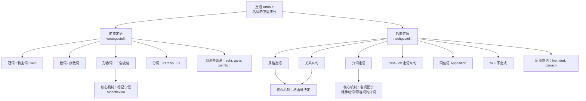
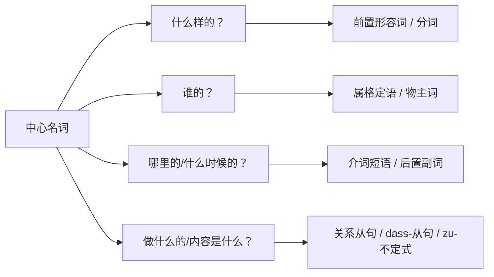
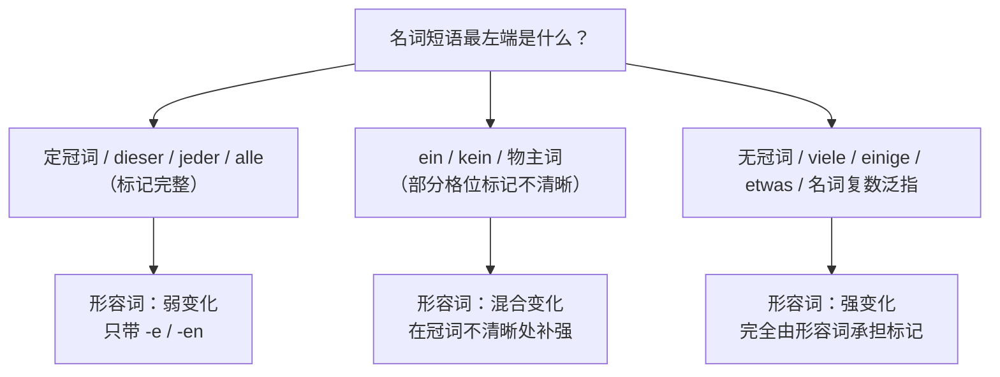
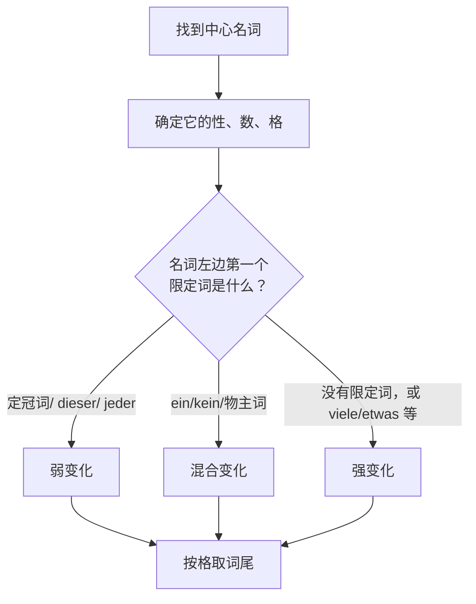
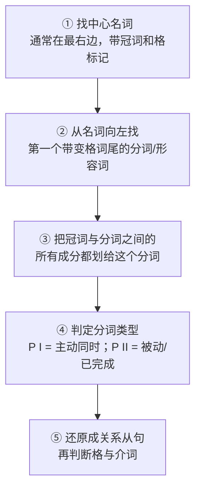

# 前置定语、后置定语以及扩展的分词定语

![[PixPin_2026-06-16_15-07-31.png|757x1035]]

[[语言学习/德语/公共知识语法/从句.md#^-X8m_0WwKxM0ibIahdbHV|100%]]
# 歌德 B 2 定语全解：前置定语与后置定语的两条轨道

> **本讲适配说明（教学设计定位）**
> - **知识类型**：语言与语法型（H）+ 技能型（E）——既要求“讲清规则”，也要求“能读、能写、能改”。
> - **起点假设**：你已具备 A 2–B 1 基础（知道冠词、四个格、关系从句的基本样子），但在 B 2 长文本里“一个名词前面挂了七八个词”时会卡住，写作时只会用简单句或关系从句堆叠。
> - **终点能力**：能**解码** B 2 阅读中的长名词短语；能**产出**符合正式语体的前置/后置定语；能**判断**什么时候该用哪一种。
> - **认知层级**：记忆（变格表）→ 理解（标记守恒）→ 应用（填空/合并）→ 分析（拆句）→ 评价（语体选择）→ 创造（自主改写）。

---

## 学习目标

学完本讲，你应当能够做到：

1. 不看表格，说出德语定语为什么分成“前置”和“后置”两条轨道。
2. 用“信号守恒”解释三套形容词变格，而不是死背 48 个词尾。
3. 识别并命名 7 类后置定语，说出每一类的“格从哪里来”。
4. 用五步法拆解一个 20 词以上的扩展分词定语。
5. 把三个短句合并成一个带定语的名词短语，并判断合并后是否仍然可读。
6. 在歌德 B 2 的 Schreiben Aufgabe 2（正式邮件）中，用恰当的定语提高语体等级，而不制造歧义。

---

## 知识地图



---

# 第 0 阶 · 无极：问题从哪里产生

## 0.1 一个真实的卡点

请读下面这句话（难度接近歌德 B 2 阅读中的说明文/新闻语体）：

> **Die in den vergangenen Jahren in vielen deutschen Großstädten deutlich gestiegenen Mietpreise haben dazu geführt, dass immer mehr Familien aus den Innenstädten verdrängt werden.**

大多数 B 1 水平的学习者读到 `gestiegenen` 时已经迷路：`Die` 后面跟了 12 个词才出现真正的名词 `Mietpreise`，中间塞了时间、地点、程度、分词。语法上你每个词都认识，但**你不知道这 12 个词是在给谁“打工”**。

再看写作端。同一位学习者在 Schreiben Aufgabe 2 里写出：

> ❌ *Ich habe Ihre Anzeige gelesen. Sie haben ein Angebot gemacht. Das Angebot war in der Zeitung. Es ging um einen Sprachkurs.*

语法没错，但这是 A 2 的句法密度。B 2 的评分标准里，语言项的“句式多样性”和“语体恰当性”都会受影响。理想写法是：

> ✅ *In Ihrer Anzeige in der Zeitung haben Sie ein Sprachkursangebot gemacht, das mich sehr interessiert.*

**这两件事——读不懂别人写的长定语、写不出自己的长定语——是同一个知识缺口的两面。**

## 0.2 学习者的三个典型直觉（以及它们为什么不够）

| 直觉 | 部分正确的地方 | 局限 |
|---|---|---|
| “定语就是形容词放在名词前面” | 覆盖了最高频的一类 | 忽略了属格、介词短语、关系从句、同位语、不定式——后置定语才是 B 2 阅读的主要障碍 |
| “形容词变格靠背表格” | 表格确实必须会 | 只背表不理解原则，遇到 `viele`, `alle`, `etwas`, `dessen` 就崩；也无法自查错误 |
| “关系从句越少越好，分词高级” | 分词确实是 B 2 的加分项 | 反过来，滥用分词和名词化会造成歧义和不可读，正式语体也有可读性上限 |

## 0.3 本讲要解决的问题

德语的名词短语有一个**结构性矛盾**：

- 德语要求**格（Kasus）、数（Numerus）、性（Genus）**这三条信息必须让听者听出来；
- 但德语又允许把大量修饰成分**堆在名词前面**（左分支），堆得越长，中心名词越晚出现，理解负担越大。

**定语这一整章，本质上就是德语用来解决这个矛盾的两种方案：**

> **方案一（前置）**：让修饰成分自己“携带”格数标记，靠词尾和名词保持一致。
> **方案二（后置）**：让修饰成分“自带”格——用属格、介词、关系代词、从句引导词，因此完全不需要变格。

理解了这两句话，你就理解了整章。剩下的都是细节。

---

# 第 1 阶 · 道生一：定语的本质与最小模型

## 1.1 专业定义

**定语（Attribut）是名词短语内部的修饰成分，它不充当句子的独立成分（不是主语、宾语、状语），而是依附于一个中心名词（Bezugswort），用来限定或补充这个名词所指的范围与信息。**

## 1.2 一句话本质

> **定语就是在名词的引力场内回答“哪一个、什么样的、谁的、哪里的、做什么的”，从而把名词从“一类”缩小到“一个”。**

## 1.3 大白话解释

说 “Ich suche eine Wohnung.”（我在找一套房子）——信息几乎为零。
说 “Ich suche **eine kleine, aber bezahlbare Wohnung mit Balkon in der Nähe der Uni**.”——现在对方知道你要什么了。

**定语就是给名词“上限定”的装置。** 定语越多，名词指得越准，句子也越长、越难读。B 2 的核心技能不是“定语越多越高级”，而是**在准确和可读之间做选择**。

## 1.4 生活类比：衣架与吊牌

把一个**名词**想成一根衣架，把它的修饰成分想成挂上去的东西：

- **前置定语 = 直接套在衣架上的衣服**：必须和衣架的尺寸吻合（衣架是 S 号，衣服也得是 S 号）。这就是**变格一致性**——形容词的词尾必须和名词的性、数、格吻合。
- **后置定语 = 用绳子挂在衣架上的吊牌**：吊牌不占衣架尺寸，它自己的格式已经写在上面了（属格 `des Problems`、介词 `über das Thema`、关系从句 `der … wurde`）。这就是**后置定语不需要变格**的原因。

## 1.5 类比映射回真实语法

| 类比元素 | 对应语法事实 |
|---|---|
| 衣架尺寸 | 中心名词的性、数、格 |
| 套上去的衣服必须合尺寸 | 前置形容词/分词必须变格，与名词一致 |
| 吊牌自己带格式 | 属格定语自带 `-s` / `des`；介词定语自带介词；关系从句自带关系代词 |
| 衣架只能挂有限件衣服 | 前置定语过长会导致理解困难（工作记忆压力） |
| 吊牌可以挂很多个 | 后置定语理论上可无限叠加，因为每个都自带边界标记 |

**类比失效的地方（必须说清）**：衣架类比不能解释“为什么有时冠词承担标记、有时形容词承担”——那是德语特有的**标记分配原则**（见 2.3）；也不能解释文体的社会含义（为什么书面语偏爱前置分词、口语偏爱后置从句）。

## 1.6 最小可运行模型：四个提问槽

拿到任何一个名词，你只需要问四个问题，就知道它可能挂哪种定语：



**一个最小示例**：

> **die seit Jahren steigenden Preise für Lebensmittel in Deutschland**

| 成分 | 回答哪个问题 | 类型 |
|---|---|---|
| `die` | 定指 | 冠词（前置） |
| `seit Jahren steigenden` | 什么样的？（持续多久？） | 扩展分词定语（前置） |
| `Preise` | — | 中心名词 |
| `für Lebensmittel` | 关于什么的？ | 介词定语（后置） |
| `in Deutschland` | 哪里的？ | 介词定语（后置） |

这就是整个知识体系的缩略图：**一个名词周围，左边挂“带词尾的”，右边挂“带标记的”。**

---

# 第 2 阶 · 一生二：两条轨道与三套变格

## 2.1 轨道一：前置定语清单

前置定语是**位于中心名词左侧、必须携带一致词尾（或本身即为限定词）**的成分。

| 类型 | 例子 | 说明 |
|---|---|---|
| 定冠词/指示词 | **der** große Erfolg, **dieser** neue Ansatz | 承担格数性标记 → 后面的形容词变弱 |
| 不定冠词/物主词/kein | **ein** großer Erfolg, **mein** neuer Chef, **keine** guten Ideen | 部分格位标记不清晰 → 形容词补强 |
| 数词/序数词 | **zwei** wichtige Punkte, **der erste** große Erfolg | 序数词本身像形容词，需变格 |
| 形容词 | ein **überzeugendes** Argument | B 2 的主力 |
| 分词（Partizip I / II） | die **steigenden** Preise, die **gestiegenen** Preise | 见 3.3 |
| 副词修饰语 | ein **sehr** guter Plan, ein **ganz** besonderer Fall | 副词本身不变格，但会拉开中心名词的距离 |
| 名词化形容词 | **der** Arbeitslose → **ein** Arbeitsloser, **etwas** Neues | 按形容词变格 |

## 2.2 轨道二：后置定语清单

后置定语是**位于中心名词右侧、自带格标记或自带引导词，因此内部成分不变格**的结构。

| 类型 | 例子 | 标记来自哪里 |
|---|---|---|
| 属格定语 | die Lösung **des Problems** | 定冠词/名词自身的属格词尾 |
| 介词定语 | die Diskussion **über das Thema** | 介词决定后面名词的格 |
| 关系从句 | der Kollege, **der gestern kam** | 关系代词（格由从句内功能决定） |
| dass / ob 定语从句 | die Tatsache, **dass er log**；die Frage, **ob er kommt** | 引导词 |
| 同位语 | Herr Weber, **mein neuer Chef**, … | 与中心名词同格 |
| zu-不定式 | die Möglichkeit, **das Problem zu lösen** | 不定式结构 |
| 后置副词 | die Menschen **hier**, der Tag **danach** | 副词不变格 |

**关键对照表（这张表是本讲的骨架）：**

| 维度 | 前置定语 | 后置定语 |
|---|---|---|
| 是否变格 | 必须变格（与名词一致） | 不变格（自带标记） |
| 长度上限 | 短，超过约 4–5 个词就开始难读 | 可很长 |
| 信息类型 | 属性、评价、状态 | 内容、来源、条件、事件 |
| 语体倾向 | 书面、新闻、学术、正式邮件 | 口语、叙述、说明 |
| 对读者的负担 | 高（中心名词出现晚） | 中（每个成分自带边界） |
| 典型错误 | 词尾漏标、变格类别判断错 | 关系代词格错、介词搭配错 |

## 2.3 核心机制一：标记守恒（Monoflexion）

这是三套变格的**唯一原理**，理解了它就不需要背 48 个词尾。

> **原则：一个名词短语的“格 + 数 + 性”信号，只需要在第一个有能力承担它的成分上标记一次。谁先标记了，后面的人就“只求不冲突，不必重复”。**

### 三套变格的触发条件



### 弱变化（定冠词后）

| Kasus | maskulin | feminin | neutrum | Plural |
|---|---|---|---|---|
| Nominativ | -e | -e | -e | -en |
| Akkusativ | -en | -e | -e | -en |
| Dativ | -en | -en | -en | -en |
| Genitiv | -en | -en | -en | -en |

→ 例：`der gute Mann`, `die gute Idee`, `das gute Konzept`, `die guten Ideen`, `mit dem guten Konzept`

### 混合变化（ein / kein / 物主词后）

| Kasus | maskulin | feminin | neutrum | Plural (keine) |
|---|---|---|---|---|
| Nominativ | -er | -e | -es | -en |
| Akkusativ | -en | -e | -es | -en |
| Dativ | -en | -en | -en | -en |
| Genitiv | -en | -en | -en | -en |

→ 例：`ein guter Mann`, `eine gute Idee`, `ein gutes Konzept`, `keine guten Ideen`, `mit einem guten Konzept`

**为什么 Nominativ 阳性是 `ein guter`？** 因为 `ein` 在阳性第一格不显示性别（`ein Mann` 和 `ein Kind` 看起来一样），信号缺失，形容词必须补上 `-er`。而 `der gute` 里 `der` 已经标记了，形容词只需要 `-e`。

### 强变化（无冠词）

| Kasus | maskulin | feminin | neutrum | Plural |
|---|---|---|---|---|
| Nominativ | -er | -e | -es | -e |
| Akkusativ | -en | -e | -es | -e |
| Dativ | -em | -er | -em | -en |
| Genitiv | -en | -er | -en | -er |

→ 例：`guter Wein`, `mit gutem Wein`, `trotz starken Regens`, `viele junge Leute`

**记忆锚点**：强变化 ≈ 定冠词的词尾，**只有两个例外**——阳性/中性第二格用 `-en`（不是 `-es`），复数第二格用 `-er`（不是 `-en` 之外的…注意是 `-er`）。比如 `trotz starken Regens`、`die Ideen kluger Leute`。

### 高危细节（B 2 真正会扣分的地方）

1. ** `viele / wenige / einige / manche / mehrere / alle / beide` + 形容词 = 强变化**
   ✅ `viele junge Leute`、`mit vielen jungen Leuten`、`alle neuen Mitarbeiter`
   ❌ `viele jungen Leute`（受弱变化直觉误导）
2. ** `etwas / nichts / viel / wenig` + 名词化形容词 = 中性强变化**
   ✅ `etwas Neues`、`nichts Wichtiges`、`viel Interessantes`
3. ** `dessen / deren` 作冠词时，后面形容词取强变化**
   ✅ `der Kollege, dessen neues Auto …`、`die Firma, deren alter Chef …`
4. **零冠词的抽象名词 + 形容词**：`aus großem Interesse`、`trotz starken Regens`

## 2.4 两个功能维度：限定 vs 补充

定语不只有“形式”维度，还有**功能**维度，这直接决定你在写作时该用哪种：

| 功能 | 作用 | 前置实现 | 后置实现 |
|---|---|---|---|
| **限定性（restriktiv）** | 把范围缩小到“只有这些” | `die neuen Mitarbeiter`（特指新来的那批） | `die Mitarbeiter, die neu sind,` |
| **补充性（appositiv）** | 追加信息，不缩小范围 | 较少用前置实现 | `Herr Weber, mein neuer Chef,` |

**重要提醒**：德语关系从句的限定/非限定**不靠逗号区分**（德语关系从句一律加逗号），主要靠语调、语境和冠词类型（`ein` 引出的从句多为限定性）。这一点与英语不同，中文学习者常误以为“加逗号就是非限定”。

## 2.5 易混辨析（考试高频）

| 容易混 | 区别 | 例子 |
|---|---|---|
| 定语 vs 表语 | 表语在 `sein/werden/bleiben` 后，**不变格** | `Der Wein ist gut.`（表语）/ `der gute Wein`（定语） |
| 定语 vs 状语 | 状语修饰**动词或整句**，定语修饰**名词** | `Er kam gestern.` / `der Termin gestern` |
| 属格定语 vs von-短语 | 属格更书面；专有名词、无冠词名词多用 von | `die Lösung des Problems` / `die Werke von Goethe` |
| 同位语 vs 关系从句 | 同位语无谓语，与中心词同格 | `Herr Weber, mein neuer Chef` / `Herr Weber, der mein neuer Chef ist` |
| 复合词 vs 属格 | 复合词是一个词，词义已固化 | `die Wirtschaftskrise` / `die Krise der Wirtschaft` |
| 介词定语 vs 介词宾语 | 介词短语依附于**名词**=定语；依附于**动词**=介词宾语 | `die Diskussion über das Thema` / `Wir diskutieren über das Thema.` |

---

# 第 3 阶 · 二生三：机制层面——格从哪里来，信息怎么排

前两阶告诉你“有哪些零件”，这一阶讲“机器怎么运转”。核心是三个机制。

## 3.1 机制一：标记分配（已在上文讲完，这里补一个判断流程）

**遇到空格时，30 秒内决定词尾的流程：**



**验证方法**：把形容词去掉，读一遍句子。如果句子在语法上仍然成立、格的信息仍然能看出来（`der` 告诉你格，`ein` 有时不能），你的词尾类别就是对的。

## 3.2 机制二：后置定语的“格由谁决定”

这是后置定语最常出错的地方，因为**三种格来源不同**：

| 后置定语类型 | 格的来源 | 例子 | 常见错误 |
|---|---|---|---|
| 属格定语 | 由**中心名词**要求（所有名词都能带属格定语） | `die Kosten **des Projekts**` | 误用 `von` 代替（书面语掉分） |
| 介词定语 | 由**中心名词的配价**要求（名词继承了动词/形容词的介词） | `das Interesse **an** der Kunst` | 介词搭配错（`Interesse für` ❌） |
| 关系从句 | 由**关系代词在从句中的句法功能**决定 | `der Mann, **den** ich traf` | 误用主格（`der ich traf` ❌） |

### 3.2.1 介词定语的配价来源（B 2 必须掌握的对应关系）

名词的介词不是随意的，它**继承自动词或形容词**：

| 动词/形容词 | 名词 + 介词 | 例句 |
|---|---|---|
| sich interessieren **für** → Interesse **an** | ⚠️ 注意：动词用 für，名词用 an | `das Interesse an der Politik` |
| diskutieren **über** | Diskussion **über** | `die Diskussion über den Klimawandel` |
| sich freuen **auf** | Freude **auf** | `die Freude auf den Urlaub` |
| Angst haben **vor** | Angst **vor** | `die Angst vor dem Scheitern` |
| sich bewerben **um** | Bewerbung **um** | `die Bewerbung um eine Stelle` |
| bitten **um** | Bitte **um** | `die Bitte um Hilfe` |
| fragen **nach** | Frage **nach** | `die Frage nach dem Warum` |
| zweifeln **an** | Zweifel **an** | `Zweifel an der Richtigkeit` |
| sich entscheiden **für** | Entscheidung **für** | `die Entscheidung für einen Neuanfang` |
| abhängen **von** | Abhängigkeit **von** | `die Abhängigkeit von fossilen Energien` |
| protestieren **gegen** | Protest **gegen** | `der Protest gegen die Reform` |
| sich beschäftigen **mit** | Beschäftigung **mit** | `die Beschäftigung mit dem Thema` |
| verantwortlich **für** | Verantwortung **für** | `die Verantwortung für die Folgen` |
| Grund **für** | — | `der Grund für die Verspätung` |

> **学习策略**：不要把这些当独立清单背，而是**成对记**（动词 → 名词）。B 2 阅读里，一个名词的介词往往就是它背后动词的介词；但要注意 `Interesse an` vs `sich interessieren für` 这类“动词名词不对称”的高频陷阱。

### 3.2.2 关系从句的格（三条判定规则）

1. **性、数**：由先行词（中心名词）决定。
2. **格**：由关系代词在**从句内部**的功能决定——这是唯一正确的判定路径。
3. **介词**：如果从句动词需要介词，介词提到关系代词前面（`mit dem`, `über das`, `auf die`）。

```
先行词 → 定性与数
从句 → 定格与介词
```

**例：**

| 句子 | 关系代词的格 | 为什么 |
|---|---|---|
| `Der Kollege, **der** gestern kam, …` | Nom. m. | 从句主语 |
| `Der Kollege, **den** ich traf, …` | Akk. m. | 从句宾语 |
| `Der Kollege, **dem** ich half, …` | Dat. m. | `helfen` + Dativ |
| `Der Kollege, **dessen** Auto gestohlen wurde, …` | Gen. m. | 所属关系 |
| `Die Kollegin, **deren** Mann krank ist, …` | Gen. f. | 所属关系（女性拥有者） |
| `Die Kollegen, **denen** ich danke, …` | Dat. Pl. | `danken` + Dativ |

** `dessen / deren` 的判定（高频错误点）：**

> **看“拥有者”的性数，不看被拥有的东西。**
> - 拥有者是阳性/中性 → `dessen`
> - 拥有者是阴性/复数 → `deren`

✅ `der Mann, **dessen** Kinder …`（男人拥有）
✅ `die Frau, **deren** Kinder …`（女人拥有）
✅ `die Eltern, **deren** Kinder …`（父母=复数拥有）
❌ `die Eltern, dessen Kinder …`

**特殊关系代词：**

| 形式 | 使用条件 | 例子 |
|---|---|---|
| `was` | 先行词是 `alles, nichts, etwas, vieles, das (Einzige/Beste)`，或指代**整个前句** | `Das ist alles, **was** ich weiß.` / `Er kam zu spät, **was** mich ärgerte.` |
| `wo` | 地点（口语化，书面语更常用 `in dem/in der`） | `die Stadt, **wo** ich aufgewachsen bin` |
| `wer` | 先行词不出现，泛指的“谁” | `**Wer** nicht wagt, der nicht gewinnt.` |
| `wie` | 方式 | `die Art und Weise, **wie** er spricht` |

## 3.3 机制三：分词定语的生产与解码

这是 B 2 阅读理解的**最大单点障碍**，也是写作的**最高性价比加分项**。

### 3.3.1 两种分词的含义

| 形式 | 语态 | 时间 | 例子 | 还原成关系从句 |
|---|---|---|---|---|
| **Partizip I**（-end） | 主动 | 同时 | `die **steigenden** Preise` | `die Preise, die steigen` |
| **Partizip II**（ge-…-t/-en） | 及物动词→被动 | 已完成 | `die **geprüften** Aufgaben` | `die Aufgaben, die geprüft wurden` |
| **Partizip II**（不及物、无宾语） | 主动 | 已完成 | `die **gestiegenen** Preise` | `die Preise, die gestiegen sind` |
| **zu + Partizip I** | 被动 + 必须 | 将来 | `die **zu lösende** Aufgabe` | `die Aufgabe, die gelöst werden muss` |

**注意 `gestiegenen` 与 `geprüften` 的区别**：两者都是 Partizip II，但 `steigen` 是不及物动词（无第四格宾语），所以它的第二分词表示“已经发生的主动过程”；`prüfen` 是及物动词，所以表示被动。中文学习者最容易在这里译反。

### 3.3.2 扩展分词定语（erweitertes Partizipialattribut）

**结构公式：**

```
[冠词] + [分词的所有状语/宾语] + [分词 + 变格词尾] + [中心名词]
         └──────── 都从属于分词 ────────┘
```

**经典例句：**

> `Die **in der vergangenen Woche von der Bundesregierung beschlossene** Reform des Rentensystems stößt auf Kritik.`

拆解：

| 成分 | 功能 |
|---|---|
| `Die` | 冠词（阴性单数主格） |
| `in der vergangenen Woche` | 时间状语 → 属于分词 |
| `von der Bundesregierung` | 施动者（被动）→ 属于分词 |
| `beschlossene` | **核心**：Partizip II + 变格词尾 |
| `Reform` | 中心名词 |
| `des Rentensystems` | 属格定语（后置） |

还原：`Die Reform, **die** in der vergangenen Woche von der Bundesregierung **beschlossen wurde**, stößt auf Kritik.`

### 3.3.3 解码五步法（阅读时用）



**慢镜头演示（B 2 阅读风格）：**

> `Die seit Jahren von vielen Experten geforderte stärkere finanzielle Unterstützung von Familien mit niedrigem Einkommen ist bis heute nicht umgesetzt.`

**Step 1** 中心名词：`Unterstützung`（阴性单数主格）。
**Step 2** 向左找分词：`geforderte`（Partizip II + `-e`）。
**Step 3** 圈成分：`seit Jahren`（时间）、`von vielen Experten`（施动者）、`stärkere finanzielle`（程度/性质形容词，也属于中心名词）。
**Step 4** 类型：Partizip II，及物动词 `fordern` → 被动；“被要求的”。
**Step 5** 还原：

> `Die Unterstützung, **die** seit Jahren von vielen Experten **gefordert wird** und **die** stärker und finanzieller Art ist, …`

更自然的还原（把 `stärkere finanzielle` 作为独立定语处理）：

> `Die **stärkere finanzielle** Unterstützung von Familien mit niedrigem Einkommen, **die** seit Jahren von vielen Experten **gefordert wird**, ist bis heute nicht umgesetzt.`

**中文翻译顺序提示**：中文是“左分支”语言，所有定语都要塞到“的”前面。所以你要把德语“向右挂”的成分，在中文里“向左重排”：

> “多年来被许多专家要求的、对低收入家庭的、更强的财政支持，至今仍未落实。”

## 3.4 机制四：名词化与定语链（Verbalstil → Nominalstil）

这是 B 2 写作从“能写”到“写得好”的关键转换。规则不是玄学，是**一一映射**：

| 动词句成分 | 名词短语中的形式 |
|---|---|
| 主语 | 属格定语 / `von` + Dativ / `durch` + Akk（施动者） |
| 第四格宾语 | 属格定语 / 介词定语 |
| 介词宾语 | 保留介词 + 定语 |
| 时间/地点状语 | 介词定语 / 前置形容词 |
| 情态（müssen, können, sollen） | 形容词（`notwendig`, `möglich`, `erforderlich`） |
| 否定 | `kein` / 前缀 `Nicht-` / 形容词 `fehlend` |

**示例：**

原句（Verbalstil）：
> `Weil die Behörde den Antrag nicht rechtzeitig geprüft hat, wurde der Kunde benachrichtigt.`

改写（Nominalstil）：
> `Wegen der **nicht rechtzeitigen Prüfung des Antrags durch die Behörde** wurde der Kunde benachrichtigt.`

对应关系：

| 动词句 | 名词化 |
|---|---|
| `die Behörde`（主语） | `durch die Behörde` |
| `den Antrag`（宾语） | `des Antrags`（属格定语） |
| `nicht rechtzeitig`（状语） | `nicht rechtzeitigen`（前置形容词） |
| `geprüft hat`（谓语） | `Prüfung`（名词化） |

**反向操作同样重要**：把名词化句还原成动词句，是阅读 B 2 说明文的基本功。

## 3.5 机制五：语序与信息结构（倾向而非铁律）

多个前置形容词并列时，德语有一个**描述性倾向**（不是硬规则，比英语宽松得多）：

```
冠词/物主 → 序数/数量 → 主观评价 → 大小/长度 → 新旧/年龄 → 来源/地域 → 材料/领域 → 名词
```

例：`ihr schönes neues kleines französisches Lieblingsrestaurant`

但德语允许大量重排（`ihr neues kleines französisches Restaurant` 与 `ihr kleines neues französisches Restaurant` 都可接受），而且**语义重心靠后**——离名词最近的形容词往往信息量最大、最本质。因此在写作中，**与其纠结排序，不如确保词尾正确、避免超过三个形容词并列**。

---

# 第 4 阶 · 三生万物：场景映射

## 4.1 场景一：阅读（Lesen Teil 1–2 的长文本）

B 2 阅读的难点不在生词，而在**名词短语的密度**。你需要的不是逐词翻译，而是“**先框定名词短语边界，再填内容**”的策略：

1. 先找**限定词**（`der/die/das/ein/…`）——这是名词短语的起点。
2. 向右扫描，直到遇到**谓语动词**——这是名词短语的右边界。
3. 在这个范围内，找**最后一个带变格词尾的形容词/分词**——这是定语的“核心钩子”。
4. 把钩子左边的一切划给它，把钩子右边的介词短语/属格划给中心名词。
5. 最后还原成关系从句，用中文重排。

## 4.2 场景二：Schreiben Aufgabe 1（论坛帖 Forumsbeitrag）

论坛帖要求**表达个人观点 + 举例**。这里**不要过度名词化**——论坛帖是半正式、带对话性的语体，长定语会显得生硬。

**推荐句式：**

- `Ich bin der Meinung, dass …`
- `Ein Punkt, **der mir besonders wichtig ist**, ist …`
- `Menschen, **die in Großstädten leben**, haben oft …`
- `Eine Lösung, **die sich langfristig lohnt**, wäre …`

## 4.3 场景三：Schreiben Aufgabe 2（正式邮件 formelle E-Mail）

这里**必须**升级语体，前置分词定语和属格定语是主力：

| 口语/A 2 写法 | B 2 正式写法 |
|---|---|
| `Sie haben mir geschrieben.` | `Bezug nehmend auf **Ihr Schreiben vom …**` |
| `Das Angebot, das Sie gemacht haben, …` | `**Ihr in der Anzeige gemachtes** Angebot …` |
| `Die Lieferung war zu spät.` | `**Die verspätete Lieferung** …` |
| `Die Bedingungen, die im Vertrag stehen, …` | `**Die im Vertrag genannten** Bedingungen …` |
| `Ich habe eine Frage zu dem Kurs.` | `Ich habe eine Frage **zu dem von Ihnen angebotenen Kurs**.` |

## 4.4 场景四：Sprechen Teil 1（Vortrag）

口头表达时，**后置定语优先**，因为说话者和听者都不需要“憋到最后才听到名词”：

- ✅ `Das ist ein Aspekt, **der in der Diskussion oft vergessen wird**.`
- ⚠️ `Das ist ein in der Diskussion oft vergessener Aspekt.`（书面可以，