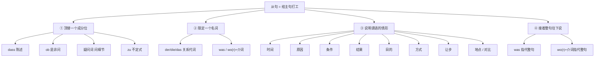
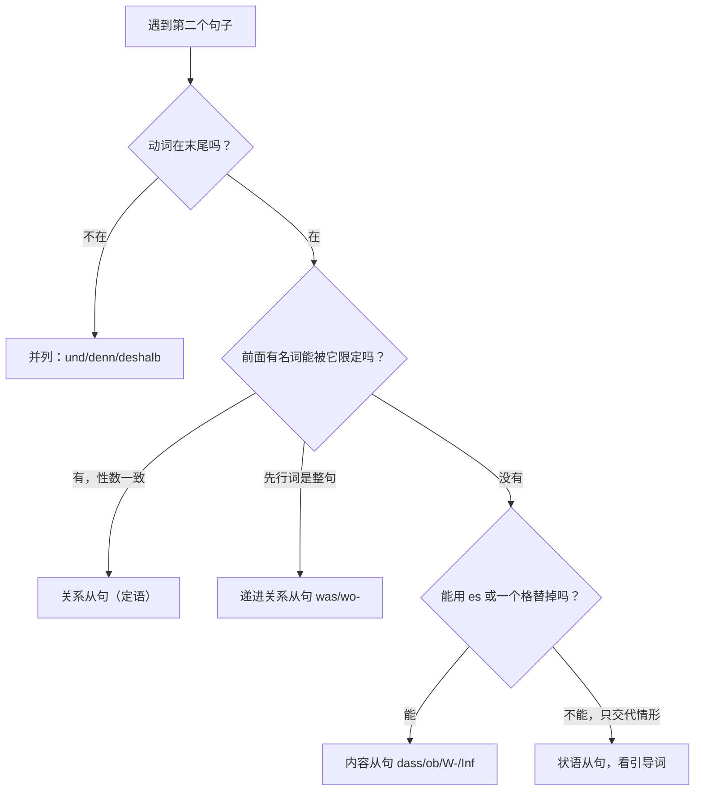

# 汇总对比从句

^pm2913

# 从句与主句的关系，以及各个场景该用什么从句语法

原句：
> 将整个德语体系里的所有从句进行归纳整理。比如，在主句后面的从句，它的核心作用是什么？而从句又分为好多类，比如定语关系从句、递进状语从句等等，它们的目的是什么？
>
> 我们需要将这些抽象的概念进一步提炼得清晰易懂，或结合场景来理解通透，以便在各种场景中更方便地识别出该使用哪种语法：
> 1. 如果要补充主句的某个成分，可以考虑使用关系从句。
> 2. 如果要对有关联关系的两个句子进行连接，就使用连接词或副词将两个句子简单联合在一起。
> 3. 如果想要对主句进行解释、递进等，就使用状语从句来进行补充。
>
> 恐怕使用多层级的思维导图来整理这些内容最适合了。

问题：把德语整个从句体系归纳成一张多层级思维导图：主句后面的从句核心作用是什么？各从句类型分别有什么目的？并提炼出“在什么场景该用哪种从句”的识别方法。

② 答案

结论是：从句不必靠“背名字”去记，只要回答一个问题——它在给主句里的**谁**服务？答案只有四种：顶替一个句子成分，贴在一个名词上，说明谓语动作的情形，指着整句话往下接着说。这里先纠正你写的两处：第一，**递进从句**不是状语从句，它是**关系从句**的特殊用法（**weiterführender Relativsatz**），标志是用 **was / wo(r)-+介词** 指代前面**整个主句**，意思等于 **und das …**；第二，“补充主句的某个成分”靠的是**内容从句**（**dass / ob** / 疑问词从句，也叫成分从句 **Satzgliedsatz**），而关系从句补的是**名词**，不是成分。

识别顺序是“先看动词，再看前面有没有名词，最后看能不能换成 **es**”：动词被赶到末尾才说明是从属从句，动词留在第二位就只是并列——**und / aber / oder / denn** 不占位置，**deshalb / trotzdem / dann** 占第一位，两者都不改变动词位置，所以并列只是把两句话“排排坐”，而从属是把一句话“降级”成主句里的零件。确定是从句后，看它前面有没有一个能被它限定的名词：有，就是关系从句（性和数跟着那个名词走，格由它在从句里的角色决定，而且整块不能搬到句首）；前面没名词可修饰，就试着用一个格或 **es / das** 替代整个从句——能替的就是内容从句（**dass** 陈述、**ob** 是非问、疑问词问细节、**zu** 不定式），替不了、只是在交代“什么时候、为什么、什么条件下、为了什么”的，就是状语从句，语义由引导词一眼定下来。

图解：德语从句的四条服务线（多层级脑图）

图解：三步判定该用哪种从句

四大类对照表：

| 从句类型 | 它替谁或修饰谁 | 典型引导词 | 一键识别 | 例句 |
|---|---|---|---|---|
| 内容从句 **Satzgliedsatz** | 主句的一个成分位（主语、宾语、介词宾语） | **dass, ob**，疑问词 | 整句能用 **es / das / 这件事** 替代 | Ich weiß **es**: **dass** er kommt. |
| 关系从句 **Relativsatz** | 主句里的一个名词 | **der/die/das, welcher, was, wo(r)-** | 前面有名词、性数跟它一致；整块不能搬到句首 | Der Mann, **der** dort steht, ist mein Chef. |
| 状语从句 **Adverbialsatz** | 主句谓语（动作发生的情形） | **als, weil, obwohl, damit, indem …** | 整块能搬到主句前面，主句照样完整 | **Weil** es regnet, bleiben wir hier. |
| 递进关系从句 **weiterführender Relativsatz** | 整个主句（= **und das …**） | **was, wo(r)-+介词, wobei, wodurch** | 前面没有名词可修饰；只能后置；译成“这让、这使得” | Er kam zu spät, **was** mich ärgerte. |

状语从句九类（按“你在问什么”记，比背名字快）：

| 语义 | 你在问什么 | 引导词 | 例句 |
|---|---|---|---|
| 时间 **Temporal** | 什么时候 / 多久？ | **als, wenn, nachdem, bevor, während, seitdem, bis, sobald, solange** | **Nachdem** er gegessen hatte, ging er los. |
| 原因 **Kausal** | 为什么？ | **weil, da** | **Weil** er krank war, blieb er im Bett. |
| 条件 **Konditional** | 在什么前提下？ | **wenn, falls, sofern** | **Falls** du Zeit hast, komm vorbei. |
| 结果 **Konsekutiv** | 造成了什么后果？ | **so dass / sodass**, **so …, dass** | Er sprach leise, **so dass** niemand ihn hörte. |
| 目的 **Final** | 为了什么？ | **damit**, **um … zu** + 不定式 | Ich lerne Deutsch, **damit** ich in Berlin arbeiten kann. |
| 方式 **Modal / Instrumental** | 怎么做到的？ | **indem, dadurch dass**；（比较：**wie, als**） | Er spart Geld, **indem** er mit dem Rad fährt. |
| 让步 **Konzessiv** | 尽管有什么阻碍？ | **obwohl, obgleich, auch wenn, selbst wenn** | **Obwohl** er müde war, arbeitete er weiter. |
| 地点 **Lokal** | 在哪里 / 去哪里？ | **wo, wohin, woher** | Er blieb, **wo** er war. |
| 对比 **Adversativ** | 相反的情况呢？ | **wohingegen, während** | Er ist ruhig, **während** sein Bruder laut ist. |

并列与从属的分工（你提的第 2 点）：

| 连接方式 | 连接词占第几位 | 后面动词位置 | 例句 |
|---|---|---|---|
| 并列连词 **und, aber, oder, denn** | 不占位（位置 0） | 仍是第二位 | Er kommt, **denn** er hat Zeit. |
| 连接副词 **deshalb, trotzdem, dann, danach** | 占第一位 | 第二位（紧跟在副词后） | Er war krank, **deshalb** blieb er zu Hause. |
| 从属连词 **weil, dass, ob, obwohl …** | 占第一位 | 被赶到末尾 | Er blieb zu Hause, **weil** er krank **war**. |

内容从句四兄弟怎么挑：

| 主句想装进去的内容 | 用哪个 | 例句 |
|---|---|---|
| 一件事实 / 陈述 | **dass** | Ich glaube, **dass** er recht hat. |
| 一个是非问题 | **ob** | Ich weiß nicht, **ob** er kommt. |
| 一个具体疑问（谁、何时、为什么） | 疑问词 | Ich weiß nicht, **wann** er kommt. |
| 一个动作，且和主句主语相同 | **zu** + 不定式 | Ich hoffe, **pünktlich anzukommen**. |

（如果内容从句当介词宾语，主句要先用 **da(r)-** 占位：Ich freue mich **darauf**, dass du kommst.）

同类例子（一个场景，四种转换方式）：Der Schüler kam zu spät.（学生迟到了。）补成分 → Der Lehrer wusste, **dass** er zu spät kam；限定名词 → Der Schüler, **der** zu spät kam, entschuldigte sich；说明情形 → **Weil** der Bus ausfiel, kam er zu spät；接着说整句 → Er kam zu spät, **was** den Lehrer ärgerte。同一件事，变的只是“这个从句给谁打工”，从句类型就跟着变。

# 从句动词位置总结

^mx9lb7

### 一、 核心辨析：连词的“占位”与动词位置

很多德语学习者会把不同类型的连词搞混。在德语中，连词按“占位”和“动词位置”严格分为三派：

|**连词类型**|**包含的词汇 (代表)**|**动词位置规则**|**例句结构**|
|---|---|---|---|
|**0 位连词 (不占位)**      _(连接两个主句)_|**ADUSO:**      aber, denn, und, sondern, oder|连词算第 0 位，**动词依然在第 2 位**。|Ich bin krank, **denn** ich **habe** Fieber.|
|**1 位连词 (副词占位)**      _(连接两个主句)_|deshalb, trotzdem, dann, danach|连词算第 1 位，**动词紧跟在第 2 位**。|Ich bin krank, **deshalb** **habe** ich Fieber.|
|**尾置连词 (从句)**      _(连接主从句)_|weil, dass, wenn, obwohl, als 等|连词引导从句，**变位动词踢到句末**。|Ich bleibe hier, **weil** ich Fieber **habe**.|
- _(从+主)_ **Dass** er heute **kommt**, **weiß** ich. (他今天来这件事，我知道。)

> **💡 结论：** 只有**第三种（尾置连词）**才是我们今天讨论的**真正的“从句连接词”**。它们不讨论占第几位，而是直接启动“从句黄金法则”，把动词踢到最后。前面两个是主句相连接，后面一个是正常的重聚顺序，接着往下看继续讲解正常的主从顺序以及从句在前主句在后

### 二、 主句与从句的两种语序公式及例句

根据你的要求，我在例句中特别加入了**情态动词**、**完成时态**以及**可分动词**，来验证你的“黄金法则”。

#### 公式 A：主句在前，从句在后

- **结构：** 主语 + 变位动词 1 + 其他, **[从句引导词 + 其他 + 变位动词 2]**.
- **特征：** 逗号前是正常语序，逗号后开启从句，变位动词在最后。

#### 公式 B：从句在前，主句在后 (动词, 逗号, 动词)

- **结构：** **[从句引导词 + 其他 + 变位动词 1]**, 变位动词 2 + 主语 + 其他.
- **特征：** 整个从句被视为第一位（Position 1），所以逗号一结束，主句的变位动词必须立刻出现占领第二位（Position 2）。

### 三、 常见从句分类与实战例句对比

#### 1. dass (宾语从句 / 主语从句)

_毫无实意，仅仅起连接作用，相当于英语的 that。_

- **普通时态：**
    - _(主+从)_ Ich weiß, **dass** er heute **kommt**. (我知道他今天来。)
    - _(从+主)_ **Dass** er heute **kommt**, **weiß** ich. (他今天来这件事，我知道。)
- **验证完成时 (助动词在最最后面)：**
    - _(主+从)_ Er sagt, **dass** er den Apfel **gegessen hat**. (他说他已经把苹果吃了。)
    - _(从+主)_ **Dass** er den Apfel **gegessen hat**, **glaube** ich nicht. (我不相信他已经把苹果吃了。)

#### 2. weil (原因从句)

_表示“因为”，回答 Warum? 的提问。_

- **验证情态动词 (情态动词变位，放最最后面)：**
    - _(主+从)_ Wir bleiben zu Hause, **weil** wir noch Hausaufgaben **machen müssen**. (我们待在家里，因为我们还得做作业。)
    - _(从+主)_ **Weil** wir noch Hausaufgaben **machen müssen**, **bleiben** wir zu Hause. (因为我们还得做作业，所以我们待在家里。)

#### 3. wenn (条件 / 时间从句)

_表示“如果（条件）”或“当……的时候（现在/未来的重复性时间）”。_

- **验证可分动词 (在从句结尾合体)：**
    - _(主+从)_ Ich bin glücklich, **wenn** am Wochenende die Sonne **aufgeht**. (如果周末出太阳，我就很高兴。_aufgehen 合体_)
    - _(从+主)_ **Wenn** am Wochenende die Sonne **aufgeht**, **mache** ich einen Ausflug. (如果周末出太阳，我就去郊游。)
- **情态动词双动词结构：**
    - _(主+从)_ Du bekommst eine gute Note, **wenn** du mehr **lernen möchtest**.
    - _(从+主)_ **Wenn** du mehr **lernen möchtest**, **bekommst** du eine gute Note.

#### 4. obwohl (让步从句)

_表示“虽然 / 尽管”，前后文通常是相反或让人意外的逻辑。_

- **完成时态：**
    - _(主+从)_ Er ist zur Arbeit gegangen, **obwohl** er stark **erkältet war**. (他去上班了，尽管他得了重感冒。)
    - _(从+主)_ **Obwohl** er stark **erkältet war**, **ist** er zur Arbeit gegangen. (动词 war 与 ist 隔着逗号相望)

#### 5. 疑问词引导的间接疑问句 (w-Fragen & ob)

_用 wo, wann, was 或 ob (是否) 引导的从句，套用相同的尾置规则。_

- _(主+从)_ Ich möchte wissen, **wann** der Zug nach Berlin **abfährt**. (我想知道去柏林的火车几点开。)
- _(从+主)_ **Ob** sie heute Zeit **hat**, **weiß** ich leider nicht. (她今天是否有时间，我遗憾地表示不知道。)

### 📊 德语核心从句（Nebensätze）全景对比表

| **从句类型 & 逻辑**                                    | **常见连词**                                  | **核心功能 (回答什么问题)**                                   | **结构特殊性 & 易混淆对比 (⚠️B 1/B 2 必考点)**                                                                                                                                                          | **记忆口诀 & 老师的避坑提示**                                                                | **对比例句 (注意动词位置和逻辑)**                                                                                                                          |
| ------------------------------------------------ | ----------------------------------------- | --------------------------------------------------- | ------------------------------------------------------------------------------------------------------------------------------------------------------------------------------------------ | --------------------------------------------------------------------------------- | --------------------------------------------------------------------------------------------------------------------------------------------- |
| 1. Kausalsätze      (原因从句)           | **weil**, **da**                          | Warum?      (为什么？)                      | **da vs. weil:**      `da` 通常放在句首，表示大家都知道的既定原因；`weil` 通常在句中，回答未知的原因。      ⚠️ **对比主句连词 denn:** denn 不占位，动词在第二位；weil/da 动词在最后。                                       | **“已知用 da，未知用 weil”**      不要用 denn 来引导从句语序！                          | **Weil** er krank **ist**, bleibt er zu Hause.      Er bleibt zu Hause, **denn** er **ist** krank. (主句语序)                         |
| 2. Temporalsätze      (时间从句)         | **als**, **wenn**, **nachdem**, **bevor** | Wann?      (什么时候？)                      | **als vs. wenn (极易错!):**      `als` **仅用于**过去发生且**只发生一次**的事；`wenn` 用于现在/将来，或过去**反复发生**的事。      **nachdem (在...之后):** 从句时态必须比主句早一个时态 (主句现在时->从句完成时；主句过去时->从句过去完成时)。 | **“过去一次才用 als，反复出现全用 wenn”**      “nachdem 必伴随时态倒退”                   | **Als** ich ein Kind **war**, spielte ich oft draußen. (过去一次)      **Wenn** es **regnet**, bleibe ich hier. (条件/现在)               |
| 3. Konditionalsätze      (条件从句)      | **wenn**, **falls**                       | Unter welcher Bedingung?      (在什么条件下？) | **wenn vs. falls:**      `falls` 表示发生的概率更低（万一...）。      ⚠️ **无连词条件句:** 可以省略 wenn，将变位动词提到第 1 位（类似问句语序），主句用 so/dann 衔接。                                              | **“省去 wenn，动词提第一”**      （高级表达，B 2 作文加分项）                             | **Wenn** du Zeit **hast**, hilf mir bitte.      **Hast** du Zeit, (so) hilf mir bitte. (省略 wenn)                                  |
| 4. Konzessivsätze      (让步从句)        | **obwohl**, **obgleich**                  | -(意料之外的转折)      (虽然...但是...)            | **obwohl vs. trotzdem:**      虽然中文都是“虽然...但是...”，但德语里只能用一个！      `obwohl` 是从句连词 (动词尾置)；      `trotzdem` 是副词连词 (占第 1 位，主谓倒装)。                           | **“obwohl 和 trotzdem 势不两立”**      写了 obwohl，主句就绝对不能加 aber 或 trotzdem！ | **Obwohl** es **regnet**, gehe ich spazieren.      Es regnet, **trotzdem** **gehe** ich spazieren.                                |
| 5. Finalsätze      (目的从句)            | **damit**, **um ... zu**                  | Wozu? / Zu welchem Zweck?      (为了什么？)  | **damit vs. um...zu:**      如果主从句**主语相同**，首选 `um...zu` (更简洁，且不需要写主语，直接加动词原形)；      如果主从句**主语不同**，**只能**用 `damit`。                                                  | **“同主语用 um zu，异主语必 damit”**                                                       | Ich lerne, **um** nach Deutschland **zu** **fliegen**. (同主语 ich)      Ich arbeite viel, **damit** _mein Sohn_ gut **lebt**. (异主语) |
| 6. Indirekte Fragesätze      (间接疑问句) | **ob**, **W-Wörter** (wann, wo, wie)      | -(礼貌提问或转述问题)                                        | **ob vs. wenn (中国学生重灾区!):**      中文的“如果”和“是否”有时很模糊，但德语壁垒分明！      疑问句的“是否” (Yes/No Question) 只能用 `ob`；条件句的“如果/当”只能用 `wenn`。                                         | **“Yes/No 选 ob，条件/时间选 wenn”**                                                     | Ich weiß nicht, **ob** er heute **kommt**. (我不知道他【是否】来)      Ich freue mich, **wenn** er **kommt**. (【如果】他来我很开心)                  |
| 7. Relativsätze      (关系从句)          | **der, die, das**, welcher                | Welcher/Welche/Welches?      (哪一个？作定语)  | ⚠️ **关系代词的双重身份：**      它的**性(Genus)**和**数(Numerus)由它指代的主句名词决定；      但它的格(Kasus)**完全由它在从句中充当的成分决定（比如在从句作主语就是一格，作宾语就是四格，跟介词就看介词要求）。                                  | **“性数看祖宗（主句），格看自己家（从句）”**                                                         | Das ist _der Mann_ (阳性单数), **den** ich gestern **gesehen habe**. (den 在从句中是 sehen 的第四格宾语)                                                     |
| 8. Dass-Sätze      (宾语/主语从句)         | **dass**                                  | Was?      (代替一个名词成分)                    | 结构最简单，直接套用从句语序。通常跟在表示“思考、感觉、说、知道”的动词后面 (denken, wissen, sagen, fühlen)。                                                                                                                    | **“dass 只是一个无情的包装盒”**      用来把一整个句子打包成一个名词。                           | Ich weiß, **dass** du sehr fleißig **bist**.                                                                                                  |

---

### 🎓 老师的进阶复习建议 (B 1 -> B 2)：

要快速掌握这些从句，不要去死记硬背表格，而是要**成对地练习和造句**。

1. **刻意练习“同义转换”：** 这是 B 2 考试的必考题型。
    
    - _Kausal（原因）:_ 试着把含有 `denn` (0 占位) 的句子，改写成 `weil` (从句尾置)，再改写成 `deshalb` (副词占 1 位)。
    - _Konzessiv（让步）:_ 试着把含有 `obwohl` 的句子改写成 `trotzdem`。
        
2. **死磕 `als` vs `wenn` 以及 `ob` vs `wenn`：** 这两个错误在 B 1 阶段如果不纠正，到了 B 2 考官会觉得你的基础很不扎实。每次写下 `wenn` 之前，停顿一秒问自己：“这是过去发生了一次的事吗？”、“这能翻译成‘是否’吗？”

你可以试着用上面的表格里的知识，针对 `ob` 和 `wenn`，或者 `damit` 和 `um...zu` 分别给我造一个句子吗？我来帮你批改！
