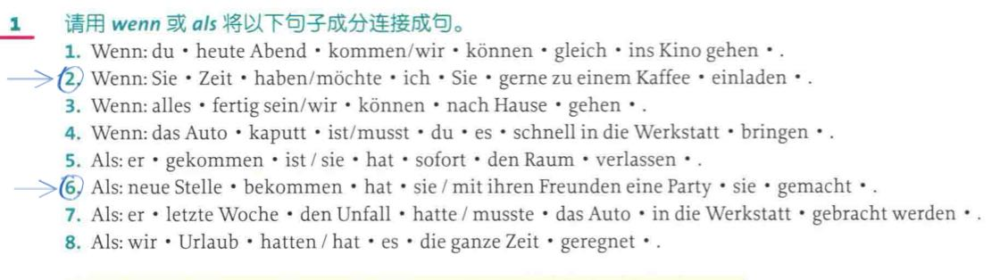

# 德语从句 · 出题范围规范（Scope Spec v 2）

> 本文件是给"出题方 AI"的输入规范，不是给学生看的教材。
> 读法：先看 §1 的三条硬规则 → 用 §2 查目标等级允许的结构 → 用 §3/§4 取引导词 → 用 §5 排除越界项 → 用 §7 取答案。
>
> **v 2 变更**：每张表新增 `答案页` 列（书中《参考答案》对应起始页），表后附答案深链；新增 §9 题型对照。

---

## 0. 元信息

| 项 | 值 |
|---|---|
| 来源 A | 《德语语法 活学活用 A 1-B 1》，Friederike Jin / Ute Voß，林琳译，商务印书馆 2017；Zotero 附件 key `XSKKCL2M`，265 页 |
| 来源 B | 《德语语法活学活用 B 2-C 1》，同作者，2021；Zotero 附件 key `XQZENR69`，320 页 |
| 页偏移 | 两册均为 **PDF 页 = 印刷页 + 8**。本文件页码一律用 **PDF 页**（可直接用于 `?page=`） |
| 答案区范围 | A 1-B 1 册 **p 226–p 262**；B 2-C 1 册 **p 273–p 317** |
| 等级标注来源 | 书中每单元页首有等级徽标（A 1/A 2/B 1 或 B 2/C 1）。`书标` = OCR 可辨识的徽标，`推定` = 徽标未被识别、按位置与结构复杂度推定 |
| 重要提醒 | 徽标是图形化文本，OCR 只能稳定识别其中一部分。**"未捕获"不等于"未标注"**，不等于"不考" |
| 答案页精度 | 表内 `答案页` 为该书《参考答案》中该单元答案的**起始页**；答案常跨 1–2 页，翻到后向下读即可 |

---

## 1. 给 AI 的三条硬规则

1. **等级以分册为硬上界。** A 1-B 1 册内的结构，最高只出到 **B 1**；B 2-C 1 册内的结构，默认 **B 2**，只有书中逐行标了 `C1` 的条目才能出 C 1 题。
2. **不考"书里没有"的从句。** 本套书对从句的覆盖面有明确缺口（见 §5），缺口之外的结构一律视为越界，即使它在通用语法体系里很常见。
3. **引导词只从 §4 取。** §4 每行都标了等级和出处；没出现在 §4 的连词，不得出现在题干或选项中。

---

## 2. 等级框架与分册边界

### 2.1 一句话边界（最重要的结论）

> **A 1-B 1 册只讲 5 类从句**：dass 从句、间接疑问句、时间状语从句、目的从句、关系从句（外加 je…desto 比较句、um…zu 等不定式结构）。
>
> **原因（da/zumal）、让步、结果、条件、方式、转折这 6 类，A 1-B 1 册完全不讲，全部首次出现在 B 2-C 1 册。**

这条边界可以直接当作"出题越界检测"的判据。

### 2.2 分册 → 等级映射

| 分册 | 册内等级 | 出题上限 | 说明 |
|---|---|---|---|
| A 1-B 1 | A 1 / A 2 / B 1 | **B 1** | 前段为 A 1-A 2 基础句法，从句集中在后段并升到 B 1 |
| B 2-C 1 | B 2 / C 1 | **C 1** | 主体为 B 2；单元内逐行标 `C1` 的条目方可出 C 1 |

### 2.3 各单元登记表（含答案页）

| 出处 | 单元 | 等级 | 依据 | 讲页 | 答案页 |
|---|---|---|---|---|---|
| A 1 B 1 | 40 并列连词 | A 2 推定 | 主句连接，A 1-A 2 过渡 | 106 | 241 |
| A 1 B 1 | 41 副词连接主句 | A 2 推定 | 同上 | 108 | 242 |
| A 1 B 1 | 42 从句（weil/dass/wenn） | **A 2** 推定 | 从句入门单元 | 110 | 242 |
| A 1 B 1 | 会话练习 7 从句 | A 2 推定 | 配套口语 | 116 | 242 |
| A 1 B 1 | 54 代副词（wo(r)+ 引导从句） | A 2 推定 | 代副词作从句引导成分 | 136 | 248 |
| A 1 B 1 | 67 间接疑问句 | **B 1 书标** | 页面可辨识 B 1 | 166 | 255 |
| A 1 B 1 | 68 带 zu 不定式 | A 2-B 1 推定 | 与 67 同段 | 168 | 256 |
| A 1 B 1 | 69 不带 zu 不定式 | **B 1 书标** | 页面可辨识 B 1 | 170 | 257 |
| A 1 B 1 | 70 关系从句 1 | B 1 推定 | 关系代词主/宾格 | 172 | 257 |
| A 1 B 1 | 71 关系从句 2 | B 1 推定 | 关系代词第三格、介词+关系代词 | 174 | 258 |
| A 1 B 1 | 72 wenn/als 时间从句 | B 1 推定 | | 176 | 258 |
| A 1 B 1 | 73 时间状语从句 | **B 1 书标** | 页面可辨识 B 1 | 178 | 259 |
| A 1 B 1 | 74 目的从句 | B 1 推定 | | 180 | 260 |
| A 1 B 1 | 75 成对连词 | B 1 推定 | | 182 | 260 |
| A 1 B 1 | 76 比较从句 je…desto | **B 1 书标** | 页面可辨识 B 1 | 184 | 261 |
| A 1 B 1 | 会话练习 10 关系从句 | B 1 推定 | | 186 | 257 |
| B 2 C 1 | 2 复杂句动词位置 | **B 2 书标** | | 22 | 274 |
| B 2 C 1 | 12 非现实条件 | B 2 推定 | | 44 | 279 |
| B 2 C 1 | 13 非现实比较（als ob） | B 2 推定 | | 46 | 279 |
| B 2 C 1 | 59 间接引语与第一虚拟式 | **B 2 书标** | | 166 | 301 |
| B 2 C 1 | 60 第一虚拟式过去时 | B 2 推定 | | 168 | 301 |
| B 2 C 1 | 61 祈使/传闻/自述的转述 | B 2 推定 | | 170 | 302 |
| B 2 C 1 | 62 时间状语从句 | B 2 推定 | 本单元全 B 2 | 172 | 302 |
| B 2 C 1 | 63 原因 + 让步 | **B 2 + C 1 书标** | `zumal`、`wobei` 为 C 1 增补项 | 174 | 303 |
| B 2 C 1 | 64 结果状语从句 | **B 2 + C 1 书标** | `weshalb/weswegen`、`zu…als dass` 标 C 1 | 176 | 303 |
| B 2 C 1 | 65 条件 + 转折 | **B 2 + C 1 书标** | `sofern`、`gesetzt den Fall`、`vorausgesetzt` 为 C 1 文雅书面 | 178 | 305 |
| B 2 C 1 | 66 方式状语从句 | B 2 推定 | `wodurch` 标 C 1 | 180 | 306 |
| B 2 C 1 | 67 带 zu / 不带 zu 不定式 | **B 2 + C 1 书标** | C 1：`ohne…zu` 的完成式 | 182 | 307 |
| B 2 C 1 | 68 dass 从句与带 zu 不定式 | **B 2 + C 1 书标** | | 184 | 307 |
| B 2 C 1 | 69 表目的/表方式的不定式与从句 | B 2 推定 | | 186 | 307 |
| B 2 C 1 | 70 关系代词 1/3/4 格 | **B 2 书标** | | 188 | 308 |
| B 2 C 1 | 71 关系代词第二格 | **B 2 + C 1 书标** | C 1：`deren` 后无名词用 `derer` | 190 | 308 |
| B 2 C 1 | 72 als / 疑问代词作关系代词 | B 2 推定 | `wo/wohin/woher/was/wer…der` | 192 | 308 |
| B 2 C 1 | 会话练习 8 关系从句 | **B 2 + C 1 书标** | | 194 | 309 |
| B 2 C 1 | 73 成对连词 | B 2 推定 | 比 A 1 B 1 p 182 多 4 组 | 196 | 309 |
| B 2 C 1 | 84 介词-副词-连词 1（时间） | B 2 推定 | 三层同义表达 | 228 | 315 |
| B 2 C 1 | 85 介词-副词-连词 2（因果/让步/结果/转折） | B 2 推定 | | 230 | 315 |
| B 2 C 1 | 86 介词-副词-连词 3（条件/目的/方式/替代/比较） | B 2 推定 | | 232 | 316 |

**答案链接位置**：按单元逐行列在 **§7.1 / §7.2 的表格正下方**，与讲解表同序。

---

## 3. 从句类型总表

`等级区间` 是该结构在本套书中出现的跨度；出题时取 **≤ 目标等级** 的那一档。`答案页` 为该类型答案的落点。

| ID | 中文名 | 德语名 | 等级区间 | 首次出现 | 出处 | 答案页 | 核心考点 |
|---|---|---|---|---|---|---|---|
| C 01 | dass 宾语/主语从句 | dass-Satz | A 2–B 1 | A 2 | A 1 B 1 p 110；B 2 C 1 p 184 | 242 / 307 | 变位动词居末；从句可占第一位 |
| C 02 | 间接疑问句 | indirekte Frage | B 1 | B 1 | A 1 B 1 p 166 | 255 | `ob` vs 疑问词；疑问词后动词居末 |
| C 03 | 原因状语从句 | Kausalsatz | B 2（`weil` 例外：A 2） | A 2（仅 weil） | A 1 B 1 p 110；B 2 C 1 p 174 | 242 / 303 | `weil` / `da` 位置差异；`da` 不能答 Warum 问句 |
| C 04 | 让步状语从句 | Konzessivsatz | B 2–C 1 | B 2 | B 2 C 1 p 174 | 303 | `obwohl` vs `auch wenn` vs `wobei` |
| C 05 | 结果状语从句 | Konsekutivsatz | B 2–C 1 | B 2 | B 2 C 1 p 176 | 303 | `so…dass` 搭配；**不能居句首** |
| C 06 | 条件状语从句 | Konditionalsatz | B 2–C 1 | B 2 | B 2 C 1 p 178 | 305 | `falls` / `wenn` 分工；无连词条件句动词居首 |
| C 07 | 转折/对比状语从句 | Adversativsatz | B 2 | B 2 | B 2 C 1 p 178、p 230 | 305 / 315 | `während` 双义（时间/转折） |
| C 08 | 方式状语从句 | Modalsatz | B 2–C 1 | B 2 | B 2 C 1 p 180 | 306 | `indem` / `dadurch dass` / `wodurch` 三分 |
| C 09 | 目的状语从句 | Finalsatz | B 1–B 2 | B 1 | A 1 B 1 p 180；B 2 C 1 p 186 | 260 / 307 | `damit` vs `um…zu` 的主语一致性 |
| C 10 | 时间状语从句 | Temporalsatz | B 1–B 2 | B 1 | A 1 B 1 p 176、p 178；B 2 C 1 p 172 | 258 / 302 | `als` / `wenn`；`nachdem` 时态差 |
| C 11 | 关系从句 | Relativsatz | B 1–C 1 | B 1 | A 1 B 1 p 172、p 174；B 2 C 1 p 188-192 | 257 / 308 | 性数看先行词、格看从句成分 |
| C 12 | 比较从句 je…desto | Vergleichssatz | B 1–B 2 | B 1 | A 1 B 1 p 184；B 2 C 1 p 196 | 261 / 309 | 前后都必须是比较级；从句居首 |
| C 13 | 非现实比较（als ob） | irrealer Vergleichssatz | B 2 | B 2 | B 2 C 1 p 46 | 279 | `als ob` + 第二虚拟式；`als` 后语序 |
| C 14 | 非现实条件 | irreale Bedingung | B 2 | B 2 | B 2 C 1 p 44 | 279 | 第二虚拟式；`wenn` 可省略→动词居首 |
| C 15 | 间接引语 | indirekte Rede | B 2 | B 2 | B 2 C 1 p 166-170 | 301 | 第一虚拟式；`dass` 可省 |
| C 16 | 递进/承接从句 | weiterführender Nebensatz | B 2–C 1 | B 2 | B 2 C 1 p 176、p 180、p 192 | 303 / 306 / 308 | `was` / `wo(r)+` / `wer…der`；**不能前置于主句** |

### 3.1 不定式结构（书内与从句并列，但不是从句）

| ID | 结构 | 等级 | 出处 | 答案页 | 注意 |
|---|---|---|---|---|---|
| I 01 | `um … zu` | B 1 | A 1 B 1 p 180 | 260 | 主从句主语必须相同 |
| I 02 | `(an)statt … zu` / `anstatt dass` | B 2 | B 2 C 1 p 186、p 232 | 307 / 316 | 替代未发生的事 |
| I 03 | `ohne … zu` / `ohne dass` | B 2（完成式 C 1） | A 1 B 1 p 170；B 2 C 1 p 182、p 232 | 257 / 307 | |
| I 04 | `dass` 从句 ↔ 带 zu 不定式互换 | B 2 | B 2 C 1 p 184 | 307 | 主语一致→不定式；不一致→dass |

---

## 4. 引导词总表（唯一取词来源）

### 4.1 从属连词（引导真正的从句，动词居末）

| 引导词 | 功能 | 等级 | 出处 |
|---|---|---|---|
| `dass` | 宾语/主语 | A 2 | A 1 B 1 p 110 |
| `ob` | 间接疑问（是非问） | B 1 | A 1 B 1 p 166 |
| `weil` | 原因 | A 2 | A 1 B 1 p 110 |
| `da` | 原因（居句首） | B 2 | B 2 C 1 p 174 |
| `zumal` | 补充理由 | **C 1** | B 2 C 1 p 174 |
| `obwohl` | 让步 | B 2 | B 2 C 1 p 174 |
| `auch wenn` | 让步 | B 2 | B 2 C 1 p 174 |
| `wobei` | 让步/补充 | **C 1** | B 2 C 1 p 174 |
| `sodass` | 结果 | B 2 | B 2 C 1 p 176 |
| `so … dass` | 结果（强调形容词） | B 2 | B 2 C 1 p 176 |
| `dermaßen … dass` | 结果 | B 2 | B 2 C 1 p 176 |
| `derart … dass` | 结果 | B 2 | B 2 C 1 p 176 |
| `derartig … dass` | 结果 | B 2 | B 2 C 1 p 176 |
| `weshalb` | 结果（承接） | **C 1** | B 2 C 1 p 176 |
| `weswegen` | 结果（承接） | **C 1** | B 2 C 1 p 176 |
| `zu … als dass` | 结果（不可能实现） | **C 1** | B 2 C 1 p 176 |
| `wenn` | 条件 / 时间 | A 2（时间）/ B 2（条件） | A 1 B 1 p 110、p 176；B 2 C 1 p 178 |
| `falls` | 条件 | B 2 | B 2 C 1 p 178 |
| `nur wenn` | 条件（唯一） | B 2 | B 2 C 1 p 178 |
| `sogar wenn` / `selbst wenn` | 条件（强调） | B 2 | B 2 C 1 p 178 |
| `außer wenn` | 条件（例外） | B 2 | B 2 C 1 p 178 |
| `sofern` | 条件（书面） | **C 1** | B 2 C 1 p 178 |
| `gesetzt den Fall, dass` | 条件（书面） | **C 1** | B 2 C 1 p 178 |
| `vorausgesetzt, dass` | 条件（书面） | **C 1** | B 2 C 1 p 178 |
| `während` | 时间 / 转折 | B 1 / B 2 | A 1 B 1 p 178；B 2 C 1 p 178 |
| `wohingegen` / `wogegen` | 转折 | B 2 | B 2 C 1 p 178 |
| `indem` | 方式 | B 2 | B 2 C 1 p 180 |
| `dadurch dass` | 方式 | B 2 | B 2 C 1 p 180 |
| `wodurch` | 方式（承接） | **C 1** | B 2 C 1 p 180 |
| `nachdem` | 时间（先后，必有时态差） | B 1 | A 1 B 1 p 178 |
| `bevor` / `ehe` | 时间（先后） | B 1 | A 1 B 1 p 178；B 2 C 1 p 172 |
| `bis` | 时间（终点） | B 2 | B 2 C 1 p 172 |
| `seit` / `seitdem` | 时间（持续至今） | B 1 | A 1 B 1 p 178 |
| `solange` | 时间（同时持续） | B 2 | B 2 C 1 p 172 |
| `sobald` / `sowie` | 时间（一开始就） | B 2 | B 2 C 1 p 172 |
| `sooft` | 时间（每次） | B 2 | B 2 C 1 p 172 |
| `als` | 时间（过去单次） | B 1 | A 1 B 1 p 176 |
| `damit` | 目的 | B 1 | A 1 B 1 p 180 |
| `als`（+ 第二虚拟式） | 非现实比较 | B 2 | B 2 C 1 p 46 |

### 4.2 关系代词 / 关系词

| 引导词 | 等级 | 出处 | 限制 |
|---|---|---|---|
| `der / das / die / die`（G/A/D） | B 1 | A 1 B 1 p 172、p 174 | 与定冠词同形；D 复数例外 `denen` |
| 介词 + `dem / der / denen / den` | B 1 | A 1 B 1 p 174 | 格由介词决定 |
| `dessen / deren`（第二格） | B 2 | B 2 C 1 p 190 | 后接名词，名词格由介词/动词定 |
| `derer`（第二格，后无名词） | **C 1** | B 2 C 1 p 190 | |
| `welcher / welche` | B 2（书内"不推荐"） | B 2 C 1 p 188 | 仅书面，不作考点 |
| `wo / wohin / woher` | B 2 | B 2 C 1 p 192 | 只用于概括地点/地名 |
| `was` | B 2 | B 2 C 1 p 192 | 指 `etwas/alles/nichts/das` 或整句 |
| `wo(r)+介词`（`worüber`, `wovon` …） | B 2 | B 2 C 1 p 192；A 1 B 1 p 136 | 指物/整句 |
| `wer … der` / `wem … dessen` | B 2 | B 2 C 1 p 192 | 泛指人；`der/dessen` 可省 |

### 4.3 不定式连词

| 引导词 | 等级 | 出处 |
|---|---|---|
| `um … zu` | B 1 | A 1 B 1 p 180 |
| `(an)statt … zu` / `anstatt dass` | B 2 | B 2 C 1 p 186 |
| `ohne … zu` / `ohne dass` | B 2 | B 2 C 1 p 182 |

### 4.4 并列连词（不占位，连接主句，非从句）

| 引导词 | 功能 | 等级 | 出处 |
|---|---|---|---|
| `und` / `oder` / `aber` / `sondern` / `denn` | 并列/转折/原因 | A 2 | A 1 B 1 p 106 |

### 4.5 连接副词（占位，主句连接，非从句）

| 引导词 | 功能 | 等级 | 出处 |
|---|---|---|---|
| `deshalb / deswegen / darum / daher` | 结果 | A 2–B 2 | A 1 B 1 p 108；B 2 C 1 p 230 |
| `sonst / andernfalls` | 否则（= wenn nicht） | A 2–B 2 | A 1 B 1 p 108；B 2 C 1 p 232 |
| `dann / danach / nachher` | 时间（之后） | A 2 | A 1 B 1 p 108；B 2 C 1 p 228 |
| `vorher / davor / zuvor` | 时间（之前） | B 2 | B 2 C 1 p 228 |
| `währenddessen / gleichzeitig / dabei` | 时间（同时） | B 2 | B 2 C 1 p 228 |
| `trotzdem / dennoch / allerdings` | 让步 | B 2 | B 2 C 1 p 230 |
| `nämlich` | 原因（不可句首） | B 2 | B 2 C 1 p 230 |
| `infolgedessen / folglich / somit / demnach / also` | 结果 | B 2 | B 2 C 1 p 230 |
| `dagegen / demgegenüber` | 转折 | B 2 | B 2 C 1 p 230 |
| `dazu / dafür / dadurch / stattdessen` | 目的/方式/替代 | B 2 | B 2 C 1 p 232 |

### 4.6 成对连词

| 组合 | 意义 | 等级 | 出处 |
|---|---|---|---|
| `entweder … oder` | 二选一 | B 1 | A 1 B 1 p 182 |
| `weder … noch` | 两者皆无 | B 1 | A 1 B 1 p 182 |
| `sowohl … als auch` | 两者皆有 | B 1 | A 1 B 1 p 182 |
| `nicht nur … sondern auch` | 两者皆有（强调后者） | B 1 | A 1 B 1 p 182 |
| `teils … teils` | 部分…部分 | B 2 | B 2 C 1 p 196 |
| `zwar … aber` | 让步转折 | B 2 | B 2 C 1 p 196 |
| `einerseits … andererseits` | 两方面 | B 2 | B 2 C 1 p 196 |
| `je … desto / je … umso` | 比例比较 | B 1 | A 1 B 1 p 184；B 2 C 1 p 196 |

---

## 5. 出题禁区（越界清单）

### 5.1 书内完全没有的从句 → 任何等级都不得出

- 由 `obschon` / `obzwar` / `obgleich` 引导的让步从句（书中仅在 p 174 作为"不太常用"提及，**无例句、无练习**）
- `als wenn`（书中非现实比较只用 `als ob`）
- `so dass` 的分离写法之外的其他结果连词（如 `dermaßen dass` 不带 `…` 的变体）
- `indem` 以外的 C 2 级方式连词（如 `dadurch, dass` 之外的 `damit dass`）
- `nachdem` 以外的 C 2 时间连词（如 `sobald` 之外的 `sowie dass`）
- 关系代词 `wer` 的完整变格表（书中只给 `wer/wem/wen/wessen` 的功能对应，未系统列变形）

### 5.2 书内有、但**不得作为考点**的条目

| 条目 | 原因 |
|---|---|
| `obschon / obzwar / obgleich` | 仅一句"不太常用"的附注，无练习 |
| `welcher` 作关系代词 | 书中明确"听起来笨拙，不太推荐" |
| `sooft … auch` 的让步用法 | 书中只作时间连词讲 |
| `gesetzt den Fall, dass` / `vorausgesetzt, dass` / `sofern` | 标 C 1 且限"文雅书面语"，只可做**识别题**，不可做**产出题** |
| 无连词条件从句（`Komme ich nicht, …` / `Sollte ich …`） | 书中注明"口语中极少使用"，只可识别 |

### 5.3 A 1-B 1 出题时的高频误判

若出题目标是 A 1-B 1 范围，以下结构**不在该册内**，属于超标：

`obwohl` · `da`（原因）· `sodass` · `falls` · `indem` · `während`（转折义）· `seitdem` 之外的所有 B 2 时间连词（`bis / solange / sobald / sooft`）· `dessen / deren` · `wo / was` 作关系词 · `als ob`

---

## 6. 易错点清单（出题时的干扰项设计依据）

1. ** `als` vs `wenn` **：过去单次用 `als`；现在/将来/过去反复用 `wenn`。（答 p 258）
2. ** `nachdem` 必有时态差**：从句时态早于主句一级（现在完成 ↔ 现在；过去完成 ↔ 过去）。（答 p 259）
3. ** `bevor` 的事件编号**：`bevor` + 事件 2，主句 + 事件 1（与 `nachdem` 相反）。（答 p 259）
4. ** `damit` vs `um … zu` **：主语相同→两者皆可；主语不同→只能 `damit`。（答 p 260）
5. ** `um … zu` 内不含 `möchten/wollen`；`damit` 内不含 `sollen/wollen/möchten` **。（答 p 260）
6. ** `da` 不能回答以 `Warum` 开头的问句**，且通常居句首。（答 p 303）
7. ** `während` 双义**：时间（同时）与转折（对比），靠上下文判定。（答 p 305）
8. **结果从句不能居句首**：`sodass / so…dass / weshalb / wodurch` 均后置。（答 p 303）
9. ** `zu … als dass` 必带第二虚拟式**，表"不可能实现的好结果"。（答 p 303）
10. **关系代词**：性、数看先行词；格看从句中的句法角色或前置介词。（答 p 257/p 308）
11. ** `dessen/deren` 后的名词**：名词的格由左侧介词或从句动词决定，形容词词尾随名词。（答 p 308）
12. **无连词条件句**：从句必居主句之前，变位动词居句首。（答 p 305）
13. ** `indem` vs `dadurch dass` vs `wodurch` **：`wodurch` 只能承接前句，不能前置。（答 p 306）
14. ** `je … desto` 两端都必须是比较级**，且 `je` 从句动词居末、`desto` 主句动词居第二位。（答 p 261/p 309）
15. ** `ob` 只引导是非问**；特殊疑问句保留原疑问词（`wo / warum / auf welchem Gleis`）。（答 p 255）

---

## 7. 页码索引

### 7.1 讲解页 + 答案页（A 1-B 1 册 `XSKKCL2M`）

| 单元 | PDF 页 | 链接 | 答案页 |
|---|---|---|---|
| 40 并列连词 | 106 | [打开](zotero://open-pdf/library/items/XSKKCL2M?page=106) | 241 |
| 41 副词连接主句 | 108 | [打开](zotero://open-pdf/library/items/XSKKCL2M?page=108) | 242 |
| 42 从句 weil/dass/wenn | 110 | [打开](zotero://open-pdf/library/items/XSKKCL2M?page=110) | 242 |
| 54 代副词 | 136 | [打开](zotero://open-pdf/library/items/XSKKCL2M?page=136) | 248 |
| 67 间接疑问句 | 166 | [打开](zotero://open-pdf/library/items/XSKKCL2M?page=166) | 255 |
| 68 带 zu 不定式 | 168 | [打开](zotero://open-pdf/library/items/XSKKCL2M?page=168) | 256 |
| 69 不带 zu 不定式 | 170 | [打开](zotero://open-pdf/library/items/XSKKCL2M?page=170) | 257 |
| 70 关系从句 1 | 172 | [打开](zotero://open-pdf/library/items/XSKKCL2M?page=172) | 257 |
| 71 关系从句 2 | 174 | [打开](zotero://open-pdf/library/items/XSKKCL2M?page=174) | 258 |
| 72 wenn/als | 176 | [打开](zotero://open-pdf/library/items/XSKKCL2M?page=176) | 258 |
| 73 时间状语从句 | 178 | [打开](zotero://open-pdf/library/items/XSKKCL2M?page=178) | 259 |
| 74 目的从句 | 180 | [打开](zotero://open-pdf/library/items/XSKKCL2M?page=180) | 260 |
| 75 成对连词 | 182 | [打开](zotero://open-pdf/library/items/XSKKCL2M?page=182) | 260 |
| 76 比较从句 | 184 | [打开](zotero://open-pdf/library/items/XSKKCL2M?page=184) | 261 |

**答案（XSKKCL 2 M，与上表同序，每个单元一行）**

| 单元                   | 答案页 | 链接                                                      |
| -------------------- | --- | ------------------------------------------------------- |
| 40 并列连词              | 241 | [打开](zotero://open-pdf/library/items/XSKKCL2M?page=241) |
| 41 副词连接主句            | 242 | [打开](zotero://open-pdf/library/items/XSKKCL2M?page=242) |
| 42 从句 weil/dass/wenn | 242 | [打开](zotero://open-pdf/library/items/XSKKCL2M?page=242) |
| 54 代副词               | 248 | [打开](zotero://open-pdf/library/items/XSKKCL2M?page=248) |
| 67 间接疑问句             | 255 | [打开](zotero://open-pdf/library/items/XSKKCL2M?page=255) |
| 68 带 zu 不定式          | 256 | [打开](zotero://open-pdf/library/items/XSKKCL2M?page=256) |
| 69 不带 zu 不定式         | 257 | [打开](zotero://open-pdf/library/items/XSKKCL2M?page=257) |
| 70 关系从句 1            | 257 | [打开](zotero://open-pdf/library/items/XSKKCL2M?page=257) |
| 71 关系从句 2            | 258 | [打开](zotero://open-pdf/library/items/XSKKCL2M?page=258) |
| 72 wenn/als          | 258 | [打开](zotero://open-pdf/library/items/XSKKCL2M?page=258) |
| 73 时间状语从句            | 259 | [打开](zotero://open-pdf/library/items/XSKKCL2M?page=259) |
| 74 目的从句              | 260 | [打开](zotero://open-pdf/library/items/XSKKCL2M?page=260) |
| 75 成对连词              | 260 | [打开](zotero://open-pdf/library/items/XSKKCL2M?page=260) |
| 76 比较从句              | 261 | [打开](zotero://open-pdf/library/items/XSKKCL2M?page=261) |

### 7.2 讲解页 + 答案页（B 2-C 1 册 `XQZENR69`）

| 单元 | PDF 页 | 链接 | 答案页 |
|---|---|---|---|
| 2 复杂句动词位置 | 22 | [打开](zotero://open-pdf/library/items/XQZENR69?page=22) | 274 |
| 12 非现实条件 | 44 | [打开](zotero://open-pdf/library/items/XQZENR69?page=44) | 279 |
| 13 非现实比较 als ob | 46 | [打开](zotero://open-pdf/library/items/XQZENR69?page=46) | 279 |
| 59 间接引语 | 166 | [打开](zotero://open-pdf/library/items/XQZENR69?page=166) | 301 |
| 60 第一虚拟式过去时 | 168 | [打开](zotero://open-pdf/library/items/XQZENR69?page=168) | 301 |
| 61 转述 | 170 | [打开](zotero://open-pdf/library/items/XQZENR69?page=170) | 302 |
| 62 时间状语从句 | 172 | [打开](zotero://open-pdf/library/items/XQZENR69?page=172) | 302 |
| 63 原因 + 让步 | 174 | [打开](zotero://open-pdf/library/items/XQZENR69?page=174) | 303 |
| 64 结果 | 176 | [打开](zotero://open-pdf/library/items/XQZENR69?page=176) | 303 |
| 65 条件 + 转折 | 178 | [打开](zotero://open-pdf/library/items/XQZENR69?page=178) | 305 |
| 66 方式 | 180 | [打开](zotero://open-pdf/library/items/XQZENR69?page=180) | 306 |
| 67 带 zu / 不带 zu | 182 | [打开](zotero://open-pdf/library/items/XQZENR69?page=182) | 307 |
| 68 dass 与带 zu | 184 | [打开](zotero://open-pdf/library/items/XQZENR69?page=184) | 307 |
| 69 目的/方式不定式与从句 | 186 | [打开](zotero://open-pdf/library/items/XQZENR69?page=186) | 307 |
| 70 关系代词 1/3/4 格 | 188 | [打开](zotero://open-pdf/library/items/XQZENR69?page=188) | 308 |
| 71 关系代词第二格 | 190 | [打开](zotero://open-pdf/library/items/XQZENR69?page=190) | 308 |
| 72 als/疑问代词 | 192 | [打开](zotero://open-pdf/library/items/XQZENR69?page=192) | 308 |
| 73 成对连词 | 196 | [打开](zotero://open-pdf/library/items/XQZENR69?page=196) | 309 |
| 84 介词-副词-连词 1 | 228 | [打开](zotero://open-pdf/library/items/XQZENR69?page=228) | 315 |
| 85 介词-副词-连词 2 | 230 | [打开](zotero://open-pdf/library/items/XQZENR69?page=230) | 315 |
| 86 介词-副词-连词 3 | 232 | [打开](zotero://open-pdf/library/items/XQZENR69?page=232) | 316 |

**答案（XQZENR 69，与上表同序，每个单元一行）**

| 单元 | 答案页 | 链接 |
|---|---|---|
| 2 复杂句动词位置 | 274 | [打开](zotero://open-pdf/library/items/XQZENR69?page=274) |
| 12 非现实条件 | 279 | [打开](zotero://open-pdf/library/items/XQZENR69?page=279) |
| 13 非现实比较 als ob | 279 | [打开](zotero://open-pdf/library/items/XQZENR69?page=279) |
| 59 间接引语 | 301 | [打开](zotero://open-pdf/library/items/XQZENR69?page=301) |
| 60 第一虚拟式过去时 | 301 | [打开](zotero://open-pdf/library/items/XQZENR69?page=301) |
| 61 转述 | 302 | [打开](zotero://open-pdf/library/items/XQZENR69?page=302) |
| 62 时间状语从句 | 302 | [打开](zotero://open-pdf/library/items/XQZENR69?page=302) |
| 63 原因 + 让步 | 303 | [打开](zotero://open-pdf/library/items/XQZENR69?page=303) |
| 64 结果 | 303 | [打开](zotero://open-pdf/library/items/XQZENR69?page=303) |
| 65 条件 + 转折 | 305 | [打开](zotero://open-pdf/library/items/XQZENR69?page=305) |
| 66 方式 | 306 | [打开](zotero://open-pdf/library/items/XQZENR69?page=306) |
| 67 带 zu / 不带 zu | 307 | [打开](zotero://open-pdf/library/items/XQZENR69?page=307) |
| 68 dass 与带 zu | 307 | [打开](zotero://open-pdf/library/items/XQZENR69?page=307) |
| 69 目的/方式不定式与从句 | 307 | [打开](zotero://open-pdf/library/items/XQZENR69?page=307) |
| 70 关系代词 1/3/4 格 | 308 | [打开](zotero://open-pdf/library/items/XQZENR69?page=308) |
| 71 关系代词第二格 | 308 | [打开](zotero://open-pdf/library/items/XQZENR69?page=308) |
| 72 als/疑问代词 | 308 | [打开](zotero://open-pdf/library/items/XQZENR69?page=308) |
| 73 成对连词 | 309 | [打开](zotero://open-pdf/library/items/XQZENR69?page=309) |
| 84 介词-副词-连词 1 | 315 | [打开](zotero://open-pdf/library/items/XQZENR69?page=315) |
| 85 介词-副词-连词 2 | 315 | [打开](zotero://open-pdf/library/items/XQZENR69?page=315) |
| 86 介词-副词-连词 3 | 316 | [打开](zotero://open-pdf/library/items/XQZENR69?page=316) |
> 
> [MarginNote](marginnote4app://note/88C0C6EB-3C33-48A3-BBA8-A988CA52A09C)
### 7.3 答案区入口

| 分册 | 答案区范围 | 入口 |
|---|---|---|
| A 1-B 1 | p 226–p 262 | [参考答案 p226](zotero://open-pdf/library/items/XSKKCL2M?page=226) |
| B 2-C 1 | p 273–p 317 | [参考答案 p273](zotero://open-pdf/library/items/XQZENR69?page=273) |

> 答案常跨 1–2 页：`63/64` 同起 p 303、`67/68/69` 同起 p 307、`70/71/72` 同起 p 308，点进去后按单元标题在该页内往下找。

---

## 8. 覆盖率自检

| 检查项 | 结果 |
|---|---|
| 从句类型数 | 16 类（C 01–C 16）+ 4 个不定式结构（I 01–I 04） |
| 引导词条目 | §4.1–§4.6 共 **70 行**（部分行含多个近义引导词，如 `sofern`、`sogar/selbst wenn`） |
| 标 C 1 的引导词 | **10 个**：`zumal` `wobei` `weshalb` `weswegen` `zu…als dass` `sofern` `gesetzt den Fall, dass` `vorausgesetzt, dass` `wodurch` `derer`，全部落在 B 2-C 1 册 p 174–p 190 |
| 单元登记 | 37 个单元，全部含等级依据 + 讲页 + 答案页 |
| 答案链 | 35 条（A 1-B 1 14 条 / B 2-C 1 21 条） |
| A 1-B 1 册覆盖的从句类型 | 6 类（C 01/C 02/C 09/C 10/C 11/C 12） |
| A 1-B 1 册**未**覆盖 | C 03 的 `da/zumal`、C 04、C 05、C 06、C 07、C 08、C 13、C 14、C 15、C 16 |
| 书内无例句的引导词 | `obschon` / `obzwar` / `obgleich` / `als wenn` |

---

## 9. 题型对照（模仿书内练习形式）

据书中练习观察，本套书只用以下 6 种题型，未出现写作题或开放式论述题。出题时应落在同一集合内。

| 题型 | 说明 | 使用单元（示例） |
|---|---|---|
| T 1 选词填空 | 给连词框，选一个填入 | A 1 B 1 40、75；B 2 C 1 73 |
| T 2 填关系词/词尾 | 只填关系代词或连词，不改变句子 | A 1 B 1 70、71；B 2 C 1 70、71、72 |
| T 3 组句 | 给定打散的句子成分，排成正确语序 | A 1 B 1 42、72、76 |
| T 4 改写 | 直接引语↔间接、主句↔从句、从句↔不定式、主动↔被动 | A 1 B 1 67、69；B 2 C 1 59–69、82 |
| T 5 连线 | 主句与从句配对 | A 1 B 1 42、70、76；B 2 C 1 — |
| T 6 划去错误项 | 二选一，划掉错的连词 | B 2 C 1 65、85、86 |

**出题等式**：一条题 = 一个 ID（C 01–C 16）+ 一个 §4 引导词 + 一个 §9 题型 + 等级 ≤ 目标等级。

---

## 10. 已知局限

1. 等级徽标为图形化文本，OCR 只稳定识别了部分单元；标 `推定` 的 22 个单元需要人工核对原页徽标才能升级为 `书标`。
2. 答案页为**起始页**：`63/64`（p 303）、`70/71/72`（p 308）、`67/68/69`（p 307）各有多单元共用一页的情况，点击后需在该页内按单元标题定位。
3. 书中练习的德语原句 OCR 质量不稳定（部分重音、变音被误识），**§6 的易错点描述已改为规则表述，未直接引用原句**，以免把 OCR 错误当成标准答案。
