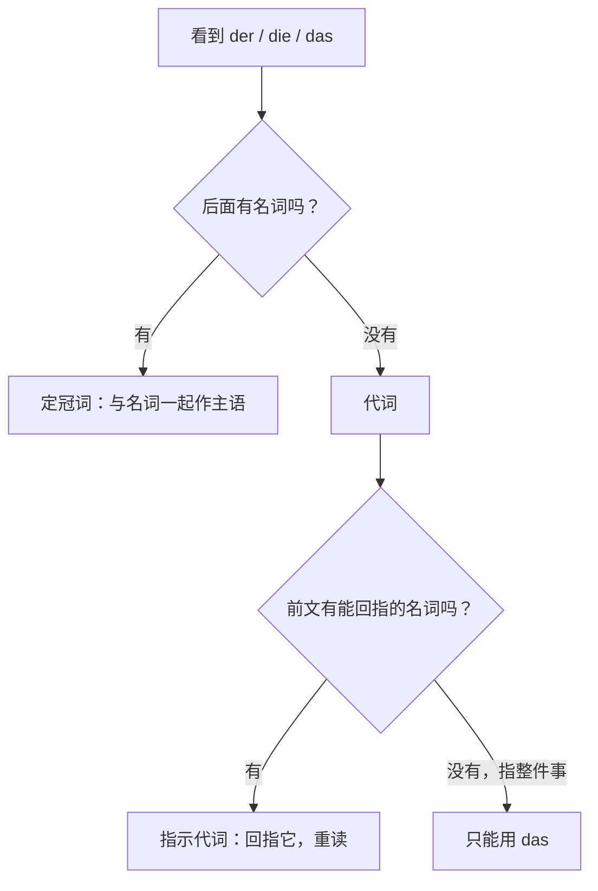

① 句子与问题

- 原句：（本题不针对某个原句，是要把"**der / die / das** 作主语"这件事系统讲一遍）
- 问题：把这种代词作主语、以及定冠词作主语的语法知识完整讲一遍。

② 答案

同一个 **der / die / das** 有两副身份，判别的唯一标准是**后面有没有名词**：后面跟着名词，它就是**定冠词**，和名词一起构成主语；后面没有名词，它自己就是**代词**，单独充当一个句子成分。定冠词作主语时永远取第一格——**der** Mann、**die** Frau、**das** Kind、**die** Studenten，它表明这个名词是已知的、特定的（前文提过、独一无二、或有后面的定语限定）。格的形式由两层条件决定：名词的**性、数**决定从 der / die / das / die 里挑哪一个，名词在句中的**功能**决定加不加 -n、-m、-s 这类词尾——作主语就是第一格 **der / die / das / die**，作第四格阳性变 **den**，作第三格变 **dem**，作第二格变 **des / der**。顺序上还有一条铁律：陈述句里变位动词固定在第二位，所以主语要么占第一位（**Der Mann kommt.**），要么被别的成分挤到动词后面（**Gestern kam der Mann.**），格和身份都不变。

**der / die / das** 单独作主语时，它是一个**指示代词**：回指前文出现过的人或物，带"这个 / 那个"的指示和强调意味，通常要重读，也能指前面整件事（这种用法只有 **das** 可以）。它作主语同样必须是第一格 **der / die / das / die**，形式上跟定冠词几乎一样，一旦句首被别的成分占走，它就退到动词后面，形式依旧不变。它和 **er / sie / es** 的差别不在语法功能（两者都是第一格主语、都能回指），而在语气：**er / sie / es** 是中性的人称代词，不重读；**der / die / das** 重读、带指认或对比的色彩。它当然也能当宾语，那就按功能变格：**Den** kenne ich nicht.（第四格）、**Dem** habe ich geholfen.（第三格）、**Dessen** Auto ist neu.（第二格）；最要注意的是第二格 **dessen / deren** 和复数第三格 **denen**，这三组词形是代词独有的，冠词用的是 **des / der** 和 **den**。

图解：看到 der / die / das，先走这个判定流程

定冠词变格（主语取第一格那一行）：

| 格 | 阳性 | 阴性 | 中性 | 复数 | 什么触发这个形式 |
|---|---|---|---|---|---|
| 第一格 | **der** | **die** | **das** | **die** | 作主语 |
| 第二格 | **des** | **der** | **des** | **der** | 作定语（"……的"） |
| 第三格 | **dem** | **der** | **dem** | **den** | 第三格动词 / 介词 |
| 第四格 | **den** | **die** | **das** | **die** | 第四格动词 / 介词 |

指示代词变格（作主语同样只看第一格那一行）：

| 格 | 阳性 | 阴性 | 中性 | 复数 | 什么触发这个形式 |
|---|---|---|---|---|---|
| 第一格 | **der** | **die** | **das** | **die** | 作主语 |
| 第二格 | **dessen** | **deren** | **dessen** | **deren** | 作定语 / 独立使用 |
| 第三格 | **dem** | **der** | **dem** | **denen** | 第三格功能 |
| 第四格 | **den** | **die** | **das** | **die** | 第四格功能 |

两者只有三处词形不同，其余完全重合：

| 格 | 定冠词 | 指示代词 |
|---|---|---|
| 第二格阳性 / 中性 | **des** | **dessen** |
| 第二格阴性 / 复数 | **der** | **deren** |
| 第三格复数 | **den**（名词加 -n） | **denen** |

指示代词与人称代词作主语的差别：

| 代词 | 类别 | 语气 | 例子 |
|---|---|---|---|
| **er / sie / es** | 人称代词 | 中性，不重读 | Da steht ein Mann. **Er** hat mir geholfen. |
| **der / die / das** | 指示代词 | 重读，指认 / 对比 | Da steht ein Mann. **Der** hat mir geholfen. |

同类例子：**Gestern rief ein Kunde an. Der wollte nur den Preis wissen.**——**Der** 是第一格阳性指示代词作主语，回指 **ein Kunde**；换成 **Er wollte nur den Preis wissen** 语法同样正确，只是少了那层"重读指认"的味道，这正是这两套代词唯一的分工。