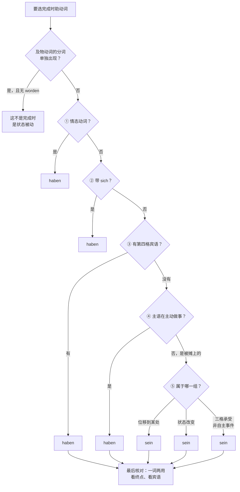

## 1.1 两个 zu-不定式结构的核心对立（B 2 高频考点）

| 结构 | 语态 | 主语身份 | 等值 | 例句 |
|---|---|---|---|---|
| **sein** + zu + Inf | 被动 | 受动者（被处理的东西） | müssen/können + werden-Passiv | Das Formular **ist auszufüllen**.（表格须填写。） |
| **haben** + zu + Inf | 主动 | 施动者（做事的人） | müssen + 主动 | Ich **habe** noch viel **zu tun**.（我还有很多事要做。） |

```
Die Rechnung ist bis Freitag zu bezahlen. → Sie haben die Rechnung bis Freitag zu bezahlen.
账单须在周五前付清。→ 您须在周五前付清账单。
```
同一件事，`ist` 句主语是账单（受动），`haben` 句主语是您（施动）。**看主语是"做事的"还是"被做的"，就能定 sein 或 haben。**

`sein + zu + Inf` 的两种读解需靠语境区分：`Das ist noch zu machen.`（还得做／还能做）——带 nicht、kaum、leicht、schwer 时多为"可能"义（`Das ist nicht zu ändern.` 这没法改），否则多为"必要"义。

---

# 二、sein 与 haben 的全部功能（阅读必备清单）

^r 9948 u

## sein 的六种身份

| # | 功能 | 标志 | 例句 |
|---|---|---|---|
| 1 | 系动词（Kopula） | + 名词/形容词 | Er **ist** Lehrer.（他是老师。） |
| 2 | 完成时助动词 | + Partizip II（位置/状态改变动词） | Er **ist** gekommen.（他来了。） |
| 3 | 状态被动（Zustandspassiv） | + Partizip II（及物动词，无 worden） | Die Tür **ist** geöffnet.（门是开着的。） |
| 4 | 过程被动的完成时 | + Partizip II + **worden** | Die Tür **ist** geöffnet **worden**.（门被打开了。） |
| 5 | 情态被动替代式 | + **zu** + Inf | Die Tür **ist** zu öffnen.（门须打开。） |
| 6 | 进行体（口语，Rheinische Verlaufsform） | + am/beim/dabei + Inf | Ich **bin** am Arbeiten.（我正在工作。） |

**第 3 / 4 / 2 三项的区分是阅读理解的关键：有 worden 就是动作被动，没有 worden 且动词及物就是状态，动词不及物才是完成时。**

## haben 的五种身份

| # | 功能 | 标志 | 例句 |
|---|---|---|---|
| 1 | 实义动词"有" | + 第四格宾语 | Ich **habe** Zeit.（我有时间。） |
| 2 | 完成时助动词 | + Partizip II | Ich **habe** gearbeitet.（我工作了。） |
| 3 | 情态主动替代式 | + **zu** + Inf | Du **hast** zu gehorchen.（你必须服从。） |
| 4 | 状态持有 | + 第四格 + Partizip II／方位不定式 | Ich **habe** das Auto geparkt / das Geld auf dem Konto liegen.（车我停好了／钱存在账上。） |
| 5 | 存在义（南德/奥地利口语） | es hat = es gibt | **Es hat** heute Schnee.（今天有雪。） |

---

# 第二套判断方法
### 1. 一句话判据

> **先看形式（sich？第四格？），形式不给答案再看主语（是执行者还是落点）。三格永远不算线索。**

### 2. 判定流程（3 步，全写成可执行动作）

- **第 1 步：动词带 `sich` 吗？** → 带 → **haben**，结束。
  （`sich ereignen, sich ereignen, sich freuen, sich ärgern, sich verändern, sich beeilen` —— 状态变化也好、位置移动也好，一律 haben。）
- **第 2 步：动词有第四格宾语吗（及物）？** → 有 → **haben**，结束。
  （`essen, lesen, kaufen, bekommen, besuchen, überfallen, fahren + das Auto` ……）
- **第 3 步：前两步都没有**，才问一句：**主语是"做了这件事的人"， **haben**。，还是"到了某处 / 变成了某种状态 / 被事件落到头上"？**  **sein**；

跑一遍今天的题：

| 题 | 有 sich？ | 有第四格？ | 主语是？ | 结论 |
|---|---|---|---|---|
| a | 无 | 无（只有三格） | ich，被碰上 | **sein → bin** |
| b | 无 | 无（只有三格） | das Konzert，状态未变 | **haben → hat** |
| c | 无 | 无（只有三格） | eine gute Idee，掉进来 | **sein → ist** |
| d | **有** | 无 | — | **haben → hat**（第 1 步就结束） |

### 3. 清单：双助动词的分界（按语义分组，标数量）

**A. sein 阵营（约 55 个常用，我按语义分 4 组）**

1. **系动词 3 个**：sein（ist gewesen）、werden（ist geworden）、**bleiben（ist geblieben）** ← 唯一的怪胎，无位移无变化却用 sein
2. **有终点的位置变化，约 22 个**：gehen, kommen, ankommen, abfahren, fahren(有目的地), fliegen(有目的地), reisen, laufen(有目的地), schwimmen(有目的地), reiten, wandern, einsteigen, aussteigen, umziehen(搬家), ziehen(迁居), aufbrechen, zurückkehren, aufstehen, sich setzen 以外的 steigen, fallen, sinken, klettern(有目的地)
3. **状态变化，约 16 个**：aufwachen, einschlafen, aufstehen, sterben, versterben, erkranken, genesen, wachsen, reifen, verblühen, aufblühen, gefrieren, schmelzen(不及物), verbrennen(不及物), platzen, zerbrechen(不及物)
4. **非自主事件 / 三格承受，约 16 个**：begegnen, folgen, passieren, geschehen, gelingen, misslingen, glücken, widerfahren, zustoßen, unterlaufen, entgehen, vorkommen(=发生), auffallen, **einfallen**, entfallen, geraten
	1. “非自主事件”说的是：主语不是有意去做这件事的人，事情是“落到”谁身上、在谁身上发生的，那个人只是承受者。 

**B. haben 阵营（数量压倒性，按语义分 5 组）**

1. **及物动词（带第四格）——占德语动词的绝大多数**：essen, trinken, lesen, schreiben, kaufen, machen, sehen, hören, bekommen, besuchen, überfallen …
2. **全部反身动词**：sich freuen, sich ärgern, sich ereignen, sich beeilen, sich verändern, sich unterhalten …
3. **情态动词与准情态动词**：wollen, sollen, müssen, dürfen, können, mögen；brauchen, lassen, sehen/hören/lassen + 不定式（`Ich habe ihn kommen sehen.`）
4. **无人称天气/自然**：es hat geregnet / geschneit / gehagelt / gedonnert / geblitzt
5. **状态动词 + 感知/心理动词**：**gefallen**, gehören, passen, schmecken, fehlen, leidtun, wehtun, gefallen, bluten, schmerzen

**⚠️ 数字的用处**：把 A 4（sein + 三格，16 个）和 B 5 里的三格动词（haben + 三格：helfen, danken, antworten, gehorchen, zuhören, raten, glauben, vertrauen, schaden, nützen, passen, gehören, gefallen, schmecken, fehlen, leidtun, wehtun, zustimmen, widersprechen ≈ 19 个）放一起看——**同样带三格，16 : 19，几乎对半**。

> 所以"三格动词用 sein"这条流传极广的说法，**预测力约等于抛硬币**。这是伪规律，必须扔掉。它在 a、c 上"碰巧对"，在 b 上必错。

### 4. 例外 / 一词两用 / 双重助动词

- **一词两用（看有无终点）**：
  - `Ich bin nach Berlin gefahren.`（有终点）／ `Ich habe das Auto gefahren.`（及物）
  - `Er ist ans Ufer geschwommen.`（有终点）／ `Ich habe eine Stunde geschwommen.`（纯活动）
  - `Sie ist durch den Park gelaufen.` ／ `Er hat den ganzen Tag gelaufen.`（口语"跑腿"）
- ** `bleiben` **：既无位移也无状态变化，标准语永远是 `ist geblieben`。硬记，理由：它和 `sein` 同族，"持续"被视为一种状态归属。
- ** `sein` 的完成时**：标准 `ist gewesen`；北德口语有 `hat gewesen` ——**考试只写 ist gewesen**。
- ** `folgen` 是 A 4 组里最坑的**：带三格却用 sein（`Ich bin ihm gefolgt`），而它旁边 `gehorchen` / `danken` / `antworten` 全是 haben。只能硬记。
- **准情态 + 双重不定式**：`Ich habe ihn kommen sehen.` / `Das habe ich nicht machen müssen.` 一律 haben，因为 `haben` 在这里是纯句法助动词。
- **sich 的例外**：现代标准德语里我找不到"反身 + sein"的可靠例子，**当铁律用**。⚠️ 如果你在哪本教材里看到反例，拍给我，我重新校准这一条。

### 5. 反例（用来打掉今天最可能长出来的两条伪规律）

**伪规律 1："三格动词用 sein"**
- 反例① `Er **hat** mir geholfen.`（helfen，三格，haben）
- 反例② `Das Buch **hat** mir gehört.`（gehören，三格，haben）
- 反例③ 今天这题 b) `Das Konzert **hat** mir gefallen.`

**伪规律 2："运动动词全用 sein"**
- 反例① `Ich **habe** eine Stunde geschwommen.`（无终点）
- 反例② `Er **hat** das Pferd geritten.`（及物化）

**伪规律 3："sich 只是装饰，看意思定"**
- 反例：`Der Unfall **ist** passiert.`（无 sich，sein）vs. `Der Unfall **hat** sich ereignet.`（有 sich，haben）——**同义却不同助动词，唯一的差别就是那个 sich**。这一组反例直接证明：形式规则可以压倒语义。

### 6. 一句话口诀

> **"有事做，haben；到哪去、变成啥，sein；见着 sich，别犹豫——haben。"**

# 决策流程
## ① 句子与问题

- 原句：为了让我彻底掌握什么时候该用 sein，什么时候该用 haben，做一个完整齐全的决策思维流程图
- 问题：请给出一张完整、无遗漏的决策流程图，用来判断完成时该用 **sein** 还是 **haben** 作助动词。

## ② 答案

这张图的骨架就是你笔记里那句“先看形式，形式不给答案再看主语”，我把它写成了固定的五步：情态动词一律 **haben**，带 **sich** 的一律 **haben**，有第四格宾语的一律 **haben**，这三步都没命中，才轮到问“主语是主动做事的人，还是被事情落到头上的承受者”，前者 **haben**，后者才 **sein**。之所以把形式放在前面，是因为 **sich** 和第四格都是不能变通的外在标志，而“主语算不算施动者”要靠人判断，容易出错；能用外在标志一锤定音的，就不要去猜语义。顺便把“三格”这一项从判断依据里彻底删掉：**sein** 组里带三格的约 16 个（**begegnen, folgen, passieren, einfallen**），**haben** 组里带三格的约 19 个（**helfen, danken, gehören, gefallen**），几乎一半对一半，看见三格就下结论等于抛硬币。

但有两个地方必须给图加“后门”：一是第四格要看**性质**，`Ich bin den Berg hinaufgestiegen` 里的 **den Berg** 只是路程状语（回答“爬了多远”），不是被作用的宾语，所以还是 **sein**；二是同一动词可能一词两用，这时只看“有没有终点、有没有真正的宾语”，`Ich habe das Auto gefahren`（及物，**haben**）对 `Ich bin nach Berlin gefahren`（有终点，**sein**）。另外进门之前还要先筛掉一种假完成时：及物动词的第二分词单独出现、后面没有 **worden**，那是状态被动而不是完成时，比如 **Die Tür ist geöffnet**；真正的完成时被动一定带 **worden**，比如 **Die Tür ist geöffnet worden**，这时 **ist** 固定来自 **werden** 的完成时，没得选。

图解：完成时助动词的完整决策树


第④步怎么判断——主语是“执行者”还是“落点”：

| 主语身份 | 助动词 | 为什么 | 例句 |
|---|---|---|---|
| 主动做事的人 | **haben** | 动作由主语发出，是纯活动 | Ich **habe** gearbeitet. |
| 被人或事“摊上”的承受者 | **sein** | 主语没有主动发力，事情落到它头上 | Der Unfall **ist** passiert. |
| 主语确实发生位移 | **sein** | 主语自己从 A 到 B，位置变了 | Der Zug **ist** angekommen. |
| 主语自身状态改变 | **sein** | 主语从一种状态变成另一种 | Er **ist** eingeschlafen. |
| 主语只是被评价、状态未变 | **haben** | 没有位移也没有变化 | Das Konzert **hat** mir gefallen. |

图的“后门”——特例与一词两用：

| 情况 | 助动词 | 为什么 | 例句 |
|---|---|---|---|
| 第四格是路程／时间量 | **sein** | 不是被作用的宾语，只是状语 | Ich **bin** den Berg hinaufgestiegen. |
| 运动动词有终点 | **sein** | 有到达点，位置变了 | Ich **bin** nach Berlin gefahren. |
| 运动动词纯活动 | **haben** | 只持续一段时间，没到达哪里 | Ich **habe** eine Stunde geschwommen. |
| 运动动词及物化 | **haben** | 有了真正的第四格宾语 | Er **hat** das Pferd geritten. |
| **bleiben** | **sein** | 无位移无变化，但与 **sein** 同族，“持续”算状态归属 | Sie **ist** zu Hause geblieben. |
| 准情态 + 双不定式 | **haben** | 这里只是纯句法助动词 | Ich **habe** ihn kommen sehen. |
| **sich** 与无 **sich** 同义对 | 分别为 **haben** / **sein** | 形式压倒语义 | Der Unfall **hat** sich ereignet.／Der Unfall **ist** passiert. |

同一条规律再看一组：**Ich bin ihm gefolgt**（三格承受、非自主 → **sein**）和 **Ich habe ihm gedankt**（三格但不是“摊上” → **haben**），差别不在三格，而在第④步那个“主语是不是被事情落到头上”的判断。