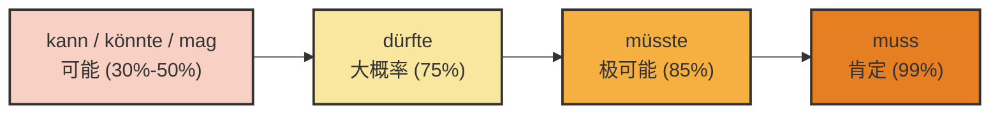

# 情态动词表可能性

^ntwb 75

[[语言学习/德语/公共知识语法/动词.md#^lsE1c4QI|100%]]

### 第一部分：情态动词的主观意义（对现在的推测）

当我们对目前正在发生、或者目前的状态进行推测时，我们使用**情态动词的现在时（Präsens）**或**第二虚拟式（Konjunktiv II）**，加上**<font color="#d83931">动词原形</font>（Infinitiv）**。

不同的情态动词代表了你作为“侦探”内心不同的确信程度。我们先用一张图表来直观感受一下这个“确信度阶梯”：

代码段



现在，我们把这些推测词放入你在德国的实际生活中：

**1. muss (99% - 肯定 / fast sicher)**

你手里掌握了铁证，几乎 100%确信。

- **生活场景（租房）：** 你看到房东的车已经停在楼下了，你和室友说：
    - _Der Vermieter **muss** gleich da **sein**._ (房东肯定马上就到了。)

**2. müsste (85% - 极可能 / höchstwahrscheinlich)**

根据常理或经验，这件事理应如此，但你不排除极其微小的意外。

- **生活场景（行政事务）：** 你上周就交了延签材料，通常一周内会有回复。
    - _Die Ausländerbehörde **müsste** meine Unterlagen schon **haben**._ (外管局极可能已经收到我的材料了。)

**3. dürfte (75% - 大概率 / wahrscheinlich)**

你有充分的理由相信某事会发生，语气比较客气且有把握。

- **生活场景（找工作）：** 你的面试非常顺利，HR 也暗示了会录用你。
    - _Ich **dürfte** den Job **bekommen**._ (我大概率能拿到这份工作。)

**4. kann / könnte / mag (30%-50% - 可能 / vielleicht)**

你只是提出一种可能性，完全靠猜，手里没什么证据。_(注意：könnte 比 kann 语气更委婉，可能性更低一点)_

- **生活场景（交通/约会）：** 你在咖啡馆等面试官，但他迟到了。
    - _Er **könnte** im Stau **stecken**._ (他可能堵车了。—— 就像 image_54 ca 1 c.jpg 中的例句一样)
    - *Er **kann** den Termin vergessen **haben**. *(他也许忘记了预约。)

### 情态动词的主观意义（对过去的推测）

**核心法则（请务必死记硬背）：**

当你推测过去时，**情态动词本身绝对不变成过去时！**情态动词依然保持现在时或第二虚拟式，我们要把句末的**实义动词变成“过去时的不定式”**（也就是：过去分词 Partizip II + haben/sein）。

> [!danger] 框架
> **主语 + 情态动词(Präsens/KII) + ... + 过去分词(Partizip II) + haben/sein.**

我们依然沿着确信度的阶梯，来看看过去的推测怎么用：

**1. 极度确信过去的某事 (muss ... haben/sein)**

- **生活场景（医疗）：** 你的朋友今天一直气喘吁吁（außer Atem），而且电梯坏了。你推测她刚刚肯定是走楼梯上来的。
    - _Sie **muss** wohl zu Fuß die Treppe hochgekommen **sein**._ (她刚才肯定是走楼梯上来的。—— 对应资料 image_54 c 9 fd.jpg 的经典例句)
- **生活场景（找工作）：** 你的邮箱里收到了一封拒信，你推测 HR 昨天肯定看过你的简历了。
    - _Der Personaler **muss** meinen Lebenslauf gestern gelesen **haben**._ (HR 昨天肯定读过我的简历了。)

**2. 大概率发生过的某事 (dürfte ... haben/sein)**

- **生活场景（租房）：** 邻居的包裹昨天就不在了，你推测他大概率已经拿走了。
    - _Der Nachbar **dürfte** das Paket schon abgeholt **haben**._ (邻居大概率已经把包裹取走了。)

**3. 可能发生过的某事 (könnte ... haben/sein)**

- **生活场景（生活交际）：** 你的室友昨天去跑步了，你推测她可能是突然有兴致运动了。
    - _Sie **könnte** Lust gehabt **haben**, Sport zu treiben._ (她可能（当时）突然有兴致做运动了。)

### 第三部分：高阶运用与核心避坑指南

#### 难点一：对过去推测的“被动语态”

如果你要推测过去发生的一件<font color="#ff0000">“被动”</font>的事情，结构会变得稍微有些长，但逻辑依然严密：

> **公式：主语 + 情态动词 + 过去分词 + worden + sein.**

- **生活场景（日常物业）：** 你们公寓的电梯坏了三天了，你今天看还是没修好，你推测：“电梯大概率还没有被修好。”
    - _Der Aufzug **dürfte** noch nicht wieder repariert **worden sein**._ (如 image_54 c 9 fd.jpg 所示，这是一个极其地道、能让德国考官眼前一亮的高分句型！)
- _补充提醒_：如果要推测**现在**的被动状态（他现在可能正在被手术），只能搭配明确的时间副词（如 gerade），以避免混淆：
    - _Er **dürfte** gerade operiert **werden**._ (他现在大概率正在接受手术。)

#### 难点二：客观描述 vs. 主观推测 的致命混淆

这是六个月冲刺 B 2 必须跨过的陷阱！请看以下两句话的巨大区别：

- **第一句（客观的必要性 - 事实）：**
    - _Sie **musste** zu Fuß gehen._
    - _(或者)_ _Sie hat zu Fuß gehen **müssen**._
    - **翻译：** 她（当时）**不得不**步行去。（描述一个过去的事实：因为没车，她没得选。）
- **第二句（主观的推测 - 破案）：**
    - _Sie **muss** zu Fuß gegangen **sein**._
    - **翻译：** 她（刚才）**肯定是**步行去的。（这是你作为侦探，看到她满头大汗后得出的推理结论。）

**大师总结：** 表达过去的客观事实，变情态动词（musste）；表达对过去的推测，变句末的实义动词（gegangen sein），情态动词岿然不动！

### 你的课后实战练习

为了在 6 个月内达到 B 2，理论必须立刻转化为肌肉记忆。请尝试把下面这几个生活场景，用我们今天学到的**推测结构**用德语翻译出来（可以在心里默念或写在笔记上）：

1. **找房场景 (99%确信，现在)：** 这套公寓在市中心，租金**肯定**很贵。 (teuer sein)
2. **行政场景 (85%确信，过去)：** 我上周寄了信，外管局**极可能**已经收到这封信了。 (den Brief erhalten haben)
3. **看病场景 (50%可能，过去的被动)：** 这个药**可能**吃错（被错误服用）了。 (falsch eingenommen worden sein)

只要你能搞懂“确信度阶梯”和“过去时态的推断结构”，这部分的语法分你已经稳稳拿下了。保持这个学习势头，我们向下一个 B 2 核心语法点进军！Viel Erfolg!

# 德语情态动词的推测用法：现在、过去、主动、被动、主观、客观的完整解析

## 学习目标

读完之后，你应该能够：

1. 看到一个情态动词句，判断它是客观用法还是主观用法，并说出判断依据。
2. 正确构成"现在推测"和"过去推测"，包括主动、过程被动、状态被动三种语态。
3. 解释为什么"主观用法不能用情态动词的完成时"。
4. 在真实语境中选择合适的情态动词，表达从"几乎确定"到"也许"的不同确信度。
5. 识别并修正学习者最常见的几类错误。

**前置知识检查**：开始之前，请确认你已经掌握：六个情态动词的基本形式；现在时和过去时的构成；被动语态的基本结构（werden + Partizip II）；完成不定式的构成（haben/sein + Partizip II）。如果这些还不熟悉，建议先复习，否则后面的形式构成表会很难跟上。

## 知识地图

```mermaid
情态动词
├── 客观用法（现实条件）
│   ├── 道义情态：义务/许可/禁止（müssen, sollen, dürfen）
│   └── 动力情态：能力/意愿/喜好（können, wollen, mögen）
└── 主观用法（说话人态度）
    ├── 推测：确信度阶梯（müssen > dürfte > kann/könnte > mag）
    └── 转述：信息来源（soll = 他人说；will = 主语自称）

三个正交维度：
时间：现在（现在不定式）vs 过去（完成不定式）
语态：主动 vs 过程被动（worden sein）vs 状态被动（gewesen sein）
确信度：muss > dürfte > kann/könnte > mag
```

这张地图告诉你：我们要处理的是三组相互独立的区分，而不是一套混乱的规则。先把它们分开，再合起来用。

---

## 第 0 阶：无极·破壁——一句 "muss" 引发的歧义

想象两个场景。

场景一：市政厅贴出通知，某栋老房子被列为危房。通知上写：

(1) **Das Haus muss renoviert werden.**

"这栋房子必须翻修。"

场景二：你路过这栋房子，看到脚手架、工人、卡车。你对同伴说：

(2) **Das Haus muss renoviert werden.**

"这栋房子一定在翻修。"

同一个句子，同一个 "muss"，同一个 "renoviert werden"，却是两种完全不同的意思。

场景一中，"muss" 说的是"现实中的义务"：房子有翻修的必要，这是规定或安全要求。场景二中，"muss" 说的是"说话人的判断"：根据脚手架和工人这些证据，我几乎可以肯定翻修正在进行。

这不是德语在故意为难学习者，而是情态动词的两层意义在同一个形式上重叠了。

传统语法把这两种意义称为"客观用法"（objektive Bedeutung）和"主观用法"（subjektive Bedeutung）。现代语言学更喜欢用另一组术语：客观用法大致对应"道义情态"（deontische Modalität）和"动力情态"（dynamische Modalität），主观用法对应"认识情态"（epistemische Modalität）。

术语不重要，重要的是理解这两层意义的分工：

- **客观用法**：情态动词作用于命题内部的现实条件。事情"能不能"发生、"许不许"发生、"该不该"发生、"想不想"发生。
- **主观用法**：情态动词作用于说话人对整个命题真值的评估。说话人"有多确定"事情发生了。

用一句话概括：客观用法问"事情在世界中处于什么状态"，主观用法问"说话人认为事情为真的概率有多高"。

这篇文章要解决的，就是围绕这个核心区分展开的三个具体问题：

第一，现在推测和过去推测怎么构成？时间标记落在哪里？

第二，主动和被动需不需要区分？被动推测有什么特殊形式？

第三，主观和客观需不需要区分？怎么判断？边界在哪里？

这三个问题不是并列的。第一个问题是时间维度，第二个问题是语态维度，第三个问题是意义维度。它们相互独立，又必须在同一个句子里同时处理。学会把这三个维度分开看，再合起来用，是掌握这个语法点的关键。

---

## 第 1 阶：道生一——情态动词的两层意义

### 1.1 专业定义

德语的情态动词有六个：**müssen, dürfen, können, mögen, sollen, wollen**。它们的基本功能是表达"模态"——事情发生的可能性、必然性、许可、义务、能力、意愿等。

但这些词有两套用法。

**客观用法**把情态加在"命题所描述的现实条件"上：

(3) **Ich muss arbeiten.**

"我必须工作。"（义务）

(4) **Ich kann schwimmen.**

"我会游泳。"（能力）

(5) **Du darfst gehen.**

"你可以走了。"（许可）

(6) **Ich will nach Hause.**

"我想回家。"（意愿）

这些句子里，情态动词说的是主语和动作之间的现实关系：有义务、有能力、被允许、有意愿。命题本身（"我工作""我游泳""你走""我回家"）没有被说话人评估真假，它只是被加上了"必须/能够/可以/想要"的条件。

**主观用法**则把情态加在"说话人对命题的态度"上：

(7) **Er muss krank sein.**

"他一定病了。"（推测）

(8) **Er kann krank sein.**

"他可能病了。"（推测）

(9) **Er dürfte krank sein.**

"他大概病了。"（推测）

(10) **Er mag krank sein.**

"他也许病了。"（推测）

这些句子里，"muss/kann/dürfte/mag" 不再表示义务、能力或意愿，而是表示说话人对"他病了"这个命题的确信程度。命题本身是一个完整的判断，情态动词是加在这个判断外面的"可信度标签"。

现代语言学把这两种用法分别称为：

- **epistemische Modalität**（认识情态）：说话人对命题真值的评估，对应传统的"主观用法"。
- **deontische Modalität**（道义情态）：义务、许可、禁止，对应客观用法的一部分。
- **dynamische Modalität**（动力情态）：能力、意愿、喜好，对应客观用法的另一部分。

这个三分法比"主观/客观"二分更精确，因为"客观"内部其实还有两类不同的东西：义务许可是一类，能力意愿是另一类。后面我们会看到，这个区分对判断具体句子很有用。

### 1.2 一句话本质

如果只能用一句话：

**客观用法说的是"事情能不能、许不许、该不该、想不想发生"；主观用法说的是"说话人有多确定事情发生了"。**

### 1.3 大白话解释

把"命题"想象成一张纸条，上面写着一件事："他病了"。

客观用法是在纸条上加一个"现实条件"的批注："他有义务……""他有能力……""他被允许……"

主观用法是在纸条上加一个"可信度"的批注："我几乎确定这是真的""我认为这可能是真的""我也许吧"。

纸条本身不变，变的是批注的类型。客观批注改变的是"事情在世界中的位置"，主观批注改变的是"说话人和真相之间的距离"。

### 1.4 生活类比：侦探与法官

想象一个案件：某人的书房被翻得乱七八糟。

**客观情态**关心的是：嫌疑人有没有能力作案？有没有被允许进入书房？有没有义务出现在现场？这些问题关乎"世界中的条件"。

**主观情态**关心的是：根据指纹、脚印、时间线，侦探对"嫌疑人有罪"这个判断的确信度有多高？这些问题关乎"判断的可信度"。

类比映射：

| 类比中的要素 | 对应的语言学术语 |
|---|---|
| 案件事实（"他进了书房"） | 命题（Proposition） |
| 侦探的确信度 | 主观情态（认识情态） |
| 嫌疑人的能力/许可/义务 | 客观情态（动力/道义情态） |
| 指纹、脚印、时间线 | 推断依据（证据、语境） |
| 侦探说"我几乎确定" | "Er muss es gewesen sein." |
| 侦探说"有可能" | "Er kann es gewesen sein." |

**类比的局限**：

第一，侦探的确信度是真实的心理状态，而语言中的主观情态是语法化的标记。说话人说 "Er muss krank sein" 时，不一定真的在心理上经历了"95% 的确信"，这可能只是一种修辞性的强调。语法标记不等于心理测量。

第二，侦探可以随时改变确信度，语言中的情态动词却有固定的形式系统。你不能随意说 "Er 60%-krank-sein"。

第三，客观和主观的边界有时模糊。"Das kann passieren"（这可能发生）到底是"事情本身有可能"还是"我判断它有可能"？两者很难截然分开。类比无法覆盖这种灰色地带。

### 1.5 最小认知模型

把情态动词句拆成两层：

第一层：命题 P。例如"他病了"。

第二层：情态标记 M。例如"一定""可能""也许"。

**客观用法**：M 作用于 P 内部的现实条件。写作 M(P)，其中 M 是"义务/许可/能力/意愿"。

**主观用法**：M 作用于"说话人对 P 的确信度"。写作 M(确信度(P))。

这个模型的关键是：主观用法的情态动词不改变 P 的内容，只改变说话人对 P 的"担保程度"。所以，"Er muss krank sein" 和 "Er ist krank" 说的是同一件事，区别只在于前者带了一个"几乎确定"的标记。

### 1.6 整体缩略图

先看一张总表，建立全局印象：

| 情态动词 | 客观用法（例子） | 主观用法（推测/转述） | 主观确信度（示意） |
|---|---|---|---|
| müssen | 必须：Ich muss arbeiten. | 一定：Er muss krank sein. | 很高（约 95%） |
| dürfen | 许可：Du darfst gehen. | 大概：Er dürfte krank sein. | 较高（约 75-85%） |
| können | 能力/许可：Ich kann schwimmen. | 可能：Er kann krank sein. | 中等（约 50%） |
| mögen | 喜好：Ich mag Kaffee. | 也许：Er mag krank sein. | 较低（约 20-30%） |
| sollen | 义务/他人要求：Du sollst kommen. | 据说：Er soll krank sein. | 不表达确信度 |
| wollen | 意愿：Ich will gehen. | 声称：Er will krank sein. | 不表达确信度 |

注意表中的"示意"二字。这些百分比不是科学测量，只是帮助记忆的相对刻度。真实语境中的确信度由语调、上下文、证据强度共同决定，不能量化。

这张表已经暗示了一个重要事实：**并非所有情态动词都均匀地拥有"推测"用法**。müssen, dürfen（仅 dürfte）, können, mögen 构成推测阶梯；sollen 和 wollen 则是另一类——它们表达的不是"我有多确定"，而是"这个消息是谁说的"。这个区别，我们会在第 3 阶详细展开。

---

## 第 2 阶：一生二——两对核心区分和一个正交维度

现在把核心概念拆开。理解情态动词的推测用法，需要同时处理三组区分：

第一组：**主观 vs 客观**（意义层）。

第二组：**现在 vs 过去**（时间层）。

第三组：**主动 vs 被动**（语态层）。

前两组是"一生二"意义上的两对核心区分；第三组是一个正交维度，它不与前两组竞争，而是叠加在它们之上。先把三组分别讲清楚，再说明它们如何组合。

### 2.1 第一对：主观 vs 客观

#### 2.1.1 客观用法内部还要再分两类

"客观"不是一个均质的类别。至少可以分出两种：

**道义情态（deontisch）**：义务、许可、禁止。典型动词是 müssen, sollen, dürfen。

(11) **Du musst das Formular unterschreiben.**

"你必须签署这份表格。"（义务）

(12) **Sie dürfen hier nicht rauchen.**

"您不能在这里吸烟。"（禁止）

(13) **Du sollst den Arzt anrufen.**

"你应该给医生打电话。"（他人要求）

**动力情态（dynamisch）**：能力、意愿、喜好。典型动词是 können, wollen, mögen。

(14) **Sie kann drei Sprachen sprechen.**

"她会说三种语言。"（能力）

(15) **Er will nach Berlin ziehen.**

"他想搬到柏林。"（意愿）

(16) **Ich mag keine laute Musik.**

"我不喜欢吵闹的音乐。"（喜好）

这两类都属于"客观"，因为情态都作用于命题内部的现实条件。但它们的语义来源不同：道义情态涉及"规范、许可、义务"，动力情态涉及"能力、意愿、内在倾向"。后面讲判断测试时，这个区分会派上用场。

#### 2.1.2 主观用法内部也要再分两类

"主观"同样不是均质的。至少可以分出两种：

**推测（Vermutung）**：说话人对命题真值的评估。典型动词是 müssen, dürfte, können, mögen。

(17) **Er muss krank sein.**

"他一定病了。"

(18) **Er dürfte krank sein.**

"他大概病了。"

(19) **Er kann krank sein.**

"他可能病了。"

(20) **Er mag krank sein.**

"他也许病了。"

**转述（Redewiedergabe）**：说话人把某个说法归给他人，自己不做担保。典型动词是 sollen 和 wollen。

(21) **Er soll krank sein.**

"据说他病了。"（别人说）

(22) **Er will krank sein.**

"他声称自己病了。"（他自己说，说话人可能怀疑）

这两类都属于"主观"，因为情态都作用于"说话人和命题的关系"。但它们的机制不同：推测表达"确信度"，转述表达"信息来源"。sollen 说的是"我从别人那里听来"，wollen 说的是"这是主语自己的说法"。它们不构成推测阶梯，也不应该被放进"muss > dürfte > kann > mag"的刻度里。

这个区分非常重要，因为很多教材把六个情态动词的主观用法混在一起讲，导致学习者以为"soll"也是一种"推测"。它不是。soll 的确信度取决于"消息来源可不可靠"，而不是说话人自己的判断。

#### 2.1.3 六种判断测试

那么，怎么判断一个句子是主观还是客观？不能只靠翻译，因为汉语翻译有时无法区分。需要用句法测试。

**测试一：改写测试。**

主观推测可以改写成 "Es ist sicher/möglich/wahrscheinlich, dass P"：

(23) **Er muss krank sein.**

→ Es ist (fast) sicher, dass er krank ist.

(24) **Er kann krank sein.**

→ Es ist möglich, dass er krank ist.

客观用法不能这样改写，或者改写后意义改变：

(25) **Ich muss arbeiten.**

→ *Es ist sicher, dass ich arbeite.（错：原句是义务，不是推测）

(26) **Ich muss arbeiten.**

→ Es ist notwendig, dass ich arbeite.（可以，但这是"必要性"，不是"确信度"）

**测试二：否定测试。**

主观推测的否定，通常否定的是"确信度"，而不是命题内容：

(27) **Er muss nicht krank sein.**

"他不一定病了。"（否定"一定"）

客观义务的否定，否定的是"义务"：

(28) **Du musst nicht kommen.**

"你不必来。"（否定"必须"）

这两个句子的形式相同，但否定范围不同。这是一个非常实用的判别点。

**测试三：完成时测试。**

主观推测不能用情态动词的完成时形式：

(29) **Er muss krank gewesen sein.** ✓

"他当时一定病了。"（主观，过去推测）

(30) ***Er hat krank sein müssen.** ✗（不表推测；如果成立，意思是"他不得不生病"，客观，且语义怪异）

客观用法可以用完成时：

(31) **Er hat kommen müssen.** ✓

"他不得不来。"（客观）

(32) **Er hat nicht kommen dürfen.** ✓

"他不被允许来。"（客观）

**测试四：副词测试。**

主观推测可以自由加入 wohl, sicher, bestimmt, vermutlich 等情态副词：

(33) **Er muss wohl krank sein.**

"他大概一定病了。"（略显冗余，但成立）

(34) **Er ist sicher krank.**

"他肯定病了。"

客观用法也可以加某些副词，但意义不同：

(35) **Du musst unbedingt kommen.**

"你必须来。"（unbedingt 加强义务，不是推测）

**测试五：主语测试。**

客观用法中，主语是"有能力/被允许/有义务/有意愿"的施事：

(36) **Der Schüler kann die Aufgabe lösen.**

"这个学生能解这道题。"（主语有能力）

主观用法中，主语只是命题的主语，不承担情态意义：

(37) **Der Schüler muss krank sein.**

"这个学生一定病了。"（主语没有"必须"的义务，是说话人在推测）

**测试六：语境测试。**

主观推测需要"推断依据"：证据、逻辑、传闻。

(38) [看到地上湿了] **Es muss geregnet haben.**

"一定下过雨。"

客观用法需要"规范来源"：法律、规则、他人要求、内在能力。

(39) [医生说] **Du musst mehr Wasser trinken.**

"你必须多喝水。"

这六个测试不是每个句子都能用，但组合起来，足以处理大多数情况。

#### 2.1.4 歧义句分析

现在用测试分析几个真实的歧义句。

**句一：**

(40) **Das muss gemacht werden.**

读法 A（客观）："这必须被做。"情态动词表义务，werden 是被动助动词，整个句子是一个"必要性"陈述。改写：Es ist notwendig, dass das gemacht wird.

读法 B（主观）："这一定正在被做/这一定会被做。"情态动词表推测，werden 是被动助动词，整个句子是说话人对"事情正在被做"的推测。改写：Es ist (fast) sicher, dass das gemacht wird.

同一个句子，两种读法。怎么消歧？看语境。如果是工作分配会议，读法 A；如果是路过工地看到工人，读法 B。此外，读法 B 常伴随情态动词重读："Das MUSS gemacht werden."

**句二：**

(41) **Er kann nicht schwimmen.**

读法 A（客观，动力情态）："他不会游泳。"（能力否定）

读法 B（主观，认识情态）："他不可能在游泳。"（推测否定）

歧义来自 "schwimmen" 的语境。如果话题是"他能不能游泳"，读法 A；如果话题是"他此刻在不在游泳"，读法 B。汉语翻译"他不会游泳"和"他不可能在游泳"已经把两种读法分开了，但德语原文是同一串词。

**句三：**

(42) **Er muss nicht kommen.**

读法 A（客观，道义情态）："他不必来。"（否定义务）

读法 B（主观，认识情态）："他不一定来。"（否定推测）

这个句子的歧义非常典型。测试二（否定测试）在这里失效，因为两种读法都否定情态词。只能靠语境：如果话题是"他有没有义务来"，读法 A；如果话题是"他会不会来"，读法 B。

这三个例子说明：**主观和客观的区分不是"看形式"，而是"看意义"**。同一串词可以承载两种意义，语境决定哪一种被激活。

### 2.2 第二对：现在 vs 过去

#### 2.2.1 核心规则：时间由不定式层级决定

这是整个语法点最容易被误解的地方。很多人以为"现在推测"用现在时，"过去推测"用过去时。这个直觉是错的。

德语的推测用法遵循一条更简单的规则：

**情态动词的时态表示"推测发生的时刻"；不定式的层级表示"命题的时间"。**

具体地说：

- **现在推测**：情态动词现在时 + 现在不定式（Infinitiv Präsens）。
- **过去推测**：情态动词现在时 + 完成不定式（Infinitiv Perfekt）。

例子：

(43) **Er muss krank sein.**

"他现在一定病了。"（现在推测，命题时间是现在）

(44) **Er muss krank gewesen sein.**

"他当时一定病了。"（过去推测，命题时间是过去）

注意：两个句子的情态动词都是现在时 "muss"。区别只在不定式："sein" vs "gewesen sein"。时间信息不在情态动词上，而在不定式上。

这是一个"相对时态"系统：不定式的层级相对于情态动词的时刻来定位。

- 现在不定式：命题时间与情态动词同时或之后。
- 完成不定式：命题时间先于情态动词。

因为情态动词通常用现在时，所以：

- 现在不定式 → 命题在说话时刻或之后 → "现在/将来推测"
- 完成不定式 → 命题在说话时刻之前 → "过去推测"

#### 2.2.2 四种组合

如果把情态动词的时态也考虑进来，就有四种组合：

| 情态动词时态 | 不定式层级 | 意义 | 例子 |
|---|---|---|---|
| 现在时 | 现在不定式 | 现在/将来推测 | Er muss krank sein. |
| 现在时 | 完成不定式 | 过去推测 | Er muss krank gewesen sein. |
| 过去时 | 现在不定式 | 过去的推测（命题在当时） | Er musste krank sein. |
| 过去时 | 完成不定式 | 过去的推测（命题更早） | Er musste krank gewesen sein. |

前两行是日常最常用的。后两行出现在叙述文本中，表示"说话人在过去某个时刻做出的推测"。

(45) **Als ich ihn sah, musste er krank sein.**

"我看到他的时候，他一定病了。"（当时的推测）

(46) **Als ich ihn traf, musste er krank gewesen sein.**

"我遇到他的时候，他一定早就病了。"（当时对更早情况的推测）

这两句的 "musste" 不是"必须"的过去时，而是"推测"的过去时。但要注意：这种用法在口语中不常见，且容易与客观用法混淆。日常表达"过去的推测"，更常用的是"现在时情态动词 + 完成不定式"：

(47) **Er muss krank gewesen sein.**

"他当时一定病了。"

这句话比 (45) 更自然，因为它把"推测"锚定在说话时刻，把"命题"锚定在过去。

#### 2.2.3 三条关键限制

**限制一：主观用法不能用情态动词的完成时。**

(48) **Er muss krank gewesen sein.** ✓（主观，过去推测）

(49) ***Er hat krank sein müssen.** ✗（不表推测）

(50) **Er hat kommen müssen.** ✓（客观，"他不得不来"）

为什么？因为主观用法的情态动词是"命题外标记"，它不参与命题内部的事件结构。完成时 "hat ... gemusst" 是把情态动词当作一个"事件"来陈述，这只有在客观用法中才成立（"不得不"是一个现实中的义务事件）。一旦情态动词变成"说话人的判断"，它就不能再被"完成时化"，因为判断本身不是一个发生在时间中的事件。

这个解释有点抽象，但记住结论就够了：看到 "hat ... gemusst/können/wollen" 这样的形式，基本可以判断它不是推测用法。

**限制二：主观用法的过去时（Präteritum）受限。**

müssen, können, mögen 的过去时形式（musste, konnte, mochte）可以用于推测，但语感受限，主要出现在叙述文本中。dürfen, sollen, wollen 的过去时形式基本不用于推测。

(51) **Er musste krank sein.** ✓（叙述中的过去推测）

(52) **Er konnte krank sein.** △（可以，但不如 "kann krank gewesen sein" 自然）

(53) ***Er durfte krank sein.** ✗（不表推测；如果成立，是"他被允许生病"，语义怪异）

(54) ***Er sollte krank sein.** ✗（不表推测；sollte 另有"应该"或"万一"用法）

所以，日常表达"过去推测"，最安全的形式是"现在时情态动词 + 完成不定式"。

**限制三：werden + 不定式是竞争形式。**

除了情态动词，德语还可以用 "werden + 不定式" 表达推测：

(55) **Er wird krank sein.**

"他大概病了。"（现在推测）

(56) **Er wird krank gewesen sein.**

"他当时大概病了。"（过去推测）

"werden" 的推测强度大约相当于 "dürfte" 或 "kann"，不如 "muss" 强。它的优势是可以避免情态动词的歧义，因为 "wird" 本身没有"义务/能力"的客观读法（虽然 "wird" 有"将来"读法）。

#### 2.2.4 正例与反例

**正确：**

(57) **Sie muss den Brief gelesen haben.**

"她一定读过这封信。"（过去推测，主动）

(58) **Der Brief muss gelesen worden sein.**

"这封信一定被读过了。"（过去推测，过程被动）

(59) **Das Fenster muss geöffnet gewesen sein.**

"窗户当时一定开着。"（过去推测，状态被动）

**错误：**

(60) ***Sie hat den Brief gelesen haben müssen.** ✗（形式混乱，不符合标准德语）

(61) ***Der Brief muss gelesen geworden sein.** ✗（应为 worden）

(62) ***Sie hat den Brief lesen gemusst.** ✗（不表推测；如果成立，是"她不得不读信"，客观）

这三组正反例覆盖了主动、过程被动、状态被动三种语态。下一节专门处理语态问题。

### 2.3 正交维度：主动 vs 被动

#### 2.3.1 核心结论

先给结论，再解释：

**在"规则层面"，不需要区分主动和被动。** 推测的时间标记和确信度标记与语态无关。

**在"形式层面"，需要区分。** 被动不定式有独特的构成规则，尤其是 "worden sein" 和 "gewesen sein"。

**在"语义层面"，需要区分。** 过程被动推测"事件发生"，状态被动推测"状态存在"。

换句话说：你不需要为主动和被动建立两套推测体系，但你需要正确构成被动不定式，并理解两种被动的意义差异。

为什么说"正交"？因为语态是命题内部的属性，推测是命题外部的标记。一个命题可以是主动的，也可以是被动的；说话人对这个命题的确信度，不因为语态而改变。

比较：

(63) **Er muss den Brief gelesen haben.**

"他一定读过这封信。"（主动，推测"他读信"）

(64) **Der Brief muss gelesen worden sein.**

"这封信一定被读过了。"（过程被动，推测"信被读"）

(65) **Der Brief muss gelesen sein.**

"这封信一定已经被读过了。"（状态被动，推测"信处于被读过的状态"）

三个句子的确信度标记都是 "muss"，时间标记都是完成不定式（命题在过去），区别只在语态。语态改变了命题的内容（谁对谁做了什么），但没有改变推测的规则。

#### 2.3.2 形式构成表

把三种语态和四种时间组合放在一起：

| | 主动 | 过程被动（Vorgangspassiv） | 状态被动（Zustandspassiv） |
|---|---|---|---|
| 现在推测 | muss kommen | muss gebracht werden | muss gebracht sein |
| 过去推测 | muss gekommen sein | muss gebracht worden sein | muss gebracht gewesen sein |
| 过去的现在推测 | musste kommen | musste gebracht werden | musste gebracht sein |
| 过去的过去推测 | musste gekommen sein | musste gebracht worden sein | musste gebracht gewesen sein |

这张表是整篇文章的技术核心。逐列解释。

**主动列**：最直接。现在推测用"情态动词 + 现在不定式"，过去推测用"情态动词 + 完成不定式"。完成不定式的助动词根据动词性质选择 haben 或 sein（"gekommen sein" 用 sein，"gelesen haben" 用 haben）。

**过程被动列**：现在推测用"情态动词 + Partizip II + werden"。过去推测用"情态动词 + Partizip II + worden sein"。注意是 "worden"，不是 "geworden"。

**状态被动列**：现在推测用"情态动词 + Partizip II + sein"。过去推测用"情态动词 + Partizip II + gewesen sein"。

#### 2.3.3 三个关键形式点

**第一点：worden 不是 geworden。**

这是德语学习者最高频的错误之一。werden 作为被动助动词时，它的第二分词是 **worden**，不是 **geworden**。

(66) **Der Brief ist gelesen worden.** ✓

"信被读过了。"（过程被动完成时）

(67) ***Der Brief ist gelesen geworden.** ✗

(68) **Er ist Arzt geworden.** ✓

"他成了医生。"（werden 作实义动词，用 geworden）

规则可以这样记：werden 单独作"变成"讲时，用 geworden；werden 作为被动助动词时，用 worden。在情态动词的完成不定式中，被动助动词当然用 worden：

(69) **Der Brief muss gelesen worden sein.** ✓

(70) ***Der Brief muss gelesen geworden sein.** ✗

**第二点：过程被动和状态被动的意义不同。**

过程被动（werden-Passiv）聚焦"事件的发生"：某事被做了。

状态被动（sein-Passiv）聚焦"事件的结果状态"：某事处于被做完的状态。

(71) **Das Fenster muss geöffnet werden.**

读法 A（客观）："窗户必须被打开。"（义务）

读法 B（主观）："窗户一定正在被打开/一定会被打开。"（推测事件发生）

(72) **Das Fenster muss geöffnet sein.**

读法 A（客观）："窗户必须处于打开状态。"（义务，较少见）

读法 B（主观）："窗户一定已经打开了。"（推测状态存在）

在推测用法中，状态被动的读法通常更自然，因为它推测的是一个"状态"，而状态比"事件"更容易被观察和推断。你看到窗户开着，说 "Das Fenster muss geöffnet sein"（一定被打开了），这很自然。你听到电钻声，说 "Das Fenster muss gerade geöffnet werden"（一定正在被打开），这也自然，但需要更具体的语境。

**第三点：情态动词本身没有被动态。**

"Das muss gemacht werden" 中的 "werden" 是被动助动词，不是情态动词的被动化。情态动词不能变成 "gemusst werden" 这样的形式。所以，"情态动词的被动"是一个伪问题：被动只发生在不定式层面，情态动词始终是主动的标记。

(73) ***Das gemusst werden.** ✗（不存在）

这个点看起来简单，但它解释了一个常见困惑：为什么 "Das muss gemacht werden" 里有两个"动词"（muss 和 werden）？因为一个是情态标记，一个是被动助动词，它们在不同的层级上工作。

#### 2.3.4 被动推测的歧义与消歧

被动句比主动句更容易产生客观/主观歧义，因为过程被动的"必要性"读法非常自然。

(74) **Die Rechnung muss bezahlt werden.**

读法 A（客观）："账单必须支付。"（义务，比如催款信）

读法 B（主观）："账单一定正在被支付/一定会被支付。"（推测，比如看到对方在转账）

为什么被动更容易歧义？因为过程被动描述的是"事件"，而"事件需要发生"（必要性）和"事件正在发生"（推测）在语义上都成立。主动句 "Du musst die Rechnung bezahlen" 的义务读法更突出，因为主语是人，人有义务；被动句 "Die Rechnung muss bezahlt werden" 的主语是事，事的"义务"读法需要语境支持，所以主观读法反而更容易被激活。

消歧手段：

1. **语境**：催款信 vs 转账现场。
2. **重音**：主观读法重读情态动词（"Die Rechnung MUSS bezahlt werden"）。
3. **副词**：加 "wohl", "sicher", "gerade" 等。
4. **替代形式**：用 "dürfte" 或 "wird" 明确推测。

(75) **Die Rechnung dürfte bezahlt werden.**

"账单大概会被支付。"（明确推测）

(76) **Die Rechnung wird gerade bezahlt.**

"账单正在被支付。"（werden 现在时，不是推测，是进行中的事件）

#### 2.3.5 被动推测的语用限制

被动推测有一个重要的语用特征：**施事通常不出现**。因为被动的作用就是"把施事推到背景"，而推测的对象是"事件/状态"，不是"某人的能力/义务"。

(77) **Das Haus muss renoviert werden.**

"房子一定在翻修。"（施事不重要）

如果要出现施事，用 von：

(78) **Das Haus muss von einer Fachfirma renoviert werden.**

"房子一定由一家专业公司在翻修。"（施事出现，但仍然是推测事件）

注意 (78) 的歧义仍然存在：也可以是"房子必须由专业公司翻修"（客观）。施事的出现不消除歧义，只是提供了更多语境信息。

另一个语用限制：**过程被动的推测不如状态被动自然**。为什么？因为"事件正在发生"的推测需要更强的证据（你听到声音、看到动作），而"状态存在"的推测只需要观察结果（你看到窗户开着）。所以，在日常推测中，状态被动更常见：

(79) **Das Fenster muss geöffnet sein.**

"窗户一定开着。"（看到窗户开着，推测状态）

(80) **?Das Fenster muss geöffnet werden.**

"窗户一定正在被打开。"（需要听到声音或看到动作，语境要求更高）

这个"?"不是语法错误，而是语用上的"不太自然"。在合适的语境中（比如你听到开窗的声音），它完全成立。

---

## 第 3 阶：二生三——推测机制的深层运行

前面讲了三组区分。现在把它们放进一个完整的运行机制中：说话人如何从"观察"走到"推测句"？情态动词的确信度如何分级？否定和疑问如何运作？句法测试如何帮助判断？

### 3.1 确信度阶梯

德语的情态动词推测构成一个从强到弱的阶梯：

| 层级 | 形式 | 确信度（示意） | 典型语境 |
|---|---|---|---|
| 1 | muss | 约 95% | 强证据、逻辑必然 |
| 2 | dürfte | 约 75-85% | 很可能，谨慎断言 |
| 3 | kann / könnte | 约 50% | 可能性，不确定 |
| 4 | mag | 约 20-30% | 也许，让步 |

这个阶梯有几个要点。

**第一，"muss" 是最强的推测**，表示"几乎确定"。它通常基于强证据或逻辑必然：

(81) [看到同事脸色苍白、发抖] **Du musst krank sein.**

"你一定病了。"

(82) [逻辑推理] **Wenn er um 8 Uhr losgefahren ist und die Fahrt drei Stunden dauert, muss er jetzt angekommen sein.**

"如果他 8 点出发，路上要三个小时，那他现在一定到了。"

**第二，"dürfte" 是"很可能"**，比 "muss" 弱，比 "kann" 强。它是 Konjunktiv II 形式，带有"谨慎、保留"的语气。在学术语言和新闻语言中很常见：

(83) **Die Ursache dürfte in der mangelnden Wartung liegen.**

"原因很可能在于维护不足。"

(84) **Der Zug dürfte jetzt in Hamburg sein.**

"火车现在大概到汉堡了。"

**第三，"kann" 和 "könnte" 表示"可能"**，确信度中等。"könnte" 比 "kann" 更委婉、更不确定，但两者的差异不是绝对的。有些语境中，"könnte" 只是更礼貌，不一定更弱。

(85) **Er kann krank sein.**

"他可能病了。"

(86) **Er könnte krank sein.**

"他也许病了。"（更委婉）

**第四，"mag" 表示"也许"**，确信度较低，常带让步意味：

(87) **Er mag krank sein, aber das entschuldigt sein Verhalten nicht.**

"他也许病了，但这不能为他的行为开脱。"

(88) **Das mag sein.**

"这也许是真的。"（固定表达，表示勉强接受）

注意：这个阶梯是教学示意，不是精确的心理测量。不同教材的排序略有差异，实际语境中的确信度由证据、语调、上下文共同决定。不要把百分比当作硬标准。

### 3.2 六个情态动词逐一分析

**müssen：**

- 客观：义务、必要。"Ich muss arbeiten."
- 主观：强推测。"Er muss krank sein."
- 虚拟式 "müsste"：期待、按理说。"Er müsste jetzt da sein."（他按理说现在该到了）
- 限制：过去时 "musste" 可用于叙述中的推测，但不如 "muss ... gewesen sein" 常用。

**dürfen：**

- 客观：许可、禁止（否定）。"Du darfst gehen." / "Du darfst nicht rauchen."
- 主观：只有 "dürfte" 形式。"Er dürfte krank sein."（大概病了）
- 限制："darf" 现在时不用于推测。
- 注意："dürfte" 还可以表示礼貌请求："Dürfte ich Sie etwas fragen?"（我可以问您一下吗？）这不是推测。

**können：**

- 客观：能力、许可、条件可能。"Ich kann schwimmen." / "Sie können jetzt gehen."
- 主观：可能性。"Er kann krank sein." / "Er könnte krank sein."
- 限制：主观和客观有时难以区分，尤其是"客观可能性"（"Das kann passieren"）。

**mögen：**

- 客观：喜好。"Ich mag Kaffee."
- 主观：弱推测、让步。"Er mag krank sein." / "Das mag sein."
- 虚拟式 "möchte"：想要（礼貌），不表推测。"Ich möchte einen Kaffee."
- 限制：推测用法偏书面，口语中不如 "kann" 常用。

**sollen：**

- 客观：义务、他人要求。"Du sollst kommen."（你应该来）
- 主观：转述。"Er soll krank sein."（据说他病了）
- 注意：sollen 的主观用法不是"推测"，而是"传闻"。它不表达说话人的确信度，而表达"信息来源是他人"。
- 虚拟式 "sollte"：应该（建议）或"万一"。"Du solltest zum Arzt gehen." / "Sollte es regnen, bleiben wir zu Hause."

**wollen：**

- 客观：意愿。"Ich will nach Hause."
- 主观：转述主语自己的说法。"Er will krank sein."（他声称自己病了）
- 注意：wollen 的主观用法常带怀疑色彩，但不是"推测"。它表达"这是他的说法，我不担保"。
- 限制：wollen 的转述用法在新闻语言中很常见："Der Zeuge will den Mann gesehen haben."（证人声称看见了那个男人）

六个动词的推测能力可以总结为：

- **完整推测阶梯**：müssen, dürfte, kann/könnte, mag
- **只有虚拟式**：dürfte
- **转述而非推测**：soll, will
- **不用于推测**：möchte（想要）

### 3.3 否定系统

推测的否定有一个特殊的规律：**否定通常作用于"确信度"，而不是命题内容**。

(89) **Er muss nicht krank sein.**

"他不一定病了。"（否定"一定"，不是"一定没病"）

(90) **Er kann nicht krank sein.**

"他不可能病了。"（否定"可能"，等于"一定没病"）

(91) **Er dürfte nicht krank sein.**

"他大概没病。"（否定"大概"，倾向于"没病"）

(92) **Er mag nicht krank sein.**

△（不太自然；"mag nicht" 更容易读成"不喜欢"）

注意 (89) 和 (90) 的区别：

- "muss nicht" = 不一定（确信度降低）
- "kann nicht" = 不可能（确信度归零，等于否定命题）

这两个否定的语义方向不同。"muss nicht" 是把"几乎确定"降为"不确定"；"kann nicht" 是把"可能"降为"不可能"，从而推出"命题为假"。

如果要明确否定命题内容（"他一定没病"），更清楚的表达是：

(93) **Er ist sicher nicht krank.**

"他肯定没病。"

(94) **Er kann nicht krank sein.**

"他不可能病了。"（推出"没病"）

(95) **Er muss gesund sein.**

"他一定很健康。"（用反义命题）

否定范围的判断，是区分主观/客观的重要测试。再比较：

(96) **Du musst nicht kommen.**

"你不必来。"（客观，否定义务）

(97) **Er muss nicht krank sein.**

"他不一定病了。"（主观，否定推测）

两个句子的形式完全相同，但否定范围不同。判断依据是语境：如果话题是"义务"，读 (96)；如果话题是"病情"，读 (97)。

### 3.4 疑问系统

主观推测的疑问形式受限。原因很简单：推测是说话人的判断，疑问是请求对方提供信息，两者在语用上有点冲突。你可以问"他病了吗"，但问"你一定病了吗"就很奇怪。

不过，某些形式仍然可以用于疑问：

(98) **Kann das sein?**

"这可能吗？"（表达怀疑，不是纯粹询问）

(99) **Könnte er krank sein?**

"他有可能病了吗？"（委婉推测疑问）

(100) **Wird er krank sein?**

"他大概病了吗？"（werden 推测的疑问）

(101) **Muss er krank sein?**

△（不太自然；如果成立，是反问"他一定病了吗？"）

最自然的推测疑问通常用 "können" 或 "werden"，而不是 "müssen"。因为 "müssen" 的确信度太高，问"你一定确定吗"在语用上很别扭。

### 3.5 时间机制的深层解释

为什么主观用法排斥情态动词的完成时？为什么 Präteritum 受限？这两个问题值得深入解释。

**第一，主观情态动词是"命题外标记"，不参与事件结构。**

客观用法的情态动词可以像一个普通动词一样被时态化："Ich habe arbeiten müssen"（我不得不工作）。这里 "müssen" 是一个现实中的义务事件，它发生在过去。

主观用法的情态动词不是事件，而是"说话人对命题的评估"。评估本身不是一个发生在时间中的事件，所以它不能被完成时化。"Ich habe krank sein müssen" 不表示"我一定病了"，因为"一定"不是一个可以被"完成"的动作。

**第二，主观推测通常锚定在说话时刻。**

推测是"我现在对某事的判断"。所以情态动词用现在时，命题时间由不定式决定。这就是为什么"现在时情态动词 + 完成不定式"是表达过去推测的标准形式：推测发生在现在，命题发生在过去。

**第三，Präteritum 的主观用法需要"叙述框架"。**

当你用 "musste" 表示推测时，你是在"过去的某个时刻"做出判断。这需要叙述语境：

(102) **Als ich das Zimmer betrat, musste er krank sein.**

"我走进房间时，他一定病了。"（当时的判断）

如果没有叙述框架，"musste" 更容易被读成客观的"必须"：

(103) **Er musste arbeiten.**

"他当时必须工作。"（客观，不是推测）

这就是为什么日常表达"过去推测"更常用"现在时情态动词 + 完成不定式"：它避免了 "musste" 的歧义。

**第四，"werden + 不定式" 是竞争形式。**

"werden" 的推测用法（Futur I als Vermutung）可以表达现在和过去的推测：

(104) **Er wird krank sein.**

"他大概病了。"（现在）

(105) **Er wird krank gewesen sein.**

"他当时大概病了。"（过去）

"werden" 的优势是：它没有"义务/能力"的客观读法，所以歧义更少。劣势是：它的推测强度不如 "muss"，而且 "wird" 本身有"将来"读法，可能产生新的歧义。

### 3.6 句法测试

除了前面六种意义测试，还有几种句法测试可以帮助判断主观用法。

**测试七：祈使句测试。**

主观用法的情态动词不能用于祈使句：

(106) ***Muss krank sein!** ✗

客观用法可以：

(107) **Du musst das machen!** ✓（命令）

**测试八：zu-不定式测试。**

主观用法的情态动词不能构成 "zu + Infinitiv"：

(108) ***Er scheint krank sein zu müssen.** ✗

客观用法可以：

(109) **Er scheint arbeiten zu müssen.** ✓（他似乎必须工作）

**测试九：被动化测试。**

主观用法的情态动词不能被被动化：

(110) ***Es muss gekonnt werden, dass er krank ist.** ✗

客观用法可以（虽然意义会变）：

(111) **Das muss gemacht werden.** ✓（这里的 werden 是被动助动词，不是情态动词的被动）

**测试十：名词化测试。**

主观用法的情态动词难以名词化：

(112) ***Das Krankseinmüssen.** ✗（不自然）

客观用法可以：

(113) **Das Müssen der Pflicht.** △（有点书面，但可理解）

这些测试不是绝对的，但组合起来，可以提供有力的判断依据。

### 3.7 完整推演案例

现在用一个完整场景，把时间、语态、确信度三个维度串起来。

**场景**：早上七点，你拉开窗帘，看到街道湿漉漉的，屋檐还在滴水。

**第一步：观察。** 你看到"湿"和"滴水"。

**第二步：推断。** 你判断"昨晚下过雨"。

**第三步：选择确信度。** 证据很强（整条街都湿了，屋檐在滴水），所以你用 "muss"：

(114) **Es muss geregnet haben.**

"昨晚一定下过雨。"

分析：

- 情态动词：muss（现在时，推测锚定在说话时刻）
- 不定式：geregnet haben（完成不定式，命题时间在过去）
- 语态：主动（regnen 是无施事的天气动词，没有被动）
- 确信度：很高

**第四步：变式一，降低确信度。** 如果你只看到一小块湿地，不确定是雨还是洒水车：

(115) **Es kann geregnet haben.**

"昨晚可能下过雨。"

或者更委婉：

(116) **Es könnte geregnet haben.**

"昨晚也许下过雨。"

**第五步：变式二，中等确信度。** 如果你看到天气预报说"夜间有雨"，但不确定是否真的下了：

(117) **Es dürfte geregnet haben.**

"昨晚大概下过雨。"

**第六步：变式三，推测"正在下雨"。** 如果你看到窗外正在下雨：

(118) **Es muss gerade regnen.**

"现在一定在下雨。"

分析：

- 情态动词：muss（现在时）
- 不定式：regnen（现在不定式，命题时间与说话时刻同时）
- 语态：主动
- 确信度：很高

**第七步：变式四，被动。** 如果推测的是"街道被清洗过"（比如看到清洗车经过）：

(119) **Die Straße muss gereinigt worden sein.**

"街道一定被清洗过了。"

分析：

- 情态动词：muss（现在时）
- 不定式：gereinigt worden sein（完成不定式，过程被动）
- 语态：过程被动
- 确信度：很高

**第八步：变式五，状态被动。** 如果你看到街道"处于干净的状态"：

(120) **Die Straße muss gereinigt sein.**

"街道一定已经清洗过了。"（状态）

分析：

- 情态动词：muss（现在时）
- 不定式：gereinigt sein（现在不定式，状态被动）
- 语态：状态被动
- 时间：状态存在于现在，但"清洗"事件在过去

注意 (119) 和 (120) 的区别：(119) 推测"清洗事件发生过"，(120) 推测"清洗后的状态存在"。两者时间焦点不同，语态不同，但确信度相同。

**第九步：变式六，过去的推测。** 如果第二天你回忆这件事：

(121) **Die Straße musste gereinigt worden sein.**

"当时街道一定被清洗过了。"（叙述中的过去推测）

或者更常见：

(122) **Die Straße muss gereinigt worden sein.**

"街道一定被清洗过了。"（推测锚定在现在，命题在过去）

这两个句子的区别：(121) 的推测发生在过去（叙述框架），(122) 的推测发生在现在。日常表达用 (122)。

这个案例展示了三个维度的组合方式：

- **时间**：现在 vs 过去（由不定式层级决定）
- **语态**：主动 vs 过程被动 vs 状态被动（由不定式内部结构决定）
- **确信度**：muss vs dürfte vs kann/könnte（由情态动词选择决定）

三个维度独立变化，互不干扰。这就是"正交"的含义。

---

## 第 4 阶：三生万物——扩展与跨场景映射

掌握了核心机制，现在把它扩展到更大的知识网络中。

### 4.1 与其他推测手段的比较

情态动词不是德语表达推测的唯一手段。至少有五种常见替代形式：

**第一种：werden + 不定式（Futur I als Vermutung）。**

(123) **Er wird krank sein.**

"他大概病了。"

(124) **Er wird krank gewesen sein.**

"他当时大概病了。"

确信度：中等，约相当于 "dürfte" 或 "kann"。优势：歧义少。劣势："wird" 有将来读法。

**第二种：情态副词。**

(125) **Er ist wohl krank.**

"他大概病了。"

(126) **Er ist sicher krank.**

"他肯定病了。"

(127) **Er ist bestimmt krank.**

"他一定病了。"

(128) **Er ist vermutlich krank.**

"他大概病了。"

这些副词可以独立使用，也可以与情态动词组合：

(129) **Er muss wohl krank sein.**

"他大概一定病了。"（略显冗余，但成立）

**第三种：句子副词。**

(130) **Wahrscheinlich ist er krank.**

"他很可能病了。"

(131) **Möglicherweise ist er krank.**

"他可能病了。"

**第四种：scheinen + zu + 不定式。**

(132) **Er scheint krank zu sein.**

"他似乎病了。"

"scheinen" 表达"根据外表推断"，确信度中等，但带有"表象"的含义（可能不是真的）。

**第五种：es ist möglich/sicher, dass...**

(133) **Es ist möglich, dass er krank ist.**

"他可能病了。"

(134) **Es ist sicher, dass er krank ist.**

"他肯定病了。"

这些形式与情态动词的推测形成互补。选择哪一种，取决于语体、确信度、句法环境。

比较表：

| 形式 | 确信度 | 语体 | 优势 | 劣势 |
|---|---|---|---|---|
| muss | 很高 | 通用 | 简洁、强 | 歧义（义务） |
| dürfte | 较高 | 书面/正式 | 谨慎、礼貌 | 仅虚拟式 |
| kann/könnte | 中等 | 通用 | 灵活 | 歧义（能力） |
| mag | 较低 | 书面 | 让步 | 口语少用 |
| wird | 中等 | 通用 | 歧义少 | 有将来读法 |
| wohl/sicher | 可变 | 口语 | 自然 | 不能带不定式 |
| scheinen | 中等 | 通用 | 表象明确 | 暗示"可能不是" |

### 4.2 不同文体中的分布

**新闻语言：soll 的转述用法非常常见。**

(135) **Der Unfall soll sich am Montagmorgen ereignet haben.**

"据说事故发生在周一早上。"

新闻用 "soll" 表示"消息来源是他人，本报不做担保"。这是新闻客观性的语法手段。

**学术语言：dürfte 的谨慎断言很常见。**

(136) **Die Ergebnisse dürften auf andere Regionen übertragbar sein.**

"研究结果很可能可以推广到其他地区。"

学术写作需要谨慎，不能把话说死。"dürfte" 提供了一个"很可能但不绝对"的表达。

**法律语言：sollen 和 dürfen 的规范用法。**

(137) **Der Mieter soll die Wohnung regelmäßig lüften.**

"租户应定期通风。"（合同义务）

(138) **Der Mieter darf die Wohnung nicht untervermieten.**

"租户不得转租。"（禁止）

**口语：muss 和 kann 的推测用法最自然。**

(139) **Du musst müde sein.**

"你一定累了。"

(140) **Das kann sein.**

"这可能。"

**文学叙事：musste 的过去推测。**

(141) **Sie musste den Brief gelesen haben.**

"她一定读过那封信。"（叙述者的推断）

### 4.3 跨语言对比

英语的推测系统与德语有相似之处，但形式不同。

(142) **He must be ill.**

= Er muss krank sein.

(143) **He must have been ill.**

= Er muss krank gewesen sein.

(144) **He may/might be ill.**

= Er kann/könnte krank sein.

(145) **He may/might have been ill.**

= Er kann/könnte krank gewesen sein.

英语的 "must" 没有过去时形式（"musted" 不存在），所以过去推测用 "must have + 过去分词"。德语有 "musste"，但主观用法受限。这是两种语言的重要差异。

汉语的推测主要靠副词：

(146) 他一定病了。= Er muss krank sein.

(147) 他可能病了。= Er kann krank sein.

(148) 他也许病了。= Er mag krank sein.

(149) 据说他病了。= Er soll krank sein.

(150) 他声称病了。= Er will krank sein.

汉语没有情态动词的"时态"变化，时间靠"了/过/已经"等标记。德语的时间信息落在不定式层级上。这是汉语母语者学习德语推测用法时最容易忽略的地方。

不过，跨语言对比只能帮助理解，不能代替德语内部的规则。德语的"情态动词 + 完成不定式"系统有自己的句法约束，不能简单套用英语或汉语的直觉。

### 4.4 特殊结构与固定表达

**"Es muss nicht sein, dass..."**

(151) **Es muss nicht sein, dass er krank ist.**

"他不一定病了。"（字面：他病了这件事不必是真的）

这是一个常用的"否定推测"句式，比 "Er muss nicht krank sein" 更明确。

**"Mag sein, dass..."**

(152) **Mag sein, dass er recht hat.**

"也许他是对的。"

"mögen" 的让步用法，常放在句首，表示"我勉强接受这个可能性"。

**"Das will ich meinen."**

(153) **Das will ich meinen.**

"我看是这样。"（固定表达，表示同意）

这里的 "will" 不是推测，也不是转述，而是"意愿"的引申用法。

**"Sollte das stimmen, ..."**

(154) **Sollte das stimmen, müssen wir handeln.**

"万一这是真的，我们必须行动。"

"sollte" 在这里表示"万一"，是虚拟式的条件用法，不是推测。

**"Er will gesehen haben."**

(155) **Er will den Täter gesehen haben.**

"他声称看见了作案人。"

"wollen" 的转述用法，常带怀疑色彩。

### 4.5 容易混淆的邻近结构

**müsste vs muss：**

- "muss"：强推测。"Er muss krank sein."（一定病了）
- "müsste"：期待、按理说。"Er müsste jetzt da sein."（按理说该到了）
- "müsste" 的确信度不一定比 "muss" 低，但语气更"保留"，带有"根据计划/逻辑应该如此"的含义。

**könnte vs kann：**

- "kann"：可能性。"Er kann krank sein."
- "könnte"：更委婉、更不确定。"Er könnte krank sein."
- 差异不是绝对的，语境决定。

**dürfte vs darf：**

- "darf"：许可。"Du darfst gehen."
- "dürfte"：推测。"Er dürfte krank sein."
- "darf" 不用于推测，这是一个硬规则。

**soll vs will：**

- "soll"：据说（他人说）。"Er soll krank sein."
- "will"：声称（他自己说）。"Er will krank sein."
- 两者都是转述，但信息来源不同。

**wird vs muss：**

- "wird"：中等确信度。"Er wird krank sein."（大概病了）
- "muss"：高确信度。"Er muss krank sein."（一定病了）
- "wird" 歧义少，但确信度低。

---

## 第 5 阶：实战·落地——操作流程与纠错

现在把理论转化为可执行的操作。

### 5.1 任务一：诊断一个句子的用法

面对一个情态动词句，按以下六步诊断。

**第一步：找情态动词。**

圈出 müssen, dürfen, können, mögen, sollen, wollen 中的任何一个。注意：werden 不是情态动词，但它的推测用法可以对照分析。

**第二步：找不定式层级。**

看情态动词后面跟的是现在不定式还是完成不定式。

- 现在不定式：muss krank sein, muss kommen
- 完成不定式：muss krank gewesen sein, muss gekommen sein

这一步决定命题的时间：现在不定式 → 现在/将来；完成不定式 → 过去。

**第三步：找语态。**

看不定式内部是主动、过程被动还是状态被动。

- 主动：muss kommen
- 过程被动：muss gebracht werden / muss gebracht worden sein
- 状态被动：muss gebracht sein / muss gebracht gewesen sein

这一步决定命题的语态：事件发生 vs 状态存在。

**第四步：测试主观/客观。**

用六个意义测试：

1. 能否改写成 "Es ist sicher/möglich, dass P"？能→主观。
2. 否定的是确信度还是义务？确信度→主观。
3. 能否用情态动词的完成时？不能→主观。
4. 能否加 "wohl/sicher/bestimmt"？能→主观。
5. 主语是"有能力/有义务"的施事，还是命题的主语？后者→主观。
6. 语境是"推断依据"还是"规范来源"？前者→主观。

**第五步：确定确信度。**

如果是主观推测，判断强度：

- muss：很高
- dürfte：较高
- kann/könnte：中等
- mag：较低

**第六步：检查否定范围。**

如果句子有 "nicht"，判断否定的是情态词还是命题内容。

- "muss nicht"：不一定（否定确信度）
- "kann nicht"：不可能（否定可能性，推出命题为假）
- "darf nicht"：不允许（客观）
- "will nicht"：不想（客观）

**异常处理**：如果六步测试结果矛盾，说明句子本身有歧义。这时候不要强行归类，而是列出可能的读法，说明语境如何消歧。

### 5.2 任务二：改写练习

**改写一：客观 → 主观。**

原句：

(156) **Er muss das Formular unterschreiben.**

"他必须签署表格。"（客观义务）

改写：

(157) **Er muss das Formular unterschrieben haben.**

"他一定已经签署了表格。"（主观推测，过去）

注意：改写不是简单换词，而是改变意义层。原句的 "muss" 是义务，改写后的 "muss" 是推测。形式上的变化是：加上完成不定式，把命题时间推到过去。

**改写二：现在 → 过去。**

原句：

(158) **Sie kann krank sein.**

"她可能病了。"（现在推测）

改写：

(159) **Sie kann krank gewesen sein.**

"她当时可能病了。"（过去推测）

规则：情态动词保持现在时，不定式变成完成式。不要改成 "Sie konnte krank sein"（虽然语法上可能，但语感受限）。

**改写三：主动 → 被动。**

原句：

(160) **Er muss den Brief gelesen haben.**

"他一定读过这封信。"（主动）

改写：

(161) **Der Brief muss gelesen worden sein.**

"这封信一定被读过了。"（过程被动）

注意：主语从"他"变成"信"，动词从"lesen"变成"gelesen werden"，完成不定式用 "worden sein"。

**改写四：过程被动 → 状态被动。**

原句：

(162) **Das Fenster muss geöffnet worden sein.**

"窗户一定被打开过。"（过程）

改写：

(163) **Das Fenster muss geöffnet sein.**

"窗户一定开着。"（状态）

注意：过程被动强调"打开"这个事件，状态被动强调"开着"这个状态。两者时间焦点不同。

### 5.3 任务三：纠错

**错误一：用情态动词完成时表推测。**

错误：***Er hat krank sein müssen.**

正确：**Er muss krank gewesen sein.**

分析：情态动词的完成时 "hat ... müssen" 只用于客观用法（"不得不"），不用于推测。推测的过去用"现在时情态动词 + 完成不定式"。

**错误二：worden 写成 geworden。**

错误：***Der Brief muss gelesen geworden sein.**

正确：**Der Brief muss gelesen worden sein.**

分析：werden 作被动助动词时，第二分词是 worden，不是 geworden。

**错误三：用 darf 表达推测。**

错误意图：想表达"他大概病了"，写成 ***Er darf krank sein.**

问题：这句话语法上可以分析为"他被允许生病"，但不表推测，语义怪异。

正确：**Er dürfte krank sein.**

分析：dürfen 的现在时 "darf" 不用于推测，推测必须用虚拟式 "dürfte"。

**错误四：用 soll 表达推测。**

错误意图：想表达"他一定病了"，写成 ***Er soll krank sein.**

问题：这句话语法正确，但意义是"据说他病了"，不是"他一定病了"。

正确：**Er muss krank sein.**

分析：soll 的主观用法是"转述"，不是"推测"。它不表达说话人的确信度。这里要区分"语法错误"和"语义错误"：句子本身合法，但意义不对。

**错误五：从句语序错误。**

错误：***Ich glaube, dass er muss krank gewesen sein.**

正确：**Ich glaube, dass er krank gewesen sein muss.**

分析：从句中情态动词位于句末，完成不定式在它前面。

**错误六：状态被动和过程被动混淆。**

错误：***Das Fenster muss geöffnet werden sein.**

正确：**Das Fenster muss geöffnet sein.**（状态被动）或 **Das Fenster muss geöffnet worden sein.**（过程被动完成）

分析：状态被动用 "Partizip II + sein"，过程被动完成用 "Partizip II + worden sein"。不要混在一起。

### 5.4 失败案例与正确案例对比

**失败案例：**

学习者 A 想表达"他当时一定已经读过那封信"。他这样写：

(164) ***Er hat den Brief gelesen haben müssen.**

分析错误链：

第一步，他想到"过去"，于是用了 "hat ... müssen"（情态动词完成时）。

第二步，他想到"完成"，于是加了 "gelesen haben"。

第三步，他把两个完成结构叠在一起，得到 "hat ... gelesen haben müssen"。

问题出在第一步：情态动词的完成时 "hat ... müssen" 只用于客观用法，不用于推测。他误以为"过去推测"要用"情态动词的过去/完成形式"。

**正确路径：**

第一步，确定这是推测（主观用法），所以情态动词用现在时 "muss"。

第二步，确定命题在过去，所以不定式用完成式 "gelesen haben"。

第三步，组合："Er muss den Brief gelesen haben."

**正确案例：**

学习者 B 面对同样的任务，这样思考：

第一步，这是推测，不是义务，所以 "muss" 用现在时。

第二步，命题是"他读信"，发生在过去，所以用完成不定式 "gelesen haben"。

第三步，主动语态，不需要被动结构。

第四步，组合并检查："Er muss den Brief gelesen haben." ✓

两个学习者的差异不在词汇量，而在"分层思维"：B 把"推测时刻"和"命题时间"分开处理，A 把两者混在一起。

### 5.5 独立挑战

**场景**：你走进办公室，看到桌上有一个空咖啡杯，杯子还是温的，椅子上有一件外套。

**任务**：用德语写五个句子，分别表达：

1. 现在推测：同事一定在附近。（用 müssen）
2. 过去推测：同事一定刚喝过咖啡。（用 müssen + 完成不定式）
3. 被动推测：咖啡一定被喝完了。（用过程被动）
4. 否定推测：同事不一定在附近。（用 müssen + nicht）
5. 疑问：同事可能在附近吗？（用 können 或 könnte）

**要求**：

- 每个句子标注时间、语态、确信度。
- 不查答案，先自己写。
- 写完后对照第 2 阶的形式构成表检查。

（参考答案见文末"学习检测"部分。）

---

## 第 6 阶：九九归一——边界、批判与升维

### 6.1 主观/客观的边界不是非黑即白

前面为了方便教学，把主观和客观讲成两个清晰的类别。真实语言更复杂。至少有三类灰色地带。

**灰色地带一："können" 的客观可能性。**

(165) **Bei diesem Wetter kann es schneien.**

"这种天气可能下雪。"

这是"客观可能性"（circumstantial possibility）：天气条件允许下雪。但它也可以读成"我判断可能下雪"（主观推测）。两者很难截然分开，因为"事情有可能"和"我判断事情有可能"在语义上接近。

**灰色地带二："müsste" 的期待。**

(166) **Er müsste jetzt in Berlin sein.**

"他按理说现在应该在柏林。"

这不是纯粹的推测，而是"根据计划/逻辑应该如此"。"müsste" 带有"期待"的含义，介于推测和义务之间。

**灰色地带三："dürfte" 的礼貌用法。**

(167) **Dürfte ich Sie etwas fragen?**

"我可以问您一下吗？"

这是礼貌请求，不是推测。但形式上用的是 "dürfte"（推测形式）。语境决定读法。

这些灰色地带说明：主观/客观的二分是教学工具，不是绝对真理。真实语言中，意义是连续的、语境依赖的。

### 6.2 术语的局限

"主观/客观"这对术语有误导性。

"主观"不意味着"不客观"或"错误"。主观用法是"说话人导向"（speaker-oriented），不是"主观臆断"。

"客观"也不意味着"客观真理"。客观用法同样可以是说话人的要求（"你必须去"是说话人的要求）。

现代语言学更倾向于三分：

- **epistemisch**（认识情态）：说话人对命题真值的评估。
- **deontisch**（道义情态）：义务、许可、禁止。
- **dynamisch**（动力情态）：能力、意愿、喜好。

这个三分法比"主观/客观"精确，因为它把"客观"内部的义务和能力分开了。但它也有局限：三分之间也有灰色地带（比如 "können" 的可能性用法）。

此外，还有第四个维度：**evidentiality**（传信范畴）。sollen 和 wollen 表达的不是"确信度"，而是"信息来源"。有些语言（如土耳其语、藏语）有专门的传信标记，德语用情态动词兼职。这就是为什么 sollen/wollen 不应该被放进推测阶梯。

### 6.3 不是所有情态动词都有完整的主观范式

这一点值得反复强调：

- **müssen**：有完整的主观用法（muss, müsste）。
- **dürfen**：只有 "dürfte" 用于推测，"darf" 不行。
- **können**：有主观用法（kann, könnte），但与客观可能性难以区分。
- **mögen**：有主观用法（mag），但偏书面，口语少用。
- **sollen**：主观用法是"转述"，不是"推测"。
- **wollen**：主观用法是"声称"，不是"推测"。

所以，"六个情态动词都能表推测"这个说法是错的。准确的说法是：**四个动词构成推测阶梯，两个动词构成转述系统。**

### 6.4 推测强度的不确定性

前面给的百分比（95%、75-85%、50%、20-30%）只是教学示意，不是科学测量。理由有三：

第一，确信度是主观的，不同说话人对同一个形式的强度感受可能不同。

第二，语境会改变强度。同样的 "kann"，在强证据下可能接近 "dürfte"，在弱证据下可能接近 "mag"。

第三，语调、重音、副词都会调节强度。"Er KANN krank sein" 比 "Er kann krank sein" 更强。

所以，不要把百分比当作硬标准。它们是记忆工具，不是语言事实。

### 6.5 反例与争议

**反例一："Das kann passieren" 是客观还是主观？**

这句话可以读成"这种事情有可能发生"（客观可能性），也可以读成"我判断这种事情可能发生"（主观推测）。语言学上，这被称为 "epistemic" 与 "circumstantial" 的连续统。没有绝对的答案，取决于语境和说话人的意图。

**反例二："Er musste krank sein" 的语感。**

有些母语者觉得这句话很自然（"当时他一定病了"），有些觉得它更像"他当时必须生病"（语义怪异）。语感差异说明：Präteritum 的主观用法不是所有母语者都同样接受。教学上，建议学习者优先使用 "Er muss krank gewesen sein"，避免争议。

**反例三："Das muss gemacht werden" 的主观读法。**

有些语法书认为，过程被动 + 情态动词的主观读法不自然，更自然的是状态被动（"Das muss gemacht sein"）或 "werden" 推测（"Das wird gemacht werden"）。另一些语法书认为，主观读法在合适语境中完全成立。这是一个语用限制问题，不是语法错误。

这些争议说明：语法规则不是绝对的，语感有差异，语境有弹性。学习者的策略应该是：掌握核心规则，注意语用限制，在真实语境中观察母语者的用法。

### 6.6 回到开篇

现在回到开头那个句子：

(168) **Das Haus muss renoviert werden.**

**场景一（市政通知）**：客观用法。"muss" 表义务，"renoviert werden" 是过程被动不定式。整个句子说"房子有翻修的必要"。

**场景二（看到脚手架）**：主观用法。"muss" 表强推测，"renoviert werden" 是过程被动不定式。整个句子说"根据证据，我几乎确定翻修正在进行"。

同一个句子，两种读法。区分的关键不是形式，而是语境：**规范来源 vs 推断依据**。

这个例子包含了本文所有核心要素：

- 主观/客观的区分（意义层）
- 现在推测的形式（情态动词现在时 + 现在不定式）
- 过程被动的构成（Partizip II + werden）
- 语境的消歧作用

如果你能分析这个句子，你就掌握了本文的核心。

### 6.7 可迁移的思维模型

最后，提炼三个可以迁移到其他语法现象的思维模型。

**模型一：同形异义。**

同一个形式可以承载多种功能。不要看到 "muss" 就想到"必须"，要问："这里的 muss 是义务还是推测？" 这个思维可以迁移到被动、虚拟式、时态等所有"形式多义"的语法点。

**模型二：正交维度。**

时间、语态、确信度是三个独立维度。分析句子时，先把它们分开，再合起来。这个思维可以迁移到任何"多维度"的语法分析。

**模型三：测试而非直觉。**

不要只靠翻译或语感判断语法功能。用句法测试（改写、否定、完成时、副词、主语、语境）来验证。这个思维可以迁移到所有语法判断。

---

## 学习检测

### 第一级：概念识别

1. 下列哪个情态动词的主观用法不是"推测"而是"转述"？
A. müssen
B. dürfen
C. sollen
D. können

2. "Er muss krank gewesen sein" 中的时间信息由什么承载？
A. 情态动词的时态
B. 不定式的层级
C. 句子的语态
D. 副词

### 第二级：通俗解释

3. 用你自己的话解释"客观用法"和"主观用法"的区别，不要使用"情态""命题""认识情态"等术语。
4. 为什么说"主观用法不能用情态动词的完成时"？用一句话解释。

### 第三级：结构分析

5. 分析下列句子的时间、语态、确信度：
"Der Brief dürfte gestern geschrieben worden sein."

6. 比较 "Das Fenster muss geöffnet sein" 和 "Das Fenster muss geöffnet werden" 的意义差异。

### 第四级：机制推导

7. 为什么 "Er musste krank sein" 容易产生歧义，而 "Er muss krank gewesen sein" 不容易？
8. 解释 "worden" 和 "geworden" 的区别，并各造一个正确的句子。

### 第五级：概念辨析

9. 辨析 "muss nicht" 和 "kann nicht" 的否定范围差异。
10. 辨析 "soll" 和 "will" 的信息来源差异。

### 第六级：案例应用

11. 把下列客观句改写成主观推测句（过去）：
"Er muss das Formular unterschreiben."

12. 把下列主动推测句改写成过程被动推测句：
"Sie muss den Brief gelesen haben."

### 第七级：陌生迁移

13. 场景：你看到厨房水槽里有水，水龙头没关紧，地上有一块湿毛巾。用德语写三个推测句，分别表达"一定"、"可能"、"据说"，并标注每个句子的时间、语态、确信度。
14. 分析下列句子的歧义，并说明语境如何消歧：
"Die Rechnung kann nicht bezahlt worden sein."

### 第八级：独立创造

15. 写一段 80-120 词的德语短文，描述一个侦探调查场景。要求：
- 使用至少三个不同的情态动词推测用法。
- 包含一个现在推测、一个过去推测、一个被动推测。
- 包含一个否定推测。
- 在文后标注每个推测句的时间、语态、确信度。

---

## 参考答案与解析

（建议先独立完成，再对照答案。）

**1.** C。sollen 的主观用法是"转述"（据说），不是"推测"。它不表达说话人的确信度，而表达信息来源。

**2.** B。时间信息由不定式层级承载：现在不定式 → 现在/将来；完成不定式 → 过去。情态动词的时态表示"推测发生的时刻"，不是"命题的时间"。

**3.** 参考答案：客观用法说的是"事情在世界中能不能、许不许、该不该发生"，比如"我必须工作""她会游泳"。主观用法说的是"说话人有多确定事情发生了"，比如"他一定病了""她可能在家"。前者加的是"现实条件"，后者加的是"可信度"。

**4.** 参考答案：因为主观用法的情态动词是"说话人的判断"，判断本身不是一个发生在时间中的事件，所以不能被完成时化。完成时 "hat ... gemusst" 只用于客观用法（"不得不"）。

**5.** 分析：

- 时间：情态动词 "dürfte" 是现在时，推测锚定在说话时刻；不定式 "geschrieben worden sein" 是完成不定式，命题时间在过去（"gestern" 进一步明确）。
- 语态：过程被动（geschrieben worden sein）。
- 确信度：较高（dürfte，约 75-85%）。
- 整句意义："这封信昨天很可能被写过。"

**6.** 差异：

- "Das Fenster muss geöffnet sein"：状态被动，推测"窗户处于打开的状态"（结果状态）。
- "Das Fenster muss geöffnet werden"：过程被动，推测"窗户正在被打开/将被打开"（事件发生）。也可以读成客观义务（"窗户必须被打开"），有歧义。

**7.** 参考答案："Er musste krank sein" 中的 "musste" 既可以读成"必须"的过去时（客观），也可以读成"推测"的过去时（主观），所以有歧义。"Er muss krank gewesen sein" 用现在时 "muss" 明确标记推测锚定在说话时刻，用完成不定式明确标记命题在过去，两个维度分开，歧义更少。

**8.** 参考答案："worden" 是 werden 作被动助动词时的第二分词；"geworden" 是 werden 作实义动词（"变成"）时的第二分词。

- 正确例句：Der Brief ist gelesen worden.（信被读过了。）
- 正确例句：Er ist Arzt geworden.（他成了医生。）

**9.** 参考答案：

- "muss nicht"：否定"确信度"，意思是"不一定"。例如 "Er muss nicht krank sein"（他不一定病了）。
- "kann nicht"：否定"可能性"，意思是"不可能"，从而推出命题为假。例如 "Er kann nicht krank sein"（他不可能病了，即一定没病）。

**10.** 参考答案：

- "soll"：信息来源是他人。"Er soll krank sein"（据说他病了），说话人不担保。
- "will"：信息来源是主语自己。"Er will krank sein"（他声称自己病了），说话人常带怀疑。

**11.** 改写："Er muss das Formular unterschrieben haben."（他一定已经签署了表格。）

分析：情态动词保持现在时 "muss"，不定式变成完成式 "unterschrieben haben"，命题时间推到过去。

**12.** 改写："Der Brief muss von ihr gelesen worden sein." 或 "Der Brief muss gelesen worden sein."

分析：主动句 "Sie muss den Brief gelesen haben" 变成过程被动句，主语从"她"变成"信"，完成不定式用 "gelesen worden sein"。施事可以用 "von ihr" 表示，但通常省略。

**13.** 参考示例：

- 一定：**Das Wasser muss ausgelaufen sein.**（水一定漏出来了。）现在推测，主动，确信度很高。
- 可能：**Der Wasserhahn kann nicht richtig geschlossen sein.**（水龙头可能没关紧。）现在推测，状态被动，确信度中等。
- 据说：**Der Wasserhahn soll schon gestern defekt gewesen sein.**（据说水龙头昨天就坏了。）转述，过去，不表达确信度。

**14.** 分析：

"Die Rechnung kann nicht bezahlt worden sein."

- 读法 A：主观推测否定。"账单不可能已经被支付了。"（kann nicht + 完成不定式被动）
- 读法 B：客观能力否定？"账单不能被支付"（不太自然，因为账单没有"能力"）。
- 更可能的读法是 A。歧义较小，但仍需语境确认。
消歧：如果语境是"对方说已经付了，你不信"，读法 A；如果语境是"系统故障，无法支付"，可能是客观读法（但更自然的表达是 "Die Rechnung kann nicht bezahlt werden"）。

**15.** 参考短文（示例）：

Der Detektiv betrat das Zimmer. Der Täter musste durch das Fenster eingestiegen sein. Die Schublade dürfte durchsucht worden sein, denn alle Papiere lagen auf dem Boden. Der Täter kann Handschuhe getragen haben, weil keine Fingerabdrücke zu finden waren. Er soll angeblich in der Nähe gesehen worden sein. Aber er muss nicht der Täter gewesen sein – vielleicht war er nur ein Zeuge.

标注：

- "musste durch das Fenster eingestiegen sein"：过去推测（叙述框架中的过去完成），主动，确信度很高。
- "dürfte durchsucht worden sein"：现在推测过去，过程被动，确信度较高。
- "kann Handschuhe getragen haben"：现在推测过去，主动，确信度中等。
- "soll gesehen worden sein"：转述，过程被动，不表达确信度。
- "muss nicht der Täter gewesen sein"：现在推测过去，主动，否定推测（不一定）。

（读者的短文可以不同，只要满足要求即可。）

---

## 总结与复习材料

### 核心总表

| 维度 | 选项 | 形式 | 例子 |
|---|---|---|---|
| 意义 | 客观（道义） | 情态动词 + 不定式 | Du musst kommen. |
| 意义 | 客观（动力） | 情态动词 + 不定式 | Ich kann schwimmen. |
| 意义 | 主观（推测） | 情态动词 + 不定式 | Er muss krank sein. |
| 意义 | 主观（转述） | sollen/wollen + 不定式 | Er soll krank sein. |
| 时间 | 现在 | 现在时情态动词 + 现在不定式 | Er muss krank sein. |
| 时间 | 过去 | 现在时情态动词 + 完成不定式 | Er muss krank gewesen sein. |
| 语态 | 主动 | 不定式主动 | Er muss gekommen sein. |
| 语态 | 过程被动 | Partizip II + werden/worden sein | Er muss operiert worden sein. |
| 语态 | 状态被动 | Partizip II + sein/gewesen sein | Er muss operiert sein. |
| 确信度 | 很高 | muss | Er muss krank sein. |
| 确信度 | 较高 | dürfte | Er dürfte krank sein. |
| 确信度 | 中等 | kann/könnte | Er kann krank sein. |
| 确信度 | 较低 | mag | Er mag krank sein. |

### 记忆口诀

> 客观管条件，主观管可信；
> 时间看不定式，语态看被动；
> muss 最强，dürfte 次之，kann 中，mag 弱；
> soll 是听说，will 是自称；
> 过去用完成，完成不用情态完成时；
> 被动记 worden，状态记 gewesen。

### 复习清单

1. 我能否用自己的话解释主观/客观的区别？
2. 我能否用六个测试判断一个句子的用法？
3. 我能否正确构成现在推测和过去推测？
4. 我能否正确构成过程被动和状态被动的推测？
5. 我能否解释为什么主观用法不能用情态动词完成时？
6. 我能否区分 müssen, dürfte, kann, mag 的确信度？
7. 我能否解释 sollen 和 wollen 为什么不是"推测"？
8. 我能否识别并修正常见错误？
9. 我能否在真实语境中选择合适的推测形式？
10. 我能否把三个维度（时间、语态、确信度）分开分析再组合？
