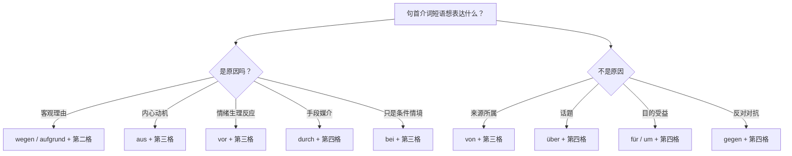

句首不表示方位、而要说明原因时，von、über、bei(m)、für、um、gegen 这些介词到底该用哪一个，怎么分？

① 句子与问题

- 原句：（本题没有给出具体句子，是一句语法提问）
- 问题：句首不表示方位、而要说明原因时，**von、über、bei(m)、für、um、gegen** 这些介词到底该用哪一个，怎么分？

② 答案
② 答案

**von、über、für、um、gegen** 这几个即使放在句首也不表示原因，**bei** 也只是间接涉及“在……情况下”的条件，并没有真正表示原因；因此，你分不清，根源在于把“话题、目的、条件”当成了“原因”。德语里表示原因基本只用一小批介词，并按“是什么样的原因”分工：

- 客观理由用第二格（第二格＝名词“的”那套词尾）的：
    - **wegen**（通用）
    - **aufgrund**（正式书面）
    - **infolge**（多指造成后果的原因）
    - **angesichts**（鉴于某事实）
    - **dank**（多亏，正面）
- 内心动机用 **aus** + 第三格，比如 **aus Angst**、**aus Liebe**、**aus Erfahrung**
- 强烈情绪或生理反应造成的用 **vor** + 第三格，比如 **vor Freude**、**vor Kälte**、**vor Müdigkeit**
- 通过某种手段或媒介引发的结果用 **durch** + 第四格，比如 **durch den Regen**
- 只表示条件情境的用 **bei** + 第三格，比如 **bei diesem Lärm**、**bei Regen**

剩下这几个介词的真正职责是：

- **von** + 第三格：表示来源或所属
- **über** + 第四格：表示话题，也就是“关于”
- **für** + 第四格：表示目的或受益者
- **um** + 第四格：表示围绕或目的
- **gegen** + 第四格：表示反对或对抗

它们都可以放在句首。放在句首只带来一个语法后果：介词短语占第一位，动词必须紧跟第二位。

- 正确：**Wegen des Regens bleiben wir zu Hause**
- 错误：~~Wegen des Regens wir bleiben~~

如果拿不准，最保险的办法是换成从句 **weil / da** 或副词 **deshalb / deswegen**，它们表原因毫无歧义。

同类例子：**Aus Angst vor Fehlern** schwieg er（因为怕出错，他不出声）——内心动机用 **aus**，后面的 **vor** 只是 **Angst vor** 这个固定搭配里的介词，两个介词各管各的，正是上面那套分工。

图解：句首介词短语选哪个

真正表示原因的介词分工：

| 介词 | 支配的格 | 哪种原因 | 为什么用它 | 例句 |
|---|---|---|---|---|
| **wegen** | 第二格 | 客观理由，最通用 | 中性，口语书面都行 | **Wegen des Regens** bleiben wir hier. |
| **aufgrund** | 第二格 | 客观依据 | 书面语、报告、论文 | **Aufgrund der Daten** ändern wir den Plan. |
| **infolge** | 第二格 | 造成后果的原因 | 多接负面结果 | **Infolge des Sturms** fiel der Zug aus. |
| **angesichts** | 第二格 | 鉴于某事实 | 引出需要考虑的背景 | **Angesichts der Lage** handeln wir sofort. |
| **dank** | 第二格 / 第三格 | 正面的原因 | 含“多亏”的褒义 | **Dank seiner Hilfe** klappte es. |
| **aus** | 第三格 | 内心动机 | 后面多是情感、动机类名词 | **Aus Angst** sagte er nichts. |
| **vor** | 第三格 | 情绪、生理反应 | 只接 **Freude / Angst / Kälte** 这类词 | **Vor Müdigkeit** konnte er nicht denken. |
| **durch** | 第四格 | 手段、媒介引发 | 强调“通过什么导致” | **Durch den Regen** wurde die Straße nass. |
| **bei** | 第三格 | 条件、情境 | 表“在……情况下”，不直接表原因 | **Bei diesem Lärm** kann ich nicht arbeiten. |

你列的这几个介词的真实身份：

| 介词        | 支配的格 | 真正意思                         | 为什么不表原因                     | 例句                            |
| --------- | ---- | ---------------------------- | --------------------------- | ----------------------------- |
| **von**   | 第三格  | 来源、所属                        | 回答 woher / wessen，不回答 warum | ein Brief **von** ihr         |
| **über**  | 第四格  | 话题、涉及                        | 是谈论、思考的对象                   | **Über** das Problem sprechen |
| **für**   | 第四格  | 目的、受益者                       | 回答 für wen / wofür          | **Für** die Prüfung lernen    |
| **um**    | 第四格  | 围绕、目的                        | 表目的或对象                      | **um** Hilfe bitten           |
| **gegen** | 第四格  | 反对、对抗                        | 表对立关系                       | **gegen** den Plan sein       |
| **beim**  | 第三格  | **bei** + **dem**，在……时 / 情况下 | 只表情境，属“条件”                  | **Beim** Lesen hört er Musik  |