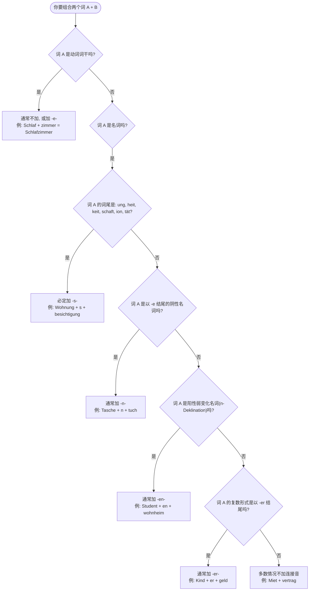

# 复合词 1+1

### 第一部分：所有的词都可以随意组合吗？

**简短的回答是：在语法上，是的；在逻辑上，不是。**

你可以把德语单词想象成**乐高积木**。

理论上，你可以把任意数量的积木拼在一起，只要它们能传达一个具体、有逻辑的意思。但在这个拼凑的过程中，有一个不可撼动的铁律：

- **火车头（Bestimmungswort / 限定词）：** 提供具体信息，说明这个东西“是什么样的”、“用来做什么的”。它可以是名词、动词、形容词。
- **火车尾（Grundwort / 基础词）：** 永远是**名词**！它决定了这个复合词的**词性（der/die/das）**和**复数形式**。

**【生活场景举例：找工作】**

- _die Arbeit_ (工作) + _der Vertrag_ (合同) = **der** Arbeitsvertrag (工作合同) -> 词性跟着 _Vertrag_ 走。
- _probe_ (试用的，来自动词 probieren) + _die Zeit_ (时间) = **die** Probezeit (试用期)。

所以，只要符合生活常理，你甚至可以==自己“发明”词汇==。比如在疫情期间，德国人就发明了 _Geisterspiel_（幽灵+比赛=无观众比赛）。

---

### 第二部分：让人头疼的“连接音”（Fugenlaute）

把两个坚硬的乐高积木硬塞在一起，有时候会“硌牙”（发音拗口）。为了让发音顺畅，或者因为历史词源的保留，德国人会在两个词中间涂一点“润滑剂”——这就是**连接音（Fugenlaute）**，主要有 **-s-, -n/en-, -e-, -er-**。

虽然没有 100%完美的数学公式（总有例外），但掌握以下几个核心规律，就能解决你 90%的问题。

为了让你更直观地理解，我为你绘制了一张决策图表：

代码段



我们来详细拆解这些规律，并结合你未来在德国的移民生活场景：

#### 1. 绝对要加 `-s-` 的情况（最常见）

当第一个词（名词）的后缀是 **-ung, -heit, -keit, -schaft, -ion, -tät, -tum** 时，**100% 必须加上 -s-**。
- [!] 注意， 这里指的不是所有阴性名词，而是上面这些以特定后缀结尾的单词

- _die Wohnung_ (公寓) + _die Besichtigung_ (看房) = **die Wohnungsbesichtigung** (看房活动，租房必备)
- _die Gesundheit_ (健康) + _die Karte_ (卡) = **die Gesundheitskarte** (医保卡，看病必备)
- _die Qualität_ (质量) + _die Kontrolle_ (控制) = **die Qualitätskontrolle** (质量控制)

_注：有时候==即使不是这些后缀，一些阴性名词也会加 -s-==，比如 die Arbeit + s + vertrag = der Arbeitsvertrag。_

#### 2. 通常要加 `-n-` 或 `-en-` 的情况

- [k] 这通常与名词的复数形式有关，或者为了发音流畅。

- **以 -e 结尾的阴性名词：** 加上 `-n-`
    - _die Tasche_ (口袋) + _das Tuch_ (布) = **das Taschentuch** (纸巾)
    - _die Woche_ (周) + _das Ende_ (结束) = **das Wochenende** (周末)
- **阳性弱变化名词（n-Deklination）：** 加上 `-en-` （这类词本身在变格时就需要加 en）
    - _der Student_ (大学生) + _das Wohnheim_ (宿舍) = **das Studentenwohnheim** (学生宿舍)
    - _der Patient_ (病人) + _die Akte_ (档案) = **die Patientenakte** (病历)

#### 3. 通常要加 `-er-` 的情况

如果第一个词的**复数形式**本身就是以 -er 结尾的，通常直接把复数形式拿来当词头。

- _das Kind_ (孩子，复数是 Kinder) + _das Geld_ (钱) = **das Kindergeld** (儿童金，去政府部门申请)
- _das Bild_ (照片，复数是 Bilder) + _das Buch_ (书) = **das Bilderbuch** (画册)

#### 4. 什么都不加的情况（Nullfuge）

如果第一个词是形容词，或者第一个词在发音上已经很“完整”且不易产生冲突，通常什么都不加。

- **形容词 + 名词：**
    - _alt_ (老/旧) + _der Bau_ (建筑) = **der Altbau** (老建筑，德国租房常见房型)
    - _kalt_ (冷) + _die Miete_ (租金) = **die Kaltmiete** (冷租金/基础租金)
- **部分动词词干 + 名词：**
    - _schlafen_ (睡觉，去掉 en) + _das Zimmer_ (房间) = **das Schlafzimmer** (卧室)
    - _mieten_ (租，去掉 en) + _der Vertrag_ (合同) = **der Mietvertrag** (租房合同)

---
# 构词法 德语为什么合成词的时候有些需要加 n/S，有些不需要加 S/n

## 一、问题：这不是“随便加”，但也不是“一条规则”

学习者常见的两句话都是错的：

- ✗ “德语复合词中间要加 s。”→ `Haustür`、`Kinderwagen`、`Umweltpolitik` 都不加。
- ✗ “完全没规律，死记。”→ 至少有六成高频词可以由首成分的形态推出来。

真实的答案是：**连接音是历史遗留的格词尾（属格或复数），今天已经冻结成词的一部分，因此是“词汇属性”，但留下大量可预测的规律。**

先看三组材料，感受一下问题所在：

| 首成分 | 加什么 | 例 |
|---|---|---|
| das Kind | -es- | `Kindeswohl`（儿童福祉） |
| das Kind | -er- | `Kinderarzt`（儿科医生） |
| das Land | -s- | `Landsmann`（同乡） |
| das Land | -es- | `Landesregierung`（州政府） |
| das Land | -er- | `Länderkunde`（各国地理） |
| das Land | ∅ | `Landkarte`（地图） |

同一个名词，五种形式。这不是混乱，而是**同一个机制在不同语义关系下的不同投影**——下面拆开看。

---

## 二、核心：一句话本质

> **复合词的第一成分在古高地德语中还带着格词尾（多为属格）；后来德语名词前的格词尾普遍脱落，但在复合词内部被“冻住”，成了今天无意义的连接音。**

**术语**：`Fugenlaut` / `Bindeelement` / `Kompositionsfuge`，德语常简称 `die Fuge`；中间的 s 叫 `Fugen-s` 或 `Bindes-`。

**通俗类比**：汉语“赤子之**心**”“无价之**宝**”里的“之”。现代汉语早已不说“桌子之腿”，但固定词里“之”留了下来，而且它今天不承担任何语法功能，只标记“这是定中结构”。德语的 `-s-` 就是这样一个“化石”：`Arbeitszimmer` 不是“工作的房间（属格）”，`-s-` 只是告诉你“词在这里切分”。

**类比的局限**（必须说明）：汉语的“之”在古汉语里是真正的结构助词，功能明确；而德语连接音**既不表属格也不表复数**（`Arbeitszimmer` 只有一个 Arbeit）。所以它比“之”更“空”——纯粹是形态化石。这也是为什么不能靠语义推导，只能靠形态线索 + 词典。

---

## 三、结构：连接音清单与首成分类型

### 3.1 德语的全部连接音

| 连接音 | 历史来源 | 例 |
|---|---|---|
| ∅（无） | 后起构词，或首成分为动词/形容词 | `Haustür` `Buchladen` `Waschmaschine` `Hochhaus` |
| **-s-** | 属格 -s（强变化阳性/中性）；部分为类推 | `Arbeitszimmer` `Hoffnungsschimmer` `Liebesbrief` |
| **-es-** | 属格 -es（强变化，词干以 -t/-d 等结尾） | `Jahreszeit` `Tageslicht` `Bundesland` `Geisteswissenschaft` |
| **-e-** | 古属格/与格 -e 的残留 | `Pferdestall` `Hundehütte` `Schweinebraten` `Mausefalle` |
| **-n-** | 弱变化/混合变化名词的格词尾 | `Straßenbahn` `Sonnenblume` `Nasenloch` `Kirchenchor` |
| **-en-** | 弱变化阳性名词（Mensch 型）或复数 -en | `Menschenmenge` `Frauenarzt` `Nervenarzt` `Staatenbund` |
| **-ens-** | 混合变化名词属格 -ens（Name 型） | `Namensschild` `Herzenswunsch` `Glaubensfrage` `Friedensvertrag` |
| **-er-** | 古属格复数 -er（强变化） | `Kinderarzt` `Wörterbuch` `Länderspiel` `Bücherregal` `Hühnerstall` |

### 3.2 首成分类型 → 连接音：可用规律

| 首成分特征 | 连接音 | 可靠度 | 例 |
|---|---|---|---|
| 派生后缀 **-heit / -keit / -igkeit** | **-s-** | 极高（几乎无反例） | `Sicherheitsnadel` `Geschwindigkeitsbegrenzung` |
| 派生后缀 **-ung** | **-s-** | 极高 | `Wohnungsbau` `Zeitungsartikel` `Bildungssystem` `Umweltverschmutzung`? ✗ → 见下 |
| 后缀 **-ion / -tät / -ität** | **-s-** | 高 | `Diskussionsrunde` `Reaktionszeit` `Universitätsbibliothek` |
| 后缀 **-schaft / -ling / -tum / -sal** | **-s-** | 高 | `Freundschaftsspiel` `Frühlingswetter` `Schicksalsschlag` |
| 弱变化阳性（Mensch, Herr, Bauer, Nachbar, Junge…） | **-en-** | 高 | `Menschenmenge` `Herrenmode` `Bauernhof` |
| 混合变化（Name, Gedanke, Glaube, Wille, Herz, Friede…） | **-ens-** | 高 | `Namensschild` `Gedankenspiel` `Willenserklärung` |
| 首成分为**动词词干** | ∅ | 极高 | `Schreibtisch` `Bügeleisen` `Kühlschrank` |
| 首成分为**形容词** | ∅ | 高 | `Hochzeit` `Kurzschluss` `Schwarzmarkt` |
| 首成分**表示复数语义**（多个 X、各种 X） | 用该词的复数形式 | 高 | `Kinderarzt` `Wörterbuch` `Länderkunde` `Blumenstrauß` |
| 阴性、以 -e 结尾的名词 | **三种都可能** | 低 → 查词典 | `Straßenbahn` / `Sonnenblume` / `Augenarzt` ↔ `Taschengeld` / `Küchenschrank` / `Augapfel` |

**注意最后一行的陷阱**：`das Auge` 在同一批词里给出 `Augenarzt`、`Augenbraue`，却给出 `Augapfel`。这说明**规律是概率性的，不是算法**。

---

## 四、机制：为什么会长成这样

### 4.1 主因：格词尾的化石（历史层）

古高地德语（约 750–1050）里，复合词第一成分处于**格形式**，通常是属格，表达“整体—部分 / 所属 / 限定”关系。当时说出来的其实是：

```
des Jahres  Zeit   →  Jahreszeit
des Kindes  Wohl   →  Kindeswohl
der Kinder  Arzt   →  Kinderarzt
des Namens  Schild →  Namensschild
des Menschen Menge →  Menschenmenge
```

早期新高地德语阶段，名词前的格词尾大面积脱落（`des Mannes Haus` → `dem Mann sein Haus` → 现代 `das Haus des Mannes`），但**复合词内部不再被重新分析**，于是这些词尾被冻结。这就是为什么 `-es-` 与 `-er-` 能精确对应“属格单数”和“属格复数”：`Kindeswohl` vs `Kinderarzt` 的差别，就是 1000 年前“一个孩子的福祉”与“（许多）孩子的医生”的差别。

**由此可以推出一条检验**：如果你在连接音上看到 `-es-`、`-er-`、`-ens-`，几乎总能猜出它原来是单数属格还是复数属格——这是理解而非记忆。

### 4.2 次因：韵律与音变（音系层）

`-s-` 在现代德语里扩张得最厉害，一个重要推力是**避免元音冲突和糟糕的重音节奏**：

- `Liebe + Brief` → 若直接拼接需删 e，得到 `Liebbrief`（不好发音）→ `Liebesbrief`，-s- 充当缓冲。
- `Hilfe + Mittel` → `Hilfsmittel`；`Geschichte + Buch` → `Geschichtsbuch`。首成分以非重读 -e 结尾时，`-s-` 兼作“切割标记”，让听者知道词界在哪儿。
- `-heit/-keit/-ung` 之后 `-s-` 近乎强制，原因之一是这些后缀本身以辅音收尾、非重读，加 -s- 形成更清晰的节奏单位（`Sicherheit(s)nadel`）。

**但音系只能解释倾向，不能预测个别词**：`Umweltpolitik`、`Umweltschutz` 就不加 s，尽管从节奏上看加了也无妨。

### 4.3 第三因：类推（构词层）

复合词是**生产者**，不是逐条发明的。一旦 `Arbeitszimmer`、`Arbeitsamt`、`Arbeitszeit`、`Arbeitsmarkt` 形成家族，新词就按家族模式加 s：

```
Arbeit(s)…  →  Arbeitsmarkt, Arbeitslosigkeit, Arbeitsvertrag …
Umwelt…     →  Umweltpolitik, Umweltschutz, Umweltbewusstsein …（整族都不加 s）
```

这也解释了为什么 **-s- 在阳性、中性名词之外还大量出现**：`die Arbeit`、`die Liebe`、`die Hilfe`、`die Geschichte` 这些阴性词的属格本来没有 -s（`der Arbeit`），所以 `Arbeits-`、`Liebes-` 无法用属格解释，学界多用“类推扩散”或“副词性属格 -s”（如 `morgens`、`mittags`、`flugs` 里的 -s）来解释。**这是本主题最诚实的空白点**，见第七节。

---

## 五、扩展：连接音何时改变意义、何时只是变体

### 5.1 有语义对立的最小对

| 无连接音 / 弱 | 加连接音 | 差别 |
|---|---|---|
| `Landmann`（农夫） | `Landsmann`（同乡） | 完全不同的词 |
| `Landkunde`（乡土/土壤学） | `Länderkunde`（各国地理） | 单数 vs 复数对象 |
| `Landeskunde`（国情/区域文化学） | 与上两者都不同 | 三种形式三义 |
| `Wortschatz`（词汇量） | `Wörterbuch`（词典） | 集合 vs 复数 |
| `Kindeswohl`（儿童福祉，法律术语） | `Kinderwohl`? 极少用 | 前者是固定术语 |

### 5.2 只有变体、没有语义差

- `Schweinebraten`（标准德语）↔ `Schweinsbraten`（南德/奥地利）——地域差异，不是语义差异。
- 瑞士标准德语总体上**少用 Fugen-s**，南德也偏保守；同一概念在北方常带 s、在南方常不带。这一点在阅读和听力里要能“容忍变体”，写作时按 Duden 走。

### 5.3 条件变化如何改变结果

| 改变的条件 | 结果 |
|---|---|
| 首成分是动词词干 | 永不加 s：`Waschmaschine` `Schreibtisch` `Bügeleisen` |
| 首成分是派生后缀词 | 几乎必加 s：`Zeitungspapier` `Sicherheitsnadel` |
| 要表达“多个 X 的 Y” | 用复数形式：`Kinderarzt` `Länderkunde` `Blumenstrauß` |
| 首成分是阴性 -e 名词 | 无法预测：`Straßenbahn` / `Taschengeld` / `Augapfel` 并列存在 |

---

## 六、实战：四步判断 + 常见错误

### 6.1 操作流程（写 C 1 作文时用）

```
① 首成分是不是 -heit/-keit/-ung/-ion/-tät/-schaft/-ling/-sal？
      是 → 加 -s-，结束。
      否 → ②
② 首成分是不是动词词干或形容词？
      是 → ∅，结束。
      否 → ③
③ 首成分是不是弱变化/混合变化阳性名词（Mensch/Name/Glaube/Herz…）？
      是 → -en- / -ens-，结束。
      否 → ④
④ 语义上是不是“多个 X / 各类 X”？
      是 → 用复数形式（-er- / -e- / -en-），结束。
      否 → ⑤
⑤ 已有同类词家族（Arbeit(s)-, Umwelt-, Bildung(s)-）可参照？
      是 → 照家族走。
      否 → 查 Duden（在线版词条会直接给出复合词写法），按词典记。
```

**第 ⑤ 步是常态，不是失败。** 连接音本质上是词条的一部分；把它当成“单词拼写”来记，而不是当成“语法规则”来推，是 B 2 之后最省力的策略。

### 6.2 常见错误对照

| 错误 | 正确 | 病因 |
|---|---|---|
| ✗ `Bildungsystem` | `Bildungssystem` | 漏掉 -ung 强制 s |
| ✗ `Kinderartz` 的类推错误：✗ `Kinderarzt` 写成 `Kindarzt` | `Kinderarzt` | 复数语义未体现 |
| ✗ `Straßebahn` | `Straßenbahn` | 阴性 -e 名词的 -n- 被吞 |
| ✗ `Taschenbuch` 理解为“包的书” | `Taschenbuch`（平装书）、`Taschengeld`（零花钱） | 误以为 -e 阴性一律加 -n- |
| ✗ `Namenschil` | `Namensschild` | 混合变化名词的 -ens- |
| ✗ `Arbeitmarket` | `Arbeitsmarkt` | 家族类推缺失 |
| ✗ `Umweltschutz` 写成 `Umweltschutz` ✓ 但 ✗ `Umweltschutz` 加 s | `Umweltschutz`（无 s） | 过度类推，把 -s- 当默认值 |

**验证手段**：写出复合词后在 Duden 在线词典查首成分（如 `Arbeit`），词条下会列出常见复合词；或直接查你写的整词，看是否收录。零成本、零风险。

---

## 七、边界：什么时候这套解释不成立

1. **没有算法，只有概率**。`Augenarzt` 与 `Augapfel`、`Straßenbahn` 与 `Taschengeld` 并列存在，任何“规则”都有反例。词典是最终权威。
2. **学术争议 1：-s- 的来源**。“属格说”能解释 `Jahres-`、`Kindes-`、`Namens-`，但解释不了 `Arbeits-`、`Liebes-`（阴性属格无 -s）。因此有“类推说”“副词性属格说”“韵律说”等多种补充解释，尚无定论。**不要把“属格说”当成已证明的因果**——它是主流假说，不是定理。
3. **学术争议 2：-e-/-er-/-en- 是“复数”还是“无义连接音”**。所谓“复数假说”能解释 `Kinderarzt`（给孩子看病的医生）、`Blumenstrauß`（多朵花），但解释不了 `Straßenbahn`（一条街上的电车，无复数义）。因此更稳妥的表述是：**部分连接音源自复数，但在现代德语中已失去复数语义，只剩形态功能**。
4. **反例清单**（记牢能防止过度概括）：`Umweltpolitik`（-ung 规则不适用，因为首成分不是 -ung 结尾）、`Augapfel`、`Taschengeld`、`Küchenschrank`、`Hochhaus`、`Waschmaschine`。
5. **地域与语域**：瑞士、奥地利、南德的连接音习惯不同；口语里 `-s-` 有时被吞（`Arbeitszimmer` → `Arbeitzimmer`），但写作必须规范。
6. **考试权重**：歌德 B 2/C 1 写作中，连接音错误**通常不构成理解障碍**，评分上属于“词汇/正字法”层面的小扣分，不会像主句倒装、时态配合那样致命。策略上：**优先保证句式与时态，连接音按背过的词块写，不确定就查**。但在 C 1 口语/写作中，`Bildungssystem`、`Arbeitsmarkt`、`Umweltbewusstsein` 这类高频学术复合词是该级别的基本盘，写错会被注意到。

**回到开篇问题**：加不加 s/n，不是“语法规定”，而是**一千年前的格词尾在今天的化石**，加上韵律缓冲与家族类推的二次塑造。可迁移的模型是：

> **看到连接音，先问“它原来是单数属格、复数属格，还是纯粹类推”；能答出来就理解了机制，答不出来就把它当词条拼写记——两种做法都对，混着用才会出错。**

---

## 八、练习（附答案与评分标准）

填入正确的连接音（∅ 表示不加），并说明依据。

1. `Sicherheit` + `Nadel` → ?
2. `Bildung` + `System` → ?
3. `Kind` + `Wagen` → ?
4. `Name` + `Tag` → ?（注意：这里有两个可能，说明为何容易混）
5. `Wasch` (动词词干) + `Maschine` → ?
6. `Umwelt` + `Politik` → ?
7. `Straße` + `Bahn` → ?
8. `Tasche` + `Geld` → ?
9. `Herz` + `Wunsch` → ?
10. `Land` + `Karte` → ?

**参考答案**

1. `Sicherheitsnadel`（-heit/-keit 强制 -s-）
2. `Bildungssystem`（-ung 强制 -s-）
3. `Kinderwagen`（复数语义：推孩子的车 → 复数属格 -er-）
4. `Namenstag`（名字日，教会节日，用 -n-）与 `Namensschild`（名牌，用属格 -ens-）并存；同为首成分却不同连接音，正说明**连接音是词条属性**，须逐个记。
5. `Waschmaschine`（动词词干首成分 → ∅）
6. `Umweltpolitik`（∅；`Umwelt-` 整个家族都不加 s，与 -ung 规则无关）
7. `Straßenbahn`（阴性 -e 名词的 -n-，无复数义，属词汇性）
8. `Taschengeld`（∅；与 Straßen- 对比，说明阴性 -e 名词不可一律加 -n-）
9. `Herzenswunsch`（混合变化名词属格 -ens-）
10. `Landkarte`（∅；与 `Landesregierung`、`Länderkunde`、`Landsmann` 构成同一名词的四种形式对照）

**评分标准（每题 1 分）**

- 连接音正确 0.5 分；
- 能说出依据（后缀 / 弱变化 / 复数语义 / 动词词干 / 词汇性）0.5 分。
- 若答案正确但依据写成“就是习惯”，得 0.5 分——因为本主题的核心正是**区分“可推的机制”与“须记的词条”**。
- 第 4 题答出 `Namenstag` 或 `Namensschild` 任一均给分，能指出二者并存者加 0.5 分。