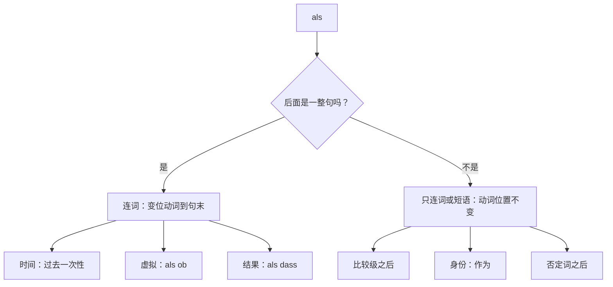
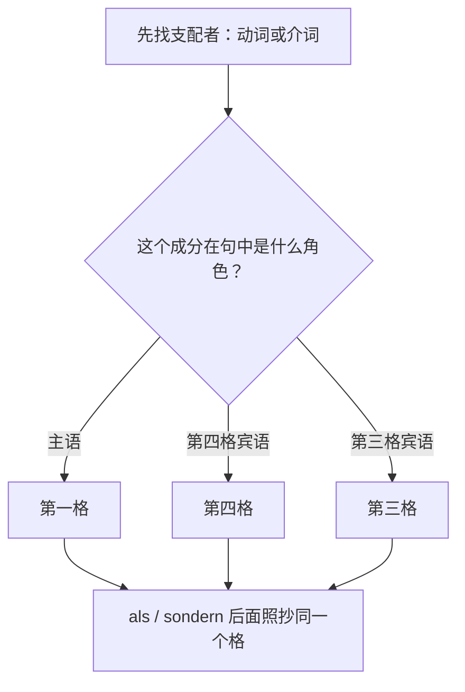

# als所有用法

结论：图里那六项可以归并成两大类，而判断属于哪一类，只需看 **als** 后面是不是一整个句子。如果后面有主语和变位动词，它就是连词（这类词会把变位动词放到句末），具体分三种：时间（过去只发生一次，现在、将来和反复发生则用 **wenn**）、虚拟比较（**als ob**，动词句末加第二虚拟式）、结果（**zu …, als dass …**）；如果没有，它只是连接词或短语的连接词，动词位置完全不动，包括比较级后的比较、表身份的“作为”、否定词后的“除了”，以及 **sowohl … als auch** 这类固定搭配。唯一的例外是 **kaum …, als …**，它前半句倒装，**als** 后面反而是正常语序，动词在第二位。

格的处理有一条铁律：**als** 自己永远不支配格，既不要求第三格也不要求第四格，它只是把两端并排，谁的格该是什么就照原样留着。具体分三种情形：比较级后的一端照抄平行成分的格（**Sie ist größer als er**，不能说 **ihn**）；表身份的那一端跟着它所说明的成分走（**Ich kenne ihn als guten Lehrer** 是第四格，因为 **ihn** 是 **kennen** 的宾语；**Er gilt als guter Lehrer** 是第一格，因为说的是主语）；否定词后的一端跟着那个否定词的格（**Kein anderer als er** 第一格，**nichts als Wasser** 第四格）。

图解：**als** 判断流程图

| 用法                                            | 触发条件                                                       | 例句与翻译                                                                                                                 | 格与动词位置                                                          |
| --------------------------------------------- | ---------------------------------------------------------- | --------------------------------------------------------------------------------------------------------------------- | --------------------------------------------------------------- |
| 时间连词（“当……的时候”）                                | 过去发生的一次性事件；现在、将来、反复发生用 **wenn**                            | **Als ich zwölf war, zogen wir nach Berlin.**（我十二岁那年，我们搬到了柏林。）                                                        | **als** 引导从句，变位动词 **zogen** 到句末                                 |
| 比较连词（比较级后）                                    | 前面有比较级（**-er、mehr、weniger、eher、anders**），两者不相等；相等用 **wie** | **Er läuft schneller als sein Bruder.**（他跑得比他哥哥快。）／**Anders als sein Bruder mag er keinen Sport.**（和他哥哥不同，他不喜欢运动。）    | 后面的代词照抄平行成分的格：**Sie ist größer als er.**（不是 **ihn**）            |
| 虚拟比较从句（**als ob / als wenn / als** 倒装）        | 与事实相反的“好像……似的”                                             | **Er tut, als ob er nichts gehört hätte.**（他装作什么也没听见。）／**Er tut, als hätte er nichts gehört.**（同上，省略 **ob** 的倒装式）     | 从句动词句末，用第二虚拟式；省略 **ob** 时动词紧跟 **als**                           |
| 结果从句（**zu …, als dass …**）                    | “太……以至于不能”，含否定结果                                           | **Er ist zu müde, als dass er noch weiterarbeiten könnte.**（他太累了，没法再继续工作。）                                            | **als dass** 引导从句，动词句末，常用第二虚拟式                                  |
| 同位语连词（“作为、是”）                                 | 说明身份、职业、功能，等于把两端画等号                                        | **Sie arbeitet als Ärztin in Hamburg.**（她在汉堡当医生。）／**Ich kenne ihn als guten Lehrer.**（我了解他是一名好老师。）                    | **als** 不变格；后面的名词跟它所说明的成分同格：**Ärztin** 第一格，**guten Lehrer** 第四格 |
| 限制小品词（否定词之后，“除了……没有别的”）                       | 前面有 **nichts、niemand、kein anderer、nirgends**               | **Kein anderer als er kann das entscheiden.**（除了他没人能决定这事。）／**Er trinkt nichts als Wasser.**（他除了水什么也不喝。）               | 跟着否定词的格走：**er** 第一格，**Wasser** 第四格                              |
| 关联连词 **sowohl … als auch**                    | 两者都成立                                                      | **Sie spricht sowohl Deutsch als auch Chinesisch.**（她既会说德语也会说中文。）                                                     | 两端同格，冠词照常保留                                                     |
| 关联连词 **kaum …, als …**                        | “刚一……就……”，过去一次性                                            | **Kaum hatte er das Haus betreten, als das Telefon klingelte.**（他刚进屋，电话就响了。）                                          | 前半句倒装；**als** 后是主句语序，动词在第二位，**不是**从句                            |
| 关联连词 **eher / lieber / nichts anderes … als** | 排高低或排除其他可能                                                 | **Ich fahre lieber mit dem Zug, als zu fliegen.**（我宁愿坐火车，也不愿坐飞机。）／**Es war nichts anderes als ein Zufall.**（那不过是个巧合。） | **als** 后接 **zu** + 不定式或名词，两端形式对称、同格                            |
| 数量比较 **mehr / weniger als**                   | 数量、程度“多于、少于”                                               | **Mehr als hundert Leute kamen zur Versammlung.**（来参加集会的一百多人。）                                                        | 只比数量；该成分是主语就用第一格，是宾语就用第四格                                       |
| 身份类的延伸：**als** + 序数                           | “作为第一个、第二个……”                                              | **Als Erster erreichte er das Ziel.**（他第一个到达终点。）                                                                      | 跟着主语同第一格，序数词照常变格                                                |
| 旧式与南德说法 **so … als**                          | 标准德语已改用 **so … wie**，只剩固定短语                                | **Komm so schnell als möglich.**（尽可能快点来。）                                                                             | 相当于 **wie**，不支配格                                                |

同类收尾：**Er benimmt sich wie ein Kind, obwohl er als Erwachsener gilt.** 一句话里同时出现 **wie**（相等比较）和 **als**（身份），正好说明两者的分工：**wie** 是“像”，**als** 是“作为”，谁都不改变后面名词的格。

## 一、 时间连词 (Temporale Subjunktion)

作为从属连词，`als` 引导时间状语从句，**必须同时满足两个条件**：

1. 描述发生在**过去**的事件或状态。
2. 该事件或状态是**一次性**的（非重复发生）。

    _语法规则：引导从句，动词必须放在从句句末。_

- **Als** ich gestern beim Ausländerbehörde war, fehlte mir ein wichtiges Dokument.
    （昨天我去外管局的时候，少带了一份重要文件。）

- Ich hatte schon drei Jahre Berufserfahrung, **als** ich nach Deutschland kam.
    （当我来到德国时，我已经有了三年的工作经验。）

## 二、 比较连词 (Vergleichspartikel / Konjunktion)

用于比较级（Komparativ）之后，表示两个事物在某方面**不相等**（对应英文的 "than"）。

_语法规则：通常不改变原有句子的语序，直接连接被比较的对象。_

- Die Kaltmiete in München ist deutlich höher, **als** ich erwartet habe.
    （慕尼黑的冷租比我预期的要高得多。）

- Es ist für Einwanderer oft schwerer, eine Wohnung zu finden **als** einen Job.
    （对移民来说，找房子往往比找工作更难。）

## 三、 同位语连词/身份标识 (Apposition / Gleichsetzungsfunktion)

这是 B 1-B 2 考试中最常设陷阱的考点。此时 `als` 意为“作为”，用于说明身份、职业、角色或功能。

_语法规则（极度重要）：**格的一致性 (Kasuskongruenz)**。`als` 后面的名词或代词，必须与其所指代的名词/代词在“格”上保持绝对一致。_

- **第一格 (Nominativ) 保持一致：**
    Ich arbeite hier **als** diplomierter Krankenpfleger.
    （我在这里作为注册护士工作。—— `als` 指代主语 `Ich`，故用第一格）

- **第四格 (Akkusativ) 保持一致：**
    Der Arzt hat mir dieses Medikament **als** starkes Schmerzmittel verschrieben.
    （医生给我开了这种药作为强效止痛药。—— `als` 指代宾语 `dieses Medikament`，故用第四格）

- **第三格 (Dativ) 保持一致：**
    Bei diesem Problem spreche ich mit dir **als** meinem Berater.
    （在这个问题上，我是把你当作我的顾问来交谈的。—— `als` 指代介词宾语 `dir`，故用第三格 `meinem Berater`）

## 四、 引导非真实比较从句 (Irrealer Vergleichssatz)

用于表达“好像……”、“仿佛……”，**必须与第二虚拟式 (Konjunktiv II) 连用**。此用法有三种变体，语序规则各不相同：

1. **als ob + 动词尾语序：**
    Der Beamte tat so, **als ob** er meinen Akzent nicht _verstanden hätte_.
    （那个签证官表现得好像他没听懂我的口音一样。）

2. **als + 动词第二位语序（强烈推荐掌握，最地道）：**
    省略 `ob`，此时变位动词必须紧跟在 `als` 之后。
    Der Beamte tat so, **als** _hätte_ er meinen Akzent nicht verstanden.
    （句意同上。注意 `hätte` 的位置提前了。）

3. **als wenn + 动词尾语序（较少用，等同于 als ob）：**
    Er sieht so aus, **als wenn** er drei Nächte nicht _geschlafen hätte_.
    （他看起来好像三天没睡觉了。）

## 五、 构成固定关联词组 (Mehrteilige Konnektoren)

用于表达“既……又……”或“不仅……而且……”，连接两个平行的句子成分。

_语法规则：固定搭配 `sowohl ... als auch ...`。连接的两个部分没有主次之分。_

- Für die Niederlassungserlaubnis brauchen Sie **sowohl** ein festes Einkommen **als auch** das B 1-Zertifikat.
    （为了获得永久居留许可，您既需要稳定的收入，也需要 B 1 语言证书。）

## 六、 用于否定词之后的限制 (Einschränkung nach Negation)

^rwfqmg

当 `als` 出现在 `nichts`（什么也没有）、`niemand`（没有人）、`kein-`（没有）等否定词之后，意为“除了……（没有别的）”。

- Ich habe auf dem Amt heute **nichts als** Ärger gehabt!
    （我今天在局里除了惹了一肚子气，什么也没得到！）

- **Niemand anders als** der Vermieter hat den Ersatzschlüssel.
    （除了房东，没有任何人有备用钥匙。）

`als` 的核心就在于：看到它，先判断它是连句子（注意语序）、连比较级，还是连身份（注意对格）。

你现在对“同位语连词的格一致性 (Kasuskongruenz)”理解得如何？需要我给出几个带陷阱的填空题来测试一下你的肌肉记忆吗？

|结构|中文意思|例句|翻译|中间成分的格由什么决定|算否定吗|
|---|---|---|---|---|---|
|eher A als B|与其说 B，不如说 A|Zwang erzeugt eher Frust als Engagement.|强制带来的与其说是投入，不如说是挫败。|两端处于同一格位，格由支配它的动词或介词决定；这里 erzeugen 支配第四格，所以 Frust 和 Engagement 同用第四格|不算，只有比较级排序|
|nicht A, sondern B|不是 A，而是 B|Ich suche nicht den Lehrer, sondern den Schüler.|我找的不是那位老师，而是那个学生。|sondern 后重复冠词，格跟随同一动词或介词；suchen 支配第四格，两端都用第四格|算，nicht 直接否定 A|
|nichts anderes als A|除了 A 没别的|Er will nichts anderes als den Frieden.|他除了和平别无他求。|nichts 已是 wollen 的第四格宾语，den Frieden 也采用同一格；整个短语作主语时改回第一格：Nichts anderes als der Zufall hat das bewirkt|算，nichts 排除其他全部可能|
|kaum mehr als A|不过 A 而已|Kaum mehr als zehn Studenten kamen zur Prüfung.|来参加考试的不过十来个学生。|只比较数量，格跟着该成分的角色走：作主语用第一格，作宾语用第四格（Ich habe kaum mehr als zehn Euro.）|半否定，kaum 压低数量|
|zu …, als dass …|太……以至于不能|Er ist zu müde, als dass er noch weiterarbeiten könnte.|他太累了，没法再继续工作。|引出的是完整从句，主语 er 用第一格，变位动词 könnte 位于句末，所以没有中间成分的格的问题|隐含否定，结果实现不了，故用第二虚拟式|
|als ob …|好像……似的|Er tut, als ob er nichts gehört hätte.|他装作什么也没听见。|同样是完整从句，主语 er 用第一格，hätte 位于句末；省略 ob 时改成 als hätte er nichts gehört，动词提前到 als 之后|反事实，与事实相反，故用第二虚拟式|
|对照：比较级 + als 代词|比……更……|Ich kenne ihn besser als dich. / Sie ist größer als er.|我比你更了解他。/ 她比他高。|als 后面的代词照抄平行成分的格：dich 是 kennen 的第四格，er 是主语第一格，不能写成 als du|不算否定|

同类收尾：Das ist eher eine Frage des Zufalls als des Könnens. 与第一行完全同构：两端都是 sein 后面的第二格定语，格由前面的名词 Frage 决定，als 只是把两端并在同一个格位上。

## 七、 表语性成分 (als-Prädikativum)

这是 `als` 在德语中最常被误判、但在你未来工作生活中最核心的用法。它**不是**同位语，而是一种独立的表语性说明成分。

**语法定义与规则：** `als` 引导一个名词短语，用来补充说明句子中的主语或宾语在**谓语动词发生时**所处的身份、角色、状态或功能。

1. **非紧贴性**：它不需要像同位语那样紧贴着被修饰的名词，它可以灵活地放在句首（占据第一位）或被谓语动词隔开。
2. **核心可删减性**：它在句法上是补充说明，删掉后句子的主谓宾核心结构依然成立。
3. **格的一致性 (Kasuskongruenz)**：这是它唯一和同位语表现相似的地方。`als` 后的名词必须与它所说明的主语或宾语在“格”上保持绝对一致。

**实战场景解析：**

- **修饰第一格主语 (Subjektsprädikativum)：** **Als 18-jähriger Entwickler** habe ich mein erstes Konto bei Amazon Web Services registriert. （作为 18 岁的开发者，我注册了我的第一个 AWS 账户。） _解析：`als` 引导的成分修饰主语 `ich`，说明主语在注册账户时的身份状态，因此 `Entwickler` 使用第一格（强变化形容词词尾 -er）。即便它被放在了句首，依然是独立说明主语的表语性成分。_
- **修饰第四格宾语 (Objektsprädikativum)：** Das IT-Unternehmen stellt mich **als Administrator für Oracle Cloud** ein. （这家 IT 公司聘用我作为 Oracle Cloud 的管理员。） _解析：`als` 成分修饰第四格宾语 `mich`，说明“我”被聘用后的职位角色，因此 `Administrator` 必须跟随使用第四格。_
- **修饰介词宾语（常与特定动词搭配）：** Die Ausländerbehörde sieht dieses Zertifikat **als einen gültigen Nachweis** an. （外管局将这份证书视为有效的证明。） _解析：这是由动词 `ansehen als` 构成的固定搭配，`als` 修饰前面的第四格宾语 `dieses Zertifikat`，因此后续的 `Nachweis` 也是第四格。_
