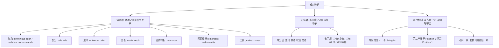
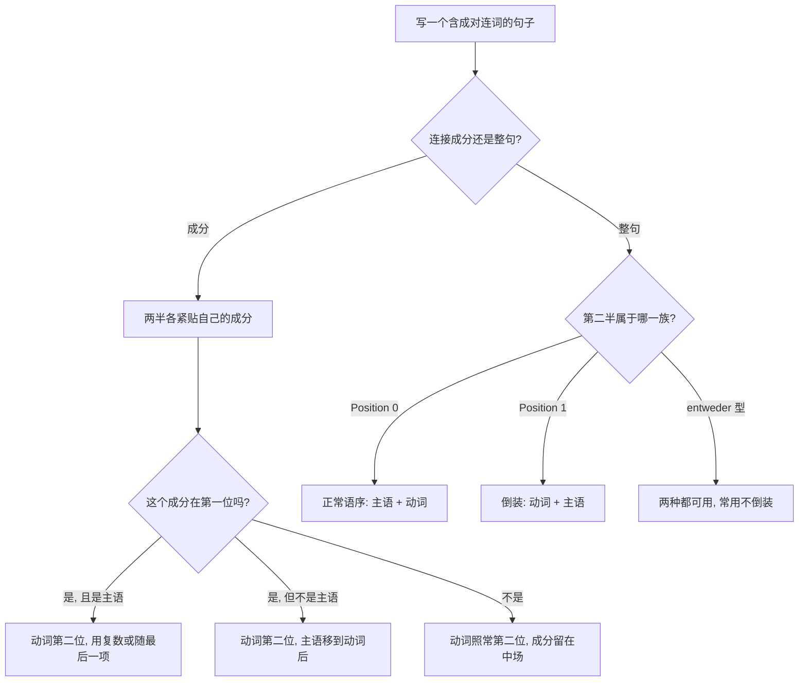

# 连词成对

^zyk0e3

你好！我是你的专属德语老师。很高兴看到你在系统地整理 B 2 级别的核心语法点。这副图片（"PixPin _2026-06-05_20-25-16.jpg"）总结的成对连词（Zweiteilige Konnektoren）是德语 B 2 书面表达（Schriftlicher Ausdruck）中提升句子逻辑和含金量的绝对利器。

由于你这次的任务是提取图片内容作为笔记，我已将图片中的连词、释义、例句以及补充的高级用法（C 1 提示）完美提取并翻译。我为你采用了清晰的 Markdown 格式，你可以直接复制并一键导入到 Notion、Obsidian 等笔记软件中：

### 📘 德语成对连词 (Zweiteilige Konnektoren) 笔记

#### 1. sowohl ... als auch (两者皆有：A + B / 既...又...)

- **例句**: Im Internet kann man sowohl Zeitung lesen als auch einkaufen.
- **翻译**: 在网上，人们既可以阅读报纸，也可以购物。
- **语法提示**: 句子不加逗号，动词通常根据上下文保持复数或与就近主语一致。

#### 2. nicht nur ..., sondern auch (两者皆有，强调后者 / 不仅...而且...)

- **例句**: Das Internet ist nicht nur ein Informationsmedium, sondern auch eine Kommunikationsplattform.
- **翻译**: 互联网不仅是一种信息媒介，也是一个沟通平台。
- **高级用法 (C 1)**: 如果后半句中有主语和动词，则主语和动词位于 `sondern` 和 `auch` 之间。
    - **例句**: Sie ist nicht nur sehr schön, sondern (sie) arbeitet auch viel.
    - **翻译**: 她不仅长得很漂亮，而且工作也很努力。

#### 3. entweder ... oder (两者之一：A 或 B / 要么...要么...)

- **例句**: Man kann entweder einen Computer oder ein Smartphone benutzen.
- **翻译**: 人们可以要么使用电脑，要么使用智能手机。

#### 4. weder ... noch (两者皆无：非 A，非 B / 既不...也不...)

- **例句**: In manchen Ländern stehen weder Facebook noch Wikipedia zur Verfügung.
- **翻译**: 在一些国家，既不能使用 Facebook，也不能使用 Wikipedia。
- **语法提示**: 这是一个含有否定意义的连词，句子中**不能**再出现 nicht 或 kein。

#### 5. teils ..., teils (两者的部分：一些 A，一些 B / 一部分...一部分...)

- **例句**: Viele Menschen benutzen ihr Smartphone teils zum Telefonieren, teils als mobilen Internetzugang.
- **翻译**: 许多人使用他们的智能手机，一部分是为了打电话，一部分是作为移动互联网接入设备。

#### 6. zwar ..., aber (积极/消极对比 / 虽然...但是...)

- **例句**: Im Internet zu surfen ist zwar interessant, aber es kostet auch viel Zeit.
- **翻译**: 虽然在网上冲浪很有趣，但也很花时间。

#### 7. einerseits ..., andererseits (两方面对比 / 一方面...另一方面...)

- **例句**: Das Internet ist einerseits ein gutes Informationsmedium, andererseits werden dort auch falsche Informationen verbreitet.
- **翻译**: 互联网一方面是一个良好的信息媒介，另一方面那里也会传播虚假信息。
- **语法提示**: 两个词都是副词，常放在句首占位（占第 1 位，动词放第 2 位）。

#### 8. je ..., desto / umso (比例关系 / 越...越...)

- **例句 1**: Je länger man im Internet surft, desto weniger Zeit hat man für andere Dinge.
- **翻译 1**: 人们在网上冲浪的时间越长，留给其他事情的时间就越少。
- **例句 2**: Je schneller das Internet ist, desto schneller kann man arbeiten.
- **翻译 2**: 互联网速度越快，人们工作的速度就越快。
- **例句 3**: Je mehr Computer im Netzwerk sind, desto langsamer wird das Internet.
- **翻译 3**: 网络中的电脑越多，互联网的速度就越慢。
- **语法提示**: `je` 引导**从句**（动词在句末）；`desto/umso` 引导**主句**（紧跟比较级，随后直接加动词，即动词在主句第 2 位）。
- **高级用法 (C 1)**: 如果形容词修饰的名词带有冠词，`je` 和 `desto/umso` 位于冠词之后，形容词之前。
    - **例句**: Ein je schnelleres Auto man fährt, ein desto vorsichtigerer Fahrer muss man sein.
    - **翻译**: 驾驶越快的汽车，就必须成为越谨慎的司机。

**👩‍🏫 老师的写作建议：**

熟练掌握并交替使用这些成对连词，能让你的文章逻辑结构瞬间清晰，是 B 2 写作评分标准中 "Kohäsion und Kohärenz"（连贯与衔接）的重要加分项！随时欢迎你用这些词造句，我来为你批改！


# 德语成对连词完全攻略
## Zweiteilige Konnektoren：从“记住八个词”到“生成任意句子”

---

## 学习目标

学完本文，你应当能够做到：

1. 说清 8 组成对连词各自表达哪种逻辑关系，以及它们之间**不能互换**的理由；
2. 面对同一个意思，主动选择把它写成**简单句、主句+主句、主句+从句、从句内部**中的任意一种；
3. 解释并预测**第一个连词在句首／第二个连词在句首／两者都不在句首**三种情况下动词分别站在哪里；
4. 把成对连词用到**定语层**（只修饰某个名词或形容词），并保证词尾、格、介词重复正确；
5. 诊断并修正中国学习者最高频的 6 类错误；
6. 在写作与口语考试中把它们当作**组织信息的骨架**，而不是装饰。

---

## 知识地图



---

# 第 0 阶　无极·破壁：这八个词为什么总是“差一点就对”

先看三句中国学习者写得出来的句子：

> ❌ *Sowohl er kommt als auch sie kommt.*
> ❌ *Nicht nur er hat Zeit, sondern auch er hat Lust.*
> ❌ *Je mehr ich lerne, desto besser ich verstehe.*

三个句子里的单词都对，意思也能猜出来，但德国人会觉得“不对劲”。原因不是词汇，而是**三个错误的心理模型**：

**错误模型一：把它们当成从属连词。**
因为中文的“虽然……但是……”“因为……所以……”常常对应德语 `obwohl` / `weil`，很多人下意识认为成对连词也会把动词赶到句末。事实是：8 组里只有 `je ... desto` 强制主从结构，其余七组都是**并列**关系，动词照常站第二位。

**错误模型二：把每一半当成可以自由漂移的副词。**
`zwar`、`einerseits`、`teils`、`noch` 确实可以站句首，但它们站句首时**占用了句子的第一位**，因此后面必须倒装。而 `aber`、`oder`、`sondern` 站句首时**不占第一位**（它们站在第一位之前），所以后面保持正常语序。这两种行为完全不同，混用就出错。

**错误模型三：只记中文意思，不记“半边括号”。**
`sowohl ... als auch` 的本质不是“既……又……”，而是**一对括号**：左括号必须紧贴 A，右括号必须紧贴 B。中文的“既……又……”可以随便放，德语不行。位置错了，句子就散架。

本文要解决的，就是这三件事：**语义怎么选、括号放哪里、动词站哪里。**

---

# 第 1 阶　道生一：成对连词是一个跨越两个成分的“半边括号”

## 1. 专业定义

**Zweiteilige Konnektoren**（也称 Doppelkonnektoren、korrelative Konjunktionen、mehrteilige Konnektoren）指由两个固定搭配的部分组成的连接词，两部分分别置于两个**句法上等值**的成分或句子之前，用以标示两者之间的逻辑关系。第一部分常称 **Korrelat**（关联词），第二部分称 **Konjunktor**（连接词）。

## 2. 一句话本质

> **成对连词把一个“对称结构”拆成两半：每一半都必须紧贴它自己负责的那一块；动词的位置不由连词决定，而由“这一块在句子里占了第几位”决定。**

## 3. 大白话解释

你可以把它想成一对**括号**：

```
[ 第一半 ]  A  …  [ 第二半 ]  B  …
```

括号本身没有意义，它的唯一工作就是**标出 A 和 B 的边界**。所以：

- 你能把括号放到别的地方吗？不能。
- 你能只写左括号吗？能（`Nicht nur er war dort` 暗示“还有别人”），但那是省略用法。
- 括号能跨句吗？能，但要遵守“第二个连词属于哪一族”的额外规则。

## 4. 一个生活类比：两个人抬一副担架

A 和 B 是担架的两头，两个连词是两个人。规则只有一条：**每个人必须站在自己那一头，不能一个站中间一个站外面**。谁站到前面去（句首），谁就“占住了路”，后面的人（主语）必须绕到动词后面走。

## 5. 类比映射回真实语法

| 类比要素 | 对应语法事实 |
|---|---|
| 担架 | 被连接的两个等值成分（Satzglieder）或两个句子 |
| 抬担架的两个人 | Korrelat（第一半）+ Konjunktor（第二半） |
| “必须站在自己那一头” | 每一半必须**紧邻**它所引导的成分之前 |
| “占住了路” | 连词占据 Vorfeld（第一位）→ 触发倒装 |
| “绕到后面走” | 主语移到变位动词之后 |

## 6. 类比解释不了的地方（必须记住的边界）

- 括号不告诉你**动词该用单数还是复数**。`sowohl ... als auch` 连接主语时用复数，`nicht nur ... sondern auch` 随最后一项——这是纯语法约定，类比无能为力。
- 括号不告诉你**第二个连词站句首时会不会倒装**。这取决于该词属于 Position 0 还是 Position 1，需要单独记忆（见第 3 阶）。
- 括号不告诉你 ** `je ... desto` 是唯一强制主从的**。

## 7. 最小可运行模型

> **德语句子的第一位（Vorfeld）只能容纳一个成分。**
> 成对连词连接的两个成分，在“是否整体搬去第一位”这件事上，可以被当作**一个成分**来移动。

于是：

```
Ich kenne sowohl den Autor als auch seinen Verlag.        （留在中场）
Sowohl den Autor als auch seinen Verlag kenne ich.        （整体搬到第一位 → 倒装）
```

检验方法（**替代法**）：把整个成对结构换成一个单词，看句子还成不成立。

> `Ich kenne sowohl den Autor als auch seinen Verlag.` → `Ich kenne beides.` ✅ 说明它确实是一个成分。

## 8. 全局缩略图

整篇文章只围绕**三个决策**展开：

| 决策 | 问题 | 决定什么 |
|---|---|---|
| **WAS** | 两项之间是什么逻辑关系？ | 选哪一组连词 |
| **WO** | 我连接的是成分，还是整句？ | 两个半边放在哪里 |
| **WOHIN** | 这一块在句子里占第几位？ | 动词站哪里、主语站哪里 |

---

# 第 2 阶　一生二：两条轴，八个词

## 轴一：语义关系

| 关系 | 连词 | 精确语义 | 中文近似 | 关键限制 |
|---|---|---|---|---|
| 加和·中性 | **sowohl ... als auch** | A 与 B 同时成立，语气正式、对称 | 既……又…… | 不能用于否定；连接主语→动词复数 |
| 加和·递进 | **nicht nur ... sondern auch** | A 成立，B 更进一步／更意外 | 不仅……而且…… | 第二项是信息重点；动词随最后一项 |
| 部分 | **teils ... teils** | 同一整体内部，一部分 A、一部分 B | 一部分……一部分…… | 强调“并存的不同部分”，不强调对立 |
| 选择 | **entweder ... oder** | 二者取一，通常互斥 | 要么……要么…… | 不能加 `nicht`；不能换成 `noch` |
| 全否 | **weder ... noch** | A、B 都不成立 | 既不……也不…… | 本身已否定，句中**不得**再加 `nicht/kein` |
| 让步转折 | **zwar ... aber** | 先承认 A，再以 B 限定或反驳 | 虽然……但是…… | 是并列，不是从句；B 是说话人真正的立场 |
| 两面权衡 | **einerseits ... andererseits** | A、B 是两个权重相当的面 | 一方面……另一方面…… | 用于权衡，不是让步 |
| 比例 | **je ... desto/umso** | A 变化多少，B 就变化多少 | 越……越…… | 唯一强制“从句+主句”结构 |

> 注意：你笔记里的“zwar ... aber = 积极/消极对比”只对了一半。它的核心是**让步**：说话人先承认对方可能提出的事实，再用第二句表明自己的真实立场。所以 `Zwar ist das Hotel teuer, aber es ist jeden Abend ausgebucht` 里，第二个分句才是重点，而且它可能是**积极的**。

## 轴二：句法层级

这是你问题里最关键的一条轴。成对连词可以在**三个层级**上工作：


| 层级 | 长什么样 | 例句 |
|---|---|---|
| 成分层 | 两个半边都在同一个句子里，中间不隔逗号（或只隔一个可选逗号） | `Ich habe **sowohl** den Film **als auch** das Buch gelesen.` |
| 句子层 | 两个半边各自领起一个主句，中间逗号 | `**Nicht nur** hat er gelogen, **sondern** er hat **auch** gestohlen.` |
| 从句层 | 整个成对结构被包进 `dass / weil / ob / obwohl` 等从句里，动词回到末位 | `Ich weiß, **dass** er **sowohl** Klavier **als auch** Geige spielt.` |

**这就是“一生二”：一个核心（括号模型），两条轴（语义 × 层级）。**

---

# 第 3 阶　二生三：语序是怎么“生”出来的

## 3.1 三条铁律（先背这三条，其余全是推论）

1. **主句：变位动词必须站在第二位。**（Verbzweitstellung）
2. **从句：变位动词必须站在最后。**（Verbstellung am Ende）
3. **第一位（Vorfeld）只能有一个成分。** 谁占了第一位，主语就得让位到动词后面。

成对连词的所有“怪现象”，都是这三条铁律的推论。

## 3.2 核心机制 A：成对成分 = 一个 Satzglied

当两个半边连接的是**句子成分**时，整个 `[第一半 A 第二半 B]` 在句法上只是**一个成分**。因此：

- 如果它是**主语** → 它就是第一位，动词紧随其后 → `Sowohl Peter als auch Maria **kommen**.`
- 如果它是**宾语／状语**，且留在中场 → 正常语序 → `Ich kenne **sowohl** den Autor **als auch** seinen Verlag.`
- 如果它是**宾语／状语**，且被搬到句首 → 它独占第一位，动词第二位，主语第三位 → `**Sowohl** den Autor **als auch** seinen Verlag **kenne ich**.`

**这就是回答你第一个问题的一半：** 把第一个连词放在主句开头，不是“连词倒装”，而是“**整个成对成分被搬到了第一位**”，所以看起来像倒装。



## 3.3 核心机制 B：第二半属于 Position 0 还是 Position 1

这是回答你第二个问题的关键。德语连词分成两族：

**Position 0 族（站在第一位之前，不占位，后面保持正常语序）**

> `und` `aber` `oder` `sondern` `denn`

例：`Er ist alt, **aber er fährt** noch gut.` （主语在前，动词第二位）

**Position 1 族（自己占住第一位，后面必须倒装）**

> `noch` `andererseits` `teils` `desto` `umso` `zwar` `einerseits`

例：`Er ist alt, **doch fährt er** noch gut.`；`**Andererseits liegt sie** perfekt.`

据此，8 组连词在**句子层**的行为如下表——请把这张表当作核心记忆材料：

| 连词                          | 第二半                  | 第二半的族              | 第二个主句的语序                            |
| --------------------------- | -------------------- | ------------------ | ----------------------------------- |
| sowohl ... als auch         | `als auch`           | 成分内标记              | 跨句极少见（见 3.5）                        |
| nicht nur ... sondern auch  | `sondern (auch)`     | **Position 0**     | 正常：`sondern er hat auch ...`        |
| entweder ... oder           | `oder`               | **Position 0**     | 正常：`oder du bleibst hier`           |
| weder ... noch              | `noch`               | **Position 1**     | 倒装：`noch hat er ...`                |
| teils ... teils             | `teils`              | **Position 1** 副词  | 倒装：`teils scheint die Sonne`        |
| zwar ... aber               | `aber`               | **Position 0** 连词  | 正常：`aber es fährt noch gut`         |
| einerseits ... andererseits | `andererseits`       | **Position 1**     | 倒装：`andererseits liegt sie perfekt` |
| je ... desto/umso           | `desto + Komparativ` | **Position 1（强制）** | 倒装 + 必须是主句                          |

**第一半在句首时的行为：**

| 连词 | 第一半占第一位吗 | 后续语序 |
|---|---|---|
| `sowohl` | 是（作为整个成分的一部分） | 若成分是主语→动词第二位且复数；若非主语→倒装 |
| `nicht nur` | 可以 | `Nicht nur **hat er** ...`（倒装）；也可 `Nicht nur **er** hat ...`（作主语一部分，不倒装） |
| `entweder` | 通常不占（Position 0） | `Entweder **du kommst** mit ...`（常见） |
| `weder` | 可以 | `Weder **hat er** Zeit ...`；也可 `Weder **er** noch sie ...` |
| `teils` | 是 | `Teils **regnet es** ...`（倒装） |
| `zwar` | 是 | `Zwar **ist das Hotel** teuer ...`（倒装） |
| `einerseits` | 是 | `Einerseits **ist die Wohnung** teuer ...`（倒装） |
| `je` | 是（从句第一位） | 动词一律末位 |

**立刻可用的诊断句：**

> ❌ *Zwar die Wohnung ist schön, aber teuer.*
> ✅ `Zwar **ist die Wohnung** schön, aber teuer.`（zwar 占第一位）
> ✅ `Die Wohnung **ist zwar** schön, aber teuer.`（zwar 退到动词后）

这两句意思完全一样，区别只是**你把 zwar 放在第一位，还是放在中场**。这是成对连词最自由、也最容易出错的地方。

## 3.4 核心机制 C：动词一致

| 连词 | 连接主语时的动词数 |
|---|---|
| sowohl ... als auch | **复数**：`Sowohl der Lehrer als auch der Schüler **waren** überrascht.` |
| nicht nur ... sondern auch | **随最后一项**：`Nicht nur die Schüler, sondern auch der Lehrer **war** begeistert.` |
| entweder ... oder | **随最后一项**：`Entweder du oder ich **muss** das machen.` |
| weder ... noch | 单数（随最后一项）最常见，复数亦可：`Weder er noch sie **war/waren** da.` |
| teils ... teils | 通常作状语，不涉及主语一致 |

这一条几乎是“送了就得分”的考点：`sowohl ... als auch` 用单数，是 B 1 阶段最常见的扣分点。

## 3.5 慢镜头：同一个意思，五种句法外壳

意思：**“他既会弹钢琴，也会拉小提琴。”**

**外壳 1｜简单句·成分留在中场**

> Er kann **sowohl** Klavier **als auch** Geige spielen.

`kann` 第二位，`spielen` 末位，成对成分在中场。最自然、最安全。

**外壳 2｜简单句·成分搬到句首（倒装）**

> **Sowohl** Klavier **als auch** Geige **kann er** spielen.

整个成对宾语占第一位 → `kann` 第二位 → `er` 第三位 → `spielen` 末位。

**外壳 3｜主句 + 主句（递进版：nicht nur ... sondern auch）**

> **Nicht nur** Klavier spielt er, **sondern er spielt auch** Geige.
> （更常见的顺序：**Nicht nur spielt er** Klavier, **sondern er spielt auch** Geige.）

第一半占第一位 → 倒装 `spielt er`；第二半 `sondern` 是 Position 0 → 保持 `er spielt`。

**外壳 4｜主句 + 从句**

> Er spielt **nicht nur** Klavier, **sondern** er hat **auch** nie Geigenunterricht gehabt.

**外壳 5｜从句内部（动词末位）**

> Ich weiß, **dass** er **sowohl** Klavier **als auch** Geige **spielt**.
> Ich glaube, **dass** er **nicht nur** Klavier **spielt**, **sondern dass** er **auch** Geige **spielt**.

**外壳 6｜定语层：只修饰一个名词**

> Ich mag **sowohl** die klassische **als auch** die moderne **Musik**.
> Ich habe **sowohl** den roten **als auch** den blauen **Pullover** gekauft.

注意：两个定语必须带**相同的词尾**，因为它们修饰的是同一个名词（`die ... Musik` / `den ... Pullover`）。

---

## 3.6 八组连词逐一精讲

下面每一组都按同一模板：**语义 → 位置规则 → 四到六个例句（覆盖句首／中场／从句／定语层）→ 易错点**。

### ① sowohl ... als auch

**语义**：A 与 B 同时成立，语体中性偏正式，比 `und` 更有“对称、全面”的味道。

**位置规则**：左半紧贴 A，右半紧贴 B；A、B 必须同类型；连接主语→复数；不能用于否定。

| 层面        | 例句                                                                                            | 中文翻译                   | 语序说明                           |
| --------- | --------------------------------------------------------------------------------------------- | ---------------------- | ------------------------------ |
| 主语        | **Sowohl** mein Vater **als auch** meine Mutter **stammen** aus Bayern.                       | 我的父亲和母亲都来自巴伐利亚。        | 整个成对主语=第一位，动词第二位，用复数           |
| 第四格宾语（中场） | Ich habe **sowohl** den Film **als auch** das Buch dazu gelesen.                              | 我既读了那部电影（的剧本），也读了配套的书。 | 动词框 `habe ... gelesen`，成对宾语在中场 |
| 第四格宾语（句首） | **Sowohl** den Film **als auch** das Buch dazu **habe ich** gelesen.                          | 那部电影（的剧本）和配套的书，我都读了。   | 成对宾语占第一位 → 倒装                  |
| 介词宾语      | Sie interessiert sich **sowohl** für Musik **als auch** für Malerei.                          | 她对音乐和绘画都感兴趣。           | 介词要重复，才清楚                      |
| 表语／形容词    | Die Wohnung ist **sowohl** groß **als auch** günstig.                                         | 这套房子既宽敞又便宜。            | 形容词并列，无词尾变化                    |
| 从句内部      | Ich freue mich, **dass** **sowohl** die Schüler **als auch** die Lehrer **mitgemacht haben**. | 我很高兴，学生和老师都参与其中了。      | 从句动词末位，仍用复数                    |
| 定语层       | Ich habe **sowohl** den roten **als auch** den blauen **Pullover** gekauft.                   | 我既买了红色的毛衣，也买了蓝色的毛衣。    | 两个定语词尾一致                       |
| 定语层（形容词）  | Sie wohnt in einem **sowohl** hellen **als auch** ruhigen Zimmer.                             | 她住在一个既明亮又安静的房间。        | `hellen` / `ruhigen` 同为弱变化     |
**易错点**

- ❌ *Sowohl er kommt als auch sie kommt.* → ✅ `Sowohl er als auch sie **kommen**.`（它连接的是**成分**，不是句子）
- ❌ *Sowohl der Lehrer als auch die Schüler **kommt**.* → ✅ `**kommen**`（复数）
- 想跨句强调，用 `nicht nur ... sondern auch` 更自然；`Sowohl ist er gekommen, als auch hat er geholfen` 语法上成立，但母语者会觉得生硬。**考试中请避免。**

### ② nicht nur ... sondern auch

**语义**：A 成立，B 更进一步、更意外、更是重点。中文“不仅……而且……”只传达了递进，没传达“B 是信息焦点”。

**位置规则**：`nicht nur` 可以退到主语内部（`Nicht nur er hat ...`），也可以占第一位触发倒装（`Nicht nur hat er ...`）；`sondern` 永远是 Position 0。

| 层面 | 例句 | 中文翻译 | 语序说明 |
|---|---|---|---|
| 成分层（主语） | **Nicht nur** die Miete, **sondern auch** die Nebenkosten **sind** gestiegen. | 不仅房租上涨了，附加费用也上涨了。 | 动词随最后一项（复数） |
| 成分层（宾语·句首） | **Nicht nur** den Hauptbahnhof, **sondern auch** den Flughafen **hat die Stadt** renoviert. | 这座城市不仅翻修了中央火车站，也翻修了机场。 | 成对宾语第一位 → 倒装 |
| 句子层（最常见） | **Nicht nur hat er** gelogen, **sondern er hat auch** gestohlen. | 他不仅撒了谎，而且还偷了东西。 | 第一半倒装；`sondern` 是 Position 0 → 正常语序；`auch` 在变位动词和代词主语之后 |
| 句子层（不倒装版） | **Nicht nur er hat** gelogen, **sondern auch seine Kollegen haben** mitgemacht. | 不仅他撒了谎，他的同事们也参与了。 | `nicht nur er` 作主语一部分，不倒装 |
| 从句内部 | Ich weiß, **dass** er **nicht nur** klug, **sondern auch** sehr humorvoll **ist**. | 我知道他不仅聪明，而且很幽默。 | 动词末位 |
| 从句 + 从句 | Ich weiß, **dass** er **nicht nur** klug **ist**, **sondern dass** er **auch** viel Humor **hat**. | 我知道他不仅聪明，而且很有幽默感。 | 第二个 `dass` 不能省 |
| 口语化变体 | **Nicht nur, dass** er zu spät kam, **sondern** er hatte **auch** nichts dabei. | 他不仅迟到了，而且还什么都没带在身上。 | 书面语中慎用 |

**易错点**

- ❌ *Nicht nur er hat Zeit, sondern auch er hat Lust.* → ✅ `Nicht nur er hat Zeit, sondern er hat **auch** Lust.`（`auch` 属于第二分句的中场，不是连词的位置）
- ❌ *Nicht nur hat er Zeit, sondern auch hat er Lust.* → ✅ `sondern er hat auch Lust.`
- 固定搭配是 `sondern auch`，不是 `aber auch`（口语有，考试别用）。

### ③ entweder ... oder

**语义**：二者取一，通常互斥。

**位置规则**：`entweder` 必须在第一个选项之前；`oder` 是 Position 0。跨句时有两种都合法的写法，这是它与别的连词最不同的一点。

| 层面 | 例句 | 语序说明 |
|---|---|---|
| 成分层（宾语） | Ich nehme **entweder** den Bus **oder** die U-Bahn. | 中场，两半各贴宾语 |
| 成分层（主语） | **Entweder du oder ich muss** das machen. | 动词随最后一项 `ich` |
| 成分层（句首倒装） | **Entweder** den Bus **oder** die U-Bahn **nehme ich**. | 成对宾语第一位 → 倒装（强调对比） |
| 句子层·A 式（最常见） | **Entweder du kommst** mit, **oder du bleibst** hier. | `entweder` 站在第一位之前 → 不倒装 |
| 句子层·B 式 | **Entweder kommst du** mit, **oder du bleibst** hier. | `entweder` 占第一位 → 倒装；对比更锐利 |
| 从句内部 | Ich hoffe, **dass** du **entweder anrufst oder** mir eine Nachricht **schreibst**. | 从句中连接两个谓语，动词仍在末位 |
| 定语层 | Du kannst **entweder** den roten **oder** den blauen **Pullover** nehmen. | 词尾一致 |

**易错点**

- ❌ *Weder ... oder*（错误搭配）→ 要么 `weder ... noch`，要么 `entweder ... oder`
- ❌ *Du **entweder** kommst mit ...* → `entweder` 不能落在主语之后
- `oder` 单独出现时只是“或者”；`entweder ... oder` 才带“二选一、不可兼得”的强制感。

### ④ weder ... noch

**语义**：A、B 都不成立。**它本身已是否定**。

**位置规则**：`noch` 是 Position 1，跨句时必须倒装；句中不得再加 `nicht/kein`；否定的是名词本身，所以用 `weder Zeit` 而不是 `weder keine Zeit`。

| 层面 | 例句 | 语序说明 |
|---|---|---|
| 成分层（宾语） | Er hat **weder** Zeit **noch** Lust. | 中场，一个成分 |
| 成分层（句首） | **Weder** Zeit **noch** Lust **hat er**. | 倒装 |
| 成分层（主语） | **Weder** der Chef **noch** die Sekretärin **war/waren** informiert. | 单数（随最后一项）最常见 |
| 句子层 | **Weder hat er** sich entschuldigt, **noch hat er** etwas gesagt. | `noch` 是 Position 1 → 倒装 |
| 从句内部 | Ich glaube, **dass** er **weder** Zeit **noch** Lust **hat**. | 动词末位 |
| 定语层 | Ich habe **weder** den roten **noch** den blauen **Pullover** gekauft. | 词尾一致 |
| 完成时（避免分离动词） | Er hat **weder** angerufen **noch** geschrieben. | 用第二分词，语序最干净 |

**易错点**

- ❌ *Er hat **nicht** weder Zeit noch Geld.* → 双重否定
- ❌ *Er hat weder Zeit, noch er hat Geld.* → ✅ `noch **hat er** Geld.`
- ❌ *Ich habe weder **keine** Zeit noch **kein** Geld.* → ✅ `weder Zeit noch Geld`

### ⑤ teils ... teils

**语义**：同一整体内部，一部分 A、一部分 B。强调“并存的不同部分或方面”，不强调对立。

**位置规则**：`teils` 是 Position 1；常用于状语层与表语层；也可以连用三次以上。

| 层面 | 例句 | 语序说明 |
|---|---|---|
| 表语层 | Das Publikum war **teils** begeistert, **teils** gelangweilt. | 中场并列，最自然 |
| 状语层 | Die Gäste kamen **teils** aus Deutschland, **teils** aus Österreich. | 两半各贴自己的介词短语 |
| 句子层 | **Teils regnet es**, **teils scheint** die Sonne. | `teils` 占第一位 → 倒装 |
| 从句内部 | Ich habe den Eindruck, **dass** die Diskussion **teils** sachlich, **teils** emotional **war**. | 动词末位 |
| 定语层 | Das ist **teils** ein sprachliches, **teils** ein kulturelles Problem. | 两个名词短语并列 |
| 三次连用 | Der Roman ist **teils** Krimi, **teils** Liebesgeschichte, **teils** Gesellschaftskritik. | 可扩展到 n 项 |

**易错点**

- ❌ *teils ... aber*（错误搭配）
- 不要用它表达“两个对立的立场”——那是 `einerseits ... andererseits` 或 `die einen ..., die anderen ...` 的工作。
- 更书面的同义变体：`zum Teil ... zum Teil`。

### ⑥ zwar ... aber

**语义**：让步 + 转折。先承认一个事实（可能是对方即将提出的），再用第二句表明真正立场。第二句才是重点。

**位置规则**：这是**位置最灵活**的一组。`zwar` 可以占第一位（倒装），也可以退到中场（不倒装）；`aber` 恒为 Position 0。

| 层面 | 例句 | 语序说明 |
|---|---|---|
| 句子层·zwar 占第一位 | **Zwar ist** das Hotel teuer, **aber es ist** jeden Abend ausgebucht. | 倒装 |
| 句子层·zwar 在中场 | Das Hotel **ist zwar** teuer, **aber es ist** jeden Abend ausgebucht. | 最常用、最安全 |
| 句子层·aber 在中场 | Das Hotel ist teuer, **es ist aber** jeden Cent wert. | `aber` 也可作中场小品词 |
| 从句内部 | Ich finde, **dass** das Hotel **zwar** teuer, **aber** jeden Cent **wert ist**. | 动词末位 |
| 定语层（形容词） | Er wohnt in einer **zwar** kleinen, **aber** sehr gut geschnittenen Wohnung. | 两个形容词词尾一致 |
| 成分层（混合类型） | Ich habe **zwar** Zeit, **aber** keine Lust. | 常见搭配：一个肯定、一个否定 |
| 变体 | **Zwar** ist er alt, **doch/jedoch** fährt er noch gut. | `doch` 可作 Position 0；`jedoch` 通常触发倒装 |

**易错点**

- ❌ *Zwar die Wohnung ist schön, aber teuer.* → `Zwar **ist die Wohnung** schön` 或 `Die Wohnung **ist zwar** schön`
- ❌ *zwar ... sondern*（错误搭配）
- 与 `obwohl` 的区别：`zwar ... aber` 是两个**并列主句**；`obwohl` 引导**从句**。转换练习：`Zwar ist er alt, aber er ist fit.` ↔ `Obwohl er alt ist, ist er fit.`

### ⑦ einerseits ... andererseits

**语义**：两面并列与权衡，两项权重相当。典型用途：做决定、写议论文、口头权衡利弊。

**位置规则**：`einerseits` 占第一位 → 倒装；`andererseits` 同样占第一位 → 倒装。

| 层面 | 例句 | 语序说明 |
|---|---|---|
| 句子层（标准） | **Einerseits ist** die Wohnung zu teuer, **andererseits liegt** sie perfekt. | 两边都倒装 |
| 句子层（一倒一不倒） | Die Wohnung **ist einerseits** zu teuer, **andererseits liegt** sie perfekt. | `einerseits` 退到中场 |
| 成分层 | Das ist **einerseits** ein finanzielles, **andererseits** ein psychologisches Problem. | 两个名词短语并列 |
| 从句内部 | Ich glaube, **dass** das Projekt **einerseits** viel Zeit **kostet**, **andererseits aber** große Chancen **bietet**. | 动词末位；`aber` 可加强转折 |
| 定语层 | Das ist eine **einerseits** teure, **andererseits** lohnende Investition. | 词尾一致 |

**易错点**

- ❌ *Einerseits die Wohnung ist zu teuer ...* → 倒装
- 与 `zwar ... aber` 的区别：`zwar` 带“我承认，但”的让步色彩；`einerseits` 是“两头都有道理”的中立权衡。写议论文时，**先 einerseits/andererseits 摆事实，再用 zwar/aber 下判断**，层次会立刻清楚。
- 更书面的同义变体：`zum einen ... zum anderen`。

### ⑧ je ... desto / umso

**语义**：比例关系——A 变化多少，B 就随之变化多少。

**位置规则**（8 组里唯一强制主从的）：

- `je`-分句 = **从句**，变位动词在**最后**；
- `desto/umso`-分句 = **主句**，`desto + 比较级` 占第一位 → 动词第二位 → 主语第三位；
- 两部分可以对调顺序，此时 `umso`-主句在前，`je`-从句在后。

| 类型 | 例句 | 语序说明 |
|---|---|---|
| 标准 | **Je länger ich übe**, **desto sicherer spreche ich**. | je 从句动词末位；desto 主句倒装 |
| 换 umso | **Je mehr du übst**, **umso besser wirst du**. | 二者可互换，不能同句混用 |
| 倒序 | Du wirst **umso sicherer**, **je öfter du übst**. | 主句在前，从句在后 |
| 带名词 | **Je mehr Geld du verdienst**, **desto mehr gibst du aus**. | 比较级 + 名词 |
| 从句内嵌 | Ich merke, **dass** ich **umso besser werde**, **je regelmäßiger ich übe**. | 两个动词都在末位 |
| 省略 | **Je mehr, desto besser.** | 口语 |

**易错点**

- ❌ *Je mehr ich lerne, desto besser ich verstehe.* → `desto besser **verstehe ich**`（desto 主句必须倒装）
- ❌ *Je ich mehr lerne ...* → `Je` 后必须先接比较级：`Je **mehr** ich lerne`
- ❌ *desto ... umso* 混用
- **边界**：`je ... desto` 不能修饰单个名词，不能用于定语层。它只能连接句子或省略结构。

---

# 第 4 阶　三生万物：扩展、变体与场景映射

## 4.1 变体与近义表达

| 基础组 | 变体 | 差异 |
|---|---|---|
| sowohl ... als auch | `sowohl ... wie auch` | 可接受，但考试建议用 `als auch` |
| nicht nur ... sondern auch | `nicht nur ..., sondern ...`（省略 auch） | 更简洁，书面常见 |
| teils ... teils | `zum Teil ... zum Teil` | 更正式 |
| zwar ... aber | `zwar ... doch / jedoch / allein` | `allein` 极书面；`jedoch` 常触发倒装 |
| einerseits ... andererseits | `zum einen ... zum anderen` | 更偏“列举”，书面 |
| weder ... noch | `nicht ... und auch nicht` | 口语替代，但不再是对称结构 |
| je ... desto | `je ... umso` | 完全等值 |

## 4.2 三个尺度的应用场景

**微观（个人表达）**：日常说明自己的偏好与取舍。

> `Ich fahre **entweder** mit dem Rad **oder** ich nehme die S-Bahn — **je nach** Wetter.`
> （顺便注意：这里的 `je nach` 是“视……而定”，与 `je ... desto` 完全无关。）

**中观（职场沟通）**：邮件里权衡方案。

> `**Einerseits** spart Variante A Kosten, **andererseits** bindet sie uns zwei Jahre. **Zwar** ist Variante B teurer, **aber** sie bleibt flexibel.`

**宏观（学术与论述）**：论证结构。

> `Die Studie zeigt **teils** klare, **teils** widersprüchliche Effekte. **Nicht nur** die Stichprobengröße, **sondern auch** die Erhebungsmethode könnte das Ergebnis beeinflussen.`

每个场景都回到同一个机制：**先判断语义关系（WAS），再判断层级（WO），最后判断位置（WOHIN）**。变化的是语境，不是规则。

## 4.3 什么时候理论会不够用

- 三项以上并列：成对连词只设计给两项。三项请用 `sowohl A, B als auch C`（勉强）或直接改用 `und` / 分项列举。
- 需要表达“虽然……但恰恰因此……”的因果反转：`zwar ... aber` 不够，需要 `gerade deshalb`、`allerdings` 等。
- 需要表达“越不……越……”的否定比例：`je weniger ..., desto ...` 可以，但 `je ... desto` 不能带 `nicht` 从句作第一项。

---

# 第 5 阶　实战·落地：把八个词变成一封能发的邮件

## 5.1 真实任务

**背景**：你在德国一家中型企业实习，主管让你评估“是否参加下月的行业展会（Messe）”，预算 8,000 欧元，报名截止本周五。

**你要做的事**：写一封 150–200 词的邮件，说明你的评估结论，并**至少使用 5 组不同的成对连词**。

**初始条件**：

- 展位费 6,500 欧，差旅与物料约 3,000 欧 → 超预算约 1,500 欧；
- 去年同类展会带来 40 个有效询盘，成交 3 单；
- 同期有一个免费的线上论坛，可覆盖部分客户；
- 团队只有 3 人，展会占用 4 天。

## 5.2 操作 SOP（七步）

**第 1 步：把信息拆成“对称对”**
做什么：把素材写成一组组两项关系。
为什么：成对连词只能处理两项；先有对称结构，才有连词。
怎么做：列成两列（优点 / 缺点，方案 A / 方案 B）。
判断标准：每一对必须**同类型**（都是成本、都是收益、都是时间）。

**第 2 步：给每一对贴语义标签**
做什么：标上“加和 / 递进 / 选择 / 全否 / 部分 / 让步 / 权衡 / 比例”。
为什么：标签决定选词，选词决定语序族。
判断标准：能用一句中文复述这一对的逻辑，且不别扭。

**第 3 步：决定层级（WO）**
做什么：判断这一对是写成一句里的两个成分，还是两个分句。
判断标准：
- 两项都很短、同类 → 成分层（`sowohl ... als auch`）；
- 两项各自带谓语 → 句子层（`nicht nur ... sondern auch`）；
- 嵌在 `dass/weil` 里 → 从句层。

**第 4 步：决定语序（WOHIN）**
做什么：查表确定第二半属于 Position 0 还是 Position 1。
判断标准：写完立刻问自己——“第二个分句的第一个词是主语还是动词？”
- `sondern / oder / aber` → 主语在前；
- `noch / andererseits / teils / desto` → 动词在前。

**第 5 步：校核动词一致**
检查清单：`sowohl` 是否用了复数？`nicht nur` 是否随最后一项？`weder` 后是否误加了 `nicht`？

**第 6 步：用替代法复核成分边界**
把每个成对成分换成一个单词（`beides` / `nichts` / `eins davon`），看句子是否仍然通顺。不通顺，说明括号位置错了。

**第 7 步：朗读一遍**
为什么：德语语序错误在朗读时最容易暴露——读到动词位置“卡住”，就是错的。

## 5.3 正反案例比较

**❌ 直觉版（逐句堆砌，信息正确但结构散）**

> Die Messe kostet 6.500 Euro. Die Reise kostet 3.000 Euro. Das ist zu teuer. Letztes Jahr hatten wir 40 Kontakte. Wir haben 3 Aufträge gemacht. Es gibt auch ein Online-Forum. Wir haben nur 3 Leute im Team.

问题：八个短句，读者要自己拼关系；没有任何“对称”结构；语气像清单，不像评估。

**✅ 理论版（用连词把关系直接写进句法）**

> Sehr geehrte Frau Weber,
>
> ich habe die Messe sorgfältig geprüft. **Einerseits** bietet sie **sowohl** direkten Kundenkontakt **als auch** die Chance, unsere neuen Produkte live zu zeigen; **andererseits** liegen die Gesamtkosten mit rund 9.500 Euro deutlich über dem Budget von 8.000 Euro.
>
> **Zwar** haben wir im letzten Jahr **nicht nur** 40 qualifizierte Anfragen, **sondern auch** drei konkrete Aufträge mitgenommen, **aber** das Team besteht aus nur drei Personen, und vier Messetage binden uns fast eine ganze Woche.
>
> Deshalb schlage ich vor: **Entweder** reduzieren wir den Stand auf die Hälfte **und** verzichten auf einen Teil des Materials, **oder** wir konzentrieren uns ganz auf das kostenlose Online-Forum. **Je kleiner** unser Auftritt, **desto** wichtiger wird allerdings die Vorbereitung — **teils** personell, **teils** inhaltlich.
>
> Für eine kurze Rückmeldung bis Freitag wäre ich dankbar.
>
> Mit freundlichen Grüßen

**为什么这封邮件更好**：每一组连词都把“关系”写进了句法位置，读者不需要自己推断；同时，`einerseits/andererseits` 负责摆事实，`zwar/aber` 负责下判断，`entweder/oder` 负责给方案，`je/desto` 负责提示风险——**四种逻辑功能各就各位**。

## 5.4 独立任务

**任务**：把上面邮件里的任意两句改写成**从句形式**（用 `dass` 或 `weil`），并保持成对连词不变。

示例答案结构：

> Ich finde es problematisch, **dass** die Messe **zwar** großen Nutzen bringt, **aber** unser Budget übersteigt.

完成后再对照第 5.2 的七步 SOP 自查一遍。

---

# 第 6 阶　九九归一：边界、反例与升维

## 6.1 每种连词的失效条件

| 连词 | 什么时候不能用 |
|---|---|
| sowohl ... als auch | 否定句（改用 `weder ... noch`）；两项不对等（一长一短、一具体一抽象）时读起来别扭 |
| nicht nur ... sondern auch | 两项重要性相当时，会人为制造“递进”，读者会觉得夸张 |
| teils ... teils | 表达对立立场时（改用 `einerseits/andererseits`）；表达“两个人都……”时（改用 `sowohl ... als auch`） |
| entweder ... oder | 两项可以同时成立时（逻辑上应为“或”，不是“异或”） |
| weder ... noch | 句中已有其他否定词时 |
| zwar ... aber | 两项不是“让步—反驳”关系，而是纯粹的并列时 |
| einerseits ... andererseits | 只有一个方面时（那就不要用）；口语中滥用会显得做作 |
| je ... desto | 两项不是单调比例关系时；修饰单个名词时 |

## 6.2 一个反例，检验你是否真的理解

> **Zwar ist die Wohnung teuer, aber sie ist jeden Abend ausgebucht.**

如果把它改成 `Einerseits ist die Wohnung teuer, andererseits ist sie jeden Abend ausgebucht`，意思会变吗？

会。第一句是**让步**：说话人承认“贵”这个可能的反对理由，然后推出“所以它值”。第二句是**中立权衡**：只是并列两个事实，不下判断。**连词不是同义词替换，它承载说话人的立场。** 这是很多人“语法全对、语感全错”的根源。

## 6.3 回到开篇的三个错句

> ❌ *Sowohl er kommt als auch sie kommt.*
> ✅ `Sowohl er als auch sie **kommen**.` —— 因为成对连词连接的是**成分**，整个成对主语是一个 Satzglied，动词用复数。

> ❌ *Nicht nur er hat Zeit, sondern auch er hat Lust.*
> ✅ `Nicht nur er hat Zeit, sondern **er hat auch** Lust.` —— 因为 `auch` 属于第二分句的中场，不属于连词位置。

> ❌ *Je mehr ich lerne, desto besser ich verstehe.*
> ✅ `Je mehr ich lerne, **desto besser verstehe ich**.` —— 因为 `desto + 比较级` 占据第一位，动词必须紧随其后。

三个错误，三个不同的机制：**成分边界、Position 0/1、强制倒装**。掌握这三个机制，就不需要背例句。

## 6.4 可迁移到其他语法点的思维模型

> **“德语的语序问题，八成可以还原为一句话：谁占了第一位？”**

这个提问方式可以迁移到：`deshalb / trotzdem / danach` 等副词连词、`um ... zu` 与 `damit` 的选择、关系从句的位置、甚至 `Es gibt` 句型的变体。**先问“第一位是谁”，再问“动词在第几位”，最后才问“其他成分怎么排”。**

---

# 练习

> 建议先独立完成，再看答案。

## Übung 1　语义识别

为下列句子选择正确的连词类型（不要求填词，只判断关系）：

1. Das Zimmer ist klein, ___ sehr gemütlich.
2. ___ der Zug ___ das Flugzeug waren pünktlich.
3. Er hat ___ Geld ___ Zeit für ein Hobby.
4. ___ du dich beeilst, ___ früher bist du fertig.
5. Die Kritik kam ___ von den Eltern, ___ von den Lehrern.
6. ___ rufst du mich an, ___ du schickst mir eine Mail.

## Übung 2　填空（每组只用一次）

用 `sowohl ... als auch` / `nicht nur ... sondern auch` / `entweder ... oder` / `weder ... noch` / `teils ... teils` / `zwar ... aber` / `einerseits ... andererseits` / `je ... desto` 填空：

1. Ich habe ___ Zeit ___ Lust, heute Abend auszugehen.
2. ___ länger ich warte, ___ ungeduldiger werde ich.
3. ___ ist die Wohnung klein, ___ sie ist sehr gemütlich.
4. Sie spricht ___ Deutsch ___ Englisch.
5. Er ist ___ Lehrer, ___ er schreibt auch Romane.
6. Das Wetter war ___ sonnig, ___ bewölkt.
7. ___ ist das Auto teuer, ___ brauche ich es für die Arbeit.
8. ___ rufst du mich an, ___ du kommst einfach vorbei.

## Übung 3　语序纠错

1. *Sowohl er kommt als auch sie kommt.*
2. *Nicht nur er hat gelogen, sondern auch hat er gestohlen.*
3. *Du entweder kommst mit oder bleibst hier.*
4. *Weder er hat Zeit noch er hat Geld.*
5. *Je mehr ich übe, desto besser ich spreche.*
6. *Zwar die Wohnung ist schön, aber teuer.*
7. *Einerseits die Wohnung ist zu teuer, andererseits liegt sie gut.*
8. *Ich habe sowohl keine Zeit als auch keine Lust.*

## Übung 4　层级转换

把下列**成分层**句子改写成**句子层**（用 `nicht nur ... sondern auch` 或 `weder ... noch`）：

1. Der Film war sowohl spannend als auch gut fotografiert.
2. Er hat weder Zeit noch Lust.

把下列**句子层**句子改写成**成分层**：

3. Zwar ist die Wohnung klein, aber sie ist sehr gemütlich.
4. Einerseits ist das Hotel teuer, andererseits ist es sehr zentral.

## Übung 5　从句嵌入

把句子嵌入 `dass` 或 `weil` 从句，保持成对连词不变：

1. Er spricht sowohl Englisch als auch Französisch. → Ich weiß, ...
2. Sie kommt entweder heute oder morgen. → Ich glaube, ...
3. Das Hotel ist zwar teuer, aber sehr gut. → Ich finde, ...
4. Je mehr ich lerne, desto sicherer werde ich. → Ich merke, ...

## Übung 6　汉译德（必须使用指定连词）

1. 他既不会游泳也不会骑车。（`weder ... noch`）
2. 我不仅学了德语，还学了一点荷兰语。（`nicht nur ... sondern auch`）
3. 你要么今天给我打电话，要么明天直接过来。（`entweder ... oder`）
4. 这辆车虽然旧，但还能开很多年。（`zwar ... aber`）
5. 你练习得越多，就越有把握。（`je ... desto`）
6. 客人们一部分来自德国，一部分来自奥地利。（`teils ... teils`）

## Übung 7　自由产出（迁移任务）

**任务**：写 5 句话，评价“大学生是否应该打工”，要求：

- 至少使用 4 组不同的成对连词；
- 至少 1 句是**句子层**，至少 1 句是**从句层**（`dass` / `weil`），至少 1 句包含**定语层**用法；
- 全部句子语法正确，动词位置正确。

**评分标准（每项 2 分，共 10 分）**

| 项目 | 要求 |
|---|---|
| 连词选择准确 | 语义关系与连词匹配，不强行制造对立或递进 |
| 语序正确 | Position 0 / Position 1 行为正确，`desto` 句倒装 |
| 动词一致 | `sowohl` 用复数，`nicht nur` 随最后一项，`weder` 不叠加否定 |
| 层级多样 | 成分层 / 句子层 / 从句层各至少一句 |
| 内容连贯 | 五句话构成一个完整立场，不是五个孤立例句 |

---

# 答案与解析

## Übung 1

1. 让步转折（`zwar ... aber`）
2. 加和·中性（`sowohl ... als auch`）
3. 全否（`weder ... noch`）
4. 比例（`je ... desto`）
5. 部分（`teils ... teils`）
6. 选择（`entweder ... oder`）

## Übung 2

1. `weder ... noch` —— `Ich habe weder Zeit noch Lust, heute Abend auszugehen.`（句中不得再加 `nicht`）
2. `Je ... desto` —— `Je länger ich warte, desto ungeduldiger werde ich.`
3. `Zwar ... aber` —— `Zwar ist die Wohnung klein, aber sie ist sehr gemütlich.`
4. `sowohl ... als auch` —— `Sie spricht sowohl Deutsch als auch Englisch.`
5. `nicht nur ... sondern auch` —— `Er ist nicht nur Lehrer, sondern er schreibt auch Romane.`
6. `teils ... teils` —— `Das Wetter war teils sonnig, teils bewölkt.`
7. `Einerseits ... andererseits` —— `Einerseits ist das Auto teuer, andererseits brauche ich es für die Arbeit.`
8. `Entweder ... oder` —— `Entweder rufst du mich an, oder du kommst einfach vorbei.`

## Übung 3

1. → `Sowohl er als auch sie **kommen**.`（连接成分，不是句子；动词复数）
2. → `Nicht nur hat er gelogen, sondern er hat auch gestohlen.`（第一半可倒装，第二半 `sondern` 是 Position 0）
3. → `Entweder du kommst mit, oder du bleibst hier.`（`entweder` 必须在第一个选项之前）
4. → `Er hat weder Zeit noch Geld.` / `Weder hat er Zeit noch Geld.`（`noch` 是 Position 1）
5. → `Je mehr ich übe, desto besser spreche ich.`（`desto` 主句倒装）
6. → `Zwar ist die Wohnung schön, aber teuer.` / `Die Wohnung ist zwar schön, aber teuer.`
7. → `Einerseits ist die Wohnung zu teuer, andererseits liegt sie gut.`
8. → `Ich habe weder Zeit noch Lust.`（`weder ... noch` 本身否定，不能加 `kein`）

## Übung 4

1. → `Der Film war nicht nur spannend, sondern auch gut fotografiert.`（仍是成分层，但换成递进连词；若改为句子层：`Nicht nur war der Film spannend, sondern er war auch gut fotografiert.`）
2. → `Weder hat er Zeit, noch hat er Lust.`
3. → `Die Wohnung ist zwar klein, aber sehr gemütlich.`
4. → `Das Hotel ist einerseits teuer, andererseits sehr zentral.`

## Übung 5

1. → `Ich weiß, dass er sowohl Englisch als auch Französisch spricht.`
2. → `Ich glaube, dass sie entweder heute oder morgen kommt.`
3. → `Ich finde, dass das Hotel zwar teuer, aber sehr gut ist.`
4. → `Ich merke, dass ich umso sicherer werde, je mehr ich lerne.`

## Übung 6

1. `Er kann weder schwimmen noch Fahrrad fahren.`
2. `Ich habe nicht nur Deutsch gelernt, sondern auch ein bisschen Niederländisch.`
3. `Entweder rufst du mich heute an, oder du kommst morgen einfach vorbei.`
4. `Zwar ist das Auto alt, aber es fährt noch viele Jahre.` / `Das Auto ist zwar alt, aber es fährt noch viele Jahre.`
5. `Je mehr du übst, desto sicherer wirst du.`
6. `Die Gäste kamen teils aus Deutschland, teils aus Österreich.`

## Übung 7　参考范文

> **Einerseits** bringt ein Nebenjob **sowohl** finanzielle Unabhängigkeit **als auch** praktische Erfahrung. **Andererseits** leidet oft das Studium, **weil** viele Studierende **nicht nur** arbeiten, **sondern auch** Prüfungen bestehen müssen. **Zwar** ist ein Nebenjob an sich sinnvoll, **aber** die Zahl der Stunden entscheidet über den Erfolg. Ich habe den Eindruck, **dass** die Universität **teils** klare Regeln, **teils** aber auch flexible Lösungen braucht. **Je früher** Studierende ihre Zeit realistisch planen, **desto** weniger geraten sie unter Druck.

自查：本段是否出现了倒装（`Andererseits leidet`）、Position 0（`sondern auch Prüfungen`）、从句末位动词（`bestehen müssen`、`braucht`）？三样都在，语序就过关了。

---

# 一页速查表

| 连词 | 语义 | 第二半的族 | 第二分句语序 | 连接主语时 | 最需注意 |
|---|---|---|---|---|---|
| sowohl ... als auch | 加和·中性 | 成分内 | 跨句极少 | **复数** | 不能否定 |
| nicht nur ... sondern auch | 加和·递进 | Position 0 | 主语+动词 | 随最后一项 | `auch` 在中场 |
| entweder ... oder | 二选一 | Position 0 | 主语+动词 | 随最后一项 | 两式皆可，勿后置 |
| weder ... noch | 全否 | Position 1 | **动词+主语** | 单数最常见 | 不加 `nicht/kein` |
| teils ... teils | 部分 | Position 1 | **动词+主语** | 少用于主语 | 不表对立 |
| zwar ... aber | 让步 | Position 0 | 主语+动词 | 少用于主语 | `zwar` 可前可中 |
| einerseits ... andererseits | 两面权衡 | Position 1 | **动词+主语** | 少用于主语 | 两边都倒装 |
| je ... desto/umso | 比例 | Position 1 | **强制倒装** | 少用于主语 | 唯一主从结构 |

> **最终心法：八个词、两条轴、三个决策。**
> 语义决定选词，层级决定位置，位置决定动词——把这句话用熟，你就不再需要例句，而是能现场生成句子。