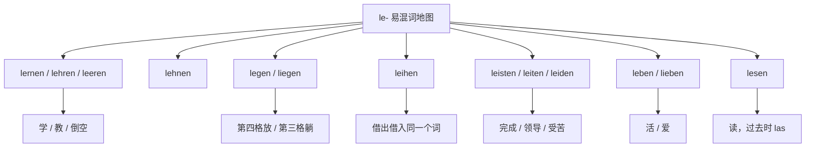

# 高频形近易错词

这里为你整理了德语中非常容易混淆的形近/音近词。根据你的需求，主要按照**拼写结构**和**发音特征**进行了简单分类，方便你直接作为词汇导航使用。

### 1. 包含 -eiter / -ieder / -etter 的核心易混词（你的举例及延伸）

^o2icec

^aeqobl

- **wieder**：又，再（副词）
- **wider**：反对，逆向（介词/前缀，发音与 wieder 完全相同）
- weit: Ⅰ (adj) ①广阔的,辽阔的,宽阔的,宽敞的②宽大的,宽松的③远的,遥远的,远距离的,长的 Ⅱ (adv) ①大大地②<用于比较级之前> ...得多
- **weiter**：更远的，继续（weit 的比较级）
- **Wetter**：天气（名词）
- **breiter**：更宽的（breit 的比较级，你提到的 breter 应该是这个）
- **Bretter**：木板（名词 Brett 的复数）
- **Bieter**：出价者，投标人（名词）
- **bitter**：苦的（形容词）
- **heiter**：晴朗的，开朗的（形容词）
- **Leiter**：领导者（阳性名词） / 梯子（阴性名词）

### 2. 经典 B-T 组合动词（最容易记错元音）

- **bieten**：提供，出价
- **bitten**：请求
- breit: ①宽的,宽阔的,宽敞的②(具有一定的)宽度的③平的,平坦的,扁平④广大的,广泛的
- bereits: 已经
- **beten**：祈祷
- **betten**：铺床

### 3. “ie” 与 “ei” 字母颠倒（发音完全不同：ie 发“依”，ei 发“哎”）

- **Wein**：葡萄酒
- **Wien**：维也纳（地名）
- **Lied**：歌曲
- **Leid**：痛苦，悲哀
- **sie**：她 / 他们
- **sei**：是（sein 的虚拟式）
- **schreiben**：写（动词原形）
- **schrieben**：写（过去式）

### 4. 常见的双写/单写辅音易混词

^d5xfqd

^32antb

- **Staat**：国家
- **Stadt**：城市
- **statt**：代替（介词）
- **fiel**：落下（fallen 的过去式）
- **viel**：很多
- **Wesen**：本质，生物
- **wissen**：知道

### 5. 变音（Umlaut）易混词对

- **schon**：已经
- **schön**：美丽的
- **fordern**：要求，索取
- **fördern**：促进，资助
- **drucken**：打印，印刷
- **drücken**：按，压
- **zahlen**：支付，付款
- **zählen**：数数，计算

### 6. 发音相近的其他高频短词

- **Meer**：海洋
- **mehr**：更多
- **Leere**：空虚
- **Lehre**：教导，学徒期
- **Wand**：墙壁（内墙）
- **Wind**：风

## le开头

| 单词          | 意思     | 变化                          | 要求的格 / 固定搭配                                                             | 例句                                                            | 易错点（为什么容易混）                                 |
| ----------- | ------ | --------------------------- | ----------------------------------------------------------------------- | ------------------------------------------------------------- | ------------------------------------------- |
| **lernen**  | 学      | 弱变化 **lernte, gelernt**     | 第四格：**Deutsch lernen**；**von jdm. lernen**（向某人学）                        | Ich lerne Deutsch.                                            | 和 **lehren** 只差一个字母，方向却相反（自己学 / 教别人）        |
| **lehren**  | 教      | 弱变化 **lehrte, gelehrt**     | 双宾语：**jdn. (Akk.) etwas lehren**；不带宾语时表示"教书"                            | Er lehrt mich Deutsch.                                        | 与 **leeren** 读音极近，听写常写错                     |
| **lesen**   | 读      | 强变化 **liest, las, gelesen** | 第四格：**ein Buch lesen**；**jdm. (Dativ) etw. vorlesen**（读给某人听）            | Sie liest mir die Nachricht vor.                              | 过去时 **las** 和 **ließ**（**lassen** 的过去时）形状接近 |
| **leeren**  | 倒空     | 弱变化 **leerte, geleert**     | 第四格：**den Mülleimer leeren**                                            | Leere die Flasche!                                            | 和 **lehren** 只差一个 **h**，意思完全无关              |
| **lehnen**  | 靠、倚    | 弱变化 **lehnte, gelehnt**     | 静态 **an + 第三格**，动态 **an/gegen + 第四格**                                   | Die Leiter lehnt an der Wand.                                 | 和 **legen** 一样表示"位置"，但搭配的介词和格不同             |
| **leihen**  | 借（出／入） | 强变化 **lieh, geliehen**      | 借给：**jdm. (Dativ) etw. (Akk.) leihen**；借进：**sich etw. von jdm. leihen** | Ich leihe dir mein Fahrrad. / Ich leihe mir ein Buch von ihm. | 同一个词两个方向，加不加 **sich / von** 就换了方向           |
| **leben**   | 活着、生活  | 弱变化 **lebte, gelebt**       | **von + 第三格 leben**（靠……过活）                                              | Er lebt von der Rente.                                        | 和 **lieben**（爱，第四格）只差一个字母                   |
| **legen**   | 把……平放  | 弱变化 **legte, gelegt**       | 第四格 + **in/an/auf + 第四格**：**etw. auf den Tisch legen**                  | Ich lege das Buch auf den Tisch.                              | 和 **liegen** 配对：有"放"的动作才有第四格                |
| **leisten** | 做出、完成  | 弱变化 **leistete, geleistet** | 第四格：**eine Arbeit leisten**；**sich (Dativ) etw. leisten**（负担得起）         | Das kann ich mir nicht leisten.                               | 和 **leiten**、**leiden** 只差一两个字母，是三兄弟        |
| **leiten**  | 领导、引导  | 弱变化 **leitete, geleitet**   | 第四格：**ein Projekt leiten**                                              | Sie leitet die Firma.                                         | 与 **leisten** 一字之差，意思完全不同                   |
| **leiden**  | 忍受、受苦  | 强变化 **litt, gelitten**      | **an + 第三格**（患……病）、**unter + 第三格**（受……之苦）                               | Er leidet an einer Allergie.                                  | 中间是 **ei**，和 **leiten / leisten** 混在一起最危险   |

