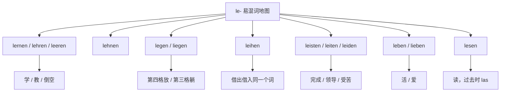
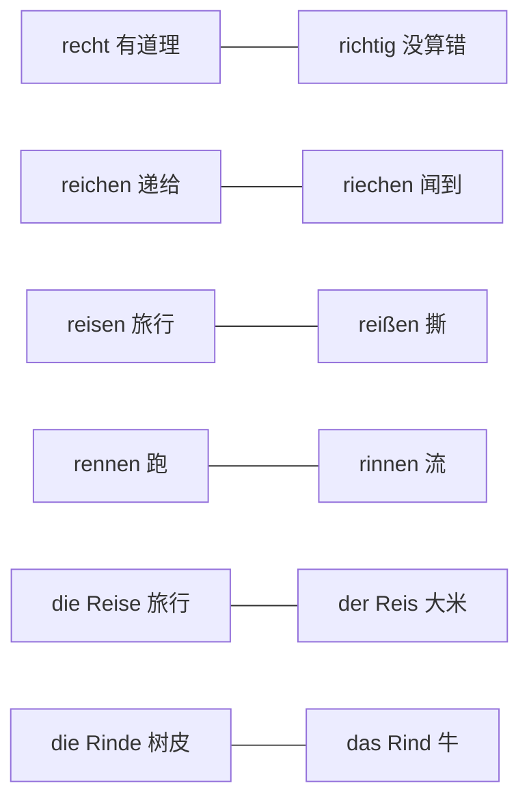
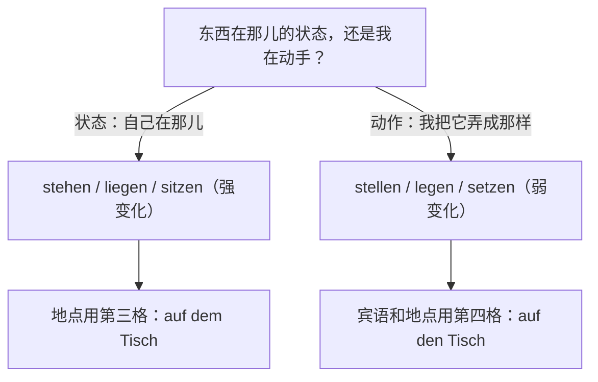
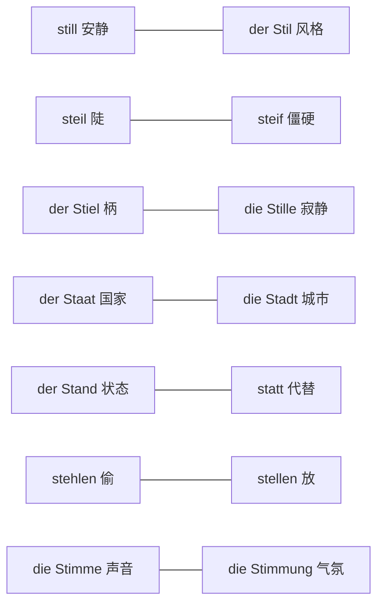
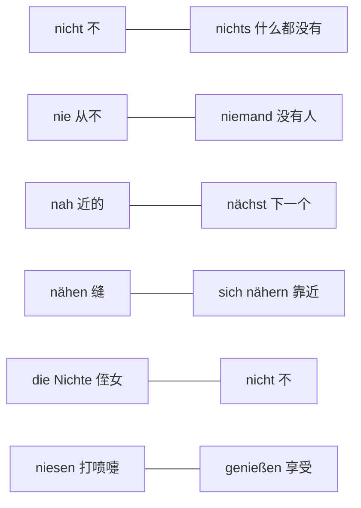

# 高频形近易错词

这里为你整理了德语中非常容易混淆的形近/音近词。根据你的需求，主要按照**拼写结构**和**发音特征**进行了简单分类，方便你直接作为词汇导航使用。

### 1. 包含 -eiter / -ieder / -etter 的核心易混词（你的举例及延伸）

^o2icec

^aeqobl

- **wieder**：又，再（副词）
- **wider**：反对，逆向（介词/前缀，发音与 wieder 完全相同）
- weit: Ⅰ (adj) ①广阔的,辽阔的,宽阔的,宽敞的②宽大的,宽松的③远的,遥远的,远距离的,长的 Ⅱ (adv) ①大大地②<用于比较级之前> ...得多
- **weiter**：更远的，继续（weit 的比较级）
- **Wetter**：天气（名词）
- **breiter**：更宽的（breit 的比较级，你提到的 breter 应该是这个）
- **Bretter**：木板（名词 Brett 的复数）
- **Bieter**：出价者，投标人（名词）
- **bitter**：苦的（形容词）
- **heiter**：晴朗的，开朗的（形容词）
- **Leiter**：领导者（阳性名词） / 梯子（阴性名词）

### 2. 经典 B-T 组合动词（最容易记错元音）

- **bieten**：提供，出价
- **bitten**：请求
- breit: ①宽的,宽阔的,宽敞的②(具有一定的)宽度的③平的,平坦的,扁平④广大的,广泛的
- bereits: 已经
- **beten**：祈祷
- **betten**：铺床

### 3. “ie” 与 “ei” 字母颠倒（发音完全不同：ie 发“依”，ei 发“哎”）

- **Wein**：葡萄酒
- **Wien**：维也纳（地名）
- **Lied**：歌曲
- **Leid**：痛苦，悲哀
- **sie**：她 / 他们
- **sei**：是（sein 的虚拟式）
- **schreiben**：写（动词原形）
- **schrieben**：写（过去式）

### 4. 常见的双写/单写辅音易混词

^d5xfqd

^32antb

- **Staat**：国家
- **Stadt**：城市
- **statt**：代替（介词）
- **fiel**：落下（fallen 的过去式）
- **viel**：很多
- **Wesen**：本质，生物
- **wissen**：知道

### 5. 变音（Umlaut）易混词对

- **schon**：已经
- **schön**：美丽的
- **fordern**：要求，索取
- **fördern**：促进，资助
- **drucken**：打印，印刷
- **drücken**：按，压
- **zahlen**：支付，付款
- **zählen**：数数，计算

### 6. 发音相近的其他高频短词

- **Meer**：海洋
- **mehr**：更多
- **Leere**：空虚
- **Lehre**：教导，学徒期
- **Wand**：墙壁（内墙）
- **Wind**：风

## le开头

| 单词          | 意思     | 变化                          | 要求的格 / 固定搭配                                                             | 例句                                                            | 易错点（为什么容易混）                                 |
| ----------- | ------ | --------------------------- | ----------------------------------------------------------------------- | ------------------------------------------------------------- | ------------------------------------------- |
| **lernen**  | 学      | 弱变化 **lernte, gelernt**     | 第四格：**Deutsch lernen**；**von jdm. lernen**（向某人学）                        | Ich lerne Deutsch.                                            | 和 **lehren** 只差一个字母，方向却相反（自己学 / 教别人）        |
| **lehren**  | 教      | 弱变化 **lehrte, gelehrt**     | 双宾语：**jdn. (Akk.) etwas lehren**；不带宾语时表示"教书"                            | Er lehrt mich Deutsch.                                        | 与 **leeren** 读音极近，听写常写错                     |
| **lesen**   | 读      | 强变化 **liest, las, gelesen** | 第四格：**ein Buch lesen**；**jdm. (Dativ) etw. vorlesen**（读给某人听）            | Sie liest mir die Nachricht vor.                              | 过去时 **las** 和 **ließ**（**lassen** 的过去时）形状接近 |
| **leeren**  | 倒空     | 弱变化 **leerte, geleert**     | 第四格：**den Mülleimer leeren**                                            | Leere die Flasche!                                            | 和 **lehren** 只差一个 **h**，意思完全无关              |
| **lehnen**  | 靠、倚    | 弱变化 **lehnte, gelehnt**     | 静态 **an + 第三格**，动态 **an/gegen + 第四格**                                   | Die Leiter lehnt an der Wand.                                 | 和 **legen** 一样表示"位置"，但搭配的介词和格不同             |
| **leihen**  | 借（出／入） | 强变化 **lieh, geliehen**      | 借给：**jdm. (Dativ) etw. (Akk.) leihen**；借进：**sich etw. von jdm. leihen** | Ich leihe dir mein Fahrrad. / Ich leihe mir ein Buch von ihm. | 同一个词两个方向，加不加 **sich / von** 就换了方向           |
| **leben**   | 活着、生活  | 弱变化 **lebte, gelebt**       | **von + 第三格 leben**（靠……过活）                                              | Er lebt von der Rente.                                        | 和 **lieben**（爱，第四格）只差一个字母                   |
| **legen**   | 把……平放  | 弱变化 **legte, gelegt**       | 第四格 + **in/an/auf + 第四格**：**etw. auf den Tisch legen**                  | Ich lege das Buch auf den Tisch.                              | 和 **liegen** 配对：有"放"的动作才有第四格                |
| **leisten** | 做出、完成  | 弱变化 **leistete, geleistet** | 第四格：**eine Arbeit leisten**；**sich (Dativ) etw. leisten**（负担得起）         | Das kann ich mir nicht leisten.                               | 和 **leiten**、**leiden** 只差一两个字母，是三兄弟        |
| **leiten**  | 领导、引导  | 弱变化 **leitete, geleitet**   | 第四格：**ein Projekt leiten**                                              | Sie leitet die Firma.                                         | 与 **leisten** 一字之差，意思完全不同                   |
| **leiden**  | 忍受、受苦  | 强变化 **litt, gelitten**      | **an + 第三格**（患……病）、**unter + 第三格**（受……之苦）                               | Er leidet an einer Allergie.                                  | 中间是 **ei**，和 **leiten / leisten** 混在一起最危险   |

## 问题：区分一下 recht / richtig / Gericht / reichen 这类 **re-** 和 **ri-** 开头的词，以及 **nacht**、**nicht** 这类 **na-** 和 **ni-** 开头的词，尽可能全面

② 答案

区分这两大组词，抓三个抓手就够了：一是**元音字母和音长**（短 **a** 在 **Nacht / nackt / nass**，长 **a** 在 **Name / Nagel / nah**，短 **i** 在 **nicht / nichts / nicken**，长 **ie** 在 **riechen / niesen**，双元音 **ei** 在 **reichen / reisen / reißen**）；二是**变化类型和要求的格**（强弱变化、第四格还是第三格）；三是**同源词族**——**recht → richten → der Richter → die Richtung → das Gericht** 是一家，**reich → reichen → erreichen → der Reichtum** 是一家，**nicht / nichts / nie / niemand / nirgends** 是"否定家族"这一家。

两个最容易踩的分界线先说清：**recht** 说的是"有道理、合适"（主观判断），**richtig** 说的是"没算错、真的是"（客观正确）；**reichen** 是"递、够"，**riechen** 是"用鼻子闻"。**na-** 那一组则完全没有否定含义（**Nacht、nah、nach **都是"夜、近、后"这类实打实的词），而 **ni-** 那一组里绝大多数是**否定词**（**nicht、nichts、nie、niemand、nirgends**），剩下几个长得像否定词的名词（**die Nichte** 侄女、**die Niere** 肾）纯属巧合，只能靠词义和词性记住。

先看拼写与读音的对应（这一张表管住两组词的"手感"）：

| 拼写 | 读音 | 这一组里的词 | 记忆抓手 |
|---|---|---|---|
| **a** 短 | /a/ | **Nacht, nackt, nass** | 短促有力，多是"夜、裸、湿"这些实词 |
| **a** 长 | /aː/ | **der Name, der Nagel, die Nadel, nah** | 长 **a** 集中在"名字、钉子、针、近" |
| **ä** 长 | /ɛː/ | **nähen, nächst, die Nähe, nähren, nämlich** | 见到 **ä** 基本是长音，意思只有"缝、近、养、也就是"几类 |
| **i** 短 | /ɪ/ | **nicht, nichts, nicken, der Ring, nirgends, die Nichte** | 短 **i** 几乎全在否定词和几个日常名词上 |
| **ie** 长 | /iː/ | **riechen, niesen, die Niere, das Niveau** | 长 **i** 全是单个动词或名词，没有否定词 |
| **ei** 双元音 | /aɪ/ | **reichen, reisen, reißen, die Reihe, reiten, reif** | 双元音集中在 **rei-** 这一家 |

## **re- / ri-** 易混词总表（按词族排列）：

^y8pa4n

| 单词 | 词性 / 变化 | 意思与搭配 | 最容易和谁混（怎么分） |
|---|---|---|---|
| **recht** | 形容词 / 副词，作表语不带词尾 | 有道理、合适：**Du hast recht.** / **Es ist mir recht.** | 与 **richtig** 混：**recht** 是"说得通、合适"（主观），**richtig** 是"没算错"（客观） |
| **das Recht** | 中性名词，复数 **die Rechte** | 权利、法律：**im Recht sein** 有理 | 与 **recht** 同源，大写才变名词 |
| **richtig** | 形容词，作表语不带词尾 | 正确的、真正的：**Das ist richtig.** | 与 **recht**（见上）、**der Richter**（形近）混 |
| **richten** | 弱变化 **richtete, gerichtet** | 对准、弄直；**sich richten nach + 第三格** 按照 | 同族词一堆；表"纠正错误"要用 **korrigieren** |
| **der Richter** | 阳性名词 | 法官 | 结尾 **-er** 像比较级，易与 **richtig** 混 |
| **die Richtung** | 阴性名词，**-en** | 方向：**in Richtung Bahnhof** | 与 **richtig** 同族，名词 vs 形容词 |
| **das Gericht** | 中性名词，**-e** | 法院；一道菜 | 词首是 **Ge-**，但和 **richten** 同族；两义靠语境 |
| **reichen** | 弱变化 **reichte, gereicht** | 递给、够：**jdm.(第三格) etw.(第四格) reichen**；**Das reicht.** | 与 **riechen** 混：递东西 **reichen**，鼻子闻 **riechen** |
| **erreichen** | 弱变化，支配第四格 | 达到、联系上：**Ich kann dich nicht erreichen.** | **reichen** 的派生词，别当"再够一次" |
| **ausreichen** | 弱变化 | 足够：**Das reicht aus.** | 与 **reichen** 同义，只多一个 **aus-** |
| **reich** | 形容词；**reich an + 第三格** | 富有的、富含的 | 与 **das Reich** 只差大小写 |
| **das Reich** | 中性名词，**-e** | 帝国、领域 | 见上 |
| **der Reichtum** | 阳性名词，**die Reichtümer** | 财富 | **reich + -tum** 构词 |
| **reißen** | 强变化 **riss, hat gerissen** | 撕、扯断：**sich um etw. reißen** 抢着要 | 与 **reisen** 只差一个字母，助动词也不同 |
| **der Riss** | 阳性名词，**-e** | 裂缝 | **reißen** 的名词化 |
| **reisen** | 弱变化 **reiste, ist gereist** | 旅行（助动词 **sein**） | 与 **reißen**（撕，助动词 **haben**）混；与 **die Reise / der Reis** 混 |
| **die Reise** | 阴性名词，**-n** | 旅行：**eine Reise machen** | 与 **der Reis** 只差一个 **-e** |
| **der Reis** | 阳性名词 | 大米 | 米饭 **der Reis**，旅行 **die Reise** |
| **reiten** | 强变化 **ritt, ist geritten** | 骑马 | 与 **reisen** 只差一个字母，助动词都是 **sein** |
| **reif** | 形容词 | 成熟的：**Der Apfel ist reif.** | 同族 **der Reifen**（轮胎）、**reifen**（成熟） |
| **riechen** | 强变化 **roch, hat gerochen** | 闻、有气味：**an + 第三格 riechen**；**Es riecht nach ...** | 与 **reichen**（递）、**rechnen**（算）混 |
| **rechnen** | 弱变化 **rechnete, gerechnet** | 计算；**mit + 第三格 rechnen** 预计 | 与 **rächen** 只差一个元音 |
| **rächen** | 弱变化 **rächte, gerächt** | 报仇：**sich an jdm. rächen** | 与 **rechnen / riechen** 混 |
| **retten** | 弱变化 **rettete, gerettet** | 救：**jdn. retten** | 与 **reden**（说话）混 |
| **rennen** | 强变化 **rannte, ist gerannt** | 跑 | 与 **rinnen**（流，**rann, ist geronnen**）混 |
| **reiben** | 强变化 **rieb, hat gerieben** | 摩擦：**sich die Hände reiben** | 与 **reißen** 混 |
| **die Reihe** | 阴性名词，**-n** | 一排、系列：**an der Reihe sein** 轮到 | 与动词 **reihen**（排列）混 |
| **rein** | 形容词 / 口语副词 | 纯的；进来：**Komm rein!** | 只是拼写像 **die Reihe**，意思无关 |
| **riesig** | 形容词 | 巨大的 | 同族 **der Riese**（巨人） |
| **das Risiko** | 中性名词，**die Risiken** | 风险：**ein Risiko eingehen** | 同族 **riskieren**（弱变化） |
| **der Ring** | 阳性名词，**-e** | 戒指、环 | 与动词 **ringen**（**rang, gerungen**，**um + 第四格** 争夺）混 |
| **die Rinde** | 阴性名词，**-n** | 树皮、外皮 | 与 **das Rind**（牛，复数 **Rinder**）只差一个 **-e** |
| **die Rente** | 阴性名词，**-n** | 养老金 | 与 **der Rentner**（领养老金的人）同族 |

图解：**re- / ri-** 最危险的六对

① 句子与问题

原句：（本次没有句子，是 st- 形近词辨析整理）

# 问题：区分形近词 **st** 开头，比如 **stand / stell / stell-**

② 答案

**st-** 开头的形近词其实不是一团乱麻，而是几个"词族"：认住词根就不会混——**steh-**（站、立、写着）、**stell-**（放、摆放）、**stehl-**（偷）、**steig-**（上升）、**still- / Stil**（安静 / 风格）、**stimm-**（正确、声音）、**steuer-**（驾驶、税），再加一个"一个字母重灾区"：**der Staat / die Stadt / der Stand / statt**。核心那对是 **stehen** 和 **stellen**：**stehen** 是东西自己在那儿立着（状态，强变化 **stand**，不带第四格宾语，地点用第三格回答"Wo?"），**stellen** 是我动手把它竖着放（动作，弱变化 **stellte**，必须有第四格宾语，地点用第四格回答"Wohin?"）。

三个最容易翻车的地方：第一，**stehlen**（偷，强变化 **stahl, gestohlen**）和 **stellen**（放，弱变化）只差一个 **h**；第二，**still / der Stil / steil / steif / der Stiel / die Stille** 这六个词彼此只差一两个字母，靠词性和搭配区分；第三，**der Staat**（国家，复数 **die Staaten**）和 **die Stadt**（城市，复数 **die Städte**）只差一个字母，而 **der Stand**（状态）跟它们又是亲戚，**statt**（代替，支配第二格）只差大小写。

图解：**stehen / stellen** 这一族的根本分野

**第一张表：位置类动词四对（状态 vs 动作）**

| 状态（自己在那儿） | 动作（我把它弄成那样） | 一句话区分 |
|---|---|---|
| **stehen**（**stand, hat gestanden**）立着 | **stellen**（**stellte, hat gestellt**）竖着放 | 状态用第三格地点（**auf dem Tisch**），动作要第四格宾语 + 第四格地点（**auf den Tisch**）；**stehen** 强变化，**stellen** 弱变化 |
| **liegen**（**lag, hat gelegen**）平躺着 | **legen**（**legte, hat gelegt**）平放 | 同上：躺是状态，放是动作 |
| **sitzen**（**saß, hat gesessen**）坐着 | **setzen**（**setzte, hat gesetzt**）使坐下；**sich setzen** 坐下 | **setzen** 必须带宾语或反身代词，完成时用 **hat sich gesetzt** |
| **hängen**（**hing, hat gehangen**）挂着 | **hängen**（**hängte, hat gehängt**）挂上去 | 同一个动词两种变化：**hing** 是状态（第三格地点），**hängte** 是动作（第四格宾语） |

**第二张表：stehen 家族的派生词**

| 单词 | 变化 | 意思与搭配 |
|---|---|---|
| **verstehen** | **verstand, hat verstanden** | 理解（第四格）：**Ich verstehe dich.** |
| **bestehen** | **bestand, hat bestanden** | 存在；通过考试；**bestehen aus + 第三格** 由……组成；**bestehen auf + 第三格** 坚持 |
| **entstehen** | **entstand, ist entstanden** | 产生、出现：**aus etw. entstehen** |
| **aufstehen** | **stand auf, ist aufgestanden** | 起床、起身（助动词 **sein**） |
| **gestehen** | **gestand, hat gestanden** | 承认：**Ich gestehe, dass ...** |
| **der Stand** | 阳性名词，**Stände** | 状态、档位、展台：**auf dem neuesten Stand sein** |
| **der Standort** | 阳性名词，**-e** | 位置、驻地 |
| **der Standpunkt** | 阳性名词，**-e** | 立场 |
| **ständig** | 形容词 | 经常的、持续的 |
| **der Standard** | 阳性名词，**-s** | 标准 |

**第三张表：stellen 家族的派生词**

| 单词 | 变化 | 意思与搭配 |
|---|---|---|
| **vorstellen** | **stellte vor, hat vorgestellt** | 介绍、想象：**jdm.(第三格) jdn. vorstellen**；**sich(第三格) etw.(第四格) vorstellen** 想象 |
| **bestellen** | **bestellte, hat bestellt** | 订购、预约；也转达问候：**Bestell ihm Grüße!** |
| **feststellen** | **feststellte, hat festgestellt** | 发现、确定：**Der Arzt stellte fest, dass ...** |
| **herstellen** | **herstellte, hat hergestellt** | 生产：**Werkzeug herstellen** |
| **darstellen** | **darstellte, hat dargestellt** | 表现、扮演：**eine Rolle darstellen** |
| **aufstellen** | **aufstellte, hat aufgestellt** | 立起、设置：**einen Plan aufstellen** |
| **anstellen** | **anstellte, hat angestellt** | 雇用；开启；**sich anstellen** 排队；**Was hast du angestellt?** 你闯什么祸了 |
| **einstellen** | **einstellte, hat eingestellt** | 雇用；调设：**den Wecker einstellen**；停止：**die Arbeit einstellen** |
| **ausstellen** | **ausstellte, hat ausgestellt** | 展出；开具（票据）：**einen Scheck ausstellen** |
| **abstellen** | **abstellte, hat abgestellt** | 停放；关掉：**das Fahrrad abstellen** |
| **zustellen** | **zustellte, hat zugestellt** | 投递：**ein Paket zustellen** |
| **erstellen** | **erstellte, hat erstellt** | 制作、编制：**eine Liste erstellen**（不可分） |
| **verstellen** | **verstellte, hat verstellt** | 挡住；**sich verstellen** 假装 |
| **die Stelle** | 阴性名词，**-n** | 位置、职位；**an deiner Stelle** 换作是你 |
| **die Stellung** | 阴性名词，**-en** | 姿势、职位；**zu etw. Stellung nehmen** 对……表态 |

**第四张表：只差一两个字母的形近词**

| 单词 | 词性 / 变化 | 意思 | 一句话区分 |
|---|---|---|---|
| **stehlen** | 强变化 **stiehlt, stahl, hat gestohlen** | 偷：**jdm.(第三格) etw.(第四格) stehlen** | 与 **stellen**（放）只差一个 **h**；偷是强变化，放是弱变化 |
| **der Diebstahl** | 阳性名词，**Diebstähle** | 盗窃 | 里面就藏着 **Stahl** |
| **der Stahl** | 阳性名词，**Stähle** | 钢 | 与 **der Stall** 只差一个字母 |
| **der Stall** | 阳性名词，**Ställe** | 马厩、畜栏 | 见上 |
| **still** | 形容词 | 安静的：**Sei still!** | 与 **der Stil** 只差大小写 |
| **der Stil** | 阳性名词，**-e** | 风格、文体 | 见上 |
| **die Stille** | 阴性名词 | 寂静 | **still** 的名词化 |
| **stillen** | 弱变化 **stillte, hat gestillt** | 止渴止饿、哺乳：**seinen Durst stillen** | 动词，别与 **still** 混 |
| **steil** | 形容词 | 陡的：**eine steile Straße** | 与 **steif**、**still** 只差一个字母 |
| **steif** | 形容词 | 僵硬的、硬的 | 与 **steil** 只差一个字母 |
| **der Stiel** | 阳性名词，**-e** | 柄、把：**der Stiel der Pfanne** | 与 **der Stil** 只差一个 **e** |
| **stumm** | 形容词 | 不响的、哑的 | 与 **still** 义近，但强调"发不出声" |
| **der Staat** | 阳性名词，**-en** | 国家：**die Staaten** | 与 **die Stadt** 只差一个字母 |
| **die Stadt** | 阴性名词，**Städte** | 城市 | 见上 |
| **der Stand** | 阳性名词，**Stände** | 状态 | 与上两个构成"三兄弟" |
| **statt** | 介词（第二格）/ 连词 | 代替：**statt meiner**；**statt ... zu** | 与 **die Stadt** 大小写之差；**stattfinden** 就是它 + **finden**（举行） |
| **stets** | 副词 | 总是 | 与 **stetig**（持续的）同源 |

**第五张表：steigen / steuern / stimmen 三族**

| 单词 | 变化 | 意思与搭配 |
|---|---|---|
| **steigen** | 强变化 **stieg, ist gestiegen** | 上升、爬（助动词 **sein**）：**Die Preise steigen.** |
| **steigern** | 弱变化 **steigerte, hat gesteigert** | 提高（及物，助动词 **haben**）：**die Produktion steigern** |
| **einsteigen / aussteigen / umsteigen** | 强变化，**ist ein-/aus-/umgestiegen** | 上 / 下 / 换乘（助动词都是 **sein**） |
| **besteigen** | 强变化 **bestieg, hat bestiegen** | 攀登：**einen Berg besteigen** |
| **die Steuer** | 阴性名词，**-n** | 税：**Steuern zahlen** |
| **das Steuer** | 中性名词 | 方向盘、舵：**am Steuer sitzen** |
| **steuern** | 弱变化 **steuerte, hat gesteuert** | 驾驶、调控：**ein Auto steuern** |
| **stören** | 弱变化 **störte, hat gestört** | 打扰（第四格）：**Störe ich?** |
| **die Störung** | 阴性名词，**-en** | 故障、干扰 |
| **stimmen** | 弱变化 **stimmte, hat gestimmt** | 正确：**Das stimmt.**；投票；调音 |
| **die Stimme** | 阴性名词，**-n** | 声音、选票：**seine Stimme erheben** |
| **die Stimmung** | 阴性名词，**-en** | 气氛、情绪 |
| **bestimmen** | 弱变化 **bestimmte, hat bestimmt** | 决定、规定 |
| **bestimmt** | 形容词 / 副词 | 一定的、肯定的 |
| **die Bestimmung** | 阴性名词，**-en** | 规定、用途、目的地 |
| **übereinstimmen** | 弱变化 **stimmte überein, hat übereingestimmt** | 一致：**mit jdm. übereinstimmen** |

**第六张表：同样是 st- 强变化，过去时元音各不相同（不能类推）**

| 原形 | 过去时 | 第二分词 | 助动词 |
|---|---|---|---|
| **stehen** | **stand** | **gestanden** | hat |
| **verstehen** | **verstand** | **verstanden** | hat |
| **stehlen** | **stahl** | **gestohlen** | hat |
| **sterben** | **starb** | **gestorben** | ist |
| **steigen** | **stieg** | **gestiegen** | ist |
| **streiten** | **stritt** | **gestritten** | hat |
| **stinken** | **stank** | **gestunken** | hat |
| **stoßen** | **stieß** | **gestoßen** | hat |

图解：**st-** 形近词的"钉子对"

同类例子：**Ich stelle die Flasche auf den Tisch, jetzt steht sie dort.**——**stellen** 是动作，要第四格宾语 **die Flasche** 和第四格地点 **auf den Tisch**；**stehen** 是状态，地点用第三格 **dort**（或 **auf dem Tisch**），和上面第一张表的分野完全一致。

## **na- / ni-** 易混词总表：

^wxti8p

| 单词                            | 词性 / 变化                 | 意思与搭配                                         | 最容易和谁混（怎么分）                                             |
| ----------------------------- | ----------------------- | --------------------------------------------- | ------------------------------------------------------- |
| **die Nacht**                 | 阴性名词，复数 **die Nächte**  | 夜：**Gute Nacht!**                             | 与 **nackt** 混：拼写只差 **c/k** 的位置，**Nacht** 的 **ch** 读 /x/ |
| **nachts**                    | 副词                      | 在夜里：**nachts um 3 Uhr**                       | 与 **nach** 混，多一个 **-ts** 就成时间副词                         |
| **nackt**                     | 形容词                     | 裸的、光秃的                                        | 见上，读 /nakt/，结尾是 **kt**                                  |
| **nach**                      | 介词，支配**第三格**            | 去（城市/国家）；在……之后：**nach Hause, nach dem Essen** | 与 **zu** 分工：**nach** 接地名，**zu** 接人和机构                   |
| **nachdem**                   | 从句连词                    | 在……之后（从句动词回句末）                                | 与 **nach** 混：它后面必须跟完整从句                                 |
| **nachher**                   | 副词                      | 之后、待会儿                                        | 与 **nachdem** 混，一个单独用，一个带从句                             |
| **nächst-**                   | 形容词                     | 下一个：**am nächsten Tag, nächste Woche**        | 与 **nah** 同词根但分工：表"顺序"用 **nächst**，表"距离"用 **nah**       |
| **nah / näher / am nächsten** | 形容词                     | 近的：**in der Nähe von + 第三格**                  | 见上                                                      |
| **die Nähe**                  | 阴性名词                    | 附近：**in der Nähe**                            | 与 **nähen** 同音，靠词性区分                                    |
| **nähen**                     | 弱变化 **nähte, genäht**   | 缝：**einen Knopf annähen**                     | 三兄弟之一，见下面两条                                             |
| **sich nähern**               | 弱变化，支配**第三格**           | 靠近：**sich dem Bahnhof nähern**                | 与 **nähen**（缝）、**nähren**（喂养）只差一两个字母                    |
| **nähren**                    | 弱变化 **nährte, genährt** | 喂养、供养                                         | 同上                                                      |
| **der Name**                  | 阳性名词，**-n**             | 名字                                            | 与 **nahm**（**nehmen** 的过去时）混：名词 vs 动词                   |
| **nämlich**                   | 副词                      | 也就是、补充说明原因                                    | 与书面语 **namentlich** 近似                                  |
| **die Nase**                  | 阴性名词，**-n**             | 鼻子                                            | 与 **nass**（湿的）混                                         |
| **nass**                      | 形容词                     | 湿的                                            | 见上                                                      |
| **der Nagel**                 | 阳性名词，**die Nägel**      | 钉子；指甲                                         | 与 **die Nadel**（针）混：**Nagel** 粗短，**Nadel** 细长带孔         |
| **die Nadel**                 | 阴性名词，**-n**             | 针                                             | 见上                                                      |
| **der Nachbar**               | 阳性名词，**-n**             | 邻居                                            | **ch** 读 /x/，别读成 **nackt** 的 /k/                        |
| **nicht**                     | 副词 / 否定词                | 不（否定动词、形容词）：**Ich weiß nicht.**               | 与 **nichts** 混：**nicht** 否定"怎么样"，**nichts** 否定"有什么"     |
| **nichts**                    | 不定代词                    | 什么也没有：**Ich habe nichts gesagt.**             | 见上                                                      |
| **nie**                       | 副词                      | 从不：**Ich war nie dort.**                      | 与 **nicht** 混：**nie** 说的是"一次都没有"（频率）                    |
| **niemals**                   | 副词                      | 从不（语气更强）                                      | = **nie**                                               |
| **niemand**                   | 不定代词                    | 没有人；第四格 **niemanden**                         | 与 **nichts** 混：人说 **niemand**，物说 **nichts**             |
| **nirgends / nirgendwo**      | 副词                      | 哪儿都不：**Ich finde es nirgends.**               | 与 **nie** 混：一个说地点，一个说时间                                 |
| **nichtig**                   | 形容词                     | 无效的、无意义的：**für nichtig erklären**             | 长得像 **nicht**，但它是形容词                                    |
| **die Nichte**                | 阴性名词，**-n**             | 侄女、外甥女                                        | 与 **nicht** 只差一个 **-e**，最危险的一对                          |
| **nieder**                    | 副词 / 形容词                | 向下、低：**sich niederlegen**                     | 三兄弟之一                                                   |
| **niedlich**                  | 形容词                     | 可爱的                                           | 见上                                                      |
| **niedrig**                   | 形容词                     | 低的（价格、地位）                                     | 见上                                                      |
| **niesen**                    | 弱变化 **nieste, geniest** | 打喷嚏                                           | 与 **genießen**（享受，强变化 **genoss, genossen**）混：少了前缀就是打喷嚏  |
| **nicken**                    | 弱变化 **nickte, genickt** | 点头                                            | 与 **niesen / nicht** 同为短 **i**，靠意思分                     |
| **die Niere**                 | 阴性名词，**-n**             | 肾                                             | 与 **nieder** 听感相近                                       |
| **das Niveau**                | 中性名词，**-s**             | 水平、水准                                         | 拼写常错，注意结尾 **-eau**                                      |

图解：**na- / ni-** 最危险的六对

同类例子：**Ich habe nichts gehört, weil ich nicht aufgepasst habe.**——**nichts** 当宾语（否定"有什么"，第四格），**nicht** 修饰动词（否定"有没有在听"），两句里各管一段，正好是上表第 20、21 行的分工。

# 德语中 rad- 与 red- 开头词汇的全方位区分

> 核心结论：**rad-** 与 **red-** 的分野，本质是「核心元音 **a / e**」+「词源层次」两条线。rad- 家族又分「日耳曼本土词（轮）」与「拉丁借词（刮/半径/根）」两层；red- 家族分「日耳曼本土词（说/论）」与「拉丁借词（整理/减少/多余）」两层。**词义决定拼写，拼写又决定发音**，两者互为印证。

---

## 一、总览：四条区分线

| 区分线 | rad- | red- |
|---|---|---|
| ① 核心元音 | **a**（/a/ 或 /aː/） | **e**（/eː/ 或 /ɛ/） |
| ② 本土词义 | Rad = 轮 | Rede/reden = 说、论 |
| ③ 拉丁借词层次 | radere 刮；radius 半径/射线；radix 根 | redigere 编辑；reducere 减少；redundare 多余 |
| ④ 同音陷阱 | Rad=Rat、Räder=Räte、Radschlag=Ratschlag | Red- 内部无同音重灾，但 Rede≠Reede |

---

## 二、rad- 家族全表（按词根分层，穷尽列出）

### A. 词干 Rad = 轮（日耳曼语 *raþa-）

| 词 | 含义 | 例句 |
|---|---|---|
| das Rad, die Räder | 轮子 | Das **Rad** ist kaputt.（轮子坏了。） |
| das Rädchen | 小轮；小圈套 | — |
| radfahren / Rad fahren | 骑自行车 | Ich **fahre** gern **Rad**. |
| das Radfahren | 骑车（名词化） | **Radfahren** ist gesund. |
| radeln | 骑车（口语） | Wir **radeln** zum See. |
| der Radler / die Radlerin | 骑车者；"自行车手"（啤酒+汽水混合饮料） | Ein **Radler**, bitte!（来杯"自行车手"！） |
| der Radfahrer / die Radfahrerin | 骑自行车的人 | — |
| der Radweg | 自行车道 | — |
| die Radtour | 骑车旅行 | — |
| der Radausflug | 骑车郊游 | — |
| das Radrennen | 自行车赛 | — |
| der Radsport / der Radsportler | 自行车运动（员） | — |
| der Radstand | 轴距 | — |
| die Radnabe | 轮毂 | — |
| die Radachse | 轮轴 | — |
| die Radkappe / der Radkranz / die Radfelge | 轮毂盖 / 轮辋 | — |
| der Radkasten | 轮罩 | — |
| der Radschlag / Rad schlagen | 侧空翻；（孔雀）开屏 | — |
| der Radlader | 轮式装载机 | — |
| ein Rad abhaben（口语） | 脑子有病 | Er hat wohl ein **Rad** ab. |

### B. 拉丁词根 radere = 刮、擦、蚀刻

| 词 | 含义 | 例句 |
|---|---|---|
| radieren | 擦除；蚀刻 | Er **radiert** den Fehler weg.（他把错误擦掉。） |
| der/das Radiergummi | 橡皮（**das** 为瑞士/南德用法） | — |
| die Radierung | 蚀刻版画 | — |
| die Radiernadel | 刻针 | — |
| der Radierer | 擦除器 | — |

### C. 拉丁词根 radius = 射线、辐条、半径

| 词 | 含义 | 例句 |
|---|---|---|
| der Radius, die Radien | 半径 | — |
| das Radio, die Radios | 收音机 | Das **Radio** läuft.（收音机开着。） |
| radioaktiv / die Radioaktivität | 放射性的 / 放射性 | — |
| das Radar / der Radar | 雷达（**das Radar** 更常见） | Der **Radar** erfasst das Flugzeug. |
| die Radiologie / der Radiologe | 放射学 / 放射科医生 | — |
| das Radium | 镭 | — |
| radiär / radial | 辐射状的 / 径向的 | — |
| der Radiowecker / der Radiosender / das Radioprogramm | 收音机闹钟 / 电台 / 广播节目 | — |
| die Radiokarbonmethode | 放射性碳定年法 | — |

### D. 拉丁词根 radix = 根

| 词 | 含义 | 例句 |
|---|---|---|
| radikal | 激进的；彻底的 | eine **radikale** Partei（一个激进政党） |
| der Radikale / der Radikalismus | 激进分子 / 激进主义 | — |
| die Radikalkur | 彻底疗法 | — |
| das Radieschen | 小萝卜（经意大利 radice ← 拉丁 radix） | — |

### E. 词源不透明

| 词 | 含义 | 例句 |
|---|---|---|
| der Radau | 喧闹 | Mach keinen **Radau**!（别吵！） |
| der Radaubruder / der Radaumacher | 吵闹的人 | — |

---

## 三、red- 家族全表（按词根分层，穷尽列出）

### A. 日耳曼词干 red- = 说、论（与 **Rat** 同源）

| 词 | 含义 | 例句 |
|---|---|---|
| die Rede, die Reden | 讲话、演说 | Der Redner hält eine **Rede**. |
| reden | 说话、谈论 | Wir müssen **reden**.（我们得谈谈。） |
| der Redner / die Rednerin | 演讲者 | — |
| die Redewendung | 惯用语 | — |
| die Redensart | 习语、套话 | — |
| die Redezeit | 发言时间 | — |
| die Redefreiheit | 言论自由 | — |
| der Redefluss | 滔滔不绝 | — |
| redselig | 健谈的 | — |
| die Rederei（贬） | 废话、瞎扯 | — |
| das Rededuell / der Redebeitrag / das Redemanuskript | 辩论 / 发言 / 讲稿 | — |

**前缀派生词**（同一词根，务必一并掌握）：**bereden**（商量）、**überreden**（说服）、**ausreden**（说完；辩解）、**einreden**（劝说）、**verabreden**（约定）、**abreden**（劝阻）、**widerreden**（反驳）、**anreden**（称呼）、**zureden**（劝说）、**beredt**（雄辩的）。

### B. 拉丁词根 redigere = 编辑、整理

| 词 | 含义 | 例句 |
|---|---|---|
| redigieren | 编辑、加工（文稿） | — |
| der Redakteur / die Redakteurin | 编辑（**CH/AT：der Redaktor**） | — |
| die Redaktion | 编辑部 | — |

### C. 拉丁词根 reducere = 减少、还原

| 词 | 含义 | 例句 |
|---|---|---|
| reduzieren | 减少、削减 | Wir müssen Kosten **reduzieren**. |
| die Reduktion / die Reduzierung | 减少、还原 | — |
| das Reduktionsmittel | 还原剂 | — |

### D. 拉丁词根 redundare = 溢出、多余

| 词 | 含义 | 例句 |
|---|---|---|
| redundant | 冗余的 | — |
| die Redundanz | 冗余 | — |

### E. 日耳曼词根 redlich / 其他

| 词 | 含义 | 例句 |
|---|---|---|
| redlich | 诚实的、正直的 | ein **redlicher** Kaufmann（诚实的商人） |
| die Redlichkeit | 诚实 | — |
| das Redox（Chemie） | 氧化还原 | — |
| die Redoute | 假面舞会 | — |

### F. 形近但**不是** red- 开头（易被误归）

| 词 | 说明 | 例句 |
|---|---|---|
| die Reede | 锚地（**Ree-**） | Das Schiff liegt auf der **Reede**. |
| der Reeder / die Reederei | 船东 / 船运公司 | — |
| reell | 实在的、诚实的 | ein **reelles** Angebot |

---

## 四、重点易混词辨析（"区分"的核心）

### 4.1 同音组一：**Rad = Rat**（都读 /ʁaːt/）

| 词 | 词性/义 | 例句 + 解析 |
|---|---|---|
| das **Rad** | 轮子 | Ich fahre mit dem **Rad**. → mit + dem Rad（骑自行车） |
| der **Rat** | 建议；（委员会） | Sie gibt ihm einen guten **Rat**. → Rat 阳性，宾格 einen Rat |
| das **Rät** / er **rät** | raten 的名词/动词形式 | Er **rät** mir zu warten.（他建议我等。） |

### 4.2 同音组二：**Räder = Räte**（都读 /ˈʁɛːdɐ/）

| 词 | 义 | 说明 |
|---|---|---|
| die **Räder** | 轮子（Rad 复数） | Zwei **Räder** sind platt. |
| die **Räte** | 委员会/建议（Rat 复数） | die **Räte** der Stadt |

### 4.3 同音组三：**Radschlag = Ratschlag**（都读 /ˈʁaːtʃlaːk/）

| 词 | 义 | 说明 |
|---|---|---|
| der **Radschlag** | 侧空翻；（孔雀）开屏 | Rad（轮） |
| der **Ratschlag** | 建议、忠告 | Rat（建议） |

> 这组是德文写作中最经典的"同音异形"重灾区。

### 4.4 **die Rede（讲话）vs die Reede（锚地）**

| 词 | 拼写 | 义 | 例句 |
|---|---|---|---|
| die Rede | 双 e 后 d | 讲话 | Er hält eine **Rede**. |
| die Reede | 双 e 后 e | 锚地 | Das Schiff liegt auf der **Reede**. |

### 4.5 **radieren（擦）vs raten（猜/建议）vs roden（开垦）**

| 词 | 义 | 例句 |
|---|---|---|
| **radieren** | 擦除、蚀刻 | Er **radiert** mit dem Radiergummi. |
| **raten** | 猜；建议 | Rate mal!（猜猜看！） |
| **roden** | 开垦、伐除 | Wald **roden**（开垦林地） |

### 4.6 **Radler ≠ Redler**

- **Radler** 是真实高频词（骑车者；啤酒混合饮料）。
- **Redler** 不是常用德语名词，属拼写干扰项。

---

## 五、发音对照表（IPA）

| 词 | 音标 | 词 | 音标 |
|---|---|---|---|
| Rad | /ʁaːt/ | Rede | /ˈʁeːdə/ |
| Räder | /ˈʁɛːdɐ/ | reden | /ˈʁeːdn̩/ |
| Rädchen | /ˈʁɛːtçən/ | Redner | /ˈʁeːdnɐ/ |
| radeln | /ˈʁaːdl̩n/ | Redaktion | /ʁedakˈt͡si̯oːn/ |
| Radler | /ˈʁaːdlɐ/ | Redakteur | /ʁedakˈtøːɐ̯/ |
| radfahren | /ˈʁaːtfaːʁən/ | reduzieren | /ʁeduˈt͡siːʁən/ |
| Radau | /ʁaˈdaʊ/ | Reduktion | /ʁedʊkˈt͡si̯oːn/ |
| Radar | /ʁaˈdaːɐ̯/ | redundant | /ʁedʊnˈdant/ |
| radieren | /ʁaˈdiːʁən/ | redlich | /ˈʁeːtlɪç/ |
| radikal | /ʁadiˈkaːl/ | Redewendung | /ˈʁeːdəvɛndʊŋ/ |
| Radius | /ˈʁaːdi̯ʊs/ | — | — |
| Radio | /ˈʁaːdi̯o/ | — | — |
| Radieschen | /ʁaˈdiːsçən/ | — | — |

> **规律一**：本土词 **Rad** 的 a 是**长音 /aː/**，其复数 umlaut 后为 **/ɛː/**。
> **规律二**：拉丁借词 **rad-** 的 a 多为**短音 /a/**，重音后移（radi-**kal**），唯 **Radius/Radio** 例外（长音 /aː/，重音在首音节）。

---

## 六、中文母语者高频易错点

| 错误 | 正确 | 原因 |
|---|---|---|
| ~~Ich fahre mit dem Rat.~~ | mit dem **Rad** | 混淆同音 Rad/Rat：骑车用 Rad |
| ~~der Rad~~ | **das Rad** | Rad 是中性名词 |
| ~~Ich radle ein Ratschlag.~~（语义混乱） | Ich **rate** dir / Ich **radle** zum See. | radeln（骑车）≠ raten（建议） |
| ~~Ich schreibe einen Radschlag.~~ | einen **Ratschlag** | Radschlag 是空翻/开屏 |
| ~~Das Radiergummi sind…~~ | **Der/das** Radiergummi | 名词性别：der/das（瑞士 das） |
| 把 Radio 当 red- 音 | **Radio** = /ˈʁaːdi̯o/（长 a） | 误按 e 音读成 "Redio" |
| 把 rede- 读成 rad- | **Rede** = /ˈʁeːdə/ | a/e 不分 |

---

## 七、记忆法与速查

- **见「轮子/自行车」→ a（Rad, Rädchen, Radweg, Radler）**。
- **见「说话/建议/演说」→ e（Rede, reden, Redner, Redewendung）**；同源 **Rat/raten/Rätsel/geraten** 亦属"说/算"家族。
- **见「半径/射线/雷达/镭」→ 拉丁 radius，长 a（Radius, Radio, Radar, Radium）**。
- **见「刮/擦/蚀刻」→ radere（radieren, Radierung）**。
- **见「根/激进」→ radix（radikal, Radieschen）**。
- **见「编辑」→ redigere（Redaktion, Redakteur）**。
- **见「减少」→ reducere（reduzieren, Reduktion）**。
- **见「多余」→ redundare（redundant, Redundanz）**。

### 速查表

| 义 | 词 | 元音 |
|---|---|---|
| 轮子 | das Rad / Radweg / radeln | a |
| 骑自行车 | radfahren / Radler | a |
| 擦除 | radieren / Radiergummi | a |
| 半径/收音机/雷达 | Radius / Radio / Radar | a（长） |
| 激进 | radikal / Radikalismus | a |
| 小萝卜 | Radieschen | a |
| 喧闹 | Radau | a |
| 讲话 | Rede / reden / Redner | e |
| 惯用语 | Redewendung / Redensart | e |
| 编辑部 | Redaktion / Redakteur / redigieren | e |
| 减少 | reduzieren / Reduktion | e |
| 冗余 | redundant / Redundanz | e |
| 诚实 | redlich / Redlichkeit | e |
| 锚地（近似） | **Reede** | ee |

---

**一句话总纲**：**a 对应"轮子"与拉丁"刮/半径/根"；e 对应"说话"与拉丁"编辑/减少/多余"**——先定词义，再定元音；记住三个同音重灾区 **Rad=Rat、Räder=Räte、Radschlag=Ratschlag**，即可彻底区分 rad- 与 red- 两大词族。

# 德语 hal- / hol- 形近词家族全面区分

> 用户所列 **hält / holen / hal** 实为三个不同层次的问题：
> - **hält** = 强变化动词 **halten** 的第三人称单数；
> - **holen** = 弱变化动词，义为"去取来"；
> - **hal** 本身**不是德语词**，应为 **halt**（halten 的命令式／副词助词）之误，或与 **Halle / hallen / Halm / Hals / halb** 等词混淆。
>
> 区分的钥匙 = **变位类型（强/弱）+ 词义场（静态"持"／动态"取"）+ 重音与可分前缀**三把尺子。

---

## 一、总纲：三把区分尺子

| 尺子 | halten 家族 | holen 家族 | halt / hal- 家族 |
|---|---|---|---|
| ① 变位 | **强变化**（a→ä, a→ie） | **弱变化**（无元音交替） | 多为弱变化／非动词 |
| ② 词义 | 持、握、保持、停、举行 | 去取来、接来 | 支撑/停/助词/其它名词 |
| ③ 重音前缀 | halt-**an** 等多个可分前缀 | **ab**holen 等 | 多为名词或副词 |

---

## 二、核心动词对：**halten vs holen**

### 2.1 变位对比表（关键差异全在 2/3 人称单数）

| 人称 | halten（强，/ˈhaltn̩/） | holen（弱，/ˈhoːlən/） |
|---|---|---|
| ich | halte | hole |
| **du** | **hältst** | holst |
| **er/sie/es** | **hält** | holt |
| wir | halten | holen |
| ihr | haltet | holt |
| sie/Sie | halten | holen |
| **Präteritum** | hielt | holte |
| **Perfekt** | hat **gehalten** | hat **geholt** |
| **Konjunktiv II** | hielte | holte |
| **Imperativ** | halt(e)! / haltet! | hol(e)! / holt! |

> **记忆点**：只有 **halten** 在现在时 2/3 人称单数发生 **a→ä** 变音并脱去词干 -e（hältst/hält）；**holen** 绝无元音交替，永为 hol-/holt-。

### 2.2 语义场对比

| 动词 | 核心义 | 语义特征 | 例句 |
|---|---|---|---|
| **halten** | 手持、握住 | **静态**（持续的状态） | Er **hält** ein Buch in der Hand. |
| **holen** | 去取来、接来 | **动态**（去→回来） | Er **holt** ein Buch aus dem Regal. |
| **nehmen** | 拿起、取 | 动态（单手抓取动作） | Er **nimmt** ein Buch. |
| **bekommen/erhalten** | 得到 | 被动获得 | Er **bekommt** ein Buch. |

**逐词解析示范**：
- Er **hält** ein Buch in der Hand.
  → Er 主语；hält（halten 3 sg，强变化）谓语"握着"；ein Buch 宾格；in der Hand 介词短语表处所。
  （他手里拿着一本书。）
- Er **holt** ein Buch aus dem Regal.
  → holt（holen 3 sg，弱变化）"去取来"；aus dem Regal 表来源。（他从书架上取一本书。）

### 2.3 halten 的七大义项（不只"拿"）

| 义项 | 例句 | 译 |
|---|---|---|
| 手持 | Ich **halte** den Kaffee. | 我端着咖啡。 |
| 停住 | Der Zug **hält** in Bonn. | 火车在波恩停。 |
| 保持 | **Halte** die Tür offen! | 让门开着！ |
| 举行 | Wir **halten** eine Party. | 我们办个派对。 |
| 饲养 | Sie **hält** Hühner. | 她养鸡。 |
| 信守 | Er **hält** sein Wort. | 他守约。 |
| 认为 | Ich **halte** ihn für klug. | 我认为他聪明。 |

### 2.4 holen 的常见义项

| 用法 | 例句 | 译 |
|---|---|---|
| 去取 | Ich **hole** Brot. | 我去买/取面包。 |
| 接人 | Er **holt** sie vom Bahnhof. | 他去火车站接她。 |
| 反身得来 | Ich **hole mir** ein Bier. | 我给自己要杯啤酒。 |
| 招来 | Er **holte** den Arzt. | 他叫来了医生。 |

---

## 三、halten 家族：可分与不可分前缀全表

### 3.1 可分前缀（重音在前缀）

| 动词 | 义 | 例句 |
|---|---|---|
| anhalten | 停下；持续；督促 | Der Bus **hält an**.（公交停下。） |
| aufhalten | 阻挡；sich ~ 逗留 | **Halt** mich nicht **auf**! |
| aushalten | 忍受 | Ich **halte** das nicht **aus**. |
| abhalten | 阻止；举行 | Sie **hielt** ihn **ab**. |
| einhalten | 遵守（期限/规则） | **Halte** die Frist **ein**! |
| festhalten | 抓住；记牢 | **Halte** dich **fest**! |
| vorhalten | 责备；举到面前 | Er **hielt** ihm sein Versäumnis **vor**. |
| nachhalten | 持续 | — |
| hochhalten | 举起；珍视 | — |
| bereithalten | 备好 | — |
| innehalten | 停顿 | Er **hielt** kurz **inne**. |
| standhalten | 顶住 | — |
| herhalten | 充当 | — |

### 3.2 不可分前缀（重音在词干，过去分词无 ge-）

| 动词 | 义 | 例句 |
|---|---|---|
| behalten | 保留 | **Behalte** das!（留着吧！） |
| enthalten | 包含；忍住 | Das Buch **enthält** Bilder. |
| erhalten | 得到；保持 | Ich **erhielt** einen Brief. |
| verhalten | sich ~ 表现 | Er **verhält** sich ruhig. |
| unterhalten | sich ~ 聊天／娱乐 | Wir **unterhalten** uns. |

> 语法标记：可分前缀过去分词 ge- 夹在中间（an**ge**halten, auf**ge**halten）；不可分前缀则无 ge-（behalten, verhalten）。

---

## 四、holen 家族：前缀全表

### 4.1 可分前缀（重音在前缀）

| 动词 | 义 | 例句 |
|---|---|---|
| abholen | 接、取 | Ich **hole** dich **ab**. |
| einholen | 取来；赶上 | **Hol** Informationen **ein**! |
| aufholen | 赶上（差距） | Wir müssen **aufholen**. |
| nachholen | 补上 | Er **holt** die Prüfung **nach**. |
| herholen | 叫来 | — |
| zurückholen | 取回；召回 | — |
| heimholen | 接回家 | — |
| herbeiholen | 召来 | — |
| wegholen | 拿走 | — |
| rausholen | 取出 | — |

### 4.2 不可分前缀（重音在词干）

| 动词 | 义 | 例句 |
|---|---|---|
| überholen | 超过；大修 | Er **überholte** das Auto. |
| erholen | sich ~ 恢复、休养 | Er **erholt** sich im Urlaub. |
| wiederholen | 重复 | **Wiederhole** das bitte! |

> **经典双面词**：**wiederholen**
> - 可分 **wíeder-holen**（重音在 wie-）= "再取回来"（Ich hole das Buch wieder.）
> - 不可分 **wiederhólen**（重音在 -ho-）= "重复"（Wiederholen Sie das!）

---

## 五、**halt / Halt** 的多重身份（"hal" 的正体）

`hal` 单独不成词，正确形式为 **halt**，它有四种完全不同的角色：

| 身份 | 词类 | 义 | 例句 |
|---|---|---|---|
| ① 命令式 | 动词形式 | 停！站住！ | **Halt!** Bleib stehen! |
| ② 可分动词成分 | 动词 | 停下 | **Halt** mal kurz **an**! |
| ③ 情态助词/副词 | Modalpartikel | 就是、嘛（= eben） | Das ist **halt** so. |
| ④ 名词 der Halt | 名词（阳性） | 支撑；停靠 | Er sucht **Halt**. / **Halt** machen |

**派生词**：haltbar（耐放的）、die Haltbarkeit（保质期）、haltlos（无根据的）、die Haltestelle（（公交）站）、der Anhalt / der Anhaltspunkt（线索）。

**解析**：
- Das ist **halt** so. → Das 主语；ist 系动词；halt 情态助词表"不无办法，就这样"；so 表语。（事情就是这样嘛。）

---

## 六、其它 hal- / hol- 形近词逐个辨析

| 词 | 词类/义 | 例句 | 关键区别 |
|---|---|---|---|
| **hohl** | 形容词：中空的、空洞的 | eine **hohle** Wand | 与 holen 同音！ |
| **hohlen**（hohl 的变格） | 形容词形式 | mit **hohlen** Augen | **与 holen 完全同音** /ˈhoːlən/ |
| **Halle** | 名词：大厅 | die Sporthalle | /ˈhalə/ |
| **hallen** | 动词：回响 | Es **hallt** im Saal. | hallt /halt/ |
| **der Hall** | 名词：回声 | — | — |
| **Hals** | 名词：脖子、喉咙 | Er hat Halsschmerzen. | 复数 Hälse |
| **der Halm** | 名词：茎、秆 | ein Halm Gras | 复数 Halme |
| **halb** | 形容词：一半的 | ein **halbes** Brot | — |
| **die Hälfte** | 名词：一半 | die **Hälfte** des Kuchens | — |
| **halbieren** | 动词：减半 | — | — |
| **hehlen** | 动词：窝藏（弱变化） | — | 与 halten 无关 |
| **der Halm** vs **halb** | — | — | 拼写近、义完全不同 |

---

## 七、同音 / 近音陷阱总表（重点！）

| 同音组 | 音标 | 词 A | 词 B |
|---|---|---|---|
| **holen = hohlen** | /ˈhoːlən/ | holen（取） | hohlen（hohl 变格：空的） |
| **halt = hallt** | /halt/ | halt（命令式/助词） | hallt（hallen 3 sg：回响） |
| **Halle = halle** | /ˈhalə/ | die Halle（大厅） | halle（hallen 1 sg/命令） |
| **Hals ≠ halt** | /hals/ vs /halt/ | Hals（脖子） | halt（停） |
| **hält ≠ Halt** | /hɛlt/ vs /halt/ | hält（halten 3 sg） | Halt（停/支撑） |
| **hältst ≠ holst** | /hɛltst/ vs /hoːlst/ | du hältst（你持） | du holst（你去取） |

---

## 八、变位与拼写高频错误

| 错误 | 正确 | 原因 |
|---|---|---|
| ~~du hälst~~ | **du hältst** | halten 2 sg 须保留 -t-（hält + st） |
| ~~er hält~~ → 误作 er halt | **er hält** | 3 sg 变音，勿漏 ä |
| ~~Ich hohle ein Buch.~~ | Ich **hole** ein Buch. | 用 hohl（空）拼成 holen 是错 |
| ~~Ich halte ein Buch vom Regal.~~ | Ich **hole** ein Buch vom Regal. | "去取"须用 holen，非 halten |
| ~~Das ist halt so.~~（北德人觉别扭） | Das ist **eben** so. | halt 为南部口语助词 |

---

## 九、语义易混：halten / holen / nehmen / bekommen 四方辨析

| 动词 | 语义焦点 | 例句 |
|---|---|---|
| **halten** | 持续握持（状态） | Er **hält** das Kind. |
| **nehmen** | 拿起（瞬时动作） | Er **nimmt** das Kind auf den Arm. |
| **holen** | 去别处取来 | Er **holt** das Kind aus dem Kindergarten. |
| **bekommen** | 被动得到 | Er **bekommt** ein Geschenk. |

---

## 十、地区与语体差异

| 现象 | 说明 | 例 |
|---|---|---|
| **halt**（助词） | 南部/奥地利/瑞士口语为主，标准北德多用 **eben** | „Das ist halt schwierig." |
| **halt**（命令式） | 全境通用，口语强命令 | „Halt's Maul!"（口，勿正式用） |
| **halt** vs **eben** | 语义近，eben 更书面、halt 更口语 | — |

---

## 十一、速查总表

| 词形 | 词类 | 义 | 变位/要点 |
|---|---|---|---|
| halten | 动词（强） | 持/停/保持/举行 | hält, hielt, gehalten |
| hält | 动词形式 | halten 3 sg | 变音 a→ä |
| hältst | 动词形式 | halten 2 sg | 保留 -t- |
| hielt | 动词形式 | halten Präteritum | a→ie |
| holen | 动词（弱） | 去取来/接 | holt, holte, geholt |
| halt | 命令式/助词 | 停！/就是嘛 | 非独立实义动词 |
| der Halt | 名词（阳） | 支撑/停靠 | Halt machen |
| hohl | 形容词 | 中空的 | 与 holen 同音 |
| Hall / hallen | 名词/动词 | 回声/回响 | es hallt |
| Halle | 名词（阴） | 大厅 | die Hallen |
| Hals | 名词（阳） | 脖子 | die Hälse |
| Halm | 名词（阳） | 茎秆 | die Halme |
| halb / Hälfte | 形容词/名词 | 一半 | — |
| hehlen | 动词（弱） | 窝藏 | hehlt, gehehlt |

---

**一句话总纲**：**halten 是强变化（hält / hielt / gehalten）的"静态持握"，holen 是弱变化（holt / holte / geholt）的"动态取来"，halt 是"停！/就是嘛"的命令式或情态助词**；再记住 **holen=hohlen、halt=hallt** 两对同音陷阱，hal- / hol- 家族即可彻底厘清。