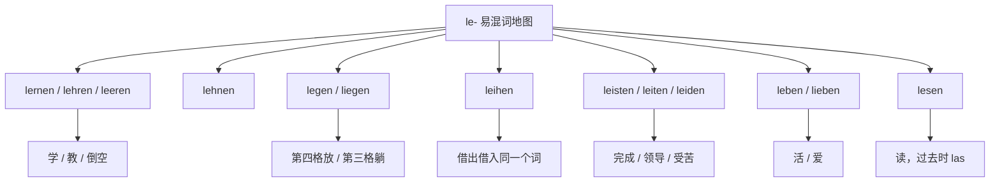
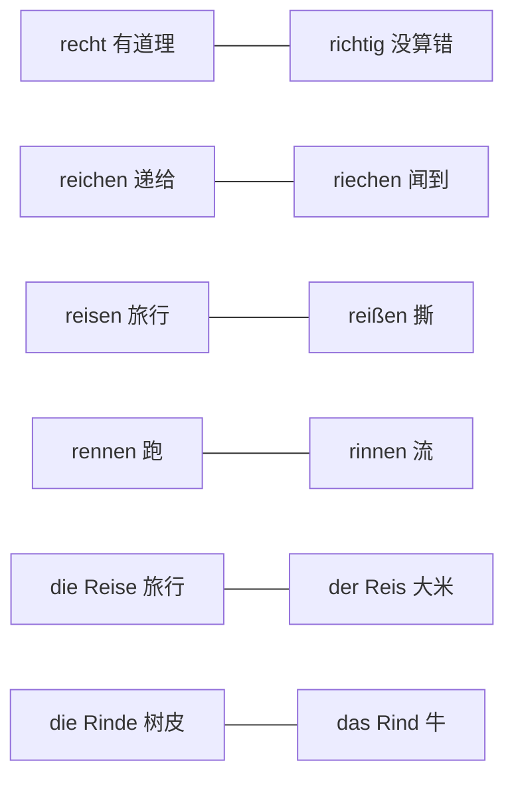
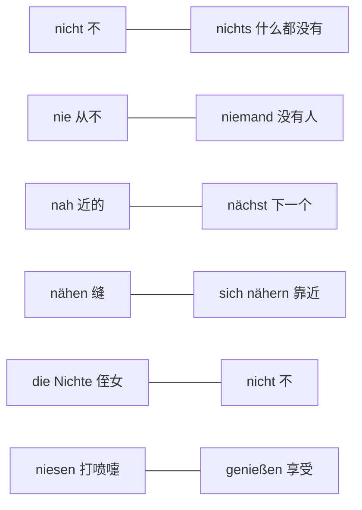

# 高频形近易错词

这里为你整理了德语中非常容易混淆的形近/音近词。根据你的需求，主要按照**拼写结构**和**发音特征**进行了简单分类，方便你直接作为词汇导航使用。

### 1. 包含 -eiter / -ieder / -etter 的核心易混词（你的举例及延伸）

^o2icec

^aeqobl

- **wieder**：又，再（副词）
- **wider**：反对，逆向（介词/前缀，发音与 wieder 完全相同）
- weit: Ⅰ (adj) ①广阔的,辽阔的,宽阔的,宽敞的②宽大的,宽松的③远的,遥远的,远距离的,长的 Ⅱ (adv) ①大大地②<用于比较级之前> ...得多
- **weiter**：更远的，继续（weit 的比较级）
- **Wetter**：天气（名词）
- **breiter**：更宽的（breit 的比较级，你提到的 breter 应该是这个）
- **Bretter**：木板（名词 Brett 的复数）
- **Bieter**：出价者，投标人（名词）
- **bitter**：苦的（形容词）
- **heiter**：晴朗的，开朗的（形容词）
- **Leiter**：领导者（阳性名词） / 梯子（阴性名词）

### 2. 经典 B-T 组合动词（最容易记错元音）

- **bieten**：提供，出价
- **bitten**：请求
- breit: ①宽的,宽阔的,宽敞的②(具有一定的)宽度的③平的,平坦的,扁平④广大的,广泛的
- bereits: 已经
- **beten**：祈祷
- **betten**：铺床

### 3. “ie” 与 “ei” 字母颠倒（发音完全不同：ie 发“依”，ei 发“哎”）

- **Wein**：葡萄酒
- **Wien**：维也纳（地名）
- **Lied**：歌曲
- **Leid**：痛苦，悲哀
- **sie**：她 / 他们
- **sei**：是（sein 的虚拟式）
- **schreiben**：写（动词原形）
- **schrieben**：写（过去式）

### 4. 常见的双写/单写辅音易混词

^d5xfqd

^32antb

- **Staat**：国家
- **Stadt**：城市
- **statt**：代替（介词）
- **fiel**：落下（fallen 的过去式）
- **viel**：很多
- **Wesen**：本质，生物
- **wissen**：知道

### 5. 变音（Umlaut）易混词对

- **schon**：已经
- **schön**：美丽的
- **fordern**：要求，索取
- **fördern**：促进，资助
- **drucken**：打印，印刷
- **drücken**：按，压
- **zahlen**：支付，付款
- **zählen**：数数，计算

### 6. 发音相近的其他高频短词

- **Meer**：海洋
- **mehr**：更多
- **Leere**：空虚
- **Lehre**：教导，学徒期
- **Wand**：墙壁（内墙）
- **Wind**：风

## le开头

| 单词          | 意思     | 变化                          | 要求的格 / 固定搭配                                                             | 例句                                                            | 易错点（为什么容易混）                                 |
| ----------- | ------ | --------------------------- | ----------------------------------------------------------------------- | ------------------------------------------------------------- | ------------------------------------------- |
| **lernen**  | 学      | 弱变化 **lernte, gelernt**     | 第四格：**Deutsch lernen**；**von jdm. lernen**（向某人学）                        | Ich lerne Deutsch.                                            | 和 **lehren** 只差一个字母，方向却相反（自己学 / 教别人）        |
| **lehren**  | 教      | 弱变化 **lehrte, gelehrt**     | 双宾语：**jdn. (Akk.) etwas lehren**；不带宾语时表示"教书"                            | Er lehrt mich Deutsch.                                        | 与 **leeren** 读音极近，听写常写错                     |
| **lesen**   | 读      | 强变化 **liest, las, gelesen** | 第四格：**ein Buch lesen**；**jdm. (Dativ) etw. vorlesen**（读给某人听）            | Sie liest mir die Nachricht vor.                              | 过去时 **las** 和 **ließ**（**lassen** 的过去时）形状接近 |
| **leeren**  | 倒空     | 弱变化 **leerte, geleert**     | 第四格：**den Mülleimer leeren**                                            | Leere die Flasche!                                            | 和 **lehren** 只差一个 **h**，意思完全无关              |
| **lehnen**  | 靠、倚    | 弱变化 **lehnte, gelehnt**     | 静态 **an + 第三格**，动态 **an/gegen + 第四格**                                   | Die Leiter lehnt an der Wand.                                 | 和 **legen** 一样表示"位置"，但搭配的介词和格不同             |
| **leihen**  | 借（出／入） | 强变化 **lieh, geliehen**      | 借给：**jdm. (Dativ) etw. (Akk.) leihen**；借进：**sich etw. von jdm. leihen** | Ich leihe dir mein Fahrrad. / Ich leihe mir ein Buch von ihm. | 同一个词两个方向，加不加 **sich / von** 就换了方向           |
| **leben**   | 活着、生活  | 弱变化 **lebte, gelebt**       | **von + 第三格 leben**（靠……过活）                                              | Er lebt von der Rente.                                        | 和 **lieben**（爱，第四格）只差一个字母                   |
| **legen**   | 把……平放  | 弱变化 **legte, gelegt**       | 第四格 + **in/an/auf + 第四格**：**etw. auf den Tisch legen**                  | Ich lege das Buch auf den Tisch.                              | 和 **liegen** 配对：有"放"的动作才有第四格                |
| **leisten** | 做出、完成  | 弱变化 **leistete, geleistet** | 第四格：**eine Arbeit leisten**；**sich (Dativ) etw. leisten**（负担得起）         | Das kann ich mir nicht leisten.                               | 和 **leiten**、**leiden** 只差一两个字母，是三兄弟        |
| **leiten**  | 领导、引导  | 弱变化 **leitete, geleitet**   | 第四格：**ein Projekt leiten**                                              | Sie leitet die Firma.                                         | 与 **leisten** 一字之差，意思完全不同                   |
| **leiden**  | 忍受、受苦  | 强变化 **litt, gelitten**      | **an + 第三格**（患……病）、**unter + 第三格**（受……之苦）                               | Er leidet an einer Allergie.                                  | 中间是 **ei**，和 **leiten / leisten** 混在一起最危险   |

## 问题：区分一下 recht / richtig / Gericht / reichen 这类 **re-** 和 **ri-** 开头的词，以及 **nacht**、**nicht** 这类 **na-** 和 **ni-** 开头的词，尽可能全面

② 答案

区分这两大组词，抓三个抓手就够了：一是**元音字母和音长**（短 **a** 在 **Nacht / nackt / nass**，长 **a** 在 **Name / Nagel / nah**，短 **i** 在 **nicht / nichts / nicken**，长 **ie** 在 **riechen / niesen**，双元音 **ei** 在 **reichen / reisen / reißen**）；二是**变化类型和要求的格**（强弱变化、第四格还是第三格）；三是**同源词族**——**recht → richten → der Richter → die Richtung → das Gericht** 是一家，**reich → reichen → erreichen → der Reichtum** 是一家，**nicht / nichts / nie / niemand / nirgends** 是"否定家族"这一家。

两个最容易踩的分界线先说清：**recht** 说的是"有道理、合适"（主观判断），**richtig** 说的是"没算错、真的是"（客观正确）；**reichen** 是"递、够"，**riechen** 是"用鼻子闻"。**na-** 那一组则完全没有否定含义（**Nacht、nah、nach **都是"夜、近、后"这类实打实的词），而 **ni-** 那一组里绝大多数是**否定词**（**nicht、nichts、nie、niemand、nirgends**），剩下几个长得像否定词的名词（**die Nichte** 侄女、**die Niere** 肾）纯属巧合，只能靠词义和词性记住。

先看拼写与读音的对应（这一张表管住两组词的"手感"）：

| 拼写 | 读音 | 这一组里的词 | 记忆抓手 |
|---|---|---|---|
| **a** 短 | /a/ | **Nacht, nackt, nass** | 短促有力，多是"夜、裸、湿"这些实词 |
| **a** 长 | /aː/ | **der Name, der Nagel, die Nadel, nah** | 长 **a** 集中在"名字、钉子、针、近" |
| **ä** 长 | /ɛː/ | **nähen, nächst, die Nähe, nähren, nämlich** | 见到 **ä** 基本是长音，意思只有"缝、近、养、也就是"几类 |
| **i** 短 | /ɪ/ | **nicht, nichts, nicken, der Ring, nirgends, die Nichte** | 短 **i** 几乎全在否定词和几个日常名词上 |
| **ie** 长 | /iː/ | **riechen, niesen, die Niere, das Niveau** | 长 **i** 全是单个动词或名词，没有否定词 |
| **ei** 双元音 | /aɪ/ | **reichen, reisen, reißen, die Reihe, reiten, reif** | 双元音集中在 **rei-** 这一家 |

## **re- / ri-** 易混词总表（按词族排列）：

^y8pa4n

| 单词 | 词性 / 变化 | 意思与搭配 | 最容易和谁混（怎么分） |
|---|---|---|---|
| **recht** | 形容词 / 副词，作表语不带词尾 | 有道理、合适：**Du hast recht.** / **Es ist mir recht.** | 与 **richtig** 混：**recht** 是"说得通、合适"（主观），**richtig** 是"没算错"（客观） |
| **das Recht** | 中性名词，复数 **die Rechte** | 权利、法律：**im Recht sein** 有理 | 与 **recht** 同源，大写才变名词 |
| **richtig** | 形容词，作表语不带词尾 | 正确的、真正的：**Das ist richtig.** | 与 **recht**（见上）、**der Richter**（形近）混 |
| **richten** | 弱变化 **richtete, gerichtet** | 对准、弄直；**sich richten nach + 第三格** 按照 | 同族词一堆；表"纠正错误"要用 **korrigieren** |
| **der Richter** | 阳性名词 | 法官 | 结尾 **-er** 像比较级，易与 **richtig** 混 |
| **die Richtung** | 阴性名词，**-en** | 方向：**in Richtung Bahnhof** | 与 **richtig** 同族，名词 vs 形容词 |
| **das Gericht** | 中性名词，**-e** | 法院；一道菜 | 词首是 **Ge-**，但和 **richten** 同族；两义靠语境 |
| **reichen** | 弱变化 **reichte, gereicht** | 递给、够：**jdm.(第三格) etw.(第四格) reichen**；**Das reicht.** | 与 **riechen** 混：递东西 **reichen**，鼻子闻 **riechen** |
| **erreichen** | 弱变化，支配第四格 | 达到、联系上：**Ich kann dich nicht erreichen.** | **reichen** 的派生词，别当"再够一次" |
| **ausreichen** | 弱变化 | 足够：**Das reicht aus.** | 与 **reichen** 同义，只多一个 **aus-** |
| **reich** | 形容词；**reich an + 第三格** | 富有的、富含的 | 与 **das Reich** 只差大小写 |
| **das Reich** | 中性名词，**-e** | 帝国、领域 | 见上 |
| **der Reichtum** | 阳性名词，**die Reichtümer** | 财富 | **reich + -tum** 构词 |
| **reißen** | 强变化 **riss, hat gerissen** | 撕、扯断：**sich um etw. reißen** 抢着要 | 与 **reisen** 只差一个字母，助动词也不同 |
| **der Riss** | 阳性名词，**-e** | 裂缝 | **reißen** 的名词化 |
| **reisen** | 弱变化 **reiste, ist gereist** | 旅行（助动词 **sein**） | 与 **reißen**（撕，助动词 **haben**）混；与 **die Reise / der Reis** 混 |
| **die Reise** | 阴性名词，**-n** | 旅行：**eine Reise machen** | 与 **der Reis** 只差一个 **-e** |
| **der Reis** | 阳性名词 | 大米 | 米饭 **der Reis**，旅行 **die Reise** |
| **reiten** | 强变化 **ritt, ist geritten** | 骑马 | 与 **reisen** 只差一个字母，助动词都是 **sein** |
| **reif** | 形容词 | 成熟的：**Der Apfel ist reif.** | 同族 **der Reifen**（轮胎）、**reifen**（成熟） |
| **riechen** | 强变化 **roch, hat gerochen** | 闻、有气味：**an + 第三格 riechen**；**Es riecht nach ...** | 与 **reichen**（递）、**rechnen**（算）混 |
| **rechnen** | 弱变化 **rechnete, gerechnet** | 计算；**mit + 第三格 rechnen** 预计 | 与 **rächen** 只差一个元音 |
| **rächen** | 弱变化 **rächte, gerächt** | 报仇：**sich an jdm. rächen** | 与 **rechnen / riechen** 混 |
| **retten** | 弱变化 **rettete, gerettet** | 救：**jdn. retten** | 与 **reden**（说话）混 |
| **rennen** | 强变化 **rannte, ist gerannt** | 跑 | 与 **rinnen**（流，**rann, ist geronnen**）混 |
| **reiben** | 强变化 **rieb, hat gerieben** | 摩擦：**sich die Hände reiben** | 与 **reißen** 混 |
| **die Reihe** | 阴性名词，**-n** | 一排、系列：**an der Reihe sein** 轮到 | 与动词 **reihen**（排列）混 |
| **rein** | 形容词 / 口语副词 | 纯的；进来：**Komm rein!** | 只是拼写像 **die Reihe**，意思无关 |
| **riesig** | 形容词 | 巨大的 | 同族 **der Riese**（巨人） |
| **das Risiko** | 中性名词，**die Risiken** | 风险：**ein Risiko eingehen** | 同族 **riskieren**（弱变化） |
| **der Ring** | 阳性名词，**-e** | 戒指、环 | 与动词 **ringen**（**rang, gerungen**，**um + 第四格** 争夺）混 |
| **die Rinde** | 阴性名词，**-n** | 树皮、外皮 | 与 **das Rind**（牛，复数 **Rinder**）只差一个 **-e** |
| **die Rente** | 阴性名词，**-n** | 养老金 | 与 **der Rentner**（领养老金的人）同族 |

图解：**re- / ri-** 最危险的六对

## **na- / ni-** 易混词总表：

^wxti8p

| 单词                            | 词性 / 变化                 | 意思与搭配                                         | 最容易和谁混（怎么分）                                             |
| ----------------------------- | ----------------------- | --------------------------------------------- | ------------------------------------------------------- |
| **die Nacht**                 | 阴性名词，复数 **die Nächte**  | 夜：**Gute Nacht!**                             | 与 **nackt** 混：拼写只差 **c/k** 的位置，**Nacht** 的 **ch** 读 /x/ |
| **nachts**                    | 副词                      | 在夜里：**nachts um 3 Uhr**                       | 与 **nach** 混，多一个 **-ts** 就成时间副词                         |
| **nackt**                     | 形容词                     | 裸的、光秃的                                        | 见上，读 /nakt/，结尾是 **kt**                                  |
| **nach**                      | 介词，支配**第三格**            | 去（城市/国家）；在……之后：**nach Hause, nach dem Essen** | 与 **zu** 分工：**nach** 接地名，**zu** 接人和机构                   |
| **nachdem**                   | 从句连词                    | 在……之后（从句动词回句末）                                | 与 **nach** 混：它后面必须跟完整从句                                 |
| **nachher**                   | 副词                      | 之后、待会儿                                        | 与 **nachdem** 混，一个单独用，一个带从句                             |
| **nächst-**                   | 形容词                     | 下一个：**am nächsten Tag, nächste Woche**        | 与 **nah** 同词根但分工：表"顺序"用 **nächst**，表"距离"用 **nah**       |
| **nah / näher / am nächsten** | 形容词                     | 近的：**in der Nähe von + 第三格**                  | 见上                                                      |
| **die Nähe**                  | 阴性名词                    | 附近：**in der Nähe**                            | 与 **nähen** 同音，靠词性区分                                    |
| **nähen**                     | 弱变化 **nähte, genäht**   | 缝：**einen Knopf annähen**                     | 三兄弟之一，见下面两条                                             |
| **sich nähern**               | 弱变化，支配**第三格**           | 靠近：**sich dem Bahnhof nähern**                | 与 **nähen**（缝）、**nähren**（喂养）只差一两个字母                    |
| **nähren**                    | 弱变化 **nährte, genährt** | 喂养、供养                                         | 同上                                                      |
| **der Name**                  | 阳性名词，**-n**             | 名字                                            | 与 **nahm**（**nehmen** 的过去时）混：名词 vs 动词                   |
| **nämlich**                   | 副词                      | 也就是、补充说明原因                                    | 与书面语 **namentlich** 近似                                  |
| **die Nase**                  | 阴性名词，**-n**             | 鼻子                                            | 与 **nass**（湿的）混                                         |
| **nass**                      | 形容词                     | 湿的                                            | 见上                                                      |
| **der Nagel**                 | 阳性名词，**die Nägel**      | 钉子；指甲                                         | 与 **die Nadel**（针）混：**Nagel** 粗短，**Nadel** 细长带孔         |
| **die Nadel**                 | 阴性名词，**-n**             | 针                                             | 见上                                                      |
| **der Nachbar**               | 阳性名词，**-n**             | 邻居                                            | **ch** 读 /x/，别读成 **nackt** 的 /k/                        |
| **nicht**                     | 副词 / 否定词                | 不（否定动词、形容词）：**Ich weiß nicht.**               | 与 **nichts** 混：**nicht** 否定"怎么样"，**nichts** 否定"有什么"     |
| **nichts**                    | 不定代词                    | 什么也没有：**Ich habe nichts gesagt.**             | 见上                                                      |
| **nie**                       | 副词                      | 从不：**Ich war nie dort.**                      | 与 **nicht** 混：**nie** 说的是"一次都没有"（频率）                    |
| **niemals**                   | 副词                      | 从不（语气更强）                                      | = **nie**                                               |
| **niemand**                   | 不定代词                    | 没有人；第四格 **niemanden**                         | 与 **nichts** 混：人说 **niemand**，物说 **nichts**             |
| **nirgends / nirgendwo**      | 副词                      | 哪儿都不：**Ich finde es nirgends.**               | 与 **nie** 混：一个说地点，一个说时间                                 |
| **nichtig**                   | 形容词                     | 无效的、无意义的：**für nichtig erklären**             | 长得像 **nicht**，但它是形容词                                    |
| **die Nichte**                | 阴性名词，**-n**             | 侄女、外甥女                                        | 与 **nicht** 只差一个 **-e**，最危险的一对                          |
| **nieder**                    | 副词 / 形容词                | 向下、低：**sich niederlegen**                     | 三兄弟之一                                                   |
| **niedlich**                  | 形容词                     | 可爱的                                           | 见上                                                      |
| **niedrig**                   | 形容词                     | 低的（价格、地位）                                     | 见上                                                      |
| **niesen**                    | 弱变化 **nieste, geniest** | 打喷嚏                                           | 与 **genießen**（享受，强变化 **genoss, genossen**）混：少了前缀就是打喷嚏  |
| **nicken**                    | 弱变化 **nickte, genickt** | 点头                                            | 与 **niesen / nicht** 同为短 **i**，靠意思分                     |
| **die Niere**                 | 阴性名词，**-n**             | 肾                                             | 与 **nieder** 听感相近                                       |
| **das Niveau**                | 中性名词，**-s**             | 水平、水准                                         | 拼写常错，注意结尾 **-eau**                                      |

图解：**na- / ni-** 最危险的六对

同类例子：**Ich habe nichts gehört, weil ich nicht aufgepasst habe.**——**nichts** 当宾语（否定"有什么"，第四格），**nicht** 修饰动词（否定"有没有在听"），两句里各管一段，正好是上表第 20、21 行的分工。