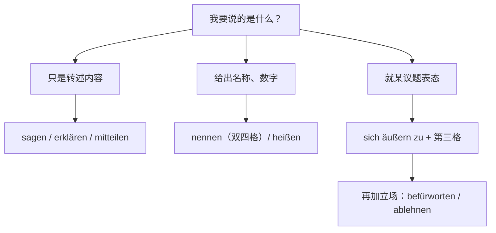

## ① 句子与问题

- 原句：—（本题是词汇辨析，用户没有给出完整句子，只有三个示例词 **sagen / nennen / äußern**）
- 问题：1. **sagen**、**nennen**、**äußern** 有什么区别？2. 把表达观点、看法的常用词全部整理出来，做用法差别、场景和例句对比，直到完全掌握。（注：原文 **ausern** 应为 **äußern**）

## ② 答案

先给三者定性：**sagen** 是“说”，只管把内容说出口，不带任何评价，最中性也最万能；**nennen** 本质不是“说观点”，而是“给出名号”——要么报出名字、数字、理由，要么把某人某物定性成某个标签（**jn. einen Freund nennen**，双四格，中间**不加 als**）；**äußern** 才是“就某个议题正式表态”，而且必须反身 **sich äußern zu + 第三格**，少掉 **sich** 就错。所以它们根本不是同义词：警察做笔录用 **nennen**（**Ihren Namen nennen**），朋友聊天表达看法用 **sagen / meinen / finden**，会议、采访、新闻里就争议话题表态才是 **sich äußern zu**。

再往上搭一层，所有表达看法的词其实是按“有没有立场、立场多强”排成一条线的。最左边是纯转述：**sagen、erklären、mitteilen、berichten、darlegen、ausführen** 只把信息送进对方耳朵；中间是“我认为”的个人判断，**meinen、finden、glauben、denken、der Meinung sein、annehmen、vermuten** 说错了也不算撒谎；再往右带对抗色彩，**behaupten**（断言，暗含有人不同意）、**betonen/hervorheben**（强调）、**bezweifeln**（怀疑）、**kritisieren**（批评）；最右是明确站队，**zustimmen**（同意）、**widersprechen**（反驳）后面都跟第三格，**befürworten/ablehnen** 跟第四格，**vertreten** 是“持某种观点”。选词诀窍就是问自己一句：**要不要传递立场**——不要，用 **sagen/erklären**；要表态，用 **sich äußern zu / Stellung nehmen zu**；要下判断，用 **meinen/finden**；要压对方，用 **behaupten/betonen**。

图解：三个核心词怎么选

图解：立场强度从左到右递增

**表 1：核心三词对照**

| 词 | 人话含义 | 语法支配 | 什么场景用它 | 例句 |
|---|---|---|---|---|
| **sagen** | 说 | + 内容 / + **dass** 从句；听者用第三格 | 中性转述、日常对话 | Er **sagt**, dass er keine Zeit hat. |
| **nennen** | 报出；把……称作 | **etw. nennen**（报名字、数字）；**jn. etw. nennen**（双四格） | 填表、报数据、给某人定性 | Können Sie Ihren Namen **nennen**? / Man **nennt** ihn einen Optimisten. |
| **äußern** | 就议题表态 | **sich äußern zu + Dativ** | 会议、采访、新闻发言 | Die Ministerin **äußerte sich zu** den Vorwürfen. |

**表 2：只转述、不带立场**

| 词 | 意思 | 支配 | 例句 |
|---|---|---|---|
| **erklären** | 解释、声明 | + Dativ（听者）+ Akk / **dass** | Er **erklärte**, dass die Frist verlängert wird. |
| **mitteilen** | 通知（很正式） | **jm. etw. mitteilen** | Wir **teilen** Ihnen **mit**, dass der Termin fällt. |
| **berichten** | 报道 | **über** + Akk / **von** + Dat | Die Zeitung **berichtet über** den Unfall. |
| **darlegen** | 阐述（书面） | + Akk | Er **legte** seine Gründe **dar**. |
| **ausführen** | 详细说明 | + Akk | Der Autor **führt** diese These näher **aus**. |
| **anführen** | 列举（论据） | + Akk | Sie **führte** drei Beispiele **an**. |
| **einwenden** | 提出异议 | **dass** / + Akk | Ich möchte **einwenden**, dass das zu teuer ist. |
| **vorbringen** | 提出（论点、请求） | + Akk | Die Partei **brachte** einen neuen Vorschlag **vor**. |

**表 3：个人判断（可以错，不算撒谎）**

| 词 | 意思 | 支配 | 例句 |
|---|---|---|---|
| **meinen** | 认为（口语） | **dass** / + Akk | Ich **meine**, dass wir warten sollten. |
| **finden** | 觉得、评价 | + Akk（+ 形容词） | Ich **finde** den Plan gut. |
| **glauben** | 认为、以为 | **dass** | Ich **glaube**, er kommt später. |
| **denken** | 想、认为 | **dass** / **an** + Akk | Ich **denke**, das ist ein Fehler. |
| **der Meinung / der Ansicht / der Auffassung sein** | 认为（书面） | + **dass**，固定第二格 | Ich **bin der Meinung**, dass das sinnvoll ist. |
| **annehmen** | 假定 | **dass** | Ich **nehme an**, dass er zustimmt. |
| **vermuten** | 推测 | **dass** | Man **vermutet**, dass die Ursache technisch ist. |

**表 4：带立场、带强度**

| 词 | 意思 | 支配 | 例句 |
|---|---|---|---|
| **betonen** | 强调 | **dass** / + Akk | Er **betonte**, dass die Frist gilt. |
| **hervorheben** | 突出强调 | + Akk | Sie **hob** die Vorteile **hervor**. |
| **behaupten** | 断言（可能被反驳） | **dass** | Er **behauptet**, das sei bewiesen. |
| **bezweifeln** | 怀疑 | + Akk / **dass** | Ich **bezweifle**, dass das stimmt. |
| **kritisieren** | 批评 | + Akk | Die Behörden **kritisierten** das Vorgehen. |
| **zustimmen** | 同意 | + **Dativ** | Ich **stimme** dir **zu**. |
| **widersprechen** | 反驳、反对 | + **Dativ** | Er **widersprach** dem Kollegen. |
| **befürworten** | 赞成 | + Akk | Die Firma **befürwortet** den Plan. |
| **ablehnen** | 拒绝、反对 | + Akk | Der Rat **lehnte** den Antrag **ab**. |
| **vertreten** | 持有（观点） | + Akk | Sie **vertritt** eine klare Position. |
| **verfechten** | 捍卫（观点） | + Akk | Er **verficht** diese These. |
| **Stellung nehmen zu / Stellung beziehen zu** | 表态 | + **Dativ** | Der Minister **nahm zu** den Vorwürfen **Stellung**. |

**表 5：命名、贴标签（和 nennen 同一族）**

| 词 | 意思 | 支配 | 例句 |
|---|---|---|---|
| **heißen** | 本身叫什么 | 无介词 | Ich **heiße** Li. / Das **heißt**, dass… |
| **bezeichnen als** | 把……称为（定性，要加 **als**） | **etw. als etw.** | Man **bezeichnet** ihn **als** Experten. |
| **benennen** | 命名 | + Akk / **nach** + Dat | Die Straße wurde **nach** ihm **benannt**. |
| **gelten als** | 被视为 | **als** + 第一格 | Er **gilt als** zuverlässig. |

**表 6：场景对照——这个场合该用哪个**

| 场景 | 首选表达 | 为什么 |
|---|---|---|
| 朋友间聊看法 | **Ich finde / meine …** | 口语、分量轻 |
| 口头报告、作文表达观点 | **Ich bin der Meinung, dass …** / **Meiner Meinung nach …** | 书面化、有分量 |
| 正式会议就议题表态 | **sich äußern zu / Stellung nehmen zu** | 正式，且明确指向某个议题 |
| 引用报道里谁说了什么 | **erklären / betonen / behaupten** | 同时传递来源和态度 |
| 明确反对 | **ablehnen / widersprechen (+D) / kritisieren** | 立场鲜明 |
| 报名字、价格、理由 | **nennen** | 只需“给出”，不带评价 |
| 把某人或某事定性 | **nennen + 双四格 / bezeichnen als** | 贴标签的固定规律 |

**表 7：最容易踩的坑**

| 错句 | 正确 | 为什么 |
|---|---|---|
| *Er nennt mich als Freund.* | Er **nennt** mich **einen Freund**. | **nennen** 用双四格，不加 **als**；要加 **als** 就换 **bezeichnen** |
| *Ich äußere zu dem Thema.* | Ich **äußere mich zu** dem Thema. | 表“表态”时必须带反身代词 |
| *Ich bin die Meinung, dass …* | Ich **bin der Meinung**, dass … | 固定第二格 |
| *Ich stimme ihn zu.* | Ich **stimme ihm zu**. | **zustimmen** 支配第三格 |
| *Ich bezweifle an dem Plan.* | Ich **bezweifle den Plan**. | **bezweifeln** 直接加第四格（只有 **zweifeln an** 才加 **an**） |

相关名词搭配：**die Stellungnahme zu** + Dat、**die Äußerung zu** + Dat、**der Standpunkt zu** + Dat、**die Meinung zu / über** + Akk——介词和动词那一栏完全一样，记住一个就带走一串。